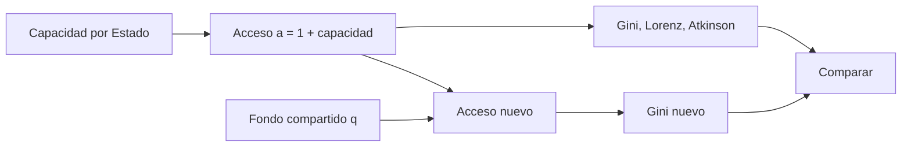

# B119-C34 — Equidad de acceso al espacio

<!-- nav:top -->
[🏠 Programa](../../../../README.md) · [📚 Bloque B119](../../../tronco-comun/B119-derecho-seguridad-y-geopolitica-espacial.md) · [← Anterior: B119-C33 — Matriz comparativa de obligaciones jurídicas por actor](../B119-C33-matriz-comparativa-de-obligaciones-juridicas-por-actor/CLASE.md) · [Siguiente: B119-C35 — Seguridad y gobernanza de datos espaciales →](../B119-C35-seguridad-y-gobernanza-de-datos-espaciales/CLASE.md)
<!-- /nav -->

## 1. Ubicación, nivel y alcance

Clase 34 del bloque B119. Nivel N3. El tratado de 1967 declara el espacio abierto a todos los Estados en igualdad, y el Acuerdo sobre la Luna habla de reparto equitativo con atención a los países en desarrollo. ¿Cómo se mide cuán desigual es el acceso? Aquí usas el índice de Gini, la curva de Lorenz y el índice de Atkinson sobre 20 Estados **genéricos** de capacidad sintética, verificas el Gini por dos fórmulas y calculas cuánto reduce la desigualdad un fondo compartido. No describe ningún país real. **Esta clase es educativa: no es asesoría legal, regulatoria ni financiera y no sustituye a un jurista, a una autoridad competente ni a un asesor.**

## 2. Por qué esta clase existe

El acceso desigual al espacio es un asunto de gobernanza que el catálogo no trata; esta clase da las herramientas de medición antes de las discusiones de política (C25, C36). La decisión central: **¿qué tan desigual es el acceso y cuánto lo reduce una regla de uso compartido?**

## 3. Lo que podrás hacer al terminar

1. Relacionar el art. I del tratado y el art. 11 del Acuerdo sobre la Luna con la equidad (consultados).
2. Calcular el Gini por dos fórmulas y verificar los casos límite.
3. Calcular Lorenz y Atkinson para dos niveles de aversión.
4. Medir el efecto de un fondo compartido `q` sobre la desigualdad.
5. Separar lo consultado (texto normativo con versión y fecha) de lo sintético o ilustrativo.

La evidencia es la **ficha de desigualdad con Gini y Atkinson** del ejercicio 12 (sección 20).

## 4. Con qué llegas y cómo comprobarlo

1. ¿Qué es el índice de Gini?
2. ¿Qué es la curva de Lorenz?
3. ¿Qué es la aversión a la desigualdad?
4. ¿Qué es una media geométrica?
5. ¿Qué es una distribución lognormal?

<details>
<summary>Ver respuestas</summary>

1. Una medida de desigualdad entre 0 (igualdad) y casi 1 (un solo poseedor). 2. La fracción acumulada del recurso frente a la fracción acumulada de la población, ordenada de menos a más. 3. Cuánto se penaliza la desigualdad en el índice de Atkinson. 4. La raíz `n`-ésima del producto; `exp` de la media de logaritmos. 5. Una cuyo logaritmo es normal; modela cantidades positivas sesgadas.
</details>

Con cuatro o cinco aciertos, sigue; si no, repasa los prerrequisitos.

## 5. Un caso de contexto y casos de referencia

La nota de la ONU (consultada el 2026-11-11) recoge el art. I: la exploración y el uso del espacio están abiertos a todos los Estados en igualdad y son «la provincia de toda la humanidad»; la página de UNOOSA del Acuerdo sobre la Luna dice (art. 11) que el reparto de beneficios debe ser equitativo, con atención especial a los países en desarrollo. **No se consultó ningún dato real de lanzamientos o de acceso.** El **ejemplo conductor**: 20 Estados genéricos, 10 sin capacidad propia y 10 con capacidad lognormal sintética, con índice de acceso `a = 1 + capacidad`.

## 6. Vocabulario

El **Gini** mide desigualdad. La **curva de Lorenz** la visualiza. El **índice de Atkinson** penaliza la desigualdad con aversión `ε`. El **fondo compartido** reparte por igual una fracción `q` de la capacidad total. La **equidad** aquí es acceso similar entre Estados.

## 7. Modelo mental



*Descripción textual:* la capacidad define el acceso, del que se miden varias desigualdades; un fondo compartido modifica el acceso y se vuelven a medir.

Analogía: repartir una tarta a una mesa donde unos comensales ya tienen un plato lleno: el Gini mide cuán desparejos quedan los platos. Límite: la capacidad de lanzar no es el único acceso; hay alianzas, servicios comerciales y datos.

## 8. La explicación, paso a paso

### 8.1 Desigualdad base

Capacidad total `54.4` lanzamientos/año. Gini del acceso `0.5138`; Atkinson con `ε = 0,5`, `0.2187`; con `ε = 1`, `0.3891`. La mitad de los Estados con menor acceso recibe el `13.4 %` del total.

### 8.2 Fondo compartido

Gini con `q = 0,10`: `0.4624`; con `q = 0,25`: `0.3854`; con `q = 0,50`: `0.2569`. Más fondo, menos desigualdad.

### 8.3 Verificaciones

Las dos fórmulas del Gini coinciden a `10⁻¹²`; la igualdad perfecta da 0; un solo poseedor entre 20 da `19/20`.

### 8.4 Límites

El acceso real depende de acuerdos, precios y regulación; un fondo compartido plantea además quién lo financia y cómo se decide (C36).

## 9. Magnitudes, símbolos y unidades

| Símbolo | Qué es | Unidad | Valor / nota |
|---|---|---|---|
| `n` | Estados | — | 20 |
| `a_i` | índice de acceso | — | 1 + capacidad |
| `G` | Gini | — | 0.5138 |
| `q` | fracción compartida | — | 0 a 0,5 |

## 10. Convenciones y referencias

Capacidad en lanzamientos por año; semilla 119; Estados genéricos; índices adimensionales.

## 11. De dónde sale lo que afirmamos

| ID | Fuente | Localizador | Respalda | Estado |
|---|---|---|---|---|
| S3 | ONU, Biblioteca Audiovisual de Derecho Internacional, nota introductoria sobre el Tratado del Espacio Ultraterrestre, https://legal.un.org/avl/ha/tos/tos.html (WebFetch, consultada 2026-11-11; no discute los artículos V ni VII) | art. I | igualdad de acceso y uso en beneficio de toda la humanidad | Consultada |
| S2 | UNOOSA, «Agreement Governing the Activities of States on the Moon and Other Celestial Bodies» (página oficial), https://www.unoosa.org/oosa/en/ourwork/spacelaw/treaties/moon-agreement.html (WebFetch, consultada 2026-11-11) | art. 11 | reparto equitativo con atención a los países en desarrollo | Consultada |
| — | Datos reales de lanzamientos o acceso | — | no consultados | No consultado / ilustrativo |
| — | Fórmulas de Gini, Lorenz y Atkinson | — | no consultadas en una fuente concreta; verificadas por dos fórmulas y casos límite | No consultado / ilustrativo |
| — | Estados y capacidades | — | sintéticos | No consultado / ilustrativo |

Límites: no se usó ningún dato real; los Estados y las capacidades son genéricos. Texto normativo parafraseado de las páginas oficiales en la fecha indicada; el texto vinculante es el de la fuente oficial vigente.

## 12. Cómo ver la situación

| Magnitud | Valor |
|---|---|
| Gini | 0.5138 |
| Atkinson `ε = 1` | 0.3891 |
| Gini con `q = 0,25` | 0.3854 |
| Gini con `q = 0,50` | 0.2569 |

Descripción larga: el acceso base es muy desigual y un fondo compartido reduce el Gini de forma continua.

## 13. Ejemplo trabajado: un Gini pequeño a mano

**Paso 1.** Tres Estados con acceso `(1, 1, 4)`: media 2. **Paso 2.** Diferencias absolutas por pares (incluyendo los pares dobles) suman `2×(0+3+3) = 12`. **Paso 3.** `G = 12/(2×9×2) = 0,333`.

## 14. Distintas formas de describirlo

**Por índice:** Gini, Atkinson. **Por gráfico:** Lorenz. **Por política:** fondo `q`. **Por fuente:** art. I, art. 11.

## 15. Práctica guiada

**Ejercicio 1 · con los pasos indicados.** Calcula el Gini de `(5, 5, 5, 5)`.

<details><summary>Solución comentada</summary>

0.
</details>

**Ejercicio 2 · con una pista.** Calcula el Gini de `(0, 0, 0, 1)`. *Pista:* `(n−1)/n`.

<details><summary>Solución comentada</summary>

`0,75`.
</details>

**Ejercicio 3 · casi autónomo.** Calcula el Gini de `(1, 1, 4)` con la fórmula de diferencias.

<details><summary>Solución comentada</summary>

`0,333`.
</details>

## 16. Práctica autónoma, transferencia e integrador

**Ejercicio 4 · autónomo.** ¿Qué mide Atkinson con `ε = 1`?

<details><summary>Solución comentada</summary>

La desigualdad relativa a la media geométrica.
</details>

**Ejercicio 5 · autónomo.** ¿Qué pasa con el Gini si `q = 1`?

<details><summary>Solución comentada</summary>

Todos reciben lo mismo de la capacidad: queda solo el acceso base igual: 0.
</details>

**Ejercicio 6 · autónomo.** ¿Qué dice el art. I sobre la igualdad?

<details><summary>Solución comentada</summary>

Que el espacio está abierto a todos los Estados en igualdad.
</details>

**Ejercicio 7 · autónomo.** ¿Por qué se suma 1 a la capacidad?

<details><summary>Solución comentada</summary>

Para representar un acceso base y evitar ceros en la media geométrica.
</details>

**Ejercicio 8 · autónomo.** ¿Qué datos reales consultaste?

<details><summary>Solución comentada</summary>

Ninguno.
</details>

**Ejercicio 9 · transferencia.** **Transferencia.** ¿Por qué el Gini no distingue quién tiene la capacidad?

<details><summary>Solución comentada</summary>

Porque mide la forma de la distribución, no a quién pertenece.
</details>

**Ejercicio 10 · transferencia.** **Transferencia.** ¿Qué dilema plantea un fondo compartido?

<details><summary>Solución comentada</summary>

Quién lo financia, quién lo gestiona y cómo se reparte (ver C36).
</details>

**Ejercicio 11 · transferencia.** **Transferencia.** ¿Qué otras dimensiones del acceso faltan?

<details><summary>Solución comentada</summary>

Servicios comerciales, datos, formación y alianzas.
</details>

**Ejercicio 12 · integrador.** **Integrador.** Elabora tu *ficha de desigualdad con Gini y Atkinson*: índices, Lorenz, efecto de `q` y aviso de que es educativa.

<details><summary>Solución comentada</summary>

Secciones 8.1–8.4 y la salida del laboratorio.
</details>

## 17. Laboratorio: desigualdad de acceso y fondo compartido

El script [laboratorio.py](laboratorio.py) calcula el Gini por dos fórmulas, Atkinson para dos aversiones y el efecto de un fondo compartido (**comprueba** los casos límite del Gini y la monotonía en `q`).

**Datos:** art. I y art. 11 consultados (2026-11-11); Estados y capacidades **sintéticos**. **Predice antes de ejecutar:** ¿cuánto bajará el Gini con `q = 0,25`? (alrededor de una cuarta parte.) **Ejecución del 2026-11-11 (Python 3.12.9):**

```text
Python 3.12.9 (biblioteca estandar)
20 Estados GENERICOS con capacidad SINTETICA; art. I y art. 11 (Luna) consultados 2026-11-11; datos reales de lanzamientos NO consultados.
Capacidad total = 54.4 lanzamientos/ano ; Estados sin capacidad = 10
Gini del acceso (1 + capacidad): 0.5138 (dos formulas coinciden) ; Atkinson e=0.5: 0.2187 ; e=1: 0.3891
La mitad de Estados con menor acceso recibe el 13.4 % del acceso total
Efecto de un fondo compartido (fraccion q de la capacidad total repartida por igual):
   q = 0.00: Gini 0.5138 ; Atkinson(e=1) 0.3891
   q = 0.10: Gini 0.4624 ; Atkinson(e=1) 0.3139
   q = 0.25: Gini 0.3854 ; Atkinson(e=1) 0.2205
   q = 0.50: Gini 0.2569 ; Atkinson(e=1) 0.1039
CLAVES {"g": "0.5138", "a05": "0.2187", "a1": "0.3891", "mb": "13.4", "g10": "0.4624", "g25": "0.3854", "g50": "0.2569", "tot": "54.4"}
Pruebas superadas.
```

```bash
python programa/clases/B119/B119-C34-equidad-de-acceso-al-espacio/laboratorio.py
```

**Límites:** una sola dimensión de acceso; sin dinámica ni incentivos; no describe ningún país.

## 18. Errores frecuentes y cómo corregirlos

**Interpretar el Gini como juicio moral.** Se corrige con el ejercicio 9.

**Calcular Atkinson con ceros.** Se corrige con el ejercicio 7.

**Ignorar el acceso base.** Se corrige con la sección 9.

**Tomar datos sintéticos como reales.** Se corrige con la sección 11.

## 19. Cómo sabrás que vas bien

Tras la sección 8: ¿qué resultado esperabas en el ejemplo trabajado y cuál obtuviste? Si dudas, repasa la sección 13. Tras el laboratorio: ¿qué comprueba cada prueba? (ver la sección 17).

## 20. Qué entregas y cómo se evalúa

El producto es tu **ficha de desigualdad con Gini y Atkinson** (ejercicio 12).

| Criterio | Inicial | En desarrollo | Logrado | Destacado |
|---|---|---|---|---|
| Conceptos | Los confunde | Parciales | Usa el vocabulario con precisión | Explica los límites del modelo |
| Cálculo | Sin unidades | Con errores | Resultados con unidades y tolerancia | Calcula casos nuevos |
| Verificación | Sin comprobar | Un caso | Contraste con una segunda vía | Interpreta las diferencias |
| Fuentes | Sin fuente | Sin fecha | Fuentes con versión, fecha y estado | Declara lo sintético y lo no consultado |
| Límites | No los nombra | Uno | Tres | Discute qué falta del modelo |

**Condiciones críticas (no se compensan con promedio):** citar la versión y la fecha del texto normativo consultado; rotular lo sintético y lo ilustrativo; no presentar un resultado como asesoría legal, regulatoria o financiera.

## 21. Ética, seguridad y límites

Clase educativa: **no es asesoría legal, regulatoria ni financiera**; no sustituye a un abogado, a la autoridad competente ni a un asesor, y ningún resultado debe usarse para decidir sobre una licencia, una reclamación, un contrato o una operación real. La clase no clasifica ni juzga a ningún Estado; los datos son genéricos. Los modelos son simplificados y sus datos son sintéticos o ilustrativos; lo simulado nunca se presenta como observado. Accesibilidad: tablas equivalentes a las gráficas, fórmulas en texto, ejercicios sin conexión.

## 22. Para cerrar y seguir

El acceso sintético tiene Gini `0.5138` y un fondo del 25 % lo reduce a `0.3854`. Queda una pregunta: ¿cómo se protegen y se comparten los datos espaciales?

**Glosario español–inglés.** equidad de acceso · *equity of access*; índice de Gini · *Gini index*; curva de Lorenz · *Lorenz curve*; fondo compartido · *shared pool*.

**Continuidad.** [B119-C35](../B119-C35-seguridad-y-gobernanza-de-datos-espaciales/CLASE.md): la seguridad y gobernanza de datos espaciales.

**Referencias:** ver sección 11.

<!-- nav:bottom -->
---

[← Anterior: B119-C33 — Matriz comparativa de obligaciones jurídicas por actor](../B119-C33-matriz-comparativa-de-obligaciones-juridicas-por-actor/CLASE.md) · [📚 Bloque B119](../../../tronco-comun/B119-derecho-seguridad-y-geopolitica-espacial.md) · [Siguiente: B119-C35 — Seguridad y gobernanza de datos espaciales →](../B119-C35-seguridad-y-gobernanza-de-datos-espaciales/CLASE.md)
<!-- /nav -->
