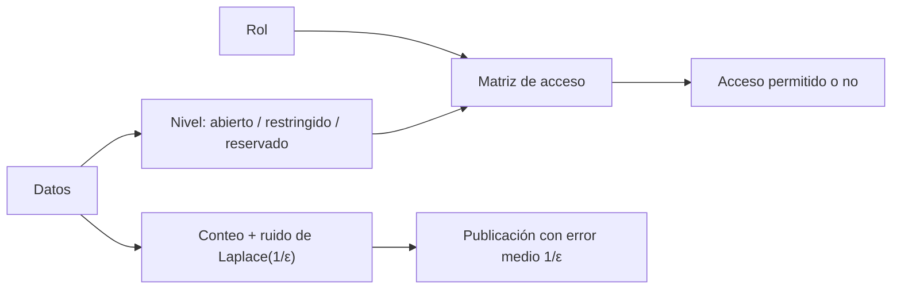

# B119-C35 — Seguridad y gobernanza de datos espaciales

<!-- nav:top -->
[🏠 Programa](../../../../README.md) · [📚 Bloque B119](../../../tronco-comun/B119-derecho-seguridad-y-geopolitica-espacial.md) · [← Anterior: B119-C34 — Equidad de acceso al espacio](../B119-C34-equidad-de-acceso-al-espacio/CLASE.md) · [Siguiente: B119-C36 — Gobernanza de los recursos espaciales →](../B119-C36-gobernanza-de-los-recursos-espaciales/CLASE.md)
<!-- /nav -->

## 1. Ubicación, nivel y alcance

Clase 35 del bloque B119. Nivel N3. Los datos espaciales (registros, observaciones, accesos) deben compartirse lo suficiente para dar transparencia y protegerse lo suficiente para dar seguridad y privacidad. Aquí defines una política de acceso por niveles y rol, y calculas con el mecanismo de Laplace cuánto error hay que aceptar para publicar conteos con privacidad diferencial, con datos **sintéticos**. Se ancla en el registro central abierto (Convenio de Registro, art. III) y en el principio de informar (art. XI). **Esta clase es educativa: no es asesoría legal, regulatoria ni financiera y no sustituye a un jurista, a una autoridad competente ni a un asesor.**

## 2. Por qué esta clase existe

B124-C13 trata ética de datos de investigación; los datos espaciales requieren políticas de acceso y seguridad específicas. Esta clase mide el compromiso entre transparencia y protección. La decisión central: **¿cuánta protección se puede añadir a un dato publicado sin volverlo inútil?**

## 3. Lo que podrás hacer al terminar

1. Relacionar el registro central abierto y el deber de informar con la política de datos (consultados).
2. Construir una matriz de acceso rol × nivel y contar los permisos.
3. Aplicar el mecanismo de Laplace a un conteo y verificar el error medio `1/ε`.
4. Calcular el `ε` mínimo para un error relativo objetivo.
5. Separar lo consultado (texto normativo con versión y fecha) de lo sintético o ilustrativo.

La evidencia es la **política de acceso con compromiso privacidad–error** del ejercicio 12 (sección 20).

## 4. Con qué llegas y cómo comprobarlo

1. ¿Qué es la privacidad diferencial?
2. ¿Qué es la sensibilidad de una consulta?
3. ¿Qué es la distribución de Laplace?
4. ¿Qué es el compromiso privacidad–utilidad?
5. ¿Qué es una matriz de control de acceso?

<details>
<summary>Ver respuestas</summary>

1. Garantía de que el resultado casi no cambia por incluir o no a una persona; se cuantifica con `ε`. 2. Cuánto puede cambiar el resultado al cambiar un registro; para un conteo es 1. 3. Una distribución simétrica de colas exponenciales con escala `b`. 4. A mayor protección, mayor error. 5. Una tabla que dice qué rol puede ver qué nivel de dato.
</details>

Con cuatro o cinco aciertos, sigue; si no, repasa los prerrequisitos.

## 5. Un caso de contexto y casos de referencia

La página de UNOOSA del Convenio de Registro (consultada el 2026-11-11) dice (art. III) que el registro central de la ONU es de acceso abierto; la nota de la ONU recoge el art. XI sobre informar al público y a la comunidad científica. **No se consultó** ninguna norma de protección de datos, política de agencia ni control de exportación. El **ejemplo conductor**: 5000 registros sintéticos de acceso a estaciones terrenas, con una característica binaria («fuera de horario») de prevalencia 0,08, y una política de 3 roles por 3 niveles.

## 6. Vocabulario

La **política de acceso** dice quién ve qué. El **nivel** clasifica el dato (abierto, restringido, reservado). La **privacidad diferencial** protege a los individuos con ruido calibrado. `ε` es el presupuesto de privacidad. La **sensibilidad** acota el efecto de un registro.

## 7. Modelo mental



*Descripción textual:* el dato recibe un nivel y el rol un permiso; para publicar, un conteo se perturba con ruido de Laplace y se acepta un error medio `1/ε`.

Analogía: mostrar una foto con un poco de desenfoque: se ve el conjunto pero no la cara de cada persona. Límite: más desenfoque protege más pero informa menos, y no hay protección perfecta.

## 8. La explicación, paso a paso

### 8.1 Política

Seis de nueve pares rol–nivel están permitidos (`6`): cada rol ve su nivel y los inferiores.

### 8.2 Ruido

Conteo verdadero `390`. Error medio con `ε = 0,05`: `20.127` (`5.16 %`); con `ε = 0,1`: `9.987`; con `ε = 1`: `1.009` (`0.26 %`). Coincide con `1/ε` a menos de 3 %.

### 8.3 Cuánto `ε` hace falta

Para un error medio de 1 % del conteo se necesita `ε ≥ 0.256`.

### 8.4 Límites

El conteo fuera de horario es una sola consulta; muchas consultas consumen el presupuesto; y la privacidad diferencial no sustituye una política de seguridad.

## 9. Magnitudes, símbolos y unidades

| Símbolo | Qué es | Unidad | Valor / nota |
|---|---|---|---|
| `ε` | presupuesto de privacidad | — | 0,05 a 2 |
| sensibilidad | efecto máx. de un registro | — | 1 |
| `b` | escala de Laplace | — | `1/ε` |
| error medio | valor absoluto medio del ruido | conteos | `1/ε` |

## 10. Convenciones y referencias

Conteos de registros; semilla 119; 20 000 repeticiones por `ε`; niveles y roles sintéticos.

## 11. De dónde sale lo que afirmamos

| ID | Fuente | Localizador | Respalda | Estado |
|---|---|---|---|---|
| S1 | UNOOSA, «Convention on Registration of Objects Launched into Outer Space» (página oficial), https://www.unoosa.org/oosa/en/ourwork/spacelaw/treaties/registration-convention.html (WebFetch, consultada 2026-11-11) | art. III | el registro central es de acceso abierto | Consultada |
| S3 | ONU, Biblioteca Audiovisual de Derecho Internacional, nota introductoria sobre el Tratado del Espacio Ultraterrestre, https://legal.un.org/avl/ha/tos/tos.html (WebFetch, consultada 2026-11-11; no discute los artículos V ni VII) | art. XI | informar al público y a la comunidad científica | Consultada |
| — | Normas de protección de datos, políticas de agencia, control de exportación | — | no consultados | No consultado / ilustrativo |
| — | Mecanismo de Laplace | — | no consultado en una fuente concreta; verificado por Monte Carlo | No consultado / ilustrativo |
| — | Registros, roles y niveles | — | sintéticos | No consultado / ilustrativo |

Límites: no se consultó ninguna norma de datos; el ejemplo es una sola consulta de conteo. Texto normativo parafraseado de las páginas oficiales en la fecha indicada; el texto vinculante es el de la fuente oficial vigente.

## 12. Cómo ver la situación

| Magnitud | Valor |
|---|---|
| Pares permitidos | 6 de 9 |
| Conteo verdadero | 390 |
| Error medio con `ε = 1` | 1.009 (0.26 %) |
| `ε` mínimo para 1 % | 0.256 |

Descripción larga: con `ε = 1` el error es insignificante para este conteo; con `ε = 0,05` ronda un 5 %.

## 13. Ejemplo trabajado: un conteo protegido

**Paso 1.** `ε = 0,5`, sensibilidad 1: escala `b = 2`. **Paso 2.** Error medio `= b = 2` registros. **Paso 3.** Para un conteo de unos 400, error relativo `0,5 %`.

## 14. Distintas formas de describirlo

**Por acceso:** matriz rol–nivel. **Por privacidad:** `ε`. **Por error:** absoluto y relativo. **Por transparencia:** registro abierto.

## 15. Práctica guiada

**Ejercicio 1 · con los pasos indicados.** Cuenta los pares permitidos de la política.

<details><summary>Solución comentada</summary>

6 de 9.
</details>

**Ejercicio 2 · con una pista.** ¿Puede el público ver datos restringidos?

<details><summary>Solución comentada</summary>

No: su nivel (0) es menor que 1.
</details>

**Ejercicio 3 · casi autónomo.** Calcula el error medio con `ε = 0,5`.

<details><summary>Solución comentada</summary>

`1/ε = 2`.
</details>

## 16. Práctica autónoma, transferencia e integrador

**Ejercicio 4 · autónomo.** Calcula el `ε` mínimo para error medio ≤ 2 con sensibilidad 1.

<details><summary>Solución comentada</summary>

`ε ≥ 0,5`.
</details>

**Ejercicio 5 · autónomo.** Si el conteo es 400, ¿qué error relativo da `ε = 0,5`?

<details><summary>Solución comentada</summary>

`2/400 = 0,5 %`.
</details>

**Ejercicio 6 · autónomo.** ¿Qué ocurre con el error si se duplica `ε`?

<details><summary>Solución comentada</summary>

Se reduce a la mitad.
</details>

**Ejercicio 7 · autónomo.** ¿Qué dice el art. III del Convenio de Registro sobre el acceso?

<details><summary>Solución comentada</summary>

Que el registro central es de acceso abierto.
</details>

**Ejercicio 8 · autónomo.** ¿Qué normas de datos consultaste?

<details><summary>Solución comentada</summary>

Ninguna.
</details>

**Ejercicio 9 · transferencia.** **Transferencia.** ¿Por qué publicar el registro abierto no contradice proteger otros datos?

<details><summary>Solución comentada</summary>

Porque el registro contiene solo los datos del art. IV; los demás datos pueden clasificarse.
</details>

**Ejercicio 10 · transferencia.** **Transferencia.** ¿Qué problema tiene responder muchas consultas con el mismo presupuesto?

<details><summary>Solución comentada</summary>

El ruido se acumula o el presupuesto se agota.
</details>

**Ejercicio 11 · transferencia.** **Transferencia.** ¿Qué combinarías con la privacidad diferencial para proteger datos espaciales sensibles?

<details><summary>Solución comentada</summary>

Control de acceso, cifrado y auditoría.
</details>

**Ejercicio 12 · integrador.** **Integrador.** Elabora tu *política de acceso con compromiso privacidad–error*: matriz, `ε`, error y aviso de que es educativa.

<details><summary>Solución comentada</summary>

Secciones 8.1–8.4 y la salida del laboratorio.
</details>

## 17. Laboratorio: acceso por niveles y ruido de Laplace

El script [laboratorio.py](laboratorio.py) cuenta los permisos de una política y mide el error del mecanismo de Laplace en cinco valores de `ε` (**comprueba** que el error medio es `1/ε` a 3 %).

**Datos:** art. III del Convenio de Registro y art. XI consultados (2026-11-11); registros, roles y niveles **sintéticos**. **Predice antes de ejecutar:** ¿cuál será el error relativo del conteo con `ε = 0,05`? (alrededor del cinco por ciento.) **Ejecución del 2026-11-11 (Python 3.12.9):**

```text
Python 3.12.9 (biblioteca estandar)
Datos SINTETICOS; art. III del Convenio de Registro y art. XI consultados 2026-11-11; normas de proteccion de datos NO consultadas.
Politica de acceso (filas: rol; columnas: abierto, restringido, reservado):
   publico   [1, 0, 0]
   socio     [1, 1, 0]
   operador  [1, 1, 1]
Pares permitidos: 6 de 9
Conteo verdadero de accesos fuera de horario: 390 de 5000
  eps    error abs. medio   1/eps    error relativo medio del conteo
 0.05         20.127   20.000           5.16 %
 0.10          9.987   10.000           2.56 %
 0.50          2.000    2.000           0.51 %
 1.00          1.009    1.000           0.26 %
 2.00          0.498    0.500           0.13 %
eps minimo para error medio <= 1 % del conteo (390): 0.256
CLAVES {"ok": 6, "v": 390, "e01": "9.987", "e1": "1.009", "e005": "20.127", "r1": "0.26", "emin": "0.256", "r005": "5.16"}
Pruebas superadas.
```

```bash
python programa/clases/B119/B119-C35-seguridad-y-gobernanza-de-datos-espaciales/laboratorio.py
```

**Límites:** una consulta, sensibilidad 1, registros independientes; no es una política de datos.

## 18. Errores frecuentes y cómo corregirlos

**Creer que el ruido garantiza seguridad total.** Se corrige con 8.4.

**Confundir `ε` bajo con poca protección.** Se corrige con el ejercicio 6.

**Aplicar una sola consulta a un uso masivo.** Se corrige con el ejercicio 10.

**Olvidar el control de acceso.** Se corrige con el ejercicio 11.

## 19. Cómo sabrás que vas bien

Tras la sección 8: ¿qué resultado esperabas en el ejemplo trabajado y cuál obtuviste? Si dudas, repasa la sección 13. Tras el laboratorio: ¿qué comprueba cada prueba? (ver la sección 17).

## 20. Qué entregas y cómo se evalúa

El producto es tu **política de acceso con compromiso privacidad–error** (ejercicio 12).

| Criterio | Inicial | En desarrollo | Logrado | Destacado |
|---|---|---|---|---|
| Conceptos | Los confunde | Parciales | Usa el vocabulario con precisión | Explica los límites del modelo |
| Cálculo | Sin unidades | Con errores | Resultados con unidades y tolerancia | Calcula casos nuevos |
| Verificación | Sin comprobar | Un caso | Contraste con una segunda vía | Interpreta las diferencias |
| Fuentes | Sin fuente | Sin fecha | Fuentes con versión, fecha y estado | Declara lo sintético y lo no consultado |
| Límites | No los nombra | Uno | Tres | Discute qué falta del modelo |

**Condiciones críticas (no se compensan con promedio):** citar la versión y la fecha del texto normativo consultado; rotular lo sintético y lo ilustrativo; no presentar un resultado como asesoría legal, regulatoria o financiera.

## 21. Ética, seguridad y límites

Clase educativa: **no es asesoría legal, regulatoria ni financiera**; no sustituye a un abogado, a la autoridad competente ni a un asesor, y ningún resultado debe usarse para decidir sobre una licencia, una reclamación, un contrato o una operación real. Los datos son sintéticos; la protección de datos de personas y de seguridad nacional exige normas y asesoría especializadas. Los modelos son simplificados y sus datos son sintéticos o ilustrativos; lo simulado nunca se presenta como observado. Accesibilidad: tablas equivalentes a las gráficas, fórmulas en texto, ejercicios sin conexión.

## 22. Para cerrar y seguir

Con `ε = 1` el error del conteo sintético es `1.009` y con `ε = 0,05` es `20.127`. Queda una pregunta: ¿cómo se gobiernan los recursos que se extraigan del espacio?

**Glosario español–inglés.** privacidad diferencial · *differential privacy*; política de acceso · *access policy*; sensibilidad · *sensitivity*; presupuesto de privacidad · *privacy budget*.

**Continuidad.** [B119-C36](../B119-C36-gobernanza-de-los-recursos-espaciales/CLASE.md): la gobernanza de los recursos espaciales.

**Referencias:** ver sección 11.

<!-- nav:bottom -->
---

[← Anterior: B119-C34 — Equidad de acceso al espacio](../B119-C34-equidad-de-acceso-al-espacio/CLASE.md) · [📚 Bloque B119](../../../tronco-comun/B119-derecho-seguridad-y-geopolitica-espacial.md) · [Siguiente: B119-C36 — Gobernanza de los recursos espaciales →](../B119-C36-gobernanza-de-los-recursos-espaciales/CLASE.md)
<!-- /nav -->
