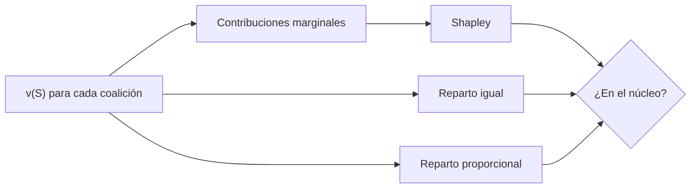

# B119-C36 — Gobernanza de los recursos espaciales

<!-- nav:top -->
[🏠 Programa](../../../../README.md) · [📚 Bloque B119](../../../tronco-comun/B119-derecho-seguridad-y-geopolitica-espacial.md) · [← Anterior: B119-C35 — Seguridad y gobernanza de datos espaciales](../B119-C35-seguridad-y-gobernanza-de-datos-espaciales/CLASE.md) · [Siguiente: B120-C01 — Licencias satelitales y procedimiento de notificación →](../../../tronco-comun/B120-espectro-licencias-y-regulacion-satelital.md#b120-c01)
<!-- /nav -->

## 1. Ubicación, nivel y alcance

Clase 36 del bloque B119. Nivel N3. Si algún día se explotan recursos fuera de la Tierra, quién recibe qué es una cuestión de gobernanza: el art. 11 del Acuerdo sobre la Luna habla de reparto equitativo con atención especial a los países en desarrollo y a quienes contribuyeron, y el art. II del tratado excluye la apropiación nacional. Aquí comparas tres reglas de reparto en una empresa conjunta **sintética** de tres actores: igual, proporcional y valor de Shapley, y verificas que el Shapley es eficiente y está en el núcleo. **Esta clase es educativa: no es asesoría legal, regulatoria ni financiera y no sustituye a un jurista, a una autoridad competente ni a un asesor.**

## 2. Por qué esta clase existe

B59 trata los recursos de forma técnica; la gobernanza de la explotación plantea cuestiones de reparto que ninguna clase trata. C25 da el caso económico y C34 las medidas de desigualdad; esta clase cierra el bloque con reglas de reparto. La decisión central: **¿qué regla de reparto reconoce las contribuciones y es estable, es decir, nadie prefiere irse?**

## 3. Lo que podrás hacer al terminar

1. Citar el art. 11 de la Luna y el art. II del tratado, y rotular lo no consultado (Acuerdos Artemis, leyes nacionales).
2. Calcular el valor de Shapley por permutaciones y por fórmula y comprobar la eficiencia.
3. Comparar con el reparto igual y el proporcional.
4. Comprobar si cada reparto pertenece al núcleo.
5. Separar lo consultado (texto normativo con versión y fecha) de lo sintético o ilustrativo.

La evidencia es la **comparación de tres reglas de reparto** del ejercicio 12 (sección 20).

## 4. Con qué llegas y cómo comprobarlo

1. ¿Qué es una función característica?
2. ¿Qué es la contribución marginal?
3. ¿Cuántas ordenaciones tienen 3 actores?
4. ¿Qué es el núcleo?
5. ¿Qué es la eficiencia?

<details>
<summary>Ver respuestas</summary>

1. La que da el valor `v(S)` que obtiene una coalición `S`. 2. `v(S ∪ {i}) − v(S)`. 3. 6. 4. El conjunto de repartos que ninguna coalición puede mejorar por sí sola. 5. Que se reparte exactamente el valor total.
</details>

Con cuatro o cinco aciertos, sigue; si no, repasa los prerrequisitos.

## 5. Un caso de contexto y casos de referencia

El Acuerdo sobre la Luna (UNOOSA, consultado el 2026-11-11) prevé en su art. 11 un régimen internacional con reparto equitativo de beneficios y especial consideración a los países en desarrollo y a los Estados que hayan contribuido a la exploración; la nota de la ONU recoge el art. II (sin apropiación nacional). **No se consultaron** los Acuerdos Artemis, leyes nacionales ni ningún régimen vigente. El **ejemplo conductor**: tres actores sintéticos (A tecnología, B capital, C acceso al sitio) con `v(A) = 10`, `v(B) = 0`, `v(C) = 20`, `v(AB) = 40`, `v(AC) = 50`, `v(BC) = 30` y `v(ABC) = 100` unidades de valor sintéticas.

## 6. Vocabulario

Una **coalición** es un subconjunto de actores. El **valor de Shapley** promedia la contribución marginal de cada actor sobre todas las ordenaciones. El **núcleo** reúne los repartos estables. La **eficiencia** exige repartir todo el valor. Un **reparto proporcional** sigue los aportes individuales.

## 7. Modelo mental



*Descripción textual:* la función característica alimenta tres reglas de reparto; cada reparto se comprueba contra el núcleo.

Analogía: repartir el premio de un equipo según cuánto añadió cada uno a todas las formaciones posibles. Límite: el valor de cada coalición es un dato inventado y las partes también negocian poder, no solo aportes.

## 8. La explicación, paso a paso

### 8.1 Tres reglas

Shapley: A `38.33`, B `23.33`, C `38.33` (suma 100). Igual: `33.33` cada uno. Proporcional (con piso de 5): A `33.33`, B `11.11`, C `55.56`.

### 8.2 Verificaciones

Shapley por permutaciones y por fórmula de subconjuntos coincide a `10⁻¹²` y suma `v(ABC) = 100`.

### 8.3 Estabilidad

Pertenece al núcleo: igual `True`, proporcional `True`, Shapley `True`: con estos valores el núcleo es amplio y los tres repartos son estables.

### 8.4 Qué no resuelve

El valor de Shapley es una regla; el art. 11 no la adopta ni define el régimen. El reparto real exige negociación (C27) y atención a los países en desarrollo.

## 9. Magnitudes, símbolos y unidades

| Símbolo | Qué es | Unidad | Valor / nota |
|---|---|---|---|
| `v(S)` | valor de la coalición `S` | u.v. | ver laboratorio |
| `φ_i` | valor de Shapley | u.v. | 38.33 / 23.33 / 38.33 |
| `T` | valor total | u.v. | 100 |
| regla | igual, proporcional, Shapley | — | 3 |

## 10. Convenciones y referencias

Unidades de valor (u.v.) sintéticas; actores A, B, C; 6 ordenaciones; piso de 5 en el proporcional.

## 11. De dónde sale lo que afirmamos

| ID | Fuente | Localizador | Respalda | Estado |
|---|---|---|---|---|
| S2 | UNOOSA, «Agreement Governing the Activities of States on the Moon and Other Celestial Bodies» (página oficial), https://www.unoosa.org/oosa/en/ourwork/spacelaw/treaties/moon-agreement.html (WebFetch, consultada 2026-11-11) | art. 11 | reparto equitativo, atención a países en desarrollo y a contribuyentes | Consultada |
| S3 | ONU, Biblioteca Audiovisual de Derecho Internacional, nota introductoria sobre el Tratado del Espacio Ultraterrestre, https://legal.un.org/avl/ha/tos/tos.html (WebFetch, consultada 2026-11-11; no discute los artículos V ni VII) | art. II | sin apropiación nacional | Consultada |
| — | Acuerdos Artemis, leyes nacionales y régimen internacional vigente | — | no consultados | No consultado / ilustrativo |
| — | Valor de Shapley y núcleo | — | no consultados en una fuente concreta; verificados por dos métodos y restricciones | No consultado / ilustrativo |
| — | Actores y valores | — | sintéticos | No consultado / ilustrativo |

Límites: no se consultó ningún régimen de reparto vigente; los valores son inventados. Texto normativo parafraseado de las páginas oficiales en la fecha indicada; el texto vinculante es el de la fuente oficial vigente.

## 12. Cómo ver la situación

| Magnitud | Valor |
|---|---|
| Shapley (A, B, C) | 38.33 / 23.33 / 38.33 |
| Igual | 33.33 cada uno |
| Proporcional (A, B, C) | 33.33 / 11.11 / 55.56 |
| En el núcleo | igual True, prop. True, Shapley True |

Descripción larga: los tres repartos son estables, pero solo Shapley reconoce el aporte marginal de cada actor y ofrece una regla simétrica; los demás ignoran lo que cada uno añade a las coaliciones.

## 13. Ejemplo trabajado: Shapley de A

**Paso 1.** A entra primero (2 ordenaciones): `v(A) = 10`; tras B: `v(AB) − v(B) = 40`; tras C: `v(AC) − v(C) = 30`; en último lugar (2 ordenaciones): `100 − 30 = 70`. **Paso 2.** Contribuciones de A en las 6 ordenaciones: 10, 10, 40, 70, 30 y 70. **Paso 3.** Promedio `230/6 = 38.33`.

## 14. Distintas formas de describirlo

**Por regla:** igual, proporcional, Shapley. **Por propiedad:** eficiencia, estabilidad. **Por actor:** aporte marginal. **Por fuente:** art. 11 y art. II.

## 15. Práctica guiada

**Ejercicio 1 · con los pasos indicados.** Calcula el reparto igual de 100 entre tres.

<details><summary>Solución comentada</summary>

`33.33`.
</details>

**Ejercicio 2 · con una pista.** Calcula la contribución marginal de B cuando entra último. *Pista:* `v(ABC) − v(AC)`.

<details><summary>Solución comentada</summary>

`100 − 50 = 50`.
</details>

**Ejercicio 3 · casi autónomo.** Calcula la contribución marginal de C cuando entra primero.

<details><summary>Solución comentada</summary>

`v(C) = 20`.
</details>

## 16. Práctica autónoma, transferencia e integrador

**Ejercicio 4 · autónomo.** Verifica que el Shapley es eficiente.

<details><summary>Solución comentada</summary>

`38.33 + 23.33 + 38.33 = 100`.
</details>

**Ejercicio 5 · autónomo.** ¿Por qué el actor B recibe algo aunque `v(B) = 0`?

<details><summary>Solución comentada</summary>

Porque su contribución marginal en coaliciones es positiva.
</details>

**Ejercicio 6 · autónomo.** ¿Qué regla reconoce mejor el aporte marginal?

<details><summary>Solución comentada</summary>

Shapley.
</details>

**Ejercicio 7 · autónomo.** ¿Qué significa estar en el núcleo?

<details><summary>Solución comentada</summary>

Que ninguna coalición obtiene más por separado.
</details>

**Ejercicio 8 · autónomo.** ¿Qué fuente citarías para el reparto equitativo?

<details><summary>Solución comentada</summary>

El art. 11 del Acuerdo sobre la Luna (S2).
</details>

**Ejercicio 9 · transferencia.** **Transferencia.** ¿Por qué la atención a los países en desarrollo no sale del valor de Shapley?

<details><summary>Solución comentada</summary>

Porque Shapley mide aportes, no necesidades; la equidad exige una regla adicional.
</details>

**Ejercicio 10 · transferencia.** **Transferencia.** ¿Qué hace más justo un reparto: la estabilidad o el aporte?

<details><summary>Solución comentada</summary>

Es un juicio de valor; el modelo ofrece ambas medidas para discutirlo.
</details>

**Ejercicio 11 · transferencia.** **Transferencia.** ¿Qué cambia si hay más de tres actores?

<details><summary>Solución comentada</summary>

El número de ordenaciones crece factorialmente y se usa muestreo.
</details>

**Ejercicio 12 · integrador.** **Integrador.** Elabora tu *comparación de tres reglas de reparto*: valores, tabla de repartos, núcleo y aviso de que es educativa y no asesoría.

<details><summary>Solución comentada</summary>

Secciones 8.1–8.4 y la salida del laboratorio.
</details>

## 17. Laboratorio: reglas de reparto y valor de Shapley

El script [laboratorio.py](laboratorio.py) calcula Shapley por permutaciones y por fórmula, lo compara con el reparto igual y el proporcional y comprueba el núcleo (**comprueba** la eficiencia y la igualdad de los dos métodos).

**Datos:** art. 11 de la Luna y art. II consultados (2026-11-11); actores y valores **sintéticos**. **Predice antes de ejecutar:** ¿qué actor recibirá más con Shapley? (A y C empatan.) **Ejecución del 2026-11-11 (Python 3.12.9):**

```text
Python 3.12.9 (biblioteca estandar)
Empresa conjunta SINTETICA de 3 actores; art. 11 de la Luna y art. II consultados 2026-11-11; Acuerdos Artemis y leyes nacionales NO consultados.
   actor   igual  proporcional  Shapley   v(individual)
   A       33.33       33.33     38.33       10.0
   B       33.33       11.11     23.33        0.0
   C       33.33       55.56     38.33       20.0
Pertenece al nucleo (ninguna coalicion mejora por separado): igual True ; proporcional True ; Shapley True
Diferencia maxima entre Shapley y reparto igual: 10.00 u.v.
CLAVES {"sA": "38.33", "sB": "23.33", "sC": "38.33", "pA": "33.33", "pB": "11.11", "pC": "55.56", "ig": "33.33", "dm": "10.00", "ni": "True", "np": "True", "ns": "True"}
Pruebas superadas.
```

```bash
python programa/clases/B119/B119-C36-gobernanza-de-los-recursos-espaciales/laboratorio.py
```

**Límites:** tres actores, valor transferible, un solo periodo; no valora ningún proyecto ni es asesoría.

## 18. Errores frecuentes y cómo corregirlos

**Confundir Shapley con lo que dice el acuerdo.** Se corrige con 8.4.

**Olvidar la eficiencia.** Se corrige con el ejercicio 4.

**Tomar valores sintéticos como reales.** Se corrige con la sección 11.

**Ignorar la estabilidad.** Se corrige con el ejercicio 7.

## 19. Cómo sabrás que vas bien

Tras la sección 8: ¿qué resultado esperabas en el ejemplo trabajado y cuál obtuviste? Si dudas, repasa la sección 13. Tras el laboratorio: ¿qué comprueba cada prueba? (ver la sección 17).

## 20. Qué entregas y cómo se evalúa

El producto es tu **comparación de tres reglas de reparto** (ejercicio 12).

| Criterio | Inicial | En desarrollo | Logrado | Destacado |
|---|---|---|---|---|
| Conceptos | Los confunde | Parciales | Usa el vocabulario con precisión | Explica los límites del modelo |
| Cálculo | Sin unidades | Con errores | Resultados con unidades y tolerancia | Calcula casos nuevos |
| Verificación | Sin comprobar | Un caso | Contraste con una segunda vía | Interpreta las diferencias |
| Fuentes | Sin fuente | Sin fecha | Fuentes con versión, fecha y estado | Declara lo sintético y lo no consultado |
| Límites | No los nombra | Uno | Tres | Discute qué falta del modelo |

**Condiciones críticas (no se compensan con promedio):** citar la versión y la fecha del texto normativo consultado; rotular lo sintético y lo ilustrativo; no presentar un resultado como asesoría legal, regulatoria o financiera.

## 21. Ética, seguridad y límites

Clase educativa: **no es asesoría legal, regulatoria ni financiera**; no sustituye a un abogado, a la autoridad competente ni a un asesor, y ningún resultado debe usarse para decidir sobre una licencia, una reclamación, un contrato o una operación real. Los actores y valores son inventados; la gobernanza de recursos reales es una decisión política internacional. Los modelos son simplificados y sus datos son sintéticos o ilustrativos; lo simulado nunca se presenta como observado. Accesibilidad: tablas equivalentes a las gráficas, fórmulas en texto, ejercicios sin conexión.

## 22. Para cerrar y seguir

Shapley reparte `38.33`, `23.33` y `38.33` del valor total sintético y es estable. Con esto cierras el bloque: vuelve a la matriz de obligaciones (C33) y a la simulación de respuesta (C20) para tu portafolio.

**Glosario español–inglés.** valor de Shapley · *Shapley value*; núcleo · *core*; función característica · *characteristic function*; reparto de beneficios · *benefit sharing*.

**Continuidad.** Fin del bloque: vuelve a la [guía](../../../tronco-comun/B119-derecho-seguridad-y-geopolitica-espacial.md) para elegir una evidencia de portafolio.

**Referencias:** ver sección 11.

<!-- nav:bottom -->
---

[← Anterior: B119-C35 — Seguridad y gobernanza de datos espaciales](../B119-C35-seguridad-y-gobernanza-de-datos-espaciales/CLASE.md) · [📚 Bloque B119](../../../tronco-comun/B119-derecho-seguridad-y-geopolitica-espacial.md) · [Siguiente: B120-C01 — Licencias satelitales y procedimiento de notificación →](../../../tronco-comun/B120-espectro-licencias-y-regulacion-satelital.md#b120-c01)
<!-- /nav -->
