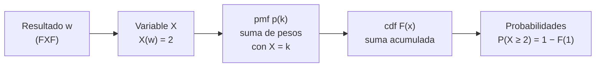

# B12-C02 — Variables aleatorias

<!-- nav:top -->
[🏠 Programa](../../../../README.md) · [📚 Bloque B12](../../../tronco-comun/B12-probabilidad-estadistica-e-incertidumbre.md) · [← Anterior: B12-C01 — Espacios muestrales y eventos](../B12-C01-espacios-muestrales-y-eventos/CLASE.md) · [Siguiente: B12-C03 — Distribuciones de probabilidad →](../B12-C03-distribuciones-de-probabilidad/CLASE.md)
<!-- /nav -->

## 1. Ubicación, nivel y alcance

Segunda clase del bloque B12. En [C01](../B12-C01-espacios-muestrales-y-eventos/CLASE.md) calculaste probabilidades de eventos a partir de un espacio muestral. Aquí conviertes el resultado de un experimento en un **número** —una variable aleatoria— y aprendes a describirla con su función de masa, su densidad y su función de distribución acumulada. Nivel N2. No verás distribuciones con nombre (C03) ni esperanza y varianza (C04).

## 2. Por qué esta clase existe

Casi nunca interesa *qué* resultado ocurrió, sino *un número* que resume el resultado: cuántos computadores funcionan, qué error tuvo una medición, cuántos fotones llegaron. Poner un número en cada resultado permite sumar, promediar y comparar. Sin la idea de variable aleatoria no hay estadística.

Pregunta motivadora: **¿cómo se describe con precisión la incertidumbre de un número que todavía no se ha medido?** Decisión central: **qué descripción usar —masa, densidad o acumulada— para responder la pregunta que se necesita**.

## 3. Lo que podrás hacer al terminar

1. Definir una variable aleatoria sobre un espacio muestral y clasificarla como discreta o continua.
2. Construir y verificar una función de masa (suma 1) y calcular probabilidades con ella.
3. Usar la función de distribución acumulada `F` para obtener `P(X ≤ x)`, `P(X > x)` y cuantiles.
4. Calcular probabilidades de una variable continua como áreas bajo la densidad.
5. Explicar por qué `P(Y = y) = 0` en una variable continua sin que `y` sea imposible.
6. Verificar un cálculo con una simulación.

La evidencia es la **ficha de variables aleatorias** del ejercicio 12 (sección 20).

## 4. Con qué llegas y cómo comprobarlo

Necesitas C01 (espacio muestral, eventos, pesos que suman 1) y el área de un rectángulo. Cinco preguntas:

1. En C01, ¿cuánto vale `P(exactamente 2 funcionan)`?
2. ¿Cuánto suman los pesos de todo `Ω`?
3. ¿Cuál es el área de un rectángulo de base 1,5 y altura 0,25?
4. Si `P(A) = 0,972`, ¿cuánto vale `P(Aᶜ)`?
5. ¿Es `{FFX, FXF, XFF}` un evento de `Ω`?

<details>
<summary>Ver respuestas</summary>

1. `0,243`. 2. `1`. 3. `0,375`. 4. `0,028`. 5. Sí, es un subconjunto.
</details>

Con cuatro o cinco aciertos, sigue; si no, repasa C01.

## 5. Un caso: contar computadores y medir un error

Seguimos con la sonda **ilustrativa** de C01 (tres computadores, `p = 0,9`) y le añadimos un telémetro cuyo error de distancia es **desconocido pero acotado** a ±2 m, sin sesgo y sin preferencia por ningún valor. De aquí salen dos variables: `X`, el número de computadores operativos, y `Y`, el error de una medición. Son el **ejemplo conductor**: `X` es discreta, `Y` continua. Todos los valores son **sintéticos e ilustrativos**.

## 6. Vocabulario

Una **variable aleatoria** es una función que asigna un número real a cada resultado del espacio muestral; el GUM la describe como una variable que puede tomar cualquier valor de un conjunto especificado y tiene asociada una distribución de probabilidad (S1, C.2.2). Es **discreta** si toma valores aislados y **continua** si toma cualquier valor de un intervalo (S1, C.2.2, nota 1). La **función de masa de probabilidad** (pmf) `p_X(k) = P(X = k)` da la probabilidad de cada valor de una discreta; suma 1. La **función de distribución acumulada** (cdf) `F(x) = P(X ≤ x)` (S1, C.2.4) existe para ambos tipos y no decrece. La **densidad** `f` de una continua es la derivada de `F` (S1, C.2.5): `P(a < Y ≤ b) = ∫ₐᵇ f(y) dy` y `∫ f = 1`. Un **cuantil** `q_α` cumple `F(q_α) = α`; la **mediana** es `q_0,5`. Se escribe con mayúscula la variable (`X`) y con minúscula el valor (`x`).

## 7. Modelo mental: etiquetar resultados con números

La variable aleatoria es un rotulador: a cada historia posible le pone una cifra. Después, las historias con la misma cifra se juntan y sus pesos se suman.



*Descripción textual:* cada resultado se traduce en un valor de `X`; se suman los pesos de los resultados que dan el mismo valor (pmf); se acumulan (cdf); con la cdf se responde cualquier pregunta de la forma «a lo sumo», «más de» o «entre».

Analogía: clasificar cartas por su número y contar el peso de cada pila. Su límite: en una variable continua no hay pilas contables; la «pila» de un valor exacto pesa cero y sólo pesan los intervalos.

## 8. La explicación, paso a paso

### 8.1 De Ω a la pmf

Para `X = número de computadores operativos`, los 8 resultados de C01 se agrupan por su valor: `X = 3` (1 resultado, peso `0,729`), `X = 2` (3 resultados, `0,081` cada uno, total `0,243`), `X = 1` (3 resultados, `0,009`, total `0,027`) y `X = 0` (1 resultado, `0,001`). La pmf es `p(0) = 0,001`, `p(1) = 0,027`, `p(2) = 0,243`, `p(3) = 0,729`. Comprobación: suman 1.

### 8.2 La acumulada

`F(0) = 0,001`, `F(1) = 0,028`, `F(2) = 0,271`, `F(3) = 1`. La cdf de una discreta es una escalera: constante entre valores y con saltos iguales a la pmf. Con ella, `P(X ≥ 2) = 1 − F(1) = 0,972`, que coincide con `P(A)` de C01: el evento «al menos dos funcionan» es ahora la pregunta «`X ≥ 2`».

### 8.3 Variable continua: la densidad

Para el error `Y` uniforme en `[−2, 2]` m, la densidad es constante: `f(y) = 1/4` por metro, porque el área total debe ser `4 · f = 1`. La probabilidad de un intervalo es el área del rectángulo: `P(−1 < Y ≤ 0,5) = 1,5 · 1/4 = 0,375`. La cdf es una rampa: `F(y) = (y + 2)/4` en `[−2, 2]`, `0` antes y `1` después.

### 8.4 Por qué un punto pesa cero

`P(Y = 0) = 0`, pero `0` es un error posible. El área de un segmento sin ancho es cero; la probabilidad vive en los intervalos. La densidad `f(y)` **no es una probabilidad** (puede superar 1 si el rango es corto); su unidad es probabilidad por unidad de `y`.

### 8.5 Cuantiles

El cuantil del 95 % cumple `F(q) = 0,95`: `(q + 2)/4 = 0,95`, `q = 1,8 m`. Se interpreta: el 95 % de los errores es menor o igual que `1,8 m`. La mediana es `0`. Los cuantiles son la forma natural de dar límites de aceptación.

### 8.6 Verificar con simulación

Se generan 1 000 000 de errores uniformes; la frecuencia de `−1 < Y ≤ 0,5` es `0,3754` frente a `0,375`, y la de `X = 2` en una binomial simulada es `0,2426` frente a `0,243`. La concordancia es la esperada para una simulación de ese tamaño (error típico del orden de `10⁻³`).

## 9. Magnitudes, símbolos y unidades

| Símbolo | Qué es | Unidad | Nota |
|---|---|---|---|
| `X` | n.º de computadores operativos | adimensional | discreta: 0, 1, 2, 3 |
| `Y` | error del telémetro | m | continua, en [−2, 2] |
| `p(k)` | pmf de `X` | adimensional | suma 1 |
| `f(y)` | densidad de `Y` | m⁻¹ | `1/4 m⁻¹` |
| `F(x)` | acumulada | adimensional | no decrece, de 0 a 1 |
| `q_α` | cuantil de orden `α` | unidad de la variable | `q_0,95 = 1,8 m` |

## 10. Convenciones y referencias

Variables en mayúscula, valores en minúscula. La cdf usa `≤` (no `<`): para continuas da igual, para discretas no. El error `Y` se define como medida menos valor verdadero (signo positivo si el telémetro mide de más). Unidades SI: metros.

## 11. De dónde sale lo que afirmamos

| ID | Fuente | Localizador | Respalda | Consulta |
|---|---|---|---|---|
| S1 | JCGM 100:2008 (GUM), Anexo C | https://doi.org/10.59161/JCGM100-2008E ; PDF de bipm.org | Definiciones: variable aleatoria discreta/continua (C.2.2), distribución (C.2.3), función de distribución (C.2.4), densidad (C.2.5) | 2026-11-05, PDF abierto y texto extraído |

Límites: la relación pmf–cdf, la regla del área y los cuantiles son resultados estándar no atribuidos a una fuente consultada; `p = 0,9` y el rango de ±2 m son **ilustrativos** y los datos, **sintéticos**.

## 12. Cómo ver la acumulada

Equivalente accesible a una gráfica de escalera (datos **sintéticos**), en tabla:

| `x` | `F(x) = P(X ≤ x)` | Salto (pmf) |
|---|---|---|
| menor que 0 | 0 | — |
| 0 | 0,001 | 0,001 |
| 1 | 0,028 | 0,027 |
| 2 | 0,271 | 0,243 |
| 3 | 1,000 | 0,729 |

Descripción larga: la escalera sube casi toda su altura en el último escalón (`x = 3`, salto de `0,729`). Para `Y`, la gráfica es una rampa recta de 0 en `−2 m` a 1 en `2 m`, con pendiente `1/4 m⁻¹`.

## 13. Ejemplo trabajado: una pregunta, tres descripciones

**Pregunta:** ¿cuál es la probabilidad de que fallen *como mucho* un computador y de que el error del telémetro esté entre `−1` y `0,5` m?

**Paso 1 · Variables.** `X` discreta (pmf de 8.1), `Y` continua (8.3); se supone que `X` e `Y` son independientes (el telémetro no depende de los computadores en este modelo).

**Paso 2 · Traducir.** «Como mucho uno falla» equivale a «al menos dos funcionan»: `X ≥ 2`.

**Paso 3 · Con la cdf.** `P(X ≥ 2) = 1 − F(1) = 1 − 0,028 = 0,972`.

**Paso 4 · Con la densidad.** `P(−1 < Y ≤ 0,5) = 1,5 m · 0,25 m⁻¹ = 0,375`.

**Paso 5 · Combinar.** Por independencia, `0,972 · 0,375 = 0,3645`.

**Paso 6 · Sentido.** El resultado es menor que cada factor, como debe. Todos los valores son **sintéticos**; el supuesto de independencia es del modelo, no un dato.

## 14. Comparación de métodos

Para responder una pregunta con una variable aleatoria hay tres caminos: **sumar la pmf** (discreta, exacto), **integrar la densidad** (continua, exacto si hay primitiva) y **usar la cdf** (ambos; es la más directa para «a lo sumo», «más de» y cuantiles). Simular sirve cuando no hay forma cerrada, pero cuesta precisión. La densidad es incómoda cuando la variable mezcla masa y continuidad (p. ej., un tiempo que es 0 con cierta probabilidad); la cdf maneja todo.

## 15. Práctica guiada

**Ejercicio 1 · con los pasos indicados.** Con dos computadores (`p = 0,9`), construye la pmf de `X = n.º operativos`. *Pasos:* resultados, valor de `X`, sumar pesos (8.1).

<details><summary>Solución comentada</summary>

`Ω = {FF, FX, XF, XX}`; `p(2) = 0,81`, `p(1) = 0,09 + 0,09 = 0,18`, `p(0) = 0,01`. Suman 1.
</details>

**Ejercicio 2 · con una pista.** En el sistema de tres, calcula `F(1)` y `P(X ≥ 2)`. *Pista:* `P(X ≥ 2) = 1 − F(1)`.

<details><summary>Solución comentada</summary>

`F(1) = 0,001 + 0,027 = 0,028`; `P(X ≥ 2) = 0,972` (8.2).
</details>

**Ejercicio 3 · casi autónomo.** Para `Y` uniforme en `[−2, 2]`, calcula `P(Y > 1)`.

<details><summary>Solución comentada</summary>

Rectángulo de base `1` y altura `0,25`: `0,25`. Con la cdf: `1 − F(1) = 1 − 0,75`.
</details>

## 16. Práctica autónoma, transferencia e integrador

**Ejercicio 4.** Calcula `P(X > 0)` en el sistema de tres.

<details><summary>Solución comentada</summary>

`1 − p(0) = 1 − 0,001 = 0,999`: al menos un computador funciona (sin exigir mayoría).
</details>

**Ejercicio 5.** Halla el cuantil `q_0,9` de `Y`.

<details><summary>Solución comentada</summary>

`(q + 2)/4 = 0,9`, `q = 1,6 m` (8.5).
</details>

**Ejercicio 6.** Cada computador aporta 20 W y se define `W = 20 X` (W). Calcula `P(W ≥ 40)`.

<details><summary>Solución comentada</summary>

`W ≥ 40 ⇔ X ≥ 2`: `0,972`. Una función de una variable aleatoria es otra variable aleatoria; su masa sale de agrupar.
</details>

**Ejercicio 7.** Una variable continua en `[0, 2]` tiene densidad `f(y) = c·y`. Halla `c` y `P(Y < 1)`.

<details><summary>Solución comentada</summary>

Área total: `c · 2²/2 = 2c = 1`, `c = 0,5`. `P(Y < 1) = 0,5 · 1²/2 = 0,25`. Cdf: `F(y) = y²/4`.
</details>

**Ejercicio 8.** Clasifica como discreta o continua: (a) impactos de micrometeoroides en un día; (b) tiempo hasta la primera falla; (c) masa de propelente restante; (d) n.º de satélites GNSS visibles.

<details><summary>Solución comentada</summary>

(a) discreta; (b) continua; (c) continua; (d) discreta. Una medida redondeada es discreta en la práctica, pero se modela como continua si el paso es pequeño.
</details>

**Ejercicio 9 · transferencia.** Un paquete de telemetría llega a un instante uniforme entre `0` y `10` s tras la solicitud. Calcula `P(T > 7 s)` y la mediana.

<details><summary>Solución comentada</summary>

Densidad `0,1 s⁻¹`; `P(T > 7) = 3 · 0,1 = 0,3`; mediana `5 s`.
</details>

**Ejercicio 10 · transferencia.** Un detector cuenta `K ∈ {0, 1, 2}` con masas `0,5; 0,3; 0,2`. Construye `F` y calcula `P(K ≥ 1)`.

<details><summary>Solución comentada</summary>

`F(0) = 0,5`, `F(1) = 0,8`, `F(2) = 1`. `P(K ≥ 1) = 1 − F(0) = 0,5`.
</details>

**Ejercicio 11 · transferencia.** El telémetro redondea el error al múltiplo de `0,1 m` más cercano. ¿Qué tipo de variable es ahora y cuál es la masa de cada valor, incluidos los extremos `±2,0`?

<details><summary>Solución comentada</summary>

Discreta con 41 valores. Los interiores reciben el intervalo de `0,1 m` → `0,1/4 = 0,025`; los extremos sólo la mitad (`0,05 m`) → `0,0125`. Suma: `39 · 0,025 + 2 · 0,0125 = 1`.
</details>

**Ejercicio 12 · integrador.** Elabora tu *ficha de variables aleatorias*: define dos variables para una situación de tu elección (una discreta, una continua), con su espacio, su pmf o densidad, su cdf, un cuantil, una probabilidad por dos caminos y una verificación por simulación.

<details><summary>Solución modelo</summary>

Debe incluir: definición de cada variable y su unidad; pmf que suma 1 o densidad con área 1; cdf (tabla o fórmula); un cuantil interpretado; una probabilidad calculada con la cdf y con masa/densidad; una simulación con semilla y versiones, comparada con el cálculo exacto; datos rotulados como sintéticos o ilustrativos.
</details>

## 17. Laboratorio: pmf, cdf y simulación

El script [variable_aleatoria.py](variable_aleatoria.py) construye la pmf y la cdf de `X`, comprueba que suman 1 y coincide con C01, calcula probabilidades de `Y` con la cdf y las compara con simulaciones; falla si alguna igualdad exacta no se cumple.

**Datos:** sintéticos. **Predice antes de ejecutar:** ¿qué frecuencia simulada esperas para `−1 < Y ≤ 0,5`? (≈ `0,375`.) **Ejecución del 2026-11-05 (Python 3.12.9, NumPy 2.4.4):**

```text
P(X=0) = 0.001000
P(X=1) = 0.027000
P(X=2) = 0.243000
P(X=3) = 0.729000
F(0..3) = 0.001000 0.028000 0.271000 1.000000
P(-1 < Y <= 0.5) = 0.3750
P(Y = 0) = 0 (un punto); mediana = 0.0; cuantil 0.95 = 1.7999999999999998
frecuencia simulada: 0.37540
P(X=2) simulada 0.24264 frente a exacta 0.24300
Pruebas superadas.
```

```bash
python programa/clases/B12/B12-C02-variables-aleatorias/variable_aleatoria.py
```

**Límites:** `X` e `Y` idealizadas; resultados **simulados**.

## 18. Errores frecuentes y cómo corregirlos

**Tratar la densidad como probabilidad.** Se corrige con 8.4 y el ejercicio 7 (`f` se integra).

**Olvidar que la pmf suma 1.** Se corrige con el ejercicio 1.

**Confundir `F(x)` con `P(X ≥ x)`.** Se corrige con los ejercicios 2 y 4.

**Decir que `P(Y = 0) = 0` implica que 0 es imposible.** Se corrige con 8.4 y el ejercicio 11.

**Mezclar `<` y `≤` en discretas.** Se corrige con el ejercicio 10.

## 19. Cómo sabrás que vas bien

Tras 8.1: ¿tu pmf suma 1? Si no, ejercicio 1. Tras 8.3: ¿por qué la densidad vale `0,25 m⁻¹` y no `0,25`? Si dudas, ejercicio 7. Tras 8.5: ¿sabes interpretar `q_0,95`? Si no, ejercicio 5. Tras el laboratorio: ¿sabes qué error de simulación es razonable con `N = 10⁶`?

## 20. Qué entregas y cómo se evalúa

El producto es tu **ficha de variables aleatorias** (ejercicio 12).

| Criterio | Inicial | En desarrollo | Logrado | Destacado |
|---|---|---|---|---|
| Definición | Ambigua | Sin unidad | Función y unidad claras | Justifica discreta/continua |
| pmf/densidad | Suma ≠ 1 | Suma 1 sin verificar | Verificada | Explica la unidad de la densidad |
| Acumulada | Ausente | Con errores | Correcta | La usa para cuantiles |
| Verificación | Ninguna | Sin comparar | Simulación comparada | Cuantifica el error de simulación |
| Rótulo de datos | Ausente | Parcial | Sintético/ilustrativo declarado | Declara límites del modelo |

**Condiciones críticas (no se compensan con promedio):** la pmf debe sumar 1 y la densidad integrar 1; rotular datos sintéticos; citar solo lo consultado.

## 21. Ética, seguridad y límites

Una variable aleatoria es un modelo, no la realidad: presentar `P(X ≥ 2) = 0,972` como la fiabilidad de una nave real es un error. Los valores de esta clase no provienen de ninguna misión. Accesibilidad: las gráficas se ofrecen como tablas; todo se resuelve sin conexión.

## 22. Para cerrar y seguir

Una variable aleatoria pone un número a cada resultado; la pmf o la densidad reparten el peso; la cdf responde «a lo sumo» y da cuantiles; en el caso continuo la probabilidad vive en los intervalos. Queda abierta una pregunta: ¿hay formas de distribución que aparecen una y otra vez en la ciencia espacial, de modo que bastaría nombrarlas? Es el tema de C03.

**Glosario español–inglés.** variable aleatoria · *random variable*; función de masa · *probability mass function*; densidad · *probability density function*; función de distribución acumulada · *cumulative distribution function*; cuantil · *quantile*; mediana · *median*.

**Continuidad.** B12-C03 reutiliza tu capacidad de **leer una pmf, una densidad y una cdf** para trabajar con las familias binomial, Poisson, exponencial y normal.

**Referencias:** ver sección 11.

<!-- nav:bottom -->
---

[← Anterior: B12-C01 — Espacios muestrales y eventos](../B12-C01-espacios-muestrales-y-eventos/CLASE.md) · [📚 Bloque B12](../../../tronco-comun/B12-probabilidad-estadistica-e-incertidumbre.md) · [Siguiente: B12-C03 — Distribuciones de probabilidad →](../B12-C03-distribuciones-de-probabilidad/CLASE.md)
<!-- /nav -->
