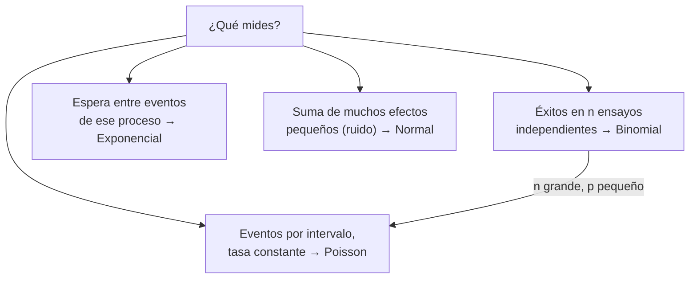

# B12-C03 — Distribuciones de probabilidad

<!-- nav:top -->
[🏠 Programa](../../../../README.md) · [📚 Bloque B12](../../../tronco-comun/B12-probabilidad-estadistica-e-incertidumbre.md) · [← Anterior: B12-C02 — Variables aleatorias](../B12-C02-variables-aleatorias/CLASE.md) · [Siguiente: B12-C04 — Esperanza y varianza →](../B12-C04-esperanza-y-varianza/CLASE.md)
<!-- /nav -->

## 1. Ubicación, nivel y alcance

Tercera clase del bloque B12. En [C02](../B12-C02-variables-aleatorias/CLASE.md) aprendiste a describir una variable con su pmf, densidad y acumulada. Aquí conoces cuatro familias que explican una gran parte de los fenómenos de la ciencia espacial —**binomial, Poisson, exponencial y normal**— y aprendes a elegir cuál usar. Nivel N2. No verás aún esperanza y varianza como tema (C04) ni el teorema que explica la omnipresencia de la normal (C06).

## 2. Por qué esta clase existe

Cada vez que un detector cuenta fotones, una nave registra impactos o un instrumento mide con ruido, el patrón de la incertidumbre se parece a uno de unos pocos moldes. Reconocer el molde permite calcular probabilidades sin construir todo desde cero y entender qué supuesto físico lo respalda.

Pregunta motivadora: **¿qué distribución describe cuántos eventos llegan, cuánto se espera entre ellos y cómo se reparte el ruido de una medida?** Decisión central: **qué familia usar y qué supuesto físico hay que verificar para justificarla**.

## 3. Lo que podrás hacer al terminar

1. Elegir entre binomial, Poisson, exponencial y normal a partir de cómo se genera el dato.
2. Calcular probabilidades de cada familia con su fórmula.
3. Explicar la relación entre Poisson y exponencial (conteos y esperas) y entre binomial y Poisson.
4. Usar la regla de las desviaciones tipo (68–95–99,7 %) con la normal.
5. Reconocer cuándo el supuesto de la familia falla (ráfagas, tasa variable).
6. Verificar una probabilidad con una simulación.

La evidencia es la **ficha de elección de distribución** del ejercicio 12 (sección 20).

## 4. Con qué llegas y cómo comprobarlo

Necesitas C01 y C02 y la exponencial `eˣ`. Cinco preguntas:

1. ¿Qué propiedad cumple una pmf?
2. ¿Qué relación hay entre densidad y acumulada?
3. ¿Cuánto es `e⁻⁴`?
4. ¿Cuánto es `4!`?
5. ¿Cuántas formas hay de elegir 2 de 5 sin orden?

<details>
<summary>Ver respuestas</summary>

1. Valores no negativos que suman 1. 2. La densidad es la derivada de la acumulada. 3. `0,018316`. 4. `24`. 5. `10`.
</details>

Con cuatro o cinco aciertos, sigue; si no, repasa C02 y B09.

## 5. Un caso: un detector que cuenta eventos

Un detector **ilustrativo** registra en promedio `λ = 4,0` eventos (impactos de partículas) cada 10 minutos. Interesan tres cosas: cuántos eventos llegan en un intervalo, cuánto se espera entre dos consecutivos y cómo se reparte el error de la señal que los convierte en energía. Es el **ejemplo conductor**; todos los números son **sintéticos e ilustrativos**.

## 6. Vocabulario

Una **distribución** (S1, C.2.3) es la función que da la probabilidad de cada valor o conjunto de valores de una variable aleatoria. Un **parámetro** es una constante que fija una distribución concreta dentro de su familia. La **distribución binomial** `B(n, p)` cuenta éxitos en `n` ensayos independientes con probabilidad `p`: `P(K = k) = C(n,k) pᵏ (1−p)ⁿ⁻ᵏ`. La **distribución de Poisson** de parámetro `λ` cuenta eventos independientes en un intervalo con tasa constante: `P(N = k) = e^{−λ} λᵏ / k!`. La **distribución exponencial** de tasa `r` describe el tiempo de espera entre eventos de un proceso de Poisson: densidad `r e^{−rt}` y `P(T > t) = e^{−rt}`. La **distribución normal** (o de Laplace–Gauss, S1, C.2.14; S2) de media `μ` y desviación `σ` tiene densidad `f(x) = e^{−(x−μ)²/(2σ²)} / (σ√(2π))`, y `μ` y `σ` fijan su posición y escala (S2). La **normal estándar** tiene `μ = 0`, `σ = 1` y se denota `Z`. La **ausencia de memoria** es la propiedad `P(T > s+t | T > s) = P(T > t)`. Un **proceso de Poisson** es la descripción conjunta: eventos independientes, tasa constante y sin eventos simultáneos.

## 7. Modelo mental: cuatro moldes y los supuestos que los sostienen

La familia no se elige por su forma, sino por el mecanismo que genera el dato.



*Descripción textual:* según el mecanismo, la variable se modela con cuatro familias; la binomial con muchos ensayos y probabilidad pequeña tiende a la de Poisson; la espera entre los eventos de un proceso de Poisson es exponencial; el ruido que acumula muchos efectos pequeños tiende a la normal (C06).

Analogía: elegir un molde de galletas según la masa disponible. Su límite: la masa real (el dato) puede no entrar en ningún molde; entonces el molde se descarta, no se fuerza.

## 8. La explicación, paso a paso

### 8.1 Poisson: contar eventos

Con `λ = 4`: `P(N = 0) = e⁻⁴ = 0,018316`, `P(N = 4) = e⁻⁴ 4⁴/4! = 0,195367` y `P(N ≥ 8) = 1 − Σₖ₌₀⁷ P(N=k) = 0,051134`. Una propiedad notable: el promedio y la varianza valen `λ`; el laboratorio lo comprueba con la suma exacta de la pmf. El modelo exige eventos independientes y tasa constante: si llegan en ráfagas, la varianza sobrepasa a `λ` (sobredispersión).

### 8.2 De la binomial a Poisson

Si cada uno de `n = 1000` intervalos de 36 s tiene probabilidad `p = 0,004` de registrar un evento, el conteo es `B(1000; 0,004)`. Su `P(K = 4) = 0,195759` es casi la de Poisson con `λ = np = 4` (`0,195367`). La aproximación es buena cuando `n` es grande, `p` pequeño y `np` moderado.

### 8.3 Exponencial: esperar al siguiente

Con tasa `r = λ/10 min = 0,4 min⁻¹`, `P(T > 3 min) = e^{−1,2} = 0,301194`. Es **sin memoria**: si ya esperaste 5 min, la probabilidad de esperar otros 3 min es la misma que desde cero, `P(T > 8)/P(T > 5) = e^{−1,2}`. Eso es razonable para impactos independientes y falso para un componente que se desgasta.

### 8.4 Normal: el ruido

La normal estándar deja dentro de `±1σ`, `±2σ` y `±3σ` las probabilidades `0,682689`, `0,954500` y `0,997300`. Se calculan con la función de error: `P(|Z| < k) = erf(k/√2)`. Para un ruido `N(0, σ = 3 m)`, el 95,45 % de las medidas cae a menos de 6 m del valor verdadero. La normal no tiene una primitiva elemental (S2 indica que su cdf se calcula numéricamente); se usa `erf` o tablas.

### 8.5 La relación Poisson–exponencial

Si los eventos llegan con tasa `r`, el conteo en un tiempo `t` es Poisson de media `r t` y la espera entre dos es exponencial de tasa `r`. Con `r = 0,4 min⁻¹`, en 30 min el conteo medio es `12` y `P(N = 0) = e⁻¹² = 6,1 × 10⁻⁶`.

### 8.6 Verificación por simulación

Con 1 000 000 de ensayos, la frecuencia simulada de `N = 4` es `0,19520` (exacta `0,19537`), la media `3,9993`, la varianza `4,0005`, la de `T > 3` es `0,30112` (exacta `0,30119`) y la de `|Z| < 2`, `0,95422` (exacta `0,95450`). Los resultados son **simulados** y concuerdan dentro del error esperado.

## 9. Magnitudes, símbolos y unidades

| Símbolo | Qué es | Unidad | Nota |
|---|---|---|---|
| `n, p` | ensayos y prob. de éxito (binomial) | — , adim. | `n = 1000`, `p = 0,004` |
| `λ` | media del conteo en el intervalo | eventos | `4,0` por 10 min |
| `r` | tasa | min⁻¹ | `λ/10 min = 0,4 min⁻¹` |
| `T` | tiempo de espera | min | exponencial |
| `μ, σ` | media y desviación (normal) | unidad de la variable | `σ = 3 m` en el ruido |
| `Z` | normal estándar | adimensional | `(X − μ)/σ` |
| `erf` | función de error | adimensional | `P(|Z|<k) = erf(k/√2)` |

## 10. Convenciones y referencias

La tasa `r` y el tiempo `T` usan la misma unidad de tiempo (min). El intervalo del conteo se declara siempre (10 min). Se estandariza con `Z = (X − μ)/σ`. No hay sistema de referencia espacial; el tiempo se mide desde el último evento.

## 11. De dónde sale lo que afirmamos

| ID | Fuente | Localizador | Respalda | Consulta |
|---|---|---|---|---|
| S1 | JCGM 100:2008 (GUM), Anexo C | https://doi.org/10.59161/JCGM100-2008E | Distribución (C.2.3); distribución normal (C.2.14) | 2026-11-05, PDF abierto y texto extraído |
| S2 | NIST/SEMATECH, *e-Handbook of Statistical Methods*, §1.3.6.6.1 «Normal Distribution» | https://www.itl.nist.gov/div898/handbook/eda/section3/eda3661.htm | Densidad normal con `μ` (posición) y `σ` (escala); cdf sin forma cerrada, calculada numéricamente | 2026-11-05, página abierta |

Límites: las fórmulas binomial, Poisson y exponencial, la ausencia de memoria y los valores `erf` son resultados estándar que no se atribuyen a una fuente consultada; la tasa del detector es **ilustrativa**.

## 12. Cómo ver las distribuciones

Equivalente accesible a un histograma del conteo Poisson con `λ = 4` (datos **sintéticos**):

| `k` | 0 | 1 | 2 | 3 | 4 | 5 | 6 | 7 | ≥ 8 |
|---|---|---|---|---|---|---|---|---|---|
| `P(N=k)` | 0,0183 | 0,0733 | 0,1465 | 0,1954 | 0,1954 | 0,1563 | 0,1042 | 0,0595 | 0,0511 |

Descripción larga: la forma es una campana asimétrica con cola a la derecha; las dos barras más altas son `k = 3` y `k = 4` (iguales cuando `λ` es entero). La probabilidad de `k ≥ 8` suma poco más del 5 %.

## 13. Ejemplo trabajado: ¿cuánto margen en los contadores?

**Pregunta:** el sistema de adquisición admite hasta 7 eventos por intervalo de 10 min; ¿con qué frecuencia se desborda, y cada cuánto esperar un intervalo sin eventos?

**Paso 1 · Modelo.** Conteo `N ~ Poisson(4)` (eventos independientes, tasa constante).

**Paso 2 · Desborde.** `P(N ≥ 8) = 0,0511`: alrededor de 1 intervalo de cada 20.

**Paso 3 · Vacío.** `P(N = 0) = 0,0183`: 1 de cada 55 intervalos.

**Paso 4 · Esperas.** El tiempo entre eventos es exponencial con media `1/r = 2,5 min`; `P(T > 3) = 0,301`.

**Paso 5 · Comprobación.** Las simulaciones de 8.6 dan los mismos números dentro de `3 × 10⁻³`.

**Paso 6 · Sentido.** Cambiar el tamaño del buffer a 10 eventos reduciría el desborde a `P(N ≥ 11) = 0,0028` (cálculo propio). Todo es **ilustrativo**; si hubiera ráfagas el desborde real sería mayor.

## 14. Comparación de métodos

Para un conteo, la **binomial** exige conocer `n` y `p`; la **Poisson** sólo `λ` y es más práctica cuando `n` es enorme e indeterminado. Para esperas, la **exponencial** supone falta de desgaste; si la tasa de fallos crece con el tiempo hay que usar otras familias (p. ej., Weibull, no tratada aquí). Para ruido, la **normal** es la opción por defecto, pero sus colas son livianas: un valor a `6σ` es casi imposible en la normal y puede ser común en datos reales con colas pesadas (C11, C19).

## 15. Práctica guiada

**Ejercicio 1 · con los pasos indicados.** Con `λ = 4`, calcula `P(N = 2)`. *Pasos:* fórmula, potencia, factorial (8.1).

<details><summary>Solución comentada</summary>

`e⁻⁴ · 4²/2! = 8 e⁻⁴ = 0,14653`.
</details>

**Ejercicio 2 · con una pista.** Calcula `P(N ≤ 1)`. *Pista:* suma `P(0) + P(1)`.

<details><summary>Solución comentada</summary>

`e⁻⁴ (1 + 4) = 5 · 0,018316 = 0,09158`.
</details>

**Ejercicio 3 · casi autónomo.** El ruido de una medida es `N(0, σ = 3 m)`. ¿Probabilidad de que el error esté dentro de `±6 m`?

<details><summary>Solución comentada</summary>

`6 m = 2σ`: `P(|Z| < 2) = 0,9545` (8.4).
</details>

## 16. Práctica autónoma, transferencia e integrador

**Ejercicio 4.** Cinco computadores independientes con `p = 0,9`; calcula la probabilidad de que funcionen al menos 4.

<details><summary>Solución comentada</summary>

Binomial `B(5; 0,9)`: `5 · 0,9⁴ · 0,1 + 0,9⁵ = 0,32805 + 0,59049 = 0,91854`.
</details>

**Ejercicio 5.** Con `r = 0,4 min⁻¹`, ¿probabilidad de que el siguiente evento llegue en 2 min o menos?

<details><summary>Solución comentada</summary>

`1 − e^{−0,8} = 1 − 0,44933 = 0,55067`.
</details>

**Ejercicio 6.** Halla la mediana del tiempo de espera exponencial con `r = 0,4 min⁻¹`.

<details><summary>Solución comentada</summary>

`e^{−r m} = 0,5`, `m = ln 2 / 0,4 = 1,733 min`, menor que la media `2,5 min` porque la cola larga aumenta la media.
</details>

**Ejercicio 7.** ¿Probabilidad de pasar 30 min sin ningún evento?

<details><summary>Solución comentada</summary>

Media en 30 min: `12`; `e⁻¹² = 6,14 × 10⁻⁶` (8.5). Equivalente: `P(T > 30) = e^{−0,4·30}`.
</details>

**Ejercicio 8.** Ya esperaste 5 min sin eventos. ¿Probabilidad de esperar más de 3 min adicionales?

<details><summary>Solución comentada</summary>

Sin memoria: `P(T > 3) = 0,3012`. Verifica: `e^{−3,2}/e^{−2,0} = e^{−1,2}`.
</details>

**Ejercicio 9 · transferencia.** Un panel recibe micrometeoroides con tasa **ilustrativa** de `0,2` por día. ¿Probabilidad de al menos un impacto en 10 días?

<details><summary>Solución comentada</summary>

`λ = 2`; `1 − e⁻² = 0,8647`. Supone tasa constante e independencia.
</details>

**Ejercicio 10 · transferencia.** Un sensor tiene 2000 píxeles; cada uno recibe un rayo cósmico con probabilidad `0,0015` por exposición. Calcula `P(ningún píxel afectado)` exactamente y con Poisson.

<details><summary>Solución comentada</summary>

Exacto: `0,9985²⁰⁰⁰ = 0,04968`. Poisson (`λ = 3`): `e⁻³ = 0,04979`. Diferencia de 0,2 %: la aproximación es buena (8.2).
</details>

**Ejercicio 11 · transferencia.** Un criterio de calidad descarta medidas a más de `3σ` si el ruido es normal. En 1000 medidas por órbita, ¿cuántas descartas en promedio? Si descartas muchas más, ¿qué sospechas?

<details><summary>Solución comentada</summary>

`P(|Z| > 3) = 0,0027`; `1000 · 0,0027 = 2,7` medidas. Si son decenas, el ruido no es normal (colas pesadas) o hay un sesgo; se estudia en C19.
</details>

**Ejercicio 12 · integrador.** Elabora tu *ficha de elección de distribución*: para tres fenómenos de tu elección (un conteo, una espera, un error de medida), nombra la familia, el parámetro con su unidad, el supuesto físico que la sostiene, una probabilidad calculada y cómo detectarías que el supuesto falla.

<details><summary>Solución modelo</summary>

Cada fila debe llevar: fenómeno, variable, familia, parámetros con unidades, supuesto (independencia, tasa constante, suma de efectos pequeños), una probabilidad con su cálculo, una verificación por simulación y un indicio de fallo (varianza ≠ media en conteos, desgaste en esperas, colas pesadas en ruido). Los datos se rotulan sintéticos o ilustrativos.
</details>

## 17. Laboratorio: familias y simulación

El script [distribuciones_basicas.py](distribuciones_basicas.py) suma la pmf de Poisson, comprueba que su media y varianza valen `λ`, compara binomial y Poisson, verifica la ausencia de memoria y las fracciones `erf`, y contrasta con simulaciones; falla si una igualdad no se cumple.

**Datos:** sintéticos, `λ = 4,0` ilustrativo. **Predice antes de ejecutar:** ¿cuánto vale `P(|Z| < 2)`? (`0,9545`.) **Ejecución del 2026-11-05 (Python 3.12.9, NumPy 2.4.4):**

```text
P(N=0)=0.018316  P(N=4)=0.195367  P(N>=8)=0.051134
Binomial(1000, 0.004) P(4) = 0.195759 frente a Poisson 0.195367
P(T>3 min) = 0.301194
P(|Z|<1) = 0.682689
P(|Z|<2) = 0.954500
P(|Z|<3) = 0.997300
simulacion Poisson: P(N=4)=0.19520  media=3.9993  var=4.0005
simulacion exponencial: P(T>3)=0.30112 frente a 0.30119
simulacion normal: P(|Z|<2)=0.95422
Pruebas superadas.
```

```bash
python programa/clases/B12/B12-C03-distribuciones-de-probabilidad/distribuciones_basicas.py
```

**Límites:** tasa constante e independencia; resultados **simulados**.

## 18. Errores frecuentes y cómo corregirlos

**Usar Poisson sin comprobar la tasa constante.** Se corrige con 8.1 (comparar media y varianza) y el ejercicio 12.

**Creer que «sin memoria» vale para cualquier espera.** Se corrige con 8.3 y el ejercicio 8.

**Mezclar unidades de `r` y `t`.** Se corrige con el ejercicio 7.

**Suponer normalidad por costumbre.** Se corrige con el ejercicio 11 y 14.

**Confundir la densidad exponencial con la probabilidad `P(T > t)`.** Se corrige con el ejercicio 5.

## 19. Cómo sabrás que vas bien

Tras 8.1: ¿predices que la varianza del conteo es `4`? Si no, repasa la definición. Tras 8.3: ¿por qué se puede reiniciar el reloj? Si no, ejercicio 8. Tras 8.4: ¿conviertes `±6 m` en `±2σ`? Si no, ejercicio 3. Tras el laboratorio: ¿qué diferencia entre exacto y simulado es razonable?

## 20. Qué entregas y cómo se evalúa

El producto es tu **ficha de elección de distribución** (ejercicio 12).

| Criterio | Inicial | En desarrollo | Logrado | Destacado |
|---|---|---|---|---|
| Elección de familia | Sin justificar | Justificada por la forma | Justificada por el mecanismo | Propone alternativa si falla el supuesto |
| Cálculo | Errores | Correcto con ayuda | Correcto y con unidades | Verificado por simulación |
| Supuestos | Ausentes | Mencionados | Comprobables y declarados | Con un diagnóstico propuesto |
| Parámetros | Sin unidad | Con unidad parcial | Con unidad y valor | Distingue estimado de supuesto |
| Rótulo y fuentes | Ausente | Parcial | Sintético/ilustrativo y fuente | Declara límites |

**Condiciones críticas (no se compensan con promedio):** declarar el supuesto que sostiene la familia; coherencia de unidades entre `r` y `t`; rotular datos sintéticos.

## 21. Ética, seguridad y límites

Elegir una distribución es una hipótesis sobre el mecanismo, no un hecho. Subestimar las colas puede llevar a subestimar riesgos (por ejemplo, de impactos o de errores extremos). Nada de esta clase es una evaluación de riesgo real. Accesibilidad: histogramas ofrecidos como tabla; todo funciona sin conexión.

## 22. Para cerrar y seguir

La binomial cuenta éxitos en ensayos, Poisson cuenta eventos con tasa constante, la exponencial mide la espera entre ellos y la normal describe el ruido acumulado. Cada una tiene un supuesto físico que hay que justificar. Queda abierta una pregunta: ¿cómo resumir una distribución en dos números, su centro y su dispersión? Es C04.

**Glosario español–inglés.** distribución binomial · *binomial distribution*; distribución de Poisson · *Poisson distribution*; distribución exponencial · *exponential distribution*; distribución normal · *normal distribution*; tasa · *rate*; ausencia de memoria · *memorylessness*; sobredispersión · *overdispersion*.

**Continuidad.** B12-C04 reutiliza tu capacidad de **identificar los parámetros de una distribución** para definir esperanza y varianza.

**Referencias:** ver sección 11.

<!-- nav:bottom -->
---

[← Anterior: B12-C02 — Variables aleatorias](../B12-C02-variables-aleatorias/CLASE.md) · [📚 Bloque B12](../../../tronco-comun/B12-probabilidad-estadistica-e-incertidumbre.md) · [Siguiente: B12-C04 — Esperanza y varianza →](../B12-C04-esperanza-y-varianza/CLASE.md)
<!-- /nav -->
