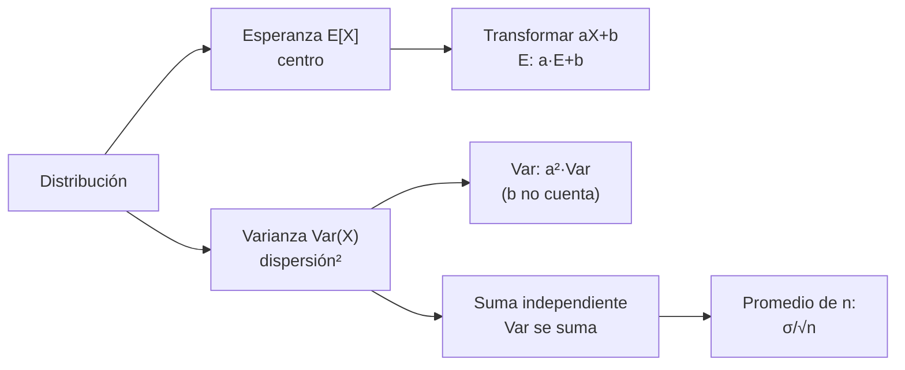

# B12-C04 — Esperanza y varianza

<!-- nav:top -->
[🏠 Programa](../../../../README.md) · [📚 Bloque B12](../../../tronco-comun/B12-probabilidad-estadistica-e-incertidumbre.md) · [← Anterior: B12-C03 — Distribuciones de probabilidad](../B12-C03-distribuciones-de-probabilidad/CLASE.md) · [Siguiente: B12-C05 — Covarianza y correlación →](../B12-C05-covarianza-y-correlacion/CLASE.md)
<!-- /nav -->

## 1. Ubicación, nivel y alcance

Cuarta clase del bloque B12. En [C03](../B12-C03-distribuciones-de-probabilidad/CLASE.md) conociste familias de distribuciones; ahora resumes cualquier distribución con dos números: su **centro** (esperanza) y su **dispersión** (varianza y desviación típica). Verás también cómo se combinan al transformar y sumar variables. Nivel N2. No verás aún la covarianza (C05) ni el estimador de la varianza a partir de datos (C07).

## 2. Por qué esta clase existe

Un ingeniero no maneja distribuciones completas; maneja «la medida es 150,0 m con una incertidumbre de 3 m». Esa frase usa exactamente una esperanza y una desviación típica. Entender qué son, cómo se calculan y qué propiedades tienen es la base del presupuesto de incertidumbre de toda misión.

Pregunta motivadora: **¿qué le pasa al centro y a la dispersión cuando escalas, sumas o promedias medidas?** Decisión central: **cuántas medidas repetir y cómo combinar errores para alcanzar una incertidumbre objetivo**.

## 3. Lo que podrás hacer al terminar

1. Calcular la esperanza y la varianza de una variable discreta y de una continua sencilla.
2. Aplicar `E[aX + b] = aE[X] + b` y `Var(aX + b) = a² Var(X)`.
3. Combinar errores independientes con `Var(X + Y) = Var X + Var Y`.
4. Explicar y usar `σ/√n` para el promedio de `n` medidas, y sus límites.
5. Distinguir sesgo de dispersión y calcular el error cuadrático medio.
6. Acotar una probabilidad con la desigualdad de Chebyshev.

La evidencia es la **ficha de combinación de errores** del ejercicio 12 (sección 20).

## 4. Con qué llegas y cómo comprobarlo

Necesitas C02 (pmf, densidad) y C03 (parámetros). Cinco preguntas:

1. ¿Cuánto es `Σ k·p(k)` si `p(0)=0,5` y `p(1)=0,5`?
2. ¿Cuánto vale la media de una normal `N(μ, σ)`?
3. ¿Cuánto es `√(9 + 16)`?
4. ¿Cuál es la media de una Poisson de parámetro 4?
5. ¿Cuánto es `(3 − 2,7)²`?

<details>
<summary>Ver respuestas</summary>

1. `0,5`. 2. `μ`. 3. `5`. 4. `4`. 5. `0,09`.
</details>

Con cuatro o cinco aciertos, sigue; si no, repasa C02 y C03.

## 5. Un caso: dos medidas de distancia

Una sonda **ilustrativa** mide su distancia a una estación con dos sistemas independientes: uno con error típico de `3,0 m` y otro de `4,0 m`, ambos sin sesgo. ¿Cuál es el error típico de su suma? ¿Y el de un promedio de 9 lecturas del primero? Además, el número de computadores operativos `X` de C02 (media y varianza se calculan exactamente) sirve de ejemplo discreto. Es el **ejemplo conductor**; los datos son **sintéticos e ilustrativos**.

## 6. Vocabulario

La **esperanza** (o valor esperado) `E[X]` es el promedio de los valores ponderado por su probabilidad (S1, C.2.9): `Σ x p(x)` en una discreta, `∫ x f(x) dx` en una continua. La **varianza** `Var(X)` es la esperanza del cuadrado de la variable centrada (S1, C.2.11): `E[(X − E[X])²] = E[X²] − (E[X])²`. La **desviación típica** `σ` es su raíz cuadrada positiva (S1, C.2.12); tiene la unidad de la variable. Un **estimador** del valor esperado a partir de `n` observaciones independientes en las mismas condiciones es la media aritmética (S1, 4.2.1); la **desviación típica experimental** estima `σ` con denominador `n − 1` (S1, 4.2.2). El **sesgo** de una medida es `E[error]`; el **error cuadrático medio** es `E[error²] = Var + sesgo²`. Dos variables son **independientes** si el valor de una no informa sobre la otra (formalización en C05).

## 7. Modelo mental: centro de masa y radio de giro

La esperanza es el punto de equilibrio de la distribución, como el centro de masa de una barra con pesos; la varianza es su momento de inercia respecto de ese centro, y la desviación típica su radio de giro.



*Descripción textual:* de la distribución se extraen centro y dispersión; al transformar linealmente el centro se escala y se desplaza mientras la varianza solo se escala al cuadrado; al sumar variables independientes se suman las varianzas, y de ahí el promedio de `n` medidas tiene desviación `σ/√n`.

Analogía: una barra con pesos y su momento de inercia. Su límite: una distribución con cola muy pesada puede no tener varianza finita (la «inercia» diverge), y entonces `σ/√n` deja de valer.

## 8. La explicación, paso a paso

### 8.1 Esperanza y varianza de una discreta

Para `X` = n.º de computadores operativos (pmf `0,001; 0,027; 0,243; 0,729`): `E[X] = 0·0,001 + 1·0,027 + 2·0,243 + 3·0,729 = 2,7`; `E[X²] = 0,027 + 4·0,243 + 9·0,729 = 7,56`; `Var(X) = 7,56 − 2,7² = 0,27`. Coincide con las fórmulas binomiales `np = 2,7` y `np(1−p) = 0,27`. Aquí `E[X] = 2,7` no es un valor que `X` pueda tomar: la esperanza es un promedio a largo plazo, no un valor típico.

### 8.2 Transformaciones lineales

Si `Y = aX + b`: `E[Y] = aE[X] + b` y `Var(Y) = a² Var(X)`. Con `Y = 2X + 1`: `E[Y] = 6,4` y `Var(Y) = 4·0,27 = 1,08`. La constante `b` desplaza pero no cambia la dispersión; el factor `a` la multiplica por `a²` (y la desviación típica por `|a|`). Esto justifica cambiar de unidades sin recalcular nada.

### 8.3 Una variable continua

Para un error uniforme en `[−a, a]`, `E = 0` y `Var = a²/3`; con `a = 2 m` queda `Var = 4/3 m²` y `σ = 1,155 m`. El GUM da la misma expresión para una distribución rectangular de semiancho `a` (S1, 4.3.7), lo que es la base de convertir una tolerancia «±a» en una incertidumbre típica `a/√3`.

### 8.4 Sumar errores independientes

Si `E₁` y `E₂` son independientes, `Var(E₁ + E₂) = Var E₁ + Var E₂`. Con `σ₁ = 3 m` y `σ₂ = 4 m`: `σ = √(9 + 16) = 5 m`. Las desviaciones típicas **no** se suman (serían 7 m): se suman las varianzas, como los lados de un triángulo rectángulo. La simulación da una varianza de `24,970 m²` frente a `25`. La resta tiene la misma varianza (`Var(−E₂) = Var E₂`).

### 8.5 El promedio de n medidas

Para `n` lecturas independientes de la misma cantidad con desviación `σ`, la media tiene varianza `σ²/n` y desviación `σ/√n`. Con `σ = 3 m` y `n = 9` queda `1 m` (la simulación da `1,0053`). Para lograr `0,5 m` hacen falta `n = 36`: reducir la incertidumbre a la mitad cuesta cuatro veces más medidas. Y hay un límite: si todas las lecturas comparten un sesgo `b`, el promedio conserva `b` por muchas que sean.

### 8.6 Chebyshev: una cota sin suponer la forma

Para cualquier variable con varianza finita, `P(|X − μ| ≥ kσ) ≤ 1/k²`. Es una cota gruesa: para una exponencial de media y desviación 1, la frecuencia de `|X − 1| ≥ 2` es `0,0498` (cota `0,25`) y la de `≥ 3`, `0,0181` (cota `0,1111`). Sirve cuando no conoces la distribución, a costa de ser conservadora.

## 9. Magnitudes, símbolos y unidades

| Símbolo | Qué es | Unidad | Nota |
|---|---|---|---|
| `E[X]` | esperanza | unidad de `X` | centro de la distribución |
| `Var(X)` | varianza | unidad² | `E[X²] − E[X]²` |
| `σ` | desviación típica | unidad de `X` | `√Var` |
| `a, b` | coeficientes de `aX + b` | — / unidad | |
| `n` | número de medidas | adimensional | |
| `b_s` | sesgo | unidad de `X` | `E[error]` |
| `k` | número de desviaciones | adimensional | en Chebyshev |

## 10. Convenciones y referencias

Los errores se definen como medida menos valor verdadero. Se trabaja con varianzas (unidad²) y se vuelve a desviación típica al informar. La desviación típica de una variable (poblacional, `σ`) se distingue de la experimental `s` (calculada con datos y `n − 1`, S1, 4.2.2). Unidades SI: metros.

## 11. De dónde sale lo que afirmamos

| ID | Fuente | Localizador | Respalda | Consulta |
|---|---|---|---|---|
| S1 | JCGM 100:2008 (GUM) | https://doi.org/10.59161/JCGM100-2008E | Esperanza (C.2.9), varianza (C.2.11), desviación típica (C.2.12); media aritmética (4.2.1) y desviación experimental (4.2.2); varianza rectangular `a²/3` (4.3.7) | 2026-11-05, PDF abierto y texto extraído |

Límites: las propiedades de linealidad, la suma de varianzas, `σ/√n` y la desigualdad de Chebyshev son resultados estándar no atribuidos a una fuente consultada; las desviaciones de 3 m y 4 m son **ilustrativas** y los datos, **sintéticos**.

## 12. Cómo ver el efecto de promediar

Equivalente accesible a una gráfica de `σ_media` contra `n` (cálculo exacto con `σ = 3 m`):

| `n` | 1 | 4 | 9 | 16 | 36 | 100 |
|---|---|---|---|---|---|---|
| `σ/√n` (m) | 3,00 | 1,50 | 1,00 | 0,75 | 0,50 | 0,30 |

Descripción larga: la curva baja con rapidez al principio y luego se aplana; pasar de 36 a 100 medidas sólo gana 0,2 m. Los rendimientos decrecen como `1/√n`.

## 13. Ejemplo trabajado: presupuesto de un rango

**Pregunta:** la distancia se estima como la media de 9 lecturas del primer sistema (`σ = 3 m`) más una corrección independiente de `σ = 4 m`; ¿cuál es el error típico?

**Paso 1 · Dato.** Primer término: media de 9 lecturas, `σ₁ = 3/√9 = 1 m`.

**Paso 2 · Segundo término.** `σ₂ = 4 m`, independiente.

**Paso 3 · Suma.** `σ = √(1² + 4²) = √17 = 4,12 m`.

**Paso 4 · Lectura.** Promediar mejoró la parte aleatoria, pero el término dominante es la corrección de 4 m: más lecturas del primer sistema ya no ayudan (con infinitas lecturas, `σ → 4 m`).

**Paso 5 · Comprobación.** La simulación del laboratorio con 200 000 grupos de 9 lecturas da `1,0053 m` para el primer término, coherente con `1 m`.

**Paso 6 · Sentido.** La mejora debe buscarse en el término dominante. Todo es **ilustrativo**.

## 14. Comparación de métodos

Para obtener una incertidumbre combinada se puede **sumar varianzas** (exacto si hay independencia y la relación es lineal), **sumar las desviaciones** (conservador, sobrestima si son independientes) o **simular** (general, cuesta cómputo). Sumar desviaciones es correcto sólo en el caso de dependencia total y del mismo signo; en la práctica, se suman varianzas con covarianzas (C05, C16). Chebyshev da una cota segura sin conocer la forma; la normal da una probabilidad más precisa si la forma se justifica.

## 15. Práctica guiada

**Ejercicio 1 · con los pasos indicados.** Una variable `K` toma `0, 1, 2` con probabilidades `0,5; 0,3; 0,2`. Calcula `E[K]` y `Var(K)`. *Pasos:* `E[K]`, `E[K²]`, restar (8.1).

<details><summary>Solución comentada</summary>

`E[K] = 0,3 + 0,4 = 0,7`; `E[K²] = 0,3 + 0,8 = 1,1`; `Var = 1,1 − 0,49 = 0,61`.
</details>

**Ejercicio 2 · con una pista.** Si `X` tiene `E = 2,7` y `Var = 0,27`, calcula `E` y `Var` de `W = 3X − 2`. *Pista:* el desplazamiento no afecta la varianza.

<details><summary>Solución comentada</summary>

`E[W] = 3·2,7 − 2 = 6,1`; `Var(W) = 9·0,27 = 2,43`.
</details>

**Ejercicio 3 · casi autónomo.** Calcula `σ` de un error uniforme en `[−2, 2] m` y la incertidumbre típica de una tolerancia «±0,5 m» (rectangular).

<details><summary>Solución comentada</summary>

`σ = 2/√3 = 1,155 m`. Para `±0,5 m`: `0,5/√3 = 0,289 m` (8.3).
</details>

## 16. Práctica autónoma, transferencia e integrador

**Ejercicio 4.** Con `σ₁ = 3 m` y `σ₂ = 4 m` independientes, ¿cuál es la desviación de `E₁ − E₂`?

<details><summary>Solución comentada</summary>

`Var(E₁ − E₂) = 9 + 16`, `σ = 5 m` (8.4).
</details>

**Ejercicio 5.** ¿Qué desviación tiene el promedio de 16 lecturas de `σ = 3 m`?

<details><summary>Solución comentada</summary>

`3/√16 = 0,75 m`.
</details>

**Ejercicio 6.** ¿Cuántas lecturas independientes hacen falta para que el promedio tenga `σ = 0,5 m`?

<details><summary>Solución comentada</summary>

`√n = 3/0,5 = 6`, `n = 36` (8.5).
</details>

**Ejercicio 7.** Un conteo Poisson de media `4` tiene `σ = 2`. Compara la cota de Chebyshev para `|N − 4| ≥ 4` con la probabilidad exacta (`P(N = 0) + P(N ≥ 8) = 0,0183 + 0,0511`).

<details><summary>Solución comentada</summary>

`k = 2`: cota `0,25`; exacta `0,0694`. La cota es segura pero holgada (8.6).
</details>

**Ejercicio 8.** Verifica `Var(X) = E[X²] − E[X]²` para el `X` de 8.1 con `E[X²]` calculado directamente.

<details><summary>Solución comentada</summary>

`E[X²] = 9·0,729 + 4·0,243 + 0,027 = 6,561 + 0,972 + 0,027 = 7,56`; `7,56 − 7,29 = 0,27`.
</details>

**Ejercicio 9 · transferencia.** Un telémetro tiene sesgo `+0,5 m` y desviación `1 m`. Calcula el error cuadrático medio y explica por qué promediar no lo arregla.

<details><summary>Solución comentada</summary>

`ECM = 1² + 0,5² = 1,25 m²` (RMS `1,118 m`). El promedio de `n` lecturas reduce la varianza a `1/n` pero conserva el sesgo: `ECM → 0,25 m²` y nunca baja de ahí.
</details>

**Ejercicio 10 · transferencia.** Para `σ = 3 m`, `n = 9` y un sesgo común `b = 0,3 m`, calcula el error RMS del promedio.

<details><summary>Solución comentada</summary>

`σ_media = 1 m`; `RMS = √(1² + 0,3²) = 1,044 m`. Con `n → ∞`, queda `0,3 m`.
</details>

**Ejercicio 11 · transferencia.** Elegir entre 1 computador (`p = 0,9`) y 3 en mayoría (`p = 0,972` de C01), si la misión vale 100 unidades y la triple redundancia cuesta 5 unidades. ¿Cuál tiene mayor valor esperado?

<details><summary>Solución comentada</summary>

A: `0,9·100 = 90`. B: `0,972·100 − 5 = 92,2`. B es mejor en valor esperado con estos números **ilustrativos**; la esperanza ignora el riesgo (la varianza del resultado), que una decisión real debe considerar.
</details>

**Ejercicio 12 · integrador.** Elabora tu *ficha de combinación de errores*: para una cantidad que depende de dos términos con incertidumbres distintas (una de ellas repetible por promedio), calcula la incertidumbre combinada para varios `n`, identifica el término dominante, verifica por simulación y decide cuántas repeticiones valen la pena.

<details><summary>Solución modelo</summary>

Tabla de `n` frente a `σ_total = √(σ₁²/n + σ₂²)`; con `σ₁ = 3`, `σ₂ = 4`: `5,00; 4,27; 4,12; 4,07` para `n = 1; 4; 9; 16`. Conclusión: pasar de `n = 9` a `16` gana sólo `0,05 m`; el término a reducir es el de 4 m. Debe incluir simulación con semilla y versiones, y datos rotulados como ilustrativos.
</details>

## 17. Laboratorio: esperanza, varianza y suma de errores

El script [esperanza_varianza.py](esperanza_varianza.py) calcula con fracciones exactas la media y la varianza de `X`, comprueba la linealidad y la suma de varianzas, simula el promedio de 9 lecturas y verifica la cota de Chebyshev; falla si una igualdad exacta no se cumple.

**Datos:** sintéticos. **Predice antes de ejecutar:** ¿qué varianza simulada esperas para la suma de dos errores de 3 y 4 m? (≈ `25 m²`.) **Ejecución del 2026-11-05 (Python 3.12.9, NumPy 2.4.4):**

```text
E[X] = 27/10 = 2.7   Var(X) = 27/100 = 0.27
Y=2X+1: E=6.4  Var=1.0800
sigma de la suma = 5.0 m (Pitagoras de las desviaciones)
varianza simulada de la suma = 24.970 m^2 (exacta 25)
desviacion de la media de 9 medidas = 1.0053 (exacta 1.0000)
Chebyshev k=2: frecuencia 0.0498 <= cota 0.2500
Chebyshev k=3: frecuencia 0.0181 <= cota 0.1111
Pruebas superadas.
```

```bash
python programa/clases/B12/B12-C04-esperanza-y-varianza/esperanza_varianza.py
```

**Límites:** errores independientes y sin sesgo; resultados **simulados**.

## 18. Errores frecuentes y cómo corregirlos

**Sumar desviaciones en lugar de varianzas.** Se corrige con 8.4 y el ejercicio 4.

**Creer que promediar elimina cualquier error.** Se corrige con los ejercicios 9 y 10.

**Pensar que `E[X]` es un valor posible de `X`.** Se corrige con 8.1.

**Olvidar el cuadrado: `Var(aX) = a² Var X`.** Se corrige con el ejercicio 2.

**Usar `σ/√n` con datos correlacionados.** Se anticipa en 8.5 y se desarrolla en C05.

## 19. Cómo sabrás que vas bien

Tras 8.2: ¿por qué sumar 1 no cambia la varianza? Si no lo explicas, ejercicio 2. Tras 8.4: ¿sabes por qué no es 7 m? Si no, ejercicio 4. Tras 8.5: ¿calculas cuántas lecturas se necesitan para una incertidumbre objetivo? Si no, ejercicio 6. Tras el laboratorio: ¿qué parte de la incertidumbre domina?

## 20. Qué entregas y cómo se evalúa

El producto es tu **ficha de combinación de errores** (ejercicio 12).

| Criterio | Inicial | En desarrollo | Logrado | Destacado |
|---|---|---|---|---|
| Cálculo de E y Var | Errores | Correcto con ayuda | Correcto con unidades | Verifica por dos caminos |
| Combinación | Suma desviaciones | Suma varianzas sin justificar | Justifica independencia | Cuantifica el término dominante |
| Promedio | Sin límites | Aplica `σ/√n` | Declara el límite del sesgo | Optimiza el número de lecturas |
| Verificación | Ninguna | Sin comparar | Simulación comparada | Explica la discrepancia |
| Rótulo y fuentes | Ausente | Parcial | Datos rotulados y fuente | Declara validez |

**Condiciones críticas (no se compensan con promedio):** sumar varianzas, no desviaciones; declarar independencia; rotular datos ilustrativos.

## 21. Ética, seguridad y límites

Una incertidumbre pequeña obtenida por promediar puede dar falsa confianza si hay un sesgo oculto. Reportar solo `σ/√n` sin discutir el sesgo es una mala práctica que ha causado errores reales en la ciencia. Los números de esta clase son ilustrativos. Accesibilidad: la gráfica se ofrece como tabla; todo se resuelve sin conexión.

## 22. Para cerrar y seguir

La esperanza es el centro; la varianza, la dispersión al cuadrado. Las transformaciones lineales las escalan; las varianzas de variables independientes se suman; el promedio de `n` lecturas gana un factor `√n`, hasta que domina el sesgo o el término irreductible. Queda abierta una pregunta: ¿qué pasa si dos errores **no** son independientes? Es la covarianza, tema de C05.

**Glosario español–inglés.** esperanza · *expected value*; varianza · *variance*; desviación típica · *standard deviation*; sesgo · *bias*; error cuadrático medio · *mean squared error*; desigualdad de Chebyshev · *Chebyshev's inequality*; independencia · *independence*.

**Continuidad.** B12-C05 reutiliza tu capacidad de **sumar varianzas** para añadir el término de covarianza cuando los errores no son independientes.

**Referencias:** ver sección 11.

<!-- nav:bottom -->
---

[← Anterior: B12-C03 — Distribuciones de probabilidad](../B12-C03-distribuciones-de-probabilidad/CLASE.md) · [📚 Bloque B12](../../../tronco-comun/B12-probabilidad-estadistica-e-incertidumbre.md) · [Siguiente: B12-C05 — Covarianza y correlación →](../B12-C05-covarianza-y-correlacion/CLASE.md)
<!-- /nav -->
