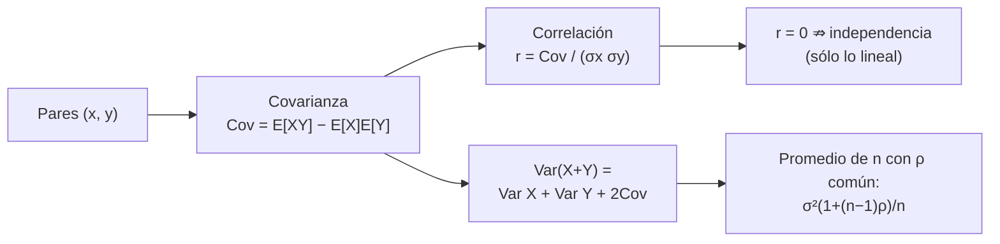

# B12-C05 — Covarianza y correlación

<!-- nav:top -->
[🏠 Programa](../../../../README.md) · [📚 Bloque B12](../../../tronco-comun/B12-probabilidad-estadistica-e-incertidumbre.md) · [← Anterior: B12-C04 — Esperanza y varianza](../B12-C04-esperanza-y-varianza/CLASE.md) · [Siguiente: B12-C06 — Teorema central del límite →](../B12-C06-teorema-central-del-limite/CLASE.md)
<!-- /nav -->

## 1. Ubicación, nivel y alcance

Quinta clase del bloque B12. En [C04](../B12-C04-esperanza-y-varianza/CLASE.md) sumaste varianzas suponiendo errores independientes. Aquí quitas ese supuesto: aprendes a medir **cuánto varían juntas** dos magnitudes (covarianza), a normalizarlo (correlación) y a ver qué le ocurre a la incertidumbre de una suma o de un promedio cuando los errores están ligados. Nivel N2. No verás aún la matriz de covarianza completa (C18) ni la propagación general (C16).

## 2. Por qué esta clase existe

En navegación espacial, la posición y la velocidad estimadas por un filtro **no** tienen errores independientes: un error de posición hacia delante suele ir acompañado de uno de velocidad. Ignorar esa relación da incertidumbres falsas, a veces demasiado optimistas y a veces demasiado pesimistas.

Pregunta motivadora: **¿cómo se mide y se usa la relación entre dos errores, y por qué `r = 0` no basta para decir que son independientes?** Decisión central: **si se puede tratar a dos errores como independientes o hay que modelar su covarianza**.

## 3. Lo que podrás hacer al terminar

1. Calcular la covarianza de dos variables discretas con `E[XY] − E[X]E[Y]`.
2. Calcular e interpretar el coeficiente de correlación de Pearson `r ∈ [−1, 1]`.
3. Aplicar `Var(X+Y) = Var X + Var Y + 2 Cov(X,Y)`.
4. Calcular la varianza de un promedio de `n` medidas con correlación común.
5. Dar un ejemplo en que `Cov = 0` y las variables dependen una de otra.
6. Verificar con simulación una covarianza y una correlación.

La evidencia es la **ficha de correlación** del ejercicio 12 (sección 20).

## 4. Con qué llegas y cómo comprobarlo

Necesitas C04 (esperanza, varianza, suma de varianzas) y C01 (probabilidad conjunta). Cinco preguntas:

1. ¿Cuánto vale `Var(X + Y)` para independientes con varianzas 9 y 16?
2. ¿Qué es `E[aX + b]`?
3. ¿Cuánto es `0,891 − 0,972 · 0,9`?
4. ¿Cuánto vale `√(0,64)`?
5. Si `P(A∩B) = P(A)P(B)`, ¿cómo son `A` y `B`?

<details>
<summary>Ver respuestas</summary>

1. `25`. 2. `aE[X] + b`. 3. `0,0162`. 4. `0,8`. 5. Independientes.
</details>

Con cuatro o cinco aciertos, sigue; si no, repasa C01 y C04.

## 5. Un caso: error de posición y de velocidad

Un filtro de navegación **ilustrativo** entrega, tras un tramo sin mediciones, un error de posición `X` con `σ_x = 3,0 m` y un error de velocidad `Y` con `σ_y = 4,0 mm/s`; al estar ligados por la dinámica, su correlación es `ρ = 0,8` (valor **ilustrativo**). Una combinación de ambos —por ejemplo, la posición predicha un instante después— suma sus efectos. Es el **ejemplo conductor**; los datos son **sintéticos**. (Para sumar «metros» y «milímetros por segundo» se expresan en unidades homogéneas; aquí `Y` se trata en metros efectivos tras multiplicar por el tiempo de predicción, de modo que `σ_y = 4,0 m`.)

## 6. Vocabulario

La **covarianza** `Cov(X,Y) = E[(X − E[X])(Y − E[Y])] = E[XY] − E[X]E[Y]` mide la variación conjunta; su unidad es el producto de las unidades; el GUM la define y tabula su papel en la propagación (S1, C.3.4; 5.2.2). El **coeficiente de correlación** `r(X,Y) = Cov(X,Y)/(σ_X σ_Y)` es adimensional y cumple `−1 ≤ r ≤ +1` (S1, 5.2.2, ecuación 14; C.3.6). Si `r = 0` las variables están **no correlacionadas**: un cambio en una no implica un cambio esperado en la otra (S1, 5.2.2). **Independientes** (S1, C.3.7) es más fuerte: la distribución de una no cambia al conocer la otra; independientes ⇒ `Cov = 0`, pero **no** al revés. **Correlación positiva** significa que tienden a subir juntas; **negativa**, que cuando una sube la otra baja. Correlación no implica causalidad.

## 7. Modelo mental: la nube de puntos inclinada

Imagina cada par `(x, y)` como un punto. Si la nube es una bola redonda, no hay relación; si se estira en diagonal, hay correlación; cuanto más delgada la elipse, más cerca de `±1`. La covarianza es la mitad «sin escala» de esa inclinación, y `r` la normaliza.



*Descripción textual:* de los pares se calcula la covarianza; normalizada da el coeficiente de correlación; la covarianza aparece en la varianza de una suma y determina cuánto ayuda promediar; `r = 0` sólo descarta la relación lineal.

Analogía: dos bailarines con una cuerda entre ellos; si se mueven en el mismo sentido, la cuerda no se tensa (suma grande); si se mueven opuestos, se anula. Su límite: la cuerda sólo ve movimientos lineales; una relación curva (como `Y = X²`) puede pasar inadvertida.

## 8. La explicación, paso a paso

### 8.1 Calcular una covarianza exacta

Con los eventos de C01, `A` = «al menos 2 computadores funcionan» (`0,972`) y `B` = «el 1 funciona» (`0,9`), y `P(A∩B) = 0,891`: los indicadores `1_A` y `1_B` (vale 1 si ocurre, 0 si no) tienen `E[1_A 1_B] = P(A∩B)`. Entonces `Cov = 0,891 − 0,972 · 0,9 = 0,0162` y `r = 0,0162/√(0,972·0,028 · 0,9·0,1) = 0,327`. Positiva: saber que el sistema funciona hace más probable que el computador 1 funcione (C01, 8.5).

### 8.2 Correlación cero y dependencia

Sea `X` uniforme en `{−2, −1, 0, 1, 2}` e `Y = X²`. `E[X] = 0`, `E[Y] = 2`, `E[XY] = E[X³] = 0`, luego `Cov = 0` y `r = 0`; pero `Y` está completamente determinada por `X`: `P(Y = 4 | X = 2) = 1` mientras `P(Y = 4) = 2/5`. La correlación de Pearson sólo detecta relaciones **lineales**.

### 8.3 La varianza de una suma

`Var(X + Y) = Var X + Var Y + 2 Cov(X,Y)`. Con `σ_x = 3`, `σ_y = 4` y `ρ = 0,8`: `Cov = 0,8 · 12 = 9,6` y `Var = 9 + 16 + 19,2 = 44,2 m²`, `σ = 6,65 m`. Si fueran independientes serían `25 m²` y `5 m`. La simulación da `44,24`. El mismo término con signo negativo reduce la incertidumbre de una diferencia: `Var(X − Y) = 9 + 16 − 19,2 = 5,8`.

### 8.4 Promediar con errores correlacionados

Para `n` medidas de varianza `σ²` con correlación común `ρ` entre cada par, `Var(media) = σ²[1 + (n−1)ρ]/n`. Con `σ² = 9 m²`, `ρ = 0,5` y `n = 9`: `9 (1 + 4)/9 = 5 m²` (la simulación da `4,98`), frente a `1 m²` si fueran independientes. Al crecer `n`, la varianza tiende a `σ²ρ = 4,5 m²`: promediar no puede eliminar la parte común. Es el mismo fenómeno del sesgo compartido de C04.

### 8.5 Estimar `r` con datos

Con una muestra se estima `r` y su incertidumbre no es despreciable para `n` pequeño; con `n = 10` un `r` de `0,5` es compatible con valores cercanos a cero. El `r` muestral no demuestra causalidad ni, por sí solo, una relación física.

### 8.6 Verificar con simulación

Con 1 000 000 de pares normales con `ρ = 0,8`, la correlación simulada es `0,8002` y la covarianza `9,609` (exacta `9,600`). Resultados **simulados** sobre datos **sintéticos**.

## 9. Magnitudes, símbolos y unidades

| Símbolo | Qué es | Unidad | Nota |
|---|---|---|---|
| `Cov(X,Y)` | covarianza | unidad(X)·unidad(Y) | `9,6 m²` en el caso |
| `r`, `ρ` | correlación (muestral/teórica) | adimensional | entre −1 y +1 |
| `σ_x, σ_y` | desviaciones típicas | m | `3,0` y `4,0` |
| `n` | número de medidas | adimensional | |
| `ρ_c` | correlación común entre medidas | adimensional | |
| `1_A` | indicador de `A` | adimensional | 1 si ocurre |

## 10. Convenciones y referencias

La correlación es simétrica: `r(X,Y) = r(Y,X)`. Los errores se definen como medida menos verdad. Las unidades de `X` e `Y` deben ser homogéneas antes de sumar (se multiplica la velocidad por el tiempo de predicción para tener metros). Se usa `ρ` para el valor teórico y `r` para el estimado.

## 11. De dónde sale lo que afirmamos

| ID | Fuente | Localizador | Respalda | Consulta |
|---|---|---|---|---|
| S1 | JCGM 100:2008 (GUM) | https://doi.org/10.59161/JCGM100-2008E | Covarianza (C.3.4), correlación (C.3.6, 5.2.2 ec. 14), independencia (C.3.7); término de covarianza en la varianza combinada (5.2.2 ec. 13) | 2026-11-05, PDF abierto y texto extraído |

Límites: la identidad `Var(X+Y)`, la desigualdad `|r| ≤ 1` y la fórmula del promedio con correlación común son resultados estándar no atribuidos a una fuente consultada; `ρ = 0,8` y las desviaciones son **ilustrativas** y los datos, **sintéticos**.

## 12. Cómo ver la correlación

Equivalente accesible a un diagrama de dispersión (datos **sintéticos**, `ρ = 0,8`): tabla de la varianza de `X + Y` según `ρ`.

| `ρ` | −1 | −0,5 | 0 | 0,5 | 0,8 | 1 |
|---|---|---|---|---|---|---|
| `Var(X+Y)` (m²) | 1 | 13 | 25 | 37 | 44,2 | 49 |
| `σ` (m) | 1,00 | 3,61 | 5,00 | 6,08 | 6,65 | 7,00 |

Descripción larga: con `ρ = +1` las desviaciones se suman (7 m); con `ρ = −1` casi se cancelan (1 m); la independencia (5 m) está en el medio. La gráfica correspondiente sería una elipse que pasa de inclinada hacia arriba a hacia abajo.

## 13. Ejemplo trabajado: ¿cuánto vale el error predicho?

**Pregunta:** la posición predicha es `X + Y` (ambos en metros); ¿qué incertidumbre tiene si `ρ = 0,8`?

**Paso 1 · Datos.** `σ_x = 3`, `σ_y = 4`, `ρ = 0,8`.

**Paso 2 · Covarianza.** `Cov = ρ σ_x σ_y = 9,6 m²`.

**Paso 3 · Varianza.** `9 + 16 + 2 · 9,6 = 44,2 m²`.

**Paso 4 · Desviación.** `σ = 6,65 m`.

**Paso 5 · Contraste.** Con independencia habría sido `5 m`: ignorar la correlación **subestima** la incertidumbre en un 25 %.

**Paso 6 · Comprobación.** La simulación da `44,24 m²`.

**Paso 7 · Sentido.** Con otra combinación (`X − Y`), la misma correlación **reduce** la incertidumbre a `√5,8 = 2,41 m`. Los valores son **ilustrativos**.

## 14. Comparación de métodos

Para tratar errores ligados se puede **ignorar** la correlación (rápido, puede subestimar o sobrestimar), **usar el peor caso** `ρ = +1` (seguro, muy conservador) o **modelar** la covarianza (preciso, exige datos o una física que la explique). Para detectar relación, `r` de Pearson mide lo lineal; si se sospecha una relación curva, hay que mirar el diagrama de dispersión o usar medidas de dependencia no lineal (no tratadas aquí).

## 15. Práctica guiada

**Ejercicio 1 · con los pasos indicados.** Calcula `Cov(1_A, 1_B)` con los números de 8.1. *Pasos:* `E[1_A 1_B] − E[1_A]E[1_B]`.

<details><summary>Solución comentada</summary>

`0,891 − 0,972 · 0,9 = 0,891 − 0,8748 = 0,0162`.
</details>

**Ejercicio 2 · con una pista.** Con `σ_x = 3`, `σ_y = 4`, `ρ = 0,8`, calcula `Var(X − Y)`. *Pista:* el término de covarianza cambia de signo.

<details><summary>Solución comentada</summary>

`9 + 16 − 19,2 = 5,8 m²`; `σ = 2,41 m`.
</details>

**Ejercicio 3 · casi autónomo.** Para `X` uniforme en `{−1, 0, 1}` e `Y = X²`, calcula `Cov(X,Y)` y di si son independientes.

<details><summary>Solución comentada</summary>

`E[X] = 0`, `E[XY] = E[X³] = 0`, `Cov = 0`. No son independientes: `P(Y=1|X=1) = 1`, `P(Y=1) = 2/3`.
</details>

## 16. Práctica autónoma, transferencia e integrador

**Ejercicio 4.** Calcula `r` de los indicadores de 8.1.

<details><summary>Solución comentada</summary>

`0,0162/√(0,972·0,028·0,9·0,1) = 0,0162/0,04949 = 0,327`.
</details>

**Ejercicio 5.** Dos errores con `σ = 2 m` cada uno y `ρ = −0,5`: ¿incertidumbre de su suma?

<details><summary>Solución comentada</summary>

`Var = 4 + 4 + 2(−0,5)(4) = 4`; `σ = 2 m`: menor que cada uno por separado.
</details>

**Ejercicio 6.** ¿Qué `ρ` hace que `σ(X+Y)` valga exactamente 7 m con `σ_x = 3`, `σ_y = 4`?

<details><summary>Solución comentada</summary>

`49 = 25 + 24ρ`, `ρ = 1`. Correlación perfecta: las desviaciones se suman.
</details>

**Ejercicio 7.** Promedio de 4 medidas con `σ² = 9 m²` y `ρ = 0,5`: varianza.

<details><summary>Solución comentada</summary>

`9 (1 + 3 · 0,5)/4 = 9 · 2,5/4 = 5,625 m²`; con independencia sería `2,25`.
</details>

**Ejercicio 8.** ¿A qué límite tiende la varianza de ese promedio cuando `n → ∞`?

<details><summary>Solución comentada</summary>

A `σ² ρ = 4,5 m²` (8.4): la parte común no se promedia.
</details>

**Ejercicio 9 · transferencia.** Dos sensores de una nave comparten la misma referencia de reloj, con un error común de `σ_c = 1 ms` y errores propios independientes de `σ_p = 2 ms`. Calcula la correlación entre sus errores totales y la varianza de su promedio.

<details><summary>Solución comentada</summary>

Cada error: `Var = 1 + 4 = 5 ms²`. `Cov = σ_c² = 1`. `ρ = 1/5 = 0,2`. Promedio de 2: `5 (1 + 0,2)/2 = 3 ms²`. Con independencia sería `2,5`.
</details>

**Ejercicio 10 · transferencia.** Un análisis halla `r = 0,02` entre la actividad solar y la tasa de fallas de un instrumento. ¿Concluyes que no hay relación?

<details><summary>Solución comentada</summary>

No: `r` pequeño sólo descarta una relación **lineal** fuerte (8.2). Podría haber una relación en umbral o curva; hay que mirar el diagrama de dispersión, la muestra y su incertidumbre (8.5).
</details>

**Ejercicio 11 · transferencia.** Un colega suma desviaciones típicas (7 m) para ser «conservador» con `ρ = 0,8`. ¿Es válido? ¿Cuánto sobrestima?

<details><summary>Solución comentada</summary>

Es seguro pero excesivo: el valor correcto es `6,65 m` y sumar da `7 m` (5 % más). Con `ρ` menor la diferencia crece (con `ρ = 0`: 7 frente a 5, 40 % más).
</details>

**Ejercicio 12 · integrador.** Elabora tu *ficha de correlación*: para dos magnitudes de tu elección, calcula covarianza y `r` con datos o un modelo, muestra la varianza de su suma y su diferencia, discute un caso en que `r = 0` no implica independencia y verifica por simulación.

<details><summary>Solución modelo</summary>

Debe incluir: definición de ambas magnitudes con unidades homogéneas; `Cov` y `r` con datos rotulados como sintéticos o ilustrativos; `Var(X±Y)` con el término de covarianza; un contraejemplo tipo `Y = X²`; simulación con semilla y versiones; límites (Pearson sólo capta relaciones lineales; muestra pequeña).
</details>

## 17. Laboratorio: covarianza y promedios correlacionados

El script [covarianza_correlacion.py](covarianza_correlacion.py) calcula covarianzas exactas con fracciones, comprueba el contraejemplo `Y = X²`, simula pares gaussianos correlacionados y compara la varianza de la suma y del promedio con las fórmulas; falla si una igualdad exacta o una tolerancia no se cumple.

**Datos:** sintéticos, `ρ = 0,8` ilustrativo. **Predice antes de ejecutar:** ¿cuánto vale `Var(X+Y)`? (`44,2 m²`.) **Ejecución del 2026-11-05 (Python 3.12.9, NumPy 2.4.4):**

```text
Y = X^2: E[X]=0, E[Y]=2, E[XY]=0, Cov=0
Cov = 0 pero Y depende de X (P(Y=4|X=2)=1 frente a P(Y=4)=2/5)
Cov(1_A,1_B) = 81/5000 = 0.0162
correlacion de los indicadores = 0.3273
r simulada = 0.8002 (rho = 0.8);  Cov = 9.609 (exacta 9.600)
Var(X+Y) = 44.24 (exacta 44.20); sin covarianza seria 25.00
Var(promedio de 9, rho=0.5) = 4.984 (exacta 5.000; independientes: 1.000)
limite n->infinito: sigma^2 * rho = 4.5 m^2
Pruebas superadas.
```

```bash
python programa/clases/B12/B12-C05-covarianza-y-correlacion/covarianza_correlacion.py
```

**Límites:** normalidad conjunta; resultados **simulados**.

## 18. Errores frecuentes y cómo corregirlos

**Concluir independencia de `r = 0`.** Se corrige con 8.2 y el ejercicio 3.

**Sumar varianzas ignorando la covarianza.** Se corrige con 8.3 y el ejercicio 2.

**Creer que promediar siempre reduce `1/n`.** Se corrige con 8.4 y los ejercicios 7 y 8.

**Interpretar correlación como causa.** Se corrige con el ejercicio 10.

**Mezclar unidades antes de sumar.** Se corrige con la sección 5 y el ejercicio 9.

## 19. Cómo sabrás que vas bien

Tras 8.2: ¿puedes inventar otro par con `r = 0` y dependencia? Si no, ejercicio 3. Tras 8.3: ¿cambia el signo de la covarianza al restar? Si dudas, ejercicio 2. Tras 8.4: ¿reconoces el límite de promediar? Si no, ejercicio 8. Tras el laboratorio: ¿qué cambia con `ρ = −0,8`?

## 20. Qué entregas y cómo se evalúa

El producto es tu **ficha de correlación** (ejercicio 12).

| Criterio | Inicial | En desarrollo | Logrado | Destacado |
|---|---|---|---|---|
| Cálculo de Cov y r | Errores | Correcto con ayuda | Correcto con unidades | Verifica por simulación |
| Suma y diferencia | Ignora Cov | Aplica con errores | Correcta en ambas | Compara con independencia |
| Contraejemplo | Ausente | Copiado | Propio y verificado | Explica el alcance de Pearson |
| Promedio | Usa `1/n` | Menciona correlación | Usa la fórmula con `ρ` | Calcula el límite |
| Rótulo y fuentes | Ausente | Parcial | Sintético/ilustrativo y fuente | Declara límites |

**Condiciones críticas (no se compensan con promedio):** no afirmar independencia por `r = 0`; homogeneizar unidades; rotular datos sintéticos.

## 21. Ética, seguridad y límites

Una correlación espuria presentada como relación física puede llevar a decisiones erróneas (por ejemplo, atribuir fallas a la actividad solar sin mecanismo). Los números de esta clase son ilustrativos. Accesibilidad: la dispersión se da como tabla; todo funciona sin conexión.

## 22. Para cerrar y seguir

La covarianza mide la variación conjunta; la correlación la normaliza a `[−1, 1]` y sólo capta lo lineal; la varianza de una suma incluye `2Cov`; promediar no elimina la parte común. Queda abierta una pregunta: ¿por qué el promedio de muchas medidas independientes se reparte casi siempre en forma de campana? Es el teorema central del límite (C06).

**Glosario español–inglés.** covarianza · *covariance*; correlación · *correlation*; coeficiente de Pearson · *Pearson coefficient*; independencia · *independence*; no correlacionadas · *uncorrelated*; indicador · *indicator*.

**Continuidad.** B12-C06 reutiliza tu capacidad de **calcular la varianza de una suma y de un promedio** para explicar la forma de la distribución del promedio.

**Referencias:** ver sección 11.

<!-- nav:bottom -->
---

[← Anterior: B12-C04 — Esperanza y varianza](../B12-C04-esperanza-y-varianza/CLASE.md) · [📚 Bloque B12](../../../tronco-comun/B12-probabilidad-estadistica-e-incertidumbre.md) · [Siguiente: B12-C06 — Teorema central del límite →](../B12-C06-teorema-central-del-limite/CLASE.md)
<!-- /nav -->
