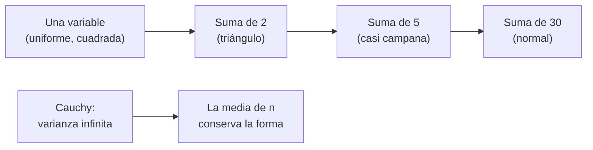

# B12-C06 — Teorema central del límite

<!-- nav:top -->
[🏠 Programa](../../../../README.md) · [📚 Bloque B12](../../../tronco-comun/B12-probabilidad-estadistica-e-incertidumbre.md) · [← Anterior: B12-C05 — Covarianza y correlación](../B12-C05-covarianza-y-correlacion/CLASE.md) · [Siguiente: B12-C07 — Estimación de parámetros →](../B12-C07-estimacion-de-parametros/CLASE.md)
<!-- /nav -->

## 1. Ubicación, nivel y alcance

Sexta clase del bloque B12. En [C04](../B12-C04-esperanza-y-varianza/CLASE.md) y [C05](../B12-C05-covarianza-y-correlacion/CLASE.md) calculaste la media y la varianza de un promedio. Aquí aprendes qué **forma** tiene su distribución: casi siempre una campana normal, aunque los datos individuales no lo sean. Nivel N2. Verás el enunciado, su evidencia numérica y su límite (colas pesadas). No verás la demostración ni los intervalos de confianza (C08).

## 2. Por qué esta clase existe

Ningún instrumento tiene ruido exactamente normal, y sin embargo casi todas las incertidumbres se expresan con campanas. La razón es que se reportan promedios y sumas de muchas contribuciones pequeñas. Entender el teorema justifica cuándo se puede usar la normal y cuándo hay que desconfiar.

Pregunta motivadora: **¿cuándo es legítimo tratar el promedio de varias medidas como normal, aunque cada medida no lo sea?** Decisión central: **si el número de medidas y la forma de sus errores permiten usar una aproximación normal**.

## 3. Lo que podrás hacer al terminar

1. Enunciar el teorema central del límite (TCL) con sus hipótesis.
2. Estandarizar un promedio y calcular probabilidades con la normal.
3. Medir la distancia entre la distribución del promedio y la normal en una simulación.
4. Estimar cuántos términos hacen falta para que la aproximación sea buena en un caso dado.
5. Reconocer un caso en que el teorema no se aplica (varianza infinita) y sus consecuencias.
6. Decidir entre usar la normal o simular.

La evidencia es el **informe de convergencia a la normal** del ejercicio 12 (sección 20).

## 4. Con qué llegas y cómo comprobarlo

Necesitas C03 (normal y uniforme) y C04 (`σ/√n`). Cinco preguntas:

1. ¿Cuál es la varianza de una uniforme en `[0, 1]`?
2. ¿Qué desviación tiene el promedio de 9 variables independientes de `σ = 3`?
3. ¿Cuánto vale `P(|Z| < 2)`?
4. ¿Cómo se estandariza un valor `x` de una normal `N(μ, σ)`?
5. ¿Qué es una densidad simétrica?

<details>
<summary>Ver respuestas</summary>

1. `1/12`. 2. `1`. 3. `0,9545`. 4. `(x − μ)/σ`. 5. Una cuyo gráfico se refleja respecto de su centro.
</details>

Con cuatro o cinco aciertos, sigue; si no, repasa C03 y C04.

## 5. Un caso: promediar un error acotado

Un convertidor analógico-digital **ilustrativo** comete un error de cuantización que, sin más información, es uniforme en `[0, 1]` unidades de cuenta: nada de campana. ¿Qué forma tiene el error del promedio de `n` lecturas? Es el **ejemplo conductor**; los datos son **sintéticos**. Como contraejemplo usaremos errores de Cauchy (de colas muy pesadas) para ver el teorema fallar.

## 6. Vocabulario

El **teorema central del límite** afirma que, para variables independientes con varianza finita, la distribución de su suma (o promedio) se aproxima a una normal cuando el número de términos crece; el GUM lo enuncia así: la distribución de una combinación lineal de variables independientes es aproximadamente normal aunque las variables no lo sean (S1, G.2). **Estandarizar** el promedio `X̄` significa formar `Z = (X̄ − μ)/(σ/√n)`, que se acerca a una normal estándar. La **distancia de Kolmogorov–Smirnov** (KS) entre la acumulada empírica y la normal es el máximo de la diferencia absoluta de ambas acumuladas. La **asimetría** mide qué tan desbalanceada está la distribución (cero en una simétrica). Una distribución de **colas pesadas** tiene valores extremos mucho más frecuentes que la normal; en la **de Cauchy** no existen la media ni la varianza. El **rango intercuartílico** (IQR) es la diferencia entre los percentiles 75 y 25.

## 7. Modelo mental: la campana como atractor de las sumas

Sumar variables independientes es mezclar sus formas; en cada mezcla se suavizan las esquinas y las asimetrías. Tras muchas mezclas queda siempre la misma silueta, de la que sólo importan el centro y la dispersión.



*Descripción textual:* una uniforme es un rectángulo; la suma de dos es un triángulo; con cinco términos es casi una campana; con treinta, indistinguible de una normal. Con colas demasiado pesadas, el promedio no se concentra.

Analogía: pulir una piedra con muchas pasadas pequeñas: sin importar la forma inicial, tiende a una forma redondeada. Su límite: si la piedra incluye un trozo gigantesco (valores extremos), el pulido nunca termina.

## 8. La explicación, paso a paso

### 8.1 Enunciado

Si `X₁, …, Xₙ` son independientes, con la misma distribución, media `μ` y varianza finita `σ²`, entonces `(X̄ − μ)/(σ/√n)` se aproxima a una normal estándar cuando `n` crece. Dicho en palabras: el promedio se centra en `μ`, su dispersión baja como `σ/√n` (ya sabido, C04) **y además** su forma tiende a la campana. El GUM lo usa para justificar que la incertidumbre combinada se trate como normal (S1, G.2).

### 8.2 Una comprobación exacta

La suma de dos uniformes en `[0, 1]` tiene forma de triángulo; `P(U₁ + U₂ ≤ 0,5) = 0,5²/2 = 0,125`, el área de un triángulo. La simulación da `0,1256`. Con tres términos, la densidad está formada por tres trozos de parábola, y con cinco ya es difícil distinguirla de la campana.

### 8.3 Cuántos términos hacen falta

Para el promedio de uniformes, la desviación observada coincide con `σ/√n` con `σ = 1/√12 = 0,2887`: `0,28846` (n=1), `0,20452` (n=2), `0,12905` (n=5), `0,05264` (n=30). La distancia KS contra la normal baja `0,0579 → 0,0180 → 0,0072 → 0,0014`. Ya con `n = 5` la discrepancia máxima es de 0,7 puntos porcentuales. Para uniformes, que son simétricas, 5 a 10 términos bastan para muchos fines; para distribuciones asimétricas (como la exponencial) hacen falta bastantes más.

### 8.4 La asimetría se diluye

La asimetría de los promedios simulados está en torno de `0,000 ± 0,008`: una uniforme es simétrica y así permanece. Para una distribución asimétrica, la asimetría del promedio decrece como `1/√n`: más lenta que la dispersión.

### 8.5 Cuando el teorema falla: Cauchy

Para la distribución de Cauchy la media de `n` observaciones tiene **la misma distribución que una sola**: el IQR de un dato es `1,992`; el de la media de 100 es `1,997`. Promediar no ayuda porque la varianza no existe. En datos reales con colas muy pesadas (por ejemplo, mediciones con fallas ocasionales de gran amplitud), la media puede ser un mal resumen y debe sustituirse por la mediana o por un estimador robusto (C11).

### 8.6 Consecuencia práctica

Para un promedio con `n` moderado y varianza finita, se puede decir `X̄ ≈ N(μ, σ²/n)`. Para colas pesadas o `n` pequeño, hay que simular (C14) o recurrir a la distribución `t` (C08). El teorema es una afirmación sobre el **centro** de la distribución; en las colas la aproximación es peor, justo donde importan los eventos raros.

## 9. Magnitudes, símbolos y unidades

| Símbolo | Qué es | Unidad | Nota |
|---|---|---|---|
| `X̄` | promedio de `n` variables | unidad de `X` | |
| `μ, σ` | media y desviación de cada término | unidad de `X` | `1/2` y `0,2887` en el caso |
| `n` | número de términos | adimensional | |
| `Z` | promedio estandarizado | adimensional | `(X̄ − μ)/(σ/√n)` |
| `KS` | distancia de Kolmogorov–Smirnov | adimensional | 0 a 1 |
| `IQR` | rango intercuartílico | unidad de `X` | `Q₇₅ − Q₂₅` |

## 10. Convenciones y referencias

Las variables son independientes e idénticamente distribuidas salvo que se diga lo contrario. La distancia KS se calcula con 200 000 repeticiones y una semilla fija. Las cuentas del convertidor se tratan como adimensionales.

## 11. De dónde sale lo que afirmamos

| ID | Fuente | Localizador | Respalda | Consulta |
|---|---|---|---|---|
| S1 | JCGM 100:2008 (GUM), Anexo G.2 | https://doi.org/10.59161/JCGM100-2008E | Enunciado práctico del teorema central del límite para una combinación lineal de variables | 2026-11-05, PDF abierto y texto extraído |

Límites: la formulación exacta con sus hipótesis, la tasa de convergencia y el caso de Cauchy son resultados estándar no atribuidos a una fuente consultada; el convertidor y sus rangos son **ilustrativos** y las simulaciones, **sintéticas**.

## 12. Cómo ver la convergencia

Equivalente accesible a cuatro histogramas superpuestos con una campana (resultados del laboratorio, **simulados**):

| `n` | Desviación del promedio | `σ/√n` | Asimetría | KS vs normal |
|---|---|---|---|---|
| 1 | 0,28846 | 0,28868 | +0,0015 | 0,0579 |
| 2 | 0,20452 | 0,20412 | −0,0001 | 0,0180 |
| 5 | 0,12905 | 0,12910 | +0,0057 | 0,0072 |
| 30 | 0,05264 | 0,05270 | −0,0076 | 0,0014 |

Descripción larga: con `n = 1` el histograma es un rectángulo; con `n = 2` un triángulo; con `n = 5` una campana apenas achatada en la cima y con `n = 30` una campana. La diferencia máxima de acumuladas se hace unas 40 veces menor entre `n = 1` y `n = 30`.

## 13. Ejemplo trabajado: ¿cuántas lecturas para usar la normal?

**Pregunta:** el error medio de 30 lecturas del convertidor, ¿se puede tratar como normal para calcular `P(|X̄ − 0,5| < 0,1)`?

**Paso 1 · Parámetros.** `μ = 0,5`, `σ = 0,2887`, `n = 30`, `σ/√n = 0,0527`.

**Paso 2 · Estandarizar.** `0,1/0,0527 = 1,897` desviaciones.

**Paso 3 · Normal.** `P(|Z| < 1,897) = erf(1,897/√2) ≈ 0,942`.

**Paso 4 · Calidad.** Con `n = 30` la distancia KS es `0,0014`: la diferencia máxima entre acumuladas es del orden de la propia precisión de la simulación (200 000 repeticiones), así que la probabilidad de un intervalo difiere de la normal en menos de `2 × KS`.

**Paso 5 · Conclusión.** Es legítimo: respuesta `0,942`, con una discrepancia de aproximación del orden de `0,003` o menos.

**Paso 6 · Sentido.** Si los errores fueran de colas pesadas, no valdría. El error del convertidor es **ilustrativo**, los resultados **simulados**.

## 14. Comparación de métodos

Para la distribución de un promedio hay tres opciones: **usar la normal** (rápida, exige varianza finita y `n` suficiente), **usar la `t`** (cuando se estima `σ` con los mismos datos, C08) y **simular** (general, necesaria para colas pesadas o `n` pequeño). La normal es peor en las colas: la probabilidad de eventos extremos (`> 4σ`) puede errar en órdenes de magnitud si la distribución original es asimétrica.

## 15. Práctica guiada

**Ejercicio 1 · con los pasos indicados.** Calcula `σ/√n` para el promedio de 5 uniformes en `[0, 1]`. *Pasos:* `σ = 1/√12`, dividir por `√5`.

<details><summary>Solución comentada</summary>

`0,2887/2,236 = 0,1291`; coincide con la tabla de la sección 12.
</details>

**Ejercicio 2 · con una pista.** Estandariza `X̄ = 0,6` con `n = 30`. *Pista:* `(0,6 − 0,5)/0,0527`.

<details><summary>Solución comentada</summary>

`Z = 1,897`.
</details>

**Ejercicio 3 · casi autónomo.** ¿Probabilidad aproximada de que `X̄ > 0,6`?

<details><summary>Solución comentada</summary>

`P(Z > 1,897) ≈ (1 − 0,942)/2 = 0,029`.
</details>

## 16. Práctica autónoma, transferencia e integrador

**Ejercicio 4.** ¿Cuántos términos reducen la desviación del promedio a un décimo de la de un solo término?

<details><summary>Solución comentada</summary>

`1/√n = 0,1`, `n = 100`.
</details>

**Ejercicio 5.** Con la tabla de 12, ¿cuántas veces menor es el KS con `n = 5` que con `n = 1`?

<details><summary>Solución comentada</summary>

`0,0579/0,0072 ≈ 8,0`.
</details>

**Ejercicio 6.** Para `n = 2`, calcula `P(U₁ + U₂ ≤ 1)` como área.

<details><summary>Solución comentada</summary>

La mitad del cuadrado unidad: `0,5`.
</details>

**Ejercicio 7.** ¿Por qué `P(U₁ + U₂ ≤ 0,5) = 0,125` no puede venir de la normal con exactitud?

<details><summary>Solución comentada</summary>

La suma de dos uniformes es acotada (entre 0 y 2) y triangular; la normal tiene cola infinita y otra forma. Con `n = 2` el TCL es sólo una aproximación gruesa: `KS = 0,018`.
</details>

**Ejercicio 8.** El IQR de una normal estándar es `1,349`. Predice el IQR del promedio de 100 normales estándar.

<details><summary>Solución comentada</summary>

Se reduce como `σ/√n`: `1,349/10 = 0,135`. Contrasta con Cauchy, donde no baja (8.5).
</details>

**Ejercicio 9 · transferencia.** La potencia diaria generada por un panel varía de forma asimétrica entre días (muchos soleados, algunos nublados). Se promedian 7 días. ¿Qué cuidados tomas al usar la normal?

<details><summary>Solución comentada</summary>

Con 7 términos y asimetría, la aproximación normal es mediocre en las colas; conviene simular la distribución del promedio (C14) o usar un intervalo basado en `t` con precaución. Además los días consecutivos pueden estar correlacionados (C05), lo que invalida la independencia del teorema.
</details>

**Ejercicio 10 · transferencia.** Un instrumento produce, con probabilidad 1 % por lectura, un valor aberrante de amplitud enorme. ¿Qué hace el promedio de 1000 lecturas? ¿Y la mediana?

<details><summary>Solución comentada</summary>

El promedio contiene unas 10 lecturas gigantes que lo arrastran; la mediana, no. Es la motivación de la regresión robusta (C11) y de la detección de atípicos (C19).
</details>

**Ejercicio 11 · transferencia.** Un colega afirma: «con `n = 10` el error del promedio es normal porque lo dice el teorema». Evalúa la afirmación para (a) uniformes y (b) exponenciales.

<details><summary>Solución comentada</summary>

(a) Aceptable (KS pequeño ya con 5). (b) La exponencial es asimétrica; con 10 términos queda una asimetría residual apreciable, y las colas se aproximan peor. La respuesta depende de la forma, de `n` y del uso (centro o colas).
</details>

**Ejercicio 12 · integrador.** Elabora tu *informe de convergencia a la normal*: elige una distribución de error (simétrica y asimétrica), simula promedios para cuatro valores de `n`, tabula desviación, asimetría y distancia KS, compara con la teoría y concluye cuántos términos usarías.

<details><summary>Solución modelo</summary>

Tabla con `n`, desviación frente a `σ/√n`, asimetría y KS; la simétrica converge más rápido que la asimétrica; conclusión con criterio explícito (p. ej., KS < 0,01); semilla y versiones declaradas; límites: independencia, varianza finita; datos sintéticos.
</details>

## 17. Laboratorio: promedios y la campana

El script [tcl_promedios.py](tcl_promedios.py) simula promedios de uniformes, mide desviación, asimetría y distancia KS, contrasta con la fórmula exacta de la suma de dos uniformes y muestra que Cauchy no converge; falla si la desviación se aparta más de 1 % de `σ/√n`, si el KS no decrece o si el IQR de Cauchy baja.

**Datos:** sintéticos. **Predice antes de ejecutar:** ¿cuánto vale el KS con `n = 30`? (menos de `0,01`.) **Ejecución del 2026-11-05 (Python 3.12.9, NumPy 2.4.4, SciPy 1.17.1):**

```text
P(U1+U2 <= 0.5) simulada = 0.1256 (exacta 0.1250)
  n   desv.media  sigma/sqrt(n)  asimetria  KS vs normal
  1   0.28846     0.28868     +0.0015     0.0579
  2   0.20452     0.20412     -0.0001     0.0180
  5   0.12905     0.12910     +0.0057     0.0072
 30   0.05264     0.05270     -0.0076     0.0014
Cauchy: IQR de 1 dato = 1.992; IQR de la media de 100 = 1.997 (no baja)
Pruebas superadas.
```

```bash
python programa/clases/B12/B12-C06-teorema-central-del-limite/tcl_promedios.py
```

**Límites:** variables independientes; resultados **simulados**.

## 18. Errores frecuentes y cómo corregirlos

**Pensar que los datos «se vuelven normales» al tener muchos.** Es el promedio quien se aproxima; se corrige con 8.1.

**Aplicar el teorema con varianza infinita.** Se corrige con 8.5 y el ejercicio 10.

**Usar la normal en las colas con pocos términos.** Se corrige con 8.6 y el ejercicio 11.

**Olvidar la independencia.** Se corrige con el ejercicio 9 y C05.

**Confundir KS con error de cada probabilidad.** KS es el máximo; se corrige con el paso 4 de 13.

## 19. Cómo sabrás que vas bien

Tras 8.2: ¿reconoces por qué la suma de dos uniformes es triangular? Si no, ejercicio 6. Tras 8.3: ¿sabes cuándo basta `n = 5`? Si dudas, ejercicio 5. Tras 8.5: ¿explicas por qué Cauchy no converge? Si no, ejercicio 10.

## 20. Qué entregas y cómo se evalúa

El producto es tu **informe de convergencia a la normal** (ejercicio 12).

| Criterio | Inicial | En desarrollo | Logrado | Destacado |
|---|---|---|---|---|
| Hipótesis del teorema | Ausentes | Parciales | Independencia y varianza finita | Comprueba ambas |
| Simulación | Sin semilla | Sin comparar | Con semilla y tabla | Con dos distribuciones |
| Medida de ajuste | Visual | KS sin interpretar | KS interpretado | Relaciona KS con la decisión |
| Límite | No lo menciona | Menciona Cauchy | Lo muestra | Propone alternativa (mediana, simulación) |
| Rótulo y fuentes | Ausente | Parcial | Sintético y fuente | Declara validez |

**Condiciones críticas (no se compensan con promedio):** declarar independencia y varianza finita; distinguir centro y colas; rotular datos sintéticos.

## 21. Ética, seguridad y límites

Usar la normal en las colas sin comprobarlo puede subestimar eventos raros y llevar a riesgos mal evaluados (por ejemplo, dosis de radiación o errores extremos de posición). Nada de esta clase es una evaluación de riesgo real. Accesibilidad: histogramas ofrecidos como tabla; todo funciona sin conexión.

## 22. Para cerrar y seguir

El promedio de muchos términos independientes de varianza finita se reparte casi como una normal, con centro `μ` y dispersión `σ/√n`; la aproximación mejora con `n` y con la simetría, es peor en las colas y falla si la varianza es infinita. Queda abierta una pregunta: si no conocemos `μ` ni `σ`, ¿cómo los estimamos a partir de los datos? Es la estimación de parámetros (C07).

**Glosario español–inglés.** teorema central del límite · *central limit theorem*; estandarizar · *standardize*; distancia de Kolmogorov–Smirnov · *Kolmogorov–Smirnov distance*; asimetría · *skewness*; colas pesadas · *heavy tails*; rango intercuartílico · *interquartile range*.

**Continuidad.** B12-C07 reutiliza tu capacidad de **describir la distribución de un promedio** para evaluar la calidad de un estimador.

**Referencias:** ver sección 11.

<!-- nav:bottom -->
---

[← Anterior: B12-C05 — Covarianza y correlación](../B12-C05-covarianza-y-correlacion/CLASE.md) · [📚 Bloque B12](../../../tronco-comun/B12-probabilidad-estadistica-e-incertidumbre.md) · [Siguiente: B12-C07 — Estimación de parámetros →](../B12-C07-estimacion-de-parametros/CLASE.md)
<!-- /nav -->
