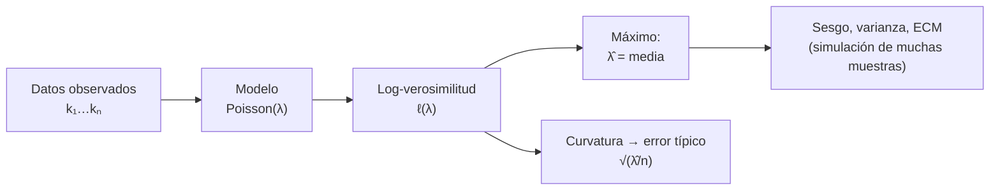

# B12-C07 — Estimación de parámetros

<!-- nav:top -->
[🏠 Programa](../../../../README.md) · [📚 Bloque B12](../../../tronco-comun/B12-probabilidad-estadistica-e-incertidumbre.md) · [← Anterior: B12-C06 — Teorema central del límite](../B12-C06-teorema-central-del-limite/CLASE.md) · [Siguiente: B12-C08 — Intervalos de confianza →](../B12-C08-intervalos-de-confianza/CLASE.md)
<!-- /nav -->

## 1. Ubicación, nivel y alcance

Séptima clase del bloque B12. Hasta aquí los parámetros (tasa `λ`, media `μ`, desviación `σ`) eran datos del problema; en la práctica se **desconocen** y se infieren de mediciones. Esta clase enseña a construir estimadores —en especial el de máxima verosimilitud—, a juzgar su calidad (sesgo, varianza, error cuadrático) y a dar el error típico de la estimación. Nivel N2–N3. No verás todavía intervalos de confianza (C08) ni inferencia bayesiana (C12).

## 2. Por qué esta clase existe

Una misión no «conoce» la tasa de impactos ni el ruido de su sensor: los estima a partir de unas decenas de datos. Un estimador mal elegido, o mal interpretado, da parámetros sesgados o con una confianza injustificada.

Pregunta motivadora: **¿cómo se obtiene el mejor valor de un parámetro a partir de los datos y cuánto se puede confiar en él?** Decisión central: **qué estimador usar y qué incertidumbre atribuirle**.

## 3. Lo que podrás hacer al terminar

1. Distinguir parámetro, estimador y estimación.
2. Construir la log-verosimilitud de un modelo sencillo y hallar su máximo (analítica y numéricamente).
3. Calcular sesgo, varianza y error cuadrático medio de un estimador.
4. Explicar por qué la varianza muestral usa `n − 1` y comprobarlo por enumeración.
5. Dar el error típico de un estimador de máxima verosimilitud y compararlo con la cota de Cramér–Rao en un caso.
6. Verificar un estimador con una simulación de muchas muestras.

La evidencia es la **ficha de estimador** del ejercicio 12 (sección 20).

## 4. Con qué llegas y cómo comprobarlo

Necesitas C03 (Poisson, normal), C04 (esperanza, varianza) y C06 (distribución del promedio). Cinco preguntas:

1. ¿Cuál es la media de una Poisson de parámetro `λ`?
2. ¿Qué es `Σ kᵢ ln λ` para los datos `1, 2` y `λ = e`?
3. ¿Qué desviación tiene el promedio de `n` datos de desviación `σ`?
4. ¿Cuánto vale `ln 1`?
5. ¿Para qué valor de `x` se anula la derivada de `3 ln x − x`?

<details>
<summary>Ver respuestas</summary>

1. `λ`. 2. `3`. 3. `σ/√n`. 4. `0`. 5. `x = 3`.
</details>

Con cuatro o cinco aciertos, sigue; si no, repasa C03, C04 y B09.

## 5. Un caso: la tasa de un detector

Un detector **ilustrativo** registró los conteos `4, 2, 3, 7, 3, 5, 1, 3, 4, 5` en diez intervalos de 10 minutos (datos **sintéticos**, generados con `λ = 4,0` y una semilla fija; en la práctica el valor verdadero se desconoce). ¿Cuál es la mejor estimación de `λ`, cuánto error tiene, y cómo estimar también la varianza de un ruido normal? Es el **ejemplo conductor**.

## 6. Vocabulario

Una **estadística** es una función de los datos de la muestra; una **estimación** es la operación de asignar valores numéricos a los parámetros a partir de una muestra, un **estimador** es la estadística usada para ello y una **estimación** (resultado) es su valor para una muestra concreta (S1, C.2.23–C.2.26). La **verosimilitud** `L(θ)` es la probabilidad (o densidad) de los datos observados vista como función del parámetro `θ`; la **log-verosimilitud** `ℓ(θ) = ln L(θ)` convierte productos en sumas. El **estimador de máxima verosimilitud** (MLE) `θ̂` es el valor que maximiza `L`. El **sesgo** de un estimador es `E[θ̂] − θ`; es **insesgado** si vale cero. Su **error cuadrático medio** es `E[(θ̂ − θ)²] = Var(θ̂) + sesgo²`. Un estimador es **consistente** si converge al valor verdadero al crecer `n`. El **error típico** (*standard error*) es la desviación típica del estimador. El GUM estima la esperanza con la media aritmética y la varianza con la desviación experimental de denominador `n − 1` (S1, 4.2.1 y 4.2.2).

## 7. Modelo mental: buscar el parámetro que hace más plausibles los datos

Dado un modelo, cada valor posible del parámetro asigna una probabilidad a los datos que viste. El MLE es el valor que le da la mayor. La curvatura de `ℓ` alrededor del máximo dice cuánto confiar: un pico agudo indica un parámetro bien determinado; uno plano, poco.



*Descripción textual:* de los datos y del modelo se construye la log-verosimilitud; su máximo es el estimador y su curvatura da el error típico; la calidad del estimador se valida repitiendo el experimento muchas veces.

Analogía: sintonizar una radio hasta que la señal sea más nítida; la nitidez es la verosimilitud, y un pico ancho significa que hay muchas posiciones casi igual de buenas. Su límite: aquí la «señal» solo es nítida si el modelo es correcto.

## 8. La explicación, paso a paso

### 8.1 Log-verosimilitud de Poisson

Para conteos independientes `k₁, …, kₙ` de una Poisson, `ℓ(λ) = Σᵢ (kᵢ ln λ − λ − ln kᵢ!)`. Derivando e igualando a cero, `Σkᵢ/λ − n = 0`, queda `λ̂ = (1/n) Σ kᵢ`: la media muestral. Para los diez datos, `Σ kᵢ = 37` y `λ̂ = 3,7`. El laboratorio busca el máximo en una rejilla de 70 001 puntos y obtiene el mismo valor, `3,7000`.

### 8.2 Error típico

La varianza de `λ̂` es `λ/n` (suma de `n` variables independientes de varianza `λ`, dividida por `n²`). Estimada, `√(λ̂/n) = √(0,37) = 0,608`. Se reporta `λ̂ = 3,7 ± 0,6` eventos por intervalo de 10 min. La cota de Cramér–Rao —que fija la menor varianza posible de un estimador insesgado— coincide con `λ/n` para este modelo: la media es el mejor estimador insesgado posible.

### 8.3 Sesgo y simulación

Repitiendo el experimento 200 000 veces con `λ = 4` y `n = 10`, la varianza del MLE es `0,4009` (teórica `0,4000`) y su sesgo `+0,0007`: insesgado. Esa es la forma de comprobar un estimador: simular muchas muestras de un modelo conocido y ver si el estimador acierta en promedio y con la dispersión esperada.

### 8.4 Estimar un ruido normal

Para `n` datos normales, el MLE de la media es la media muestral y el de la varianza usa el divisor `n`: `σ̂² = (1/n) Σ (xᵢ − x̄)²`. Pero ese estimador **subestima**: `E[σ̂²] = (n − 1)σ²/n`. Con `n = 5` y `σ² = 9`, la esperanza es `7,2`; la simulación da `7,209`. Con el divisor `n − 1`, `s²`, el sesgo desaparece: simulado `9,011` (S1, 4.2.2).

### 8.5 La prueba exacta del `n − 1`

Sea una población `{0, 1}` equiprobable, de varianza `1/4`, y muestras de tamaño 2 con reemplazo: `(0,0), (0,1), (1,0), (1,1)`. Las sumas de cuadrados valen `0, 1/2, 1/2, 0`. Con divisor `n = 2`, el promedio de las cuatro muestras es `1/8`; con divisor `n − 1 = 1`, es `1/4 = σ²`. El divisor `n − 1` compensa que `x̄` se calculó con los mismos datos y deja la suma de cuadrados más pequeña de lo debido.

### 8.6 Sesgo frente a varianza

Un estimador ligeramente sesgado puede tener menor error cuadrático medio que uno insesgado. Hay que decidir según el uso: para propagar incertidumbres suele preferirse el insesgado; para predecir con muestras muy pequeñas, a veces uno sesgado pero menos variable. Un estimador que siempre devuelve `3,7`, ignore los datos, tiene varianza cero pero sesgo enorme si `λ` es otro.

## 9. Magnitudes, símbolos y unidades

| Símbolo | Qué es | Unidad | Nota |
|---|---|---|---|
| `θ` | parámetro genérico | según el caso | |
| `θ̂` | estimador / estimación | igual que `θ` | |
| `λ` | tasa por intervalo | eventos | `3,7` estimado |
| `ℓ(θ)` | log-verosimilitud | adimensional | |
| `n` | tamaño de muestra | adimensional | 10 |
| `s²`, `σ̂²` | varianza con `n − 1` / con `n` | unidad² | |
| `SE` | error típico | unidad de `θ` | `0,608` |

## 10. Convenciones y referencias

El sombrero `^` indica estimación. Los conteos son por intervalo de 10 min. Se declara el modelo antes de estimar: Poisson para conteos, normal para ruido. Con el divisor `n − 1` el texto escribe `s²`; con `n`, `σ̂²`.

## 11. De dónde sale lo que afirmamos

| ID | Fuente | Localizador | Respalda | Consulta |
|---|---|---|---|---|
| S1 | JCGM 100:2008 (GUM) | https://doi.org/10.59161/JCGM100-2008E | Definiciones de estadística, estimación, estimador y estimación (C.2.23–C.2.26); media aritmética (4.2.1) y desviación experimental con `n − 1` (4.2.2) | 2026-11-05, PDF abierto y texto extraído |

Límites: la derivación del MLE de Poisson, la cota de Cramér–Rao y el sesgo `(n−1)/n` son resultados estándar no atribuidos a una fuente consultada; los conteos y `λ = 4` son **sintéticos e ilustrativos**.

## 12. Cómo ver la verosimilitud

Equivalente accesible a la gráfica de `ℓ(λ)` para los diez conteos (cálculo propio, valores relativos al máximo):

| `λ` | 2,5 | 3,0 | 3,7 | 4,5 | 5,5 |
|---|---|---|---|---|---|
| `ℓ(λ) − ℓ(3,7)` | −2,51 | −0,76 | 0 | −0,76 | −3,33 |

Descripción larga: la curva sube hasta el máximo en `3,7` y baja a los dos lados; es algo más empinada a la izquierda de `3,7` que a la derecha. A una distancia de un error típico (`λ̂ ± 0,6`) la caída es de aproximadamente `0,5`; esa caída de media unidad marca el rango de valores plausibles.

## 13. Ejemplo trabajado: tasa del detector y su error

**Paso 1 · Modelo.** Conteos independientes `Poisson(λ)`.

**Paso 2 · Log-verosimilitud.** `ℓ(λ) = 37 ln λ − 10 λ − Σ ln kᵢ!`.

**Paso 3 · Máximo.** `37/λ − 10 = 0`, `λ̂ = 3,7`.

**Paso 4 · Error típico.** `√(3,7/10) = 0,61`.

**Paso 5 · Reporte.** `λ̂ = 3,7 ± 0,6` por 10 min, es decir `0,37 ± 0,06 min⁻¹`.

**Paso 6 · Contraste con el valor generador.** El valor usado para generar los datos era `4,0`: está a `0,3/0,61 ≈ 0,5` errores típicos del estimado, coherente. En una situación real ese valor no se conoce.

**Paso 7 · Sentido.** Los datos son **sintéticos**; con diez intervalos la incertidumbre relativa es de 16 %. Si la tasa no fuera constante, el error típico sería engañoso.

## 14. Comparación de métodos

Hay tres caminos: **método de los momentos** (igualar momentos teóricos y muestrales; sencillo, a veces ineficiente), **máxima verosimilitud** (eficiente para muestras grandes, exige un modelo) y **mínimos cuadrados** (óptimo con ruido normal; C10). Para Poisson y para la media normal, los tres coinciden con la media muestral. Para la varianza normal, el MLE es sesgado y suele sustituirse por `s²`. Con muestras pequeñas o modelos dudosos, ninguno reemplaza la validación por simulación.

## 15. Práctica guiada

**Ejercicio 1 · con los pasos indicados.** Con conteos `2, 5, 3, 4`, calcula `λ̂` y su error típico. *Pasos:* media, `√(λ̂/n)` (8.1–8.2).

<details><summary>Solución comentada</summary>

`λ̂ = 14/4 = 3,5`; `SE = √(3,5/4) = 0,935`.
</details>

**Ejercicio 2 · con una pista.** Para `4, 6, 5` calcula `s²` y `σ̂²`. *Pista:* suma de cuadrados respecto de `5`.

<details><summary>Solución comentada</summary>

Suma `1 + 0 + 1 = 2`. `s² = 2/2 = 1`; `σ̂² = 2/3`.
</details>

**Ejercicio 3 · casi autónomo.** Para una única observación `k = 3`, compara `ℓ(2)` y `ℓ(3)` y di cuál `λ` es más verosímil.

<details><summary>Solución comentada</summary>

`ℓ(λ) = 3 ln λ − λ − ln 6`: `ℓ(2) = −1,712`, `ℓ(3) = −1,496`. `λ = 3` es más verosímil (de hecho es el MLE).
</details>

## 16. Práctica autónoma, transferencia e integrador

**Ejercicio 4.** El tiempo entre eventos es exponencial de tasa `r`. Con datos de media `2,5 min`, estima `r` (MLE `r̂ = 1/media`).

<details><summary>Solución comentada</summary>

`ℓ(r) = n ln r − rΣt`; derivando, `r̂ = n/Σt = 1/2,5 = 0,4 min⁻¹`.
</details>

**Ejercicio 5.** ¿Cuál es la esperanza de `σ̂²` (divisor `n`) con `n = 5` y `σ² = 9`?

<details><summary>Solución comentada</summary>

`(n−1)σ²/n = 4·9/5 = 7,2` (8.4).
</details>

**Ejercicio 6.** ¿Cuántos intervalos hacen falta para que `SE` de `λ̂` sea `0,2` si `λ ≈ 4`?

<details><summary>Solución comentada</summary>

`√(4/n) = 0,2`, `n = 4/0,04 = 100`.
</details>

**Ejercicio 7.** Compara dos estimadores de `μ` con `σ = 3 m` y `n = 9`: la media y sólo la primera observación.

<details><summary>Solución comentada</summary>

Ambos insesgados. Desviaciones: `1 m` y `3 m`. La media es 9 veces más eficiente (varianza).
</details>

**Ejercicio 8.** Convierte `λ̂ = 3,7 ± 0,61` por 10 min a una tasa por minuto.

<details><summary>Solución comentada</summary>

Se divide por 10: `0,37 ± 0,061 min⁻¹`.
</details>

**Ejercicio 9 · transferencia.** De 30 pruebas de un mecanismo, 27 salieron bien. Estima la probabilidad de éxito `p` y su error típico (MLE `p̂ = éxitos/n`, `SE = √(p̂(1−p̂)/n)`).

<details><summary>Solución comentada</summary>

`p̂ = 0,9`; `SE = √(0,09/30) = 0,0548`. Con 30 pruebas, ±0,055: no distingue `0,9` de `0,85`.
</details>

**Ejercicio 10 · transferencia.** Los datos `4, 2, 3, 70` incluyen un valor aberrante. Calcula media y mediana; ¿cuál usarías y por qué?

<details><summary>Solución comentada</summary>

Media `19,75`; mediana `3,5`. El MLE bajo normalidad (la media) se arrastra por el atípico; la mediana, no. Es la motivación de C11 y C19.
</details>

**Ejercicio 11 · transferencia.** Un estimador devuelve siempre `3,7`. ¿Cuál es su varianza, su sesgo y su ECM si `λ = 4,0`? ¿Es bueno?

<details><summary>Solución comentada</summary>

Varianza `0`, sesgo `−0,3`, `ECM = 0,09`. Menor que `0,4` de la media con `n = 10`, pero sólo porque acertó por azar; con `λ = 6` su ECM sería `5,29`. Un estimador se juzga para todos los valores plausibles del parámetro.
</details>

**Ejercicio 12 · integrador.** Elabora tu *ficha de estimador*: elige un modelo (Poisson, exponencial o normal), simula datos con un parámetro conocido, deriva el MLE, calcula sesgo, varianza y ECM con 10 000 repeticiones y reporta la estimación de una muestra con su error típico.

<details><summary>Solución modelo</summary>

Debe incluir: modelo y supuestos; log-verosimilitud y su máximo (analítico y numérico); tabla con sesgo, varianza y ECM simulados frente a los teóricos; la estimación de una muestra con `±SE` y unidades; semilla y versiones; datos rotulados como sintéticos.
</details>

## 17. Laboratorio: MLE, sesgo y cota

El script [estimacion_parametros.py](estimacion_parametros.py) maximiza la log-verosimilitud de Poisson en rejilla, prueba con fracciones exactas el sesgo del divisor `n`, y simula la varianza del MLE y el sesgo de la varianza normal; falla si el MLE numérico y el analítico difieren más de `10⁻³` o si el sesgo exacto no es el esperado.

**Datos:** sintéticos, `λ = 4,0` ilustrativo. **Predice antes de ejecutar:** ¿qué esperanza tiene la varianza con divisor `n` para `n = 5` y `σ² = 9`? (`7,2`.) **Ejecución del 2026-11-05 (Python 3.12.9, NumPy 2.4.4):**

```text
conteos: [4, 2, 3, 7, 3, 5, 1, 3, 4, 5]  suma = 37
lambda_MLE por rejilla = 3.7000; media muestral = 3.7000
error tipico estimado sqrt(lambda_hat/n) = 0.6083
sigma^2 = 1/4; E[divisor n] = 1/8; E[divisor n-1] = 1/4
Var(MLE) simulada = 0.4009; lambda/n = 0.4000
sesgo del MLE = +0.0007 (insesgado)
normal sigma^2 = 9: E[divisor n] = 7.209 (teorica 7.2); E[divisor n-1] = 9.011
Pruebas superadas.
```

```bash
python programa/clases/B12/B12-C07-estimacion-de-parametros/estimacion_parametros.py
```

**Límites:** independencia y tasa constante; resultados **simulados**.

## 18. Errores frecuentes y cómo corregirlos

**Confundir el parámetro con su estimación.** Se corrige con la sección 6 y el paso 6 de 13.

**Usar el divisor `n` sin pensar.** Se corrige con 8.4–8.5 y el ejercicio 2.

**Reportar la estimación sin su error típico.** Se corrige con el ejercicio 1.

**Creer que un estimador insesgado siempre es mejor.** Se corrige con 8.6 y el ejercicio 11.

**Aplicar el MLE con un modelo equivocado.** Se corrige con el ejercicio 10.

## 19. Cómo sabrás que vas bien

Tras 8.1: ¿derivas `λ̂ = media`? Si no, ejercicio 3. Tras 8.2: ¿calculas el error típico a mano? Si no, ejercicio 1. Tras 8.5: ¿explicas por qué el divisor `n − 1`? Si no, ejercicio 2.

## 20. Qué entregas y cómo se evalúa

El producto es tu **ficha de estimador** (ejercicio 12).

| Criterio | Inicial | En desarrollo | Logrado | Destacado |
|---|---|---|---|---|
| Modelo y supuestos | Ausentes | Parciales | Declarados | Discute su validez |
| Estimador | Sin derivar | Derivado con ayuda | Derivado y verificado | Compara con otro estimador |
| Calidad | No evalúa | Sesgo sin varianza | Sesgo, varianza y ECM | Interpreta la compensación |
| Reporte | Sin error | Con error sin unidades | Estimación ± SE con unidades | Cita cuántas cifras justifica |
| Rótulo y fuentes | Ausente | Parcial | Sintético y fuente | Declara límites |

**Condiciones críticas (no se compensan con promedio):** declarar el modelo; acompañar toda estimación con su error típico; rotular datos sintéticos.

## 21. Ética, seguridad y límites

Una estimación con pocos datos y un modelo no comprobado puede dar una falsa sensación de precisión. Ninguna tasa de esta clase es de una misión real. Accesibilidad: las curvas se ofrecen como tabla; todo funciona sin conexión.

## 22. Para cerrar y seguir

Un estimador convierte datos en un valor del parámetro; el de máxima verosimilitud maximiza la plausibilidad de los datos; su calidad se resume en sesgo, varianza y ECM; el error típico acompaña siempre a la estimación. Queda abierta una pregunta: ¿cómo expresar el rango de valores plausibles del parámetro con un nivel de confianza declarado? Es el intervalo de confianza (C08).

**Glosario español–inglés.** estimador · *estimator*; estimación · *estimate*; máxima verosimilitud · *maximum likelihood*; sesgo · *bias*; error cuadrático medio · *mean squared error*; error típico · *standard error*; consistente · *consistent*; cota de Cramér–Rao · *Cramér–Rao bound*.

**Continuidad.** B12-C08 reutiliza tu capacidad de **estimar un parámetro y su error típico** para construir un intervalo de confianza.

**Referencias:** ver sección 11.

<!-- nav:bottom -->
---

[← Anterior: B12-C06 — Teorema central del límite](../B12-C06-teorema-central-del-limite/CLASE.md) · [📚 Bloque B12](../../../tronco-comun/B12-probabilidad-estadistica-e-incertidumbre.md) · [Siguiente: B12-C08 — Intervalos de confianza →](../B12-C08-intervalos-de-confianza/CLASE.md)
<!-- /nav -->
