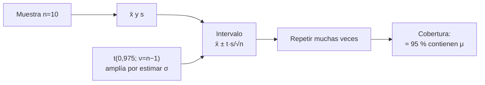

# B12-C08 — Intervalos de confianza

<!-- nav:top -->
[🏠 Programa](../../../../README.md) · [📚 Bloque B12](../../../tronco-comun/B12-probabilidad-estadistica-e-incertidumbre.md) · [← Anterior: B12-C07 — Estimación de parámetros](../B12-C07-estimacion-de-parametros/CLASE.md) · [Siguiente: B12-C09 — Pruebas de hipótesis →](../../../tronco-comun/B12-probabilidad-estadistica-e-incertidumbre.md#b12-c09)
<!-- /nav -->

## 1. Ubicación, nivel y alcance

Octava clase del bloque B12. En [C07](../B12-C07-estimacion-de-parametros/CLASE.md) obtuviste una estimación y su error típico. Aquí conviertes ambos en un **intervalo de confianza**: un rango de valores con un nivel de confianza declarado, y aprendes qué significa y qué no significa. Nivel N3. Usarás la distribución `t` de Student. No verás pruebas de hipótesis (C09) ni intervalos bayesianos (C12).

## 2. Por qué esta clase existe

Un número sin rango es una afirmación sin evidencia de su precisión. «La distancia es 148,5 m» no dice si el valor es fiable al metro o al decámetro. Un intervalo con su nivel de confianza lo dice, y permite decidir si una medición cumple un requisito o si hay que tomar más datos.

Pregunta motivadora: **¿qué rango de valores es compatible con mis diez medidas, y qué quiero decir exactamente al llamarlo «de confianza del 95 %»?** Decisión central: **cuántos datos tomar para que el intervalo sea suficientemente estrecho para la decisión**.

## 3. Lo que podrás hacer al terminar

1. Calcular un intervalo `t` para la media y escribir su interpretación correcta.
2. Explicar por qué se usa `t` y no la normal cuando `σ` se estima con los mismos datos.
3. Estimar el tamaño de muestra necesario para un semiancho dado.
4. Verificar por simulación que un intervalo tiene la cobertura que dice tener.
5. Calcular un intervalo aproximado para un conteo o una proporción y reconocer cuándo falla.
6. Evitar las interpretaciones erróneas más comunes (probabilidad del parámetro, solapamiento).

La evidencia es el **informe de cobertura** del ejercicio 12 (sección 20).

## 4. Con qué llegas y cómo comprobarlo

Necesitas C06 (distribución del promedio) y C07 (estimador y error típico). Cinco preguntas:

1. ¿Qué desviación típica tiene el promedio de 10 datos con `s = 3`?
2. ¿Cuánto vale `P(|Z| < 1,96)`?
3. ¿Qué es el error típico?
4. ¿Qué dice el TCL del promedio?
5. ¿Por qué se usa `n − 1` en `s²`?

<details>
<summary>Ver respuestas</summary>

1. `3/√10 = 0,949`. 2. `0,95`. 3. La desviación típica del estimador. 4. Que es aproximadamente normal. 5. Para que `s²` sea insesgada.
</details>

Con cuatro o cinco aciertos, sigue; si no, repasa C06 y C07.

## 5. Un caso: diez medidas de una distancia

Diez medidas independientes de una distancia a un reflector (valor verdadero **conocido solo por el simulador**: `150,0 m`, con ruido normal de `σ = 3,0 m`; datos **sintéticos**) dan media `148,499 m` y desviación experimental `s = 3,773 m`. ¿Entre qué valores razonables está la distancia verdadera? Es el **ejemplo conductor**.

## 6. Vocabulario

Un **intervalo de confianza** bilateral es un par de funciones de los datos `T₁ < T₂` tales que, repetido el experimento, la fracción de veces que el intervalo contiene el parámetro es el **nivel de confianza** (S1, C.2.27 y C.2.29). Un intervalo del 95 % se construye de modo que el 95 % de los intervalos así calculados contenga el valor verdadero. La **distribución `t` de Student** con `ν` grados de libertad es la distribución de `(x̄ − μ)/(s/√n)` cuando los datos son normales y `ν = n − 1` (S1, G.3.2 y C.3.8). El **semiancho** del intervalo es `t · s/√n`. La **cobertura** es la fracción real de intervalos que contienen el parámetro; la **cobertura nominal** es la que se declara. El NIST escribe el intervalo para la media como `Ȳ ± t_{1−α/2, N−1} s/√N` (S2).

## 7. Modelo mental: lanzar redes

Cada muestra produce una red (un intervalo) que se lanza para atrapar un pez (el parámetro) que no se mueve. Un procedimiento del 95 % es uno cuyas redes atrapan el pez en 95 de cada 100 lanzamientos. Una vez lanzada una red, el pez está o no está dentro; la probabilidad del 95 % describe el **procedimiento**, no ese intervalo concreto.



*Descripción textual:* de cada muestra se calculan media y desviación; el intervalo se construye con el cuantil `t`, que es mayor que 1,96 para compensar que `σ` se estimó; si se repite el experimento, aproximadamente el 95 % de los intervalos contiene el parámetro.

Analogía: el arquero que acierta el 95 % de sus tiros; no sabes si este tiro en particular acertó. Su límite: en un experimento real solo hay un tiro, y la «puntería» depende de que el modelo (normalidad, independencia) sea correcto.

## 8. La explicación, paso a paso

### 8.1 El intervalo `t`

Con `n = 10`, `x̄ = 148,499 m`, `s = 3,773 m`: el cuantil `t(0,975; 9) = 2,2622`, y el semiancho es `2,2622 · 3,773/√10 = 2,699 m`. El intervalo del 95 % es **[145,800; 151,198] m**. Contiene `150,0` (el simulador lo sabe; en la práctica no).

### 8.2 Por qué `t` y no `1,96`

Si `σ` fuera conocida, el intervalo sería `x̄ ± 1,96 σ/√n`. Al reemplazar `σ` por `s`, se agrega variabilidad: con pocos datos, `s` puede estar por debajo del valor verdadero y el intervalo sería demasiado corto. El cuantil `t` es mayor que 1,96 (2,262 para `ν = 9`) y converge a 1,96 al crecer `n` (1,975 para `n = 160`). Comprobación independiente: la integral numérica de la densidad `t` con 9 grados de libertad entre `±2,2622` vale `0,950000`.

### 8.3 Verificar la cobertura

Con 100 000 repeticiones del experimento: la cobertura del intervalo `t` es **`0,9507`**; con `σ` conocida y 1,96, **`0,9518`**; con `s` estimada pero 1,96 (error común), **`0,9199`**: un «95 %» que en realidad es 92 %. La simulación es la forma de saber si un intervalo hace lo que promete.

### 8.4 Cuántas medidas

El semiancho de un intervalo es `t · s/√n`. Con `s = 3 m`: `n = 4` → `4,774 m`; `n = 10` → `2,146 m`; `n = 40` → `0,959 m`; `n = 160` → `0,468 m`. Para reducir el semiancho a la mitad se necesita aproximadamente cuatro veces más datos. Una estimación previa del tamaño: `n ≈ (1,96 s/semiancho)²` (aproximación normal; añadir unos pocos si `n` sale pequeño).

### 8.5 Qué significa y qué no

Correcto: «el procedimiento que produjo este intervalo cubre el valor verdadero en el 95 % de las repeticiones». Incorrecto: «hay un 95 % de probabilidad de que `μ` esté en [145,8; 151,2]» (para un intervalo ya calculado, `μ` está o no está dentro). Hablar de probabilidad del parámetro es el terreno bayesiano (C12), con otros supuestos y otra interpretación. Tampoco es correcto «el 95 % de las medidas cae en el intervalo»: para eso se necesita un intervalo de predicción, más ancho.

### 8.6 Otros casos aproximados

Para un conteo Poisson, un intervalo aproximado es `λ̂ ± 1,96√(λ̂/n)`; con `λ̂ = 3,7`, `n = 10`: `[2,51; 4,89]`. Para una proporción, `p̂ ± 1,96√(p̂(1−p̂)/n)`; con `p̂ = 0,9`, `n = 30` el límite superior sale mayor que 1 (`1,007`), señal de que la aproximación falla cerca de los extremos y con `n` pequeño; hay que usar métodos exactos o bayesianos.

## 9. Magnitudes, símbolos y unidades

| Símbolo | Qué es | Unidad | Nota |
|---|---|---|---|
| `x̄` | media muestral | m | `148,499` |
| `s` | desviación experimental | m | `3,773` |
| `n` | tamaño de muestra | adimensional | 10 |
| `ν = n − 1` | grados de libertad | adimensional | 9 |
| `t_{1−α/2,ν}` | cuantil de la `t` | adimensional | `2,2622` |
| `1 − α` | nivel de confianza | adimensional | 0,95 |
| semiancho | `t s/√n` | m | `2,699` |

## 10. Convenciones y referencias

Intervalos bilaterales y simétricos salvo que se diga lo contrario. Las medidas se suponen independientes y aproximadamente normales. El nivel se declara siempre junto al intervalo («IC 95 %»). Distancias en metros.

## 11. De dónde sale lo que afirmamos

| ID | Fuente | Localizador | Respalda | Consulta |
|---|---|---|---|---|
| S1 | JCGM 100:2008 (GUM) | https://doi.org/10.59161/JCGM100-2008E | Intervalo de confianza bilateral y nivel (C.2.27, C.2.29); distribución `t` con `ν = n − 1` (G.3.2, C.3.8) | 2026-11-05, PDF abierto y texto extraído |
| S2 | NIST/SEMATECH, *e-Handbook of Statistical Methods*, §1.3.5.2 «Confidence Limits for the Mean» | https://www.itl.nist.gov/div898/handbook/eda/section3/eda352.htm | Fórmula `Ȳ ± t_{1−α/2,N−1} s/√N` | 2026-11-05, página abierta |
| S3 | NIST/SEMATECH, *e-Handbook*, §1.3.6.7.2 «Critical Values of the Student's t Distribution» | https://www.itl.nist.gov/div898/handbook/eda/section3/eda3672.htm | Tabla de valores críticos de la `t`; uso bilateral con la columna 0,975 | 2026-11-05, página abierta |

Límites: los cuantiles se calculan con SciPy y se comprueban con una integración numérica propia (no con la tabla de S3, cuyos valores no se transcriben aquí); la interpretación de la cobertura y las aproximaciones para Poisson y proporciones son resultados estándar no atribuidos a una fuente consultada; los datos son **sintéticos**.

## 12. Cómo ver el intervalo

Equivalente accesible a una gráfica de semiancho contra `n` (cálculo propio, `s = 3 m`):

| `n` | 4 | 10 | 40 | 160 |
|---|---|---|---|---|
| `t(0,975; n−1)` | 3,182 | 2,262 | 2,023 | 1,975 |
| Semiancho (m) | 4,774 | 2,146 | 0,959 | 0,468 |

Descripción larga: el semiancho cae de 4,8 m a 0,47 m al pasar de 4 a 160 datos; el factor `t` aporta una mejora adicional del 38 % entre `n = 4` y `n = 160`. La recta objetivo de ±1 m se cruza entre `n = 10` y `n = 40`.

## 13. Ejemplo trabajado: ¿cumple el requisito?

**Pregunta:** el requisito exige conocer la distancia con un semiancho no mayor que `1 m` con confianza 95 %. ¿Basta con 10 medidas?

**Paso 1 · Datos.** `n = 10`, `s = 3,773 m`.

**Paso 2 · Intervalo.** Semiancho `2,699 m` (8.1).

**Paso 3 · Comparación.** `2,699 > 1 m`: no cumple.

**Paso 4 · Tamaño necesario.** `n ≈ (1,96 · 3,773/1)² ≈ 54,7`, es decir unas 55; con `t` en lugar de 1,96 hay que verificar valores cercanos.

**Paso 5 · Comprobación.** Con `n = 57` el semiancho es `1,001 m` (no cumple); con `n = 58`, `0,992 m` (cumple). Se piden 58 medidas.

**Paso 6 · Sentido.** La estimación de `s` con 10 datos es incierta; se recalcula con los datos nuevos. Los datos son **sintéticos**.

## 14. Comparación de métodos

El **intervalo `t`** es el estándar para la media con datos normales y `n` pequeño. El **intervalo normal** (1,96) vale con `σ` conocida o `n` grande. Los **intervalos por simulación** (*bootstrap*) o **bayesianos** sirven cuando no hay normalidad. Para proporciones y conteos, los intervalos aproximados fallan cerca de los extremos. Un **intervalo de predicción** responde otra pregunta: dónde caerá la próxima medida, y es más ancho.

## 15. Práctica guiada

**Ejercicio 1 · con los pasos indicados.** Con `x̄ = 150`, `s = 3`, `n = 9` y `t(0,975; 8) = 2,306`, calcula el IC 95 %. *Pasos:* semiancho, extremos.

<details><summary>Solución comentada</summary>

Semiancho `2,306 · 3/3 = 2,306`; IC `[147,694; 152,306]`.
</details>

**Ejercicio 2 · con una pista.** Repite con `n = 36` (`t(0,975; 35) = 2,030`). *Pista:* `√36 = 6`.

<details><summary>Solución comentada</summary>

Semiancho `2,030 · 3/6 = 1,015`; IC `[148,985; 151,015]`. Cuatro veces más datos: menos de la mitad del semiancho.
</details>

**Ejercicio 3 · casi autónomo.** ¿Cuántos datos hacen falta, con la aproximación normal, para un semiancho de `0,5 m` con `s = 3 m`?

<details><summary>Solución comentada</summary>

`n = (1,96 · 3/0,5)² = 138,3`; se toman 139 (más unos pocos por usar `t`).
</details>

## 16. Práctica autónoma, transferencia e integrador

**Ejercicio 4.** Para `n = 10`, `s = 3 m` y confianza 99 % (`t(0,995; 9) = 3,250`), ¿cuál es el semiancho? ¿Qué cuesta la mayor confianza?

<details><summary>Solución comentada</summary>

`3,250 · 3/√10 = 3,083 m`, frente a `2,146 m` al 95 %: 44 % más ancho.
</details>

**Ejercicio 5.** Un colega dice «hay 95 % de probabilidad de que el valor verdadero esté en [145,8; 151,2]». ¿Qué le responderías?

<details><summary>Solución comentada</summary>

Que el 95 % describe el procedimiento (8.5): una vez calculado, el valor verdadero está dentro o no. La afirmación de probabilidad sobre el parámetro requiere un enfoque bayesiano (C12) con sus supuestos.
</details>

**Ejercicio 6.** Se calculan 100 intervalos del 95 % de muestras independientes. ¿Cuántos esperas que contengan el parámetro y qué variación es razonable?

<details><summary>Solución comentada</summary>

Unos 95; el conteo es binomial `B(100; 0,95)` con desviación `√(100·0,95·0,05) = 2,2`: entre 91 y 99 es normal.
</details>

**Ejercicio 7.** Calcula el IC aproximado para `λ` con `λ̂ = 3,7`, `n = 10`.

<details><summary>Solución comentada</summary>

`3,7 ± 1,96 √0,37 = 3,7 ± 1,192`: `[2,51; 4,89]` por 10 min.
</details>

**Ejercicio 8.** Aplica la fórmula de proporción a `27` éxitos en `30` y comenta.

<details><summary>Solución comentada</summary>

`p̂ = 0,9`, `SE = 0,0548`, IC `0,9 ± 0,107 = [0,793; 1,007]`. El límite pasa de 1: la aproximación no es fiable aquí; usar un método exacto o bayesiano.
</details>

**Ejercicio 9 · transferencia.** Dos métodos dan estimaciones `150,0` y `153,5 m`, cada una con error típico `1,2 m` e IC al 95 % de semiancho `2,35 m` aproximado. Los intervalos se solapan. ¿Concluyes que no hay diferencia?

<details><summary>Solución comentada</summary>

No necesariamente. El error típico de la diferencia es `1,2 √2 = 1,70`; `3,5/1,70 = 2,06 > 1,96`: la diferencia es significativa al 5 % pese al solapamiento. Compara la diferencia con su propio error, no los intervalos entre sí.
</details>

**Ejercicio 10 · transferencia.** Una calibración exige que la media se conozca a `±1 m` con 95 %, con `s ≈ 3 m` por lectura. ¿Cuántas lecturas hacen falta, y qué ocurre si hay un sesgo sistemático de `0,5 m`?

<details><summary>Solución comentada</summary>

Unas 36 (`(1,96·3)² = 34,6`, más ajuste por `t`). Un sesgo de 0,5 m **no** se reduce con más lecturas: el intervalo estaría centrado en un valor desplazado 0,5 m y su cobertura real sería menor que 95 %.
</details>

**Ejercicio 11 · transferencia.** Si los datos reales tienen colas pesadas, ¿qué esperas de la cobertura de un IC `t` con `n = 10`? ¿Cómo lo comprobarías?

<details><summary>Solución comentada</summary>

Puede quedar por debajo del 95 % o ser inestable. Se comprueba simulando datos con esa forma (C14) y midiendo la cobertura, como en 8.3.
</details>

**Ejercicio 12 · integrador.** Elabora tu *informe de cobertura*: simula 20 000 muestras de un modelo conocido para `n = 5` y `n = 20`; calcula la cobertura de los intervalos `t` y de los de 1,96; compara con el nivel nominal y concluye cuántos datos exigirías.

<details><summary>Solución modelo</summary>

Tabla con cobertura por método y por `n` (el de 1,96 con `n = 5` queda muy por debajo del 95 %); semiancho medio; conclusión con criterio explícito; semilla, versiones; datos sintéticos; límites: normalidad e independencia.
</details>

## 17. Laboratorio: intervalo `t` y cobertura

El script [intervalos_confianza.py](intervalos_confianza.py) calcula el intervalo de las diez medidas, comprueba el cuantil `t` con una integración numérica propia (Simpson) y mide la cobertura de tres procedimientos; falla si la integral no vale `0,95` o si la cobertura del intervalo `t` sale de `[0,945; 0,955]`.

**Datos:** sintéticos. **Predice antes de ejecutar:** ¿cuál será la cobertura de «1,96 con `s`» con `n = 10`? (algo menos de 0,93.) **Ejecución del 2026-11-05 (Python 3.12.9, NumPy 2.4.4, SciPy 1.17.1):**

```text
media = 148.499 m  s = 3.773 m  t(0.975, 9) = 2.2622
IC 95 % = [145.800, 151.198] m  (semiancho 2.699 m)
integral de la densidad t entre +-t = 0.950000
cobertura intervalo t = 0.9507; con 1.96 y s estimada = 0.9199; sigma conocida = 0.9518
n=   4  t=3.182  semiancho para s=3 m: 4.774 m
n=  10  t=2.262  semiancho para s=3 m: 2.146 m
n=  40  t=2.023  semiancho para s=3 m: 0.959 m
n= 160  t=1.975  semiancho para s=3 m: 0.468 m
Pruebas superadas.
```

```bash
python programa/clases/B12/B12-C08-intervalos-de-confianza/intervalos_confianza.py
```

**Límites:** datos normales e independientes; resultados **simulados**.

## 18. Errores frecuentes y cómo corregirlos

**Interpretar el 95 % como probabilidad del parámetro.** Se corrige con 8.5 y el ejercicio 5.

**Usar 1,96 con pocos datos.** Se corrige con 8.2–8.3.

**Comparar intervalos por solapamiento.** Se corrige con el ejercicio 9.

**Creer que más datos eliminan cualquier error.** Se corrige con el ejercicio 10.

**Dar el intervalo sin el nivel.** Se corrige con la convención de la sección 10.

## 19. Cómo sabrás que vas bien

Tras 8.1: ¿recalculas el semiancho con otro `n`? Si no, ejercicios 1–2. Tras 8.3: ¿puedes explicar por qué 0,92 ≠ 0,95? Si no, vuelve a 8.2. Tras 8.5: ¿distingues probabilidad del procedimiento y del parámetro? Si no, ejercicio 5.

## 20. Qué entregas y cómo se evalúa

El producto es tu **informe de cobertura** (ejercicio 12).

| Criterio | Inicial | En desarrollo | Logrado | Destacado |
|---|---|---|---|---|
| Construcción | Errores | Con ayuda | Correcta con `t` | Justifica `t` frente a la normal |
| Interpretación | Probabilidad del parámetro | Ambigua | Correcta (procedimiento) | Distingue de predicción |
| Verificación | Ninguna | Sin comparar | Cobertura simulada | Explora varias `n` y métodos |
| Tamaño de muestra | Ausente | Estimado sin cálculo | Con fórmula y comprobación | Incluye sesgo sistemático |
| Rótulo y fuentes | Ausente | Parcial | Sintético y fuente | Declara límites |

**Condiciones críticas (no se compensan con promedio):** declarar el nivel; interpretación correcta del intervalo; rotular datos sintéticos.

## 21. Ética, seguridad y límites

Un intervalo estrecho obtenido con un modelo incorrecto es una falsa seguridad. Ocultar el nivel de confianza o presentar un intervalo del 68 % como si fuera del 95 % engaña al lector. Los números de esta clase no provienen de ninguna misión. Accesibilidad: las gráficas se ofrecen como tabla; todo funciona sin conexión.

## 22. Para cerrar y seguir

Un intervalo de confianza convierte una estimación y su error típico en un rango con un nivel declarado; con `σ` estimada se usa la `t`; el nivel describe el procedimiento y se verifica por simulación; más datos estrechan el intervalo como `1/√n`, pero no corrigen un sesgo. Queda abierta una pregunta: ¿cómo decidir, con un nivel de error controlado, si los datos son compatibles con un valor propuesto? Son las pruebas de hipótesis (C09).

**Glosario español–inglés.** intervalo de confianza · *confidence interval*; nivel de confianza · *confidence level*; cobertura · *coverage*; grados de libertad · *degrees of freedom*; distribución `t` · *Student's t distribution*; intervalo de predicción · *prediction interval*; semiancho · *half-width*.

**Continuidad.** B12-C09 reutiliza tu capacidad de **calcular un error típico y un cuantil `t`** para contrastar un valor propuesto con los datos.

**Referencias:** ver sección 11.

<!-- nav:bottom -->
---

[← Anterior: B12-C07 — Estimación de parámetros](../B12-C07-estimacion-de-parametros/CLASE.md) · [📚 Bloque B12](../../../tronco-comun/B12-probabilidad-estadistica-e-incertidumbre.md) · [Siguiente: B12-C09 — Pruebas de hipótesis →](../../../tronco-comun/B12-probabilidad-estadistica-e-incertidumbre.md#b12-c09)
<!-- /nav -->
