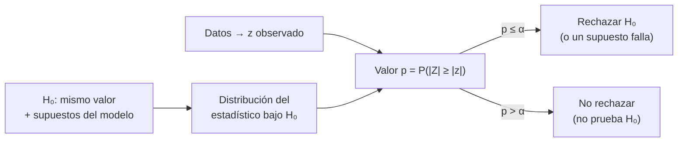

# B12-C09 — Pruebas de hipótesis

<!-- nav:top -->
[🏠 Programa](../../../../README.md) · [📚 Bloque B12](../../../tronco-comun/B12-probabilidad-estadistica-e-incertidumbre.md) · [← Anterior: B12-C08 — Intervalos de confianza](../B12-C08-intervalos-de-confianza/CLASE.md) · [Siguiente: B12-C10 — Regresión lineal y no lineal →](../B12-C10-regresion-lineal-y-no-lineal/CLASE.md)
<!-- /nav -->

## 1. Ubicación, nivel y alcance

Novena clase del bloque B12. En [C08](../B12-C08-intervalos-de-confianza/CLASE.md) construiste un rango de valores plausibles; aquí lo usas para **decidir** si los datos son compatibles con un valor propuesto, controlando la tasa de decisiones erróneas. Verás hipótesis nula y alternativa, estadístico, valor `p`, errores tipo I y II, potencia y el problema de las pruebas múltiples. Nivel N3. No verás comparación de modelos (C22) ni sesgos en poblaciones pequeñas (C26).

## 2. Por qué esta clase existe

Muchas preguntas científicas tienen forma de decisión: ¿coinciden dos mediciones de la misma constante?, ¿el sensor sigue calibrado?, ¿es real la señal o es ruido? Sin un procedimiento con error controlado, cada persona decide por intuición. Pero el procedimiento se malinterpreta con facilidad, y esa mala interpretación ha producido conclusiones falsas.

Pregunta motivadora: **¿son compatibles dos estimaciones de la constante de Hubble dentro de sus incertidumbres declaradas, y qué significa responder «no»?** Decisión central: **qué nivel de error aceptar y qué conclusión se puede (y no se puede) sacar de la prueba**.

## 3. Lo que podrás hacer al terminar

1. Formular `H₀` y `H₁` para una pregunta y elegir un estadístico.
2. Calcular un estadístico `z` o `t` y su valor `p`, y enunciar la decisión.
3. Interpretar el valor `p` sin atribuirle la probabilidad de la hipótesis.
4. Distinguir error tipo I, error tipo II y potencia, y calcular la potencia en un caso.
5. Estimar el tamaño de muestra para una potencia dada.
6. Reconocer y corregir el problema de pruebas múltiples.

La evidencia es el **informe de decisión estadística** del ejercicio 12 (sección 20).

## 4. Con qué llegas y cómo comprobarlo

Necesitas C06 (normal), C07 (error típico) y C08 (cuantil `t`). Cinco preguntas:

1. ¿Cuánto vale `√(0,5² + 1,04²)`?
2. ¿Cuál es el cuantil 0,975 de la normal estándar?
3. ¿Qué valor tiene `P(|Z| > 1,96)`?
4. ¿Cuál es el error típico de la diferencia de dos estimaciones independientes?
5. ¿Para qué sirve el cuantil `t` en un intervalo?

<details>
<summary>Ver respuestas</summary>

1. `1,154`. 2. `1,96`. 3. `0,05`. 4. `√(s₁² + s₂²)`. 5. Compensa que `σ` se estimó con pocos datos.
</details>

Con cuatro o cinco aciertos, sigue; si no, repasa C06–C08.

## 5. Un caso: dos valores de H₀

La constante de Hubble `H₀` mide el ritmo de expansión actual del universo. Dos resultados publicados, ambos **estimaciones** con sus incertidumbres: `67,4 ± 0,5 km s⁻¹ Mpc⁻¹` inferido por la colaboración Planck en su modelo cosmológico base (S1), y `73,04 ± 1,04 km s⁻¹ Mpc⁻¹` medido por el equipo SH0ES con escalera de distancias (S2). ¿Son compatibles con un mismo valor? Es el **ejemplo conductor**. Aquí solo se practica la aritmética de la prueba bajo supuestos simplificados (ambas estimaciones normales e independientes); no es un análisis cosmológico ni se atribuye la discrepancia a causa alguna.

## 6. Vocabulario

La **hipótesis nula** `H₀` es la afirmación que se pone a prueba (aquí: «las dos estimaciones apuntan al mismo valor»); la **alternativa** `H₁` es su negación. Un **estadístico de prueba** es una función de los datos con distribución conocida bajo `H₀`; aquí `z = (H₂ − H₁)/√(s₁² + s₂²)`. El **valor `p`** es la probabilidad, **si `H₀` fuera cierta**, de obtener un estadístico al menos tan extremo como el observado. El **nivel de significación** `α` es la tasa de falsos rechazos que se acepta (error **tipo I**); el **error tipo II** (probabilidad `β`) es no rechazar una `H₀` falsa; la **potencia** `1 − β` es la probabilidad de detectar un efecto real de un tamaño dado. Una prueba **bilateral** rechaza para desviaciones en ambos sentidos; una **unilateral**, en uno solo. La **región crítica** es el conjunto de valores del estadístico que llevan a rechazar; con la `t`, el NIST indica rechazar cuando el valor absoluto del estadístico supera el valor crítico de la tabla (S3). En **pruebas múltiples**, la probabilidad de al menos un falso positivo crece con el número de pruebas.

## 7. Modelo mental: ¿qué tan sorprendente es el dato si H₀ fuera cierta?

Se supone provisionalmente `H₀`, se calcula cómo se repartirían los resultados bajo ese supuesto y se mide qué tan lejos cae el observado. Si cae en una zona muy poco probable, o bien ocurrió algo raro, o bien `H₀` (o alguno de sus supuestos) es falsa.



*Descripción textual:* se supone `H₀` y el modelo, se deduce la distribución del estadístico, se calcula el estadístico con los datos y su valor `p`; si es menor que el umbral `α` se rechaza `H₀` (o se concluye que algún supuesto no se cumple); si no, no se rechaza, lo cual no demuestra `H₀`.

Analogía: un juicio donde se presume inocencia (`H₀`) y se condena sólo con evidencia muy improbable bajo esa presunción. Su límite: la ausencia de condena no prueba inocencia, y el «tribunal» (el modelo) también puede estar equivocado.

## 8. La explicación, paso a paso

### 8.1 La prueba z de la diferencia

Con `H₁ = 67,4`, `s₁ = 0,5`, `H₂ = 73,04`, `s₂ = 1,04`: la diferencia es `5,64`; su error típico (varianzas independientes que se suman, C04) es `√(0,25 + 1,0816) = 1,1539`; el estadístico es `z = 5,64/1,1539 = 4,888`. El valor `p` bilateral es `2 P(Z > 4,888) = 1,02 × 10⁻⁶`. Bajo los supuestos, una discrepancia así por azar sería rarísima.

### 8.2 Qué se puede concluir

Se rechaza `H₀`: **las dos estimaciones, con las incertidumbres declaradas y tratadas como normales e independientes, no son compatibles**. Qué la causa —un error sistemático no incluido, física nueva, un supuesto del modelo— **no lo dice la prueba**. El valor `p` no es la probabilidad de que `H₀` sea cierta ni de que haya física nueva.

### 8.3 Un supuesto que cambia la respuesta

Si las dos estimaciones tuvieran una correlación positiva de `0,3`, la covarianza (C05) restaría a la varianza de la diferencia: `√(1,3316 − 2·0,3·0,5·1,04) = 1,0098` y `z = 5,59`. Un supuesto de independencia no justificado cambia el estadístico; hay que declararlo.

### 8.4 Error tipo I: se verifica por simulación

Con 200 000 muestras de 10 datos de una población con media 0 y `H₀` cierta, la prueba `t` al 5 % rechaza el `0,0500` de las veces: el nivel nominal se cumple. La simulación es la forma de comprobar que un procedimiento hace lo que promete.

### 8.5 Potencia y tamaño de muestra

Con un efecto real `δ = 1 m`, `σ = 3 m` y `n = 25`, el estadístico se desplaza `δ√n/σ = 1,667` errores típicos y la potencia de la prueba bilateral al 5 % es `0,385` (simulada `0,387`): la prueba pasa por alto el efecto el 61 % de las veces. Para potencia 0,80 hacen falta `n ≈ ((1,96 + 0,84)σ/δ)² = 70,6`, es decir 71 datos. Un resultado «no significativo» con baja potencia no demuestra ausencia de efecto.

### 8.6 Pruebas múltiples

Con 20 pruebas independientes al 5 % y todas las `H₀` ciertas, la probabilidad de al menos un falso positivo es `1 − 0,95²⁰ = 0,6415` (simulada `0,6402`). La corrección de Bonferroni usa `α/20 = 0,0025` en cada prueba y devuelve la tasa conjunta a `0,0488`. Buscar una señal en muchas direcciones sin corregir produce «descubrimientos» espurios.

## 9. Magnitudes, símbolos y unidades

| Símbolo | Qué es | Unidad | Nota |
|---|---|---|---|
| `H₀`, `H₁` (hip.) | hipótesis nula y alternativa | — | |
| `H` (cosmología) | constante de Hubble | km s⁻¹ Mpc⁻¹ | `67,4` y `73,04` |
| `s₁, s₂` | errores típicos declarados | km s⁻¹ Mpc⁻¹ | `0,5` y `1,04` |
| `z` | estadístico normal | adimensional | `4,888` |
| `p` | valor `p` | adimensional | `1,02 × 10⁻⁶` |
| `α` | nivel de significación | adimensional | 0,05 |
| `β`, `1−β` | error tipo II y potencia | adimensional | |
| `δ` | tamaño del efecto | unidad de la medida | 1 m |

Nota de notación: el símbolo de la hipótesis nula se escribe `H₀` como en estadística; el de la constante de Hubble, `H₀` por tradición astronómica. En esta clase se distinguen por contexto y, en las fórmulas de la sección 8.1, la constante se rotula con los subíndices 1 y 2.

## 10. Convenciones y referencias

Pruebas bilaterales salvo que se diga lo contrario. Los dos resultados de `H₀` provienen de métodos distintos y se tratan como estimaciones independientes (supuesto declarado). Unidades: km s⁻¹ Mpc⁻¹ (velocidad por distancia).

## 11. De dónde sale lo que afirmamos

| ID | Fuente | Localizador | Respalda | Consulta |
|---|---|---|---|---|
| S1 | Planck Collaboration, *Planck 2018 results. VI. Cosmological parameters* | arXiv:1807.06209 (A&A 641, A6, 2020), https://arxiv.org/abs/1807.06209 | `H₀ = 67,4 ± 0,5 km s⁻¹ Mpc⁻¹` (ΛCDM base), según el resumen | 2026-11-05, resumen consultado; artículo completo no leído |
| S2 | A. G. Riess et al. (SH0ES), *A Comprehensive Measurement of the Local Value of the Hubble Constant with 1 km/s/Mpc Uncertainty…* | arXiv:2112.04510, https://arxiv.org/abs/2112.04510 | `H₀ = 73,04 ± 1,04 km s⁻¹ Mpc⁻¹` (resultado de referencia, con sistemáticos), según el resumen | 2026-11-05, resumen consultado; artículo completo no leído |
| S3 | NIST/SEMATECH, *e-Handbook*, §1.3.6.7.2 «Critical Values of the Student's t Distribution» | https://www.itl.nist.gov/div898/handbook/eda/section3/eda3672.htm | Uso de valores críticos bilaterales (rechazar si el estadístico absoluto supera el valor crítico) | 2026-11-05, página abierta |

Límites: de S1 y S2 sólo se usa el valor y su incertidumbre del resumen; la interpretación cosmológica no se hace. Los datos de las simulaciones son **sintéticos**. Los conceptos de valor `p`, potencia y Bonferroni son resultados estándar no atribuidos a una fuente consultada.

## 12. Cómo ver la prueba

Equivalente accesible a la gráfica de la normal con la zona de rechazo, en tabla:

| `z` observado | Valor `p` bilateral | ¿Rechaza a 5 %? |
|---|---|---|
| 1,00 | 0,317 | no |
| 1,96 | 0,050 | límite |
| 2,06 | 0,039 | sí |
| 4,89 | 1,0 × 10⁻⁶ | sí |

Descripción larga: la normal estándar es una campana centrada en cero; las colas rechazadas suman 0,05 (0,025 a cada lado, más allá de `±1,96`). El `z = 4,89` queda tan lejos de la zona central que la cola correspondiente es invisible en un gráfico lineal.

## 13. Ejemplo trabajado: decisión sobre dos H₀

**Paso 1 · Hipótesis.** `H₀`: las dos estimaciones apuntan al mismo valor; `H₁`: no.

**Paso 2 · Supuestos.** Normales, independientes, errores típicos tal como se publicaron.

**Paso 3 · Estadístico.** `z = 5,64/1,1539 = 4,888`.

**Paso 4 · Valor `p`.** `1,02 × 10⁻⁶`, comprobado con `2·sf(z)` de otra función.

**Paso 5 · Decisión.** Con `α = 0,05`, se rechaza.

**Paso 6 · Sensibilidad.** Con correlación 0,3, `z = 5,59`; la decisión no cambia.

**Paso 7 · Lo que no se concluye.** No se concluye cuál valor es el correcto ni la causa. El resultado aritmético vale para esos números y esos supuestos; las cifras son **estimaciones publicadas**.

## 14. Comparación de métodos

La **prueba `z`** exige `σ` conocida o `n` grande; la **`t`** se usa con `σ` estimada y pocos datos; las pruebas **no paramétricas** no suponen una forma. El **intervalo de confianza** transmite lo mismo que la prueba (rechazar `H₀: θ = θ₀` al 5 % equivale a que `θ₀` esté fuera del IC al 95 %) y además muestra el tamaño del efecto: suele preferirse. La **comparación de modelos** (C22) responde otra pregunta: cuál de varios modelos explica mejor los datos. Y el enfoque **bayesiano** (C12) calcula la probabilidad de hipótesis, con un prior.

## 15. Práctica guiada

**Ejercicio 1 · con los pasos indicados.** Prueba `H₀: μ = 0` con `x̄ = 0,6 m`, `σ = 3 m`, `n = 25`. *Pasos:* error típico, `z`, `p`.

<details><summary>Solución comentada</summary>

`SE = 3/5 = 0,6`; `z = 1,0`; `p = 0,317`: no se rechaza.
</details>

**Ejercicio 2 · con una pista.** Con `n = 10`, `x̄ = 1,2`, `s = 2`, calcula `t` y compara con `2,262`. *Pista:* `SE = s/√n`.

<details><summary>Solución comentada</summary>

`t = 1,2/(2/3,162) = 1,897 < 2,262`: no se rechaza a 5 %.
</details>

**Ejercicio 3 · casi autónomo.** Con `z = 1,8`, calcula los valores `p` bilateral y unilateral y compara con 0,05.

<details><summary>Solución comentada</summary>

Bilateral `0,072` (no rechaza); unilateral `0,036` (rechaza). Elegir la alternativa después de ver los datos es una trampa: debe fijarse antes.
</details>

## 16. Práctica autónoma, transferencia e integrador

**Ejercicio 4.** Dos métodos dan `150,0` y `153,5 m` con error típico `1,2 m` cada uno. Prueba su compatibilidad.

<details><summary>Solución comentada</summary>

`SE = 1,697`; `z = 2,06`; `p = 0,039`: se rechaza a 5 % aunque los intervalos individuales se solapen (C08, ejercicio 9).
</details>

**Ejercicio 5.** Calcula la potencia con `δ√n/σ = 2` (prueba bilateral al 5 %).

<details><summary>Solución comentada</summary>

`Φ(2 − 1,96) + Φ(−2 − 1,96) = Φ(0,04) + ≈0 = 0,516`.
</details>

**Ejercicio 6.** Halla `n` para potencia 0,80 con `δ = 1 m`, `σ = 3 m`.

<details><summary>Solución comentada</summary>

`n = ((1,96 + 0,84)·3)² = 70,6 → 71`.
</details>

**Ejercicio 7.** Si se hacen 20 pruebas independientes al 5 % bajo `H₀`, ¿cuántos falsos positivos esperas en promedio y con qué nivel por prueba mantendrías 5 % conjunto (Bonferroni)?

<details><summary>Solución comentada</summary>

Esperados: `20·0,05 = 1`. Nivel por prueba: `0,05/20 = 0,0025`.
</details>

**Ejercicio 8.** Un resultado tiene `p = 0,03`. Explica por qué NO significa «hay un 3 % de probabilidad de que `H₀` sea cierta».

<details><summary>Solución comentada</summary>

El valor `p` es `P(datos tan extremos | H₀)`, no `P(H₀ | datos)`. Para obtener esta última se necesita un prior (C12).
</details>

**Ejercicio 9 · transferencia.** Un sensor se considera calibrado si el sesgo es 0. Con 16 lecturas, `x̄ = 0,8` y `s = 1,5`, prueba `H₀: sesgo = 0` (valor crítico `t(0,975; 15) = 2,131`).

<details><summary>Solución comentada</summary>

`t = 0,8/(1,5/4) = 2,133 > 2,131`: rechaza por un margen mínimo. Conviene reportar el IC `0,8 ± 0,80` y la decisión de recalibración basada en el tamaño del sesgo, no sólo en el umbral.
</details>

**Ejercicio 10 · transferencia.** En la comparación de `H₀`, supón que la correlación entre estimaciones fuese `−0,3`. ¿Qué pasa con `z`? ¿Qué enseña?

<details><summary>Solución comentada</summary>

`SE = √(1,3316 + 0,312) = 1,282`; `z = 4,40`. Cambia el número pero no la decisión; enseña a probar la sensibilidad a un supuesto no verificable.
</details>

**Ejercicio 11 · transferencia.** Un equipo busca una señal en 200 cuadrículas del cielo y halla una con `p = 0,01`. ¿La declararías significativa?

<details><summary>Solución comentada</summary>

No sin corrección: esperaríamos `200·0,01 = 2` resultados así bajo `H₀`. Con Bonferroni, el umbral es `0,05/200 = 0,00025`. El efecto «mirar en otro lado» exige corregir por el número de búsquedas.
</details>

**Ejercicio 12 · integrador.** Elabora tu *informe de decisión estadística*: plantea dos estimaciones o una calibración, formula `H₀` y `H₁`, calcula `z` o `t` y su `p`, comprueba el nivel y la potencia por simulación, examina la sensibilidad a un supuesto y redacta la conclusión con lo que **no** se puede afirmar.

<details><summary>Solución modelo</summary>

Debe incluir: hipótesis y supuestos; estadístico y `p` comprobado por dos caminos; simulación del error tipo I; potencia y `n` necesario; sensibilidad (correlación, colas); conclusión acotada; datos rotulados como observados/estimados/sintéticos y fuentes con fecha.
</details>

## 17. Laboratorio: prueba, nivel y potencia

El script [pruebas_hipotesis.py](pruebas_hipotesis.py) calcula el estadístico de la comparación, comprueba el valor `p` con una segunda función, mide por simulación el error tipo I, la potencia y la tasa de falsos positivos con 20 pruebas; falla si el nivel sale de `[0,046; 0,054]` o si la potencia simulada difiere más de 0,01 de la teórica.

**Datos:** estimaciones publicadas (S1, S2) y datos sintéticos. **Predice antes de ejecutar:** ¿cuánto vale el error tipo I simulado? (≈ `0,05`.) **Ejecución del 2026-11-05 (Python 3.12.9, NumPy 2.4.4, SciPy 1.17.1):**

```text
diferencia = 5.64; error tipico de la diferencia = 1.1539; z = 4.888; p bilateral = 1.02e-06
error tipo I simulado = 0.0500 (nominal 0.05, n = 10, tcrit = 2.2622)
potencia teorica = 0.3848; simulada = 0.3865 (delta=1.0 m, sigma=3.0 m, n=25)
n para potencia 0.80 (aprox. normal) = 70.6 -> 71
P(al menos un falso positivo en 20 pruebas) = 0.6415; simulada = 0.6402; con Bonferroni (alpha/k): 0.0488
Pruebas superadas.
```

```bash
python programa/clases/B12/B12-C09-pruebas-de-hipotesis/pruebas_hipotesis.py
```

**Límites:** normalidad e independencia; las simulaciones son **sintéticas**.

## 18. Errores frecuentes y cómo corregirlos

**Leer `p` como probabilidad de `H₀`.** Se corrige con el ejercicio 8.

**Concluir «no hay efecto» de un resultado no significativo.** Se corrige con 8.5 (potencia).

**Elegir la alternativa o la prueba tras ver los datos.** Se corrige con el ejercicio 3.

**Ignorar las pruebas múltiples.** Se corrige con 8.6 y el ejercicio 11.

**Tratar como independientes estimaciones que comparten un sistemático.** Se corrige con 8.3 y el ejercicio 10.

## 19. Cómo sabrás que vas bien

Tras 8.1: ¿recalculas `z` con otros datos? Si no, ejercicios 1–2. Tras 8.2: ¿puedes redactar qué no se concluye? Si no, ejercicio 8. Tras 8.5: ¿entiendes por qué `0,385` es preocupante? Si no, ejercicio 5.

## 20. Qué entregas y cómo se evalúa

El producto es tu **informe de decisión estadística** (ejercicio 12).

| Criterio | Inicial | En desarrollo | Logrado | Destacado |
|---|---|---|---|---|
| Hipótesis y supuestos | Ausentes | Parciales | Declaradas | Con sensibilidad |
| Cálculo de `z/t` y `p` | Errores | Con ayuda | Correcto y verificado | Por dos caminos |
| Interpretación de `p` | Prob. de `H₀` | Ambigua | Correcta | Distingue significación y relevancia |
| Error y potencia | Ausentes | Solo `α` | `α`, potencia y `n` | Con simulación |
| Fuentes y rótulo | Ausente | Parcial | Rotulado y fechado | Declara límites |

**Condiciones críticas (no se compensan con promedio):** no interpretar `p` como probabilidad de `H₀`; declarar los supuestos; corregir o declarar las pruebas múltiples.

## 21. Ética, seguridad y límites

Buscar un umbral hasta que «salga» una significación (*p-hacking*) y reportar sólo lo que cruza `0,05` falsea la evidencia. Rechazar `H₀` no prueba una teoría alternativa. La comparación de `H₀` es una ilustración aritmética con valores publicados, no un juicio sobre la cosmología. Accesibilidad: las gráficas se ofrecen como tabla; todo funciona sin conexión.

## 22. Para cerrar y seguir

Una prueba de hipótesis mide qué tan sorprendente sería el dato si `H₀` y el modelo fueran ciertos; controla el error tipo I, tiene potencia limitada, no prueba `H₀` cuando no rechaza y exige corregir las búsquedas múltiples. Queda abierta una pregunta: cuando los datos se relacionan con una variable explicativa, ¿cómo se ajusta una función y se cuantifica su incertidumbre? Es la regresión (C10).

**Glosario español–inglés.** hipótesis nula · *null hypothesis*; valor p · *p-value*; error tipo I · *type I error*; potencia · *power*; pruebas múltiples · *multiple testing*; región crítica · *critical region*; bilateral · *two-sided*.

**Continuidad.** B12-C10 reutiliza tu capacidad de **calcular un estadístico y su error típico** para evaluar parámetros de un ajuste.

**Referencias:** ver sección 11.

<!-- nav:bottom -->
---

[← Anterior: B12-C08 — Intervalos de confianza](../B12-C08-intervalos-de-confianza/CLASE.md) · [📚 Bloque B12](../../../tronco-comun/B12-probabilidad-estadistica-e-incertidumbre.md) · [Siguiente: B12-C10 — Regresión lineal y no lineal →](../B12-C10-regresion-lineal-y-no-lineal/CLASE.md)
<!-- /nav -->
