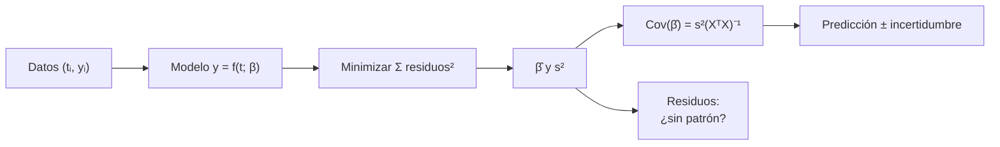

# B12-C10 — Regresión lineal y no lineal

<!-- nav:top -->
[🏠 Programa](../../../../README.md) · [📚 Bloque B12](../../../tronco-comun/B12-probabilidad-estadistica-e-incertidumbre.md) · [← Anterior: B12-C09 — Pruebas de hipótesis](../B12-C09-pruebas-de-hipotesis/CLASE.md) · [Siguiente: B12-C11 — Regresión robusta →](../B12-C11-regresion-robusta/CLASE.md)
<!-- /nav -->

## 1. Ubicación, nivel y alcance

Décima clase del bloque B12. En C07–C09 estimaste un parámetro y lo contrastaste. Aquí ajustas una **función** de una variable explicativa a los datos: una recta (deriva de un reloj) y una exponencial (degradación de un panel), y cuantificas la incertidumbre de los parámetros, su correlación y la extrapolación. Nivel N3. No verás aún regresión robusta (C11), matrices de covarianza en general (C18), ni modelos mixtos (C25).

## 2. Por qué esta clase existe

Casi todo en ciencias espaciales es un ajuste: la deriva de un oscilador, la curva de luz de un tránsito, la degradación de una celda solar, la relación período–luminosidad. Un ajuste sin incertidumbre de parámetros ni diagnóstico de residuos es sólo una línea dibujada.

Pregunta motivadora: **¿qué modelo describe cómo cambia la magnitud con el tiempo, cuánto valen sus parámetros y cuánto puedo confiar en una predicción fuera de lo observado?** Decisión central: **qué modelo ajustar y hasta dónde extrapolar**.

## 3. Lo que podrás hacer al terminar

1. Plantear el modelo lineal `y = Xβ + ε` y resolver las ecuaciones normales.
2. Calcular `β̂`, su matriz de covarianza `s²(XᵀX)⁻¹` y los errores típicos.
3. Interpretar la correlación entre pendiente e intercepto y reducirla centrando.
4. Ajustar un modelo no lineal en parámetros con un método iterativo y compararlo con la linealización.
5. Examinar residuos y `R²` y decidir si el modelo es adecuado.
6. Calcular una predicción con su incertidumbre y justificar un límite de extrapolación.

La evidencia es el **informe de ajuste** del ejercicio 12 (sección 20).

## 4. Con qué llegas y cómo comprobarlo

Necesitas C07 (estimadores), C08 (error típico) y álgebra de matrices de B10. Cinco preguntas:

1. ¿Cuál es la pendiente de la recta que pasa por `(0,1)` y `(2,5)`?
2. ¿Qué es la traspuesta de una matriz columna?
3. ¿Qué es un residuo?
4. ¿Cuánto vale `ln(e^{−0,05 t})`?
5. ¿Por qué se divide por `n − 2` al estimar la varianza de una recta?

<details>
<summary>Ver respuestas</summary>

1. `2`. 2. La fila con los mismos elementos. 3. Dato menos valor ajustado. 4. `−0,05 t`. 5. Porque se estimaron dos parámetros (grados de libertad `n − 2`).
</details>

Con cuatro o cinco aciertos, sigue; si no, repasa C07, C08 y B10.

## 5. Un caso: la deriva del reloj y la degradación del panel

(a) El reloj de una sonda **ilustrativa** se desfasa de una referencia: modelo `y = a + b t`, con `a = 2,0 µs`, `b = 0,50 µs/día`, ruido `σ = 0,8 µs`, 20 días de datos **sintéticos**. (b) La potencia de un panel decae como `P = P₀ e^{−kt}`, con `P₀ = 100 W`, `k = 0,05 año⁻¹` y ruido de 1 W, 11 puntos anuales **sintéticos**. Son el **ejemplo conductor**; ¿qué parámetros recuperas y con qué incertidumbre?

## 6. Vocabulario

Un **modelo lineal en los parámetros** escribe `y = Xβ + ε`, con `X` la matriz de diseño, `β` los parámetros y `ε` el error; no exige que sea lineal en `t` (un polinomio sigue siéndolo). **Mínimos cuadrados ordinarios** (OLS) elige `β̂` que minimiza la suma de cuadrados de los residuos; las **ecuaciones normales** son `XᵀX β̂ = Xᵀ y`. El **residuo** es `e = y − Xβ̂`. La varianza del ruido se estima con `s² = eᵀe/(n − p)`, con `p` parámetros. La **covarianza de los parámetros** es `s²(XᵀX)⁻¹` (S1). Un modelo **no lineal en parámetros** (como `P₀e^{−kt}`) se ajusta por iteración (Gauss–Newton y variantes). El coeficiente `R²` es la fracción de la variación de `y` explicada por el modelo. Hogg, Bovy y Lang señalan que los mínimos cuadrados ponderados solo son apropiados cuando un eje carece de incertidumbre y el otro tiene errores gaussianos de varianza conocida, y proponen partir de un **modelo generativo** de los datos (S1).

## 7. Modelo mental: la mejor curva es la que menos se aleja en cuadrado

Cada dato tira de la curva con una fuerza proporcional a su distancia; la curva óptima equilibra todas. La incertidumbre de los parámetros viene de cuánto «apoyo» ofrecen los datos: puntos muy repartidos fijan bien la pendiente; puntos agrupados, no.



*Descripción textual:* de los datos y un modelo se minimizan los cuadrados de los residuos; se obtienen los parámetros y la varianza del ruido; con ellos, la covarianza de los parámetros; los residuos se examinan por si muestran patrón; con la covarianza se da una predicción con su incertidumbre.

Analogía: una regla elástica sujeta a los puntos. Su límite: si hay valores atípicos, la regla se desvía por uno solo (C11).

## 8. La explicación, paso a paso

### 8.1 La recta

Con `X = [1, t]`, las ecuaciones normales dan `b = Σ(tᵢ − t̄)(yᵢ − ȳ)/Σ(tᵢ − t̄)²` y `a = ȳ − b t̄`. En el laboratorio, los datos sin ruido recuperan exactamente `(2,0; 0,50)`; con ruido salen `a = 1,439 ± 0,363 µs` y `b = 0,5548 ± 0,0326 µs/día`, con `s = 0,842 µs` (verdad: `σ = 0,8`). La pendiente verdadera está a `(0,5548 − 0,5)/0,0326 = 1,7` errores típicos del valor ajustado: compatible.

### 8.2 Incertidumbre y correlación de parámetros

`Cov(β̂) = s²(XᵀX)⁻¹`. Aquí la correlación entre intercepto y pendiente es `−0,855`: si la pendiente se ajusta más alta, el intercepto baja. Centrar `t` (usar `t − t̄`) elimina la correlación. La comparación con una simulación de 20 000 repeticiones confirma el error típico de la pendiente: `0,0308` simulado frente a `0,0310` teórico.

### 8.3 Predicción y extrapolación

La media ajustada en `t₀` tiene varianza `s²[1/n + (t₀ − t̄)²/S_xx]`, con `S_xx = Σ(tᵢ − t̄)² = 665` aquí. En `t₀ = 40 días` (fuera de los 0–19 observados): valor `1,439 + 0,5548·40 = 23,63 µs`, con error típico `√(0,709·(0,05 + 1,399)) = 1,01 µs` **si el modelo lineal sigue valiendo**. La incertidumbre crece alejándose del centro, y no incluye el riesgo de que la deriva real se curve (el error de modelo).

### 8.4 Ajuste no lineal

Para `P = P₀e^{−kt}`, el método iterativo parte de una estimación inicial (`P₀ = 80`, `k = 0,1`) y converge a `P₀ = 99,95 ± 0,62 W` y `k = 0,0491 ± 0,0012 año⁻¹`; `k` verdadero (`0,05`) está a `0,75` errores típicos. Con datos sin ruido recupera `(100; 0,05)` a `10⁻⁸`. La **vida media** es `ln 2/k = 14,1 años`, con error típico `ln 2 · 0,0012/0,0491² = 0,35 años` (propagación, C16).

### 8.5 Linealizar o no

Tomando logaritmos, `ln P = ln P₀ − kt` es lineal. Con este ruido pequeño da casi lo mismo (`99,95` y `0,0491`), pero no siempre: el logaritmo cambia la forma del ruido (el aditivo y constante se vuelve multiplicativo), y falla cerca de cero o con valores negativos. Hay que ajustar en el espacio donde el ruido sea como se supone.

### 8.6 Diagnóstico

Se revisa que los residuos no tengan patrón (curvatura, tendencia), que su dispersión sea constante (si crece con `y`, usar pesos), que no haya atípicos y que `R²` sea alto: aquí `R² = 0,990`. Un `R²` alto no prueba un modelo correcto (una recta ajusta bien un tramo corto de cualquier curva suave).

## 9. Magnitudes, símbolos y unidades

| Símbolo | Qué es | Unidad | Nota |
|---|---|---|---|
| `y`, `t` | variable respuesta y explicativa | µs, días / W, años | |
| `a`, `b` | intercepto y pendiente | µs, µs/día | `1,439` y `0,5548` |
| `β`, `X` | parámetros y matriz de diseño | — | |
| `s` | desviación residual | unidad de `y` | `0,842 µs` |
| `P₀`, `k` | potencia inicial y tasa | W, año⁻¹ | `99,95`, `0,0491` |
| `R²` | fracción explicada | adimensional | 0,990 |
| `S_xx` | `Σ(t − t̄)²` | días² | 665 |

## 10. Convenciones y referencias

El tiempo `t` se mide desde el primer dato (día 0, año 0). Los errores se suponen independientes, de media cero y varianza constante. Los errores típicos de los parámetros son condicionales al modelo. Se declaran la semilla y las versiones de las bibliotecas.

## 11. De dónde sale lo que afirmamos

| ID | Fuente | Localizador | Respalda | Consulta |
|---|---|---|---|---|
| S1 | D. W. Hogg, J. Bovy, D. Lang, *Data analysis recipes: Fitting a model to data* | arXiv:1008.4686, https://arxiv.org/abs/1008.4686 | Condiciones en que los mínimos cuadrados ponderados son adecuados; modelo generativo; manejo de atípicos, errores desconocidos y dispersión intrínseca (según el resumen) | 2026-11-05, resumen consultado; texto completo no leído |

Límites: las ecuaciones normales, `s²(XᵀX)⁻¹`, el error de predicción y Gauss–Newton son resultados estándar no atribuidos a una fuente consultada; los datos son **sintéticos** y los parámetros, **ilustrativos**.

## 12. Cómo ver el ajuste

Equivalente accesible a una gráfica de dispersión con la recta, en tabla (cálculo propio, valor ajustado `1,439 + 0,5548 t`):

| `t` (día) | 0 | 5 | 10 | 15 | 19 | 40 (extrapolado) |
|---|---|---|---|---|---|---|
| Ajuste (µs) | 1,44 | 4,21 | 6,99 | 9,76 | 11,98 | 23,63 |

Descripción larga: una recta ascendente de 1,4 µs a 12,0 µs entre los días 0 y 19, con puntos dispersos de ±0,8 µs; la banda de incertidumbre de la media es más ancha en los extremos y se ensancha mucho más allá del día 19.

## 13. Ejemplo trabajado: ¿cuánto se desfasa en 40 días?

**Paso 1 · Modelo.** Recta con ruido homogéneo.

**Paso 2 · Ajuste.** `a = 1,439`, `b = 0,5548`, `s = 0,842`.

**Paso 3 · Predicción.** `y(40) = 23,63 µs`.

**Paso 4 · Incertidumbre de la media.** `S_xx = 665`; varianza `0,709 · (0,05 + 1,399) = 1,027`; `σ = 1,01 µs`.

**Paso 5 · Incertidumbre de una lectura nueva.** Añade el ruido: `√(1,027 + 0,709) = 1,32 µs`.

**Paso 6 · Límite.** La extrapolación a más del doble del rango observado supone que la deriva sigue lineal; sin un mecanismo físico que lo garantice, el intervalo subestima el riesgo.

**Paso 7 · Sentido.** Datos **sintéticos**; los valores del simulador (`b = 0,50`) caen dentro del intervalo.

## 14. Comparación de métodos

**OLS** es óptimo con ruido normal homogéneo; los **mínimos cuadrados ponderados** cubren varianza distinta por punto; el **ajuste en ambos ejes** se necesita si `t` también tiene error (S1); la **regresión robusta** (C11) resiste atípicos; la **linealización** simplifica pero cambia el ruido; el **ajuste bayesiano** (C12) incorpora información previa. Para extrapolar importa más un buen modelo físico que un buen `R²`.

## 15. Práctica guiada

**Ejercicio 1 · con los pasos indicados.** Ajusta una recta a `(0,1), (1,3), (2,5)`. *Pasos:* medias, pendiente, intercepto.

<details><summary>Solución comentada</summary>

`t̄ = 1`, `ȳ = 3`; `b = [(−1)(−2) + 0 + (1)(2)]/2 = 2`; `a = 3 − 2 = 1`. Ajuste exacto.
</details>

**Ejercicio 2 · con una pista.** Ajusta `(0,1), (1,2), (2,2), (3,4)`. *Pista:* `t̄ = 1,5`, `ȳ = 2,25`.

<details><summary>Solución comentada</summary>

Numerador `1,875 + 0,125 − 0,125 + 2,625 = 4,5`; denominador `5`; `b = 0,9`; `a = 2,25 − 1,35 = 0,9`.
</details>

**Ejercicio 3 · casi autónomo.** Con la recta del ejercicio 2, calcula los residuos y su suma.

<details><summary>Solución comentada</summary>

Ajustes `0,9; 1,8; 2,7; 3,6`; residuos `0,1; 0,2; −0,7; 0,4`. Suma `0`: propiedad de OLS con intercepto.
</details>

## 16. Práctica autónoma, transferencia e integrador

**Ejercicio 4.** Estima `s²` del ejercicio 2 (`n − 2` grados de libertad).

<details><summary>Solución comentada</summary>

Suma de cuadrados `0,01 + 0,04 + 0,49 + 0,16 = 0,70`; `s² = 0,70/2 = 0,35`.
</details>

**Ejercicio 5.** ¿Por qué la correlación entre `a` y `b` es `−0,855` y qué pasa si se centra `t`?

<details><summary>Solución comentada</summary>

Los datos están lejos de `t = 0`, de modo que cambiar la pendiente se compensa con el intercepto. Con `t − t̄` las columnas de `X` son ortogonales y la correlación es `0`.
</details>

**Ejercicio 6.** ¿Es `k = 0,05` compatible con `0,0491 ± 0,0012`?

<details><summary>Solución comentada</summary>

`(0,05 − 0,0491)/0,0012 = 0,75` errores típicos: sí.
</details>

**Ejercicio 7.** Calcula la vida media y su error típico con `k = 0,0491 ± 0,0012`.

<details><summary>Solución comentada</summary>

`ln 2/k = 14,1 años`; `u = ln 2·0,0012/k² = 0,35 años` (primer orden).
</details>

**Ejercicio 8.** ¿Cuándo es inadecuado linealizar tomando logaritmos?

<details><summary>Solución comentada</summary>

Cuando el ruido es aditivo y hay valores cercanos a cero o negativos (el logaritmo explota o no existe) o cuando cambia la forma del ruido; hay que ajustar el modelo original (8.5).
</details>

**Ejercicio 9 · transferencia.** El error de cada punto es proporcional a su valor (5 %). ¿Qué ajuste usarías y con qué pesos?

<details><summary>Solución comentada</summary>

Mínimos cuadrados ponderados con peso `1/σᵢ²`, con `σᵢ = 0,05 yᵢ` (usando el valor ajustado, no el ruidoso, si es posible), o ajuste en logaritmos si el error relativo es constante.
</details>

**Ejercicio 10 · transferencia.** Los residuos de una recta forman una «U». ¿Qué indica y qué harías?

<details><summary>Solución comentada</summary>

Curvatura no modelada: la recta es inadecuada. Probar un polinomio de segundo grado o un modelo con base física, y comparar (C22) con criterios de información.
</details>

**Ejercicio 11 · transferencia.** El tiempo `t` también tiene un error de 0,5 días. ¿Qué le pasa a la pendiente de OLS?

<details><summary>Solución comentada</summary>

Tiende a subestimarse (atenuación). Hay que usar un ajuste que modele el error en ambos ejes (S1) y no tratar a `t` como exacto.
</details>

**Ejercicio 12 · integrador.** Elabora tu *informe de ajuste*: elige datos sintéticos que sigan una recta y otros una exponencial; ajusta cada uno, tabula parámetros con errores típicos, verifica la covarianza por simulación, examina los residuos y da una predicción fuera del rango con su incertidumbre y su advertencia.

<details><summary>Solución modelo</summary>

Debe incluir: modelo y supuestos; `β̂`, `s`, errores típicos; correlación de parámetros; simulación de 10 000 repeticiones para validar los errores típicos; análisis de residuos; predicción con intervalo y límite de validez; datos rotulados como sintéticos; semilla y versiones.
</details>

## 17. Laboratorio: ajuste y covarianza

El script [regresion_ajuste.py](regresion_ajuste.py) resuelve las ecuaciones normales, comprueba que recuperan los parámetros sin ruido y coinciden con `polyfit` y con la fórmula cerrada, valida los errores típicos por simulación y ajusta el decaimiento exponencial por iteración; falla si alguna comprobación se incumple.

**Datos:** sintéticos. **Predice antes de ejecutar:** ¿qué correlación esperas entre intercepto y pendiente? (negativa y fuerte.) **Ejecución del 2026-11-05 (Python 3.12.9, NumPy 2.4.4, SciPy 1.17.1):**

```text
a = 1.439 +/- 0.363 us;  b = 0.5548 +/- 0.0326 us/dia;  s = 0.842 us
correlacion a-b = -0.855
sd(b) simulada = 0.0308; teorica = 0.0310
P0 = 99.95 +/- 0.62 W;  k = 0.0491 +/- 0.0012 /ano
linealizando (ln): P0 = 99.95 W, k = 0.0491 /ano
R^2 = 0.98989; media de residuos = +0.000 W
Pruebas superadas.
```

```bash
python programa/clases/B12/B12-C10-regresion-lineal-y-no-lineal/regresion_ajuste.py
```

**Límites:** ruido normal, homogéneo e independiente; resultados **simulados**.

## 18. Errores frecuentes y cómo corregirlos

**Confiar en `R²` como prueba de un buen modelo.** Se corrige con 8.6 y el ejercicio 10.

**Extrapolar sin declarar el riesgo.** Se corrige con 8.3.

**Olvidar la correlación entre parámetros.** Se corrige con 8.2 y el ejercicio 5.

**Linealizar sin pensar en el ruido.** Se corrige con 8.5 y el ejercicio 8.

**Tratar `t` como exacto.** Se corrige con el ejercicio 11.

## 19. Cómo sabrás que vas bien

Tras 8.1: ¿recalculas `a` y `b` a mano con pocos puntos? Si no, ejercicios 1–2. Tras 8.3: ¿distingues incertidumbre de la media y de una lectura nueva? Si no, vuelve al paso 5 de 13. Tras 8.6: ¿qué patrón te haría descartar el modelo? Si no sabes, ejercicio 10.

## 20. Qué entregas y cómo se evalúa

El producto es tu **informe de ajuste** (ejercicio 12).

| Criterio | Inicial | En desarrollo | Logrado | Destacado |
|---|---|---|---|---|
| Modelo y supuestos | Ausentes | Parciales | Declarados | Los contrasta con residuos |
| Parámetros | Sin error | Con error sin interpretar | Con errores y correlación | Valida por simulación |
| Diagnóstico | Solo `R²` | Residuos sin análisis | Residuos analizados | Propone alternativa |
| Predicción | Sin incertidumbre | Con incertidumbre | Con incertidumbre y límite | Distingue media y lectura |
| Fuentes y rótulo | Ausente | Parcial | Sintético y fuente | Declara límites |

**Condiciones críticas (no se compensan con promedio):** acompañar cada parámetro con su error típico; declarar el rango de validez de la extrapolación; rotular datos sintéticos.

## 21. Ética, seguridad y límites

Una extrapolación presentada con precisión excesiva puede llevar a decisiones operativas erróneas (por ejemplo, planificar un presupuesto de energía con una degradación mal modelada). Los parámetros de esta clase no son de ninguna misión. Accesibilidad: las gráficas se ofrecen como tabla; todo funciona sin conexión.

## 22. Para cerrar y seguir

La regresión ajusta una función minimizando los cuadrados; los parámetros llevan errores típicos y correlaciones que salen de `s²(XᵀX)⁻¹`; los residuos validan el modelo; la extrapolación amplía la incertidumbre y supone un modelo que puede no valer. Queda abierta una pregunta: ¿qué ocurre cuando unos pocos datos están muy fuera de lugar? Es la regresión robusta (C11).

**Glosario español–inglés.** regresión · *regression*; mínimos cuadrados · *least squares*; matriz de diseño · *design matrix*; residuo · *residual*; extrapolación · *extrapolation*; vida media · *half-life*; modelo generativo · *generative model*.

**Continuidad.** B12-C11 reutiliza tu capacidad de **ajustar y examinar residuos** para tratar datos con valores atípicos.

**Referencias:** ver sección 11.

<!-- nav:bottom -->
---

[← Anterior: B12-C09 — Pruebas de hipótesis](../B12-C09-pruebas-de-hipotesis/CLASE.md) · [📚 Bloque B12](../../../tronco-comun/B12-probabilidad-estadistica-e-incertidumbre.md) · [Siguiente: B12-C11 — Regresión robusta →](../B12-C11-regresion-robusta/CLASE.md)
<!-- /nav -->
