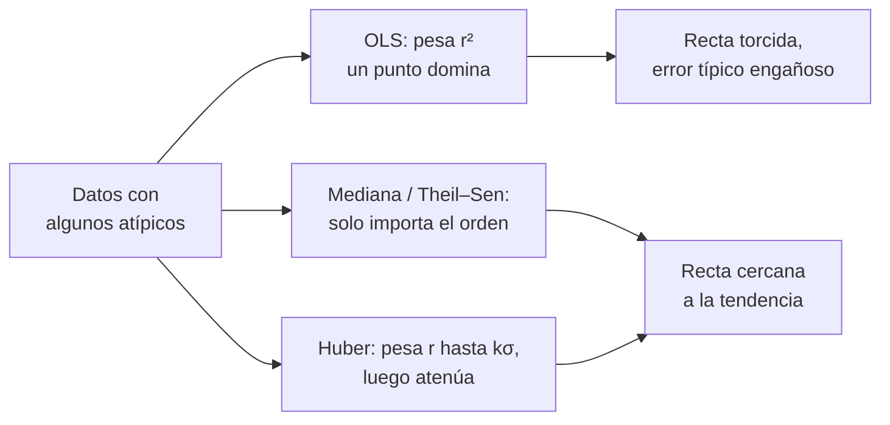

# B12-C11 — Regresión robusta

<!-- nav:top -->
[🏠 Programa](../../../../README.md) · [📚 Bloque B12](../../../tronco-comun/B12-probabilidad-estadistica-e-incertidumbre.md) · [← Anterior: B12-C10 — Regresión lineal y no lineal](../B12-C10-regresion-lineal-y-no-lineal/CLASE.md) · [Siguiente: B12-C12 — Inferencia bayesiana →](../B12-C12-inferencia-bayesiana/CLASE.md)
<!-- /nav -->

## 1. Ubicación, nivel y alcance

Undécima clase del bloque B12. En [C10](../B12-C10-regresion-lineal-y-no-lineal/CLASE.md) ajustaste una recta por mínimos cuadrados, que es óptimo con ruido normal pero muy sensible a datos fuera de lugar. Aquí aprendes tres respuestas: la **mediana**, el estimador de **Theil–Sen** y el **M-estimador de Huber**. Nivel N3. No verás aún los criterios formales para detectar atípicos (C19) ni la inferencia bayesiana con colas pesadas (C12).

## 2. Por qué esta clase existe

Los datos reales traen errores de transmisión, rayos cósmicos en un detector, una lectura perdida o un salto del sensor. Un solo punto muy alejado puede torcer la recta de mínimos cuadrados y producir parámetros y predicciones erróneos con errores típicos pequeños y engañosos.

Pregunta motivadora: **¿cómo estimar la tendencia verdadera cuando una parte de los datos no sigue el modelo?** Decisión central: **qué estimador usar para que unos pocos datos malos no dominen el resultado, sin esconder que existen**.

## 3. Lo que podrás hacer al terminar

1. Explicar el punto de ruptura (*breakdown point*) de la media, la mediana y OLS.
2. Calcular la mediana, la MAD y una desviación robusta `σ̂ = MAD/0,6745`.
3. Aplicar Theil–Sen a un conjunto pequeño y explicar por qué resiste.
4. Describir el algoritmo IRLS de Huber y calcular pesos.
5. Cuantificar la pérdida de eficiencia de un estimador robusto con datos limpios.
6. Decidir cuándo tratar, investigar o conservar un atípico, y documentarlo.

La evidencia es la **comparación robusta** del ejercicio 12 (sección 20).

## 4. Con qué llegas y cómo comprobarlo

Necesitas C07 (estimadores, sesgo), C10 (OLS, residuos) y la mediana. Cinco preguntas:

1. ¿Cuál es la mediana de `{3, 4, 5, 6, 100}`?
2. ¿Qué es un residuo?
3. ¿Cuál es el efecto de un valor muy grande sobre la media?
4. ¿Qué pendiente tiene la recta por `(0,1)` y `(4,9)`?
5. ¿Por qué `σ/√n` deja de valer con colas muy pesadas?

<details>
<summary>Ver respuestas</summary>

1. `5`. 2. Dato menos valor ajustado. 3. La arrastra. 4. `2`. 5. Porque la varianza puede ser infinita (C06).
</details>

Con cuatro o cinco aciertos, sigue; si no, repasa C06, C07 y C10.

## 5. Un caso: residuos de distancia con tres lecturas malas

Una sonda **ilustrativa** registra el residuo de distancia (m) cada segundo durante 20 s. La tendencia verdadera es `y = 5,0 + 0,40 t` con ruido normal de `0,3 m`, pero tres lecturas (en `t = 1, 17, 19`) llevan errores de `−9`, `+8` y `+10 m` por pérdidas de sincronía. Datos **sintéticos**. ¿Qué recta devuelve cada método? Es el **ejemplo conductor**.

## 6. Vocabulario

Un **valor atípico** (*outlier*) es una observación que se aparta de la tendencia que siguen las demás; el NIST titula una sección entera «Detection of Outliers» (S1). El **punto de ruptura** de un estimador es la fracción máxima de datos que pueden ser arbitrariamente malos sin que el estimador se vaya al infinito: 0 para la media, 50 % para la mediana. La **MAD** es la mediana de las desviaciones absolutas respecto de la mediana; `σ̂ = MAD/0,6745` estima la desviación típica de una normal. La **pendiente de Theil–Sen** es la mediana de las pendientes de todos los pares de puntos. Un **M-estimador** minimiza una suma de pérdidas que crecen más despacio que el cuadrado; el de **Huber** usa pérdida cuadrática para residuos pequeños y lineal para grandes, y se calcula por **mínimos cuadrados reponderados iterativamente** (IRLS), con peso `w = 1` si `|r|/σ̂ ≤ k` y `w = k σ̂/|r|` si no (`k = 1,345` es el valor convencional). La **eficiencia relativa** compara las varianzas de dos estimadores en datos que cumplen el modelo ideal. El **apalancamiento** (*leverage*) es la influencia potencial de un punto por estar lejos del centro de las `t`.

## 7. Modelo mental: votar en lugar de promediar

Mínimos cuadrados deja que cada punto «grite» con fuerza proporcional al cuadrado de su distancia: un grito enorme domina. Los métodos robustos limitan ese volumen: la mediana sólo cuenta el orden; Huber atenúa a los puntos lejanos; Theil–Sen deja votar a todos los pares y toma la opinión central.



*Descripción textual:* con datos contaminados, mínimos cuadrados da una recta torcida; la mediana, Theil–Sen y Huber limitan la influencia de los puntos lejanos y recuperan una recta cercana a la tendencia.

Analogía: un jurado que decide por mayoría en vez de por la opinión más estridente. Su límite: si la mayoría está sesgada, la mayoría también se equivoca.

## 8. La explicación, paso a paso

### 8.1 Media frente a mediana

Con 1000 datos normales de media 0 donde 200 (20 %) llevan un desplazamiento de `+50`, la media vale `10,03` y la mediana `0,324`. Cada atípico arrastra la media sin límite; la mediana solo cambia cuando cruza la mitad de la muestra. Por eso el punto de ruptura de la media es 0 y el de la mediana, 50 %.

### 8.2 El precio de la robustez

Si los datos **sí** son normales, la mediana es menos precisa: `sd(mediana)/sd(media) = 1,2524` simulado, frente al teórico `√(π/2) = 1,2533`. Equivale a necesitar unas `π/2 ≈ 1,57` veces más datos para igual precisión. Hay una compensación: se paga un 25 % de dispersión extra a cambio de no depender de que no haya atípicos.

### 8.3 MAD y desviación robusta

Para `{10,1; 9,9; 10,0; 10,2; 9,8; 25}` la mediana es `10,05`; las desviaciones absolutas son `0,05; 0,15; 0,05; 0,15; 0,25; 14,95`, con mediana `0,15`. La desviación robusta es `0,15/0,6745 = 0,222`, mientras que la desviación típica ordinaria es `6,1`. El valor `25` queda a `67` desviaciones robustas: claramente atípico.

### 8.4 Theil–Sen

Con cinco puntos `(0,1), (1,3), (2,5), (3,7), (4,60)`, hay 10 pares: seis entre los cuatro puntos buenos con pendiente `2` y cuatro que involucran al atípico (`14,75; 19; 27,5; 53`). La mediana de las diez es `2`: el atípico no afecta. El método tolera aproximadamente un 29 % de contaminación en muchas situaciones; su costo computacional crece como `n²`.

### 8.5 Huber por IRLS

Se parte de OLS, se calculan residuos y `σ̂` robusta, se asignan pesos y se resuelve mínimos cuadrados ponderados; se repite hasta converger. Con `k` muy grande todos los pesos valen 1 y el resultado coincide con OLS (el laboratorio lo verifica a `10⁻⁹`). Con `k = 1,345`, un residuo de `0,9 m` con `σ̂ = 0,3 m` (3 desviaciones) recibe peso `1,345/3 = 0,448`.

### 8.6 El resultado del caso conductor

Sin atípicos: OLS `b = 0,3855`, Huber `0,3836`, Theil–Sen `0,3827` (el ruido hace que la pendiente de la muestra sea algo menor que `0,40`). Con los tres atípicos: **OLS `b = 0,7337, a = 2,300`** (casi el doble de la pendiente y la mitad del intercepto), **Huber `b = 0,4263, a = 4,852`** y **Theil–Sen `b = 0,4242, a = 4,940`**. Los atípicos en los extremos de `t` tienen apalancamiento alto, por eso OLS se tuerce tanto. Los métodos robustos no recuperan el valor exacto pero quedan a `0,03` de la verdad.

## 9. Magnitudes, símbolos y unidades

| Símbolo | Qué es | Unidad | Nota |
|---|---|---|---|
| `y`, `t` | residuo de distancia y tiempo | m, s | |
| `a`, `b` | intercepto y pendiente | m, m/s | verdad `5,0` y `0,40` |
| `r` | residuo del ajuste | m | |
| `MAD` | mediana de `|r − mediana(r)|` | m | |
| `σ̂` | desviación robusta | m | `MAD/0,6745` |
| `k` | constante de Huber | adimensional | `1,345` |
| `w` | peso IRLS | adimensional | de 0 a 1 |

## 10. Convenciones y referencias

La constante `0,6745` convierte la MAD en una estimación de `σ` para una normal (valor convencional, no verificado con una fuente consultada). Los atípicos se ubican en `y` (errores en la variable respuesta). Se conservan los datos originales; los atípicos se marcan, no se borran.

## 11. De dónde sale lo que afirmamos

| ID | Fuente | Localizador | Respalda | Consulta |
|---|---|---|---|---|
| S1 | NIST/SEMATECH, *e-Handbook*, §1.3.5.17 «Detection of Outliers» | https://www.itl.nist.gov/div898/handbook/eda/section3/eda35h.htm | Existencia del apartado y recomendación de un test para un solo atípico (Grubbs); el texto de la prueba está en §1.3.5.17.1 | 2026-11-05, página abierta |
| S2 | D. W. Hogg, J. Bovy, D. Lang, *Data analysis recipes: Fitting a model to data* | arXiv:1008.4686 | El resumen menciona el tratamiento de valores atípicos en el ajuste de modelos | 2026-11-05, resumen consultado |

Límites: Huber, IRLS, Theil–Sen, la constante `0,6745`, el punto de ruptura y la eficiencia `√(π/2)` son resultados estándar que no se atribuyen a una fuente consultada; los datos son **sintéticos** y los atípicos, ilustrativos.

## 12. Cómo ver los tres ajustes

Equivalente accesible a un gráfico de la recta de cada método (cálculo propio):

| Método | Pendiente `b` (m/s) | Intercepto `a` (m) |
|---|---|---|
| Verdad | 0,400 | 5,000 |
| OLS sin atípicos | 0,3855 | 5,157 |
| OLS con atípicos | 0,7337 | 2,300 |
| Huber con atípicos | 0,4263 | 4,852 |
| Theil–Sen con atípicos | 0,4242 | 4,940 |

Descripción larga: tres puntos aislados (uno abajo a la izquierda, dos arriba a la derecha) levantan la recta de OLS; las rectas de Huber y Theil–Sen pasan por la nube principal casi superpuestas con la verdad.

## 13. Ejemplo trabajado: ¿cuál es la tendencia?

**Paso 1 · Mirar.** Antes de ajustar, se grafica (o tabula) y se ve que tres puntos se alejan de la nube.

**Paso 2 · OLS.** Pendiente `0,7337`: casi el doble de lo esperado.

**Paso 3 · Robustos.** Huber `0,4263`, Theil–Sen `0,4242`: consistentes entre sí.

**Paso 4 · Diagnóstico.** Los residuos de OLS son grandes en los tres puntos y mucho menores en los demás; los residuos de Huber destacan los tres atípicos (`MAD` pequeña).

**Paso 5 · Decisión.** Se reporta el resultado robusto y se informa de los tres puntos marcados con su causa probable (pérdida de sincronía); se investiga la causa.

**Paso 6 · Sensibilidad.** Se muestra también el resultado sin los tres puntos y el de OLS con todos, para que el lector vea la diferencia.

**Paso 7 · Sentido.** Datos **sintéticos**; ningún dato fue borrado.

## 14. Comparación de métodos

**OLS** es el más eficiente con ruido normal puro y el más frágil. **Mediana/Theil–Sen** tienen alto punto de ruptura pero pierden eficiencia y Theil–Sen es costoso para `n` grande. **Huber** equilibra: casi tan eficiente como OLS en datos limpios y resistente a atípicos moderados, pero su resistencia a atípicos con alto apalancamiento es menor. **Eliminar atípicos** por criterio (C19) puede ser aceptable si hay una causa documentada; hacerlo para que el ajuste «salga bien» es manipular los datos. **Modelar los atípicos** (mezcla de dos poblaciones) es la opción bayesiana (S2).

## 15. Práctica guiada

**Ejercicio 1 · con los pasos indicados.** Calcula media y mediana de `{3, 4, 5, 6, 100}`. *Pasos:* ordenar, centrar, promediar.

<details><summary>Solución comentada</summary>

Mediana `5`; media `118/5 = 23,6`. Un dato arrastra la media a un valor que ni siquiera está cerca de la nube.
</details>

**Ejercicio 2 · con una pista.** Calcula la MAD y `σ̂` de `{10,1; 9,9; 10,0; 10,2; 9,8; 25}`. *Pista:* mediana `10,05`.

<details><summary>Solución comentada</summary>

Desviaciones `0,05; 0,15; 0,05; 0,15; 0,25; 14,95`; ordenadas, la mediana es `(0,15 + 0,15)/2 = 0,15`; `σ̂ = 0,15/0,6745 = 0,222`.
</details>

**Ejercicio 3 · casi autónomo.** Calcula el peso de Huber (`k = 1,345`) de un residuo de `0,9 m` con `σ̂ = 0,3 m`.

<details><summary>Solución comentada</summary>

`u = 3 > 1,345`, `w = 1,345/3 = 0,448`.
</details>

## 16. Práctica autónoma, transferencia e integrador

**Ejercicio 4.** Con `(0,1), (1,3), (2,5), (3,7), (4,60)`, calcula la pendiente OLS y compárala con la de Theil–Sen.

<details><summary>Solución comentada</summary>

`t̄ = 2`, `ȳ = 15,2`; numerador `(−2)(−14,2) + (−1)(−12,2) + 0 + (1)(−8,2) + (2)(44,8) = 28,4 + 12,2 − 8,2 + 89,6 = 122`; denominador `10`; `b = 12,2`. Theil–Sen: `2`.
</details>

**Ejercicio 5.** ¿Cuántos atípicos tolera la mediana en 20 datos?

<details><summary>Solución comentada</summary>

Mientras sean menos de la mitad: hasta 9. Con 10 la mediana ya puede quedar entre buenos y malos.
</details>

**Ejercicio 6.** Si para una precisión dada la media necesita 100 datos normales, ¿cuántos necesita la mediana?

<details><summary>Solución comentada</summary>

`100 · π/2 ≈ 157` (varianza `π/2` veces mayor).
</details>

**Ejercicio 7.** ¿Por qué un atípico en el extremo de `t` daña más a OLS que uno en el centro?

<details><summary>Solución comentada</summary>

Apalancamiento: los puntos lejos de `t̄` tienen mayor influencia sobre la pendiente; uno en el centro desplaza el intercepto pero casi no cambia la pendiente.
</details>

**Ejercicio 8.** ¿Qué hace el IRLS de Huber si `k → ∞`?

<details><summary>Solución comentada</summary>

Todos los pesos valen 1 y es OLS (verificado en el laboratorio a `10⁻⁹`).
</details>

**Ejercicio 9 · transferencia.** Un enlace de datos entrega, en promedio, un 5 % de lecturas de rango con errores gigantes. Eliges un estimador de la distancia entre media, mediana y Huber. ¿Cuál y por qué?

<details><summary>Solución comentada</summary>

Huber o la mediana: la media se contamina. Si las lecturas buenas son normales, Huber pierde poca eficiencia (frente a `1,57` de la mediana). Además hay que registrar el 5 % para diagnosticar el enlace.
</details>

**Ejercicio 10 · transferencia.** Un analista elimina los tres puntos malos «porque no encajan» y reporta el error típico de OLS sin mencionarlo. Evalúa la práctica.

<details><summary>Solución comentada</summary>

Inaceptable: oculta una decisión que cambia el resultado. Debe documentar criterio y causa, conservar los datos originales y reportar el resultado con y sin la exclusión (sensibilidad).
</details>

**Ejercicio 11 · transferencia.** ¿Cómo estimarías el error típico de la pendiente de Theil–Sen?

<details><summary>Solución comentada</summary>

Con remuestreo (*bootstrap*): se extraen muestras con reemplazo de los pares, se recalcula la pendiente cada vez y se toma la desviación típica de esas pendientes; se verifica con simulación como en C14.
</details>

**Ejercicio 12 · integrador.** Elabora tu *comparación robusta*: genera datos sintéticos con una tendencia conocida y 10 %–20 % de atípicos, ajusta con OLS, Huber y Theil–Sen, tabula los parámetros y sus errores, y mide por simulación (500 repeticiones) el sesgo y la dispersión de cada método con y sin contaminación.

<details><summary>Solución modelo</summary>

Debe incluir: modelo de contaminación explícito; tabla de sesgo y desviación de cada método en ambos escenarios (OLS gana sin contaminación, pierde con ella); el costo de eficiencia en datos limpios; la política para tratar los atípicos (marcar, investigar, no borrar); datos rotulados como sintéticos; semilla y versiones.
</details>

## 17. Laboratorio: tres ajustes ante atípicos

El script [regresion_robusta.py](regresion_robusta.py) implementa OLS, Theil–Sen y Huber por IRLS, comprueba que Huber con `k` enorme iguala a OLS, mide la desviación de cada método con tres atípicos, compara media y mediana con 20 % de contaminación y verifica la eficiencia `√(π/2)`; falla si OLS no se desvía más de `0,3` de la verdad, si los robustos se pasan de `0,04` o si la eficiencia se aparta más de `0,02`.

**Datos:** sintéticos. **Predice antes de ejecutar:** ¿qué pendiente da OLS con los atípicos? (muy por encima de `0,40`.) **Ejecución del 2026-11-05 (Python 3.12.9, NumPy 2.4.4):**

```text
verdad: a = 5.0, b = 0.4
sin atipicos  OLS b=0.3855 a=5.157 | Huber b=0.3836 a=5.199 | Theil-Sen b=0.3827 a=5.195
con atipicos  OLS b=0.7337 a=2.300 | Huber b=0.4263 a=4.852 | Theil-Sen b=0.4242 a=4.940
contaminacion 20 % (+50): media = 10.03; mediana = 0.324; punto de ruptura de la mediana = 50 %
sd(mediana)/sd(media) = 1.2524 (teorico sqrt(pi/2) = 1.2533)
Pruebas superadas.
```

```bash
python programa/clases/B12/B12-C11-regresion-robusta/regresion_robusta.py
```

**Límites:** atípicos solo en `y`, ruido simétrico; resultados **simulados**.

## 18. Errores frecuentes y cómo corregirlos

**Borrar atípicos sin documentar.** Se corrige con el ejercicio 10.

**Usar el error típico de OLS con datos contaminados.** Se corrige con 8.6.

**Creer que robusto significa «siempre mejor».** Se corrige con 8.2 y el ejercicio 6.

**Ignorar el apalancamiento.** Se corrige con el ejercicio 7.

**Aplicar métodos robustos para esconder un sesgo sistemático.** Se corrige con la sección 21.

## 19. Cómo sabrás que vas bien

Tras 8.1: ¿explicas por qué la media se va a 10? Si no, ejercicio 1. Tras 8.3: ¿calculas la MAD a mano? Si no, ejercicio 2. Tras 8.6: ¿qué método usarías y qué reportarías? Si dudas, ejercicio 9.

## 20. Qué entregas y cómo se evalúa

El producto es tu **comparación robusta** (ejercicio 12).

| Criterio | Inicial | En desarrollo | Logrado | Destacado |
|---|---|---|---|---|
| Modelo de contaminación | Implícito | Descrito | Explícito y cuantificado | Variado |
| Métodos | Solo OLS | OLS y uno robusto | OLS, Huber, Theil–Sen | Explica sus límites |
| Evaluación | Una muestra | Varias sin resumen | Sesgo y dispersión simulados | Costo de eficiencia |
| Tratamiento de atípicos | Los borra | Los marca | Los marca e investiga | Con sensibilidad |
| Fuentes y rótulo | Ausente | Parcial | Sintético y fuente | Declara límites |

**Condiciones críticas (no se compensan con promedio):** no borrar datos sin documentar; reportar el resultado con y sin tratamiento; rotular datos sintéticos.

## 21. Ética, seguridad y límites

Los métodos robustos pueden ocultar un fenómeno real si los «atípicos» son la señal (por ejemplo, un evento transitorio). Un atípico es una pregunta, no un estorbo. Los datos de esta clase no provienen de ninguna misión. Accesibilidad: las gráficas se ofrecen como tabla; todo funciona sin conexión.

## 22. Para cerrar y seguir

Un dato malo basta para torcer mínimos cuadrados; la mediana, Theil–Sen y Huber limitan esa influencia a cambio de algo de eficiencia; un atípico se marca, se investiga y se reporta, no se esconde. Queda abierta una pregunta: ¿cómo incorporar al ajuste lo que ya se sabe antes de ver los datos? Es la inferencia bayesiana (C12).

**Glosario español–inglés.** regresión robusta · *robust regression*; valor atípico · *outlier*; punto de ruptura · *breakdown point*; mediana de desviaciones absolutas · *median absolute deviation (MAD)*; apalancamiento · *leverage*; M-estimador · *M-estimator*; remuestreo · *bootstrap*.

**Continuidad.** B12-C12 reutiliza tu capacidad de **modelar la contaminación y documentar supuestos** para introducir información previa.

**Referencias:** ver sección 11.

<!-- nav:bottom -->
---

[← Anterior: B12-C10 — Regresión lineal y no lineal](../B12-C10-regresion-lineal-y-no-lineal/CLASE.md) · [📚 Bloque B12](../../../tronco-comun/B12-probabilidad-estadistica-e-incertidumbre.md) · [Siguiente: B12-C12 — Inferencia bayesiana →](../B12-C12-inferencia-bayesiana/CLASE.md)
<!-- /nav -->
