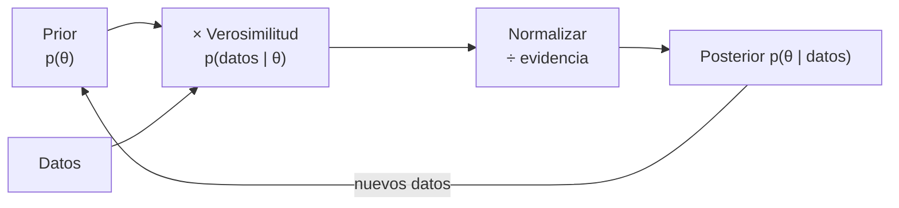

# B12-C12 — Inferencia bayesiana

<!-- nav:top -->
[🏠 Programa](../../../../README.md) · [📚 Bloque B12](../../../tronco-comun/B12-probabilidad-estadistica-e-incertidumbre.md) · [← Anterior: B12-C11 — Regresión robusta](../B12-C11-regresion-robusta/CLASE.md) · [Siguiente: B12-C13 — Cadenas de Markov y muestreo →](../../../tronco-comun/B12-probabilidad-estadistica-e-incertidumbre.md#b12-c13)
<!-- /nav -->

## 1. Ubicación, nivel y alcance

Duodécima clase del bloque B12. En C07–C09 el parámetro era una constante desconocida y la probabilidad se refería a datos repetidos. Aquí la probabilidad expresa **grado de conocimiento**: partes de un *prior*, lo actualizas con los datos mediante el teorema de Bayes y obtienes una *posterior* que combina ambos. Nivel N3. Verás los casos conjugados Beta–Binomial y Poisson–Gamma, los intervalos creíbles y el efecto del prior. No verás aún muestreo MCMC (C13), jerarquías (C21) ni comparación de modelos (C22).

## 2. Por qué esta clase existe

Una misión rara vez parte de cero: hay pruebas en tierra, misiones anteriores y física conocida. Y a menudo el dato es escaso (diez intervalos, treinta pruebas). Un método que no pueda incorporar lo que ya se sabe, ni expresar con claridad una probabilidad sobre el parámetro, se queda corto. La inferencia bayesiana lo hace, a costa de exigir que el prior se declare y se discuta.

Pregunta motivadora: **dada una tasa estimada con pocos datos y un conocimiento previo, ¿cuál es la distribución de valores plausibles de la tasa?** Decisión central: **qué prior declarar y cuánto pesa frente a los datos**.

## 3. Lo que podrás hacer al terminar

1. Enunciar el teorema de Bayes y aplicarlo a eventos y a parámetros.
2. Calcular la posterior en los modelos Beta–Binomial y Poisson–Gamma.
3. Calcular un intervalo creíble y distinguirlo de un intervalo de confianza.
4. Interpretar la media posterior como promedio ponderado de prior y datos.
5. Comprobar una posterior con una rejilla numérica independiente.
6. Evaluar la sensibilidad a la elección del prior.

La evidencia es el **informe de actualización bayesiana** del ejercicio 12 (sección 20).

## 4. Con qué llegas y cómo comprobarlo

Necesitas C01 (condicional y Bayes), C03 (Poisson, binomial) y C07 (verosimilitud). Cinco preguntas:

1. ¿Cuánto vale `P(A|B)` en términos de `P(B|A)`, `P(A)` y `P(B)`?
2. ¿Cuál es la verosimilitud de `k = 3` para `λ = 2`?
3. ¿Cuál es la media de una Gamma(forma `α`, tasa `β`)?
4. ¿Qué se obtiene al multiplicar una densidad por una constante?
5. ¿Qué es un intervalo de confianza?

<details>
<summary>Ver respuestas</summary>

1. `P(B|A)P(A)/P(B)`. 2. `e⁻² 2³/3! = 0,180`. 3. `α/β`. 4. Una función proporcional (misma forma). 5. Un procedimiento con cobertura declarada (C08).
</details>

Con cuatro o cinco aciertos, sigue; si no, repasa C01, C07 y C08.

## 5. Un caso: la tasa del detector con y sin conocimiento previo

Los diez conteos sintéticos de C07 (`4, 2, 3, 7, 3, 5, 1, 3, 4, 5`; suma 37 en 10 intervalos de 10 min) y dos puntos de partida: un prior **débil** (casi sin información) y uno **informativo** que refleja pruebas en tierra que sugerían una tasa cercana a 4. Además, un problema discreto: una alarma de anomalía con una prevalencia muy baja. Es el **ejemplo conductor**; los datos y los priors son **sintéticos e ilustrativos**.

## 6. Vocabulario

El **teorema de Bayes** dice que `P(θ | datos) = P(datos | θ) P(θ) / P(datos)`. El **prior** `P(θ)` expresa lo que se sabe de `θ` antes de ver los datos; la **verosimilitud** `P(datos | θ)` es el modelo de los datos (C07); la **posterior** `P(θ | datos)` es el conocimiento actualizado; el denominador, la **evidencia** o verosimilitud marginal, normaliza (y es clave en C22). Un prior es **conjugado** si la posterior pertenece a su misma familia: **Beta–Binomial** (prior `Beta(a,b)`, `s` éxitos en `n` ensayos → `Beta(a+s, b+n−s)`) y **Poisson–Gamma** (prior `Gamma(α,β)` con forma `α` y tasa `β`, conteos con suma `S` en `n` intervalos → `Gamma(α+S, β+n)`). Un **intervalo creíble** al 95 % contiene el 95 % de la probabilidad posterior; es una afirmación sobre `θ`, a diferencia de un intervalo de confianza (C08), que describe un procedimiento. El **prior informativo** lleva información sustantiva; el **débil** pesa poco. Hogg, Bovy y Lang insisten en partir de un modelo generativo de los datos, lo que permite calcular la posterior y marginalizar los parámetros de perturbación (S1).

## 7. Modelo mental: apilar evidencia sobre una creencia

Imagina una distribución como una nube de lo que crees sobre `θ`. Cada dato multiplica la nube por su verosimilitud y la renormaliza: las regiones compatibles con los datos crecen, las incompatibles se encogen. Con pocos datos manda el prior; con muchos, los datos.



*Descripción textual:* el prior se multiplica por la verosimilitud de los datos, se normaliza y se obtiene la posterior; ésta sirve de prior para los siguientes datos, lo que permite actualizar de forma acumulativa.

Analogía: un cartógrafo que corrige un mapa con cada recorrido nuevo, sin descartar lo anterior. Su límite: si el mapa inicial excluye por completo una región (prior cero), ningún recorrido podrá agregarla.

## 8. La explicación, paso a paso

### 8.1 Bayes con eventos: una alarma de anomalía

Un monitor detecta una anomalía real con probabilidad `0,95` (sensibilidad), da falsa alarma con `0,02` y la anomalía aparece una vez cada mil intervalos (`0,001`). Dada una alarma, `P(anomalía | alarma) = 0,95·0,001/(0,95·0,001 + 0,02·0,999) = 95/2093 = 0,0454`. Sólo el 4,5 % de las alarmas es real: la rareza del evento domina. Esa es la lección de la **tasa base**. Una segunda alarma independiente, tomando `0,0454` como nuevo prior, eleva la probabilidad a `0,693`.

### 8.2 Poisson–Gamma

Con prior débil `Gamma(1; 0,1)` (media 10, muy difuso), `S = 37` y `n = 10`: posterior `Gamma(38; 10,1)`, media `3,7624`, intervalo creíble 95 % `[2,662; 5,049]`. Con prior informativo `Gamma(8; 2)` (media 4): posterior `Gamma(45; 12)`, media `3,750`, intervalo `[2,735; 4,922]`. Con diez datos ambos priors dan casi lo mismo; el informativo estrecha un poco el intervalo.

### 8.3 La media posterior como promedio ponderado

`(α + S)/(β + n) = w·(α/β) + (1 − w)·(S/n)` con `w = β/(β + n)`. Para `Gamma(8; 2)` y `n = 10`: `w = 2/12 = 0,167`, y `0,167·4 + 0,833·3,7 = 3,75`. El prior vale como `β = 2` intervalos de datos «virtuales»; el dato real pesa 10. Cuantos más datos, más pequeño el peso del prior.

### 8.4 Beta–Binomial

27 éxitos en 30 pruebas con prior uniforme `Beta(1,1)`: posterior `Beta(28, 4)`, media `0,875`, intervalo creíble 95 % `[0,742; 0,964]`. A diferencia del intervalo aproximado de C08 (que pasaba de 1), el creíble queda siempre dentro de `[0,1]`.

### 8.5 Verificación independiente

El laboratorio calcula la posterior por rejilla (100 001 puntos entre 0 y 15) multiplicando prior y verosimilitud y normalizando, y la compara con la fórmula conjugada: la diferencia máxima es `4 × 10⁻¹⁴`, y la media coincide a seis decimales. Cuando no hay forma conjugada, la rejilla (poco dimensional) o el muestreo (C13) hacen lo mismo.

### 8.6 Sensibilidad al prior

Siempre se prueba más de un prior. Con `n = 10` las medias posteriores (`3,76` y `3,75`) apenas difieren; con un solo dato `k = 4` y prior `Gamma(8; 2)`, la posterior `Gamma(12; 3)` tiene media `4,0`, casi el prior. Un prior que asigna probabilidad cero a una región (por ejemplo `λ > 3`) nunca puede aprenderla: la posterior hereda el cero.

## 9. Magnitudes, símbolos y unidades

| Símbolo | Qué es | Unidad | Nota |
|---|---|---|---|
| `θ`, `λ` | parámetro, tasa | según el caso; eventos/intervalo | |
| `α`, `β` | forma y tasa de la Gamma | adimensional; intervalos | prior `Gamma(1;0,1)`, `Gamma(8;2)` |
| `S`, `n` | suma de conteos y n.º de intervalos | eventos; intervalos | 37 y 10 |
| `a`, `b` | parámetros de la Beta | adimensional | `Beta(1,1)` |
| `w` | peso del prior | adimensional | `β/(β+n)` |
| `P(·|·)` | probabilidad condicional | adimensional | |
| IC creíble | intervalo con 95 % de la posterior | unidad de `θ` | `[2,662; 5,049]` |

## 10. Convenciones y referencias

La Gamma se parametriza con **forma y tasa** (no escala): media `α/β`. Los intervalos creíbles son de colas iguales (2,5 % a cada lado). Se declaran los priors y se prueba más de uno. Los conteos son por intervalo de 10 min.

## 11. De dónde sale lo que afirmamos

| ID | Fuente | Localizador | Respalda | Consulta |
|---|---|---|---|---|
| S1 | D. W. Hogg, J. Bovy, D. Lang, *Data analysis recipes: Fitting a model to data* | arXiv:1008.4686, https://arxiv.org/abs/1008.4686 | Uso de un modelo generativo para definir verosimilitud/posterior y marginalizar (según el resumen) | 2026-11-05, resumen consultado; texto completo no leído |

Límites: el teorema de Bayes, los pares conjugados y la interpretación de intervalos creíbles son resultados estándar no atribuidos a una fuente consultada; los priors, la sensibilidad (`0,95`, `0,02`, `0,001`) y los datos son **sintéticos** e ilustrativos.

## 12. Cómo ver la actualización

Equivalente accesible a las curvas prior y posterior (parámetros exactos):

| Distribución de `λ` | Forma/tasa | Media | IC 95 % |
|---|---|---|---|
| Prior débil | 1 / 0,1 | 10,0 | muy amplio |
| Posterior (débil) | 38 / 10,1 | 3,7624 | [2,662; 5,049] |
| Prior informativo | 8 / 2 | 4,0 | amplio |
| Posterior (informativo) | 45 / 12 | 3,750 | [2,735; 4,922] |

Descripción larga: el prior débil es una curva casi plana y muy extendida hasta valores grandes; la posterior es una campana ligeramente asimétrica centrada en 3,7. El prior informativo es una campana ancha centrada en 4; su posterior es más estrecha.

## 13. Ejemplo trabajado: tasa y probabilidad de superar 5

**Paso 1 · Modelo y prior.** Conteos Poisson; prior `Gamma(8; 2)` de pruebas en tierra.

**Paso 2 · Datos.** `S = 37`, `n = 10`.

**Paso 3 · Posterior.** `Gamma(45; 12)`, media `3,75`, desviación `√45/12 = 0,559`.

**Paso 4 · Intervalo creíble.** `[2,735; 4,922]`.

**Paso 5 · Pregunta de decisión.** ¿Probabilidad de que la tasa supere 5? `P(λ > 5)` bajo la posterior ≈ `0,019` (cálculo propio con la distribución Gamma).

**Paso 6 · Sensibilidad.** Con el prior débil, el intervalo es `[2,662; 5,049]` y `P(λ > 5) ≈ 0,029`, algo mayor. La conclusión (probablemente < 5) no cambia.

**Paso 7 · Sentido.** Datos y priors **sintéticos**; el resultado es válido si la tasa es constante e independiente.

## 14. Comparación de métodos

La **estimación por máxima verosimilitud** (C07) da un punto y su error típico; la **bayesiana** da una distribución completa y permite incorporar información previa, a costa de elegir y defender un prior. Con muchos datos ambas coinciden. El **intervalo de confianza** (C08) y el **creíble** se parecen numéricamente pero se interpretan de modo distinto. Para modelos complejos la posterior no tiene forma cerrada y se necesita MCMC (C13). Es crítico declarar el prior: un prior oculto es un supuesto oculto.

## 15. Práctica guiada

**Ejercicio 1 · con los pasos indicados.** Prior `Beta(1,1)`, 9 éxitos en 10 ensayos: calcula la posterior y su media. *Pasos:* sumar éxitos y fracasos.

<details><summary>Solución comentada</summary>

`Beta(1+9, 1+1) = Beta(10, 2)`; media `10/12 = 0,833`.
</details>

**Ejercicio 2 · con una pista.** Prior `Gamma(2;1)`, tres intervalos con suma 6: posterior y media. *Pista:* `(α + S, β + n)`.

<details><summary>Solución comentada</summary>

`Gamma(8; 4)`; media `2`.
</details>

**Ejercicio 3 · casi autónomo.** Verifica la media posterior de `Gamma(8;2)` con `n = 10`, `S = 37` como promedio ponderado.

<details><summary>Solución comentada</summary>

`w = 2/12`; `(2/12)·4 + (10/12)·3,7 = 0,667 + 3,083 = 3,75`.
</details>

## 16. Práctica autónoma, transferencia e integrador

**Ejercicio 4.** Con prevalencia `0,01` (en vez de `0,001`), ¿cuánto vale `P(anomalía | alarma)`?

<details><summary>Solución comentada</summary>

`0,0095/(0,0095 + 0,02·0,99) = 0,0095/0,0293 = 0,324`.
</details>

**Ejercicio 5.** Actualiza en dos etapas: conteos `4, 2, 3` y luego `7, 3, 5, 1, 3, 4, 5` con prior `Gamma(1; 0,1)`. Compara con el lote de una vez.

<details><summary>Solución comentada</summary>

Etapa 1: `Gamma(1+9; 0,1+3) = Gamma(10; 3,1)`. Etapa 2: `Gamma(10+28; 3,1+7) = Gamma(38; 10,1)`, igual al lote: la actualización es acumulativa.
</details>

**Ejercicio 6.** Un colega dice «el intervalo creíble `[2,66; 5,05]` significa lo mismo que un intervalo de confianza». Responde.

<details><summary>Solución comentada</summary>

No: el creíble es una afirmación de probabilidad sobre `λ` dado el modelo y el prior; el de confianza describe la cobertura de un procedimiento en repeticiones (C08). Los números pueden parecerse.
</details>

**Ejercicio 7.** Con un solo dato `k = 4` y prior `Gamma(8;2)`, ¿qué posterior y qué media?

<details><summary>Solución comentada</summary>

`Gamma(12; 3)`, media `4,0`. Casi no se mueve: el prior pesa `2` frente a `1` dato.
</details>

**Ejercicio 8.** ¿Cuál es la probabilidad predictiva de que la próxima prueba sea un éxito con posterior `Beta(28,4)`?

<details><summary>Solución comentada</summary>

La media de la posterior: `28/32 = 0,875`.
</details>

**Ejercicio 9 · transferencia.** Tras una primera alarma (`P = 0,0454`), llega una segunda alarma independiente. Calcula la nueva probabilidad de anomalía.

<details><summary>Solución comentada</summary>

`0,95·0,0454/(0,95·0,0454 + 0,02·0,9546) = 0,04313/0,06222 = 0,693`. Dos alarmas independientes convierten una sospecha débil en probable.
</details>

**Ejercicio 10 · transferencia.** Un analista elige un prior que asigna cero a `λ > 6` «por ingeniería». Los datos futuros sugieren `λ = 8`. ¿Qué pasa?

<details><summary>Solución comentada</summary>

La posterior sigue en cero para `λ > 6`: el modelo nunca puede aprender el valor real. Hay que usar priors con soporte amplio (colas) salvo imposibilidad física.
</details>

**Ejercicio 11 · transferencia.** ¿Cuándo preferirías el enfoque de máxima verosimilitud al bayesiano y viceversa en una misión?

<details><summary>Solución comentada</summary>

Verosimilitud: muchos datos, sin información previa fiable, necesidad de un número único y rápido. Bayesiano: pocos datos, información previa documentada, necesidad de probabilidades de decisión o de propagar la incertidumbre completa. En ambos se prueba la sensibilidad.
</details>

**Ejercicio 12 · integrador.** Elabora tu *informe de actualización bayesiana*: elige un parámetro (tasa o proporción), declara dos priors, calcula las posteriores (analítica y por rejilla), da intervalos creíbles, compara con la estimación de máxima verosimilitud y concluye sobre la sensibilidad al prior.

<details><summary>Solución modelo</summary>

Debe incluir: modelo y supuestos; priors justificados; posteriores analíticas con parámetros; verificación por rejilla (diferencia máxima); intervalos creíbles; tabla comparativa con el MLE de C07; discusión de sensibilidad; datos rotulados como sintéticos; semilla y versiones.
</details>

## 17. Laboratorio: posterior conjugada y rejilla

El script [inferencia_bayes.py](inferencia_bayes.py) calcula posteriores Poisson–Gamma con dos priors, las compara con una rejilla de 100 001 puntos, calcula la Beta–Binomial y resuelve el problema de la alarma con fracciones exactas; falla si la rejilla se aparta más de `10⁻⁶` o si el resultado exacto de Bayes no coincide.

**Datos:** sintéticos. **Predice antes de ejecutar:** ¿qué fracción de las alarmas es real? (menos del 5 %.) **Ejecución del 2026-11-05 (Python 3.12.9, NumPy 2.4.4, SciPy 1.17.1):**

```text
prior debil                 : posterior Gamma(38, 10.1); media = 3.7624; IC creible 95 % = [2.662, 5.049]
prior informativo (media 4) : posterior Gamma(45, 12.0); media = 3.7500; IC creible 95 % = [2.735, 4.922]
max |rejilla - analitica| = 3.99e-14; media rejilla = 3.762376 (analitica 3.762376)
Beta-Binomial 27/30, prior uniforme: media = 0.8750; IC 95 % = [0.742, 0.964]
P(anomalia | alarma) = 95/2093 = 0.0454  (sensibilidad 0.95, prevalencia 0.001, falsas alarmas 0.02)
Pruebas superadas.
```

```bash
python programa/clases/B12/B12-C12-inferencia-bayesiana/inferencia_bayes.py
```

**Límites:** priors conjugados, tasa constante; resultados **sintéticos**.

## 18. Errores frecuentes y cómo corregirlos

**Ignorar la tasa base.** Se corrige con 8.1 y el ejercicio 4.

**Ocultar el prior.** Se corrige con la sección 10 y el ejercicio 12.

**Confundir intervalo creíble y de confianza.** Se corrige con el ejercicio 6.

**Usar un prior con soporte nulo.** Se corrige con 8.6 y el ejercicio 10.

**Confundir forma/tasa con forma/escala de la Gamma.** Se corrige con la sección 10.

## 19. Cómo sabrás que vas bien

Tras 8.1: ¿recalculas la probabilidad con otra prevalencia? Si no, ejercicio 4. Tras 8.3: ¿explicas cuánto pesa el prior? Si no, ejercicio 3. Tras 8.6: ¿qué prior descartarías por soporte nulo? Si dudas, ejercicio 10.

## 20. Qué entregas y cómo se evalúa

El producto es tu **informe de actualización bayesiana** (ejercicio 12).

| Criterio | Inicial | En desarrollo | Logrado | Destacado |
|---|---|---|---|---|
| Priors | No declarados | Declarados | Justificados | Con sensibilidad |
| Posterior | Con errores | Correcta con ayuda | Analítica y verificada | Con predictiva |
| Intervalo | Sin interpretar | Interpretación ambigua | Creíble bien interpretado | Contrasta con confianza |
| Comparación con MLE | Ausente | Parcial | Tabla comparativa | Explica diferencias |
| Fuentes y rótulo | Ausente | Parcial | Sintético y fuente | Declara límites |

**Condiciones críticas (no se compensan con promedio):** declarar y justificar los priors; probar la sensibilidad; rotular datos sintéticos.

## 21. Ética, seguridad y límites

Un prior elegido para obtener la conclusión deseada es manipulación. Las probabilidades de decisión (por ejemplo, de falla) derivadas de priors no documentados no deben alimentar decisiones de seguridad. Los priors y datos de esta clase son ilustrativos. Accesibilidad: las curvas se ofrecen como tabla; todo funciona sin conexión.

## 22. Para cerrar y seguir

Bayes combina un prior con la verosimilitud para dar una posterior; en los casos conjugados el cálculo es una suma de parámetros; el intervalo creíble habla del parámetro; la tasa base y la sensibilidad al prior son los puntos delicados. Queda abierta una pregunta: ¿cómo calcular la posterior cuando no hay forma cerrada ni basta una rejilla? Con cadenas de Markov y muestreo (C13).

**Glosario español–inglés.** teorema de Bayes · *Bayes' theorem*; prior (a priori) · *prior*; posterior (a posteriori) · *posterior*; verosimilitud · *likelihood*; evidencia · *evidence*; conjugado · *conjugate*; intervalo creíble · *credible interval*; tasa base · *base rate*.

**Continuidad.** B12-C13 reutiliza tu capacidad de **plantear prior × verosimilitud** para muestrear posteriores sin forma cerrada.

**Referencias:** ver sección 11.

<!-- nav:bottom -->
---

[← Anterior: B12-C11 — Regresión robusta](../B12-C11-regresion-robusta/CLASE.md) · [📚 Bloque B12](../../../tronco-comun/B12-probabilidad-estadistica-e-incertidumbre.md) · [Siguiente: B12-C13 — Cadenas de Markov y muestreo →](../../../tronco-comun/B12-probabilidad-estadistica-e-incertidumbre.md#b12-c13)
<!-- /nav -->
