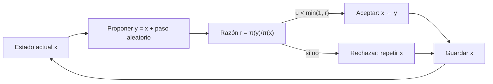

# B12-C13 — Cadenas de Markov y muestreo

<!-- nav:top -->
[🏠 Programa](../../../../README.md) · [📚 Bloque B12](../../../tronco-comun/B12-probabilidad-estadistica-e-incertidumbre.md) · [← Anterior: B12-C12 — Inferencia bayesiana](../B12-C12-inferencia-bayesiana/CLASE.md) · [Siguiente: B12-C14 — Simulación Monte Carlo →](../B12-C14-simulacion-monte-carlo/CLASE.md)
<!-- /nav -->

## 1. Ubicación, nivel y alcance

Decimotercera clase del bloque B12. En [C12](../B12-C12-inferencia-bayesiana/CLASE.md) las posteriores tenían forma cerrada o se evaluaban en una rejilla. Cuando el modelo tiene muchos parámetros, ninguna de las dos sirve. La salida es **muestrear** la posterior con una **cadena de Markov**. Esta clase enseña qué es una cadena, su distribución estacionaria y el algoritmo de Metropolis. Nivel N3. No verás los diagnósticos de convergencia (C23) ni el uso de la cadena para integrar (C14).

## 2. Por qué esta clase existe

Una posterior de diez o veinte parámetros (órbita, calibración, ruido) no se puede tabular. Pero sí se pueden generar muestras que sigan su forma, aunque no se conozca su normalización. Con esas muestras se calculan medias, intervalos y correlaciones. El truco es construir una cadena cuyo comportamiento a largo plazo reproduzca la distribución deseada.

Pregunta motivadora: **¿cómo se genera una secuencia de valores que, en conjunto, siga una distribución que solo sabemos evaluar salvo una constante?** Decisión central: **cuántos pasos descartar y cuántos usar, y qué tamaño de paso proponer**.

## 3. Lo que podrás hacer al terminar

1. Definir una cadena de Markov y su matriz de transición, y calcular sus probabilidades de `n` pasos.
2. Hallar la distribución estacionaria de una cadena finita por tres caminos.
3. Explicar el balance detallado y por qué garantiza la estacionariedad.
4. Implementar el algoritmo de Metropolis y calcular su probabilidad de aceptación.
5. Interpretar el calentamiento, la correlación entre muestras y la tasa de aceptación.
6. Verificar un muestreador contra una posterior con solución exacta.

La evidencia es el **informe del muestreador** del ejercicio 12 (sección 20).

## 4. Con qué llegas y cómo comprobarlo

Necesitas C01 (probabilidad condicional), C12 (prior × verosimilitud) y multiplicación de matrices. Cinco preguntas:

1. ¿Qué es `P(A|B)`?
2. ¿Cómo se multiplica un vector fila por una matriz?
3. ¿Qué es una densidad no normalizada?
4. ¿Cuánto es `ln(e³ · e⁻¹)`?
5. ¿Qué forma tiene la posterior Gamma(38; 10,1) de C12?

<details>
<summary>Ver respuestas</summary>

1. Probabilidad de `A` sabiendo `B`. 2. Fila por columnas: cada componente es una suma de productos. 3. Una función proporcional a la densidad, sin constante. 4. `2`. 5. Una campana asimétrica de media `3,76`.
</details>

Con cuatro o cinco aciertos, sigue; si no, repasa C01 y C12.

## 5. Un caso: el enlace y la tasa del detector

(a) Un enlace de comunicaciones **ilustrativo** está en estado Bueno (0) o Malo (1). Cada minuto pasa de Bueno a Malo con probabilidad `p = 0,10` y de Malo a Bueno con `q = 0,40`. ¿Qué fracción del tiempo pasa en cada estado? (b) Para la tasa `λ` del detector de C12 (posterior `Gamma(38; 10,1)`) se quiere obtener muestras con Metropolis y comparar con la solución exacta. Es el **ejemplo conductor**; los datos son **sintéticos e ilustrativos**.

## 6. Vocabulario

Una **cadena de Markov** es una secuencia de estados `X₀, X₁, …` en que el siguiente depende solo del actual: `P(Xₙ₊₁ | Xₙ, Xₙ₋₁, …) = P(Xₙ₊₁ | Xₙ)`. La **matriz de transición** `P` tiene entradas `Pᵢⱼ = P(siguiente = j | actual = i)` y cada fila suma 1. La **distribución estacionaria** `π` cumple `πP = π`: si el estado se distribuye según `π`, lo sigue haciendo. Una cadena **irreducible** puede llegar de cualquier estado a cualquier otro; **aperiódica** no queda atrapada en ciclos; si es ambas, converge a su única `π` desde cualquier inicio. El **balance detallado** `πᵢPᵢⱼ = πⱼPⱼᵢ` es una condición suficiente de estacionariedad. El **algoritmo de Metropolis** propone `y` desde una distribución simétrica alrededor del actual `x` y lo acepta con probabilidad `min(1, π(y)/π(x))`; si no, repite `x`. La **tasa de aceptación** es la fracción de propuestas aceptadas. El **calentamiento** (*burn-in*) son los primeros pasos, que se descartan porque aún no reflejan `π`. El *emcee* de Foreman-Mackey y colaboradores es un muestreador de conjunto invariante afín para el que reportan el tiempo de autocorrelación como medida de rendimiento (S1).

## 7. Modelo mental: un caminante que visita en proporción a la altura

Imagina un paseante en un paisaje cuya altura es la densidad objetivo. Prueba un paso al azar: si sube, siempre lo da; si baja, lo da con una probabilidad proporcional a cuánto baja. A largo plazo pasa más tiempo en las zonas altas, exactamente en proporción a la altura. No necesita saber el volumen total del paisaje.



*Descripción textual:* desde el estado actual se propone un movimiento simétrico; se compara la densidad en el punto nuevo y en el actual; se acepta siempre si es mayor, o con probabilidad igual al cociente si es menor; se guarda el estado (nuevo o repetido) y se repite.

Analogía: el paseante que explora un valle en la niebla guiado solo por si el terreno sube o baja. Su límite: con un paso demasiado corto avanza muy despacio, y con uno demasiado largo casi siempre cae fuera del valle y no se mueve.

## 8. La explicación, paso a paso

### 8.1 Una cadena de dos estados

Con `p = 0,10` y `q = 0,40`, la matriz es `P = [[0,9; 0,1], [0,4; 0,6]]`. La distribución estacionaria es `π = (q/(p+q), p/(p+q)) = (0,8; 0,2)`. Se obtiene por tres caminos que el laboratorio comprueba a `10⁻¹²`: la fórmula, el vector propio de `Pᵀ` con valor propio 1, y las potencias `Pⁿ`, cuyas filas convergen a `π` (con `n = 60` las dos filas valen `(0,8; 0,2)`). El enlace pasa el 20 % del tiempo en estado Malo; simulado un millón de pasos: `0,2005`.

### 8.2 Velocidad de mezcla

El segundo valor propio de `P` es `1 − p − q = 0,5`: el error respecto de `π` se reduce a la mitad en cada paso. Una cadena cuyo segundo valor propio está cerca de 1 «recuerda» mucho tiempo su inicio, es decir, mezcla lento. En general, la correlación entre muestras sucesivas es lo que hace que una cadena valga menos que un número igual de muestras independientes.

### 8.3 Balance detallado

Para un objetivo discreto `(0,2; 0,5; 0,3)` y una propuesta que elige uno de los otros dos estados con igual probabilidad, Metropolis da `T₀₁ = ½ min(1; 0,5/0,2) = 0,5` y `T₁₀ = ½ min(1; 0,2/0,5) = 0,2`. Entonces `π₀T₀₁ = 0,2·0,5 = 0,1 = π₁T₁₀ = 0,5·0,2`. El laboratorio verifica `πT = π` en toda la matriz de 3 estados. Esta igualdad es la razón por la que el algoritmo funciona: el objetivo es estacionario.

### 8.4 Metropolis para la posterior de C12

Objetivo: `π(λ) ∝ λ³⁷ e^{−10,1 λ}` (no hace falta la constante). Propuesta: `y = x + 0,8·z`, con `z ~ N(0,1)`. Inicio deliberadamente lejos, `λ = 8`. Se generan 400 000 pasos y se descartan los 5 000 primeros. Resultado: tasa de aceptación `0,628`; media `3,7617` (exacta `3,7624`); varianza `0,3746` (exacta `0,3725`); intervalo 95 % `[2,661; 5,052]` (exacto `[2,662; 5,049]`). La cadena reproduce la posterior sin conocer su constante.

### 8.5 Aceptar con probabilidad

Si el estado actual es `3,7` y se propone `4,2`: `ln r = 37 ln(4,2/3,7) − 10,1·0,5 = 4,690 − 5,05 = −0,360`, `r = 0,698`. Se acepta con probabilidad 0,698: se compara un número uniforme `u` con `r`. El logaritmo evita desbordamientos con densidades muy pequeñas. Una propuesta simétrica hace que su densidad se cancele en `r`; con una asimétrica hay un factor de corrección.

### 8.6 Lo que puede fallar

(i) **Calentamiento insuficiente**: la cadena que empezó en `8,41` tardó en acercarse a `3,7`; las primeras muestras no son de `π`. (ii) **Autocorrelación**: las muestras sucesivas se parecen, de modo que 400 000 pasos equivalen a muchas menos muestras independientes (C23). (iii) **Paso mal elegido**: pequeño ⇒ se acepta casi todo pero se avanza lento; grande ⇒ se rechaza casi todo. (iv) **Multimodalidad**: una cadena puede quedarse en un solo pico. Una cadena que parece haber convergido no prueba que lo haya hecho.

## 9. Magnitudes, símbolos y unidades

| Símbolo | Qué es | Unidad | Nota |
|---|---|---|---|
| `Xₙ` | estado en el paso `n` | según el caso | |
| `P`, `Pᵢⱼ` | matriz de transición | adimensional | filas suman 1 |
| `p, q` | prob. Bueno→Malo, Malo→Bueno | min⁻¹ (por paso) | `0,10`, `0,40` |
| `π` | distribución estacionaria o objetivo | adimensional | `(0,8; 0,2)` |
| `λ` | tasa del detector | eventos/intervalo | objetivo Gamma(38; 10,1) |
| `r` | razón de Metropolis | adimensional | `π(y)/π(x)` |
| `ε` | tamaño de paso | igual que `λ` | `0,8` |

## 10. Convenciones y referencias

Los pasos de la cadena (a) son de 1 min. La cadena (b) se inicia en `8,0` y se descartan 5 000 pasos. Se fija la semilla y se imprimen las versiones. Se trabaja con `ln π` para estabilidad numérica.

## 11. De dónde sale lo que afirmamos

| ID | Fuente | Localizador | Respalda | Consulta |
|---|---|---|---|---|
| S1 | D. Foreman-Mackey, D. W. Hogg, D. Lang, J. Goodman, *emcee: The MCMC Hammer* | arXiv:1202.3665, https://arxiv.org/abs/1202.3665 | Existencia de un muestreador MCMC de conjunto invariante afín en Python y uso del tiempo de autocorrelación como medida de rendimiento (según el resumen) | 2026-11-05, resumen consultado; texto completo no leído |

Límites: la teoría de cadenas de Markov, el balance detallado y la regla de Metropolis son resultados estándar no atribuidos a una fuente consultada; los valores de `p`, `q` y la posterior de C12 son **sintéticos e ilustrativos**; el algoritmo de la clase es un Metropolis simple, no el de S1.

## 12. Cómo ver la cadena

Equivalente accesible a la traza de la cadena (cálculo propio):

| Paso | Valor | Comentario |
|---|---|---|
| 0 | 8,00 | inicio lejano |
| 1–4 | 8,41 | cadena que aún no ha aceptado una propuesta |
| tras el calentamiento | 3,76 ± 0,61 | media y desviación de las muestras utilizadas |

Descripción larga: la traza empieza en `8` y desciende hacia la región de `3` a `5`, donde oscila alrededor de `3,76`; los primeros valores repetidos (`8,41`) muestran rechazos consecutivos. La tasa de aceptación global fue `0,628`.

## 13. Ejemplo trabajado: ¿es creíble el muestreador?

**Paso 1 · Objetivo.** `ln π(λ) = 37 ln λ − 10,1 λ + cte`.

**Paso 2 · Propuesta.** Normal de paso `0,8`.

**Paso 3 · Ejecución.** 400 000 pasos, 5 000 de calentamiento.

**Paso 4 · Comparación.** Media `3,7617` frente a `3,7624` (diferencia relativa `0,02 %`); varianza `0,3746` frente a `0,3725` (`0,6 %`).

**Paso 5 · Intervalo.** `[2,661; 5,052]` frente a `[2,662; 5,049]`.

**Paso 6 · Conclusión.** El muestreador funciona en este problema de una dimensión con solución exacta.

**Paso 7 · Límite.** Que funcione aquí no prueba que funcione en un problema sin solución exacta; ahí hay que usar diagnósticos (C23). Todo **simulado** con datos **sintéticos**.

## 14. Comparación de métodos

Frente a la **rejilla** (C12), Metropolis escala a más dimensiones pero produce muestras correlacionadas y requiere diagnósticos. Frente a **Monte Carlo simple** (C14), no necesita saber muestrear directamente de la distribución. Hay variantes más eficientes (Hamiltoniano, ensamble afín como el de S1), con más ajuste o más información del modelo. Para problemas pequeños y con forma cerrada, usa la forma cerrada.

## 15. Práctica guiada

**Ejercicio 1 · con los pasos indicados.** Una cadena de dos estados con `p = 0,2` y `q = 0,3`: halla `π`. *Pasos:* `π = (q, p)/(p+q)`.

<details><summary>Solución comentada</summary>

`π = (0,3; 0,2)/0,5 = (0,6; 0,4)`.
</details>

**Ejercicio 2 · con una pista.** Con `p = 0,1`, `q = 0,4`, calcula la probabilidad de estar en Bueno a los dos pasos partiendo de Bueno. *Pista:* dos caminos: BB y BM→B... (BB→B y BM→B).

<details><summary>Solución comentada</summary>

`0,9·0,9 + 0,1·0,4 = 0,81 + 0,04 = 0,85`.
</details>

**Ejercicio 3 · casi autónomo.** Calcula la probabilidad de aceptar la propuesta `4,2` desde `3,7` para el objetivo `λ³⁷ e^{−10,1λ}`.

<details><summary>Solución comentada</summary>

`ln r = 37·ln(4,2/3,7) − 10,1·0,5 = −0,360`; `r = 0,698` (8.5).
</details>

## 16. Práctica autónoma, transferencia e integrador

**Ejercicio 4.** ¿Cuánto tiempo seguido se espera que el enlace permanezca en Malo?

<details><summary>Solución comentada</summary>

La permanencia es geométrica con probabilidad de salida `q = 0,4`: media `1/q = 2,5 min`.
</details>

**Ejercicio 5.** ¿Por qué en Metropolis con propuesta simétrica la densidad de la propuesta no aparece en `r`?

<details><summary>Solución comentada</summary>

Porque `q(y|x) = q(x|y)` y se cancela en el cociente; sólo importa `π(y)/π(x)`.
</details>

**Ejercicio 6.** ¿Por qué se descartan los primeros pasos? ¿Cómo lo vería un lector en la traza de 12?

<details><summary>Solución comentada</summary>

La cadena empezó lejos (`8`) y aún no se distribuye según `π`; la traza muestra el descenso inicial. Incluir esos valores sesgaría la media.
</details>

**Ejercicio 7.** ¿Qué ocurre con la tasa de aceptación si el paso se hace diez veces más pequeño? ¿Y diez veces mayor?

<details><summary>Solución comentada</summary>

Mucho más pequeño: casi todo se acepta (la propuesta es casi igual al actual) pero la cadena avanza muy lento. Mucho mayor: casi todo se rechaza y la cadena se queda quieta. Ambos extremos dan pocas muestras útiles.
</details>

**Ejercicio 8.** Comprueba el balance detallado entre los estados 1 y 2 del objetivo `(0,2; 0,5; 0,3)`.

<details><summary>Solución comentada</summary>

`T₁₂ = ½ min(1; 0,3/0,5) = 0,3`; `T₂₁ = ½ min(1; 0,5/0,3) = 0,5`. `π₁T₁₂ = 0,5·0,3 = 0,15`; `π₂T₂₁ = 0,3·0,5 = 0,15`. ✓.
</details>

**Ejercicio 9 · transferencia.** Un clima espacial con tres estados (Quieto, Activo, Tormenta) tiene `P = [[0,9; 0,1; 0], [0,2; 0,7; 0,1], [0; 0,3; 0,7]]` (ilustrativo). Halla `π`.

<details><summary>Solución comentada</summary>

Balance: `0,1π₀ = 0,2π₁` ⇒ `π₁ = 0,5π₀`; `0,1π₁ = 0,3π₂` ⇒ `π₂ = π₁/3 = π₀/6`. Suma: `π₀(1 + 0,5 + 0,1667) = 1` ⇒ `π = (0,6; 0,3; 0,1)`. Comprobación: `0,9·0,6 + 0,2·0,3 = 0,6`.
</details>

**Ejercicio 10 · transferencia.** Las muestras de una cadena tienen autocorrelación alta; 100 000 pasos «valen» 5 000 independientes. ¿Cuál es el error típico de la media si la desviación es `0,61`?

<details><summary>Solución comentada</summary>

Con el tamaño efectivo: `0,61/√5000 = 0,0086`. Con `N = 100 000` sin corregir se obtendría `0,0019`, subestimado 4,5 veces (C23).
</details>

**Ejercicio 11 · transferencia.** Un colega usa la salida de una única cadena de 1000 pasos con inicio arbitrario y concluye que «convergió porque la traza parece estable». Evalúa.

<details><summary>Solución comentada</summary>

Insuficiente: una traza estable en un modo puede no haber explorado otros; se necesitan varias cadenas con inicios dispersos y diagnósticos cuantitativos (C23), además de un calentamiento suficiente.
</details>

**Ejercicio 12 · integrador.** Elabora tu *informe del muestreador*: aplica Metropolis a una posterior con solución exacta (por ejemplo Beta(28; 4) de C12), con tres pasos distintos; tabula tasa de aceptación, media, varianza y error frente a lo exacto; reporta el calentamiento y la semilla.

<details><summary>Solución modelo</summary>

Tabla por paso con aceptación, media, varianza y error relativo; elección justificada del paso; calentamiento mostrado en la traza; comparación del intervalo con el exacto; límites (una dimensión, solución conocida); semilla y versiones; datos sintéticos.
</details>

## 17. Laboratorio: cadena de dos estados y Metropolis

El script [markov_metropolis.py](markov_metropolis.py) comprueba la distribución estacionaria por tres caminos, simula la cadena, verifica `πT = π` para Metropolis en tres estados y muestrea la posterior `Gamma(38; 10,1)`; falla si alguna igualdad o tolerancia no se cumple.

**Datos:** sintéticos. **Predice antes de ejecutar:** ¿qué media tendrá la cadena? (≈ `3,76`.) **Ejecución del 2026-11-06 (Python 3.12.9, NumPy 2.4.4, SciPy 1.17.1):**

```text
pi teorica = [0.8 0.2]; vector propio = [0.8 0.2]; P^60 filas = [0.8 0.2] [0.8 0.2]
segundo valor propio = 0.50: el error cae como 0.5^n
fraccion simulada en estado Malo = 0.2005 (teorica 0.2000)
balance detallado de Metropolis: pi T = pi (3 estados) verificado
tasa de aceptacion = 0.628; media = 3.7617 (exacta 3.7624); var = 0.3746 (exacta 0.3725)
IC 95 % MCMC = [2.661, 5.052]; exacto = [2.662, 5.049]
primeros 5 valores de la cadena: [8.41 8.41 8.41 8.41 8.41]
Pruebas superadas.
```

```bash
python programa/clases/B12/B12-C13-cadenas-de-markov-y-muestreo/markov_metropolis.py
```

**Límites:** una dimensión; resultados **simulados**.

## 18. Errores frecuentes y cómo corregirlos

**Incluir el calentamiento en las estimaciones.** Se corrige con el ejercicio 6.

**Tratar las muestras como independientes.** Se corrige con el ejercicio 10.

**Elegir el paso por la tasa de aceptación sola.** Se corrige con el ejercicio 7.

**Declarar convergencia por inspección visual.** Se corrige con el ejercicio 11.

**Olvidar que las filas de `P` suman 1.** Se corrige con el ejercicio 1.

## 19. Cómo sabrás que vas bien

Tras 8.1: ¿calculas `π` de una cadena de dos estados? Si no, ejercicio 1. Tras 8.3: ¿explicas por qué Metropolis preserva `π`? Si no, ejercicio 8. Tras 8.6: ¿qué te haría desconfiar de una cadena? Si dudas, ejercicio 11.

## 20. Qué entregas y cómo se evalúa

El producto es tu **informe del muestreador** (ejercicio 12).

| Criterio | Inicial | En desarrollo | Logrado | Destacado |
|---|---|---|---|---|
| Algoritmo | Con errores | Con ayuda | Correcto en log | Explica el balance detallado |
| Verificación | Ninguna | Compara la media | Media, varianza e intervalo | Con varios pasos |
| Calentamiento | Ignorado | Descartado sin justificar | Justificado con la traza | Con varias cadenas |
| Límites | No los menciona | Los menciona | Explica autocorrelación | Cuantifica el tamaño efectivo |
| Fuentes y rótulo | Ausente | Parcial | Sintético y fuente | Declara validez |

**Condiciones críticas (no se compensan con promedio):** descartar o justificar el calentamiento; verificar contra una solución conocida; no declarar convergencia sin diagnóstico.

## 21. Ética, seguridad y límites

Una cadena sin convergencia da intervalos falsamente precisos que pueden llevar a decisiones de misión equivocadas. Ningún resultado de esta clase es operativo. Accesibilidad: la traza se ofrece como tabla; todo funciona sin conexión.

## 22. Para cerrar y seguir

Una cadena de Markov olvida su pasado salvo el estado actual; si es irreducible y aperiódica, converge a su distribución estacionaria; Metropolis construye una cadena cuya estacionaria es el objetivo, usando solo cocientes de densidad; el calentamiento, la autocorrelación y el paso condicionan la calidad. Queda abierta una pregunta: ¿cómo usar muestras aleatorias en general para calcular probabilidades e integrales? Es la simulación Monte Carlo (C14).

**Glosario español–inglés.** cadena de Markov · *Markov chain*; matriz de transición · *transition matrix*; distribución estacionaria · *stationary distribution*; balance detallado · *detailed balance*; calentamiento · *burn-in*; tasa de aceptación · *acceptance rate*; autocorrelación · *autocorrelation*.

**Continuidad.** B12-C14 reutiliza tu capacidad de **generar muestras y resumir con ellas** para estimar probabilidades con su error.

**Referencias:** ver sección 11.

<!-- nav:bottom -->
---

[← Anterior: B12-C12 — Inferencia bayesiana](../B12-C12-inferencia-bayesiana/CLASE.md) · [📚 Bloque B12](../../../tronco-comun/B12-probabilidad-estadistica-e-incertidumbre.md) · [Siguiente: B12-C14 — Simulación Monte Carlo →](../B12-C14-simulacion-monte-carlo/CLASE.md)
<!-- /nav -->
