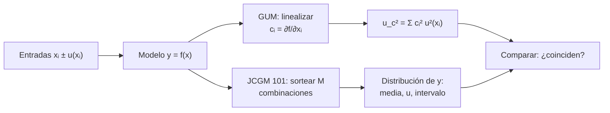

# B12-C16 — Propagación de incertidumbre

<!-- nav:top -->
[🏠 Programa](../../../../README.md) · [📚 Bloque B12](../../../tronco-comun/B12-probabilidad-estadistica-e-incertidumbre.md) · [← Anterior: B12-C15 — Muestreo de importancia](../B12-C15-muestreo-de-importancia/CLASE.md) · [Siguiente: B12-C17 — Análisis de sensibilidad →](../../../tronco-comun/B12-probabilidad-estadistica-e-incertidumbre.md#b12-c17)
<!-- /nav -->

## 1. Ubicación, nivel y alcance

Decimosexta clase del bloque B12. Tienes entradas con incertidumbre (un semieje, una paralaje, una constante) y una fórmula que las combina; necesitas la incertidumbre de la salida. Aprenderás la **ley de propagación** del GUM, con sus coeficientes de sensibilidad, y el **método de Monte Carlo** del suplemento 1, y verás cuándo la primera deja de ser fiable. Nivel N3. Ejemplo conductor: la velocidad circular a 400 km de altitud. No verás aún el presupuesto completo (C20) ni el análisis de sensibilidad global (C17).

## 2. Por qué esta clase existe

Casi todo resultado en ciencias espaciales es una función de medidas: una velocidad a partir de un radio, una distancia a partir de una paralaje, una masa a partir de un período. Dar el valor sin su incertidumbre no permite comparar con otros resultados ni decidir si cumple un requisito. Y propagar mal —sumar desviaciones, ignorar correlaciones, linealizar donde no se puede— produce incertidumbres falsas.

Pregunta motivadora: **¿cuánta incertidumbre tiene `v = √(GM/a)` si `a` se conoce a ±1 km, y cuándo puedo fiarme de la fórmula de propagación?** Decisión central: **qué método de propagación usar y cómo verificarlo**.

## 3. Lo que podrás hacer al terminar

1. Escribir el modelo de medida `y = f(x₁, …, x_N)` e identificar sus entradas.
2. Calcular coeficientes de sensibilidad y la incertidumbre combinada con la ley de propagación.
3. Convertir una tolerancia rectangular `±a` en incertidumbre típica `a/√3`.
4. Propagar por Monte Carlo y comparar con la ley de propagación.
5. Reconocer la no linealidad como causa de intervalos asimétricos y de fallos de la linealización.
6. Dar el resultado con incertidumbre, intervalo de cobertura y método.

La evidencia es el **informe de propagación** del ejercicio 12 (sección 20).

## 4. Con qué llegas y cómo comprobarlo

Necesitas C04 (suma de varianzas), C05 (covarianza), C14 (Monte Carlo) y derivadas de B09. Cinco preguntas:

1. ¿Cuál es la derivada de `√(c/a)` respecto de `a`?
2. ¿Cuánto vale `√(3² + 4²)`?
3. ¿Cuál es la varianza de una uniforme en `[−a, a]`?
4. ¿Qué es la incertidumbre típica?
5. ¿Qué error típico tiene una simulación con `N` muestras?

<details>
<summary>Ver respuestas</summary>

1. `−½ √c a^{−3/2} = −½ f/a`. 2. `5`. 3. `a²/3`. 4. La desviación típica asociada a una estimación. 5. Proporcional a `1/√N`.
</details>

Con cuatro o cinco aciertos, sigue; si no, repasa C04, C05, C14 y B09.

## 5. Un caso: la velocidad circular y una distancia por paralaje

(a) Una órbita circular con semieje `a = 6 778 100 m` (radio ecuatorial nominal `6,3781 × 10⁶ m` más 400 km **ilustrativos**), con `u(a) = 1 000 m` también ilustrativo, y `GM = 3,986004 × 10¹⁴ m³ s⁻²` (valor nominal de la IAU, S3), tomado sin incertidumbre. ¿Cuánto vale `v = √(GM/a)` y con qué incertidumbre? (b) Una distancia `d = 1000/p` (en pc, con `p` en mas) con `p = 10 ± 2 mas` (**sintético**): una función no lineal con incertidumbre relativa grande. Es el **ejemplo conductor**.

## 6. Vocabulario

El **modelo de medida** expresa la salida como función de las entradas: `Y = f(X₁, …, X_N)` (S1, 4.1). La **incertidumbre típica** `u(xᵢ)` es la desviación típica asociada a la estimación `xᵢ` (S1, 4.2–4.3). Los **coeficientes de sensibilidad** son las derivadas parciales `cᵢ = ∂f/∂xᵢ` evaluadas en las estimaciones; describen cómo varía la salida con cada entrada (S1, 5.1.3). La **ley de propagación de la incertidumbre** da la **incertidumbre combinada**: `u_c²(y) = Σᵢ (∂f/∂xᵢ)² u²(xᵢ)` para entradas independientes (S1, 5.1.2, ecuación 10); con entradas correlacionadas se añade el término `2 ΣΣ (∂f/∂xᵢ)(∂f/∂xⱼ) u(xᵢ, xⱼ)` (S1, 5.2.2, ecuación 13). Para una cota rectangular `±a`, la varianza es `a²/3` (S1, 4.3.7). El **método de Monte Carlo** del JCGM 101 propaga las distribuciones completas de las entradas, evaluando el modelo en muchas combinaciones sorteadas (S2). El **intervalo de cobertura** contiene la salida con una probabilidad dada (típicamente 95 %); la **incertidumbre expandida** es `U = k u_c` con factor de cobertura `k`.

## 7. Modelo mental: las entradas empujan la salida según su sensibilidad

Cada entrada es una barra de incertidumbre; el modelo la transforma en una barra en la salida cuyo largo es (sensibilidad × incertidumbre). Las barras independientes se combinan como los catetos de un triángulo; si el modelo es casi recto en el rango de la barra, la forma se conserva; si se curva, la barra de salida se deforma y se vuelve asimétrica.



*Descripción textual:* de las entradas con su incertidumbre se parte a dos métodos; el del GUM linealiza el modelo y combina varianzas ponderadas por las sensibilidades; el de Monte Carlo sortea combinaciones y obtiene la distribución de salida; se comparan para decidir si la linealización es suficiente.

Analogía: una palanca que amplifica o reduce un temblor de la mano según su longitud. Su límite: si la palanca se dobla (modelo no lineal), el temblor de salida no es simétrico ni proporcional.

## 8. La explicación, paso a paso

### 8.1 Velocidad circular: sensibilidad y combinación

`v = √(GM/a) = 7 668,579 m/s`. La sensibilidad es `∂v/∂a = −½ v/a = −5,657 × 10⁻⁴ (m/s)/m`: un metro más de radio resta `0,57 mm/s`. Con `u(a) = 1 000 m`: `u(v) = |∂v/∂a| u(a) = 0,5657 m/s`. En términos relativos, `u(v)/v = ½ u(a)/a = 7,4 × 10⁻⁵`. Como solo hay una entrada con incertidumbre, la ley se reduce a multiplicar por la sensibilidad.

### 8.2 Comprobación por Monte Carlo

Con `M = 10⁶` sorteos de `a ~ N(6 778 100; 1 000)`: media `7 668,580 m/s`, desviación `0,5654 m/s` (GUM: `0,5657`, diferencia `0,05 %`) e intervalo de cobertura del 95 % `[7 667,474; 7 669,688] m/s`. La elección `M = 10⁶` sigue la indicación del suplemento 1 (S2, 7.2.1). Con una incertidumbre relativa de `10⁻⁴`, el modelo es casi lineal en el rango y ambos métodos coinciden.

### 8.3 Una tolerancia rectangular

Si en lugar de `u(a)` solo se sabe que `a` está entre `a ± 1 500 m`, sin preferencia interna, se asigna una distribución rectangular: `u(a) = 1 500/√3 = 866,0 m` (S1, 4.3.7). Entonces `u(v) = 5,657 × 10⁻⁴ · 866,0 = 0,4899 m/s`; Monte Carlo con una distribución uniforme da `0,4896 m/s`. Una tolerancia de ±1 500 m aporta *menos* incertidumbre típica que una desviación de 1 000 m, aunque «parezca» mayor, porque no tiene cola.

### 8.4 Cuando la linealización falla

`d = 1000/p` con `p = 10 ± 2 mas`: `d = 100 pc`; sensibilidad `∂d/∂p = −1000/p² = −10 pc/mas`, `u(d) = 20 pc`. La ley da el intervalo `100 ± 39 = [60,8; 139,2] pc`. Pero la incertidumbre relativa de `p` es del 20 % y el modelo se curva: Monte Carlo (con `p > 0`) da media `104,6`, mediana `100,0`, desviación `24,8 pc` e intervalo del 95 % `[71,8; 164,6] pc`, asimétrico y 18 % más alto en el extremo superior que el linealizado. Con `p = 100 ± 1 mas` (1 % de incertidumbre) los dos métodos coinciden: `0,1000` y `0,1001 pc`. La regla práctica: linealizar sólo cuando `u/x` es pequeño en las entradas relevantes; si no, simular.

### 8.5 Entradas correlacionadas

Si dos entradas comparten un sistemático (un mismo reloj, una misma constante), se agrega el término de covarianza (S1, 5.2.2). Su signo puede aumentar o disminuir la incertidumbre combinada (C05). Ignorar una correlación positiva entre entradas que se suman subestima `u_c`.

### 8.6 Cómo reportar

El resultado va como: valor, incertidumbre típica combinada, factor de cobertura o intervalo, método y supuestos. Por ejemplo: «`v = 7 668,58 m/s`, `u_c = 0,57 m/s`; intervalo del 95 % `[7 667,47; 7 669,69] m/s` por Monte Carlo (`M = 10⁶`); `a` normal con `u(a) = 1 000 m` (ilustrativo); `GM` nominal IAU sin incertidumbre».

## 9. Magnitudes, símbolos y unidades

| Símbolo | Qué es | Unidad | Nota |
|---|---|---|---|
| `a` | semieje de la órbita | m | `6 778 100` |
| `u(a)` | incertidumbre típica de `a` | m | `1 000` |
| `GM` | parámetro gravitacional terrestre | m³ s⁻² | `3,986004 × 10¹⁴` (S3) |
| `v` | velocidad circular | m s⁻¹ | `7 668,579` |
| `cᵢ = ∂f/∂xᵢ` | coeficiente de sensibilidad | unidad(y)/unidad(xᵢ) | `−5,657 × 10⁻⁴` |
| `u_c(y)` | incertidumbre combinada | unidad de `y` | `0,5657 m/s` |
| `p, d` | paralaje, distancia | mas, pc | `d = 1000/p` |
| `M` | pruebas de Monte Carlo | adimensional | `10⁶` |

## 10. Convenciones y referencias

Las entradas se suponen independientes salvo que se diga lo contrario. Las incertidumbres son típicas (1σ) salvo mención. Las distribuciones de entrada son normales, salvo la rectangular indicada. `GM` y el radio ecuatorial son valores nominales de la IAU 2015 B3, y `GM` se toma sin incertidumbre. La paralaje en milisegundos de arco (mas) y la distancia en parsec cumplen `d [pc] = 1000/p [mas]`.

## 11. De dónde sale lo que afirmamos

| ID | Fuente | Localizador | Respalda | Consulta |
|---|---|---|---|---|
| S1 | JCGM 100:2008 (GUM) | https://doi.org/10.59161/JCGM100-2008E | Ley de propagación (5.1.2, ec. 10), coeficientes de sensibilidad (5.1.3), caso correlacionado (5.2.2, ec. 13), varianza rectangular `a²/3` (4.3.7) | 2026-11-05, PDF abierto y texto extraído |
| S2 | JCGM 101:2008, Suplemento 1 del GUM | https://doi.org/10.59161/JCGM101-2008 | `M = 10⁶` como valor habitual (7.2.1); método de Monte Carlo para propagar distribuciones | 2026-11-05, PDF abierto y texto extraído |
| S3 | IAU, Resolución B3 de 2015 | arXiv:1510.07674, https://arxiv.org/pdf/1510.07674 | `(GM)_E^N = 3,986 004 × 10¹⁴ m³ s⁻²`, `R_eE^N = 6,3781 × 10⁶ m` | 2026-11-05, texto extraído del PDF |

Límites: las derivadas y las comparaciones numéricas son cálculos propios; que el modelo `d = 1000/p` ignore sesgos de paralaje (como el de un punto cero) y que `u(a)`, `u(p)` sean **ilustrativos**; los datos son **sintéticos**.

## 12. Cómo ver la propagación

Equivalente accesible a un gráfico de la salida frente a la entrada (cálculo propio):

| `p` (mas) | 6,08 | 8 | 10 | 12 | 13,92 |
|---|---|---|---|---|---|
| `d = 1000/p` (pc) | 164,5 | 125,0 | 100,0 | 83,3 | 71,8 |

Descripción larga: la curva `d(p)` decrece y se curva hacia arriba; los puntos `p = 10 ± 3,92` (95 %) se transforman en `[71,8; 164,5]`, con la mitad izquierda (hacia `p` mayor) más corta (28 pc) que la derecha (64,5 pc). Una tangente en `p = 10` daría una banda simétrica de ±39 pc.

## 13. Ejemplo trabajado: período orbital con incertidumbre

**Pregunta:** ¿cuánto vale el período `T = 2π √(a³/GM)` y su incertidumbre con los mismos datos?

**Paso 1 · Modelo.** `T = 2π a^{3/2} GM^{−1/2}`.

**Paso 2 · Valor.** `T = 5 553,58 s`.

**Paso 3 · Sensibilidad.** `∂T/∂a = (3/2) T/a = 1,229 × 10⁻³ s/m`.

**Paso 4 · Combinación.** `u(T) = 1,229 × 10⁻³ · 1000 = 1,23 s`; relativa `2,2 × 10⁻⁴` (tres medios de la de `a`).

**Paso 5 · Intervalo.** Con `k = 2`, `U = 2,5 s`: «`T = 5 553,6 ± 2,5 s` (k = 2)».

**Paso 6 · Verificación.** Casi lineal con `u/x ~ 10⁻⁴`: la ley es suficiente; bastaría una comprobación con Monte Carlo como en 8.2.

**Paso 7 · Sentido.** Valores **ilustrativos**; sin perturbaciones; `GM` sin incertidumbre.

## 14. Comparación de métodos

La **ley de propagación del GUM** es rápida, analítica y da los coeficientes de sensibilidad, que explican qué entrada domina; falla con no linealidad fuerte o salidas no gaussianas. **Monte Carlo** (JCGM 101) obtiene la distribución completa y maneja no linealidades, a costa de cómputo y de requerir distribuciones de entrada. La **diferenciación numérica** sirve cuando no hay derivada analítica. En la práctica se calculan ambos: la ley para entender, Monte Carlo para validar. El suplemento 1 incluye una sección específica de condiciones de validez y de comparación entre ambos (S2, 5.10–5.11, según su índice).

## 15. Práctica guiada

**Ejercicio 1 · con los pasos indicados.** Calcula `u(v)` para `a = 6 778,1 km` con `u(a) = 1 km` y `v = 7 668,58 m/s`. *Pasos:* sensibilidad relativa `½`, incertidumbre relativa de `a`.

<details><summary>Solución comentada</summary>

`u(a)/a = 1/6 778,1 = 1,475 × 10⁻⁴`; `u(v)/v = ½ · 1,475 × 10⁻⁴ = 7,38 × 10⁻⁵`; `u(v) = 0,566 m/s`.
</details>

**Ejercicio 2 · con una pista.** Propaga `y = x₁/x₂` con `x₁ = 100 ± 2` y `x₂ = 50 ± 1`. *Pista:* para cocientes se suman los cuadrados de las incertidumbres relativas.

<details><summary>Solución comentada</summary>

`y = 2`; `(u/y)² = 0,02² + 0,02² = 8 × 10⁻⁴`; `u/y = 0,0283`; `u(y) = 0,0566`.
</details>

**Ejercicio 3 · casi autónomo.** Propaga `y = x₁ + x₂` con `u₁ = 3`, `u₂ = 4`: (a) independientes; (b) correlación `+0,8` (C05).

<details><summary>Solución comentada</summary>

(a) `√(9 + 16) = 5`. (b) `√(9 + 16 + 2·0,8·12) = 6,65`.
</details>

## 16. Práctica autónoma, transferencia e integrador

**Ejercicio 4.** Convierte una tolerancia «±1,5 km» (rectangular) en incertidumbre típica y propágala a `v`.

<details><summary>Solución comentada</summary>

`1 500/√3 = 866 m`; `u(v) = 5,657 × 10⁻⁴ · 866 = 0,490 m/s`.
</details>

**Ejercicio 5.** Interpreta el coeficiente `∂v/∂a = −5,657 × 10⁻⁴ (m/s)/m`.

<details><summary>Solución comentada</summary>

Subir el semieje en 1 m reduce la velocidad circular en `0,57 mm/s`; su signo es negativo porque a mayor órbita, menor velocidad.
</details>

**Ejercicio 6.** Un círculo tiene radio `2,00 ± 0,02 m`. Calcula el área y su incertidumbre.

<details><summary>Solución comentada</summary>

`A = π r² = 12,566 m²`; `∂A/∂r = 2π r = 12,566 m`; `u(A) = 12,566 · 0,02 = 0,251 m²`.
</details>

**Ejercicio 7.** Obtén la incertidumbre relativa del período `T ∝ a^{3/2}` en función de la de `a`.

<details><summary>Solución comentada</summary>

`u(T)/T = (3/2) u(a)/a`. Con `1,475 × 10⁻⁴` queda `2,21 × 10⁻⁴`, igual que en 13.
</details>

**Ejercicio 8.** ¿Por qué `d = 1000/p` con 1 % de incertidumbre se linealiza bien y con 20 % no?

<details><summary>Solución comentada</summary>

La curva `1/p` es casi recta en un rango estrecho (1 %) pero se curva mucho en uno amplio (20 %); la linealización ignora la segunda derivada, cuyo efecto crece con `(u/p)²`. Por eso la media se desplaza (104,6 frente a 100,0) y el intervalo se vuelve asimétrico.
</details>

**Ejercicio 9 · transferencia.** Da la incertidumbre expandida de `v` con `k = 2` y compárala con el semiancho del intervalo del 95 % de Monte Carlo.

<details><summary>Solución comentada</summary>

`U = 2 · 0,5657 = 1,131 m/s`; semiancho Monte Carlo `(7 669,688 − 7 667,474)/2 = 1,107 m/s` (corresponde a `k = 1,96`). Coinciden porque la salida es casi normal.
</details>

**Ejercicio 10 · transferencia.** Un colega reporta «`d = 100 ± 39 pc`». ¿Qué le responderías con 8.4?

<details><summary>Solución comentada</summary>

Que el intervalo simétrico viene de linealizar con una incertidumbre relativa del 20 %; la salida es asimétrica: `[71,8; 164,6] pc` al 95 %, con mediana `100`. Debe reportarse el intervalo por Monte Carlo y el método.
</details>

**Ejercicio 11 · transferencia.** Si `GM` tuviera una incertidumbre relativa **hipotética** de `10⁻⁶`, ¿cuánto aportaría a `u(v)`, y cómo cambia la combinada?

<details><summary>Solución comentada</summary>

`v ∝ GM^{1/2}`: aporte `½ · 10⁻⁶ · 7 668,6 = 0,0038 m/s`. Combinada: `√(0,5657² + 0,0038²) = 0,5657` — despreciable. Se omite sin pérdida; esto justifica tratar `GM` sin incertidumbre en este caso.
</details>

**Ejercicio 12 · integrador.** Elabora tu *informe de propagación*: elige un modelo con tres entradas (una de ellas con tolerancia rectangular), calcula sensibilidades, la incertidumbre combinada, el intervalo por Monte Carlo (`M = 10⁶`) y el de la linealización, y decide cuál reportar.

<details><summary>Solución modelo</summary>

Debe incluir: modelo y entradas con unidades y distribuciones; tabla de sensibilidades y contribuciones (cuál domina); `u_c` por GUM; media, `u` e intervalo por Monte Carlo; comparación y criterio (`u/x`); reporte final con método; semilla y versiones; datos sintéticos o ilustrativos; fuentes con fecha.
</details>

## 17. Laboratorio: GUM frente a Monte Carlo

El script [propagacion_incertidumbre.py](propagacion_incertidumbre.py) calcula `u(v)` por la ley de propagación y por un millón de sorteos, repite con distribución rectangular, y compara ambos métodos para `d = 1000/p` con 20 % y 1 % de incertidumbre; falla si GUM y Monte Carlo difieren más de 0,5 % para `v`, si el caso no lineal no muestra una diferencia mayor de 5 % en el extremo superior o si el caso del 1 % difiere más de 1 %.

**Datos:** `GM` y radio de la IAU (S3); el resto, sintético. **Predice antes de ejecutar:** ¿qué extremo superior dará Monte Carlo para `d`? (mayor que 139 pc.) **Ejecución del 2026-11-06 (Python 3.12.9, NumPy 2.4.4):**

```text
v = 7668.579 m/s; sensibilidad dv/da = -5.657e-04 (m/s)/m; u(v) por GUM = 0.5657 m/s
MC normal: media = 7668.580; u(v) = 0.5654 m/s; IC 95 % = [7667.474, 7669.688]
rectangular +-1500 m: u(a) = 866.0 m; u(v) GUM = 0.4899; MC = 0.4896 m/s
d = 100.0 pc; GUM: u(d) = 20.0 pc -> [60.8, 139.2]
MC: media = 104.6; mediana = 100.0; u(d) = 24.8; IC 95 % = [71.8, 164.6] pc (asimetrico)
p = 100 +/- 1 mas: u(d) GUM = 0.1000; MC = 0.1001 pc
Pruebas superadas.
```

```bash
python programa/clases/B12/B12-C16-propagacion-de-incertidumbre/propagacion_incertidumbre.py
```

**Límites:** entradas independientes; resultados **simulados**.

## 18. Errores frecuentes y cómo corregirlos

**Sumar incertidumbres en lugar de combinarlas en cuadratura.** Se corrige con el ejercicio 3.

**Tratar la tolerancia `±a` como `u = a`.** Se corrige con 8.3 y el ejercicio 4.

**Linealizar con incertidumbres grandes.** Se corrige con 8.4 y el ejercicio 8.

**Ignorar correlaciones.** Se corrige con 8.5 y el ejercicio 3.

**Reportar sin método ni supuestos.** Se corrige con 8.6.

## 19. Cómo sabrás que vas bien

Tras 8.1: ¿calculas `u(v)` para otra `u(a)`? Si no, ejercicio 1. Tras 8.3: ¿conviertes tolerancias a incertidumbre típica? Si no, ejercicio 4. Tras 8.4: ¿decides cuándo simular? Si dudas, ejercicio 8.

## 20. Qué entregas y cómo se evalúa

El producto es tu **informe de propagación** (ejercicio 12).

| Criterio | Inicial | En desarrollo | Logrado | Destacado |
|---|---|---|---|---|
| Modelo y entradas | Ambiguos | Declarados | Con unidades y distribuciones | Con correlaciones |
| Ley del GUM | Con errores | Con ayuda | Correcta con contribuciones | Con interpretación |
| Monte Carlo | Ausente | Sin comparar | Comparado y explicado | Con adaptativo/réplicas |
| Reporte | Sin método | Valor ± u | Valor, u, intervalo y método | Con supuestos y validez |
| Fuentes y rótulo | Ausente | Parcial | Rotulado y fechado | Declara límites |

**Condiciones críticas (no se compensan con promedio):** combinar en cuadratura (no sumar); declarar el método y las distribuciones; verificar la linealización cuando `u/x` no es pequeño.

## 21. Ética, seguridad y límites

Una incertidumbre subestimada puede llevar a aceptar un diseño que no cumple su requisito; una sobrestimada, a descartarlo sin necesidad. Los valores de `u(a)` y `u(p)` son ilustrativos; nada de esta clase es una determinación orbital ni astrométrica real. Accesibilidad: las curvas se ofrecen como tabla; todo funciona sin conexión.

## 22. Para cerrar y seguir

La ley de propagación combina en cuadratura las incertidumbres ponderadas por sensibilidades; Monte Carlo propaga las distribuciones completas y revela asimetrías; la linealización se verifica, no se supone. Queda abierta una pregunta: ¿cuál de las entradas conviene mejorar primero, y cómo medirlo cuando el modelo no es lineal? Es el análisis de sensibilidad (C17).

**Glosario español–inglés.** propagación de incertidumbre · *uncertainty propagation*; coeficiente de sensibilidad · *sensitivity coefficient*; incertidumbre combinada · *combined standard uncertainty*; incertidumbre expandida · *expanded uncertainty*; factor de cobertura · *coverage factor*; intervalo de cobertura · *coverage interval*; modelo de medida · *measurement model*.

**Continuidad.** B12-C17 reutiliza tus **coeficientes de sensibilidad** para decidir qué entrada domina la incertidumbre.

**Referencias:** ver sección 11.

<!-- nav:bottom -->
---

[← Anterior: B12-C15 — Muestreo de importancia](../B12-C15-muestreo-de-importancia/CLASE.md) · [📚 Bloque B12](../../../tronco-comun/B12-probabilidad-estadistica-e-incertidumbre.md) · [Siguiente: B12-C17 — Análisis de sensibilidad →](../../../tronco-comun/B12-probabilidad-estadistica-e-incertidumbre.md#b12-c17)
<!-- /nav -->
