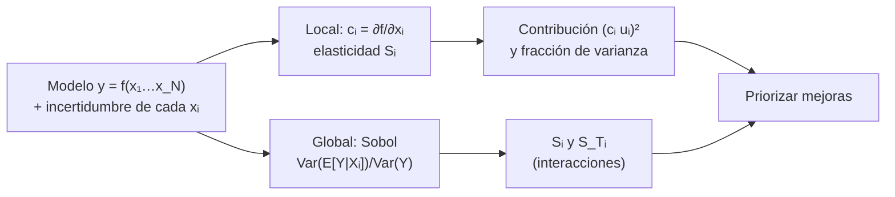

# B12-C17 — Análisis de sensibilidad

<!-- nav:top -->
[🏠 Programa](../../../../README.md) · [📚 Bloque B12](../../../tronco-comun/B12-probabilidad-estadistica-e-incertidumbre.md) · [← Anterior: B12-C16 — Propagación de incertidumbre](../B12-C16-propagacion-de-incertidumbre/CLASE.md) · [Siguiente: B12-C18 — Matrices de covarianza →](../B12-C18-matrices-de-covarianza/CLASE.md)
<!-- /nav -->

## 1. Ubicación, nivel y alcance

Decimoséptima clase del bloque B12. En [C16](../B12-C16-propagacion-de-incertidumbre/CLASE.md) propagaste incertidumbres de las entradas a la salida. Aquí respondes la pregunta complementaria: **¿cuál entrada manda?** Verás sensibilidad local (derivadas y elasticidades), la descomposición de la varianza y los índices globales de Sobol, que capturan no linealidad e interacciones. Nivel N3. Ejemplo conductor: el presupuesto de velocidad (Δv) de una maniobra. No verás aún el informe completo (C20).

## 2. Por qué esta clase existe

Mejorar una medida cuesta dinero, masa o tiempo. Si el presupuesto de una misión ofrece mejorar la masa seca o el empuje específico, hay que saber cuál de las dos reduce más la incertidumbre del resultado. Sin análisis de sensibilidad, el esfuerzo se reparte por intuición, y a menudo se mejora la entrada equivocada.

Pregunta motivadora: **¿qué entrada del cálculo de Δv hay que conocer mejor para reducir su incertidumbre, y cuándo las derivadas locales no bastan?** Decisión central: **dónde invertir el esfuerzo de medición y qué método de sensibilidad usar**.

## 3. Lo que podrás hacer al terminar

1. Calcular sensibilidades locales (derivadas) y elasticidades de un modelo, y comprobarlas con diferencias finitas.
2. Descomponer la varianza de la salida en contribuciones de cada entrada.
3. Decidir qué entrada mejorar y estimar el efecto de la mejora.
4. Definir los índices de Sobol de primer orden y totales e interpretarlos.
5. Estimarlos por Monte Carlo y validarlos contra un caso con solución analítica.
6. Reconocer cuándo el análisis local engaña (interacciones, no linealidad).

La evidencia es la **tabla de prioridades de mejora** del ejercicio 12 (sección 20).

## 4. Con qué llegas y cómo comprobarlo

Necesitas C16 (coeficientes de sensibilidad, ley de propagación), C14 (Monte Carlo) y derivadas de B09. Cinco preguntas:

1. ¿Cuál es la derivada de `ve·ln(m0/mf)` respecto de `ve`?
2. ¿Qué es la varianza de una suma de variables independientes?
3. ¿Qué es un coeficiente de sensibilidad?
4. ¿Cómo se estima por Monte Carlo la varianza de una salida?
5. ¿Qué es una interacción entre dos variables?

<details>
<summary>Ver respuestas</summary>

1. `ln(m0/mf)`. 2. La suma de las varianzas. 3. La derivada de la salida respecto de una entrada (C16). 4. Sorteando entradas, evaluando el modelo y calculando la varianza de los resultados. 5. Un efecto conjunto que no es la suma de los efectos individuales.
</details>

Con cuatro o cinco aciertos, sigue; si no, repasa C14, C16 y B09.

## 5. Un caso: el presupuesto de Δv de una maniobra

La ecuación del cohete de Tsiolkovsky da el cambio de velocidad `Δv = v_e · ln(m₀/m_f)`, con `v_e` la velocidad efectiva de escape (m/s), `m₀` la masa inicial y `m_f` la masa final (kg). Valores **ilustrativos**: `v_e = 3 000 m/s`, `m₀ = 1 000 kg`, `m_f = 600 kg`, de modo que `Δv = 1 532,48 m/s`. Las incertidumbres típicas relativas son `2 %` para `v_e` y `0,5 %` para cada masa. ¿Qué entrada domina? Es el **ejemplo conductor**. Para la parte global se usa además la función de Ishigami, un banco de pruebas matemático con índices conocidos, **sintético**.

## 6. Vocabulario

La **sensibilidad local** de la salida `y` respecto de la entrada `xᵢ` es la derivada parcial `cᵢ = ∂y/∂xᵢ` en el punto nominal (los *coeficientes de sensibilidad* del GUM, S1, 5.1.3), con unidades de `y` por unidad de `xᵢ`. La **elasticidad** `Sᵢ = (∂y/∂xᵢ)(xᵢ/y)` es adimensional: el cambio relativo de `y` por cada cambio relativo de `xᵢ`. La **contribución** de `xᵢ` a la varianza combinada es `(cᵢ u(xᵢ))²` (S1, 5.1.2–5.1.3). El **análisis global** examina todo el rango de las entradas. El **índice de Sobol de primer orden** `Sᵢ = Var(E[Y|Xᵢ])/Var(Y)` es la fracción de la varianza de `Y` explicada por `Xᵢ` sola; el **índice total** `S_Tᵢ` incluye además todas sus interacciones. Con entradas independientes `ΣSᵢ ≤ 1` (igualdad si el modelo es aditivo) y `S_Tᵢ ≥ Sᵢ`. Los estimadores de «pick-freeze» comparan dos matrices de muestras `A`, `B` y las matrices `A_B^i` en que se intercambia la columna `i`.

## 7. Modelo mental: ¿cuánto del ruido de salida viene de cada perilla?

Imagina un tablero con perillas (entradas) y un medidor (salida) que oscila. Mover una perilla a la vez al valor nominal da la sensibilidad local. Mover todas juntas, en todo su rango, da la global; la diferencia entre ambas son las interacciones.



*Descripción textual:* el modelo y las incertidumbres de entrada alimentan dos análisis: el local, con derivadas, elasticidades y contribuciones de varianza; y el global, con índices de Sobol que capturan no linealidad e interacciones; ambos orientan qué entrada mejorar.

Analogía: el mezclador de un estudio con varios deslizadores, donde tocar uno cambia cuánto afecta otro. Su límite: la varianza describe la dispersión, no el riesgo en la cola; una entrada puede ser pequeña en varianza y decisiva para una falla rara.

## 8. La explicación, paso a paso

### 8.1 Derivadas del presupuesto

Para `Δv = v_e ln(m₀/m_f)`: `∂Δv/∂v_e = ln(m₀/m_f) = 0,51083` (adimensional), `∂Δv/∂m₀ = v_e/m₀ = 3,000 (m/s)/kg` y `∂Δv/∂m_f = −v_e/m_f = −5,000 (m/s)/kg`. El laboratorio comprueba las tres con diferencias centrales con un error relativo menor que `10⁻⁶`. Un kilogramo más de masa final **resta** 5 m/s; un kilogramo más inicial **suma** 3 m/s.

### 8.2 Elasticidades

`S_{v_e} = 1,000`; `S_{m₀} = +1,958`; `S_{m_f} = −1,958`. Un 1 % más en `v_e` da un 1 % más en `Δv` (15,3 m/s), mientras un 1 % más en `m_f` resta 1,958 % (30,0 m/s). Las elasticidades permiten comparar entradas con unidades distintas.

### 8.3 Contribuciones a la varianza

Con `u(v_e) = 60 m/s`, `u(m₀) = 5 kg`, `u(m_f) = 3 kg`: contribuciones `(0,51083·60)² = 939,3`, `(3·5)² = 225` y `(5·3)² = 225` m²/s². Total `1 389,3`, es decir `u(Δv) = 37,27 m/s`. La velocidad de escape explica el 67,6 % de la varianza y cada masa el 16,2 %. Monte Carlo con `10⁶` sorteos da `37,24 m/s`, coherente.

### 8.4 Qué mejorar

Si `v_e` se mide con 1 % (30 m/s) en vez de 2 %: contribuciones `234,9; 225; 225`, total `684,9`, `u = 26,17 m/s`, es decir, 29,8 % menos. Si en cambio ambas masas se miden al 0,25 % (`2,5 kg` y `1,5 kg`): contribuciones `939,3; 56,3; 56,3`, total `1 051,8`, `u = 32,43 m/s` (13 % menos). La prioridad es la velocidad de escape. La conclusión depende de los valores relativos de incertidumbre, no sólo de las derivadas.

### 8.5 Índices de Sobol

Con la función de Ishigami (`a = 7`, `b = 0,1`, entradas uniformes en `[−π, π]`) los índices analíticos son `S₁ = 0,3139`, `S₂ = 0,4424`, `S₃ = 0` y `S_T = (0,5576; 0,4424; 0,2437)`. Con el estimador de «pick-freeze» y `N = 400 000` el laboratorio obtiene `S = (0,3164; 0,4421; 0,0010)` y `S_T = (0,5595; 0,4420; 0,2430)`, todos a menos de 0,01 de los analíticos. La entrada 3 tiene `S₃ = 0` pero `S_T3 = 0,24`: actúa **sólo** por interacción con la 1. Un análisis local o de primer orden la descartaría equivocadamente.

### 8.6 Cuándo usar cada cosa

Local: modelo suave, incertidumbres pequeñas, respuesta rápida. Global: no linealidad, interacciones o rangos amplios, a costa de miles de evaluaciones. Siempre se verifica el estimador con un caso analítico (como Ishigami) antes de usarlo en el modelo real. La varianza no basta para riesgo en la cola.

## 9. Magnitudes, símbolos y unidades

| Símbolo | Qué es | Unidad | Nota |
|---|---|---|---|
| `Δv` | cambio de velocidad | m/s | `1 532,48` |
| `v_e` | velocidad efectiva de escape | m/s | 3 000 (ilustrativo) |
| `m₀`, `m_f` | masas inicial y final | kg | 1 000 y 600 |
| `cᵢ = ∂Δv/∂xᵢ` | sensibilidad local | unidad(y)/unidad(x) | |
| `Sᵢ` (elasticidad) | sensibilidad relativa | adimensional | `1; 1,958; −1,958` |
| `Sᵢ`, `S_Tᵢ` (Sobol) | índices de primer orden y total | adimensional | entre 0 y 1 |
| `u(·)` | incertidumbre típica | unidad de la variable | |

Nota de notación: `Sᵢ` designa la elasticidad en 8.2 y el índice de primer orden en 8.5; el contexto y la columna lo distinguen.

## 10. Convenciones y referencias

Las entradas se suponen independientes. Las derivadas se evalúan en el valor nominal. Los índices de Sobol se estiman con los esquemas de Saltelli (primer orden) y Jansen (total), usando dos matrices de `N` muestras. La semilla es 1717. Los valores del cohete son ilustrativos y la función de Ishigami es un banco de pruebas, no un modelo físico.

## 11. De dónde sale lo que afirmamos

| ID | Fuente | Localizador | Respalda | Consulta |
|---|---|---|---|---|
| S1 | JCGM 100:2008 (GUM) | https://doi.org/10.59161/JCGM100-2008E | Coeficientes de sensibilidad como derivadas parciales y contribución `(cᵢ u(xᵢ))²` a la varianza combinada (5.1.2–5.1.3) | 2026-11-05, PDF abierto y texto extraído |

Límites: la ecuación del cohete, las definiciones y estimadores de Sobol (Saltelli, Jansen) y los valores analíticos de Ishigami son resultados estándar no atribuidos a una fuente consultada; se verifican numéricamente en el laboratorio. Los valores de `v_e`, masas e incertidumbres son **ilustrativos**; los datos, **sintéticos**.

## 12. Cómo ver las prioridades

Equivalente accesible a un gráfico de barras de contribuciones (cálculo propio):

| Entrada | Contribución (m²/s²) | Fracción |
|---|---|---|
| `v_e` (2 %) | 939,3 | 0,676 |
| `m₀` (0,5 %) | 225,0 | 0,162 |
| `m_f` (0,5 %) | 225,0 | 0,162 |

Descripción larga: tres barras, la de `v_e` más del triple de alta que cada una de las masas, que son iguales entre sí. Si se mejora `v_e` a 1 %, su barra baja a `234,9` y las otras dos pasan a dominar en conjunto.

## 13. Ejemplo trabajado: dónde invertir

**Paso 1 · Modelo.** `Δv = v_e ln(m₀/m_f)`; valores nominales ilustrativos.

**Paso 2 · Sensibilidades.** `0,51083; 3,000; −5,000`.

**Paso 3 · Contribuciones.** `939,3; 225; 225`; `u(Δv) = 37,27 m/s`.

**Paso 4 · Candidatas.** (A) `v_e` al 1 %: `u = 26,17 m/s`. (B) masas al 0,25 %: `u = 32,43 m/s`.

**Paso 5 · Decisión.** (A) reduce más (−29,8 % frente a −13 %); se prioriza medir `v_e` mejor.

**Paso 6 · Verificación.** Monte Carlo `10⁶`: `37,24 m/s` frente a `37,27`.

**Paso 7 · Sentido.** Cálculo **ilustrativo**; los costos de cada mejora (no incluidos) modificarían la decisión.

## 14. Comparación de métodos

Las **derivadas locales** son baratas y muy interpretables, pero válidas cerca del nominal y sin interacciones. La **descomposición de varianza lineal** (GUM) usa derivadas y las incertidumbres reales de las entradas, ideal para presupuestos. El **método de Morris** explora de forma barata para filtrar entradas irrelevantes. Los **índices de Sobol** son globales y capturan interacciones, pero cuestan `N(k+2)` evaluaciones. Con salidas costosas se usan sustitutos. Ninguno sustituye el criterio de ingeniería sobre costos y riesgos.

## 15. Práctica guiada

**Ejercicio 1 · con los pasos indicados.** Calcula `∂Δv/∂m₀` para `v_e = 3 000 m/s`, `m₀ = 1 000 kg`. *Pasos:* derivar `ln(m₀/m_f)` respecto de `m₀`.

<details><summary>Solución comentada</summary>

`∂/∂m₀ [v_e ln m₀ − v_e ln m_f] = v_e/m₀ = 3,0 (m/s)/kg`.
</details>

**Ejercicio 2 · con una pista.** Calcula la elasticidad de `Δv` respecto de `m_f`. *Pista:* `(∂Δv/∂m_f)(m_f/Δv)`.

<details><summary>Solución comentada</summary>

`(−5,0)(600)/1 532,48 = −1,958`.
</details>

**Ejercicio 3 · casi autónomo.** Si `m_f` aumenta un 1 %, ¿cuánto cambia `Δv` en m/s (aprox.)?

<details><summary>Solución comentada</summary>

`−1,958 % · 1 532,48 = −30,0 m/s`.
</details>

## 16. Práctica autónoma, transferencia e integrador

**Ejercicio 4.** Con `u(v_e) = 30 m/s` (1 %), calcula las fracciones de varianza.

<details><summary>Solución comentada</summary>

Contribuciones `234,9; 225; 225`; total `684,9`; fracciones `0,343; 0,329; 0,329`; `u = 26,17 m/s`.
</details>

**Ejercicio 5.** Compara mejorar las dos masas al 0,25 % con mejorar `v_e` al 1 %.

<details><summary>Solución comentada</summary>

Masas: total `1 051,8`, `u = 32,43`. `v_e`: `u = 26,17`. Mejorar `v_e` reduce más (8.4).
</details>

**Ejercicio 6.** Para `y = 2x₁ + x₂` con `x₁, x₂ ~ N(0,1)` independientes, calcula `S₁`, `S₂`.

<details><summary>Solución comentada</summary>

`Var(y) = 4 + 1 = 5`; `S₁ = 4/5 = 0,8`; `S₂ = 0,2`. Modelo aditivo: suman 1.
</details>

**Ejercicio 7.** Interpreta `S₃ = 0` y `S_T3 = 0,24` en Ishigami.

<details><summary>Solución comentada</summary>

`x₃` no explica varianza por sí sola, pero un 24 % de la varianza depende de su interacción con `x₁` (término `b x₃⁴ sin x₁`). Descartarla por `S₃` sería un error.
</details>

**Ejercicio 8.** Para `y = x₁ x₂` con `x₁, x₂ ~ U(−1, 1)`, ¿cuál es la derivada local en `(0,0)` y qué dicen los índices?

<details><summary>Solución comentada</summary>

Ambas derivadas valen `0` en el origen: el análisis local diría que no importan. Pero `E[y | x₁] = 0`, luego `S₁ = S₂ = 0`, y `S_T1 = S_T2 = 1`: toda la varianza viene de la interacción.
</details>

**Ejercicio 9 · transferencia.** El período orbital cumple `T ∝ a^{3/2}`. Da la elasticidad respecto del semieje y estima el cambio de `T` si `a` crece 0,1 %.

<details><summary>Solución comentada</summary>

`S = 3/2`; `ΔT/T ≈ 0,15 %`. Con `T = 5 553,6 s` (C16): `+8,3 s`.
</details>

**Ejercicio 10 · transferencia.** Si `m₀/m_f = 1,1` en vez de `1,667`, ¿cambian las prioridades?

<details><summary>Solución comentada</summary>

`ln 1,1 = 0,0953`: la sensibilidad a `v_e` cae a `0,095` mientras la de las masas, `v_e/m₀`, `v_e/m_f`, es igual de grande (`m₀ = 1 000`, `m_f = 909`: `3,0` y `−3,3`). Con una maniobra pequeña, las masas pasan a dominar. La sensibilidad depende del punto de operación.
</details>

**Ejercicio 11 · transferencia.** Un colega propone «bajar a cero la entrada con menor fracción de varianza para simplificar el modelo». ¿Qué cuidados?

<details><summary>Solución comentada</summary>

Verificar con el índice total, no sólo el de primer orden (8.5); evaluar si la fracción pequeña se debe a que la incertidumbre actual es pequeña (podría cambiar con otros datos); comprobar el efecto en la cola, no sólo en la varianza; y documentar la simplificación.
</details>

**Ejercicio 12 · integrador.** Elabora tu *tabla de prioridades de mejora*: para un modelo con tres o cuatro entradas, calcula sensibilidades, elasticidades y contribuciones, propone dos mejoras con su efecto sobre `u`, verifica con Monte Carlo y valida tu estimador de Sobol contra un caso con solución analítica.

<details><summary>Solución modelo</summary>

Debe incluir: modelo y unidades; derivadas verificadas con diferencias finitas; tabla de contribuciones y fracciones; escenarios de mejora con `u` resultante; verificación Monte Carlo; índices de Sobol validados con Ishigami u otro banco; advertencias (varianza vs. cola, costos); datos rotulados como sintéticos o ilustrativos.
</details>

## 17. Laboratorio: sensibilidad local y global

El script [sensibilidad_cohete_ishigami.py](sensibilidad_cohete_ishigami.py) comprueba las derivadas con diferencias centrales, calcula elasticidades y contribuciones, las contrasta con Monte Carlo, y estima los índices de Sobol de Ishigami contra los valores analíticos; falla si alguna derivada se desvía más de `10⁻⁶`, si Monte Carlo difiere más de 1 % de la ley de propagación o si un índice de Sobol difiere más de 0,01.

**Datos:** sintéticos e ilustrativos. **Predice antes de ejecutar:** ¿qué entrada dominará la varianza de Δv? (`v_e`.) **Ejecución del 2026-11-06 (Python 3.12.9, NumPy 2.4.4):**

```text
dv = 1532.477 m/s;  d/dve = 0.51083;  d/dm0 = 3.0000 (m/s)/kg;  d/dmf = -5.0000 (m/s)/kg
elasticidades (cambio relativo de dv por cambio relativo de cada entrada): +1.0000 +1.9576 -1.9576
u(dv) = 37.27 m/s; fraccion de la varianza: ve 0.676, m0 0.162, mf 0.162
Monte Carlo (M = 1e6): u(dv) = 37.24 m/s (GUM 37.27)
Ishigami analitico: S1=0.3139 S2=0.4424 S3=0.0000;  ST1=0.5576 ST2=0.4424 ST3=0.2437
Sobol Monte Carlo:  S1 = 0.3164 0.4421 0.0010   ST = 0.5595 0.4420 0.2430
S3 = 0 pero ST3 = 0.243: x3 actua solo por interaccion con x1
Pruebas superadas.
```

```bash
python programa/clases/B12/B12-C17-analisis-de-sensibilidad/sensibilidad_cohete_ishigami.py
```

**Límites:** entradas independientes; resultados **simulados**.

## 18. Errores frecuentes y cómo corregirlos

**Comparar derivadas de unidades distintas.** Se corrige con las elasticidades (8.2) y el ejercicio 2.

**Priorizar solo por la derivada.** Se corrige con 8.3–8.4: pesa también la incertidumbre.

**Descartar entradas por `Sᵢ` bajo.** Se corrige con 8.5 y los ejercicios 7 y 8.

**Usar sensibilidad local lejos del punto nominal.** Se corrige con el ejercicio 10.

**Tomar la varianza como medida de riesgo.** Se corrige con la sección 7 y el ejercicio 11.

## 19. Cómo sabrás que vas bien

Tras 8.1: ¿derivas otro modelo? Si no, ejercicio 1. Tras 8.4: ¿decides qué mejorar con números? Si no, ejercicio 5. Tras 8.5: ¿explicas por qué `S₃ = 0` no implica irrelevancia? Si no, ejercicio 8.

## 20. Qué entregas y cómo se evalúa

El producto es tu **tabla de prioridades de mejora** (ejercicio 12).

| Criterio | Inicial | En desarrollo | Logrado | Destacado |
|---|---|---|---|---|
| Sensibilidades | Con errores | Con ayuda | Verificadas numéricamente | Con elasticidades |
| Contribuciones | Ausentes | Sin fracción | Con fracciones y `u` | Con escenarios de mejora |
| Índices globales | Ausentes | Calculados sin validar | Validados con un caso analítico | Con interacciones interpretadas |
| Decisión | Sin criterio | Con criterio cualitativo | Cuantitativa | Con costos y cola |
| Fuentes y rótulo | Ausente | Parcial | Rotulado y fechado | Declara límites |

**Condiciones críticas (no se compensan con promedio):** validar el estimador global contra una referencia; distinguir sensibilidad de contribución; rotular valores ilustrativos.

## 21. Ética, seguridad y límites

Una prioridad de mejora mal fundamentada desvía recursos de una misión y puede dejar sin cubrir el riesgo dominante. Los valores de esta clase no son de ninguna misión. Accesibilidad: los gráficos se ofrecen como tabla; todo funciona sin conexión.

## 22. Para cerrar y seguir

La sensibilidad local mide cuánto cambia la salida por entrada; la contribución a la varianza combina sensibilidad e incertidumbre; los índices de Sobol añaden no linealidad e interacciones; el estimador se valida con un caso analítico. Queda abierta una pregunta: cuando las entradas están correlacionadas y son vectores completos, ¿cómo se describe su incertidumbre conjunta? Con matrices de covarianza (C18).

**Glosario español–inglés.** análisis de sensibilidad · *sensitivity analysis*; coeficiente de sensibilidad · *sensitivity coefficient*; elasticidad · *elasticity*; índice de Sobol · *Sobol index*; interacción · *interaction*; índice total · *total-effect index*; ecuación del cohete · *rocket equation*.

**Continuidad.** B12-C18 reutiliza tu capacidad de **combinar contribuciones de entradas** para tratar entradas vectoriales correlacionadas.

**Referencias:** ver sección 11.

<!-- nav:bottom -->
---

[← Anterior: B12-C16 — Propagación de incertidumbre](../B12-C16-propagacion-de-incertidumbre/CLASE.md) · [📚 Bloque B12](../../../tronco-comun/B12-probabilidad-estadistica-e-incertidumbre.md) · [Siguiente: B12-C18 — Matrices de covarianza →](../B12-C18-matrices-de-covarianza/CLASE.md)
<!-- /nav -->
