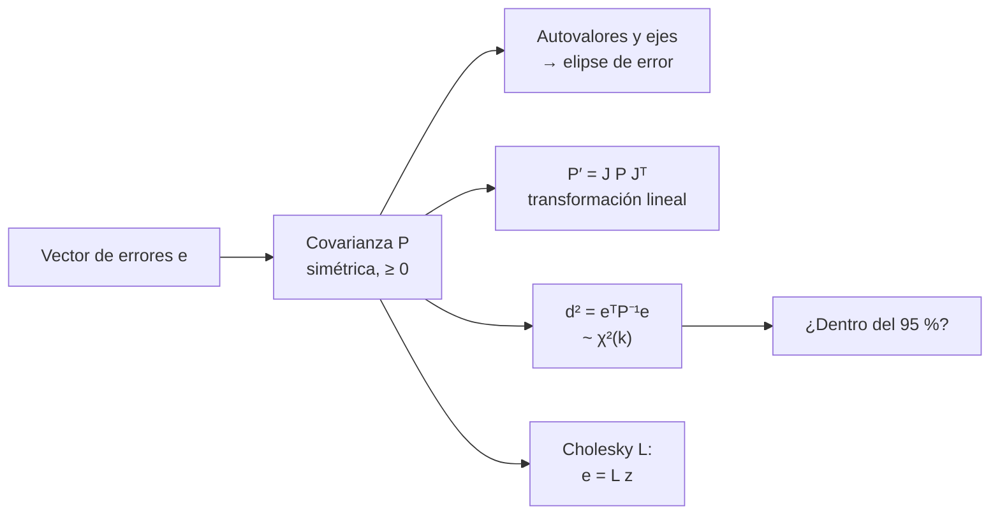

# B12-C18 — Matrices de covarianza

<!-- nav:top -->
[🏠 Programa](../../../../README.md) · [📚 Bloque B12](../../../tronco-comun/B12-probabilidad-estadistica-e-incertidumbre.md) · [← Anterior: B12-C17 — Análisis de sensibilidad](../B12-C17-analisis-de-sensibilidad/CLASE.md) · [Siguiente: B12-C19 — Detección de valores atípicos →](../B12-C19-deteccion-de-valores-atipicos/CLASE.md)
<!-- /nav -->

## 1. Ubicación, nivel y alcance

Decimoctava clase del bloque B12. En [C05](../B12-C05-covarianza-y-correlacion/CLASE.md) trabajaste con dos magnitudes correlacionadas; aquí pasas a **vectores** de magnitudes (posición, velocidad, parámetros de calibración) y a la **matriz de covarianza** que resume sus incertidumbres y relaciones. Verás sus propiedades, la elipse de error, la transformación bajo una función lineal, la distancia de Mahalanobis y cómo detectar una matriz inválida. Nivel N3. No verás el filtro de Kalman ni la determinación de órbitas.

## 2. Por qué esta clase existe

El resultado de una determinación de órbita o de un ajuste no es un número sino un vector con una matriz de covarianza; sin ella no se puede propagar, comparar con otro resultado ni calcular probabilidades. Escribir una matriz a mano o redondearla puede producir una "covarianza" que no lo es, con consecuencias absurdas (varianzas negativas, probabilidades mayores que uno).

Pregunta motivadora: **¿cómo describir la incertidumbre conjunta de un vector, cómo transformarla y cómo saber si la matriz que tengo es válida?** Decisión central: **qué representación usar, cómo propagarla y cómo comprobar su validez**.

## 3. Lo que podrás hacer al terminar

1. Construir una matriz de covarianza a partir de desviaciones y correlaciones, y viceversa.
2. Comprobar simetría y semidefinición positiva por autovalores o por Cholesky.
3. Hallar semiejes y orientación de la elipse de error y la del 95 % en 2D.
4. Transformar una covarianza con `P′ = J P Jᵀ`.
5. Calcular la distancia de Mahalanobis y usar la `χ²` para decidir si un punto es compatible.
6. Detectar y corregir una matriz de correlación inconsistente.

La evidencia es el **informe de covarianza de un estado** del ejercicio 12 (sección 20).

## 4. Con qué llegas y cómo comprobarlo

Necesitas C05 (covarianza, correlación), C16 (propagación) y álgebra de matrices de B10 (autovalores, inversa). Cinco preguntas:

1. ¿Qué es la covarianza de `X` con `Y` si `σ_x = 3`, `σ_y = 4`, `ρ = 0,8`?
2. ¿Qué es un autovalor?
3. ¿Cuál es la inversa de una matriz diagonal?
4. ¿Qué significa que una matriz sea simétrica?
5. ¿Cuál es el efecto de `Jᵀ`?

<details>
<summary>Ver respuestas</summary>

1. `9,6`. 2. Un escalar `λ` tal que `Av = λv` para algún `v ≠ 0`. 3. La diagonal de recíprocos. 4. Que `A = Aᵀ`. 5. La traspuesta: filas por columnas.
</details>

Con cuatro o cinco aciertos, sigue; si no, repasa C05 y B10.

## 5. Un caso: error de posición y de estado

(a) El error de posición plana de una sonda **ilustrativa** tiene `σ_x = 3 m`, `σ_y = 4 m` y correlación `0,8` (los de C05); (b) un estado (posición, velocidad) con `σ_x = 3 m` y `σ_v = 0,02 m/s` independientes, que se propaga 100 s. Es el **ejemplo conductor**; los datos son **sintéticos**.

## 6. Vocabulario

La **matriz de covarianza** `P` de un vector aleatorio tiene como elementos diagonales las varianzas y como elementos fuera de la diagonal las covarianzas (S1, C.3.5). Es **simétrica** y **semidefinida positiva**: `xᵀP x ≥ 0` para todo `x`, equivalente a que todos sus autovalores sean `≥ 0`. La **matriz de correlación** tiene unos en la diagonal y los coeficientes `r = cov/(σσ)` fuera de ella (S1, C.3.6). La **descomposición espectral** `P = V Λ Vᵀ` da los **ejes principales** (columnas de `V`) y las varianzas a lo largo de ellos (autovalores `λ`). La **elipse de error** es el conjunto `{e : eᵀP⁻¹e = c}`; sus semiejes son `√(c λᵢ)`. La **distancia de Mahalanobis** al cuadrado, `d² = eᵀP⁻¹e`, mide la distancia en unidades de incertidumbre y, para un vector gaussiano de dimensión `k`, sigue una `χ²` con `k` grados de libertad. La **factorización de Cholesky** `P = L Lᵀ` existe si `P` es definida positiva y sirve para generar muestras. El suplemento 2 del GUM propaga la covarianza de las entradas a las salidas mediante `U_y = C_x U_x C_xᵀ`, con `C_x` la matriz de sensibilidad (S2).

## 7. Modelo mental: una nube elíptica de errores

La matriz de covarianza es la «forma» de la nube de errores posibles: sus ejes principales dicen hacia dónde es más larga (incertidumbre máxima) y hacia dónde más estrecha. Una transformación lineal estira y gira la nube. La distancia de Mahalanobis mide cuán adentro o afuera de la nube está un punto.



*Descripción textual:* de la covarianza se obtienen cuatro cosas: la elipse (por autovalores y ejes), la covarianza de una transformación lineal, la distancia de Mahalanobis para decidir compatibilidad con la `χ²`, y un factor de Cholesky para generar muestras con esa covarianza.

Analogía: el contorno de una colina alargada visto desde arriba. Su límite: las elipses son exactas para gaussianas; con colas pesadas o curvadas (órbitas largas), no describen bien la nube.

## 8. La explicación, paso a paso

### 8.1 Construir la matriz y revisar sus propiedades

Con `σ_x = 3`, `σ_y = 4` y `ρ = 0,8`: `P = [[9; 9,6], [9,6; 16]]` (m²). Es simétrica; traza `25`, determinante `51,84`. Autovalores: `2,2819` y `22,7181` m²; los dos son positivos, así que es definida positiva. La reconstrucción `V Λ Vᵀ` coincide con `P` a `10⁻¹²` y su suma de autovalores es la traza (`25`).

### 8.2 La elipse de error

Los semiejes de 1σ son `√λ = 1,511 m` y `4,766 m`; el eje mayor forma `55,02°` con el eje `x`. Una elipse de 1σ en 2D contiene solo `1 − e^{−1/2} = 39,3 %` de la probabilidad (no 68 %, que es el valor de una dimensión). Para el 95 % el factor es `√(−2 ln 0,05) = 2,4477`, con semiejes `11,67 m` y `3,70 m`.

### 8.3 Distancia de Mahalanobis

Para `e = (3, −4)`, cada coordenada mide `1σ` en solitario, y sin embargo `d² = eᵀP⁻¹e = 10,0` — mayor que `χ²(0,99; 2) = 9,21`. El punto es atípico por ser contrario a la correlación positiva: miradas por separado, no lo ven; la elipse, sí. Con `k = 2`, `P(d² ≤ s) = 1 − e^{−s/2}`.

### 8.4 Generar muestras con Cholesky

Si `P = L Lᵀ` y `z` es un vector de normales estándar independientes, entonces `e = L z` tiene covarianza `P`. Con un millón de muestras, la covarianza muestral es `[[9,007; 9,615], [9,615; 16,02]]`, a menos de `0,02` de `P`. La fracción con `d² ≤ 5,9915` es `0,9498` (esperada `0,95`).

### 8.5 Transformación lineal

Un estado `(x, v)` con `P₀ = diag(9, 4 × 10⁻⁴)` se propaga 100 s con `x′ = x + 100 v`, es decir `J = [[1, 100], [0, 1]]`. Resulta `P′ = J P₀ Jᵀ`: `Var(x′) = 9 + 100² · 0,0004 = 13,00 m²`, `Cov(x′,v) = 100 · 0,0004 = 0,04 m²/s`, `Var(v) = 0,0004`. Aparece una correlación `0,5547` que no existía: la dinámica la crea. Como `det J = 1`, el determinante (volumen de la elipse) se conserva. La misma fórmula es la ley de propagación del GUM para varias salidas: `U_y = C_x U_x C_xᵀ` (S2, ec. 3).

### 8.6 Una matriz inválida

Una «matriz de correlación» con `r₁₂ = 0,9`, `r₁₃ = 0,9`, `r₂₃ = −0,9` parece razonable pero tiene un autovalor `−0,8`: no es semidefinida positiva, y la factorización de Cholesky falla. Significa que las tres relaciones son incompatibles (si 1 va con 2 y con 3, 2 y 3 no pueden ir en sentidos opuestos). El suplemento 2 advierte que, al redondear una matriz de correlación, hay que cuidar que siga siendo semidefinida positiva (S2). Se arregla recortando los autovalores negativos y renormalizando, y documentando el cambio.

## 9. Magnitudes, símbolos y unidades

| Símbolo | Qué es | Unidad | Nota |
|---|---|---|---|
| `P` | matriz de covarianza | unidades cruzadas | `[[9; 9,6], [9,6; 16]] m²` |
| `λᵢ`, `V` | autovalores y autovectores | unidad², — | `2,28; 22,72` |
| `R` | matriz de correlación | adimensional | unos en la diagonal |
| `J` | matriz de la transformación (jacobiana) | según el caso | `[[1,100],[0,1]]` |
| `d²` | Mahalanobis al cuadrado | adimensional | `10,0` |
| `L` | factor de Cholesky | unidad | `P = L Lᵀ` |
| `k` | grados de libertad de la `χ²` | adimensional | 2 |

## 10. Convenciones y referencias

El eje `x` es el de referencia para el ángulo de la elipse, medido hacia `y` positivo. Las covarianzas cruzadas de posición y velocidad tienen unidades m²/s. Los errores son gaussianos de media cero cuando se usa la `χ²`. Las matrices se verifican siempre antes de usarlas: simetría, autovalores no negativos y, si se invierte, número de condición razonable.

## 11. De dónde sale lo que afirmamos

| ID | Fuente | Localizador | Respalda | Consulta |
|---|---|---|---|---|
| S1 | JCGM 100:2008 (GUM) | https://doi.org/10.59161/JCGM100-2008E | Matriz de covarianza (C.3.5), coeficiente de correlación (C.3.6, 5.2.2 ec. 14) | 2026-11-05, PDF abierto y texto extraído |
| S2 | JCGM 102:2011, *Supplement 2 to the GUM: Extension to any number of output quantities* | https://doi.org/10.59161/JCGM102-2011 | Propagación matricial `U_y = C_x U_x C_xᵀ` (ec. 3); cuidado de la semidefinición positiva al redondear matrices de correlación | 2026-11-05, PDF abierto y texto extraído |

Límites: la teoría de matrices definidas positivas, la elipse de error, la distancia de Mahalanobis y su relación con la `χ²` son resultados estándar no atribuidos a una fuente consultada; los datos son **sintéticos** y las matrices, ilustrativas.

## 12. Cómo ver la elipse

Equivalente accesible a un diagrama de la elipse (cálculo propio):

| Nivel | Factor `c` | Semieje mayor (m) | Semieje menor (m) | Probabilidad dentro |
|---|---|---|---|---|
| 1σ | 1,0 | 4,766 | 1,511 | 0,393 |
| 95 % | 2,448 | 11,667 | 3,698 | 0,950 |

Descripción larga: una elipse alargada con su eje mayor inclinado `55°` respecto de `x`; el eje menor es unas tres veces más corto. La elipse del 95 % es la del 1σ multiplicada por `2,448`.

## 13. Ejemplo trabajado: ¿es compatible esta medición?

**Paso 1 · Matriz.** `P` de 8.1, simétrica y definida positiva.

**Paso 2 · Residuo.** Una medición se desvía `e = (3, −4) m` del valor esperado.

**Paso 3 · Inversa.** `P⁻¹ = (1/51,84) [[16; −9,6], [−9,6; 9]]`.

**Paso 4 · Distancia.** `d² = (16·9 + 2·(−9,6)·(3)(−4) + 9·16)/51,84 = 518,4/51,84 = 10,0`.

**Paso 5 · Umbral.** `χ²(0,99; 2) = 9,21`: `10,0 > 9,21`, incompatible al 99 %.

**Paso 6 · Contraste.** Cada coordenada, por separado, estaba a `1σ`: ignorar la correlación habría llevado a aceptarla.

**Paso 7 · Sentido.** Datos **sintéticos**; la prueba supone errores gaussianos y la `P` correcta.

## 14. Comparación de métodos

Tratar los errores **por separado** (desviaciones) es simple, pero pierde las correlaciones y puede aceptar puntos incompatibles. La **matriz completa** conserva todo, a costa de más números y del cuidado de su validez. La **elipse** resume en 2D; en dimensiones mayores se proyecta. Alternativas para colas no gaussianas: muestras de Monte Carlo o mezclas gaussianas. Para transformaciones no lineales fuertes, `J P Jᵀ` es solo una aproximación y se contrasta con Monte Carlo (C16).

## 15. Práctica guiada

**Ejercicio 1 · con los pasos indicados.** Construye `P` para `σ = (2, 5)` y `ρ = −0,5`. *Pasos:* `cov = ρ σ₁ σ₂`, llenar la matriz.

<details><summary>Solución comentada</summary>

`cov = −0,5·2·5 = −5`; `P = [[4; −5], [−5; 25]]`; `det = 100 − 25 = 75 > 0`: válida.
</details>

**Ejercicio 2 · con una pista.** Halla los autovalores de `[[5; 3], [3; 5]]`. *Pista:* para una matriz `[[a; b], [b; a]]` son `a ± b`.

<details><summary>Solución comentada</summary>

`8` y `2`. Traza `10`, determinante `16`. Eje mayor a 45°.
</details>

**Ejercicio 3 · casi autónomo.** Calcula `d²` para `e = (3, −4)` con la `P` de 8.1.

<details><summary>Solución comentada</summary>

`d² = 10,0` (paso 4 de 13).
</details>

## 16. Práctica autónoma, transferencia e integrador

**Ejercicio 4.** ¿Cuál es el umbral de `d²` para el 99 % con 2 grados de libertad?

<details><summary>Solución comentada</summary>

`−2 ln 0,01 = 9,21`.
</details>

**Ejercicio 5.** Calcula `Var(x + 100 v)` con `σ_x = 3 m`, `σ_v = 0,02 m/s` independientes.

<details><summary>Solución comentada</summary>

`[1, 100] P₀ [1, 100]ᵀ = 9 + 10 000 · 0,0004 = 13 m²`.
</details>

**Ejercicio 6.** Aplica `J = diag(2, 1)` a `P` de 8.1 y calcula `P′`.

<details><summary>Solución comentada</summary>

`P′ = J P Jᵀ`: `P′₁₁ = 4·9 = 36`, `P′₁₂ = 2·9,6 = 19,2`, `P′₂₂ = 16`. La correlación se conserva (`19,2/(6·4) = 0,8`): escalar un eje no cambia `r`.
</details>

**Ejercicio 7.** Obtén la matriz de correlación de `P`.

<details><summary>Solución comentada</summary>

`r = 9,6/(3·4) = 0,8`; `R = [[1; 0,8], [0,8; 1]]`.
</details>

**Ejercicio 8.** ¿Es válida `[[1; 0,9], [0,9; 1]]`?

<details><summary>Solución comentada</summary>

Autovalores `1 ± 0,9 = 1,9; 0,1`: ambos positivos; válida (y casi singular).
</details>

**Ejercicio 9 · transferencia.** Un analista redondea una matriz de correlación a un decimal y obtiene `[[1; 1,0; 0,9], [1,0; 1; −0,9], …]`. ¿Qué verificas y cómo la arreglas?

<details><summary>Solución comentada</summary>

Se calculan los autovalores: si alguno es negativo, no es una covarianza válida (8.6). Arreglo: descomponer, recortar los autovalores negativos a un valor pequeño positivo, recomponer y renormalizar la diagonal a 1; documentar. El suplemento 2 sugiere además redondear hacia cero para no perder la semidefinición (S2).
</details>

**Ejercicio 10 · transferencia.** Describe cómo generar 10⁴ errores con covarianza `P` y cómo comprobarlo.

<details><summary>Solución comentada</summary>

Calcular `L = chol(P)`; sortear `Z` de `N(0,1)` de tamaño `10⁴ × 2`; formar `E = Z Lᵀ`; comprobar que la covarianza muestral difiere de `P` en un orden `σ²/√N` (8.4) y que la fracción con `d² ≤ 5,99` es `≈ 0,95`.
</details>

**Ejercicio 11 · transferencia.** Un informe dice «el error de posición es de 1σ = (3 m, 4 m)» y dibuja la caja de 3×4 m como el 68 % de los casos. ¿Qué corriges?

<details><summary>Solución comentada</summary>

Que las desviaciones por separado omiten la correlación y que el contorno de 1σ en 2D contiene solo 39,3 % (no 68 %). Debe dar la matriz completa y la elipse al 95 % (semiejes 11,67 y 3,70 m).
</details>

**Ejercicio 12 · integrador.** Elabora tu *informe de covarianza de un estado*: define un vector de 2 o 3 componentes con desviaciones y correlaciones, construye `P`, comprueba su validez, calcula la elipse (o los ejes), propaga con una transformación lineal, verifica por muestreo y evalúa la compatibilidad de una medición con `d²`.

<details><summary>Solución modelo</summary>

Debe incluir: `P` con unidades; verificación (simetría, autovalores, Cholesky); elipse del 95 %; `J P Jᵀ` y su interpretación; muestreo con covarianza muestral comparada; cálculo de `d²` frente a la `χ²`; advertencia sobre gaussianidad y linealización; datos rotulados como sintéticos.
</details>

## 17. Laboratorio: validar y usar una covarianza

El script [matrices_covarianza.py](matrices_covarianza.py) construye `P`, comprueba su descomposición espectral, calcula elipses, muestrea con Cholesky, verifica la cobertura de la `χ²`, propaga un estado y detecta una matriz de correlación inválida; falla si la reconstrucción espectral difiere más de `10⁻¹²`, si la covarianza muestral se aparta más de 0,05 o si la cobertura sale de `0,95 ± 0,003`.

**Datos:** sintéticos. **Predice antes de ejecutar:** ¿qué correlación aparecerá tras propagar el estado 100 s? (positiva, ≈ 0,55.) **Ejecución del 2026-11-06 (Python 3.12.9, NumPy 2.4.4):**

```text
P = [[9.0, 9.600000000000001], [9.600000000000001, 16.0]]
autovalores = [ 2.2819 22.7181] (m^2); semiejes 1-sigma = [1.5106 4.7664] m
traza = 25.0; det = 51.84; angulo del eje mayor = 55.02 grados respecto del eje x
elipse al 95 % (2 gl): factor 2.4477; semiejes = [11.667  3.698] m
covarianza muestral = [[9.007, 9.615], [9.615, 16.02]]
fraccion con d^2 <= 5.9915: 0.9498 (chi^2 de 2 gl: 0.95)
P tras dt=100 s: var(x) = 13.00 m^2, cov = 0.0400 m^2/s, var(v) = 0.0004; correlacion = 0.5547
correlaciones (0.9, 0.9, -0.9): autovalores = [-0.8  1.9  1.9] -> no semidefinida positiva
Cholesky falla: la matriz no es una covarianza valida
Pruebas superadas.
```

```bash
python programa/clases/B12/B12-C18-matrices-de-covarianza/matrices_covarianza.py
```

**Límites:** linealidad y gaussianidad; resultados **simulados**.

## 18. Errores frecuentes y cómo corregirlos

**Usar solo desviaciones y no la matriz completa.** Se corrige con 8.3 y el ejercicio 11.

**Confundir la elipse de 1σ con el 68 %.** Se corrige con 8.2.

**No verificar la semidefinición positiva.** Se corrige con 8.6 y el ejercicio 9.

**Mezclar unidades en la matriz.** Se corrige con la sección 10 y el ejercicio 5.

**Olvidar la traspuesta en `J P Jᵀ`.** Se corrige con el ejercicio 6.

## 19. Cómo sabrás que vas bien

Tras 8.1: ¿construyes `P` a partir de `σ` y `ρ`? Si no, ejercicio 1. Tras 8.3: ¿explicas por qué (3, −4) es atípico? Si no, ejercicio 3. Tras 8.6: ¿detectas una matriz inválida? Si no, ejercicio 9.

## 20. Qué entregas y cómo se evalúa

El producto es tu **informe de covarianza de un estado** (ejercicio 12).

| Criterio | Inicial | En desarrollo | Logrado | Destacado |
|---|---|---|---|---|
| Construcción | Con errores | Con ayuda | Correcta con unidades | Con correlación y covarianza |
| Validación | Ninguna | Simetría | Autovalores/Cholesky | Con corrección documentada |
| Elipse y `d²` | Ausentes | Solo 1σ | 95 % y `χ²` correctos | Interpreta la correlación |
| Transformación | Ausente | Con ayuda | `J P Jᵀ` verificada | Con Monte Carlo |
| Fuentes y rótulo | Ausente | Parcial | Rotulado y fechado | Declara límites |

**Condiciones críticas (no se compensan con promedio):** verificar que la matriz sea válida; usar el nivel correcto de la elipse; rotular datos sintéticos.

## 21. Ética, seguridad y límites

Una covarianza optimista (demasiado pequeña) o con correlaciones inventadas puede hacer que una evaluación de riesgo declare segura una situación que no lo es. Nada de esta clase es una covarianza de una misión real. Accesibilidad: los diagramas se ofrecen como tablas; todo funciona sin conexión.

## 22. Para cerrar y seguir

La matriz de covarianza resume varianzas y correlaciones de un vector; es simétrica y semidefinida positiva; sus autovalores dan la elipse; se transforma con `J P Jᵀ`; `d²` mide compatibilidad; una matriz inválida se detecta y se corrige con cuidado. Queda abierta una pregunta: ¿cómo identificar los datos que no son compatibles con el modelo? Es la detección de valores atípicos (C19).

**Glosario español–inglés.** matriz de covarianza · *covariance matrix*; semidefinida positiva · *positive semi-definite*; autovalor · *eigenvalue*; elipse de error · *error ellipse*; distancia de Mahalanobis · *Mahalanobis distance*; factorización de Cholesky · *Cholesky factorization*; matriz de correlación · *correlation matrix*.

**Continuidad.** B12-C19 reutiliza tu capacidad de **medir la distancia de Mahalanobis** para marcar observaciones incompatibles.

**Referencias:** ver sección 11.

<!-- nav:bottom -->
---

[← Anterior: B12-C17 — Análisis de sensibilidad](../B12-C17-analisis-de-sensibilidad/CLASE.md) · [📚 Bloque B12](../../../tronco-comun/B12-probabilidad-estadistica-e-incertidumbre.md) · [Siguiente: B12-C19 — Detección de valores atípicos →](../B12-C19-deteccion-de-valores-atipicos/CLASE.md)
<!-- /nav -->
