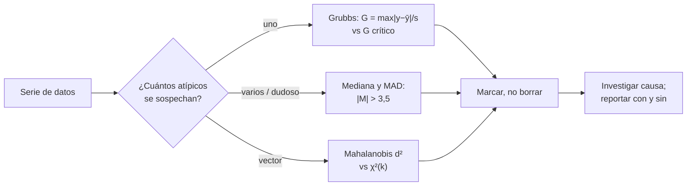

# B12-C19 — Detección de valores atípicos

<!-- nav:top -->
[🏠 Programa](../../../../README.md) · [📚 Bloque B12](../../../tronco-comun/B12-probabilidad-estadistica-e-incertidumbre.md) · [← Anterior: B12-C18 — Matrices de covarianza](../B12-C18-matrices-de-covarianza/CLASE.md) · [Siguiente: B12-C20 — Informe de incertidumbre de una misión →](../B12-C20-informe-de-incertidumbre-de-una-mision/CLASE.md)
<!-- /nav -->

## 1. Ubicación, nivel y alcance

Decimonovena clase del bloque B12. En [C11](../B12-C11-regresion-robusta/CLASE.md) aprendiste a ajustar sin que los datos malos dominen; aquí aprendes a **detectarlos y a decidir qué hacer** con criterios cuantitativos: la prueba de Grubbs, el puntaje z modificado con la MAD y la distancia de Mahalanobis. Verás también el enmascaramiento y la tasa de falsos positivos. Nivel N3. No verás aquí filtros de Kalman con rechazo de mediciones ni detección de anomalías por aprendizaje automático.

## 2. Por qué esta clase existe

Un dato aberrante puede ser un error del instrumento, una pérdida de sincronía o el primer indicio de un fenómeno real. Eliminarlo sin criterio esconde información; conservarlo sin revisar contamina el resultado. Una regla explícita y verificable convierte la decisión en algo reproducible y auditable.

Pregunta motivadora: **¿qué lectura de diez es lo bastante extraña como para investigarla, con qué tasa de falsas alarmas y qué pasa si hay dos?** Decisión central: **qué criterio usar, con qué umbral y qué hacer con lo marcado**.

## 3. Lo que podrás hacer al terminar

1. Calcular el estadístico de Grubbs y compararlo con su valor crítico.
2. Calcular el puntaje z modificado con la MAD y aplicarlo con su umbral convencional.
3. Calcular la distancia de Mahalanobis y detectar un atípico multivariado.
4. Medir por simulación la tasa de falsos positivos de una regla.
5. Explicar el enmascaramiento y elegir un método que lo resista.
6. Redactar una política de tratamiento: marcar, investigar, documentar y reportar con y sin el dato.

La evidencia es el **informe de depuración de datos** del ejercicio 12 (sección 20).

## 4. Con qué llegas y cómo comprobarlo

Necesitas C06 (normal), C08 (cuantil `t`), C11 (mediana y MAD) y C18 (Mahalanobis). Cinco preguntas:

1. ¿Qué es la MAD?
2. ¿Cuál es el cuantil `t(0,975; 9)`?
3. ¿Qué es la distancia de Mahalanobis?
4. ¿Qué es un falso positivo en una prueba?
5. ¿Qué pasa con la media si un dato es 15 m más alto?

<details>
<summary>Ver respuestas</summary>

1. La mediana de las desviaciones absolutas respecto de la mediana. 2. `2,262`. 3. `√(eᵀP⁻¹e)`, la distancia en unidades de incertidumbre. 4. Marcar como atípico un dato legítimo. 5. Sube `15/n`.
</details>

Con cuatro o cinco aciertos, sigue; si no, repasa C08, C11 y C18.

## 5. Un caso: diez lecturas de distancia

Diez lecturas de distancia a un reflector (en metros, **sintéticas**, con verdad `150,0 m` y ruido de `3,0 m`) a las que se agrega un error de `+15 m` en la cuarta: `153,23; 149,36; 148,69; 165,25; 145,02; 152,79; 148,87; 147,89; 150,80; 148,25`. ¿Cuál es sospechosa y con qué respaldo? Es el **ejemplo conductor**. Un segundo caso muestra el enmascaramiento con dos errores, y un tercero un atípico bivariado.

## 6. Vocabulario

Un **valor atípico** es una observación que se aparta de la tendencia del resto (C11). El NIST describe un apartado «Detection of Outliers» y recomienda la prueba de Grubbs cuando se busca **un solo** atípico (S1). El **estadístico de Grubbs** es `G = máx|Yᵢ − Ȳ| / s` (S2). Se rechaza la hipótesis de ausencia de atípicos si `G > G_c`, con `G_c = ((N−1)/√N) √( t² / (N−2+t²) )` y `t = t_{α/(2N), N−2}` para la prueba bilateral (S2). El **puntaje z modificado** es `Mᵢ = 0,6745 (xᵢ − mediana)/MAD`; se marca `|Mᵢ| > 3,5` (umbral convencional). La **distancia de Mahalanobis** `d² = eᵀP⁻¹e` marca atípicos multivariados (C18). La **tasa de falsos positivos** es la fracción de series limpias que la regla marca. El **enmascaramiento** ocurre cuando varios atípicos inflan la media y la desviación y ninguno se detecta. El **apalancamiento** y el **residuo** son lo relevante en regresión (C11).

## 7. Modelo mental: medir cuántas «desviaciones típicas» está un dato

Detectar un atípico es comparar su distancia al centro con la dispersión de los demás. La media y la desviación típica se contaminan con el propio atípico; la mediana y la MAD no. De ahí la regla: si la dispersión se calcula con el dato sospechoso dentro, un atípico se «esconde» a sí mismo.



*Descripción textual:* según cuántos atípicos se sospechen se elige Grubbs (uno), la mediana y la MAD (varios o dudoso) o Mahalanobis (vectores); todos terminan en marcar sin borrar, investigar la causa y reportar el resultado con y sin el dato.

Analogía: preguntar a un grupo cuál de sus miembros no encaja; si el discordante opina mucho, él mismo altera el criterio del grupo. Su límite: en un grupo real, el discordante puede ser quien tiene razón.

## 8. La explicación, paso a paso

### 8.1 Grubbs en las diez lecturas

Con las diez lecturas, la media es `151,02 m` y `s = 5,55 m` se infla por el dato de `165,25` (sin él, `s` es de unos `2,5 m`). `G = 2,5664`. El valor crítico para `N = 10`, `α = 0,05` bilateral es `G_c = 2,2900`. Como `G > G_c`, la cuarta lectura (`165,25 m`) se marca. Sin el error agregado, `G` valía `1,8640 < 2,29`: ninguna lectura es sospechosa en la serie limpia. El límite superior posible de `G` con `N` datos es `(N−1)/√N = 2,846` para `N = 10`: ninguna regla de «3σ» podría disparar jamás con 10 datos.

### 8.2 Puntaje z modificado

La mediana es robusta; los puntajes para las diez lecturas son `1,9; 0,11; −0,2; 7,46; −1,89; 1,7; −0,11; −0,57; 0,78; −0,4`. Solo `7,46` supera `3,5`: el mismo dato se marca, con una puntuación tres veces superior al umbral. Para la serie `{10,1; 9,9; 10,0; 10,2; 9,8; 25}`, `M = 0,6745·14,95/0,15 = 67,2`, mientras que la desviación ordinaria diluye el extremo (`G = 2,04 > G_c(6) = 1,887`, detecta pero con mucha menos nitidez).

### 8.3 Falsos positivos

Con 200 000 series limpias de 10 datos normales, la prueba de Grubbs marca el `0,0505` (nominal `0,05`). La tasa se cumple, pero en un programa que revisa 20 series al día habrá al menos una falsa alarma en el 64 % de los días (`1 − 0,95²⁰`, C09). Hay que decidir qué hacer con una alarma: revisar, no borrar.

### 8.4 Enmascaramiento

Si se agregan dos errores de `+15` y `+16 m` en lugares distintos, `G = 1,7815 < 2,29`: **ninguno se detecta**, porque ambos inflan la desviación típica. El puntaje z modificado con la MAD marca exactamente los dos. Por eso Grubbs sirve para un solo atípico y, cuando se sospechan varios, se usan versiones secuenciales o métodos robustos.

### 8.5 Atípicos multivariados

Con `P = [[9; 9,6], [9,6; 16]]` y el residuo `e = (3, −4)`: cada coordenada está a `1σ`, pero `d² = 10,0 > χ²(0,99; 2) = 9,21`: incompatible. En cambio `e = (3, 4)` (ambas a `1σ` en el mismo sentido) da `d² = 1,11`: plenamente compatible. La correlación decide.

### 8.6 Qué hacer con lo marcado

Una marca no es un veredicto. Se **investiga** la causa (instrumento, sincronización, fenómeno real), se **documenta**, se conserva el dato original y se reporta el resultado **con y sin** el dato marcado. Si el dato no se puede explicar, se informa su existencia y su efecto. Eliminar valores para que el ajuste «salga bien» es manipulación.

## 9. Magnitudes, símbolos y unidades

| Símbolo | Qué es | Unidad | Nota |
|---|---|---|---|
| `Yᵢ`, `Ȳ`, `s` | lecturas, media, desviación experimental | m | |
| `N` | número de lecturas | adimensional | 10 |
| `G`, `G_c` | estadístico de Grubbs y valor crítico | adimensional | `2,5664`; `2,2900` |
| `α` | nivel de significación | adimensional | 0,05 |
| `Mᵢ` | puntaje z modificado | adimensional | umbral 3,5 |
| `MAD` | mediana de desviaciones absolutas | m | |
| `d²` | Mahalanobis al cuadrado | adimensional | `10,0` |

## 10. Convenciones y referencias

La prueba de Grubbs es bilateral al 5 %. La constante `0,6745` y el umbral `3,5` son convenciones habituales que no se verificaron en una fuente consultada para esta clase. Los datos de la serie limpia son normales; el valor `+15 m` es un error introducido a propósito. La semilla del laboratorio es 1919.

## 11. De dónde sale lo que afirmamos

| ID | Fuente | Localizador | Respalda | Consulta |
|---|---|---|---|---|
| S1 | NIST/SEMATECH, *e-Handbook of Statistical Methods*, §1.3.5.17 «Detection of Outliers» | https://www.itl.nist.gov/div898/handbook/eda/section3/eda35h.htm | Prueba de Grubbs recomendada para un solo atípico | 2026-11-05, página abierta |
| S2 | NIST/SEMATECH, *e-Handbook*, §1.3.5.17.1 «Grubbs' Test for Outliers» | https://www.itl.nist.gov/div898/handbook/eda/section3/eda35h1.htm | Estadístico `G` y valor crítico con la distribución `t` (bilateral: `α/(2N)`) | 2026-11-05, página abierta |

Límites: el puntaje z modificado, su umbral, el enmascaramiento y la cota `(N−1)/√N` son resultados estándar no atribuidos a una fuente consultada; la tasa de falsos positivos se mide por simulación propia; los datos son **sintéticos**.

## 12. Cómo ver las decisiones

Equivalente accesible a un gráfico de puntos con umbrales (resultados del laboratorio):

| Índice | Lectura (m) | Puntaje `M` | ¿`|M| > 3,5`? |
|---|---|---|---|
| 1 | 153,23 | 1,90 | no |
| 2 | 149,36 | 0,11 | no |
| 3 | 148,69 | −0,20 | no |
| 4 | **165,25** | **7,46** | sí |
| 5 | 145,02 | −1,89 | no |
| 6–10 | 147,89 a 152,79 | de −0,57 a 1,70 | no |

Descripción larga: nueve puntos agrupados entre 145 y 154 m y uno aislado en 165 m, a 7,46 unidades robustas de la mediana; es el único fuera de la franja de ±3,5.

## 13. Ejemplo trabajado: ¿qué hago con la lectura de 165,25 m?

**Paso 1 · Criterio.** Grubbs al 5 % bilateral; puntaje z modificado como contraste.

**Paso 2 · Resultado.** `G = 2,566 > 2,290`; `M = 7,46 > 3,5`. Ambos marcan la cuarta lectura.

**Paso 3 · Investigar.** Se revisan telemetría y registros de sincronía; en el caso simulado, la causa se conoce (error introducido); en uno real se buscaría.

**Paso 4 · Con y sin.** Con las diez: media `151,02 m`; sin la marcada: media `149,43 m`, con error típico `0,85 m`. La diferencia (`1,6 m`) es casi el doble del error típico de la media sin el dato.

**Paso 5 · Decisión.** Se excluye de la estimación con la causa documentada; se conserva en el archivo con una marca.

**Paso 6 · Reporte.** «Una de 10 lecturas excluida por prueba de Grubbs (α = 0,05) y puntaje z modificado; causa: …; resultados con y sin ella adjuntos».

**Paso 7 · Sentido.** Datos **sintéticos**; la tasa de falsas alarmas de la regla es de 5 % por serie.

## 14. Comparación de métodos

**Grubbs**: sencillo, con valor crítico exacto, pero un solo atípico y supone normalidad. **Puntaje z modificado**: robusto, resiste el enmascaramiento, el umbral es convencional. **Regla de 3σ**: inútil con pocos datos (8.1). **Mahalanobis**: vectores, necesita una buena covarianza (se contamina igual). **Ajuste robusto** (C11): no marca, desactiva. **Modelos de mezcla** (bayesianos): modelan la contaminación. Para series temporales, se detecta sobre los residuos del modelo, no sobre los valores brutos.

## 15. Práctica guiada

**Ejercicio 1 · con los pasos indicados.** Calcula `G` para `{10,1; 9,9; 10,0; 10,2; 9,8; 25}` y compara con `G_c(6) = 1,887`. *Pasos:* media `12,5`, `s = 6,125`, `G = 12,5/s`.

<details><summary>Solución comentada</summary>

`G = 12,5/6,125 = 2,041 > 1,887`: se marca el `25`.
</details>

**Ejercicio 2 · con una pista.** Calcula `M` para `25` en esa serie. *Pista:* mediana `10,05`, MAD `0,15`.

<details><summary>Solución comentada</summary>

`M = 0,6745·(25 − 10,05)/0,15 = 67,2`. Se marca con holgura.
</details>

**Ejercicio 3 · casi autónomo.** ¿Cuánto vale el máximo posible de `G` para `N = 20`? ¿Podría una regla de 3σ disparar?

<details><summary>Solución comentada</summary>

`(N−1)/√N = 19/4,472 = 4,249`. Sí es posible, pero con `N = 10` el máximo es `2,846 < 3`, y no.
</details>

## 16. Práctica autónoma, transferencia e integrador

**Ejercicio 4.** Con 20 series diarias independientes y Grubbs al 5 %, ¿probabilidad de al menos una falsa alarma en un día?

<details><summary>Solución comentada</summary>

`1 − 0,95²⁰ = 0,642` (C09).
</details>

**Ejercicio 5.** Explica por qué dos errores de `+15` y `+16 m` pueden escapar a Grubbs.

<details><summary>Solución comentada</summary>

Elevan la media y, sobre todo, la desviación típica `s`; el mayor desvío pierde protagonismo: `G` bajó a `1,78 < 2,29` (8.4).
</details>

**Ejercicio 6.** Para `e = (3, 4)` y la `P` de 8.5, calcula `d²`.

<details><summary>Solución comentada</summary>

`d² = (16·9 − 2·9,6·3·4 + 9·16)/51,84 = (144 − 230,4 + 144)/51,84 = 1,11`: compatible.
</details>

**Ejercicio 7.** ¿Por qué `(3, −4)` se marca y `(3, 4)` no, con las mismas magnitudes por coordenada?

<details><summary>Solución comentada</summary>

La correlación `+0,8` hace que errores del mismo signo sean normales y de signo opuesto, raros. La distancia de Mahalanobis lo incorpora.
</details>

**Ejercicio 8.** Valores críticos de Grubbs: `G_c(5) = 1,715`, `G_c(10) = 2,290`, `G_c(20) = 2,708`, `G_c(50) = 3,128`. ¿Qué tendencia ves y por qué?

<details><summary>Solución comentada</summary>

El umbral crece con `N`: con más datos, un extremo mayor es normal en una muestra limpia. Una regla de umbral fijo marcaría más falsos positivos en series largas.
</details>

**Ejercicio 9 · transferencia.** Una serie de distancia crece linealmente con el tiempo. ¿Aplicas Grubbs a los valores? ¿Qué haces?

<details><summary>Solución comentada</summary>

No: la tendencia crea «extremos» legítimos. Se ajusta el modelo (C10, C11) y se detecta sobre los residuos.
</details>

**Ejercicio 10 · transferencia.** Redacta la política de tratamiento para un conjunto de 1000 lecturas diarias.

<details><summary>Solución comentada</summary>

Marcar con una regla robusta documentada (p. ej., `|M| > 3,5`); contar y reportar la fracción marcada; investigar las rachas y las causas; excluir solo con causa documentada; conservar el archivo original; reportar resultados con y sin; revisar la regla si la fracción marcada se aparta de la esperada.
</details>

**Ejercicio 11 · transferencia.** Un sensor tiene colas pesadas: el 3 % de las lecturas limpias superan `3,5` en el puntaje modificado. ¿Qué indica y qué haces?

<details><summary>Solución comentada</summary>

Que la regla marca falsamente demasiados datos: el ruido no es normal. Se calibra el umbral con datos limpios del propio sensor (simulación o histórico), se modela la distribución del ruido y se informa la tasa de falsos positivos.
</details>

**Ejercicio 12 · integrador.** Elabora tu *informe de depuración de datos*: parte de una serie sintética con uno y con dos errores introducidos, aplica Grubbs, el puntaje z modificado y (si hay dos variables) Mahalanobis, mide la tasa de falsos positivos por simulación, y redacta la política de tratamiento y el reporte con y sin los datos marcados.

<details><summary>Solución modelo</summary>

Tabla por método con detecciones en cada escenario (el enmascaramiento de Grubbs con dos errores); tasa de falsos positivos simulada; efecto de la exclusión en la media y el error típico; política escrita; datos rotulados como sintéticos; semilla y versiones.
</details>

## 17. Laboratorio: detectar, medir falsos positivos y enmascarar

El script [valores_atipicos.py](valores_atipicos.py) implementa Grubbs con su valor crítico, el puntaje z modificado y la distancia de Mahalanobis, mide la tasa de falsos positivos y reproduce el enmascaramiento; falla si Grubbs no marca el atípico, si su tasa de falsos positivos sale de `[0,040; 0,052]`, si con dos atípicos Grubbs detecta (debía enmascararse) o si el puntaje modificado no marca los dos.

**Datos:** sintéticos. **Predice antes de ejecutar:** ¿detectará Grubbs dos errores de +15 y +16 m? (no.) **Ejecución del 2026-11-06 (Python 3.12.9, NumPy 2.4.4, SciPy 1.17.1):**

```text
lecturas: [153.23, 149.36, 148.69, 165.25, 145.02, 152.79, 148.87, 147.89, 150.8, 148.25]
G_critico (N=10, alfa=0.05, bilateral) = 2.2900
G sin atipico = 1.8640; G con atipico = 2.5664; marca el indice 3
puntaje z modificado (|M| > 3.5): [1.9, 0.11, -0.2, 7.46, -1.89, 1.7, -0.11, -0.57, 0.78, -0.4]
tasa de falsos positivos de Grubbs bajo H0 = 0.0505 (nominal 0.05)
dos atipicos: G = 1.7815 (critico 2.2900) -> NO detecta; |M|>3.5 marca 2 puntos
punto (3, -4): |x|/sx = 1.00, |y|/sy = 1.00 (normal por separado) pero d^2 = 10.00 > chi2(0.99; 2) = 9.21
Pruebas superadas.
```

El índice impreso es base 0 (índice 3 = cuarta lectura).

```bash
python programa/clases/B12/B12-C19-deteccion-de-valores-atipicos/valores_atipicos.py
```

**Límites:** ruido normal en la serie limpia; resultados **simulados**.

## 18. Errores frecuentes y cómo corregirlos

**Aplicar Grubbs con varios atípicos.** Se corrige con 8.4 y el ejercicio 5.

**Usar 3σ con pocos datos.** Se corrige con 8.1 y el ejercicio 3.

**Borrar el dato marcado sin investigar.** Se corrige con 8.6 y el ejercicio 10.

**Detectar sobre datos con tendencia.** Se corrige con el ejercicio 9.

**Ignorar la tasa de falsos positivos.** Se corrige con 8.3 y los ejercicios 4 y 11.

## 19. Cómo sabrás que vas bien

Tras 8.1: ¿calculas `G` y lo comparas con `G_c`? Si no, ejercicio 1. Tras 8.4: ¿explicas el enmascaramiento? Si no, ejercicio 5. Tras 8.6: ¿escribes una política de tratamiento? Si no, ejercicio 10.

## 20. Qué entregas y cómo se evalúa

El producto es tu **informe de depuración de datos** (ejercicio 12).

| Criterio | Inicial | En desarrollo | Logrado | Destacado |
|---|---|---|---|---|
| Método | Regla de 3σ | Un método sin umbral | Grubbs y robusto con umbrales | Con Mahalanobis |
| Falsos positivos | No los mide | Los menciona | Los mide por simulación | Calibra el umbral |
| Enmascaramiento | Ausente | Mencionado | Demostrado | Elige método que lo resiste |
| Tratamiento | Borra | Marca | Marca, investiga y reporta con y sin | Política escrita completa |
| Fuentes y rótulo | Ausente | Parcial | Rotulado y fechado | Declara límites |

**Condiciones críticas (no se compensan con promedio):** no borrar sin causa documentada; reportar el resultado con y sin el dato marcado; rotular datos sintéticos.

## 21. Ética, seguridad y límites

Descartar un dato inconveniente es una forma de manipulación; descartar uno real puede ocultar un descubrimiento o un fallo. Las marcas automáticas no deben decidir acciones de seguridad sin revisión humana. Los datos de esta clase son sintéticos. Accesibilidad: los gráficos se ofrecen como tabla; todo funciona sin conexión.

## 22. Para cerrar y seguir

Grubbs compara el mayor desvío con un valor crítico y sirve para un atípico; el puntaje z modificado resiste al enmascaramiento; Mahalanobis maneja vectores; toda regla tiene una tasa de falsos positivos que se mide; marcar no es borrar: se investiga, se documenta y se reporta con y sin el dato. Queda abierta una pregunta: ¿cómo reunir todo el bloque en un informe de incertidumbre que otra persona pueda auditar? Es el informe de incertidumbre de una misión (C20).

**Glosario español–inglés.** valor atípico · *outlier*; prueba de Grubbs · *Grubbs' test*; puntaje z modificado · *modified z-score*; falso positivo · *false positive*; enmascaramiento · *masking*; MAD · *median absolute deviation*; distancia de Mahalanobis · *Mahalanobis distance*.

**Continuidad.** B12-C20 reutiliza tu capacidad de **documentar un tratamiento de datos y su efecto** en el informe de incertidumbre.

**Referencias:** ver sección 11.

<!-- nav:bottom -->
---

[← Anterior: B12-C18 — Matrices de covarianza](../B12-C18-matrices-de-covarianza/CLASE.md) · [📚 Bloque B12](../../../tronco-comun/B12-probabilidad-estadistica-e-incertidumbre.md) · [Siguiente: B12-C20 — Informe de incertidumbre de una misión →](../B12-C20-informe-de-incertidumbre-de-una-mision/CLASE.md)
<!-- /nav -->
