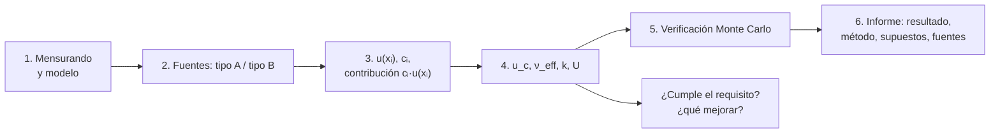

# B12-C20 — Informe de incertidumbre de una misión

<!-- nav:top -->
[🏠 Programa](../../../../README.md) · [📚 Bloque B12](../../../tronco-comun/B12-probabilidad-estadistica-e-incertidumbre.md) · [← Anterior: B12-C19 — Detección de valores atípicos](../B12-C19-deteccion-de-valores-atipicos/CLASE.md) · [Siguiente: B12-C21 — Modelos jerárquicos bayesianos →](../B12-C21-modelos-jerarquicos-bayesianos/CLASE.md)
<!-- /nav -->

## 1. Ubicación, nivel y alcance

Vigésima clase del bloque B12 y cierre de su línea base. Reúne lo anterior —distribuciones, estimación, propagación, sensibilidad, covarianza, atípicos— en un producto auditable: el **presupuesto de incertidumbre** y el **informe** que lo acompaña. Verás los componentes de tipo A y B, la combinación, los grados de libertad efectivos, la incertidumbre expandida, la verificación por Monte Carlo y cómo se redacta el resultado. Nivel N4. Después de esta clase vienen las seis clases programadas del bloque (C21–C26), que amplían el método bayesiano, la comparación de modelos, los pronósticos y las muestras pequeñas.

## 2. Por qué esta clase existe

Una cifra sin incertidumbre es una opinión; una incertidumbre sin presupuesto es una cifra sin respaldo. Quien revise la misión —otro ingeniero, un cliente o uno mismo dentro de un año— debe poder ver qué componentes se consideraron, cómo se evaluó cada uno, cuál domina y si el requisito se cumple. El informe es la evidencia de que se hizo bien.

Pregunta motivadora: **¿qué incertidumbre tiene la velocidad circular a 400 km, de dónde viene cada parte y cumple el requisito de 0,25 m/s?** Decisión central: **si el resultado cumple el requisito y qué componente conviene mejorar si no**.

## 3. Lo que podrás hacer al terminar

1. Definir el mensurando y su modelo de medida con unidades y convenciones.
2. Clasificar componentes en tipo A (estadísticos) y tipo B (otros) y evaluar cada uno.
3. Combinar con la ley de propagación, tabular contribuciones y fracciones de varianza.
4. Calcular los grados de libertad efectivos (Welch–Satterthwaite) y la incertidumbre expandida.
5. Verificar el presupuesto con Monte Carlo y decidir qué método reportar.
6. Redactar el informe con todos los elementos para que otra persona repita el cálculo.

La evidencia es el **informe de incertidumbre** del ejercicio 12 (sección 20).

## 4. Con qué llegas y cómo comprobarlo

Necesitas C04 y C05 (varianza, covarianza), C08 (intervalos, cuantil `t`), C14 (Monte Carlo), C16 (propagación) y C17 (sensibilidad). Cinco preguntas:

1. ¿Qué es una incertidumbre de tipo A?
2. ¿Qué incertidumbre típica corresponde a una tolerancia rectangular `±a`?
3. ¿Cómo se combinan dos componentes independientes?
4. ¿Qué es la incertidumbre expandida?
5. ¿Qué hace una simulación de Monte Carlo en este contexto?

<details>
<summary>Ver respuestas</summary>

1. Una evaluada por análisis estadístico de observaciones repetidas. 2. `a/√3`. 3. En cuadratura, ponderadas por sus sensibilidades. 4. `U = k u_c`, con `k` el factor de cobertura. 5. Propaga las distribuciones de entrada y da la distribución de la salida.
</details>

Con cuatro o cinco aciertos, sigue; si no, repasa C08, C14, C16 y C17.

## 5. Un caso: la velocidad circular en una órbita de 400 km

El mensurando es la velocidad circular `v = √(GM/(R + h))` de una órbita de altitud nominal `h = 400 000 m` sobre el radio ecuatorial de referencia `R = 6,3781 × 10⁶ m`, con `GM = 3,986004 × 10¹⁴ m³ s⁻²` (valores nominales de la IAU, S3), que da `v = 7 668,579 m/s`. Las fuentes de incertidumbre (**ilustrativas**): (A) la altitud se estima como la media de `n = 9` lecturas repetidas de dispersión `s = 300 m`; (B1) el radio de referencia admite una tolerancia rectangular de `±500 m`; (B2) `GM` con una incertidumbre relativa hipotética de `10⁻⁹`. El requisito, igualmente ilustrativo, es `u_c(v) ≤ 0,25 m/s`. Es el **ejemplo conductor**; los datos de las lecturas son **sintéticos**.

## 6. Vocabulario

El **mensurando** es la magnitud que se quiere determinar; el **modelo de medida** expresa el mensurando en función de las magnitudes de entrada (S1, 4.1). La evaluación de **tipo A** de una incertidumbre típica se obtiene del análisis estadístico de observaciones repetidas; la de **tipo B**, por otros medios: datos previos, especificaciones, certificados, juicio científico (S1, 4.2–4.3). La **incertidumbre típica combinada** `u_c(y)` es la raíz de la suma ponderada de las varianzas (S1, 5.1.2). Los **grados de libertad efectivos** se aproximan con la fórmula de Welch–Satterthwaite `ν_eff = u_c⁴ / Σ (cᵢ⁴ uᵢ⁴/νᵢ)` (S1, G.4.1, ec. G.2a), donde `νᵢ = n − 1` en una evaluación de tipo A y se toma infinito para las de tipo B. La **incertidumbre expandida** es `U = k u_c(y)`, con `k` el factor de cobertura (S1, 6.2.1, ec. 18); el GUM restringe el uso de la palabra «confianza» para el intervalo `y ± U` a ciertas condiciones (S1, 6.2.2). El **presupuesto de incertidumbre** es la tabla que enumera cada componente, su distribución, su valor, su coeficiente de sensibilidad, su contribución y sus grados de libertad.

## 7. Modelo mental: un libro de cuentas de la duda

El presupuesto es un libro contable: cada fuente de duda se anota con su monto (contribución a la varianza), su origen (cómo se evaluó) y su peso en el total. Quien lo audita puede seguir cada partida y volver a sumar.



*Descripción textual:* se define el mensurando y su modelo; se enumeran las fuentes de tipo A y B; se evalúa cada una con su sensibilidad y contribución; se combinan para obtener la incertidumbre combinada, los grados de libertad, el factor de cobertura y la expandida; se verifica por Monte Carlo; se redacta el informe y se decide si cumple y qué mejorar.

Analogía: el estado de cuentas de un proyecto. Su límite: las cuentas bancarias son exactas; aquí cada partida tiene su propia incertidumbre y el total depende de supuestos que también se documentan.

## 8. La explicación, paso a paso

### 8.1 Modelo y sensibilidades

`v = √(GM/a)` con `a = R + h = 6 778 100 m`. Sensibilidades: `∂v/∂h = ∂v/∂R = −½ v/a = −5,6569 × 10⁻⁴ (m/s)/m` y `∂v/∂GM = ½ v/GM = 9,619 × 10⁻¹² (m/s)/(m³ s⁻²)`. Como `a = R + h`, `R` y `h` tienen la misma sensibilidad.

### 8.2 Evaluar cada componente

(A) Altitud: `u_A = s/√n = 300/3 = 100 m`, con `ν = n − 1 = 8` (S1, 4.2). (B1) Radio de referencia: tolerancia `±500 m` rectangular, `u = 500/√3 = 288,7 m`, `ν = ∞` (S1, 4.3.7). (B2) `GM`: `u = 10⁻⁹ · 3,986 × 10¹⁴ = 3,99 × 10⁵ m³ s⁻²`, `ν = ∞`.

### 8.3 Contribuciones y combinación

Contribuciones a `u(v)`: A, `0,05657 m/s`; B1, `0,16330 m/s`; B2, `3,8 × 10⁻⁶ m/s` (nula en la tabla). La combinada: `u_c = √(0,05657² + 0,16330² + (3,8 × 10⁻⁶)²) = 0,17282 m/s`, relativa `2,25 × 10⁻⁵`. Fracciones de varianza: A `10,7 %`, B1 `89,3 %`, B2 `≈ 0`. El radio de referencia domina.

### 8.4 Grados de libertad y factor de cobertura

Solo A tiene `ν` finito: `ν_eff = u_c⁴ / (u_A⁴/8) = (0,17282/0,05657)⁴ · 8 = 696,9`. Con tantos grados de libertad la `t` es casi normal: `k = t(0,975; 697) = 1,963`. La incertidumbre expandida es `U = 1,963 · 0,17282 = 0,3393 m/s`. Con `k = 2` (la costumbre) sería `0,3456 m/s`. Aun así el GUM recomienda ser prudente al llamar «confianza del 95 %» a este intervalo (S1, 6.2.2).

### 8.5 Verificación por Monte Carlo

Con `M = 10⁶` sorteos (S2, 7.2.1): `a` con `h` normal, `R` uniforme en `±500 m` y `GM` normal: `u(v) = 0,17269 m/s` (frente a `0,17282`, diferencia `0,08 %`) y un intervalo de cobertura del 95 % `[7 668,2769; 7 668,8811] m/s`, es decir, semiancho `0,302 m/s`. Si la altitud se modela con una `t` de 8 grados de libertad escalada, `u = 0,17589 m/s`: la desviación de una `t(8)` es `√(8/6) = 1,155` veces la normal, y el resultado se desvía un 1,8 %. La conclusión no cambia.

### 8.6 Decisión y mejora

`u_c = 0,173 m/s ≤ 0,25 m/s`: **cumple**. Si hiciera falta bajar, la palanca es B1: reducir la tolerancia del radio de referencia a `±100 m` da `u_c = 0,0653 m/s` (62,2 % menos). Más lecturas de altitud apenas ayudan (10,7 % de la varianza).

## 9. Magnitudes, símbolos y unidades

| Símbolo | Qué es | Unidad | Nota |
|---|---|---|---|
| `v` | velocidad circular | m s⁻¹ | `7 668,579` |
| `GM` | parámetro gravitacional terrestre | m³ s⁻² | `3,986004 × 10¹⁴` |
| `R`, `h`, `a` | radio de referencia, altitud, semieje | m | `a = R + h` |
| `u_A`, `u_B1` | incertidumbres típicas (A y B1) | m | `100` y `288,7` |
| `cᵢ` | coeficiente de sensibilidad | (m/s)/m | `−5,657 × 10⁻⁴` |
| `u_c` | incertidumbre combinada | m s⁻¹ | `0,17282` |
| `ν_eff` | grados de libertad efectivos | adimensional | `696,9` |
| `k`, `U` | factor de cobertura, incertidumbre expandida | —, m s⁻¹ | `1,963`; `0,3393` |

## 10. Convenciones y referencias

La órbita es circular de dos cuerpos; no hay perturbaciones. Los valores de `GM` y `R` son los nominales de la IAU 2015 B3. Las incertidumbres son 1σ salvo indicación. La semilla de Monte Carlo es 2020. El informe usa el formato 1 del GUM (valor con `u_c` explícita), el recomendado frente al `±` ambiguo (S1, 7.2.2).

## 11. De dónde sale lo que afirmamos

| ID | Fuente | Localizador | Respalda | Consulta |
|---|---|---|---|---|
| S1 | JCGM 100:2008 (GUM) | https://doi.org/10.59161/JCGM100-2008E | Modelo (4.1), tipos A y B (4.2–4.3), rectangular `a²/3` (4.3.7), combinación (5.1.2), incertidumbre expandida (6.2.1 ec. 18), uso de «confianza» (6.2.2), Welch–Satterthwaite (G.4.1 ec. G.2a), contenido del informe (7.1.4, 7.2.1) y formatos de reporte (7.2.2) | 2026-11-05, PDF abierto y texto extraído |
| S2 | JCGM 101:2008, Suplemento 1 del GUM | https://doi.org/10.59161/JCGM101-2008 | `M = 10⁶` como valor habitual (7.2.1); propagación de distribuciones por Monte Carlo | 2026-11-05, PDF abierto y texto extraído |
| S3 | IAU, Resolución B3 de 2015 | arXiv:1510.07674, https://arxiv.org/pdf/1510.07674 | `(GM)_E^N = 3,986 004 × 10¹⁴ m³ s⁻²`; `R_eE^N = 6,3781 × 10⁶ m` | 2026-11-05, texto extraído del PDF |

Límites: las incertidumbres de las lecturas, de la tolerancia del radio y de `GM`, y el requisito de 0,25 m/s, son **ilustrativos**; no hay incertidumbre oficial de `GM` en S3 que se use aquí. El informe es **ilustrativo** y no sustituye un análisis de misión.

## 12. El presupuesto en una tabla

Equivalente accesible al gráfico de barras del presupuesto (resultados del laboratorio):

| Componente | Tipo | Distribución | `u(xᵢ)` | Contribución a `u(v)` (m/s) | Varianza | `ν` |
|---|---|---|---|---|---|---|
| A · altitud (9 lecturas) | A | normal | 100 m | 0,05657 | 10,7 % | 8 |
| B1 · radio de referencia | B | rectangular ±500 m | 288,7 m | 0,16330 | 89,3 % | ∞ |
| B2 · `GM` | B | normal | 3,99 × 10⁵ m³ s⁻² | 0,000004 | ≈ 0 % | ∞ |
| **Combinada** | | | | **0,17282** | 100 % | 696,9 |

Descripción larga: la barra de B1 es casi tres veces más alta que la de A; la de B2 es invisible a esta escala. La línea del requisito (`0,25 m/s`) queda por encima de la barra total (`0,173`).

## 13. Ejemplo trabajado: el informe completo

**Paso 1 · Mensurando y modelo.** Velocidad circular `v = √(GM/(R + h))`, en m/s, a 400 km sobre el radio ecuatorial de referencia.

**Paso 2 · Componentes.** A, B1, B2 como en 8.2, con su distribución y origen.

**Paso 3 · Cálculo.** Tabla de la sección 12: `u_c = 0,17282 m/s`.

**Paso 4 · Cobertura.** `ν_eff = 696,9`, `k = 1,963`, `U = 0,339 m/s`.

**Paso 5 · Verificación.** Monte Carlo (`M = 10⁶`, semilla 2020): `u = 0,17269 m/s`, intervalo `[7 668,277; 7 668,881] m/s`.

**Paso 6 · Redacción.** «`v = 7 668,579 m/s` con una incertidumbre típica combinada `u_c = 0,173 m/s` (`u_c/v = 2,3 × 10⁻⁵`); incertidumbre expandida `U = 0,339 m/s` con `k = 1,96` (≈ 95 %, `ν_eff ≈ 700`). Modelo: dos cuerpos. Componentes: altitud (tipo A, 9 lecturas, `s = 300 m`), radio de referencia (tipo B, rectangular ±500 m), `GM` (tipo B, `10⁻⁹` relativa, hipotético). Constantes: IAU 2015 B3. Verificado por Monte Carlo (`M = 10⁶`). Datos: sintéticos e ilustrativos».

**Paso 7 · Decisión.** Cumple `u_c ≤ 0,25 m/s`; la partida dominante es el radio de referencia (89 %).

## 14. Comparación de métodos

El **GUM** (ley de propagación, S1) es analítico, transparente y enseña qué domina; falla ante no linealidad fuerte o salidas no normales. **Monte Carlo** (S2) maneja todo eso con costo de cómputo. Para informes, lo habitual es calcular ambos y reportar el resultado de uno con el otro como verificación. Un **presupuesto por pasos** (cada etapa del proceso) es útil en sistemas grandes. En todo caso, se reporta qué método se usó y se evita contar dos veces una misma fuente (S1, 4.3.10).

## 15. Práctica guiada

**Ejercicio 1 · con los pasos indicados.** Calcula `u_A` para 9 lecturas con `s = 300 m` y sus grados de libertad. *Pasos:* `s/√n`, `ν = n − 1`.

<details><summary>Solución comentada</summary>

`u_A = 300/3 = 100 m`; `ν = 8` (S1, 4.2).
</details>

**Ejercicio 2 · con una pista.** Convierte la tolerancia `±500 m` en incertidumbre típica. *Pista:* `a/√3`.

<details><summary>Solución comentada</summary>

`500/1,732 = 288,7 m` (S1, 4.3.7).
</details>

**Ejercicio 3 · casi autónomo.** Combina A y B1 en `a` y propaga a `v` con `c = 5,657 × 10⁻⁴ (m/s)/m`.

<details><summary>Solución comentada</summary>

`u(a) = √(100² + 288,7²) = 305,5 m`; `u(v) = 5,657 × 10⁻⁴ · 305,5 = 0,1728 m/s`.
</details>

## 16. Práctica autónoma, transferencia e integrador

**Ejercicio 4.** Calcula las fracciones de varianza de A y B1.

<details><summary>Solución comentada</summary>

`0,05657² = 0,0032`; `0,1633² = 0,02667`; suma `0,02987`; A `10,7 %`, B1 `89,3 %`.
</details>

**Ejercicio 5.** Calcula `U` con `k = 2` y con `k = 1,963`. ¿Cuándo importa la diferencia?

<details><summary>Solución comentada</summary>

`0,3456` y `0,3393 m/s`. Diferencia del 1,9 %; importa solo si el requisito está al borde. Se declara el `k` usado.
</details>

**Ejercicio 6.** Si dos componentes de tipo A con igual contribución tuvieran `ν = 8` cada una, ¿cuánto vale `ν_eff`?

<details><summary>Solución comentada</summary>

`ν_eff = u_c⁴ / (2 · (u_c²/2)²/8) = u_c⁴ · 8 / (2 · u_c⁴/4) = 16`. Sumar componentes iguales aumenta los grados de libertad.
</details>

**Ejercicio 7.** ¿Cuánto bajaría `u_c` si la tolerancia del radio fuera `±100 m`?

<details><summary>Solución comentada</summary>

`u_B1 = 57,7 m`; `u(a) = √(100² + 57,7²) = 115,5 m`; `u_c = 0,0653 m/s` (−62,2 %).
</details>

**Ejercicio 8.** Escribe el resultado en el formato 1 del GUM.

<details><summary>Solución comentada</summary>

«v = 7 668,579 m/s con una incertidumbre típica combinada de u_c = 0,173 m/s»; evita el `±` ambiguo (S1, 7.2.2).
</details>

**Ejercicio 9 · transferencia.** Si el requisito fuera `u_c ≤ 0,10 m/s`, ¿qué tolerancia máxima del radio (rectangular) serviría, manteniendo A?

<details><summary>Solución comentada</summary>

`u(a) ≤ 0,10/5,657 × 10⁻⁴ = 176,8 m`; `u_B1 ≤ √(176,8² − 100²) = 145,8 m`; tolerancia `≤ 145,8 · √3 = ±252 m`. Alternativamente, más lecturas: con `n = 36`, `u_A = 50 m`.
</details>

**Ejercicio 10 · transferencia.** El radio de referencia ya está incluido en la dispersión de las 9 lecturas de altitud, y también se agrega como tolerancia. ¿Qué error se comete?

<details><summary>Solución comentada</summary>

Contar dos veces la misma fuente (S1, 4.3.10): sobrestima `u_c`. Hay que decidir en qué componente vive la fuente y evaluarla una sola vez.
</details>

**Ejercicio 11 · transferencia.** Audita el informe del paso 6 de 13 con la lista del GUM 7.1.4 (a–d): ¿qué le falta, si algo?

<details><summary>Solución comentada</summary>

(a) métodos: sí (GUM + Monte Carlo); (b) componentes y su evaluación: sí; (c) pasos reproducibles: falta adjuntar el script y la semilla (disponibles en C20); (d) constantes y fuentes: IAU 2015 B3, sí. Añadiría versiones de software.
</details>

**Ejercicio 12 · integrador.** Elabora tu *informe de incertidumbre* para otro mensurando (por ejemplo el período orbital `T = 2π√(a³/GM)` o el `Δv` de C17): define el modelo, enumera al menos tres componentes con su tipo, calcula `u_c`, `ν_eff`, `k` y `U`, verifica por Monte Carlo, decide frente a un requisito propio y redacta el resultado según el GUM.

<details><summary>Solución modelo</summary>

Debe incluir: mensurando y modelo con unidades; tabla de presupuesto como en la sección 12; `u_c`, `ν_eff`, `k` y `U`; verificación por Monte Carlo con `M`, semilla y versiones; decisión frente al requisito y la partida dominante; texto del informe con valores, método, supuestos, constantes con fuente y fecha; datos rotulados como sintéticos o ilustrativos.
</details>

## 17. Laboratorio: presupuesto y verificación

El script [presupuesto_incertidumbre.py](presupuesto_incertidumbre.py) evalúa los tres componentes, calcula la incertidumbre combinada, los grados de libertad efectivos, el factor de cobertura y la expandida, verifica con un millón de sorteos de Monte Carlo (y con una variante de `t(8)`), decide frente al requisito y prueba una mejora; falla si Monte Carlo difiere más de 0,5 % de la combinada del GUM, si la variante `t` se aparta más de 10 % o si no se cumple el requisito.

**Datos:** `GM` y `R` de la IAU (S3); el resto, sintético e ilustrativo. **Predice antes de ejecutar:** ¿qué partida dominará? (el radio de referencia.) **Ejecución del 2026-11-06 (Python 3.12.9, NumPy 2.4.4, SciPy 1.17.1):**

```text
v = 7668.5787 m/s; coeficientes: c_a = -5.6569e-04 (m/s)/m, c_GM = 9.6194e-12 (m/s)/(m3/s2)
componente                  u_i(v) [m/s]   % de la varianza   nu
A  altitud (9 lecturas)     0.05657         10.71           8
B1 radio de referencia      0.16330         89.29           inf
B2 GM                       0.00000          0.00           inf
u_c(v) = 0.17282 m/s;  relativa = 2.25e-05
nu_eff = 696.9; k(95 %) = 1.963; U = k u_c = 0.3393 m/s
MC (h normal): u = 0.17269 m/s; IC 95 % = [7668.2769, 7668.8811]
MC (h ~ t(8) escalada): u = 0.17589 m/s (la t de 8 gl tiene desviacion sqrt(8/6) = 1.155 veces la normal)
requisito u_c <= 0.25 m/s: CUMPLE; componente dominante: B1
informe: v = 7668.579 m/s, u_c = 0.173 m/s (k = 1); U = 0.339 m/s (k = 1.96, ~95 %); u_c/v = 2.3e-05
con tolerancia de +-100 m en el radio: u_c = 0.06532 m/s (62.2 % menos)
Pruebas superadas.
```

```bash
python programa/clases/B12/B12-C20-informe-de-incertidumbre-de-una-mision/presupuesto_incertidumbre.py
```

**Límites:** modelo de dos cuerpos, entradas independientes; resultados **simulados**.

## 18. Errores frecuentes y cómo corregirlos

**Contar dos veces una fuente.** Se corrige con el ejercicio 10.

**Sumar incertidumbres en lugar de combinarlas en cuadratura.** Se corrige con el ejercicio 3.

**Reportar `±` sin decir qué es.** Se corrige con el ejercicio 8.

**Omitir el factor de cobertura o los supuestos.** Se corrige con la sección 13, paso 6.

**Mejorar la partida que no domina.** Se corrige con 8.6 y los ejercicios 7 y 9.

## 19. Cómo sabrás que vas bien

Tras 8.2: ¿clasificas cada componente en A o B y justificas? Si no, ejercicios 1–2. Tras 8.4: ¿calculas `k` y `U`? Si no, ejercicio 5. Tras 8.6: ¿sabes qué mejorar y cuánto ganas? Si no, ejercicios 7 y 9. Al final: ¿otra persona podría repetir tu cálculo con tu informe? Si no, ejercicio 11.

## 20. Qué entregas y cómo se evalúa

El producto es tu **informe de incertidumbre** (ejercicio 12), archivable y revisable.

| Criterio | Inicial | En desarrollo | Logrado | Destacado |
|---|---|---|---|---|
| Mensurando y modelo | Ambiguos | Declarados | Con unidades y convenciones | Con alcance y límites |
| Presupuesto | Incompleto | Con componentes sin tipo | Tabla con tipo, distribución, contribución y `ν` | Con fracciones y mejora |
| Combinación y cobertura | Sumas simples | Cuadratura | `u_c`, `ν_eff`, `k`, `U` | Con Monte Carlo comparado |
| Redacción | Sin método | Valor ± u | Formato GUM con supuestos | Reproducible y auditable |
| Fuentes y rótulo | Ausente | Parcial | Rotulado y fechado | Declara validez |

**Condiciones críticas (no se compensan con promedio):** no contar dos veces una fuente; declarar el factor de cobertura y el método; rotular datos sintéticos o ilustrativos; no presentar el informe como análisis de misión real.

## 21. Ética, seguridad y límites

Un informe de incertidumbre incompleto o optimista puede legitimar una decisión de misión que no se sostiene. Revisar que cada partida tenga origen documentado y que el resultado no se «ajuste» para cumplir un requisito es una responsabilidad profesional. Los números de esta clase son ilustrativos; el informe no es una determinación orbital. Accesibilidad: el gráfico se ofrece como tabla; todo funciona sin conexión.

## 22. Para cerrar y seguir

El informe de incertidumbre documenta el mensurando, los componentes de tipo A y B, la combinación, los grados de libertad, la incertidumbre expandida, la verificación por Monte Carlo, la decisión frente al requisito y todo lo necesario para repetir el cálculo. Queda abierta una pregunta: ¿cómo seguir cuando el modelo tiene varios niveles de variación, cuando hay que comparar modelos o evaluar pronósticos? Es la ampliación del bloque (C21–C26), comenzando por los modelos jerárquicos bayesianos.

**Glosario español–inglés.** mensurando · *measurand*; presupuesto de incertidumbre · *uncertainty budget*; tipo A / tipo B · *Type A / Type B*; incertidumbre combinada · *combined standard uncertainty*; incertidumbre expandida · *expanded uncertainty*; factor de cobertura · *coverage factor*; grados de libertad efectivos · *effective degrees of freedom*.

**Continuidad.** B12-C21 reutiliza tu capacidad de **declarar un modelo con varios componentes de incertidumbre** para modelar jerarquías de variación.

**Referencias:** ver sección 11.

<!-- nav:bottom -->
---

[← Anterior: B12-C19 — Detección de valores atípicos](../B12-C19-deteccion-de-valores-atipicos/CLASE.md) · [📚 Bloque B12](../../../tronco-comun/B12-probabilidad-estadistica-e-incertidumbre.md) · [Siguiente: B12-C21 — Modelos jerárquicos bayesianos →](../B12-C21-modelos-jerarquicos-bayesianos/CLASE.md)
<!-- /nav -->
