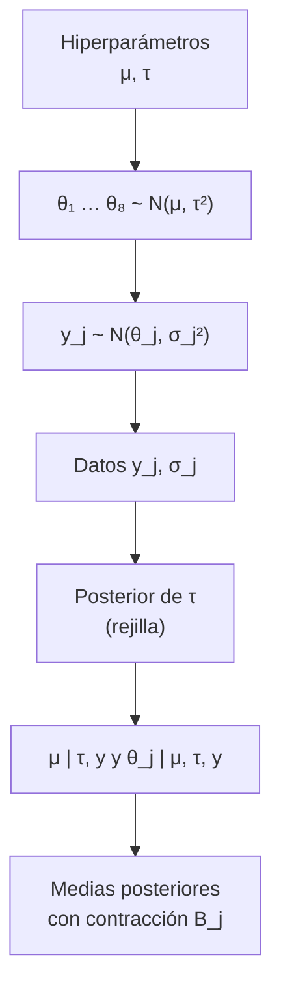

# B12-C21 — Modelos jerárquicos bayesianos

<!-- nav:top -->
[🏠 Programa](../../../../README.md) · [📚 Bloque B12](../../../tronco-comun/B12-probabilidad-estadistica-e-incertidumbre.md) · [← Anterior: B12-C20 — Informe de incertidumbre de una misión](../B12-C20-informe-de-incertidumbre-de-una-mision/CLASE.md) · [Siguiente: B12-C22 — Comparación de modelos: evidencia bayesiana y criterios de información →](../B12-C22-comparacion-de-modelos-evidencia-bayesiana-y-criterios-de-informacion/CLASE.md)
<!-- /nav -->

## 1. Ubicación, nivel y alcance

Clase programada del bloque B12 (ampliación), que sigue a [C20](../B12-C20-informe-de-incertidumbre-de-una-mision/CLASE.md). En [C12](../B12-C12-inferencia-bayesiana/CLASE.md) inferiste un único parámetro con un prior fijo. Aquí varios grupos (sensores, instrumentos, observaciones) comparten una **distribución común** cuyos parámetros —los *hiperparámetros*— también se infieren. Verás la agrupación parcial (*partial pooling*), la contracción hacia la media y la incertidumbre sobre la heterogeneidad. Nivel N4. No verás la implementación general con muestreadores (C13, C23) ni la comparación de modelos (C22).

## 2. Por qué esta clase existe

Ocho sensores del mismo tipo miden un mismo desfase con errores distintos. Tratarlos como idénticos (agrupación completa) ignora diferencias reales entre ellos; tratarlos como independientes (sin agrupación) desperdicia lo que cada uno enseña de los demás. El modelo jerárquico es el punto intermedio: cada sensor se pesa entre su propia lectura y la del conjunto, según cuánta heterogeneidad real hay y cuánto ruido tiene.

Pregunta motivadora: **¿qué valor de calibración asigno a cada sensor y al conjunto, cuando las lecturas individuales son ruidosas y los sensores quizá difieran?** Decisión central: **cuánta información tomar prestada de los demás y cómo reconocer cuánta heterogeneidad real hay**.

## 3. Lo que podrás hacer al terminar

1. Escribir un modelo jerárquico normal–normal con sus niveles y sus hiperparámetros.
2. Calcular el factor de contracción `B_j = σ_j²/(σ_j² + τ²)` e interpretarlo.
3. Obtener la posterior de la heterogeneidad `τ` en una rejilla y resumirla.
4. Calcular las medias posteriores de cada grupo por rejilla y por muestreo directo.
5. Reconocer los límites de agrupación completa (`τ → 0`) y de ausencia de agrupación (`τ → ∞`).
6. Señalar los supuestos (intercambiabilidad, normalidad) y los riesgos de la prior sobre `τ`.

La evidencia es el **informe del modelo jerárquico** del ejercicio 12 (sección 20).

## 4. Con qué llegas y cómo comprobarlo

Necesitas C12 (prior × verosimilitud), C13 (muestreo), C05 (correlación) y C07 (estimación). Cinco preguntas:

1. ¿Cuál es la media posterior de un parámetro normal con prior `N(μ₀, τ²)` y dato `y` de varianza `σ²`?
2. ¿Qué es una distribución marginal?
3. ¿Qué es un hiperparámetro?
4. ¿Qué significa que dos grupos sean intercambiables?
5. ¿Qué pasa con la media posterior cuando el prior es muy ancho?

<details>
<summary>Ver respuestas</summary>

1. Un promedio ponderado por precisiones: `(y/σ² + μ₀/τ²)/(1/σ² + 1/τ²)`. 2. La distribución de una parte de las variables tras integrar el resto. 3. Un parámetro del prior, que a su vez se infiere. 4. Que no hay información previa que distinga a unos de otros. 5. Tiende al dato.
</details>

Con cuatro o cinco aciertos, sigue; si no, repasa C12 y C13.

## 5. Un caso: ocho sensores del mismo tipo

Ocho sensores **ilustrativos** miden un desfase de calibración (µm), con lecturas `y_j = 4,1; 1,2; 2,8; 0,4; 3,3; 5,6; 1,9; 2,5` y errores típicos conocidos `σ_j = 1,0; 0,8; 1,5; 1,2; 0,9; 1,4; 1,1; 1,6` µm. Todos los datos son **sintéticos**. ¿Cuál es el desfase de cada uno, y cuánto difieren realmente entre sí? Es el **ejemplo conductor**.

## 6. Vocabulario

Un **modelo jerárquico** tiene niveles: datos `y_j ~ N(θ_j, σ_j²)`, parámetros de grupo `θ_j ~ N(μ, τ²)` y **hiperparámetros** `μ` (media del conjunto) y `τ` (heterogeneidad entre grupos), con un **hiperprior** sobre ellos. La **intercambiabilidad** supone que, antes de ver los datos, nada distingue a un sensor de otro. La **agrupación completa** fija `θ_j = μ` (equivale a `τ = 0`); **sin agrupación**, cada `θ_j` se estima solo con `y_j` (equivale a `τ → ∞`); la **agrupación parcial** es el caso intermedio. La **contracción** (*shrinkage*) acerca cada `y_j` a la media del conjunto con peso `B_j = σ_j²/(σ_j² + τ²)`: la media posterior condicionada a `τ` es `(1 − B_j) y_j + B_j μ̂`. La **verosimilitud marginal** de `μ` y `τ` integra los `θ_j`: `y_j ~ N(μ, σ_j² + τ²)`. La **heterogeneidad** `τ` se identifica mal con pocos grupos; su posterior suele ser ancha y asimétrica. Hogg, Bovy y Lang hablan de la dispersión intrínseca y de marginalizar parámetros de perturbación como ingredientes de un modelo generativo (S1).

## 7. Modelo mental: cada sensor pide prestado a los demás

El sensor muy ruidoso no puede confiar en sí mismo y se apoya en el grupo; el muy preciso casi se queda con su lectura. Si los sensores resultan muy distintos entre sí (`τ` grande), nadie pide prestado; si son casi iguales (`τ` pequeño), todos se parecen a la media.



*Descripción textual:* los hiperparámetros generan los parámetros de cada sensor, que a su vez generan los datos; al observar los datos se calcula la posterior de la heterogeneidad `τ`, y condicionada a `τ` se obtienen `μ` y los `θ_j`, que son normales; integrando sobre `τ` se obtienen las medias posteriores con contracción.

Analogía: pesar a cada alumno de una clase con una balanza dispar y estimar el peso de cada uno apoyándose también en el promedio de la clase. Su límite: si hay alumnos de otro grupo etario mezclados, el promedio de la clase no les sirve (violación de la intercambiabilidad).

## 8. La explicación, paso a paso

### 8.1 Dos casos extremos

Con `τ → 0` todos los `θ_j` valen la misma media ponderada por `1/σ_j²`, aquí `2,5476` µm. Con `τ → ∞` cada `θ_j` se estima por `y_j`. El laboratorio verifica ambos límites a `10⁻³`. Los datos reales determinan dónde está el modelo entre ambos extremos.

### 8.2 La verosimilitud marginal

Integrando los `θ_j` y `μ`, la evidencia de `τ` es proporcional a `V_μ^{1/2} Π (σ_j² + τ²)^{−1/2} exp(−(y_j − μ̂)²/(2(σ_j² + τ²)))`, con `μ̂ = Σ w_j y_j/Σ w_j`, `w_j = 1/(σ_j² + τ²)` y `V_μ = 1/Σ w_j`. Comprobación independiente con tres sensores y `τ = 1,3`: la fórmula cerrada da `1,34109392 × 10⁻²` y la integración numérica de `μ` también `1,34109392 × 10⁻²`.

### 8.3 La posterior de la heterogeneidad

Con un prior uniforme para `τ` en `[0, 6] µm`, la posterior de `τ` tiene media `1,417 µm`, mediana `1,297` e intervalo del 95 % `[0,146; 3,443] µm`. Además `P(τ < 0,5 µm | y) = 0,108`: **los datos no excluyen** que los sensores sean casi idénticos. Con solo ocho sensores y errores de ese tamaño, `τ` queda mal determinada y la conclusión depende de la prior.

### 8.4 Medias posteriores y contracción

Integrando sobre `τ` (rejilla) y por muestreo directo (400 000 sorteos: `τ`, luego `μ | τ`, luego `θ_j | μ, τ`), las medias posteriores coinciden a menos de `0,003`: `3,472; 1,691; 2,701; 1,497; 3,037; 3,960; 2,233; 2,579` µm. El sensor 6, con la lectura más extrema (`5,6`), pasa a `3,960`: una contracción grande, justificada por su error de `1,4 µm`. El 8, ruidoso (`σ = 1,6`) y cerca de la media, casi no cambia (`2,5 → 2,579`). La desviación posterior de cada `θ_j` es entre 6 % y 33 % menor que su error de lectura: tomar prestado reduce la incertidumbre.

### 8.5 La media del conjunto

Posterior de `μ`: `2,644 ± 0,711 µm`, frente a `2,548` de la media ponderada sin jerarquía (que suponía `τ = 0`). El error es mayor porque ahora se admite heterogeneidad: **la jerarquía no reduce la incertidumbre del conjunto, la hace honesta.**

### 8.6 Límites y cuidados

(i) **Intercambiabilidad**: si los sensores vienen de lotes distintos, hay que modelar covariables. (ii) **Pocos grupos**: `τ` se estima mal; el prior importa y se prueba su sensibilidad. (iii) **Normalidad** de `θ_j`: un sensor defectuoso puede no ser compatible con la campana común (se puede usar una `t`). (iv) La fórmula con rejilla funciona en esta dimensión; modelos mayores requieren MCMC (C13, C23).

## 9. Magnitudes, símbolos y unidades

| Símbolo | Qué es | Unidad | Nota |
|---|---|---|---|
| `y_j`, `σ_j` | lectura y error típico del sensor `j` | µm | datos sintéticos |
| `θ_j` | desfase verdadero del sensor `j` | µm | |
| `μ` | media del conjunto | µm | `2,644` |
| `τ` | heterogeneidad entre sensores | µm | media posterior `1,417` |
| `B_j` | factor de contracción | adimensional | `σ_j²/(σ_j² + τ²)` |
| `w_j`, `V_μ` | pesos y varianza de `μ̂` | µm⁻², µm² | |
| `J` | número de sensores | adimensional | 8 |

## 10. Convenciones y referencias

Los errores `σ_j` se suponen conocidos. El prior sobre `μ` es plano; el de `τ`, uniforme en `[0, 6] µm`. Las medias posteriores se informan con tres decimales por claridad de comparación, no porque tengan esa precisión. Semilla 2121. Todo el cálculo es de dos pasos: rejilla sobre `τ`, normal condicional para `μ` y `θ_j`.

## 11. De dónde sale lo que afirmamos

| ID | Fuente | Localizador | Respalda | Consulta |
|---|---|---|---|---|
| S1 | D. W. Hogg, J. Bovy, D. Lang, *Data analysis recipes: Fitting a model to data* | arXiv:1008.4686, https://arxiv.org/abs/1008.4686 | Dispersión intrínseca, incertidumbres heterogéneas y marginalización de parámetros de perturbación en un modelo generativo (según el resumen) | 2026-11-05, resumen consultado; texto completo no leído |

Límites: las fórmulas del modelo normal–normal jerárquico, el factor de contracción y la posterior de `τ` son resultados estándar no atribuidos a una fuente consultada; se verifican numéricamente en el laboratorio contra una integración independiente. Los datos y el prior son **sintéticos e ilustrativos**.

## 12. Cómo ver la contracción

Equivalente accesible a un gráfico de líneas desde `y_j` hasta la media posterior (resultados del laboratorio):

| Sensor | `y_j` | `σ_j` | Media posterior | Cambio |
|---|---|---|---|---|
| 1 | 4,10 | 1,00 | 3,472 | −0,63 |
| 2 | 1,20 | 0,80 | 1,691 | +0,49 |
| 4 | 0,40 | 1,20 | 1,497 | +1,10 |
| 6 | 5,60 | 1,40 | 3,960 | −1,64 |
| 8 | 2,50 | 1,60 | 2,579 | +0,08 |

Descripción larga: cada flecha va de la lectura individual hacia el centro (≈ 2,6 µm); las más largas son las de los sensores con lecturas extremas y más ruido relativo (4 y 6); la del sensor 8, cercano al centro, es casi nula.

## 13. Ejemplo trabajado: ¿qué desfase tiene el sensor 6?

**Paso 1 · Datos.** `y₆ = 5,6 µm`, `σ₆ = 1,4 µm`; resto de sensores como en 5.

**Paso 2 · Heterogeneidad.** Posterior de `τ` con media `1,42 µm`.

**Paso 3 · Contracción a `τ = 1,4`.** `B₆ = 1,96/(1,96 + 1,96) = 0,5`; `μ̂ ≈ 2,55`: media condicional `0,5·5,6 + 0,5·2,55 = 4,08`.

**Paso 4 · Integrando sobre `τ`.** Media posterior `3,960 µm`.

**Paso 5 · Incertidumbre.** Desviación posterior menor que `1,4`: 12,2 % menos.

**Paso 6 · Interpretación.** No se descarta la lectura del sensor 6, pero se interpreta como parcialmente ruido; para decidir si es un sensor defectuoso se compara con la distribución predictiva del conjunto.

**Paso 7 · Sentido.** Datos **sintéticos**; la conclusión depende del prior de `τ` y de la intercambiabilidad.

## 14. Comparación de métodos

**Agrupación completa**: simple, bajo error si los grupos son idénticos, sesgada si no. **Sin agrupación**: cada grupo con su ruido; imprecisa con pocos datos por grupo. **Agrupación parcial jerárquica**: compromiso, estima la heterogeneidad. El **empírico** (estimar `τ` por máxima verosimilitud marginal y fijarlo) es más rápido pero subestima la incertidumbre al ignorar la de `τ`. La **comparación formal** entre estos modelos se hace con evidencia o criterios de información (C22).

## 15. Práctica guiada

**Ejercicio 1 · con los pasos indicados.** Para `σ = 1,0`, `τ = 1,4`, `y = 4,1` y `μ̂ = 2,55`, calcula `B` y la media condicional. *Pasos:* `B = σ²/(σ² + τ²)`, `(1 − B)y + Bμ̂`.

<details><summary>Solución comentada</summary>

`B = 1/(1 + 1,96) = 0,338`; `0,662·4,1 + 0,338·2,55 = 2,714 + 0,862 = 3,576`.
</details>

**Ejercicio 2 · con una pista.** ¿A qué valor tiende la media condicional cuando `τ → 0`? *Pista:* mira `B`.

<details><summary>Solución comentada</summary>

`B → 1`: la media condicional tiende a `μ̂`, la media ponderada del conjunto (agrupación completa).
</details>

**Ejercicio 3 · casi autónomo.** Compara `B` del sensor 8 (`σ = 1,6`) y del 2 (`σ = 0,8`) con `τ = 1,4`.

<details><summary>Solución comentada</summary>

`B₈ = 2,56/(2,56 + 1,96) = 0,566`; `B₂ = 0,64/(0,64 + 1,96) = 0,246`. El sensor más ruidoso se contrae más hacia el conjunto.
</details>

## 16. Práctica autónoma, transferencia e integrador

**Ejercicio 4.** Calcula la varianza condicional de `θ_j` con `σ = 1,0` y `τ = 1,4` (precisión `1/σ² + 1/τ²`).

<details><summary>Solución comentada</summary>

Precisión `1 + 0,510 = 1,510`; varianza `0,662`; desviación `0,814 µm`, menor que `σ = 1,0`.
</details>

**Ejercicio 5.** ¿Qué dice `P(τ < 0,5 µm | y) = 0,108`?

<details><summary>Solución comentada</summary>

Que hay un 10,8 % de probabilidad posterior de que la heterogeneidad real sea inferior a 0,5 µm: los datos no excluyen sensores casi idénticos.
</details>

**Ejercicio 6.** ¿Por qué la incertidumbre de `μ` (0,711) es mayor que con agrupación completa?

<details><summary>Solución comentada</summary>

Porque con `τ > 0` el promedio de ocho sensores heterogéneos tiene también la variabilidad entre sensores, `τ²/J`; con `τ = 0` ésta desaparece. La jerarquía no esconde esa incertidumbre.
</details>

**Ejercicio 7.** Predice la distribución de un noveno sensor sin datos con `τ = 1,4` y `V_μ = 0,5`.

<details><summary>Solución comentada</summary>

`θ_nuevo ~ N(μ, τ²)` con `μ` incierta: desviación `√(1,96 + 0,5) = 1,57 µm` alrededor de `2,6`. Es la distribución predictiva para un sensor nuevo.
</details>

**Ejercicio 8.** ¿Por qué la elección del prior de `τ` pesa tanto con 8 grupos?

<details><summary>Solución comentada</summary>

Porque la verosimilitud de `τ` es muy plana en las zonas pequeñas y la posterior hereda la forma del prior. Se prueba más de uno (uniforme, semi-normal) y se informa la sensibilidad.
</details>

**Ejercicio 9 · transferencia.** Un sensor tiene `σ` pequeño y lectura extrema. ¿Se contrae mucho? ¿Y qué sospechas?

<details><summary>Solución comentada</summary>

Se contrae poco (`B` pequeño): el modelo le cree. Una lectura extrema y precisa sugiere que el sensor realmente difiere, o que viola la normalidad común; conviene revisar con un modelo de colas más pesadas.
</details>

**Ejercicio 10 · transferencia.** Los sensores 1–4 vienen de un lote y 5–8 de otro. ¿Qué cambias?

<details><summary>Solución comentada</summary>

La intercambiabilidad no se cumple: se añade una covariable de lote (efecto fijo) o un nivel adicional (sensores dentro de lotes). Si no, la contracción acerca sensores de lotes distintos y sesga.
</details>

**Ejercicio 11 · transferencia.** Un colega fija `τ` en su valor más probable y calcula con él. ¿Qué riesgo hay?

<details><summary>Solución comentada</summary>

Ignora la incertidumbre de `τ`: las contracciones y los intervalos se vuelven demasiado confiados. Aquí `τ` va de 0,15 a 3,4 con el 95 %; es mejor integrar (8.3–8.4).
</details>

**Ejercicio 12 · integrador.** Elabora tu *informe del modelo jerárquico*: genera datos sintéticos de 6–10 grupos con heterogeneidad conocida, ajusta el modelo normal–normal, grafica (o tabula) la contracción, compara con agrupación completa y sin agrupación, y valida tu cálculo contra una integración numérica independiente.

<details><summary>Solución modelo</summary>

Debe incluir: modelo y niveles; posterior de `τ` con intervalo; medias posteriores de cada grupo y su contracción; comparación de los tres enfoques en error cuadrático respecto de los valores verdaderos (conocidos por ser sintéticos); validación independiente; sensibilidad al prior de `τ`; límites (intercambiabilidad, normalidad); semilla y versiones.
</details>

## 17. Laboratorio: contracción y heterogeneidad

El script [jerarquico_normal.py](jerarquico_normal.py) calcula la posterior de `τ` en rejilla, comprueba la verosimilitud marginal contra una integración numérica independiente, verifica los dos límites y compara las medias posteriores por rejilla y por muestreo directo; falla si la fórmula cerrada y la integración difieren más de `10⁻⁸` relativo, si fallan los límites a `10⁻³` o si las medias difieren más de `0,02`.

**Datos:** sintéticos. **Predice antes de ejecutar:** ¿qué sensor se contrae más? (el 6, por lectura extrema y error alto.) **Ejecución del 2026-11-06 (Python 3.12.9, NumPy 2.4.4, SciPy 1.17.1):**

```text
verosimilitud marginal en tau=1.3 (J=3): cerrada = 1.34109392e-02; integracion numerica = 1.34109392e-02
posterior de tau: media = 1.417 um; mediana = 1.297; IC 95 % = [0.146, 3.443]
P(tau < 0.5 um | y) = 0.108  (la posterior no excluye tau pequeno)
tau -> 0: todos los theta_j = media ponderada 2.5476; tau -> inf: theta_j = y_j
sensor    y_j     s_j   sin agrupar   agrupacion parcial (rejilla)   (muestreo)   reduccion de s
   1     4.10   1.00       4.10           3.472                   3.473        11.3 %
   2     1.20   0.80       1.20           1.691                   1.691         5.8 %
   3     2.80   1.50       2.80           2.701                   2.701        31.1 %
   4     0.40   1.20       0.40           1.497                   1.495        13.3 %
   5     3.30   0.90       3.30           3.037                   3.037        15.2 %
   6     5.60   1.40       5.60           3.960                   3.958        12.2 %
   7     1.90   1.10       1.90           2.233                   2.233        21.2 %
   8     2.50   1.60       2.50           2.579                   2.577        33.1 %
media global mu: 2.644 +/- 0.711 um;  media ponderada sin jerarquia: 2.548
Pruebas superadas.
```

```bash
python programa/clases/B12/B12-C21-modelos-jerarquicos-bayesianos/jerarquico_normal.py
```

**Límites:** errores conocidos, normalidad; resultados **simulados**.

## 18. Errores frecuentes y cómo corregirlos

**Fijar `τ` y olvidar su incertidumbre.** Se corrige con el ejercicio 11.

**Creer que la jerarquía reduce siempre la incertidumbre del conjunto.** Se corrige con 8.5 y el ejercicio 6.

**Suponer intercambiabilidad sin examinarla.** Se corrige con el ejercicio 10.

**No probar la sensibilidad al prior de `τ`.** Se corrige con 8.3 y el ejercicio 8.

**Interpretar la contracción como corrección de un error del instrumento.** Es un efecto estadístico, no una calibración; se corrige con 8.6.

## 19. Cómo sabrás que vas bien

Tras 8.1: ¿entiendes qué significan los dos extremos? Si no, ejercicio 2. Tras 8.4: ¿explicas por qué se contrae más el 6 que el 8? Si no, ejercicio 3. Tras 8.6: ¿qué supuesto revisarías primero? Si dudas, ejercicio 10.

## 20. Qué entregas y cómo se evalúa

El producto es tu **informe del modelo jerárquico** (ejercicio 12).

| Criterio | Inicial | En desarrollo | Logrado | Destacado |
|---|---|---|---|---|
| Modelo | Sin niveles | Con niveles sin hiperpriors | Niveles e hiperpriors declarados | Con intercambiabilidad discutida |
| Cálculo | Con errores | Con ayuda | Verificado con integración independiente | Con muestreo |
| Contracción | Ausente | Descrita | Cuantificada | Comparada con agrupación completa y nula |
| Sensibilidad | Ausente | Un prior | Dos priors de `τ` | Con efecto en las conclusiones |
| Fuentes y rótulo | Ausente | Parcial | Rotulado y fechado | Declara límites |

**Condiciones críticas (no se compensan con promedio):** declarar el prior de `τ` y su sensibilidad; no tratar la contracción como una corrección instrumental; rotular datos sintéticos.

## 21. Ética, seguridad y límites

Tomar prestado entre unidades puede ocultar un sensor realmente defectuoso o ajustar una unidad a un promedio que no le corresponde; en salud o seguridad, eso es un riesgo. Los datos de esta clase son sintéticos y ningún sensor real se evalúa. Accesibilidad: los gráficos se ofrecen como tabla; todo funciona sin conexión.

## 22. Para cerrar y seguir

Un modelo jerárquico infiere a la vez los parámetros de cada grupo y la heterogeneidad entre ellos; la contracción pondera lectura propia y conjunto según el ruido y la heterogeneidad; la incertidumbre de `τ` debe propagarse y el prior de `τ` probarse. Queda abierta una pregunta: ¿cómo decidir entre agrupación completa, nula o parcial? Con evidencia bayesiana y criterios de información (C22).

**Glosario español–inglés.** modelo jerárquico · *hierarchical model*; hiperparámetro · *hyperparameter*; agrupación parcial · *partial pooling*; contracción · *shrinkage*; intercambiabilidad · *exchangeability*; verosimilitud marginal · *marginal likelihood*; heterogeneidad · *heterogeneity*.

**Continuidad.** B12-C22 reutiliza tu capacidad de **calcular verosimilitudes marginales** para comparar modelos con evidencia.

**Referencias:** ver sección 11.

<!-- nav:bottom -->
---

[← Anterior: B12-C20 — Informe de incertidumbre de una misión](../B12-C20-informe-de-incertidumbre-de-una-mision/CLASE.md) · [📚 Bloque B12](../../../tronco-comun/B12-probabilidad-estadistica-e-incertidumbre.md) · [Siguiente: B12-C22 — Comparación de modelos: evidencia bayesiana y criterios de información →](../B12-C22-comparacion-de-modelos-evidencia-bayesiana-y-criterios-de-informacion/CLASE.md)
<!-- /nav -->
