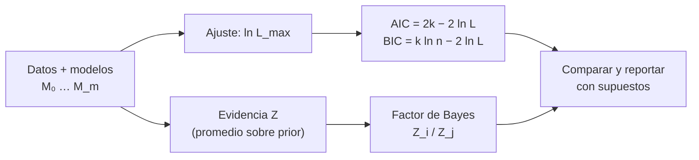

# B12-C22 — Comparación de modelos: evidencia bayesiana y criterios de información

<!-- nav:top -->
[🏠 Programa](../../../../README.md) · [📚 Bloque B12](../../../tronco-comun/B12-probabilidad-estadistica-e-incertidumbre.md) · [← Anterior: B12-C21 — Modelos jerárquicos bayesianos](../B12-C21-modelos-jerarquicos-bayesianos/CLASE.md) · [Siguiente: B12-C23 — Diagnóstico de convergencia y reproducibilidad de cadenas MCMC →](../B12-C23-diagnostico-de-convergencia-y-reproducibilidad-de-cadenas-mcmc/CLASE.md)
<!-- /nav -->

## 1. Ubicación, nivel y alcance

Clase programada del bloque B12 (ampliación). En [C09](../B12-C09-pruebas-de-hipotesis/CLASE.md) contrastaste un valor frente a una hipótesis; aquí comparas **modelos completos** que compiten por explicar los mismos datos: la evidencia bayesiana, el factor de Bayes y los criterios de información AIC y BIC. Nivel N4. Ejemplo conductor: elegir el grado de un polinomio para la deriva de un reloj. No verás la implementación de la evidencia por muestreo anidado ni la validación cruzada.

## 2. Por qué esta clase existe

Un modelo más flexible siempre ajusta mejor los datos que uno más sencillo, así que el ajuste solo no sirve para elegir. Hace falta penalizar la complejidad: ¿vale la pena el parámetro extra? Sin esa penalización, se termina interpolando el ruido y prediciendo mal. Además, la elección de modelo condiciona todo lo que sigue (parámetros, extrapolaciones, incertidumbres).

Pregunta motivadora: **¿cuándo un parámetro adicional está justificado por los datos y cuándo solo ajusta el ruido?** Decisión central: **qué criterio usar, qué supone cada uno y cuánto confiar en la decisión**.

## 3. Lo que podrás hacer al terminar

1. Definir la evidencia (verosimilitud marginal) de un modelo y el factor de Bayes entre dos modelos.
2. Calcular la evidencia exacta en un caso conjugado y comprobarla numéricamente.
3. Calcular AIC y BIC y explicar qué penaliza cada uno.
4. Aplicar los tres criterios a polinomios de grado creciente y comparar sus decisiones.
5. Explicar la penalización automática de Occam y su dependencia del prior.
6. Reportar la comparación con sus supuestos y sin umbrales mecánicos.

La evidencia es el **informe de selección de modelo** del ejercicio 12 (sección 20).

## 4. Con qué llegas y cómo comprobarlo

Necesitas C10 (regresión, mínimos cuadrados), C12 (prior, posterior, evidencia como denominador), C21 (verosimilitud marginal) y logaritmos. Cinco preguntas:

1. ¿Qué es `χ²_min` en un ajuste con errores conocidos?
2. ¿Cómo se relaciona `ln L_max` con `χ²_min` cuando `σ` es conocida?
3. ¿Qué es la verosimilitud marginal?
4. ¿Cuánto vale `ln 20`?
5. ¿Qué pasa con `χ²_min` al añadir un parámetro?

<details>
<summary>Ver respuestas</summary>

1. La suma de cuadrados de residuos ponderados por `1/σ²`. 2. `ln L = −χ²/2 + constante`. 3. El promedio de la verosimilitud sobre el prior del parámetro. 4. `2,996`. 5. No aumenta (disminuye o se mantiene).
</details>

Con cuatro o cinco aciertos, sigue; si no, repasa C10, C12 y C21.

## 5. Un caso: ¿qué grado tiene la deriva?

(a) Un problema conjugado: 27 éxitos en 30 pruebas; ¿modelo `M0` con `p = 0,9` fijo o `M1` con `p` desconocido y prior uniforme? (b) Veinte puntos de deriva de un reloj (**sintéticos**) generados con una recta `y = 2,0 + 0,50 t` y ruido `N(0; 0,8²)` conocido; se ajustan polinomios de grado 0 a 3. Sabemos que la verdad es una recta (porque los datos son sintéticos); ¿la identifican los criterios? Es el **ejemplo conductor**.

## 6. Vocabulario

La **evidencia** (o verosimilitud marginal) de un modelo `M` es `Z = ∫ p(datos | θ, M) p(θ | M) dθ`: promedia la verosimilitud sobre el prior. El **factor de Bayes** `B₀₁ = Z₀/Z₁` compara dos modelos; si los priors de modelo son iguales, es el cociente de sus probabilidades posteriores. La **navaja de Occam** emerge sola: un modelo con prior amplio reparte su probabilidad en muchos datos posibles y recibe menos evidencia por el que ocurrió. El **criterio de información de Akaike** es `AIC = 2k − 2 ln L_max`, con `k` parámetros; el **bayesiano** es `BIC = k ln n − 2 ln L_max`, con `n` datos. Menor es mejor en ambos. Liddle contrasta estos criterios y la evidencia bayesiana, y recuerda que el criterio de desviación (DIC) es otra alternativa; en su aplicación a datos cosmológicos los enfoques informacionales y bayesianos llevaron a conclusiones notablemente distintas (S1). El **modelo anidado** contiene al otro como caso particular (grado 1 dentro de grado 2).

## 7. Modelo mental: ajuste menos precio por flexibilidad

Cada modelo se evalúa por dos cosas: qué tan bien ajusta (verosimilitud máxima) y cuánto «cuesta» su flexibilidad. AIC y BIC ponen un precio fijo por parámetro; la evidencia pone un precio que depende del prior, calculado automáticamente al promediar.



*Descripción textual:* para cada modelo se calcula el ajuste máximo, con el que se forman AIC y BIC (ajuste más una penalización por parámetro), y la evidencia, que promedia la verosimilitud sobre el prior; con ellos se comparan los modelos y se reporta con sus supuestos.

Analogía: comprar un traje a medida: el que calza mejor puede ser el que más cuesta y el que peor sienta en otra talla. Su límite: aquí el «precio» de AIC y BIC es una regla fija y el de la evidencia depende de lo que se supuso sobre el cliente (el prior).

## 8. La explicación, paso a paso

### 8.1 Evidencia exacta en un caso conjugado

Con 27 éxitos en 30 pruebas: `Z₀ = C(30,27) 0,9²⁷ 0,1³ = 0,236088`. Con prior uniforme, `Z₁ = ∫ C(30,27) p²⁷(1−p)³ dp = 1/31 = 0,032258`; la integración numérica da el mismo valor. El factor de Bayes es `B₀₁ = 7,319` (`ln B₀₁ = 1,99`): los datos favorecen `p = 0,9` frente a «cualquier `p`», porque `M₀` apostó a un valor concreto y acertó, mientras `M₁` repartió su apuesta. Si los 30 hubieran sido éxitos, `Z₀ = 0,9³⁰ = 0,0424` y `B₀₁ = 1,31`: la preferencia sería mínima.

### 8.2 AIC y BIC en polinomios

Con `n = 20`, `σ = 0,8` conocida y grados 0 a 3: `χ²_min = 214,75; 17,88; 17,39; 15,37`. Los criterios (incluyendo la constante gaussiana de `ln L`) son `AIC = 244,58; 49,71; 51,22; 51,20` y `BIC = 245,58; 51,70; 54,21; 55,18`. El grado 1 minimiza ambos. Pasar de grado 1 a 2 baja `χ²` solo en `0,49`, y cuesta `2` en AIC (`ΔAIC = +1,51`) y `ln 20 = 3,0` en BIC (`ΔBIC = +2,51`).

### 8.3 La evidencia de los polinomios

Con prior `β ~ N(0, 10² I)` para los coeficientes (sobre la variable `t` estandarizada), la evidencia es normal multivariada: `Z = N(y; 0, σ² I + s² X Xᵀ)`. Los `ln Z` son `−125,54; −31,16; −34,82; −37,56`: el grado 1 gana. La comprobación independiente con integración numérica 2D del grado 1 da `−31,1621`, igual a la analítica. `ln B(1/3) = 6,40`: el modelo cúbico recibe un factor `e⁶·⁴ ≈ 600` menos de evidencia por los dos parámetros que no necesita.

### 8.4 El prior importa

Si el prior de los coeficientes se ensancha de `s = 10` a `s = 100`, `ln Z` del grado 1 baja de `−31,16` a `−35,51` (`≈ −2 ln 10`) y el del grado 0 de `−125,54` a `−127,62` (`≈ −ln 10`). Cada parámetro «paga» `ln(s₂/s₁)` por ensancharse. AIC y BIC no dependen del prior, lo que es ventaja (simplicidad) y límite (ignoran lo que se sabe del parámetro). Un prior arbitrariamente ancho hace la evidencia arbitrariamente pequeña: hay que justificarlo.

### 8.5 Qué mide cada criterio

AIC apunta a la **capacidad predictiva** de un modelo sobre datos nuevos; BIC, a aproximar el logaritmo de la evidencia para `n` grande y priors poco informativos, y suele preferir modelos más sencillos (penaliza `ln n` por parámetro, mayor que 2 desde `n = 8`). La evidencia responde «¿cuál modelo (con su prior) es más probable?», no «¿cuál predice mejor?». En los datos de Liddle sobre cosmología los dos enfoques no coincidieron (S1): no existe un criterio universal.

### 8.6 Cómo reportar

Se reportan: los modelos candidatos y sus priors, `χ²_min` o `ln L_max`, `k`, AIC, BIC y `ln Z` (si se calculó), la sensibilidad al prior, y una conclusión **sin umbral mecánico**. Para decisiones de misión se complementa con validación en datos no usados y con el costo de equivocarse. Si los criterios discrepan, se dice.

## 9. Magnitudes, símbolos y unidades

| Símbolo | Qué es | Unidad | Nota |
|---|---|---|---|
| `Z` | evidencia | depende de los datos | `ln Z = −31,16` (grado 1) |
| `B₀₁` | factor de Bayes | adimensional | `7,319` |
| `k` | número de parámetros | adimensional | 1 a 4 |
| `n` | número de datos | adimensional | 20 |
| `ln L_max` | log-verosimilitud máxima | adimensional | |
| `AIC`, `BIC` | criterios de información | adimensional | menor es mejor |
| `χ²_min` | ajuste mínimo ponderado | adimensional | `17,88` (grado 1) |
| `s` | desviación del prior de los coeficientes | unidad del coeficiente | 10 |

## 10. Convenciones y referencias

Los polinomios se ajustan sobre `t` estandarizada para estabilidad numérica. `σ = 0,8` se supone conocida; con `σ` desconocida las fórmulas cambian. La constante gaussiana se incluye en `ln L` (las diferencias entre modelos no dependen de ella). La semilla es 2222. Se cumple la convención «menor AIC/BIC, mayor `Z`, mejor».

## 11. De dónde sale lo que afirmamos

| ID | Fuente | Localizador | Respalda | Consulta |
|---|---|---|---|---|
| S1 | A. R. Liddle, *Information criteria for astrophysical model selection*, MNRAS 377, L74 (2007) | arXiv:astro-ph/0701113, https://arxiv.org/abs/astro-ph/0701113 | Existencia de los criterios AIC, BIC, evidencia bayesiana y DIC; aplicación a modelos cosmológicos con conclusiones distintas entre enfoques (según el resumen) | 2026-11-05, resumen consultado; texto completo no leído |

Límites: las definiciones de AIC y BIC en la forma escrita, la evidencia normal multivariada del modelo lineal y la identidad `Z₁ = 1/(n+1)` son resultados estándar no atribuidos a una fuente consultada; se verifican numéricamente. Los datos son **sintéticos** y los priors, ilustrativos.

## 12. Cómo ver la comparación

Equivalente accesible a un gráfico de los criterios por grado (resultados del laboratorio):

| Grado | `k` | `χ²_min` | AIC | BIC | `ln Z` |
|---|---|---|---|---|---|
| 0 | 1 | 214,75 | 244,58 | 245,58 | −125,54 |
| 1 | 2 | 17,88 | **49,71** | **51,70** | **−31,16** |
| 2 | 3 | 17,39 | 51,22 | 54,21 | −34,82 |
| 3 | 4 | 15,37 | 51,20 | 55,18 | −37,56 |

Descripción larga: `χ²_min` cae de golpe del grado 0 al 1 (de 215 a 18) y casi no mejora después; AIC y BIC tienen un mínimo en el grado 1 y suben luego (BIC más rápido); `ln Z` tiene un máximo en el grado 1 y desciende.

## 13. Ejemplo trabajado: elegir el grado

**Paso 1 · Modelos.** Polinomios de grado 0, 1, 2, 3 con `σ = 0,8` conocida y `s = 10`.

**Paso 2 · Ajuste.** `χ²_min` de la tabla; el grado 0 es inadmisible (`χ² = 215` con 19 g.l.).

**Paso 3 · Penalización.** Del grado 1 al 2: `Δχ² = −0,49`; AIC `+1,51`, BIC `+2,51`.

**Paso 4 · Evidencia.** `ln B(1 vs 2) = 3,66`; `(1 vs 3) = 6,40`.

**Paso 5 · Sensibilidad.** Con `s = 100`: `ln Z(1) = −35,51`, `ln Z(2) = −41,48`: el grado 1 sigue ganando.

**Paso 6 · Conclusión.** Los tres criterios coinciden: grado 1, el que generó los datos.

**Paso 7 · Sentido.** **Datos sintéticos**; con datos reales, `σ` conocida es un supuesto fuerte y el modelo verdadero no se sabe.

## 14. Comparación de métodos

**Contraste de razón de verosimilitud**: solo anidados y con un nivel de error. **AIC**: predicción, sin prior, asintótico. **BIC**: aproxima la evidencia con priors poco informativos y `n` grande. **Evidencia**: coherente, usa el prior, cuesta calcularla e importa su elección. **Validación cruzada**: mide directamente la predicción en datos no usados; no se trata aquí. Con pocos datos, ningún criterio es concluyente; se reporta la incertidumbre de la elección.

## 15. Práctica guiada

**Ejercicio 1 · con los pasos indicados.** Calcula `ΔAIC` y `ΔBIC` entre grado 2 y grado 1 con `Δχ² = −0,49` y `n = 20`. *Pasos:* `ΔAIC = 2Δk + Δχ²`, `ΔBIC = Δk ln n + Δχ²`.

<details><summary>Solución comentada</summary>

`ΔAIC = 2 − 0,49 = 1,51`; `ΔBIC = 2,996 − 0,49 = 2,51`. Ambos positivos: el grado 2 es peor.
</details>

**Ejercicio 2 · con una pista.** Interpreta `B₀₁ = 7,32`. *Pista:* con priors de modelo iguales.

<details><summary>Solución comentada</summary>

`P(M₀|datos)/P(M₁|datos) = 7,32` ⇒ `P(M₀|datos) = 7,32/8,32 = 0,88`. Preferencia clara, no abrumadora.
</details>

**Ejercicio 3 · casi autónomo.** Para 30 éxitos en 30 pruebas, calcula `Z₀` y `B₀₁`.

<details><summary>Solución comentada</summary>

`Z₀ = 0,9³⁰ = 0,0424`; `Z₁ = 1/31 = 0,0323`; `B₀₁ = 1,31`. El dato extremo ya no distingue entre los modelos.
</details>

## 16. Práctica autónoma, transferencia e integrador

**Ejercicio 4.** ¿Cuánto penaliza BIC cada parámetro con `n = 1000`? ¿Y AIC?

<details><summary>Solución comentada</summary>

BIC: `ln 1000 = 6,91`; AIC: `2`. Con muchos datos, BIC exige mucha más mejora de ajuste por parámetro.
</details>

**Ejercicio 5.** ¿Desde qué `n` penaliza BIC más que AIC?

<details><summary>Solución comentada</summary>

`ln n > 2` ⇒ `n > e² = 7,39`: desde `n = 8`.
</details>

**Ejercicio 6.** Ensancha el prior de `s = 10` a `s = 1000`: ¿cuánto cae `ln Z` de un modelo con `k` parámetros (aprox.)?

<details><summary>Solución comentada</summary>

`k ln(1000/10) = 4,6 k`. Un grado 3 (`k = 4`) cae unos 18,4; uno de grado 1 (`k = 2`), unos 9,2: la diferencia entre ellos crece.
</details>

**Ejercicio 7.** ¿Por qué el grado 3 tiene menor `χ²` y peor AIC?

<details><summary>Solución comentada</summary>

`χ²` baja en `2,51` respecto del grado 1 pero el término `2Δk = 4` lo supera: `ΔAIC = 4 − 2,51 = +1,49`. El ajuste mejora menos de lo que cuesta.
</details>

**Ejercicio 8.** ¿Qué indica una discrepancia entre AIC y BIC?

<details><summary>Solución comentada</summary>

Que la mejora del ajuste está entre las dos penalizaciones (entre `2` y `ln n` por parámetro): la evidencia de que el parámetro extra es útil es débil; se reporta como incierta y se busca más información.
</details>

**Ejercicio 9 · transferencia.** Un colega dice «el modelo de grado 3 ajusta mejor, así que es el correcto». Responde con los números de la sección 12.

<details><summary>Solución comentada</summary>

Ajusta mejor (`χ² = 15,37` frente a `17,88`) pero eso siempre ocurre al añadir parámetros; AIC, BIC y la evidencia lo penalizan (`ΔAIC = +1,49`, `ΔBIC = +3,48`, `ln B = 6,4` a favor del grado 1). El ajuste sin penalización no distingue señal de ruido.
</details>

**Ejercicio 10 · transferencia.** Quieres comparar dos modelos físicos no anidados de la curva de luz de una estrella. ¿Qué criterio te sirve y qué cuidado?

<details><summary>Solución comentada</summary>

La evidencia y el factor de Bayes no requieren anidamiento; AIC y BIC también se pueden comparar si se calculan sobre los mismos datos. Cuidado: el prior de cada modelo debe justificarse, y los modelos deben ajustar los mismos datos con la misma verosimilitud.
</details>

**Ejercicio 11 · transferencia.** Un revisor pide «un umbral de decisión» para el factor de Bayes. ¿Qué respondes?

<details><summary>Solución comentada</summary>

Que no hay un umbral universal verificado en las fuentes de esta clase; la decisión depende del costo de equivocarse, del prior, y de la sensibilidad. Se reporta el valor, su sensibilidad, y se compara con la validación en datos nuevos.
</details>

**Ejercicio 12 · integrador.** Elabora tu *informe de selección de modelo*: genera datos sintéticos con un modelo conocido, ajusta cuatro candidatos, tabula `χ²_min`, AIC, BIC y `ln Z` (con dos priors), verifica una evidencia con integración numérica y concluye con la sensibilidad y los límites.

<details><summary>Solución modelo</summary>

Debe incluir: modelos candidatos y priors; tabla de criterios; verificación independiente de una evidencia; efecto del prior en `ln Z`; discusión de coincidencias o discrepancias entre criterios; advertencia de que `σ` se supuso conocida; datos rotulados sintéticos; semilla y versiones.
</details>

## 17. Laboratorio: evidencia, AIC y BIC

El script [comparacion_modelos.py](comparacion_modelos.py) calcula la evidencia Beta–Binomial exacta y numérica, ajusta polinomios de grado 0 a 3, calcula `χ²_min`, AIC, BIC y la evidencia analítica, y comprueba esta última con una integración 2D del grado 1; falla si la evidencia numérica y la exacta difieren más de lo tolerado, si BIC y evidencia no eligen el grado 1 o si la rejilla se aparta de la analítica en más de `10⁻³` en `ln Z`.

**Datos:** sintéticos. **Predice antes de ejecutar:** ¿qué grado elegirá cada criterio? (grado 1.) **Ejecución del 2026-11-06 (Python 3.12.9, NumPy 2.4.4, SciPy 1.17.1):**

```text
evidencia M0 (p=0.9) = 0.236088; M1 (p~U(0,1)) = 0.032258 (numerica 0.032258); factor de Bayes B01 = 7.319
grado  k   chi2_min   AIC      BIC      ln evidencia
   0   1    214.75   244.58   245.58    -125.54
   1   2     17.88    49.71    51.70     -31.16
   2   3     17.39    51.22    54.21     -34.82
   3   4     15.37    51.20    55.18     -37.56
mejor segun AIC: grado 1; BIC: grado 1; evidencia: grado 1
ln evidencia grado 1: analitica = -31.1621; rejilla 2D = -31.1621
ln B(grado 1 / grado 3) = 6.40  (penalizacion de Occam de los parametros sobrantes)
Pruebas superadas.
```

```bash
python programa/clases/B12/B12-C22-comparacion-de-modelos-evidencia-bayesiana-y-criterios-de-informacion/comparacion_modelos.py
```

**Límites:** `σ` conocida, prior gaussiano para los coeficientes; resultados **simulados**.

## 18. Errores frecuentes y cómo corregirlos

**Elegir el modelo que mejor ajusta.** Se corrige con el ejercicio 9.

**Ignorar la dependencia de la evidencia del prior.** Se corrige con 8.4 y el ejercicio 6.

**Aplicar umbrales mecánicos.** Se corrige con el ejercicio 11.

**Comparar criterios sobre datos distintos.** Se corrige con la sección 10.

**Usar BIC con pocos datos como si fuera exacto.** Se corrige con 8.5 y el ejercicio 8.

## 19. Cómo sabrás que vas bien

Tras 8.2: ¿calculas `ΔAIC` y `ΔBIC` entre dos grados? Si no, ejercicio 1. Tras 8.4: ¿explicas por qué la evidencia depende del prior? Si no, ejercicio 6. Tras 8.5: ¿distingues lo que mide cada criterio? Si no, ejercicio 8.

## 20. Qué entregas y cómo se evalúa

El producto es tu **informe de selección de modelo** (ejercicio 12).

| Criterio | Inicial | En desarrollo | Logrado | Destacado |
|---|---|---|---|---|
| Modelos y priors | No declarados | Declarados | Justificados | Con sensibilidad |
| Criterios | Solo ajuste | Uno | AIC, BIC y evidencia | Con validación independiente |
| Verificación | Ninguna | Un cálculo | Evidencia comprobada | Con simulación del procedimiento |
| Conclusión | Mecánica | Con umbral | Acotada y con supuestos | Con costo de equivocarse |
| Fuentes y rótulo | Ausente | Parcial | Rotulado y fechado | Declara límites |

**Condiciones críticas (no se compensan con promedio):** penalizar la complejidad; declarar el prior; no aplicar umbrales sin justificar; rotular datos sintéticos.

## 21. Ética, seguridad y límites

Elegir un modelo para llegar a una conclusión deseada es una forma de manipulación; ocultar los modelos descartados, también. En decisiones de misión, el modelo elegido condiciona márgenes de seguridad. Los datos y modelos de esta clase son sintéticos. Accesibilidad: los gráficos se ofrecen como tabla; todo funciona sin conexión.

## 22. Para cerrar y seguir

La evidencia promedia la verosimilitud sobre el prior y penaliza automáticamente la complejidad; AIC y BIC aproximan esa penalización con una regla fija; cada criterio mide algo distinto; el prior importa; la conclusión se reporta con sus supuestos y su sensibilidad. Queda abierta una pregunta: cuando la evidencia se calcula con MCMC, ¿cómo saber que las cadenas son confiables? Con diagnóstico de convergencia y reproducibilidad (C23).

**Glosario español–inglés.** evidencia bayesiana · *Bayesian evidence*; factor de Bayes · *Bayes factor*; criterio de Akaike · *Akaike information criterion (AIC)*; criterio bayesiano · *Bayesian information criterion (BIC)*; navaja de Occam · *Occam's razor*; modelo anidado · *nested model*; selección de modelos · *model selection*.

**Continuidad.** B12-C23 reutiliza tu capacidad de **calcular posteriores y evidencias con cadenas** para comprobar su convergencia.

**Referencias:** ver sección 11.

<!-- nav:bottom -->
---

[← Anterior: B12-C21 — Modelos jerárquicos bayesianos](../B12-C21-modelos-jerarquicos-bayesianos/CLASE.md) · [📚 Bloque B12](../../../tronco-comun/B12-probabilidad-estadistica-e-incertidumbre.md) · [Siguiente: B12-C23 — Diagnóstico de convergencia y reproducibilidad de cadenas MCMC →](../B12-C23-diagnostico-de-convergencia-y-reproducibilidad-de-cadenas-mcmc/CLASE.md)
<!-- /nav -->
