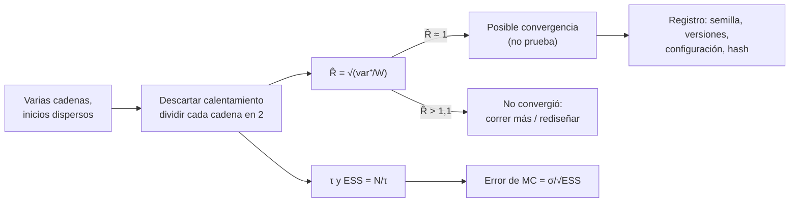

# B12-C23 — Diagnóstico de convergencia y reproducibilidad de cadenas MCMC

<!-- nav:top -->
[🏠 Programa](../../../../README.md) · [📚 Bloque B12](../../../tronco-comun/B12-probabilidad-estadistica-e-incertidumbre.md) · [← Anterior: B12-C22 — Comparación de modelos: evidencia bayesiana y criterios de información](../B12-C22-comparacion-de-modelos-evidencia-bayesiana-y-criterios-de-informacion/CLASE.md) · [Siguiente: B12-C24 — Métricas de habilidad (skill scores) de pronóstico →](../B12-C24-metricas-de-habilidad-skill-scores-de-pronostico/CLASE.md)
<!-- /nav -->

## 1. Ubicación, nivel y alcance

Clase programada del bloque B12 (ampliación). En [C13](../B12-C13-cadenas-de-markov-y-muestreo/CLASE.md) escribiste un muestreador de Metropolis y viste que una traza «que parece estable» no prueba convergencia. Aquí aprendes a **diagnosticarla** con varias cadenas (el estadístico `R̂`), a medir cuántas muestras independientes valen realmente (tamaño efectivo, `ESS`) y a hacer que el resultado sea **reproducible** (semillas, versiones, registros, huellas). Nivel N4. No verás muestreadores avanzados ni modelos concretos de misión.

## 2. Por qué esta clase existe

Un análisis MCMC cuya cadena no convergió da intervalos falsos con apariencia de precisión; y uno que no se puede repetir es irrevisable. En una misión, un parámetro estimado con cadenas defectuosas puede determinar una maniobra o un diagnóstico de salud de un instrumento. La evidencia de que se hizo bien es cuantitativa y archivable.

Pregunta motivadora: **¿puedo confiar en estas cadenas, cuántas muestras independientes tengo, y cómo hago para que otra persona obtenga exactamente el mismo resultado?** Decisión central: **aceptar o rechazar las cadenas, y qué registro conservar**.

## 3. Lo que podrás hacer al terminar

1. Calcular `R̂` con cadenas divididas y leerlo correctamente.
2. Calcular el tiempo de autocorrelación integrado y el `ESS`.
3. Demostrar con cadenas de inicios dispersos que una cadena corta no ha convergido.
4. Estimar el error de Monte Carlo de una media a partir del `ESS`.
5. Verificar la reproducibilidad con semillas y huellas SHA-256.
6. Redactar un registro de ejecución con semilla, versiones, configuración y resultado.

La evidencia es el **registro de convergencia y reproducibilidad** del ejercicio 12 (sección 20).

## 4. Con qué llegas y cómo comprobarlo

Necesitas C13 (Metropolis, calentamiento, autocorrelación), C06 (error `σ/√n`) y C14 (semilla, error de Monte Carlo). Cinco preguntas:

1. ¿Qué es el calentamiento?
2. ¿Por qué las muestras sucesivas de una cadena están correlacionadas?
3. ¿Qué error típico tiene una media de `n` muestras independientes?
4. ¿Qué es una semilla?
5. ¿Cuál es el objetivo de la cadena de C13?

<details>
<summary>Ver respuestas</summary>

1. Los primeros pasos, que se descartan porque aún no reflejan la distribución objetivo. 2. Cada estado se propone a partir del anterior. 3. `σ/√n`. 4. El valor que inicializa un generador pseudoaleatorio. 5. La posterior `Gamma(38; 10,1)` de la tasa del detector.
</details>

Con cuatro o cinco aciertos, sigue; si no, repasa C13 y C14.

## 5. Un caso: cuatro cadenas con inicios dispersos

Se lanzan cuatro cadenas de Metropolis sobre la posterior `Gamma(38; 10,1)` de C12–C13 (media exacta `3,7624`), con inicios en `1, 3, 8` y `15` (**sintéticos**). Además se simulan cadenas autorregresivas AR(1) con coeficiente `ρ = 0,9`, cuyo tiempo de autocorrelación se conoce exactamente: `(1 + ρ)/(1 − ρ) = 19`. Es el **ejemplo conductor**.

## 6. Vocabulario

El **tiempo de autocorrelación integrado** `τ = 1 + 2 Σ_{t≥1} ρ_t` mide cuántos pasos equivalen a una muestra independiente; el **tamaño muestral efectivo** es `ESS = N/τ`. Para un AR(1) con coeficiente `ρ`, `τ = (1 + ρ)/(1 − ρ)`. El **estadístico `R̂`** (Gelman–Rubin) compara la varianza entre cadenas con la de dentro de cada una: si todas las cadenas muestrean la misma distribución, `R̂ ≈ 1`; si están en regiones distintas, `R̂ > 1`. La versión «dividida» parte cada cadena en dos mitades para detectar no estacionariedad. Vehtari y colaboradores muestran que el `R̂` clásico puede fallar con colas pesadas o varianzas distintas entre cadenas, y proponen una variante basada en rangos y el uso de gráficos de rangos en lugar de trazas (S1); este laboratorio usa la versión clásica dividida. Foreman-Mackey y colaboradores usan el tiempo de autocorrelación como medida de rendimiento de un muestreador (S2). La **reproducibilidad** exige poder repetir la ejecución con el mismo resultado: semilla, generador, versiones, configuración y datos de entrada. Una **huella** (*hash*) SHA-256 de la salida permite verificar la igualdad bit a bit.

## 7. Modelo mental: varios exploradores que deben contar la misma historia

Si cuatro exploradores salen de puntos distintos de un territorio y, tras un tiempo, describen el mismo paisaje, es creíble que lo conocen. Si cada uno describe un valle distinto, no. `R̂` es esa comparación; `ESS` dice cuántos mapas realmente independientes tienes; y el registro permite que otro repita la expedición.



*Descripción textual:* con varias cadenas de inicios dispersos se descarta el calentamiento y se divide cada una en dos mitades; con ellas se calcula `R̂` y el tiempo de autocorrelación; un `R̂` cercano a 1 sugiere (sin probar) convergencia, uno alto indica que hay que seguir; el `ESS` da el error de Monte Carlo; todo se archiva con semilla, versiones, configuración y huella.

Analogía: comprobar un mapa con varios topógrafos independientes. Su límite: si todos parten del mismo valle y nunca cruzan una cordillera, coinciden y se equivocan juntos (multimodalidad no explorada).

## 8. La explicación, paso a paso

### 8.1 Qué es `R̂`

Con `m` cadenas de `n` pasos (cada una dividida en dos mitades, así `m` se duplica y `n` se reduce a la mitad), sea `W` el promedio de las varianzas dentro de cada cadena y `B = n · var(medias de las cadenas)`. La estimación de la varianza de la distribución es `var⁺ = ((n−1)/n) W + B/n`, y `R̂ = √(var⁺/W)`. Si las medias de las cadenas difieren más de lo que explica su variabilidad interna, `B` es grande y `R̂ > 1`.

### 8.2 Un ejemplo numérico

Con `n = 100`, `W = 1` y `B = 150`: `var⁺ = 0,99 + 1,5 = 2,49`, `R̂ = 1,578`. Cadenas que visitan regiones distintas. Con cuatro cadenas independientes de una normal estándar (2000 pasos), el laboratorio obtiene `R̂ = 0,9998`.

### 8.3 Cadenas que aún no convergieron

Con las cuatro cadenas de Metropolis desde `1, 3, 8, 15` y solo 60 pasos: `R̂ = 1,290`: no convergieron. Con 40 000 pasos y descartando la primera mitad: `R̂ = 1,0002`. La media agregada es `3,7627` (exacta `3,7624`). Una regla de uso frecuente es exigir `R̂ < 1,01` (valores mayores que `1,1` son claramente inaceptables); es una convención, no un teorema.

### 8.4 Tiempo de autocorrelación y `ESS`

Para un AR(1) con `ρ = 0,9`, el `τ` exacto es `19`; el estimado a partir de 200 000 pasos, sumando autocorrelaciones hasta la primera no positiva, es `19,25` (1,3 % de diferencia). Entonces el `ESS` es `200 000/19,25 = 10 387`: cada 19 pasos equivalen a una muestra independiente. Para las cuatro cadenas de Metropolis (80 000 muestras), el `ESS` total es `13 021`.

### 8.5 Error de Monte Carlo

El error típico de la media es `σ/√ESS`, no `σ/√N`: `0,0053` para la media de las cadenas (con `σ ≈ 0,61` y `ESS = 13 021`); la media `3,7627` difiere de la exacta en `0,0003`, dentro de lo esperado. Usar `N = 80 000` daría `0,0022`, subestimando en un factor 2,5.

### 8.6 Reproducibilidad

Ejecutando la cadena dos veces con la misma semilla (7), las huellas SHA-256 coinciden (`778a87d20e902767…`); con la semilla 8, difieren (`899b999fbc03aedb…`). Un registro mínimo incluye: semilla, generador (aquí el predeterminado de NumPy, PCG64), versiones de Python y bibliotecas, parámetros del algoritmo (paso, número de cadenas, pasos, calentamiento), datos de entrada (con su huella) y el resultado con su huella. Tras actualizar una biblioteca no se asume que el flujo aleatorio siga igual: se vuelve a comprobar la huella.

## 9. Magnitudes, símbolos y unidades

| Símbolo | Qué es | Unidad | Nota |
|---|---|---|---|
| `m`, `n` | cadenas y pasos por cadena | adimensional | 4 y 40 000 |
| `W`, `B` | varianza dentro y entre cadenas | unidad² de la variable | |
| `R̂` | estadístico de convergencia | adimensional | `1,0002` |
| `ρ` | coeficiente AR(1) | adimensional | 0,9 |
| `τ` | tiempo de autocorrelación integrado | pasos | `19` (exacto) |
| `ESS` | tamaño muestral efectivo | adimensional | `13 021` |
| `σ` | desviación de la posterior | eventos/intervalo | `≈ 0,61` |

## 10. Convenciones y referencias

La mitad inicial de cada cadena larga se descarta como calentamiento. `R̂` se calcula sobre cadenas divididas. Las huellas se calculan sobre los bytes de la cadena en doble precisión. Se usa `numpy.random.default_rng(semilla)`. Todas las cadenas se ejecutan con semillas distintas e independientes.

## 11. De dónde sale lo que afirmamos

| ID | Fuente | Localizador | Respalda | Consulta |
|---|---|---|---|---|
| S1 | A. Vehtari, A. Gelman, D. Simpson, B. Carpenter, P.-C. Bürkner, *Rank-normalization, folding, and localization: an improved R̂ for assessing convergence of MCMC* | arXiv:1903.08008, https://arxiv.org/abs/1903.08008 | El `R̂` clásico puede fallar con colas pesadas o varianzas distintas; propuesta basada en rangos; recomienda gráficos de rangos con varias cadenas (según el resumen) | 2026-11-05, resumen consultado; texto completo no leído |
| S2 | D. Foreman-Mackey, D. W. Hogg, D. Lang, J. Goodman, *emcee: The MCMC Hammer* | arXiv:1202.3665, https://arxiv.org/abs/1202.3665 | Uso del tiempo de autocorrelación como medida de rendimiento de un muestreador MCMC (según el resumen) | 2026-11-05, resumen consultado |

Límites: la fórmula de `R̂` dividido, el tiempo de autocorrelación integrado, `ESS = N/τ` y la fórmula de AR(1) son resultados estándar no atribuidos a una fuente consultada; el umbral `1,01` es una convención; los resultados son **simulados** y sobre datos **sintéticos**.

## 12. Cómo ver la convergencia

Equivalente accesible a un gráfico de trazas superpuestas (resultados del laboratorio):

| Situación | Pasos por cadena | `R̂` | Lectura |
|---|---|---|---|
| 4 cadenas iid | 2 000 | 0,9998 | sin problema |
| 4 cadenas de Metropolis, inicios dispersos | 60 | 1,290 | no convergieron |
| mismas, tras 40 000 pasos (mitad descartada) | 20 000 | 1,0002 | compatible con convergencia |

Descripción larga: al principio, las cuatro trazas parten de valores distintos (1, 3, 8, 15) y se separan; después se entremezclan en una banda común alrededor de 3,8 y no se distingue una de otra.

## 13. Ejemplo trabajado: decidir si las cadenas valen

**Paso 1 · Diseño.** Cuatro cadenas con inicios dispersos y semillas distintas.

**Paso 2 · Calentamiento.** Descartar la primera mitad.

**Paso 3 · `R̂`.** `1,0002 < 1,01`: sin señal de no convergencia.

**Paso 4 · `ESS`.** `13 021` de `80 000`: unas 6 muestras por cada muestra independiente.

**Paso 5 · Error de Monte Carlo.** `0,0053` en la media; se reporta la media `3,763 ± 0,005`.

**Paso 6 · Reproducibilidad.** Se archivan semillas, versiones y huella de la salida.

**Paso 7 · Límite.** `R̂ ≈ 1` no prueba convergencia (modos no explorados); aquí hay un solo modo y una solución exacta que lo confirma. Datos **sintéticos**.

## 14. Comparación de métodos

La **traza visual** da intuición, pero engaña. `R̂` clásico: simple y estándar, con fallas en colas pesadas. El **`R̂` basado en rangos y `ESS` de colas** (S1) es más robusto y recomendado. Para pocas cadenas, el uso de **inicios dispersos** es lo que da valor al diagnóstico. El **tiempo de autocorrelación** (S2) sirve para dimensionar el costo. La **simulación con solución conocida** valida el algoritmo, no el análisis real. Ningún diagnóstico sustituye comprobar con el modelo la plausibilidad física.

## 15. Práctica guiada

**Ejercicio 1 · con los pasos indicados.** Calcula `R̂` con `n = 100`, `W = 1`, `B = 150`. *Pasos:* `var⁺`, cociente, raíz.

<details><summary>Solución comentada</summary>

`var⁺ = 0,99·1 + 150/100 = 2,49`; `R̂ = √2,49 = 1,578`.
</details>

**Ejercicio 2 · con una pista.** Si `τ = 19` y `N = 100 000`, ¿cuál es el `ESS`? *Pista:* `N/τ`.

<details><summary>Solución comentada</summary>

`5 263`.
</details>

**Ejercicio 3 · casi autónomo.** Con ese `ESS` y `σ = 0,61`, ¿cuál es el error de Monte Carlo de la media? Compárelo con `σ/√N`.

<details><summary>Solución comentada</summary>

`0,61/√5263 = 0,0084`; con `N`, `0,0019`: subestimación de un factor `√19 = 4,4`.
</details>

## 16. Práctica autónoma, transferencia e integrador

**Ejercicio 4.** Calcula `τ` para AR(1) con `ρ = 0,5` y con `ρ = 0,99`.

<details><summary>Solución comentada</summary>

`τ = (1 + ρ)/(1 − ρ)`: `3` y `199`. La autocorrelación alta multiplica el costo.
</details>

**Ejercicio 5.** ¿Cuántos pasos necesitas para `ESS = 1000` con `τ = 19`?

<details><summary>Solución comentada</summary>

`N = 1000 · 19 = 19 000`.
</details>

**Ejercicio 6.** ¿Por qué se dividen las cadenas en mitades?

<details><summary>Solución comentada</summary>

Para detectar no estacionariedad dentro de una cadena: si la primera y la segunda mitad difieren, las medias de las mitades difieren y `B` crece, aunque haya una sola cadena.
</details>

**Ejercicio 7.** ¿Qué debe contener el registro de una ejecución MCMC para ser reproducible?

<details><summary>Solución comentada</summary>

Semilla, generador, versiones de Python y bibliotecas, parámetros del algoritmo, datos de entrada con huella, calentamiento, número de cadenas, resultado con huella, fecha y responsable (8.6).
</details>

**Ejercicio 8.** Cuatro cadenas parten del mismo valor y dan `R̂ = 1,00`. ¿Es evidencia de convergencia?

<details><summary>Solución comentada</summary>

Débil: sin inicios dispersos, el diagnóstico no puede detectar que las cadenas quedaron atrapadas en el mismo modo. Hay que dispersar los inicios (8.3).
</details>

**Ejercicio 9 · transferencia.** Una posterior bimodal con picos en 2 y 10. Dos cadenas desde 2 y 10 no se cruzan. ¿Qué `R̂` esperas y qué ocurre si ambas parten de 2?

<details><summary>Solución comentada</summary>

Desde 2 y 10: `R̂` muy alto, señal de que no se mezclan. Ambas desde 2: `R̂ ≈ 1`, falso consuelo: el muestreador nunca vio el segundo pico. Se necesitan inicios dispersos y un algoritmo que salte entre modos.
</details>

**Ejercicio 10 · transferencia.** Redacta el registro de ejecución del laboratorio de esta clase.

<details><summary>Solución modelo</summary>

Ejecutar con Python 3.12.9, NumPy 2.4.4, SciPy 1.17.1, `default_rng`, semillas 100–103 para cadenas, paso 0,8, 40 000 pasos, descarte de 20 000, huella SHA-256 de cada cadena, resultado (media, `R̂`, `ESS`) y fecha 2026-11-06.
</details>

**Ejercicio 11 · transferencia.** Tras actualizar NumPy, la huella de tu corrida cambió. ¿Qué haces?

<details><summary>Solución comentada</summary>

No se asume que el flujo aleatorio es estable entre versiones. Se registra el cambio, se repite el análisis, se comparan los resultados estadísticamente (no bit a bit) y se actualiza el registro con la nueva versión y huella.
</details>

**Ejercicio 12 · integrador.** Elabora tu *registro de convergencia y reproducibilidad*: ejecuta cuatro cadenas con inicios dispersos sobre una posterior con solución exacta, calcula `R̂` para varias longitudes, `τ`, `ESS` y el error de Monte Carlo, y archiva semillas, versiones y huellas.

<details><summary>Solución modelo</summary>

Tabla de `R̂` según longitud; `τ` y `ESS`; media con error de Monte Carlo comparada con la exacta; huellas de dos corridas idénticas y una distinta; registro completo; límites (versión clásica de `R̂`, un solo modo); datos sintéticos.
</details>

## 17. Laboratorio: `R̂`, `ESS` y huellas

El script [convergencia_mcmc.py](convergencia_mcmc.py) implementa `R̂` dividido y `τ`, valida `τ` contra la fórmula exacta de AR(1), muestra `R̂` alto con 60 pasos y cercano a 1 con 40 000, calcula el `ESS` y comprueba que dos ejecuciones con igual semilla producen la misma huella; falla si `τ` se aparta más de 10 % del exacto, si `R̂` iid supera 1,01, si `R̂` corto no supera 1,1, si el largo supera 1,01 o si las huellas no coinciden.

**Datos:** sintéticos. **Predice antes de ejecutar:** ¿qué `R̂` verás con 60 pasos? (claramente mayor que 1,1.) **Ejecución del 2026-11-06 (Python 3.12.9, NumPy 2.4.4, SciPy 1.17.1):**

```text
AR(1) rho=0.9: tau_int estimado = 19.25; exacto = 19.00; ESS = 10,387 de 200,000
R-hat de 4 cadenas iid = 0.9998
R-hat con inicios dispersos y 60 pasos = 1.290  -> NO convergio
R-hat con 40 000 pasos (se descarta la mitad) = 1.0002; ESS total = 13,021 de 80,000
media posterior = 3.7627 (exacta 3.7624); error de Monte Carlo = 0.0053
SHA-256 misma semilla: 778a87d20e902767 / 778a87d20e902767 (iguales: True); otra semilla: 899b999fbc03aedb
Pruebas superadas.
```

```bash
python programa/clases/B12/B12-C23-diagnostico-de-convergencia-y-reproducibilidad-de-cadenas-mcmc/convergencia_mcmc.py
```

**Límites:** versión clásica de `R̂`, un solo modo; resultados **simulados**.

## 18. Errores frecuentes y cómo corregirlos

**Declarar convergencia por inspección de la traza.** Se corrige con 8.3 y el ejercicio 8.

**Usar `N` en vez de `ESS` para el error.** Se corrige con 8.5 y el ejercicio 3.

**Iniciar todas las cadenas en el mismo punto.** Se corrige con el ejercicio 8.

**No archivar semillas y versiones.** Se corrige con 8.6 y los ejercicios 7 y 10.

**Asumir que `R̂ ≈ 1` prueba convergencia.** Se corrige con el ejercicio 9.

## 19. Cómo sabrás que vas bien

Tras 8.1: ¿calculas `R̂` con números dados? Si no, ejercicio 1. Tras 8.4: ¿relacionas `ρ` con `τ`? Si no, ejercicio 4. Tras 8.6: ¿escribes el registro? Si no, ejercicio 7.

## 20. Qué entregas y cómo se evalúa

El producto es tu **registro de convergencia y reproducibilidad** (ejercicio 12).

| Criterio | Inicial | En desarrollo | Logrado | Destacado |
|---|---|---|---|---|
| Diseño de cadenas | Una cadena | Varias del mismo inicio | Varias con inicios dispersos | Con caso multimodal |
| Diagnóstico | Visual | Solo `R̂` | `R̂`, `τ` y `ESS` | Con versión robusta |
| Error | Con `N` | Con `ESS` sin verificar | Con `ESS` y comparación con lo exacto | Discute su límite |
| Reproducibilidad | Sin semilla | Semilla | Semilla, versiones y huella | Registro completo y verificado |
| Fuentes y rótulo | Ausente | Parcial | Rotulado y fechado | Declara límites |

**Condiciones críticas (no se compensan con promedio):** inicios dispersos; error con `ESS`, no con `N`; semilla y versiones archivadas; rotular datos sintéticos.

## 21. Ética, seguridad y límites

Reportar intervalos de cadenas sin convergencia o sin registro es ocultar el riesgo del análisis; en decisiones de seguridad, es inaceptable. Los resultados de esta clase son sintéticos. Accesibilidad: las trazas se ofrecen como tabla; todo funciona sin conexión.

## 22. Para cerrar y seguir

`R̂` compara cadenas de inicios dispersos; `τ` y `ESS` dicen cuántas muestras independientes hay y fijan el error de Monte Carlo; un `R̂` cercano a 1 sugiere pero no prueba convergencia; el registro con semilla, versiones y huella hace repetible el análisis. Queda abierta una pregunta: ¿cómo evaluar un pronóstico probabilista frente a una referencia? Con métricas de habilidad (C24).

**Glosario español–inglés.** convergencia · *convergence*; tiempo de autocorrelación · *autocorrelation time*; tamaño muestral efectivo · *effective sample size*; reproducibilidad · *reproducibility*; semilla · *seed*; huella · *hash*; cadenas divididas · *split chains*.

**Continuidad.** B12-C24 reutiliza tu capacidad de **comprobar y reportar un resultado con su registro** para evaluar pronósticos frente a una referencia.

**Referencias:** ver sección 11.

<!-- nav:bottom -->
---

[← Anterior: B12-C22 — Comparación de modelos: evidencia bayesiana y criterios de información](../B12-C22-comparacion-de-modelos-evidencia-bayesiana-y-criterios-de-informacion/CLASE.md) · [📚 Bloque B12](../../../tronco-comun/B12-probabilidad-estadistica-e-incertidumbre.md) · [Siguiente: B12-C24 — Métricas de habilidad (skill scores) de pronóstico →](../B12-C24-metricas-de-habilidad-skill-scores-de-pronostico/CLASE.md)
<!-- /nav -->
