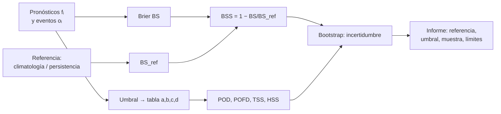

# B12-C24 — Métricas de habilidad (skill scores) de pronóstico

<!-- nav:top -->
[🏠 Programa](../../../../README.md) · [📚 Bloque B12](../../../tronco-comun/B12-probabilidad-estadistica-e-incertidumbre.md) · [← Anterior: B12-C23 — Diagnóstico de convergencia y reproducibilidad de cadenas MCMC](../B12-C23-diagnostico-de-convergencia-y-reproducibilidad-de-cadenas-mcmc/CLASE.md) · [Siguiente: B12-C25 — Modelos longitudinales y de efectos mixtos para muestras pequeñas →](../B12-C25-modelos-longitudinales-y-de-efectos-mixtos-para-muestras-pequenas/CLASE.md)
<!-- /nav -->

## 1. Ubicación, nivel y alcance

Clase programada del bloque B12 (ampliación), pensada para quien pronostica fenómenos como las llamaradas solares o la actividad geomagnética. Aquí tiene sentido preguntar no solo *cuánto* se equivoca un pronóstico, sino *cuánto mejor es que una referencia sencilla*. Verás el puntaje de Brier, su versión de habilidad (BSS), la tabla de contingencia y los índices POD, POFD, TSS y HSS, junto con la incertidumbre de la propia evaluación. Nivel N4. No verás los modelos físicos de pronóstico ni la validación operativa.

## 2. Por qué esta clase existe

Un pronóstico de «no habrá llamarada» acierta el 90 % de los días en una época tranquila y no sirve de nada. La exactitud bruta premia lo trivial. Para decidir si un método de pronóstico merece uso operativo hace falta una métrica que lo compare con una referencia y que sea honesta ante eventos raros.

Pregunta motivadora: **¿un pronóstico probabilista de llamaradas es mejor que decir siempre la frecuencia histórica, y con qué certeza?** Decisión central: **qué métricas y qué referencia usar, y cuánta confianza dar al resultado**.

## 3. Lo que podrás hacer al terminar

1. Calcular el puntaje de Brier y el BSS frente a la climatología.
2. Construir una tabla de contingencia con un umbral y calcular POD, POFD, TSS y HSS.
3. Explicar por qué la exactitud engaña con eventos raros y por qué TSS no depende de la tasa base.
4. Evaluar cómo cambia la habilidad con la referencia elegida.
5. Cuantificar la incertidumbre de una métrica con remuestreo.
6. Redactar una evaluación honesta que incluya referencia, umbral, muestra y límites.

La evidencia es el **informe de verificación de un pronóstico** del ejercicio 12 (sección 20).

## 4. Con qué llegas y cómo comprobarlo

Necesitas C01 (probabilidad), C03 (Bernoulli), C08 (intervalos, incertidumbre por muestreo) y C14 (remuestreo). Cinco preguntas:

1. ¿Qué es un evento de Bernoulli?
2. ¿Cuánto vale `(0,7 − 1)²`?
3. ¿Qué es la tasa base de un evento?
4. ¿Qué es un falso positivo?
5. ¿Por qué un intervalo de confianza acompaña una métrica?

<details>
<summary>Ver respuestas</summary>

1. Uno que ocurre o no (1/0). 2. `0,09`. 3. La frecuencia relativa con que ocurre. 4. Alarma sin evento. 5. Porque la métrica se calculó con una muestra finita.
</details>

Con cuatro o cinco aciertos, sigue; si no, repasa C01, C08 y C14.

## 5. Un caso: pronóstico de eventos solares (sintético)

Se evalúa un pronóstico probabilista diario de un evento (por ejemplo, una llamarada de cierta clase) en 3 000 días **sintéticos**: la frecuencia base es de ~10 %; el pronosticador tiene información parcial del riesgo diario. **No son datos solares reales**. La literatura reporta que, comparando varios métodos de pronóstico de llamaradas con métricas estándar, ninguno superó claramente a los demás y las habilidades frente a la climatología fueron débilmente positivas para eventos de clase M y mayores (S1). Es el **ejemplo conductor**.

## 6. Vocabulario

El **puntaje de Brier** `BS = (1/N) Σ (fᵢ − oᵢ)²` mide el error cuadrático medio de las probabilidades pronosticadas `fᵢ ∈ [0,1]` frente a los resultados `oᵢ ∈ {0,1}`; 0 es perfecto. La **referencia climatológica** pronostica siempre la frecuencia base `ō`, con `BS_ref = ō(1 − ō)`. El **puntaje de habilidad de Brier** es `BSS = 1 − BS/BS_ref`: 1 es perfecto, 0 iguala a la referencia, negativo es peor. La **tabla de contingencia** (con un umbral de probabilidad) cuenta aciertos `a` (alarma y evento), falsas alarmas `b`, omisiones `c` y rechazos correctos `d`. La **probabilidad de detección** es `POD = a/(a+c)`; la **tasa de falsas alarmas** (probabilidad de detección falsa) `POFD = b/(b+d)`. El **estadístico de habilidad verdadera** `TSS = POD − POFD` no depende de la tasa base. El **puntaje de habilidad de Heidke** `HSS = 2(ad − bc)/[(a+c)(c+d) + (a+b)(b+d)]` compara los aciertos con los esperados por azar y sí depende de la tasa base. La **exactitud** `(a+d)/N` es la fracción de aciertos totales. Un **bootstrap** remuestrea los pares (pronóstico, evento) con reemplazo para estimar la variabilidad de una métrica.

## 7. Modelo mental: comparar con quien no sabe nada

Una métrica de habilidad pregunta: ¿cuánto mejor es este pronóstico que uno trivial que ignora los datos del día? El trivial más usual es la climatología (siempre la tasa histórica) o la persistencia (lo que pasó ayer). Un pronóstico útil le gana, y la medida es cuánto.



*Descripción textual:* de los pronósticos y eventos se calcula el puntaje de Brier y, con una referencia, el BSS; con un umbral se arma la tabla de contingencia y de ella POD, POFD, TSS y HSS; un bootstrap da la incertidumbre de las métricas; el informe declara referencia, umbral, muestra y límites.

Analogía: un alumno que sacó 7 en un examen en que adivinar da 5: lo que cuenta es la diferencia con adivinar. Su límite: la «referencia» puede ser demasiado fácil (persistencia), y entonces cualquier cosa parece buena.

## 8. La explicación, paso a paso

### 8.1 Brier y su referencia

Para un pronóstico perfecto, `BS = 0` y `BSS = 1`; para la climatología, `BSS = 0` exactamente (con base `0,2`, `BS_ref = 0,16`). Con 5 días `f = (0,1; 0,2; 0,7; 0,1; 0,9)` y `o = (0; 0; 1; 0; 1)`: `BS = (0,01 + 0,04 + 0,09 + 0,01 + 0,01)/5 = 0,032`; la base es `0,4`, `BS_ref = 0,24` y `BSS = 0,867`.

### 8.2 La tabla de contingencia

Con la tabla `(a,b,c,d) = (30, 20, 10, 140)`: `POD = 30/40 = 3/4`, `POFD = 20/160 = 1/8`, `TSS = 5/8 = 0,625` y `HSS = 4/7 = 0,5714`. Las fracciones exactas se verifican en el laboratorio. La exactitud sería `170/200 = 0,85`.

### 8.3 La tasa base y las métricas

Si se multiplica por 10 el número de no-eventos (`b` y `d`), `TSS` sigue valiendo exactamente `0,625` (POD y POFD no cambian), pero `HSS` baja a `0,1885`. Con eventos raros, `HSS` castiga las falsas alarmas porque pesa más los rechazos esperados por azar; `TSS` es comparable entre épocas con distinta actividad. La exactitud engaña: un pronóstico «siempre no» tiene `TSS = 0` y una exactitud de `0,899` en los datos sintéticos.

### 8.4 El pronóstico sintético

En 3 000 días con base `0,1013`: `BS = 0,0872` frente a `BS_ref = 0,0911`; `BSS = 0,042`. Habilidad positiva y pequeña. Con umbral `0,2`: `a = 92, b = 291, c = 212, d = 2405`; `POD = 0,303`, `POFD = 0,108`, `TSS = 0,195`, `HSS = 0,175`. Detecta el 30 % de los eventos a costa de 11 % de falsas alarmas.

### 8.5 Incertidumbre de la evaluación

El bootstrap con 1 000 remuestras da un intervalo del 95 % para el BSS de `[0,020; 0,064]`: la habilidad es positiva con la muestra dada, pero pequeña y con un rango relativo amplio. El error típico de `POD` con 304 eventos es `√(0,303·0,697/304) = 0,026`. Con pocos eventos (por ejemplo 30 en la muestra), la incertidumbre se multiplica por más de 3.

### 8.6 La referencia importa

Frente a la **persistencia** (pronosticar para hoy lo que ocurrió ayer, con puntaje de Brier ≈ `2ō(1−ō)` por ser 0/1), el mismo pronóstico obtiene `BSS = 0,510`. La persistencia es una referencia mucho peor que la climatología para un evento raro y esporádico, así que el resultado parece espectacular. Siempre se declara con qué se compara, y se prefiere la referencia más exigente disponible.

## 9. Magnitudes, símbolos y unidades

| Símbolo | Qué es | Unidad | Nota |
|---|---|---|---|
| `fᵢ`, `oᵢ` | probabilidad pronosticada y resultado | adimensional | `f ∈ [0,1]`, `o ∈ {0,1}` |
| `ō` | tasa base | adimensional | `0,1013` |
| `BS`, `BSS` | Brier y su habilidad | adimensional | `0,0872`; `0,042` |
| `a, b, c, d` | aciertos, falsas alarmas, omisiones, rechazos | eventos | `92, 291, 212, 2405` |
| `POD`, `POFD` | detección y falsas alarmas | adimensional | `0,303`; `0,108` |
| `TSS`, `HSS` | estadísticos de habilidad | adimensional | `0,195`; `0,175` |
| `N` | número de días | adimensional | 3 000 |

## 10. Convenciones y referencias

El umbral de probabilidad se declara siempre (aquí `0,2`). Los eventos se suponen independientes entre días (un supuesto a revisar en series con persistencia). La referencia es la climatología de la muestra. Los datos son sintéticos, la semilla es 2424 y se evalúan sobre los mismos datos que se simulan (no hay ajuste previo).

## 11. De dónde sale lo que afirmamos

| ID | Fuente | Localizador | Respalda | Consulta |
|---|---|---|---|---|
| S1 | G. Barnes et al., *A Comparison of Flare Forecasting Methods, I: Results from the "All-Clear" Workshop*, ApJ | arXiv:1608.06319, https://arxiv.org/abs/1608.06319 | Comparación de métodos de pronóstico de llamaradas con estadísticas de verificación estándar; habilidad débilmente positiva frente a la climatología para eventos ≥ M; ningún método claramente superior (según el resumen) | 2026-11-05, resumen consultado; texto completo no leído |

Límites: las definiciones de BS, BSS, POD, POFD, TSS y HSS y el bootstrap son estándar y no se atribuyen a una fuente consultada; no se verificó contra S1 la fórmula exacta de cada métrica ni el valor de sus umbrales; los datos son **sintéticos** y no representan la actividad solar.

## 12. Cómo ver las métricas

Equivalente accesible a la tabla de contingencia (datos **sintéticos**, umbral `0,2`):

| | Evento | No evento |
|---|---|---|
| **Pronosticado (f ≥ 0,2)** | `a = 92` | `b = 291` |
| **No pronosticado** | `c = 212` | `d = 2 405` |

Descripción larga: de 304 eventos, el pronóstico anuncia 92 (30 %) y omite 212; de 2 696 días sin evento, da 291 falsas alarmas (11 %). Un diagrama de fiabilidad mostraría la frecuencia observada contra la probabilidad pronosticada; aquí se resume con el BSS.

## 13. Ejemplo trabajado: ¿es mejor que la climatología?

**Paso 1 · Datos.** 3 000 días; base `0,1013`.

**Paso 2 · Brier.** `BS = 0,0872`; referencia climatológica `0,0911`.

**Paso 3 · Habilidad.** `BSS = 1 − 0,0872/0,0911 = 0,042`.

**Paso 4 · Incertidumbre.** Bootstrap: `[0,020; 0,064]`, no incluye 0: habilidad positiva.

**Paso 5 · Contingencia.** Umbral `0,2`: `TSS = 0,195`, `HSS = 0,175`, `POD = 0,303`, `POFD = 0,108`.

**Paso 6 · Referencia exigente.** Se declara que la persistencia da `BSS = 0,510` pero no es la comparación adecuada.

**Paso 7 · Conclusión.** El pronóstico tiene una habilidad real pero modesta (~4 % de mejora del Brier). Para uso operativo sería insuficiente sin más evidencia. Datos **sintéticos**.

## 14. Comparación de métodos

**Exactitud**: simple, engañosa con eventos raros. **Brier/BSS**: evalúa probabilidades, sensible a la calibración y la resolución. **TSS**: robusto a la tasa base, adecuado para comparar épocas. **HSS**: compara con el azar, depende de la tasa base. **Curvas ROC y diagramas de fiabilidad**: muestran el compromiso entre detección y falsas alarmas y la calibración; no se desarrollan aquí. La elección de umbral depende del costo relativo de omitir y de dar una falsa alarma (decisión operativa, no estadística).

## 15. Práctica guiada

**Ejercicio 1 · con los pasos indicados.** Calcula el error cuadrático de un día con `f = 0,7` si el evento ocurrió y si no. *Pasos:* `(f − o)²`.

<details><summary>Solución comentada</summary>

Ocurrió: `(0,7 − 1)² = 0,09`; no ocurrió: `(0,7 − 0)² = 0,49`.
</details>

**Ejercicio 2 · con una pista.** Para `f = (0,1; 0,2; 0,7; 0,1; 0,9)` y `o = (0; 0; 1; 0; 1)`, calcula `BS` y `BSS`. *Pista:* base `0,4`.

<details><summary>Solución comentada</summary>

`BS = 0,032`; `BS_ref = 0,4·0,6 = 0,24`; `BSS = 1 − 0,032/0,24 = 0,867`.
</details>

**Ejercicio 3 · casi autónomo.** Con `(a,b,c,d) = (40, 60, 20, 880)` calcula POD, POFD, TSS y HSS.

<details><summary>Solución comentada</summary>

`POD = 40/60 = 0,667`; `POFD = 60/940 = 0,0638`; `TSS = 0,603`; `HSS = 2(40·880 − 60·20)/[(60)(900) + (100)(940)] = 68 000/148 000 = 0,459`.
</details>

## 16. Práctica autónoma, transferencia e integrador

**Ejercicio 4.** Con base 10 %, ¿qué exactitud y qué TSS tiene un pronóstico «siempre no»?

<details><summary>Solución comentada</summary>

Exactitud `0,90`; `POD = 0`, `POFD = 0`, `TSS = 0`.
</details>

**Ejercicio 5.** ¿Qué indica un BSS negativo?

<details><summary>Solución comentada</summary>

Que el pronóstico es peor que la referencia: su error de Brier supera al de la climatología.
</details>

**Ejercicio 6.** Demuestra que TSS no cambia si se multiplican `b` y `d` por 10.

<details><summary>Solución comentada</summary>

`POFD = b/(b + d)` queda igual (`10b/(10b + 10d)`); `POD` no cambia. Por tanto `TSS` es igual.
</details>

**Ejercicio 7.** ¿Qué referencia usarías para pronosticar un evento que persiste varios días? ¿Y para uno raro e independiente?

<details><summary>Solución comentada</summary>

Persistente: persistencia es exigente (difícil de superar) y debe incluirse. Raro e independiente: climatología, la persistencia es mala referencia. Idealmente ambas.
</details>

**Ejercicio 8.** Interpreta el IC bootstrap del BSS `[0,020; 0,064]`.

<details><summary>Solución comentada</summary>

Con 3 000 días, la habilidad es positiva con alta probabilidad, pero podría ser un 2 % o un 6 %; es un resultado modesto y con rango apreciable.
</details>

**Ejercicio 9 · transferencia.** Bajas el umbral de `0,2` a `0,1`. ¿Qué pasa con POD, POFD y TSS?

<details><summary>Solución comentada</summary>

POD sube (se anuncian más eventos) y POFD también (más falsas alarmas). TSS puede subir o bajar; hay un umbral óptimo que depende de los datos y del costo operativo.
</details>

**Ejercicio 10 · transferencia.** El pronosticador ajustó su modelo con los mismos 3 000 días. ¿Qué cuidado falta?

<details><summary>Solución comentada</summary>

La verificación debe hacerse con datos no usados para ajustar (fuera de muestra); de lo contrario la habilidad se sobrestima. Se separa un periodo de prueba o se usa validación cruzada temporal.
</details>

**Ejercicio 11 · transferencia.** Con solo 30 eventos en la muestra, ¿qué puedes decir de un POD de 0,30?

<details><summary>Solución comentada</summary>

`SE = √(0,3·0,7/30) = 0,084`: un IC aproximado de `0,30 ± 0,16`. La incertidumbre es grande; hay que acumular más eventos o agrupar épocas antes de comparar métodos.
</details>

**Ejercicio 12 · integrador.** Elabora tu *informe de verificación*: genera pronósticos y eventos sintéticos con habilidad conocida, calcula Brier, BSS frente a dos referencias, la tabla de contingencia con un umbral declarado, POD, POFD, TSS y HSS, el IC bootstrap de al menos una métrica, y concluye con límites.

<details><summary>Solución modelo</summary>

Debe incluir: descripción de los datos y su rótulo sintético; definiciones de las métricas; tabla de contingencia y métricas; BSS con dos referencias; IC bootstrap; discusión de tasa base y de la exactitud engañosa; verificación fuera de muestra; límites (independencia entre días, umbral); semilla y versiones.
</details>

## 17. Laboratorio: Brier, TSS y HSS

El script [skill_scores.py](skill_scores.py) implementa las métricas, comprueba con fracciones exactas los casos analíticos (pronóstico perfecto, climatología, tabla `(30,20,10,140)` e invariancia de TSS), evalúa el pronóstico sintético y calcula el IC bootstrap; falla si algún caso analítico no coincide o si el IC no contiene el BSS observado.

**Datos:** sintéticos. **Predice antes de ejecutar:** ¿qué exactitud tendrá «siempre no»? (≈ 0,90.) **Ejecución del 2026-11-06 (Python 3.12.9, NumPy 2.4.4):**

```text
pronostico perfecto: BS = 0, BSS = 1;  climatologia (base 0.2): BS = 0.160, BSS = 0
tabla (a,b,c,d)=(30,20,10,140): POD = 3/4, POFD = 1/8, TSS = 5/8 = 0.6250, HSS = 4/7 = 0.5714
con 10 veces mas no-eventos: TSS = 0.6250 (igual), HSS = 0.1885 (cambia)
dias = 3000; frecuencia base = 0.1013; Brier del pronostico = 0.0872; Brier de la climatologia = 0.0911
BSS frente a climatologia = 0.0420
umbral 0.2: a=92 b=291 c=212 d=2405; POD = 0.303; POFD = 0.108; TSS = 0.195; HSS = 0.175
pronostico 'siempre no': TSS = 0.000; exactitud = 0.899  (alta exactitud, habilidad nula)
BSS bootstrap (1000): IC 95 % = [0.020, 0.064]
BSS frente a persistencia = 0.510  (la referencia cambia el valor)
Pruebas superadas.
```

```bash
python programa/clases/B12/B12-C24-metricas-de-habilidad-skill-scores-de-pronostico/skill_scores.py
```

**Límites:** eventos independientes entre días; datos **sintéticos**.

## 18. Errores frecuentes y cómo corregirlos

**Usar la exactitud con eventos raros.** Se corrige con 8.3 y el ejercicio 4.

**No declarar la referencia.** Se corrige con 8.6 y el ejercicio 7.

**Evaluar con los datos de ajuste.** Se corrige con el ejercicio 10.

**Ignorar la incertidumbre de la métrica.** Se corrige con 8.5 y el ejercicio 11.

**Usar HSS para comparar épocas con distinta tasa base.** Se corrige con 8.3 y el ejercicio 6.

## 19. Cómo sabrás que vas bien

Tras 8.1: ¿calculas BS y BSS a mano? Si no, ejercicio 2. Tras 8.2: ¿calculas las cuatro métricas de una tabla? Si no, ejercicio 3. Tras 8.6: ¿explicas por qué 0,51 engaña? Si no, ejercicio 7.

## 20. Qué entregas y cómo se evalúa

El producto es tu **informe de verificación de un pronóstico** (ejercicio 12).

| Criterio | Inicial | En desarrollo | Logrado | Destacado |
|---|---|---|---|---|
| Métricas | Solo exactitud | Brier o TSS | Brier, BSS, POD, POFD, TSS, HSS | Con curvas/fiabilidad |
| Referencia | No declarada | Una | Dos, declaradas | Discute cuál es la exigente |
| Incertidumbre | Ausente | Mencionada | Bootstrap | Con efecto de pocos eventos |
| Validación | En muestra | Mencionada | Fuera de muestra | Con tasa base cambiante |
| Fuentes y rótulo | Ausente | Parcial | Rotulado y fechado | Declara límites |

**Condiciones críticas (no se compensan con promedio):** declarar la referencia y el umbral; no reportar solo exactitud; rotular datos sintéticos.

## 21. Ética, seguridad y límites

Un pronóstico sobrevendido por una métrica favorable puede llevar a decisiones operativas (como proteger o no un satélite) sin respaldo. Las métricas de esta clase se aplican a datos sintéticos y no certifican ningún método real de pronóstico. Accesibilidad: las tablas reemplazan a los gráficos; todo funciona sin conexión.

## 22. Para cerrar y seguir

El Brier mide el error de las probabilidades; el BSS lo compara con una referencia; la tabla de contingencia da POD, POFD, TSS y HSS; la exactitud engaña con eventos raros; la referencia, el umbral y la incertidumbre se declaran siempre. Queda abierta una pregunta: ¿cómo analizar medidas repetidas de pocas unidades, donde no son independientes? Con modelos longitudinales y de efectos mixtos (C25).

**Glosario español–inglés.** puntaje de Brier · *Brier score*; puntaje de habilidad · *skill score*; probabilidad de detección · *probability of detection (POD)*; tasa de falsas alarmas · *probability of false detection (POFD)*; estadístico de habilidad verdadera · *true skill statistic (TSS)*; puntaje de Heidke · *Heidke skill score (HSS)*; climatología · *climatology*; persistencia · *persistence*.

**Continuidad.** B12-C25 reutiliza tu capacidad de **cuantificar la incertidumbre de una métrica con pocos datos** para analizar medidas repetidas.

**Referencias:** ver sección 11.

<!-- nav:bottom -->
---

[← Anterior: B12-C23 — Diagnóstico de convergencia y reproducibilidad de cadenas MCMC](../B12-C23-diagnostico-de-convergencia-y-reproducibilidad-de-cadenas-mcmc/CLASE.md) · [📚 Bloque B12](../../../tronco-comun/B12-probabilidad-estadistica-e-incertidumbre.md) · [Siguiente: B12-C25 — Modelos longitudinales y de efectos mixtos para muestras pequeñas →](../B12-C25-modelos-longitudinales-y-de-efectos-mixtos-para-muestras-pequenas/CLASE.md)
<!-- /nav -->
