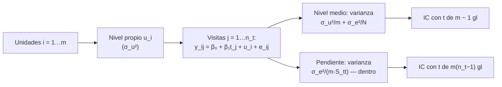

# B12-C25 — Modelos longitudinales y de efectos mixtos para muestras pequeñas

<!-- nav:top -->
[🏠 Programa](../../../../README.md) · [📚 Bloque B12](../../../tronco-comun/B12-probabilidad-estadistica-e-incertidumbre.md) · [← Anterior: B12-C24 — Métricas de habilidad (skill scores) de pronóstico](../B12-C24-metricas-de-habilidad-skill-scores-de-pronostico/CLASE.md) · [Siguiente: B12-C26 — Sesgos y potencia estadística en poblaciones pequeñas →](../B12-C26-sesgos-y-potencia-estadistica-en-poblaciones-pequenas/CLASE.md)
<!-- /nav -->

## 1. Ubicación, nivel y alcance

Clase programada del bloque B12 (ampliación `0.2.0`), pensada para quienes analizan medidas repetidas en muy pocas unidades (por ejemplo, un estudio fisiológico con una tripulación pequeña). Hasta [C24](../B12-C24-metricas-de-habilidad-skill-scores-de-pronostico/CLASE.md) tratabas las observaciones como independientes. Aquí, las mediciones de una misma unidad se parecen entre sí. Verás el modelo de **intercepto aleatorio**, la correlación intraclase, el efecto del agrupamiento sobre los errores típicos y los intervalos, y por qué con muestras pequeñas todo es más delicado. Nivel N4. No verás el ajuste general por REML con datos faltantes ni pendientes aleatorias.

## 2. Por qué esta clase existe

Seis personas medidas cuatro veces dan 24 números, pero no 24 piezas de información independientes: las de una misma persona se parecen. Ignorar eso produce intervalos demasiado angostos para el nivel medio y, paradójicamente, demasiado anchos para los cambios dentro de cada persona. Con muestras muy pequeñas, además, hay que reportar con cuidado y proteger la privacidad.

Pregunta motivadora: **¿cómo estimo el nivel medio y el cambio en el tiempo, con su incertidumbre, cuando tengo pocas unidades con medidas repetidas?** Decisión central: **qué modelo usar y qué intervalo es honesto con tan pocas unidades**.

## 3. Lo que podrás hacer al terminar

1. Escribir el modelo de intercepto aleatorio y nombrar sus componentes de varianza.
2. Estimar las varianzas dentro y entre unidades en un diseño balanceado y calcular el coeficiente de correlación intraclase (ICC).
3. Calcular el error típico correcto del nivel medio y de la pendiente, y compararlos con el ingenuo.
4. Construir el intervalo correcto con la `t` de `m − 1` grados de libertad.
5. Verificar por simulación la cobertura de los intervalos correcto e ingenuo.
6. Declarar los límites del enfoque con muestras pequeñas y proteger la privacidad.

La evidencia es el **informe longitudinal con muestra pequeña** del ejercicio 12 (sección 20).

## 4. Con qué llegas y cómo comprobarlo

Necesitas C04 (varianza de promedios), C05 (correlación), C08 (intervalo `t`) y C10 (regresión). Cinco preguntas:

1. ¿Cuál es la varianza del promedio de `n` variables independientes de varianza `σ²`?
2. ¿Cuál con correlación común `ρ`?
3. ¿Qué grados de libertad tiene un intervalo `t` para la media de `m` valores?
4. ¿Qué es la pendiente de una recta ajustada?
5. ¿Qué es un componente de varianza?

<details>
<summary>Ver respuestas</summary>

1. `σ²/n`. 2. `σ²[1 + (n−1)ρ]/n`. 3. `m − 1`. 4. El cambio de `y` por unidad de `t`. 5. La parte de la varianza total atribuible a una fuente.
</details>

Con cuatro o cinco aciertos, sigue; si no, repasa C05, C08 y C10.

## 5. Un caso: seis unidades, cuatro visitas

Seis unidades **sintéticas** (no hay datos de personas reales) se miden en cuatro visitas `t = 0, 1, 2, 3`. El modelo generador es `y_ij = 10 + 0,5 t_j + u_i + e_ij`, con diferencias estables entre unidades `u_i ~ N(0; 2²)` y ruido de medida `e_ij ~ N(0; 1²)`. ¿Qué incertidumbre tienen el nivel medio y el cambio por visita? Es el **ejemplo conductor**: se conocen los valores verdaderos porque los datos son simulados.

## 6. Vocabulario

Un **diseño longitudinal** mide las mismas unidades repetidamente. El **modelo de intercepto aleatorio** escribe `y_ij = β₀ + β₁ t_j + u_i + e_ij`: `β₀, β₁` son **efectos fijos** (comunes), `u_i` es el **efecto aleatorio** de la unidad `i` (su diferencia estable) y `e_ij` el error de medida. Las **varianzas** son `σ_u²` (entre unidades) y `σ_e²` (dentro). El **coeficiente de correlación intraclase** es `ICC = σ_u²/(σ_u² + σ_e²)`: la fracción de la varianza total que es estable por unidad. En un diseño **balanceado**, las medias cuadráticas `MSB` (entre) y `MSW` (dentro) estiman `σ_e² = MSW` y `σ_u² = (MSB − MSW)/n_t`, con `n_t` visitas por unidad. El **efecto del diseño** `1 + (n_t − 1) ICC` mide cuánto reduce la correlación el tamaño muestral efectivo. El GUM estima la esperanza con la media de observaciones y la desviación experimental con `n − 1` (S1, 4.2.1–4.2.2) y describe la `t` con `n − 1` grados de libertad (S1, G.3.2): aquí «observaciones independientes» son las **medias por unidad**.

## 7. Modelo mental: cada unidad es un bloque con su propio nivel

Cada unidad tiene un nivel propio estable; sus cuatro visitas oscilan alrededor de él con ruido. Para estimar el nivel de la población, el número de «piezas de información» es el de unidades, no el de mediciones. Para estimar el cambio en el tiempo, cada unidad sirve de su propio control: la diferencia entre sus visitas elimina su nivel propio.



*Descripción textual:* cada unidad tiene un nivel propio con varianza entre unidades; las visitas añaden ruido; la varianza del nivel medio depende sobre todo del número de unidades; la de la pendiente depende solo del ruido dentro de la unidad, porque la comparación entre visitas anula el nivel propio.

Analogía: un grupo de relojes de pulsera con desfase propio cada uno; para el desfase medio del grupo importa cuántos relojes hay, no cuántas veces los miras; para la velocidad a que se adelantan, basta comparar cada reloj consigo mismo. Su límite: si los relojes difieren también en velocidad, hace falta una pendiente aleatoria.

## 8. La explicación, paso a paso

### 8.1 Recuperar los componentes con muchas unidades

Con 4 000 unidades simuladas: `σ̂_e² = 0,996` (verdad `1`), `σ̂_u² = 3,937` (verdad `4`) e `ICC = 0,798` (verdad `0,800`). El estimador por análisis de varianza funciona con muchas unidades; con 6 es muy ruidoso: `σ̂_e² = 0,653`, `σ̂_u² = 3,609`, `ICC = 0,847`. Con pocas unidades, `σ_u²` queda mal determinada, y puede incluso salir negativa (se trunca a 0).

### 8.2 El error típico del nivel medio

El promedio global tiene varianza `σ_u²/m + σ_e²/N`, con `N = m n_t = 24`: `4/6 + 1/24 = 0,7083`, es decir `0,8416`; la simulación con 20 000 réplicas da `0,8411`. El cálculo ingenuo que ignora el agrupamiento usa `(σ_u² + σ_e²)/N = 5/24`, es decir `0,4564`: **casi la mitad**. La causa: las 24 observaciones valen mucho menos que 24 independientes (efecto del diseño `1 + 3 · 0,8 = 3,4`, tamaño efectivo `24/3,4 ≈ 7`).

### 8.3 El intervalo correcto

El intervalo correcto para el nivel medio trata las **medias por unidad** como la muestra y usa la `t` con `m − 1 = 5` grados de libertad (`t = 2,571`, S1, G.3.2). Su cobertura simulada es `0,9489`, cercana al 95 %. El intervalo ingenuo (con `t` de 23 grados y error típico `0,4564`) cubre solo `0,6999`: un «95 %» que en realidad es del 70 %. Con tan pocas unidades, además, el intervalo correcto es ancho: semiancho `2,571 · 0,8416 = 2,16` frente a `0,94` del ingenuo.

### 8.4 La pendiente: el caso inverso

La pendiente de las visitas se estima comparando visitas dentro de cada unidad, de modo que `u_i` se cancela: su varianza es `σ_e²/(m S_tt)`, con `S_tt = Σ(t − t̄)² = 5`: error típico `1/√30 = 0,1826` (simulado `0,1819`). El cálculo ingenuo usa `√(σ_u² + σ_e²) = 2,24`: error `0,4082`, **2,24 veces mayor**. Aquí ignorar el agrupamiento desperdicia potencia: el diseño longitudinal es mucho más sensible al cambio en el tiempo que al nivel medio.

### 8.5 Cuando la muestra es pequeña

Con 6 unidades: (i) `σ_u²` se estima mal; (ii) los intervalos usan pocos grados de libertad y son anchos; (iii) la normalidad de los efectos aleatorios no se puede comprobar; (iv) un solo sujeto atípico influye mucho. Se reporta el intervalo con la `t` apropiada, se evita la extrapolación y se declara la limitación. Con datos faltantes o diseños desbalanceados, estos estimadores por ANOVA dejan de valer y se necesita un modelo mixto completo (ajustado por REML), que no se desarrolla aquí.

### 8.6 Privacidad y reporte

Con un grupo pequeño, la identificación de las personas es fácil aun sin nombres: edad, rol y valores extremos pueden bastar. Para docencia se usan datos sintéticos; para investigación real, consentimiento, minimización de datos y revisión ética. El informe incluye el número de unidades y visitas, los componentes de varianza con su incertidumbre, el nivel medio y la pendiente con intervalos correctos, y los límites.

## 9. Magnitudes, símbolos y unidades

| Símbolo | Qué es | Unidad | Nota |
|---|---|---|---|
| `y_ij` | medición de la unidad `i`, visita `j` | unidad de la variable | |
| `β₀`, `β₁` | nivel y cambio por visita (efectos fijos) | unidad; unidad/visita | `10`; `0,5` |
| `u_i`, `e_ij` | efecto de la unidad y error | unidad | `N(0; 2²)`; `N(0; 1²)` |
| `σ_u²`, `σ_e²` | varianzas entre y dentro | unidad² | `4` y `1` |
| `ICC` | correlación intraclase | adimensional | `0,8` |
| `m`, `n_t`, `N` | unidades, visitas, total | adimensional | 6, 4, 24 |
| `S_tt` | `Σ(t − t̄)²` | visita² | 5 |

## 10. Convenciones y referencias

Diseño balanceado: todas las unidades con las mismas visitas. El tiempo `t` es el número de visita (0 a 3). Los efectos aleatorios se suponen normales e independientes del error. Los datos son sintéticos y las varianzas verdaderas se conocen solo por ser simulados. La semilla es 2525.

## 11. De dónde sale lo que afirmamos

| ID | Fuente | Localizador | Respalda | Consulta |
|---|---|---|---|---|
| S1 | JCGM 100:2008 (GUM) | https://doi.org/10.59161/JCGM100-2008E | Media aritmética (4.2.1), desviación experimental con `n − 1` (4.2.2) y distribución `t` con `n − 1` grados de libertad (G.3.2) | 2026-11-05, PDF abierto y texto extraído |

Límites: no se consultó una fuente específica de modelos mixtos; las fórmulas de ANOVA para componentes de varianza, el efecto del diseño y las varianzas del nivel y de la pendiente son resultados estándar que aquí se verifican por simulación; los datos son **sintéticos** y no representan a ninguna persona.

## 12. Cómo ver el agrupamiento

Equivalente accesible a un gráfico de «espagueti» (una línea por unidad), resumido:

| Cantidad | Verdadero | Ingenuo | Simulado |
|---|---|---|---|
| Error típico del nivel medio | 0,8416 | 0,4564 | 0,8411 |
| Error típico de la pendiente | 0,1826 | 0,4082 | 0,1819 |
| Cobertura del IC 95 % del nivel medio | 0,9489 | 0,6999 | — |

Descripción larga: seis líneas casi paralelas con pendiente cercana a 0,5 por visita, separadas verticalmente por varios puntos (niveles propios de cada unidad); la dispersión vertical entre líneas es mucho mayor que el ruido dentro de cada una.

## 13. Ejemplo trabajado: nivel medio y cambio de una cohorte de seis

**Paso 1 · Modelo.** Intercepto aleatorio, balanceado.

**Paso 2 · Componentes.** `σ̂_e² = 0,653`, `σ̂_u² = 3,609`, `ICC = 0,847`.

**Paso 3 · Nivel medio.** Error típico `√(σ_u²/m + σ_e²/N)` con valores verdaderos: `0,84`; intervalo con `t(0,975; 5) = 2,571`.

**Paso 4 · Pendiente.** Error típico `0,183` por visita; semiancho con `t` de `m(n_t − 1) = 18` grados de libertad (`2,101`): `0,38`.

**Paso 5 · Contraste con el ingenuo.** Nivel: ingenuo `0,46` (cobertura 70 %). Pendiente: ingenuo `0,41`.

**Paso 6 · Reporte.** Nivel medio con intervalo `t(5)`, pendiente con su intervalo, `ICC` con su incertidumbre amplia, y la advertencia de muestra pequeña.

**Paso 7 · Sentido.** Datos **sintéticos**; con personas reales haría falta revisión ética y de privacidad.

## 14. Comparación de métodos

La **regresión ordinaria ingenua** ignora el agrupamiento: subestima el error del nivel y sobrestima el de los cambios dentro de unidad. El **análisis de medias por unidad** (resumir cada unidad y analizar los resúmenes) es simple y robusto con muestras pequeñas. El **modelo mixto** (REML) maneja datos desbalanceados y faltantes, con más supuestos. Los **modelos con pendientes aleatorias** permiten que cada unidad tenga su propia velocidad. Con 6 unidades, ninguno rescata información que no existe: el intervalo se ensancha con honestidad.

## 15. Práctica guiada

**Ejercicio 1 · con los pasos indicados.** Calcula el `ICC` con `σ_u² = 4` y `σ_e² = 1`. *Pasos:* `σ_u²/(σ_u² + σ_e²)`.

<details><summary>Solución comentada</summary>

`4/5 = 0,8`.
</details>

**Ejercicio 2 · con una pista.** Calcula el error típico del nivel medio con `m = 6`, `n_t = 4`. *Pista:* `σ_u²/m + σ_e²/N`.

<details><summary>Solución comentada</summary>

`4/6 + 1/24 = 0,7083`; raíz `0,8416`.
</details>

**Ejercicio 3 · casi autónomo.** Calcula el error ingenuo y el cociente respecto del correcto.

<details><summary>Solución comentada</summary>

`√(5/24) = 0,4564`; `0,8416/0,4564 = 1,84`.
</details>

## 16. Práctica autónoma, transferencia e integrador

**Ejercicio 4.** Calcula el efecto del diseño y el tamaño muestral efectivo con `ICC = 0,8`, `n_t = 4`, `N = 24`.

<details><summary>Solución comentada</summary>

`1 + 3·0,8 = 3,4`; `24/3,4 = 7,06`. Las 24 mediciones valen como ~7 independientes.
</details>

**Ejercicio 5.** Calcula el error típico de la pendiente con `σ_e = 1`, `m = 6`, `S_tt = 5`.

<details><summary>Solución comentada</summary>

`1/√(6·5) = 0,1826`.
</details>

**Ejercicio 6.** ¿Por qué el cálculo ingenuo sobrestima el error de la pendiente?

<details><summary>Solución comentada</summary>

Porque mezcla la varianza entre unidades en el error de un cambio que se estima comparando cada unidad consigo misma, donde esa varianza se cancela.
</details>

**Ejercicio 7.** Calcula los semianchos del IC 95 % del nivel medio correcto y del ingenuo.

<details><summary>Solución comentada</summary>

Correcto: `2,571·0,8416 = 2,16`. Ingenuo: `t(0,975; 23) = 2,069`; `2,069·0,4564 = 0,94`.
</details>

**Ejercicio 8.** Con `MSB = 17` y `MSW = 1` (`n_t = 4`), estima `σ_u²` y el `ICC`.

<details><summary>Solución comentada</summary>

`σ̂_u² = (17 − 1)/4 = 4`; `ICC = 4/5 = 0,8`.
</details>

**Ejercicio 9 · transferencia.** Con 6 unidades obtienes `MSB < MSW` y, por tanto, `σ̂_u² < 0`. ¿Qué haces?

<details><summary>Solución comentada</summary>

Se trunca a 0 (ICC 0) pero se avisa: con tan pocas unidades, la estimación es muy incierta y un valor nulo no prueba que no haya diferencias entre unidades. El análisis de medias por unidad sigue siendo válido.
</details>

**Ejercicio 10 · transferencia.** Algunas unidades faltan a la visita 3. ¿Siguen valiendo estas fórmulas?

<details><summary>Solución comentada</summary>

No: el diseño ya no es balanceado. Se usa un modelo mixto ajustado por máxima verosimilitud restringida, que usa todos los datos disponibles bajo supuestos (datos faltantes al azar), o se reporta el análisis completo-caso con su límite.
</details>

**Ejercicio 11 · transferencia.** Un estudio con 6 miembros de una tripulación quiere publicar los valores individuales. ¿Qué cuidados?

<details><summary>Solución comentada</summary>

Consentimiento informado específico para la publicación, minimización (publicar solo agregados o datos desidentificados), evaluación del riesgo de reidentificación con grupos tan pequeños, revisión ética y acuerdo de uso de datos. Para docencia, usar datos sintéticos.
</details>

**Ejercicio 12 · integrador.** Elabora tu *informe longitudinal con muestra pequeña*: simula `m = 6` unidades con `n_t = 4` visitas, estima los componentes de varianza, calcula el error típico del nivel medio y de la pendiente (correcto e ingenuo), construye los intervalos y verifica por simulación (≥ 5 000 réplicas) la cobertura de ambos.

<details><summary>Solución modelo</summary>

Debe incluir: modelo y supuestos; estimación de `σ_e²`, `σ_u²`, `ICC` con su incertidumbre; errores típicos de nivel y pendiente; intervalos con `t(m − 1)` y `t(m(n_t − 1))`; cobertura simulada (correcta ≈ 0,95, ingenua mucho menor para el nivel); advertencias de muestra pequeña y privacidad; datos sintéticos; semilla y versiones.
</details>

## 17. Laboratorio: agrupamiento, errores típicos y cobertura

El script [intercepto_aleatorio.py](intercepto_aleatorio.py) simula el diseño, estima los componentes de varianza por ANOVA, compara los errores típicos correcto e ingenuo con la simulación y mide la cobertura de los intervalos; falla si con 4 000 unidades los componentes se apartan más de 5 % de lo verdadero, si el error típico simulado difiere más de 3 % del teórico, si la cobertura correcta sale de `[0,94; 0,96]` o si la ingenua supera 0,85.

**Datos:** sintéticos. **Predice antes de ejecutar:** ¿qué cobertura tendrá el intervalo ingenuo? (muy inferior al 95 %.) **Ejecución del 2026-11-06 (Python 3.12.9, NumPy 2.4.4, SciPy 1.17.1):**

```text
m = 4000: sigma_e^2 = 0.996 (verdad 1); sigma_u^2 = 3.937 (verdad 4); ICC = 0.798 (verdad 0.800)
m = 6: sigma_e^2 = 0.653; sigma_u^2 = 3.609; ICC = 0.847
error tipico del nivel medio: verdadero = 0.8416; ingenuo (ignora agrupamiento) = 0.4564
simulado = 0.8411
cobertura del IC 95 % del nivel medio: correcto (t con 5 gl sobre medias por unidad) = 0.9489; ingenuo = 0.6999
error tipico de la pendiente: verdadero = 0.1826; ingenuo = 0.4082 (el ingenuo es 2.24 veces mayor)
simulado = 0.1819
Pruebas superadas.
```

```bash
python programa/clases/B12/B12-C25-modelos-longitudinales-y-de-efectos-mixtos-para-muestras-pequenas/intercepto_aleatorio.py
```

**Límites:** diseño balanceado, intercepto aleatorio, normalidad; resultados **simulados**.

## 18. Errores frecuentes y cómo corregirlos

**Tratar todas las mediciones como independientes.** Se corrige con 8.2–8.3 y el ejercicio 4.

**Usar los grados de libertad del total de mediciones.** Se corrige con 8.3 y el ejercicio 7.

**Interpretar un `σ̂_u²` nulo como ausencia de diferencias.** Se corrige con el ejercicio 9.

**Aplicar las fórmulas con datos desbalanceados.** Se corrige con el ejercicio 10.

**Ignorar la privacidad en grupos pequeños.** Se corrige con 8.6 y el ejercicio 11.

## 19. Cómo sabrás que vas bien

Tras 8.2: ¿calculas el error típico correcto del nivel medio? Si no, ejercicio 2. Tras 8.4: ¿explicas por qué la pendiente va al revés? Si no, ejercicio 6. Tras 8.6: ¿qué cuidados de privacidad aplicas? Si dudas, ejercicio 11.

## 20. Qué entregas y cómo se evalúa

El producto es tu **informe longitudinal con muestra pequeña** (ejercicio 12).

| Criterio | Inicial | En desarrollo | Logrado | Destacado |
|---|---|---|---|---|
| Modelo y supuestos | Independencia implícita | Menciona agrupamiento | Intercepto aleatorio declarado | Discute extensiones |
| Componentes | No los estima | Los estima sin interpretar | Estima e interpreta ICC | Con incertidumbre |
| Intervalos | Ingenuos | Correctos sin verificar | Correctos con cobertura simulada | Para nivel y pendiente |
| Muestra pequeña | No la discute | La menciona | Declara límites | Propone alternativas |
| Privacidad y rótulo | Ausentes | Parcial | Sintético y privacidad declarados | Plan ético completo |

**Condiciones críticas (no se compensan con promedio):** no tratar las medidas repetidas como independientes; usar los grados de libertad adecuados; proteger la privacidad; rotular datos sintéticos.

## 21. Ética, seguridad y límites

Los datos de personas en grupos pequeños (como una tripulación) son especialmente sensibles: aun sin nombres, pueden ser reidentificables. Esta clase usa solo datos sintéticos y no ofrece orientación clínica ni médica; las decisiones de salud corresponden a profesionales competentes. Accesibilidad: el gráfico se ofrece como tabla; todo funciona sin conexión.

## 22. Para cerrar y seguir

Las medidas repetidas de una misma unidad se parecen, de modo que el tamaño de muestra relevante para el nivel medio es el de unidades; el cambio en el tiempo se estima dentro de cada unidad y puede ser mucho más preciso; los intervalos correctos usan los grados de libertad de las unidades; con pocas unidades todo es incierto y hay que cuidar la privacidad. Queda abierta una pregunta: ¿qué probabilidad hay de detectar un efecto real con tan pocas unidades, y qué ocurre con los efectos que sí se detectan? Es el tema de los sesgos y la potencia en poblaciones pequeñas (C26).

**Glosario español–inglés.** modelo longitudinal · *longitudinal model*; efecto aleatorio · *random effect*; efecto fijo · *fixed effect*; correlación intraclase · *intraclass correlation (ICC)*; componente de varianza · *variance component*; efecto del diseño · *design effect*; medidas repetidas · *repeated measures*.

**Continuidad.** B12-C26 reutiliza tu capacidad de **estimar con pocas unidades y declarar la incertidumbre** para calcular potencia y sesgos de significancia.

**Referencias:** ver sección 11.

<!-- nav:bottom -->
---

[← Anterior: B12-C24 — Métricas de habilidad (skill scores) de pronóstico](../B12-C24-metricas-de-habilidad-skill-scores-de-pronostico/CLASE.md) · [📚 Bloque B12](../../../tronco-comun/B12-probabilidad-estadistica-e-incertidumbre.md) · [Siguiente: B12-C26 — Sesgos y potencia estadística en poblaciones pequeñas →](../B12-C26-sesgos-y-potencia-estadistica-en-poblaciones-pequenas/CLASE.md)
<!-- /nav -->
