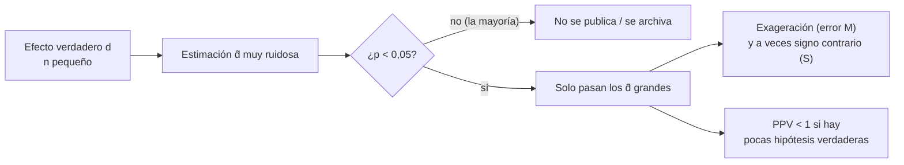

# B12-C26 — Sesgos y potencia estadística en poblaciones pequeñas

<!-- nav:top -->
[🏠 Programa](../../../../README.md) · [📚 Bloque B12](../../../tronco-comun/B12-probabilidad-estadistica-e-incertidumbre.md) · [← Anterior: B12-C25 — Modelos longitudinales y de efectos mixtos para muestras pequeñas](../B12-C25-modelos-longitudinales-y-de-efectos-mixtos-para-muestras-pequenas/CLASE.md) · [Siguiente: B13-C01 — Sistema Internacional y constantes →](../../B13/B13-C01-sistema-internacional-y-constantes/CLASE.md)
<!-- /nav -->

## 1. Ubicación, nivel y alcance

Última clase programada del bloque B12 (ampliación `0.2.0`). En [C09](../B12-C09-pruebas-de-hipotesis/CLASE.md) definiste la potencia y el error tipo I; en [C25](../B12-C25-modelos-longitudinales-y-de-efectos-mixtos-para-muestras-pequenas/CLASE.md) viste lo frágil que es la estimación con pocas unidades. Aquí juntas ambas ideas: **qué se puede detectar con una población pequeña, cuánto exagera el efecto lo que sí se detecta y cuán creíbles son los resultados «significativos»**. Nivel N4. No verás metaanálisis ni diseño secuencial.

## 2. Por qué esta clase existe

En medicina espacial, en estudios con tripulaciones o en misiones con pocas unidades, los tamaños de muestra son pequeños por necesidad. Con ellos, la mayoría de los efectos reales no se detectan, y los que se detectan suelen estar inflados. Si solo se publican los resultados significativos, la literatura se llena de efectos exagerados e incluso de signo contrario.

Pregunta motivadora: **¿qué probabilidad tengo de detectar un efecto real con seis unidades por grupo, y cuánto me puedo fiar de un resultado "significativo"?** Decisión central: **si el estudio es informativo antes de hacerlo, y cómo reportar sus resultados con honestidad**.

## 3. Lo que podrás hacer al terminar

1. Calcular la potencia exacta de una prueba `t` de dos muestras con la `t` no central.
2. Estimar el tamaño de muestra para una potencia dada y compararlo con la fórmula normal.
3. Medir por simulación el sesgo de exageración y el error de signo entre los resultados significativos.
4. Calcular el valor predictivo positivo de un resultado significativo.
5. Evaluar si un estudio pequeño es informativo antes de hacerlo.
6. Redactar un reporte que incluya intervalos y potencia, y no solo el valor `p`.

La evidencia es el **informe de potencia y sesgo** del ejercicio 12 (sección 20).

## 4. Con qué llegas y cómo comprobarlo

Necesitas C08 (intervalos, `t`), C09 (hipótesis, potencia, error tipo I) y C14 (simulación). Cinco preguntas:

1. ¿Qué es la potencia?
2. ¿Qué es el efecto estandarizado `d`?
3. ¿Qué es el error tipo I?
4. ¿Cómo cambia la potencia al aumentar `n`?
5. ¿Qué es un valor `p`?

<details>
<summary>Ver respuestas</summary>

1. La probabilidad de rechazar `H₀` cuando el efecto es real. 2. La diferencia de medias dividida por la desviación típica. 3. Rechazar `H₀` cuando es cierta. 4. Aumenta. 5. La probabilidad, bajo `H₀`, de un resultado al menos tan extremo como el observado.
</details>

Con cuatro o cinco aciertos, sigue; si no, repasa C08 y C09.

## 5. Un caso: comparar dos grupos pequeños

Se compara una variable entre dos grupos de `n` unidades **sintéticas** cada uno, con un efecto estandarizado verdadero `d` (diferencia de medias dividida por la desviación típica). Con `d = 0,8` (un efecto «grande») y `n = 6`, ¿qué potencia hay? ¿Y si el efecto real es modesto, `d = 0,3`, con `n = 10`? Es el **ejemplo conductor**; los datos son **sintéticos** y no corresponden a persona alguna.

## 6. Vocabulario

La **potencia** de una prueba bilateral al nivel `α` es la probabilidad de rechazar `H₀` cuando el efecto verdadero es `d`. Para la prueba `t` de dos muestras con `n` por grupo, el estadístico bajo la alternativa sigue una **`t` no central** con `2n − 2` grados de libertad y parámetro de no centralidad `d√(n/2)`. El NIST escribe, para una prueba de una muestra con `σ` conocida, el tamaño necesario `N = (z_{1−α/2} + z_{1−β})² (σ/δ)²`, e indica iterar con la `t` cuando `σ` se estima (S1). El **filtro de significancia** es la selección de los resultados con `p < α`: entre ellos, el efecto estimado está sesgado hacia valores grandes. El **error tipo M** (magnitud) es la razón entre el efecto estimado medio entre los significativos y el verdadero (exageración); el **error tipo S** (signo) es la probabilidad de que un resultado significativo tenga signo contrario al efecto verdadero. El **valor predictivo positivo** (PPV) es la fracción de resultados significativos que corresponden a efectos reales: `PPV = potencia·π/(potencia·π + α(1 − π))`, con `π` la proporción previa de hipótesis verdaderas.

## 7. Modelo mental: la red con agujeros grandes

Una prueba con baja potencia es una red con agujeros grandes: casi todo se escapa, y lo único que queda atrapado son los peces más grandes (los efectos más exagerados por el azar). Lo atrapado no representa lo que había en el agua.



*Descripción textual:* con un efecto verdadero y pocos datos, la estimación es muy ruidosa; solo las estimaciones grandes cruzan el umbral de significancia, así que los resultados significativos exageran el efecto y a veces tienen signo contrario; además, si pocas hipótesis son verdaderas, buena parte de los significativos son falsos positivos.

Analogía: una encuesta con muy pocas respuestas que solo se publica si "sorprende". Su límite: la analogía ignora que el problema se corrige con diseño (más datos, comparaciones intra-unidad, registro previo), no solo con cautela.

## 8. La explicación, paso a paso

### 8.1 Potencia exacta

Con `α = 0,05` bilateral, la potencia exacta por la `t` no central y la simulada (100 000 réplicas) son:

| `d` | `n` por grupo | Potencia exacta | Simulada |
|---|---|---|---|
| 0,8 | 6 | 0,2410 | 0,2414 |
| 0,8 | 26 | 0,8075 | 0,8098 |
| 0,5 | 20 | 0,3379 | 0,3390 |
| 0,2 | 10 | 0,0708 | 0,0702 |

Con `d = 0,8` y `n = 6`, la probabilidad de detectar un efecto «grande» es de solo el 24 %. Con `d = 0,2` y `n = 10`, ocurre casi al nivel del error tipo I (7 % frente a 5 %).

### 8.2 Tamaño de muestra

Para potencia 0,80 con `d = 0,8` se necesitan `n = 26` por grupo (potencia `0,8075`; con 25 por grupo es `0,7915`, menor que 0,80). La fórmula normal `n = 2((z_{1−α/2} + z_{1−β})/d)² = 2(2,8016/0,8)² = 24,5` lleva a 25, un poco menos: la `t` exige algo más (misma idea que el ajuste iterativo de S1). La dependencia es cuadrática: si `d` se reduce a la mitad, `n` se cuadruplica.

### 8.3 El filtro de significancia

Con `d = 0,3` y `n = 10` por grupo: potencia `0,098`. Entre los resultados significativos, el efecto estimado medio es `|d̂| = 1,194`, es decir **3,98 veces** el verdadero (error tipo M). Además, `4,9 %` de los significativos tiene el signo contrario (error tipo S). Quien solo mira los significativos concluiría un efecto de «grande» cuando es modesto.

### 8.4 Valor predictivo positivo

Si solo el 10 % de las hipótesis que se prueban son verdaderas (`π = 0,10`) y la potencia es `0,338` (`d = 0,5`, `n = 20`), el PPV es `0,338·0,10/(0,338·0,10 + 0,05·0,90) = 0,4289`; la simulación da `0,4297`. Menos de la mitad de los resultados significativos corresponden a efectos reales. Con potencia `0,8` y `π = 0,5`, el PPV sería `0,941`; con `π = 0,01`, `0,139`. La credibilidad de un «significativo» depende de la potencia y de la plausibilidad previa.

### 8.5 Qué hacer con una población pequeña

(i) Calcular la potencia **antes**; si es muy baja, el estudio es poco informativo y hay que replantear. (ii) Mejorar el diseño: comparaciones dentro de la unidad (C25), medidas repetidas, mejores instrumentos. (iii) Reportar la estimación con su **intervalo** y no solo el valor `p`; un intervalo ancho es la manera honesta de mostrar que no se sabe. (iv) Registrar el análisis antes de ver los datos y publicar los resultados nulos. (v) Combinar estudios cuando sea posible. (vi) Distinguir lo confirmatorio de lo exploratorio.

### 8.6 Responsabilidad con poblaciones pequeñas

Un grupo pequeño suele ser una tripulación, un grupo clínico o una flota de pocos satélites; los resultados pueden afectar decisiones de seguridad. Presentar una exageración como un hallazgo firme es dañino. Los datos de personas requieren consentimiento y protección (C25). Las decisiones médicas competen a profesionales; esta clase solo enseña a razonar sobre la evidencia.

## 9. Magnitudes, símbolos y unidades

| Símbolo | Qué es | Unidad | Nota |
|---|---|---|---|
| `d` | efecto estandarizado | adimensional | 0,2 a 0,8 |
| `n` | unidades por grupo | adimensional | 6 a 26 |
| `α` | nivel de significación | adimensional | 0,05 |
| `1 − β` | potencia | adimensional | `0,2410` (n=6, d=0,8) |
| `d̂` | efecto estimado | adimensional | |
| Exageración | `E[|d̂| | significativo]/d` | adimensional | `3,98` |
| `π` | proporción previa de hipótesis verdaderas | adimensional | `0,10` |
| `PPV` | valor predictivo positivo | adimensional | `0,4289` |

## 10. Convenciones y referencias

Prueba bilateral, varianzas iguales, normalidad. La potencia exacta se calcula con SciPy (`nct`) y se contrasta con simulación de 100 000 réplicas por fila. El efecto verdadero es fijo. La semilla es 2626.

## 11. De dónde sale lo que afirmamos

| ID | Fuente | Localizador | Respalda | Consulta |
|---|---|---|---|---|
| S1 | NIST/SEMATECH, *e-Handbook of Statistical Methods*, §7.2.2.2 «Sample sizes required» | https://www.itl.nist.gov/div898/handbook/prc/section2/prc222.htm | Fórmula `N = (z + z)² (σ/δ)²` para una prueba de una muestra con `σ` conocida e iteración con la `t` si `σ` se estima | 2026-11-05, página abierta |

Límites: la potencia por la `t` no central, el filtro de significancia (errores M y S) y el PPV son resultados estándar no atribuidos a una fuente consultada; S1 trata una prueba de una muestra y aquí se usa su estructura de fórmula para dos muestras; los datos son **sintéticos**.

## 12. Cómo ver la potencia

Equivalente accesible a la curva de potencia (`d = 0,8`, valores exactos):

| `n` por grupo | 6 | 10 | 15 | 20 | 25 | 26 |
|---|---|---|---|---|---|---|
| Potencia | 0,2410 | 0,3951 | 0,5618 | 0,6934 | 0,7915 | 0,8075 |

Descripción larga: la curva sube desde 0,24 con 6 por grupo hasta 0,81 con 26 (la potencia de 25 por grupo es 0,79, aún bajo 0,80), con pendiente decreciente; con efectos más pequeños la curva se desplaza a la derecha y se vuelve más baja (para `d = 0,2`, `n = 10`: 0,07).

## 13. Ejemplo trabajado: ¿vale la pena el estudio con 6 por grupo?

**Paso 1 · Pregunta.** Detectar `d = 0,8` entre dos grupos de 6.

**Paso 2 · Potencia.** `0,2410`: 76 % de probabilidad de no detectarlo.

**Paso 3 · Tamaño necesario.** `n = 26` por grupo para `0,80`.

**Paso 4 · Consecuencia del filtro.** Si el efecto verdadero fuera `d = 0,3` y se hiciera el estudio con `n = 10`, solo 1 de cada 10 saldría significativo y con una exageración del 4×.

**Paso 5 · Alternativas.** Diseño intra-unidad (C25), más unidades por colaboración, o reportar solo estimación con intervalo y declarar exploratorio.

**Paso 6 · Decisión.** No se hace un estudio confirmatorio con 6 por grupo; se rediseña.

**Paso 7 · Sentido.** Datos **sintéticos**; una decisión real requiere conocer el tamaño de efecto plausible y el costo de equivocarse.

## 14. Comparación de métodos

La **prueba `t` y el valor `p`** son lo habitual, pero con muestras pequeñas dan poco. La **estimación con intervalo** comunica mejor lo que se sabe. Los **diseños intra-unidad** reducen la varianza. Los **análisis bayesianos** (C12) permiten incorporar información previa y reducir la exageración mediante priors realistas. La **replicación y los metaanálisis** acumulan evidencia. Un estudio pequeño es útil como piloto exploratorio, no como prueba confirmatoria.

## 15. Práctica guiada

**Ejercicio 1 · con los pasos indicados.** Estima por la aproximación normal la potencia con `d = 0,8`, `n = 26`. *Pasos:* no centralidad `d√(n/2)`, `Φ(nc − 1,96)`.

<details><summary>Solución comentada</summary>

`nc = 0,8·√13 = 2,884`; `Φ(0,924) = 0,822` (la `t` exacta da `0,8075`).
</details>

**Ejercicio 2 · con una pista.** Con la fórmula de S1, `δ/σ = 1`, `α = 0,05` bilateral, `β = 0,10`, calcula `N`. *Pista:* `z₀,₉₇₅ = 1,96`, `z₀,₉₀ = 1,2816`.

<details><summary>Solución comentada</summary>

`N = (1,96 + 1,2816)² · 1 = 10,5`; se redondea a 11 (con la `t` hay que iterar).
</details>

**Ejercicio 3 · casi autónomo.** Calcula `n` por grupo para potencia 0,80 con `d = 0,8` por la aproximación normal de dos muestras.

<details><summary>Solución comentada</summary>

`2(2,8016/0,8)² = 24,5 → 25`; exacto con la `t`: 26.
</details>

## 16. Práctica autónoma, transferencia e integrador

**Ejercicio 4.** Calcula el PPV con `π = 0,5`, potencia `0,8`, `α = 0,05`.

<details><summary>Solución comentada</summary>

`0,4/(0,4 + 0,025) = 0,941`.
</details>

**Ejercicio 5.** Calcula el PPV con `π = 0,01`, potencia `0,8`.

<details><summary>Solución comentada</summary>

`0,008/(0,008 + 0,0495) = 0,139`: ocho de cada nueve significativos serían falsos.
</details>

**Ejercicio 6.** Interpreta la «exageración 3,98».

<details><summary>Solución comentada</summary>

Entre los resultados significativos, el efecto estimado medio es casi cuatro veces el verdadero. Es un sesgo de selección: solo cruzan el umbral las estimaciones grandes.
</details>

**Ejercicio 7.** ¿Qué indica un error de signo del 4,9 %?

<details><summary>Solución comentada</summary>

Que uno de cada 20 resultados significativos señala la dirección contraria al efecto real. Con poca potencia, un resultado significativo puede ser un error de signo.
</details>

**Ejercicio 8.** Si `d` se reduce a la mitad, ¿cómo cambia `n` para igual potencia?

<details><summary>Solución comentada</summary>

`n ∝ 1/d²`: se cuadruplica aproximadamente (de 26 a 100 por grupo para `d = 0,4`, con potencia exacta `0,8036`).
</details>

**Ejercicio 9 · transferencia.** Un estudio con 6 miembros de tripulación quiere detectar un cambio con medidas repetidas. ¿Cómo aumentarías la potencia sin más personas?

<details><summary>Solución comentada</summary>

Usar comparaciones intra-persona (cada una es su control), más mediciones por persona, instrumentos más precisos y un análisis de medidas repetidas (C25); el error del cambio dentro de cada persona es mucho menor que el entre personas.
</details>

**Ejercicio 10 · transferencia.** Obtuviste `p = 0,03` con `n = 8` por grupo. ¿Cómo lo reportarías?

<details><summary>Solución comentada</summary>

Con la estimación del efecto y su intervalo (que será amplio), la potencia estimada para efectos plausibles, la advertencia de exageración probable y el carácter exploratorio. Sin afirmar un efecto de ese tamaño.
</details>

**Ejercicio 11 · transferencia.** Un comité propone «publicar solo los resultados significativos». ¿Qué le dices?

<details><summary>Solución comentada</summary>

Que ese filtro produce la exageración y los errores de signo de 8.3 y baja el PPV; propone registro previo, publicar resultados nulos y reportar intervalos y potencia.
</details>

**Ejercicio 12 · integrador.** Elabora tu *informe de potencia y sesgo*: calcula la potencia exacta para tres `(d, n)`, verifícala por simulación, halla el `n` para potencia 0,80, mide la exageración y el error de signo entre significativos para un efecto pequeño, calcula el PPV con dos valores de `π` y concluye si el estudio es informativo.

<details><summary>Solución modelo</summary>

Tabla de potencias exactas y simuladas; `n` necesario; exageración y error de signo simulados; PPV para dos `π`; conclusión sobre qué diseño y qué reporte (con intervalo, registro previo, intra-unidad); límites (normalidad, efecto fijo); datos sintéticos; semilla y versiones.
</details>

## 17. Laboratorio: potencia, exageración y PPV

El script [potencia_sesgo.py](potencia_sesgo.py) calcula la potencia exacta con la `t` no central, la compara con simulación, halla el `n` para potencia 0,80, mide la exageración y el error de signo entre los significativos y verifica el PPV; falla si la potencia exacta y la simulada difieren más de 0,01, si `n` no sale 26, si la exageración no supera 2 o si el PPV difiere más de 0,01.

**Datos:** sintéticos. **Predice antes de ejecutar:** ¿qué potencia tendrá `d = 0,8` con `n = 6`? (menos de 0,3.) **Ejecución del 2026-11-06 (Python 3.12.9, NumPy 2.4.4, SciPy 1.17.1):**

```text
   d    n/grupo  potencia exacta  potencia simulada
 0.8       6      0.2410           0.2414
 0.8      26      0.8075           0.8098
 0.5      20      0.3379           0.3390
 0.2      10      0.0708           0.0702
n por grupo para potencia >= 0.80 con d = 0.8: 26 (potencia 0.8075)
d verdadero = 0.3, n = 10: potencia = 0.098; media de |d_hat| entre significativos = 1.194 (exageracion x3.98); signo equivocado entre significativos = 0.049
PPV con pi = 0.1, potencia = 0.338: exacto = 0.4289; simulado = 0.4297
Pruebas superadas.
```

```bash
python programa/clases/B12/B12-C26-sesgos-y-potencia-estadistica-en-poblaciones-pequenas/potencia_sesgo.py
```

**Límites:** normalidad, varianzas iguales, efecto fijo; resultados **simulados**.

## 18. Errores frecuentes y cómo corregirlos

**Interpretar un resultado no significativo como ausencia de efecto.** Se corrige con 8.1 y el ejercicio 10.

**Tomar el efecto estimado de un resultado significativo como el efecto real.** Se corrige con 8.3 y el ejercicio 6.

**Ignorar la plausibilidad previa.** Se corrige con 8.4 y los ejercicios 4–5.

**Calcular la potencia después de ver los datos.** Se corrige con 8.5.

**Publicar solo lo significativo.** Se corrige con el ejercicio 11.

## 19. Cómo sabrás que vas bien

Tras 8.1: ¿predices que la potencia con 6 por grupo es baja? Si no, ejercicio 1. Tras 8.3: ¿explicas por qué el efecto "significativo" exagera? Si no, ejercicio 6. Tras 8.4: ¿calculas un PPV? Si no, ejercicios 4–5.

## 20. Qué entregas y cómo se evalúa

El producto es tu **informe de potencia y sesgo** (ejercicio 12).

| Criterio | Inicial | En desarrollo | Logrado | Destacado |
|---|---|---|---|---|
| Potencia | No la calcula | Aproximada | Exacta y simulada | Con curva y tamaño |
| Sesgo de significancia | Ausente | Descrito | Cuantificado (M y S) | Con efecto del PPV |
| PPV | Ausente | Fórmula | Calculado para dos `π` | Interpretado |
| Recomendación | Ninguna | Cualitativa | Diseño y reporte concretos | Con alternativas |
| Fuentes y rótulo | Ausente | Parcial | Sintético y fechado | Declara límites |

**Condiciones críticas (no se compensan con promedio):** calcular la potencia antes de concluir; reportar intervalos; rotular datos sintéticos; no presentar un efecto exagerado como firme.

## 21. Ética, seguridad y límites

Concluir con firmeza a partir de pocas unidades puede afectar decisiones de seguridad y de salud. Los datos de esta clase son sintéticos y nada aquí es orientación clínica. Las decisiones de salud de tripulaciones corresponden a profesionales competentes con consentimiento informado. Accesibilidad: las curvas se ofrecen como tabla; todo funciona sin conexión.

## 22. Para cerrar y seguir

Con poblaciones pequeñas la potencia es baja; los resultados significativos exageran el efecto y a veces tienen signo contrario; el PPV depende de la plausibilidad previa; se mejora con diseño intra-unidad, intervalos, registro previo y publicación de resultados nulos. Con esta clase se cierra el bloque B12: los conceptos de probabilidad, estimación, inferencia, simulación y presentación de la incertidumbre son los que usan los bloques posteriores del programa.

**Glosario español–inglés.** potencia · *power*; efecto estandarizado · *standardized effect size*; `t` no central · *noncentral t*; filtro de significancia · *significance filter*; error tipo M / S · *Type M / Type S error*; valor predictivo positivo · *positive predictive value*; registro previo · *preregistration*.

**Continuidad.** Esta clase cierra el bloque B12; los bloques siguientes de A02 (B13 en adelante) reutilizan tu capacidad de **informar la incertidumbre y el diseño de estudios** en sus propios métodos.

**Referencias:** ver sección 11.

<!-- nav:bottom -->
---

[← Anterior: B12-C25 — Modelos longitudinales y de efectos mixtos para muestras pequeñas](../B12-C25-modelos-longitudinales-y-de-efectos-mixtos-para-muestras-pequenas/CLASE.md) · [📚 Bloque B12](../../../tronco-comun/B12-probabilidad-estadistica-e-incertidumbre.md) · [Siguiente: B13-C01 — Sistema Internacional y constantes →](../../B13/B13-C01-sistema-internacional-y-constantes/CLASE.md)
<!-- /nav -->
