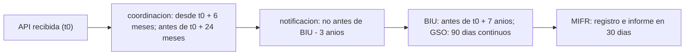

# B120-C01 — Licencias satelitales y procedimiento de notificación

<!-- nav:top -->
[🏠 Programa](../../../../README.md) · [📚 Bloque B120](../../../tronco-comun/B120-espectro-licencias-y-regulacion-satelital.md) · [← Anterior: B119-C36 — Gobernanza de los recursos espaciales](../../../tronco-comun/B119-derecho-seguridad-y-geopolitica-espacial.md#b119-c36) · [Siguiente: B120-C02 — Zonas de coordinación entre servicios radioeléctricos →](../B120-C02-zonas-de-coordinacion-entre-servicios-radioelectricos/CLASE.md)
<!-- /nav -->

## 1. Ubicación, nivel y alcance

Clase 1 del bloque B120. Nivel N4. Poner en servicio un satélite exige que la administración responsable publique, coordine, notifique y registre sus frecuencias ante la Unión Internacional de Telecomunicaciones (UIT), y que lo haga dentro de plazos. Aquí traduces esos plazos a una línea de tiempo calculable y comprobable. Usas [B119](../../../tronco-comun/B119-derecho-seguridad-y-geopolitica-espacial.md) solo como contexto de las normas generales. **Esta clase es educativa: no es asesoría legal ni regulatoria y no sustituye el texto vigente del Reglamento de Radiocomunicaciones ni a la administración nacional.** Los casos son sintéticos y los plazos citados corresponden a un documento de la UIT cuya versión se indica en la sección 11.

## 2. Por qué esta clase existe

B119-C09 presenta las normas sin el procedimiento. La decisión central: **dada la fecha de recepción de la publicación anticipada, ¿entre qué fechas deben ocurrir la coordinación, la notificación y la puesta en servicio, y qué se pierde si no ocurren?**

## 3. Lo que podrás hacer al terminar

1. Ordenar las etapas: publicación anticipada, coordinación, notificación y registro.
2. Calcular las fechas límite derivadas de la fecha de la publicación anticipada.
3. Evaluar un caso y listar los plazos que incumple.
4. Explicar la definición de puesta en servicio de un satélite geoestacionario (90 días continuos y aviso en 30).
5. Comprobar un cálculo de fechas con una segunda aritmética independiente.
6. Separar lo consultado (plazos del documento de la UIT) de lo ilustrativo (los casos) y de lo no consultado (el texto vigente).

La evidencia es la **línea de tiempo regulatoria de una red sintética** del ejercicio 12 (sección 20).

## 4. Con qué llegas y cómo comprobarlo

1. ¿Qué es una administración en el marco de la UIT?
2. ¿Qué diferencia hay entre asignar y registrar una frecuencia?
3. ¿Cómo se suman meses a una fecha cuando el mes de llegada es más corto?
4. ¿Qué es un dato sintético?
5. ¿Qué es una verificación por segunda vía?

<details>
<summary>Ver respuestas</summary>

1. El Estado miembro (o su autoridad competente) que responde ante la UIT por las estaciones bajo su jurisdicción. 2. Asignar lo hace la autoridad nacional al licenciar; registrar es la inscripción internacional en el Registro Internacional de Frecuencias (MIFR). 3. Se conserva el día y, si no existe, se toma el último día del mes. 4. Un dato inventado para el ejemplo, no real. 5. Calcular lo mismo con otro método y comparar.
</details>

Con cuatro o cinco aciertos, sigue; si no, repasa los prerrequisitos.

## 5. Un caso de contexto y casos de referencia

Un documento de la UIT sobre el marco regulatorio de los servicios espaciales (creado el 2018-01-10 y leído el 2026-11-11) describe tres pasos básicos: publicación anticipada (Artículo 9, Sección I), coordinación (Artículo 9, Sección II) y notificación (Artículo 11). Señala que la fecha de puesta en servicio notificada no puede ser posterior a siete años desde la recepción de la publicación anticipada. El **ejemplo conductor** es una red sintética «SINT-A» cuya publicación anticipada se recibe el 2027-03-01: de ahí salen la coordinación posible desde 2027-09-01, el límite de 2029-03-01 para solicitarla y la puesta en servicio como tarde el 2034-03-01. Las fechas y la red son **ilustrativas**; los plazos son **consultados**.

## 6. Vocabulario

La **publicación anticipada** (API) es la descripción general de la red que se publica en la circular de información de la Oficina de Radiocomunicaciones (BR IFIC). La **coordinación** es la negociación con administraciones cuyos servicios pueden verse afectados. La **notificación** es el envío de las características de una asignación para su registro. El **MIFR** es el Registro Internacional de Frecuencias. La **puesta en servicio** (BIU, *bringing into use*) es el inicio efectivo del uso de la asignación. Una **administración** es la autoridad estatal responsable.

## 7. Modelo mental: un calendario con compuertas



*Descripción textual:* la fecha de la publicación anticipada abre una ventana; la coordinación, la notificación y la puesta en servicio deben caer dentro de ventanas derivadas de ella.

Analogía: un trámite con compuertas que se abren y se cierran por calendario. Límite: el reglamento real tiene excepciones, prórrogas y casos por servicio y banda que este modelo no incluye.

## 8. La explicación, paso a paso

### 8.1 Las etapas

Según el documento consultado, antes de actuar bajo el Artículo 11 la administración envía la publicación anticipada «no antes de siete años y preferentemente no después de dos años» antes de la puesta en servicio planeada. Luego coordina y, después, notifica para registrar en el MIFR.

### 8.2 Las ventanas

Con la API recibida en `t0`: la coordinación puede iniciarse no antes de `t0 + 6 meses`; si no se recibe la solicitud de coordinación en `t0 + 24 meses`, la publicación anticipada se cancela (No. 9.5D); la notificación no debe llegar a la Oficina antes de tres años previos a la puesta en servicio; y la puesta en servicio notificada debe ser como tarde `t0 + 7 años` (No. 11.44).

### 8.3 Satélite geoestacionario

Una asignación a una estación espacial geoestacionaria se considera puesta en servicio cuando una estación con capacidad de transmitir o recibir esa frecuencia ha estado desplegada y mantenida en la posición notificada **90 días continuos**; la administración informa a la Oficina en los 30 días siguientes (No. 11.44B).

### 8.4 Lo que el laboratorio comprueba

Siete casos sintéticos: uno conforme (A), cinco con un incumplimiento cada uno (B–F) y uno en el límite exacto de los siete años (G), que debe pasar. Dos aritméticas de fechas distintas deben coincidir en todos.

## 9. Magnitudes, símbolos y unidades

| Símbolo | Qué es | Unidad | Valor / nota |
|---|---|---|---|
| `t0` | fecha de recepción de la API | fecha | 2027-03-01 (sintética) |
| ventana de coordinación | desde `t0 + 6` hasta `t0 + 24` | meses | consultado |
| plazo de BIU | `t0 + 84` | meses | consultado (7 años) |
| notificación | no antes de BIU − 36 | meses | consultado (3 años) |
| permanencia GSO | ≥ 90 | días | consultado |
| aviso | ≤ 30 tras el periodo | días | consultado |

## 10. Convenciones y referencias

Calendario gregoriano; fechas AAAA-MM-DD; sin zona horaria. Un mes se suma conservando el día, o el último día del mes de llegada si no existe. «No antes de» y «no después de» incluyen la fecha límite (caso G). Los plazos son del documento de la UIT de 2018; ediciones posteriores del Reglamento (2019, 2023) no se consultaron.

## 11. De dónde sale lo que afirmamos

| ID | Fuente | Localizador | Respalda | Estado |
|---|---|---|---|---|
| S1 | UIT, «ITU Radio Regulatory Framework for Space Services» (PDF de 19 páginas; metadatos de creación 2018-01-10; refleja el Reglamento hasta la CMR-15) — https://www.itu.int/en/ITU-R/space/snl/Documents/ITU-Space_reg.pdf (consultada 2026-11-11) | secciones 4 y 5 (pasos, 4.2.1, 5.2, 5.4), leído con PyMuPDF | API 7 a 2 años, coordinación desde 6 meses, cancelación a 24 meses, notificación 3 años, BIU 7 años, 90 días y 30 días | Consultada (documento de síntesis de la UIT; no es el texto del Reglamento) |
| S2 | UIT, Departamento de Servicios Espaciales — https://www.itu.int/en/ITU-R/space/Pages/default.aspx (consultada 2026-11-11) | página completa | la Oficina tramita, examina y publica las notificaciones; recuperación de costos | Consultada |
| — | Reglamento de Radiocomunicaciones vigente (Artículos 9 y 11, Apéndice 4) | — | texto exacto y excepciones | No consultado |
| — | Los siete casos | — | todo el laboratorio | Sintético |

Límites: el documento S1 tiene fecha de 2018; no se verificó si los plazos cambiaron; la página S2 no enumera los plazos.

## 12. Cómo ver la línea de tiempo

| Hito | Fecha para `t0` = 2027-03-01 |
|---|---|
| Coordinación posible desde | 2027-09-01 |
| API cancelada si no hay solicitud en | 2029-03-01 |
| BIU como tarde | 2034-03-01 |
| Notificación posible desde (BIU 2034-03-01) | 2031-03-01 |

Descripción larga: tres fechas parten de `t0` (+6, +24 y +84 meses) y una cuarta depende de la BIU elegida (−36 meses).

## 13. Ejemplo trabajado: el caso D

**Paso 1 · Datos.** `t0 = 2027-03-01`, BIU `2034-03-02`, notificación `2031-01-10`.

**Paso 2 · Límite de BIU.** `t0 + 84 meses = 2034-03-01`; la BIU es un día después: incumple.

**Paso 3 · Notificación.** `BIU − 36 meses = 2031-03-02`; la notificación (2031-01-10) llega antes: incumple.

**Paso 4 · Resultado.** Dos incumplimientos, como el laboratorio.

## 14. Distintas formas de describir el procedimiento

**Por etapas:** API, coordinación, notificación, registro. **Por fechas:** `t0 + 6`, `t0 + 24`, `t0 + 84` meses. **Por actor:** la administración notifica, la Oficina examina y publica. **Por riesgo:** cancelación de la API, pérdida de la asignación. **Por evidencia:** el expediente (C04).

## 15. Práctica guiada

**Ejercicio 1 · con los pasos indicados.** Calcula la fecha límite para solicitar la coordinación si la API se recibe el 2028-08-31. *Pasos:* suma 24 meses; el mes de llegada es agosto de 2030.

<details><summary>Solución comentada</summary>

`2030-08-31`.
</details>

**Ejercicio 2 · con una pista.** ¿Desde cuándo puede iniciarse la coordinación si la API es del 2027-08-31? *Pista:* suma 6 meses y febrero tiene menos días.

<details><summary>Solución comentada</summary>

`2028-02-29` (2028 es bisiesto): el día se recorta al último del mes.
</details>

**Ejercicio 3 · casi autónomo.** Una red tiene API el 2027-03-01 y BIU el 2034-03-01. ¿Cumple el plazo de siete años?

<details><summary>Solución comentada</summary>

Sí: la BIU coincide con el límite y «no más tarde» lo incluye (caso G).
</details>

## 16. Práctica autónoma, transferencia e integrador

**Ejercicio 4 · autónomo.** Fecha límite de BIU para API del 2029-01-15.

<details><summary>Solución comentada</summary>

`2036-01-15`.
</details>

**Ejercicio 5 · autónomo.** Si el periodo de 90 días continuos empieza el 2032-06-01, ¿cuándo termina sumando 90 días a la fecha de inicio?

<details><summary>Solución comentada</summary>

`2032-08-30`. Si se cuenta el 1 de junio como día 1, el día 90 es el 2032-08-29: la convención cambia el resultado, por eso la sección 10 la fija y el texto vigente (no consultado) debe confirmarla.
</details>

**Ejercicio 6 · autónomo.** Fecha límite del aviso si el periodo termina el 2032-08-30.

<details><summary>Solución comentada</summary>

`2032-09-29` (30 días después).
</details>

**Ejercicio 7 · autónomo.** Con API 2027-03-01 y BIU 2031-03-01, ¿desde cuándo puede notificarse?

<details><summary>Solución comentada</summary>

`2028-03-01` (BIU − 36 meses).
</details>

**Ejercicio 8 · autónomo.** Si la solicitud de coordinación llega el 2029-03-01, ¿se cancela la API?

<details><summary>Solución comentada</summary>

No: el límite es `t0 + 24 meses = 2029-03-01` y la fecha llega dentro del plazo (misma lógica que en la sección 10).
</details>

**Ejercicio 9 · transferencia.** **Transferencia.** El documento S1 es de 2018. ¿Puedes usar sus plazos en un proyecto real?

<details><summary>Solución comentada</summary>

No sin comprobar el texto vigente del Reglamento y consultar a la administración: las conferencias mundiales lo revisan.
</details>

**Ejercicio 10 · transferencia.** **Transferencia.** ¿Qué agrega una administración nacional al procedimiento internacional?

<details><summary>Solución comentada</summary>

La licencia y la autorización nacional de la operación; ese tramo no se consultó y depende del país.
</details>

**Ejercicio 11 · transferencia.** **Transferencia.** Un retraso de lanzamiento hace que la BIU pase a los siete años y un día. ¿Qué evalúas antes de decidir qué hacer?

<details><summary>Solución comentada</summary>

Si existe una prórroga o una excepción en el texto vigente (no consultado), y el costo de volver a presentar; no se decide con este modelo.
</details>

**Ejercicio 12 · integrador.** **Integrador.** Elabora tu *línea de tiempo regulatoria de una red sintética*: fechas límite para una API inventada, una evaluación de tres casos, la explicación de cada incumplimiento y la lista de qué es consultado, ilustrativo y no consultado, con el aviso de que no es asesoría legal ni regulatoria.

<details><summary>Solución comentada</summary>

Secciones 8, 12 y 13 y la salida del laboratorio.
</details>

## 17. Laboratorio: plazos de una red sintética

El script [plazos.py](plazos.py) calcula las fechas límite y evalúa siete casos con dos aritméticas de fechas (**comprueba** que coincidan, 0 días de diferencia).

**Datos:** plazos consultados (documento UIT 2018-01-10); fechas **sintéticas**. **Predice antes de ejecutar:** ¿cuántos incumplimientos tiene el caso D? (dos: BIU y notificación.) **Ejecución del 2026-11-11 (Python 3.12.9):**

```text
Python 3.12.9 (biblioteca estandar)
REDES SINTETICAS; plazos del documento UIT 2018-01-10 (Reglamento hasta CMR-15), consultado 2026-11-11. No es asesoria.
Fechas limite para API recibida 2027-03-01:
  coordinacion no antes de 2027-09-01; API cancelada si no hay solicitud al 2029-03-01; BIU limite 2034-03-01
Caso                          incumplimientos
A conforme                    0  ninguno
B coordinacion temprana       1  coordinacion antes de 6 meses desde la API
C coordinacion tardia         1  sin solicitud de coordinacion en 24 meses: API cancelada
D BIU fuera de 7 anios        2  notificacion antes de 3 anios de la BIU; BIU mas de 7 anios despues de la API
E notificacion temprana       1  notificacion antes de 3 anios de la BIU
F 80 dias y informe tardio    2  menos de 90 dias continuos en la posicion; informe a la Oficina despues de 30 dias del fin del periodo
G limite exacto 7 anios       0  ninguno
Discrepancias entre las dos aritmeticas de fechas: 0
Pruebas superadas.
```

```bash
python programa/clases/B120/B120-C01-licencias-satelitales-y-procedimiento-de-notificacion/plazos.py
```

**Límites:** plazos de una versión del Reglamento; sin prórrogas ni excepciones; sin la tramitación nacional.

## 18. Errores frecuentes y cómo corregirlos

**Tomar el modelo como asesoría legal.** Se corrige con las secciones 1 y 21.

**Usar plazos sin citar versión y fecha.** Se corrige con la sección 11.

**Contar mal los meses cortos.** Se corrige con la sección 10 y el ejercicio 2.

**Confundir licencia nacional con registro internacional.** Se corrige con la sección 6.

## 19. Cómo sabrás que vas bien

Tras la sección 8: ¿cuántos incumplimientos esperabas en cada caso y cuántos dio el laboratorio? Si dudas, repasa el ejemplo 13. Tras el laboratorio: ¿qué comprueba? (ver la sección 17).

## 20. Qué entregas y cómo se evalúa

El producto es tu **línea de tiempo regulatoria de una red sintética** (ejercicio 12).

| Criterio | Inicial | En desarrollo | Logrado | Destacado |
|---|---|---|---|---|
| Conceptos | Los confunde | Parciales | Ordena las etapas y calcula las ventanas | Explica los límites del modelo |
| Cálculo | Sin fechas | Con errores | Fechas correctas y casos evaluados | Calcula casos nuevos |
| Numérico | Sin comprobar | Un caso | Contraste con una segunda aritmética | Interpreta las diferencias |
| Fuentes | Sin fuente | Sin fecha | Fuentes con fecha, versión y estado | Declara lo no consultado |
| Límites | No los nombra | Uno | Tres | Discute qué falta del modelo |

**Condiciones críticas (no se compensan con promedio):** citar la versión y fecha del texto normativo; rotular los casos como sintéticos; declarar que la clase no es asesoría legal ni regulatoria.

## 21. Ética, seguridad y límites

Clase educativa: **no es asesoría legal, regulatoria ni financiera**; ningún resultado debe usarse para tramitar un sistema real, y para ello corresponde consultar el texto vigente del Reglamento, a la administración nacional y a un especialista. Los casos son sintéticos y los plazos son de una versión fechada del documento de la UIT. Accesibilidad: tablas equivalentes a las gráficas, fórmulas en texto, ejercicios sin conexión.

## 22. Para cerrar y seguir

Una red sintética con API recibida el 2027-03-01 puede coordinar desde 2027-09-01, debe solicitarlo antes del 2029-03-01 y poner en servicio antes del 2034-03-01. Queda una pregunta: ¿con quién se coordina y dónde empieza la zona de coordinación?

**Glosario español–inglés.** publicación anticipada · *advance publication information (API)*; coordinación · *coordination*; notificación · *notification*; puesta en servicio · *bringing into use (BIU)*; Registro Internacional de Frecuencias · *Master International Frequency Register (MIFR)*.

**Continuidad.** [B120-C02](../B120-C02-zonas-de-coordinacion-entre-servicios-radioelectricos/CLASE.md) estudia las zonas de coordinación.

**Referencias:** ver sección 11.

<!-- nav:bottom -->
---

[← Anterior: B119-C36 — Gobernanza de los recursos espaciales](../../../tronco-comun/B119-derecho-seguridad-y-geopolitica-espacial.md#b119-c36) · [📚 Bloque B120](../../../tronco-comun/B120-espectro-licencias-y-regulacion-satelital.md) · [Siguiente: B120-C02 — Zonas de coordinación entre servicios radioeléctricos →](../B120-C02-zonas-de-coordinacion-entre-servicios-radioelectricos/CLASE.md)
<!-- /nav -->
