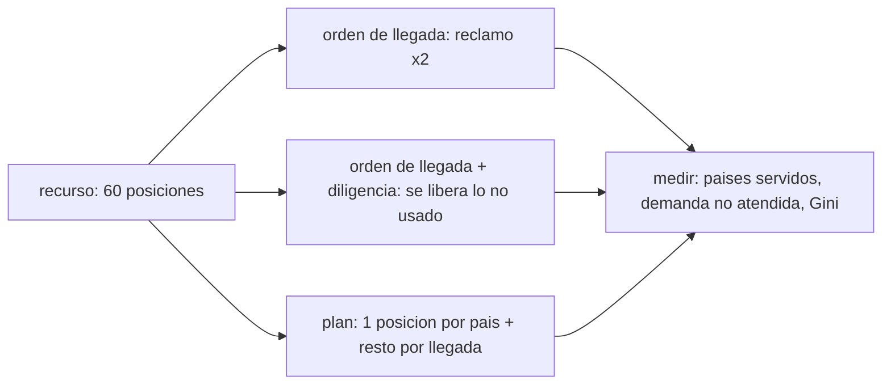

# B120-C03 — Posiciones orbitales y espectro como recursos limitados

<!-- nav:top -->
[🏠 Programa](../../../../README.md) · [📚 Bloque B120](../../../tronco-comun/B120-espectro-licencias-y-regulacion-satelital.md) · [← Anterior: B120-C02 — Zonas de coordinación entre servicios radioeléctricos](../B120-C02-zonas-de-coordinacion-entre-servicios-radioelectricos/CLASE.md) · [Siguiente: B120-C04 — Documentación regulatoria de un sistema satelital →](../B120-C04-documentacion-regulatoria-de-un-sistema-satelital/CLASE.md)
<!-- /nav -->

## 1. Ubicación, nivel y alcance

Clase 3 del bloque B120. Nivel N4. Las frecuencias y las posiciones en la órbita geoestacionaria son recursos escasos que se reparten con reglas jurídicas. Aquí calculas el tamaño físico del recurso (el radio de la órbita y cuántas posiciones caben), lees el principio del Artículo 44 de la Constitución de la UIT y comparas, con un escenario sintético, un acceso por orden de llegada con una planificación a priori. Retomas el procedimiento de [B120-C01](../B120-C01-licencias-satelitales-y-procedimiento-de-notificacion/CLASE.md) y la coordinación de [B120-C02](../B120-C02-zonas-de-coordinacion-entre-servicios-radioelectricos/CLASE.md). **Esta clase es educativa: no es asesoría legal ni regulatoria y no toma posición sobre ninguna disputa real.** Los países, demandas y capacidades son sintéticos.

## 2. Por qué esta clase existe

Las posiciones orbitales y el espectro son recursos escasos con reglas de asignación y no están tratados como concepto jurídico. La decisión central: **¿cuánto recurso hay, quién lo obtiene bajo cada régimen y qué mide la desigualdad del reparto?**

## 3. Lo que podrás hacer al terminar

1. Calcular el radio de la órbita geoestacionaria y el número de posiciones según la separación.
2. Citar el principio del Artículo 44 y los dos enfoques de acceso (coordinación y planificación).
3. Simular un reparto por orden de llegada, con diligencia debida y por plan.
4. Medir la desigualdad con el índice de Gini por dos fórmulas.
5. Explicar cómo la diligencia debida combate la reserva sin uso real.
6. Separar lo consultado (principios y regímenes) de lo sintético (países y demandas) y de lo no consultado (constantes astronómicas y texto del Reglamento).

La evidencia es la **comparación de dos regímenes de acceso con su índice de desigualdad** del ejercicio 12 (sección 20).

## 4. Con qué llegas y cómo comprobarlo

1. ¿Qué es una órbita geoestacionaria?
2. ¿Qué dice la tercera ley de Kepler?
3. ¿Qué es un índice de Gini?
4. ¿Qué es un dato sintético?
5. ¿Qué es una verificación por segunda vía?

<details>
<summary>Ver respuestas</summary>

1. Una órbita circular ecuatorial con periodo igual a un día sideral, desde la que el satélite parece fijo. 2. El cuadrado del periodo es proporcional al cubo del semieje. 3. Una medida de desigualdad entre 0 (reparto igual) y casi 1 (todo en uno). 4. Un dato inventado para el ejemplo, no real. 5. Calcular lo mismo con otro método y comparar.
</details>

Con cuatro o cinco aciertos, sigue; si no, repasa los prerrequisitos.

## 5. Un caso de contexto y casos de referencia

El Artículo 44 de la Constitución de la UIT, citado en el documento de la UIT sobre el marco regulatorio espacial (creado el 2018-01-10, leído el 2026-11-11), establece que las radiofrecuencias y las órbitas asociadas, incluida la geoestacionaria, son «limited natural resources» que deben usarse de manera racional, eficiente y económica para que los países tengan acceso equitativo. El mismo documento describe dos mecanismos: la coordinación «primero en llegar, primero en ser servido» y los planes a priori (Apéndices 30, 30A y 30B), y explica que la diligencia debida administrativa busca evitar reservar capacidad sin uso real. El **ejemplo conductor** es un escenario sintético de 40 países que compiten por 60 posiciones; la demanda real total es 94 posiciones. Los números son **ilustrativos**.

## 6. Vocabulario

Un **recurso limitado** es uno cuya cantidad no crece con la demanda. El **acceso equitativo** es la oportunidad de uso para todos los países. El **orden de llegada** asigna a quien presenta primero. La **planificación a priori** reserva capacidad para todos antes de que la pidan. La **diligencia debida** exige probar que una red será realmente construida. Un **satélite de papel** es una red registrada sin intención real de uso. El **Gini** mide desigualdad.

## 7. Modelo mental: un estacionamiento con dos reglas



*Descripción textual:* el mismo recurso se reparte con tres reglas y se comparan los resultados con las mismas métricas.

Analogía: un estacionamiento donde se puede reservar plazas por orden de llegada, con revisión de reservas sin uso o con una plaza garantizada por vecino. Límite: el reparto real mezcla negociación técnica, calidad de la posición y banda, no solo cantidad.

## 8. La explicación, paso a paso

### 8.1 El tamaño del recurso

El radio de la órbita geoestacionaria sale de que su periodo sea el día sideral: `r = (μ T²/4π²)^(1/3)`. Con `μ = 398 600,4418 km³/s²` y `T = 86 164,0905 s`: `r = 42 164,17 km`, es decir 35 786 km de altitud sobre el ecuador. Con satélites separados 2°, la distancia entre ellos es `2 r sin(1°) = 1 471,7 km` y caben 180 posiciones en los 360°. El laboratorio resuelve `r` por bisección sobre el periodo como segunda vía.

### 8.2 Tres regímenes

En el escenario sintético, por **orden de llegada** (reclamo doble de la demanda) los países de mayor capacidad llegan primero y 13 de 40 países obtienen alguna posición (Gini 0,813). Con **diligencia debida**, cada país conserva solo lo que usará y lo liberado se reparte de nuevo: 21 países sirven (Gini 0,725). Con un **plan** de una posición garantizada por país más el resto por llegada, los 40 países tienen al menos una (Gini 0,296).

### 8.3 Lo que no resuelve el modelo

La demanda no atendida del plan (34) es igual a la del régimen con diligencia: el plan cambia **quién** queda servido, no cuánto recurso hay. Ninguno crea posiciones nuevas.

### 8.4 Capacidad del espectro

Una posición con 500 MHz y 2 bit/s/Hz (ilustrativo) da 1,0 Gbit/s; el espectro y la posición se multiplican en la capacidad total.

## 9. Magnitudes, símbolos y unidades

| Símbolo | Qué es | Unidad | Valor / nota |
|---|---|---|---|
| `μ` | parámetro gravitacional terrestre | km³/s² | 398 600,4418 (no consultado) |
| `T` | día sideral | s | 86 164,0905 (no consultado) |
| `r` | radio de la órbita geoestacionaria | km | 42 164,17 |
| separación | entre satélites vecinos | ° | 2 (ilustrativa) |
| `G` | índice de Gini | — | 0–1 |
| ancho de banda | por posición | MHz | 500 (ilustrativo) |

## 10. Convenciones y referencias

Órbita circular ecuatorial geocéntrica; radios en km, longitudes orbitales en grados. Semilla fija 120 para el escenario sintético. La altitud se mide desde el radio ecuatorial `6 378,137 km` (no consultado). Principios y regímenes son del documento de la UIT de 2018 y de la presentación de la Oficina de 2021; no se consultó el texto vigente de la Constitución ni del Reglamento.

## 11. De dónde sale lo que afirmamos

| ID | Fuente | Localizador | Respalda | Estado |
|---|---|---|---|---|
| S1 | UIT, «ITU Radio Regulatory Framework for Space Services» (PDF; creación 2018-01-10; hasta la CMR-15) — https://www.itu.int/en/ITU-R/space/snl/Documents/ITU-Space_reg.pdf (consultada 2026-11-11) | secciones 1 y 2, 3, 8 (texto del Art. 44, planes, diligencia debida) | recursos limitados, acceso equitativo, dos enfoques, diligencia debida | Consultada (síntesis de la UIT; no es el Reglamento) |
| S2 | UIT, Oficina de Radiocomunicaciones, «Orbit-Spectrum International Regulatory Framework» (PDF de 15 páginas; metadatos 2021-05-11) — https://www.itu.int/bestofwrs/wp-content/uploads/sites/15/2021/12/WRS-20-Orbit-Spectrum-Internatio_nal-Regulatory-Framework.pdf (consultada 2026-11-11) | diapositivas del marco legal y de los dos enfoques | Art. 44, coordinación frente a planificación, registro en el MIFR | Consultada (presentación) |
| — | Constantes `μ`, `T`, `R_eq` | — | cálculo de `r` | Valores astronómicos estándar, verificados con la recuperación del periodo; no consultados en una fuente |
| — | Escenario de 40 países | — | todo el reparto | Sintético |

Límites: no se consultaron las disposiciones de los Apéndices 30 y 30B; el escenario no representa a ningún país real; la desigualdad medida es de cantidad, no de calidad de posición.

## 12. Cómo ver los tres regímenes

| Régimen | Asignadas | Países con ≥ 1 | Demanda no atendida | Gini |
|---|---|---|---|---|
| Orden de llegada (reclamo ×2) | 60 | 13 | 64 | 0,813 |
| Orden de llegada + diligencia | 60 | 21 | 34 | 0,725 |
| Plan a priori (1 por país) | 60 | 40 | 34 | 0,296 |

Descripción larga: la desigualdad baja y el número de países servidos sube de la primera a la tercera fila; la oferta total (60) no cambia.

## 13. Ejemplo trabajado: el radio geoestacionario

**Paso 1 · Datos.** `μ = 398 600,4418`; `T = 86 164,0905 s`.

**Paso 2 · Factor.** `T/2π = 13 713,44 s`.

**Paso 3 · Cubo.** `μ (T/2π)² = 7,496 × 10¹³ km³`.

**Paso 4 · Raíz cúbica.** `r = 42 164,17 km`; altitud `42 164,17 − 6 378,14 = 35 786,03 km`.

## 14. Distintas formas de describir el acceso

**Por cantidad:** posiciones asignadas. **Por cobertura:** países con al menos una. **Por demanda:** la no atendida. **Por desigualdad:** el Gini. **Por régimen:** coordinación, diligencia o plan.

## 15. Práctica guiada

**Ejercicio 1 · con los pasos indicados.** Distancia entre satélites separados 1°. *Pasos:* `2 r sin(0,5°)`.

<details><summary>Solución comentada</summary>

`2 × 42 164,17 × 0,0087265 = 735,9 km`.
</details>

**Ejercicio 2 · con una pista.** ¿Cuántas posiciones caben con separación de 3°? *Pista:* divide 360 entre la separación.

<details><summary>Solución comentada</summary>

120.
</details>

**Ejercicio 3 · casi autónomo.** ¿Por qué el plan sube el número de países servidos sin crear posiciones?

<details><summary>Solución comentada</summary>

Reserva una posición por país antes de repartir el resto; reordena quién recibe, no cuánto hay.
</details>

## 16. Práctica autónoma, transferencia e integrador

**Ejercicio 4 · autónomo.** Gini de `[1, 1, 1, 1]`.

<details><summary>Solución comentada</summary>

0: reparto igual.
</details>

**Ejercicio 5 · autónomo.** Gini de `[0, 0, 0, 4]` con la fórmula `Σ|xi − xj|/(2 n² media)`.

<details><summary>Solución comentada</summary>

Pares con diferencia 4: 6 pares ordenados dobles = 24; `24/(2 × 16 × 1) = 0,75`.
</details>

**Ejercicio 6 · autónomo.** Distancia entre satélites a 0,5° de separación.

<details><summary>Solución comentada</summary>

`2 r sin(0,25°) ≈ 368 km`.
</details>

**Ejercicio 7 · autónomo.** Capacidad de 20 posiciones con 500 MHz y 2 bit/s/Hz.

<details><summary>Solución comentada</summary>

`20 × 1,0 = 20 Gbit/s`.
</details>

**Ejercicio 8 · autónomo.** Si el reclamo es ×1 en lugar de ×2, ¿esperas más o menos países servidos con orden de llegada? Pruébalo en el laboratorio.

<details><summary>Solución comentada</summary>

Más: cada país reclama menos y quedan más posiciones para los siguientes.
</details>

**Ejercicio 9 · transferencia.** **Transferencia.** ¿Qué diferencia hay entre acceso equitativo y reparto igual?

<details><summary>Solución comentada</summary>

El Artículo 44 habla de acceso equitativo teniendo en cuenta necesidades especiales y la situación geográfica; no exige partes iguales.
</details>

**Ejercicio 10 · transferencia.** **Transferencia.** ¿Qué mediría la calidad de una posición que el modelo ignora?

<details><summary>Solución comentada</summary>

La longitud (cobertura), las bandas disponibles y la interferencia de los vecinos; todo eso falta aquí.
</details>

**Ejercicio 11 · transferencia.** **Transferencia.** ¿Es el Gini adecuado para evaluar la equidad del Artículo 44?

<details><summary>Solución comentada</summary>

Solo mide desigualdad de cantidad; no incorpora necesidades especiales ni geografía. Es una métrica del ejercicio, no un juicio jurídico.
</details>

**Ejercicio 12 · integrador.** **Integrador.** Elabora tu *comparación de dos regímenes de acceso con su índice de desigualdad*: radio y posiciones, un escenario sintético propio, resultados de dos regímenes, Gini y la lista de qué es consultado, sintético y no consultado, con el aviso de que no es asesoría legal ni regulatoria.

<details><summary>Solución comentada</summary>

Secciones 8 y 12 y la salida del laboratorio.
</details>

## 17. Laboratorio: tres regímenes de acceso

El script [recursos.py](recursos.py) calcula el radio de la órbita por dos vías (**comprueba** a 1e-6 relativo) y reparte 60 posiciones entre 40 países sintéticos con tres reglas (**comprueba** el Gini por dos fórmulas a 1e-12 y que el plan sirve a todos).

**Datos:** principios consultados; constantes astronómicas no consultadas; países **sintéticos**. **Predice antes de ejecutar:** ¿cuántos países obtienen posición por orden de llegada? (pocos, bastante menos de la mitad.) **Ejecución del 2026-11-11 (Python 3.12.9):**

```text
Python 3.12.9 (biblioteca estandar)
RECURSOS LIMITADOS: Art. 44 UIT y regimenes consultados en documentos UIT 2018/2021 (consulta 2026-11-11); paises, demandas y capacidades SINTETICOS.
Radio de la orbita geoestacionaria: 42164.17 km (altitud sobre el ecuador 35786.03 km); periodo recalculado 86164.0905 s
Verificacion: biseccion sobre el periodo y periodo por v=sqrt(mu/r) = 86164.0905 s ; diferencia relativa de r = 3.5e-16
Separacion de 2.0 grados entre satelites: 1471.7 km ; posiciones en 360 grados = 180
Capacidad ilustrativa de una posicion con 500 MHz y 2 bit/s/Hz: 1.0 Gbit/s
Escenario: 40 paises, 60 posiciones, demanda total = 94, demanda maxima = 12
Regimen                          asignadas  paises con >=1  demanda no atendida  Gini
orden de llegada (reclamo x2)          60              13                   64  0.813
orden de llegada + diligencia          60              21                   34  0.725
plan a priori (1 por pais)             60              40                   34  0.296
Pruebas superadas.
```

```bash
python programa/clases/B120/B120-C03-posiciones-orbitales-y-espectro-como-recursos-limitados/recursos.py
```

**Límites:** cantidad sin calidad de posición; demandas inventadas; sin negociación técnica.

## 18. Errores frecuentes y cómo corregirlos

**Confundir equidad con igualdad.** Se corrige con el ejercicio 9.

**Tomar el escenario como evidencia sobre países reales.** Se corrige con las secciones 1 y 11.

**Creer que un plan crea recurso.** Se corrige con 8.3.

**Citar el Artículo 44 de memoria.** Se corrige con la sección 11 (texto citado de un documento fechado).

## 19. Cómo sabrás que vas bien

Tras la sección 8: ¿qué régimen esperabas que diera menor Gini y cuál resultó? Si dudas, repasa el ejemplo 13. Tras el laboratorio: ¿qué comprueba? (ver la sección 17).

## 20. Qué entregas y cómo se evalúa

El producto es tu **comparación de dos regímenes de acceso con su índice de desigualdad** (ejercicio 12).

| Criterio | Inicial | En desarrollo | Logrado | Destacado |
|---|---|---|---|---|
| Conceptos | Los confunde | Parciales | Explica recurso limitado y regímenes | Explica los límites de las métricas |
| Cálculo | Sin unidades | Con errores | `r`, posiciones y Gini correctos | Calcula casos nuevos |
| Numérico | Sin comprobar | Un caso | Dos vías para `r` y para Gini | Interpreta las diferencias |
| Fuentes | Sin fuente | Sin fecha | Fuentes con fecha, versión y estado | Declara lo no consultado |
| Límites | No los nombra | Uno | Tres | Discute qué falta del modelo |

**Condiciones críticas (no se compensan con promedio):** rotular el escenario como sintético; citar la versión y fecha del texto; declarar que no es asesoría legal ni regulatoria.

## 21. Ética, seguridad y límites

Clase educativa: **no es asesoría legal, regulatoria ni financiera** y no representa a ningún país real; ningún resultado debe usarse para solicitar o disputar una posición orbital. Los datos son sintéticos y el modelo es simplificado. Accesibilidad: tablas equivalentes a las gráficas, fórmulas en texto, ejercicios sin conexión.

## 22. Para cerrar y seguir

La órbita geoestacionaria mide 42 164 km de radio y admite 180 posiciones a 2°; en un escenario sintético, pasar del orden de llegada a un plan sube de 13 a 40 los países servidos y baja el Gini de 0,813 a 0,296. Queda una pregunta: ¿qué papeles prueban que una red cumple lo que dice?

**Glosario español–inglés.** recurso natural limitado · *limited natural resource*; acceso equitativo · *equitable access*; diligencia debida administrativa · *administrative due diligence*; planificación a priori · *a priori planning*; órbita geoestacionaria · *geostationary-satellite orbit (GSO)*.

**Continuidad.** [B120-C04](../B120-C04-documentacion-regulatoria-de-un-sistema-satelital/CLASE.md) estudia la documentación regulatoria.

**Referencias:** ver sección 11.

<!-- nav:bottom -->
---

[← Anterior: B120-C02 — Zonas de coordinación entre servicios radioeléctricos](../B120-C02-zonas-de-coordinacion-entre-servicios-radioelectricos/CLASE.md) · [📚 Bloque B120](../../../tronco-comun/B120-espectro-licencias-y-regulacion-satelital.md) · [Siguiente: B120-C04 — Documentación regulatoria de un sistema satelital →](../B120-C04-documentacion-regulatoria-de-un-sistema-satelital/CLASE.md)
<!-- /nav -->
