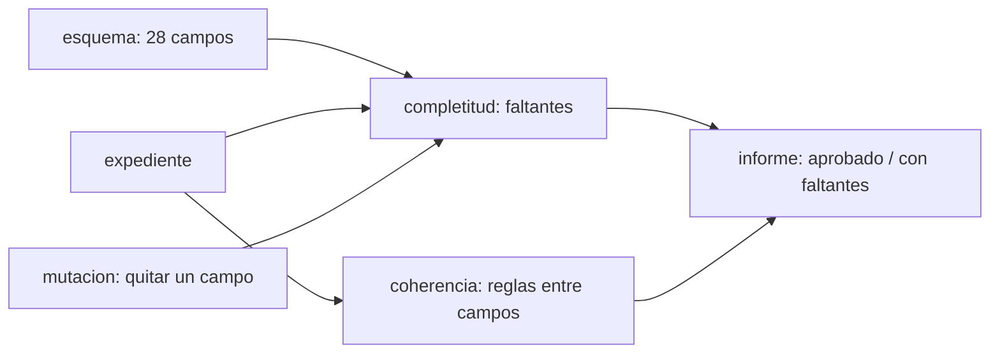

# B120-C04 — Documentación regulatoria de un sistema satelital

<!-- nav:top -->
[🏠 Programa](../../../../README.md) · [📚 Bloque B120](../../../tronco-comun/B120-espectro-licencias-y-regulacion-satelital.md) · [← Anterior: B120-C03 — Posiciones orbitales y espectro como recursos limitados](../B120-C03-posiciones-orbitales-y-espectro-como-recursos-limitados/CLASE.md) · [Siguiente: B120-C05 — Riesgos de incumplimiento regulatorio →](../B120-C05-riesgos-de-incumplimiento-regulatorio/CLASE.md)
<!-- /nav -->

## 1. Ubicación, nivel y alcance

Clase 4 del bloque B120. Nivel N4. Cada trámite regulatorio descansa en información que la administración debe presentar completa y a tiempo, y la omisión puede costar la red. Aquí tratas el expediente como un conjunto de campos exigidos por etapa, compruebas su completitud y su coherencia y pruebas el verificador con omisiones introducidas a propósito. Usas el plazo de [B120-C01](../B120-C01-licencias-satelitales-y-procedimiento-de-notificacion/CLASE.md) para ubicar cada documento. [B90](../../../tronco-comun/B90-integracion-ensayos-y-calificacion-espacial.md) documenta interfaces técnicas, no trámites. **Esta clase es educativa: no es asesoría legal ni regulatoria y los campos del laboratorio no son el formulario oficial.** El expediente es sintético.

## 2. Por qué esta clase existe

El expediente regulatorio es un entregable del rol; B90-C05 documenta interfaces, no trámites regulatorios. La decisión central: **¿está el expediente completo y es coherente antes de enviarlo, y cómo lo compruebo sin depender de mi lectura?**

## 3. Lo que podrás hacer al terminar

1. Listar la información que exige la diligencia debida y la que pide el informe de despliegue de la Resolución 35.
2. Distinguir los grupos del expediente: red, fabricante, lanzador y despliegue.
3. Verificar la completitud con dos métodos independientes.
4. Definir reglas de coherencia entre campos (órbita, frecuencias, fechas, cantidades).
5. Probar un verificador con una prueba de mutación.
6. Separar lo consultado (campos de dos documentos de la UIT) de lo no consultado (el Apéndice 4) y de las reglas propias del curso.

La evidencia es el **informe de completitud de un expediente sintético** del ejercicio 12 (sección 20).

## 4. Con qué llegas y cómo comprobarlo

1. ¿Qué es un esquema de datos?
2. ¿Qué es una diferencia de conjuntos?
3. ¿Qué es una prueba de mutación?
4. ¿Qué es un dato sintético?
5. ¿Qué es una verificación por segunda vía?

<details>
<summary>Ver respuestas</summary>

1. La lista de campos exigidos y su tipo. 2. Los elementos del primer conjunto que no están en el segundo. 3. Introducir fallos a propósito para comprobar que el verificador los detecta. 4. Un dato inventado para el ejemplo, no real. 5. Calcular lo mismo con otro método y comparar.
</details>

Con cuatro o cinco aciertos, sigue; si no, repasa los prerrequisitos.

## 5. Un caso de contexto y casos de referencia

El documento de la UIT sobre el marco regulatorio espacial (creado el 2018-01-10; leído el 2026-11-11) detalla la diligencia debida administrativa: la administración debe enviar información sobre la red (nombre del satélite, administración notificante, referencia a la publicación, rango de frecuencias, operador, características orbitales), sobre el fabricante (nombre, fecha del contrato, ventana de entrega, número de satélites) y, antes de notificar, sobre el proveedor de lanzamiento (contrato, ventana, vehículo, sitio). Si la información completa no llega a tiempo, la red se cancela. Las diapositivas del Seminario Mundial de Radiocomunicaciones de 2022 sobre la Resolución 35 listan los campos del informe de despliegue (lanzamiento, plano orbital, apogeo, perigeo, inclinación, argumento del perigeo y bandas). El **ejemplo conductor** es el expediente sintético «SINT-B», con 28 campos, cuya completitud se verifica con un código. Los valores son **ilustrativos**.

## 6. Vocabulario

El **expediente** es el conjunto de documentos y datos de un trámite. La **completitud** es la fracción de campos exigidos presentes. La **coherencia** es la ausencia de contradicciones entre campos. El **esquema** es la lista de campos exigidos. La **diligencia debida** es la información sobre fabricante y lanzador que prueba que la red se construirá. La **prueba de mutación** introduce omisiones para medir si el verificador las detecta.

## 7. Modelo mental: una lista de embarque



*Descripción textual:* el expediente se compara con el esquema (completitud) y consigo mismo (coherencia); la mutación prueba al verificador.

Analogía: una lista de embarque que se revisa campo por campo antes de despachar. Límite: una lista completa no garantiza que el contenido sea correcto ni que el regulador lo acepte.

## 8. La explicación, paso a paso

### 8.1 El esquema

El laboratorio exige 28 campos: 9 de la red, 5 del fabricante, 7 del lanzador, 6 del despliegue y 1 marcador del Apéndice 4. El marcador existe porque el contenido del Apéndice 4 **no se consultó**: aquí solo se registra que el anexo está adjunto.

### 8.2 Completitud por dos vías

La vía A recorre el esquema y lista los campos vacíos; la vía B resta el conjunto de campos presentes del conjunto de exigidos. Deben coincidir siempre. El expediente base tiene 0 faltantes (100 %).

### 8.3 Coherencia

Reglas propias: perigeo ≤ apogeo, frecuencia mínima < máxima, inclinación entre 0° y 180°, ventanas ordenadas, lanzamiento después de la entrega, contratos anteriores a sus ventanas, desplegados ≤ fabricados y fecha de lanzamiento dentro de su ventana. Ninguna es una regla del Reglamento.

### 8.4 Prueba de mutación

Se quita cada uno de los 28 campos, uno a uno, y las dos vías deben señalar exactamente ese campo. Resultado: 28 omisiones introducidas, 0 sin detectar. Cuando falta un campo que alimenta una regla, la coherencia se declara «no evaluable» en vez de aprobarla.

## 9. Magnitudes, símbolos y unidades

| Símbolo | Qué es | Unidad | Valor / nota |
|---|---|---|---|
| `N` | campos exigidos | — | 28 |
| `n_falt` | campos faltantes | — | 0 en el base |
| completitud | `(N − n_falt)/N` | % | 100 |
| perigeo, apogeo | altitudes orbitales | km | 550 y 560 (sintéticas) |
| frecuencia | límites de banda | MHz | 10 700–12 700 (sintética) |
| inclinación | del plano orbital | ° | 53 (sintética) |

## 10. Convenciones y referencias

Fechas AAAA-MM-DD comparadas como texto ordenable; altitudes en km, frecuencias en MHz, ángulos en grados. Un campo vacío, nulo o falso cuenta como faltante. Los nombres de los campos son del curso y no coinciden con los del formulario oficial. Las listas de campos provienen de dos documentos fechados de la UIT; no se consultó el Apéndice 4 ni el texto de la Resolución 49.

## 11. De dónde sale lo que afirmamos

| ID | Fuente | Localizador | Respalda | Estado |
|---|---|---|---|---|
| S1 | UIT, «ITU Radio Regulatory Framework for Space Services» (PDF; creación 2018-01-10; hasta la CMR-15) — https://www.itu.int/en/ITU-R/space/snl/Documents/ITU-Space_reg.pdf (consultada 2026-11-11) | sección 8 (8.1–8.3) | información de red, fabricante y lanzador; cancelación si es incompleta | Consultada (síntesis de la UIT; no es el texto de la Resolución 49) |
| S2 | UIT, 30.º Seminario Mundial de Radiocomunicaciones, «A milestone approach for NGSO systems, Resolution 35 (WRC-19)» (diapositivas, 24–28 de octubre de 2022) — https://www.itu.int/en/ITU-R/space/WRS22space/WRS22_RES35.pdf (consultada 2026-11-11) | diapositivas de «Deployment information» y «Submission» | campos del informe de despliegue | Consultada (material de seminario; no es la Resolución) |
| — | Apéndice 4 del Reglamento, formularios de la UIT | — | campos de la publicación anticipada y de la coordinación | No consultado |
| — | Reglas de coherencia, expediente SINT-B | — | laboratorio | Del curso / sintético |

Límites: los campos son los de los dos documentos, no el formulario completo; ediciones posteriores pueden diferir; las reglas de coherencia no son normativas.

## 12. Cómo ver el expediente

| Grupo | Campos | Fuente de la lista |
|---|---|---|
| Red | 9 | S1 (8.2) |
| Fabricante | 5 | S1 (8.2) |
| Lanzador | 7 | S1 (8.2) |
| Despliegue | 6 | S2 |
| Marcador del Apéndice 4 | 1 | del curso |
| **Total** | **28** | |

Descripción larga: la mayoría de los campos proviene de la diligencia debida; el despliegue añade los datos de la Resolución 35.

## 13. Ejemplo trabajado: un campo que falta

**Paso 1 · Quitar.** Se deja vacío `lanzador.fecha_contrato`.

**Paso 2 · Vía A.** Recorre el esquema y encuentra `(lanzador, fecha_contrato)` vacío.

**Paso 3 · Vía B.** `exigidos − presentes = {(lanzador, fecha_contrato)}`.

**Paso 4 · Coherencia.** La regla «contrato anterior a su ventana» no se puede evaluar: el verificador lo declara y no la da por buena.

## 14. Distintas formas de describir un expediente

**Por etapa:** publicación anticipada, coordinación, diligencia, notificación, despliegue. **Por grupo:** red, fabricante, lanzador. **Por estado:** completo, con faltantes, incoherente. **Por fuente:** campo consultado o del curso. **Por plazo:** el de [B120-C01](../B120-C01-licencias-satelitales-y-procedimiento-de-notificacion/CLASE.md).

## 15. Práctica guiada

**Ejercicio 1 · con los pasos indicados.** Completitud si faltan 3 campos de 28. *Pasos:* `(28 − 3)/28`.

<details><summary>Solución comentada</summary>

`25/28 = 89,3 %`.
</details>

**Ejercicio 2 · con una pista.** ¿Qué regla detecta que el perigeo es 600 km y el apogeo 560 km? *Pista:* sección 8.3.

<details><summary>Solución comentada</summary>

«Perigeo mayor que apogeo».
</details>

**Ejercicio 3 · casi autónomo.** ¿Por qué un campo vacío no debe tratarse como cero?

<details><summary>Solución comentada</summary>

Porque cero es un valor posible (por ejemplo, 0 satélites o 0 °) y un campo ausente es información que falta.
</details>

## 16. Práctica autónoma, transferencia e integrador

**Ejercicio 4 · autónomo.** Completitud si faltan 7 campos.

<details><summary>Solución comentada</summary>

`21/28 = 75,0 %`.
</details>

**Ejercicio 5 · autónomo.** ¿Cuántos campos aporta el grupo del lanzador?

<details><summary>Solución comentada</summary>

7.
</details>

**Ejercicio 6 · autónomo.** Escribe una regla de coherencia nueva entre dos fechas del expediente.

<details><summary>Solución comentada</summary>

Por ejemplo: la ventana de lanzamiento no debe terminar antes de que termine la ventana de entrega. Toda regla propia se declara «del curso», no normativa.
</details>

**Ejercicio 7 · autónomo.** ¿Qué detecta la prueba de mutación que no detecta el expediente base?

<details><summary>Solución comentada</summary>

Si el verificador funciona: el expediente base está completo y por sí solo no lo prueba.
</details>

**Ejercicio 8 · autónomo.** Si desplegados = 130 y fabricados = 120, ¿qué regla falla?

<details><summary>Solución comentada</summary>

«Desplegados mas que los fabricados».
</details>

**Ejercicio 9 · transferencia.** **Transferencia.** El laboratorio da 100 % de completitud. ¿Significa que la administración lo aceptará?

<details><summary>Solución comentada</summary>

No: completitud no es conformidad; el examen de la Oficina verifica el contenido contra el Reglamento.
</details>

**Ejercicio 10 · transferencia.** **Transferencia.** ¿Qué haría falta para sustituir el marcador del Apéndice 4 por sus campos reales?

<details><summary>Solución comentada</summary>

Consultar el Apéndice 4 vigente y la versión de los formularios de la UIT, y citar su edición y fecha.
</details>

**Ejercicio 11 · transferencia.** **Transferencia.** ¿Por qué se rotulan como «del curso» las reglas de coherencia?

<details><summary>Solución comentada</summary>

Porque no se consultaron en el Reglamento; presentarlas como normativas sería afirmar lo no consultado.
</details>

**Ejercicio 12 · integrador.** **Integrador.** Elabora tu *informe de completitud de un expediente sintético*: esquema por grupos, expediente con dos omisiones y una incoherencia, resultado de las dos vías, resultado de la prueba de mutación y lista de qué es consultado, del curso y no consultado, con el aviso de que no es asesoría legal ni regulatoria.

<details><summary>Solución comentada</summary>

Secciones 8 y 12 y la salida del laboratorio.
</details>

## 17. Laboratorio: verificador de expediente

El script [expediente.py](expediente.py) verifica un expediente de 28 campos por dos vías, evalúa 8 reglas de coherencia y ejecuta una prueba de mutación (**comprueba** 0 omisiones sin detectar).

**Datos:** listas de campos de dos documentos de la UIT; expediente **sintético**. **Predice antes de ejecutar:** ¿qué dirá la coherencia si falta la fecha de contrato del lanzador? (que no es evaluable.) **Ejecución del 2026-11-11 (Python 3.12.9):**

```text
Python 3.12.9 (biblioteca estandar)
EXPEDIENTE SINTETICO; campos de diligencia debida (UIT 2018-01-10) y de Res. 35 (WRS-22), consulta 2026-11-11; no es el formulario oficial ni asesoria.
Campos exigidos en el esquema: 28 (grupos: diligencia_red=9, fabricante=5, lanzador=7, despliegue_res35=6, marcadores=1)
Expediente base: faltantes = 0 ; incoherencias = []
Prueba de mutacion: 28 omisiones introducidas, 0 sin detectar por alguna de las dos vias
Caso                               faltantes  incoherencias
falta contrato del lanzador             1  coherencia no evaluable por campos ausentes  (falta lanzador.fecha_contrato)
falta nombre del operador               1  -  (falta diligencia_red.operador)
perigeo > apogeo                        0  perigeo mayor que apogeo
lanzamiento antes de la entrega         0  lanzamiento previsto antes de la entrega
mas desplegados que fabricados          0  desplegados mas que los fabricados
Completitud del expediente base: 100.0 %
Pruebas superadas.
```

```bash
python programa/clases/B120/B120-C04-documentacion-regulatoria-de-un-sistema-satelital/expediente.py
```

**Límites:** campos parciales, sin el Apéndice 4; reglas propias; sin firmas ni anexos.

## 18. Errores frecuentes y cómo corregirlos

**Confundir completitud con conformidad.** Se corrige con el ejercicio 9.

**Presentar las reglas del curso como normativas.** Se corrige con la sección 11.

**Tratar el vacío como cero.** Se corrige con el ejercicio 3.

**Confiar en un verificador sin probarlo.** Se corrige con la sección 8.4.

## 19. Cómo sabrás que vas bien

Tras la sección 8: ¿qué campo falta y qué regla queda sin evaluar? Si dudas, repasa el ejemplo 13. Tras el laboratorio: ¿qué comprueba? (ver la sección 17).

## 20. Qué entregas y cómo se evalúa

El producto es tu **informe de completitud de un expediente sintético** (ejercicio 12).

| Criterio | Inicial | En desarrollo | Logrado | Destacado |
|---|---|---|---|---|
| Conceptos | Los confunde | Parciales | Distingue completitud y coherencia | Explica los límites del verificador |
| Cálculo | Sin porcentajes | Con errores | Completitud correcta | Calcula casos nuevos |
| Numérico | Sin comprobar | Un caso | Dos vías y mutación | Interpreta las diferencias |
| Fuentes | Sin fuente | Sin fecha | Fuentes con fecha, versión y estado | Declara lo no consultado |
| Límites | No los nombra | Uno | Tres | Discute qué falta del esquema |

**Condiciones críticas (no se compensan con promedio):** rotular las reglas propias y el expediente como del curso y sintético; citar la versión y fecha del texto; declarar que no es asesoría legal ni regulatoria.

## 21. Ética, seguridad y límites

Clase educativa: **no es asesoría legal, regulatoria ni financiera**; el expediente es sintético y ningún resultado debe usarse para presentar documentos a una administración o a la UIT. Los campos reales y su formato deben tomarse de los textos y formularios vigentes. Accesibilidad: tablas equivalentes a las gráficas, fórmulas en texto, ejercicios sin conexión.

## 22. Para cerrar y seguir

Un expediente sintético de 28 campos puede verificarse por dos vías y probarse con 28 omisiones introducidas; completo no significa aceptado. Queda una pregunta: ¿qué pasa y cuánto cuesta si un plazo o un hito no se cumple?

**Glosario español–inglés.** expediente · *filing / dossier*; completitud · *completeness*; diligencia debida · *due diligence*; prueba de mutación · *mutation testing*; plano orbital · *orbital plane*.

**Continuidad.** [B120-C05](../B120-C05-riesgos-de-incumplimiento-regulatorio/CLASE.md) estudia los riesgos de incumplimiento.

**Referencias:** ver sección 11.

<!-- nav:bottom -->
---

[← Anterior: B120-C03 — Posiciones orbitales y espectro como recursos limitados](../B120-C03-posiciones-orbitales-y-espectro-como-recursos-limitados/CLASE.md) · [📚 Bloque B120](../../../tronco-comun/B120-espectro-licencias-y-regulacion-satelital.md) · [Siguiente: B120-C05 — Riesgos de incumplimiento regulatorio →](../B120-C05-riesgos-de-incumplimiento-regulatorio/CLASE.md)
<!-- /nav -->
