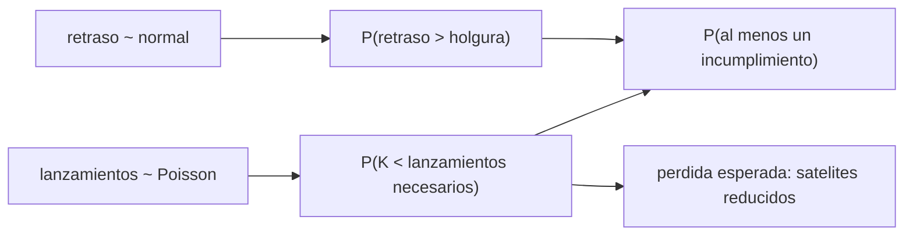

# B120-C05 — Riesgos de incumplimiento regulatorio

<!-- nav:top -->
[🏠 Programa](../../../../README.md) · [📚 Bloque B120](../../../tronco-comun/B120-espectro-licencias-y-regulacion-satelital.md) · [← Anterior: B120-C04 — Documentación regulatoria de un sistema satelital](../B120-C04-documentacion-regulatoria-de-un-sistema-satelital/CLASE.md) · [Siguiente: B120-C06 — Caso de planificación regulatoria de un sistema satelital →](../B120-C06-caso-de-planificacion-regulatoria-de-un-sistema-satelital/CLASE.md)
<!-- /nav -->

## 1. Ubicación, nivel y alcance

Clase 5 del bloque B120. Nivel N4. Un plazo incumplido puede cancelar una publicación o reducir el tamaño autorizado de un sistema. Aquí conviertes los plazos de [B120-C01](../B120-C01-licencias-satelitales-y-procedimiento-de-notificacion/CLASE.md) y el expediente de [B120-C04](../B120-C04-documentacion-regulatoria-de-un-sistema-satelital/CLASE.md) en riesgos: la probabilidad de no poner en servicio a tiempo y la de no alcanzar un hito de despliegue, calculadas con una fórmula y con una simulación. **Esta clase es educativa: no es asesoría legal, regulatoria ni financiera.** Los retrasos, el ritmo de lanzamientos y los valores son sintéticos, y las consecuencias regulatorias son las del texto consultado, no las vigentes.

## 2. Por qué esta clase existe

Incumplir condiciones de licencia puede inhabilitar una misión y ninguna clase trata ese riesgo. La decisión central: **¿cuánta holgura se necesita para que la probabilidad de incumplir un plazo sea aceptable y cuánto se pierde si no se cumple un hito?**

## 3. Lo que podrás hacer al terminar

1. Modelar el retraso de lanzamiento con una distribución normal y calcular la probabilidad de superar la holgura.
2. Modelar el despliegue con lanzamientos poissonianos y calcular la probabilidad de no alcanzar un hito.
3. Calcular una pérdida esperada por reducción del sistema.
4. Contrastar la fórmula con una simulación de Monte Carlo.
5. Hacer un análisis de sensibilidad y calcular la holgura necesaria para un riesgo objetivo.
6. Separar lo consultado (plazo, hitos y consecuencia) de lo ilustrativo (los parámetros) y de lo no consultado (límites, prórrogas y excepciones).

La evidencia es la **matriz de riesgo de incumplimiento con su sensibilidad** del ejercicio 12 (sección 20).

## 4. Con qué llegas y cómo comprobarlo

1. ¿Qué es una distribución normal?
2. ¿Qué es una distribución de Poisson?
3. ¿Qué es una simulación de Monte Carlo?
4. ¿Qué es un valor esperado?
5. ¿Qué es un dato sintético?

<details>
<summary>Ver respuestas</summary>

1. Una distribución en campana definida por su media y su desviación típica. 2. La del número de eventos independientes en un intervalo con tasa constante. 3. Estimar una probabilidad repitiendo muchas veces un experimento aleatorio. 4. El promedio ponderado por probabilidad. 5. Un dato inventado para el ejemplo, no real.
</details>

Con cuatro o cinco aciertos, sigue; si no, repasa los prerrequisitos.

## 5. Un caso de contexto y casos de referencia

El documento de la UIT sobre el marco regulatorio espacial (creado el 2018-01-10; leído el 2026-11-11) fija que la puesta en servicio notificada no puede superar siete años desde la publicación anticipada y que la red cuya información de diligencia debida llega incompleta o tarde se cancela. Las diapositivas del Seminario Mundial de Radiocomunicaciones de 2022 sobre la Resolución 35 (CMR-19) fijan los hitos de despliegue de sistemas no geoestacionarios: 10 %, 50 % y 100 % de los satélites a 2, 5 y 7 años del plazo de puesta en servicio; fallar un hito reduce el número de satélites del sistema. La nota de la UIT del 2020-01-30 explica que el enfoque busca evitar el acaparamiento de espectro. El **ejemplo conductor** es un sistema sintético de 300 satélites con 12 meses de holgura hasta el plazo, retraso de lanzamiento normal(8; 5) meses y 1,2 lanzamientos de 20 satélites por año: la probabilidad de incumplir el plazo es 21,2 % y la de no alcanzar el primer hito, 30,8 %. Los parámetros son **ilustrativos**.

## 6. Vocabulario

El **riesgo** es la probabilidad de un evento por su consecuencia. La **holgura** es el margen entre la fecha planeada y el plazo. Un **hito** es una proporción del sistema que debe estar desplegada en una fecha. La **reducción** es la disminución del número de satélites autorizados al fallar un hito. La **pérdida esperada** es la consecuencia ponderada por la probabilidad. La **sensibilidad** mide cuánto cambia el resultado al variar un parámetro.

## 7. Modelo mental: dos relojes y una cuchilla



*Descripción textual:* un reloj mide el retraso frente a la holgura, otro cuenta lanzamientos frente al hito; el incumplimiento del hito recorta el sistema y se combinan ambas probabilidades.

Analogía: dos relojes con alarma y una cuchilla que recorta lo no desplegado. Límite: el modelo supone retrasos normales, lanzamientos independientes y la regla de recorte tal como la describe un material de seminario.

## 8. La explicación, paso a paso

### 8.1 Riesgo del plazo de puesta en servicio

Con retraso `D ~ N(μ = 8; σ = 5)` meses y holgura de 12 meses, `P(D > 12) = 1 − Φ((12 − 8)/5) = 1 − Φ(0,8) = 0,2119`. La simulación (200 000 repeticiones) da `0,2124`.

### 8.2 Sensibilidad

Si el retraso medio sube de 4 a 12 meses, la probabilidad pasa de 0,055 a 0,500. Para un riesgo objetivo de 5 % hacen falta `μ + 1,645 σ = 16,2` meses de holgura.

### 8.3 Riesgo del hito M1

El hito exige `0,10 × 300 = 30` satélites en 2 años: dos lanzamientos de 20. Con `K ~ Poisson(1,2 × 2 = 2,4)`, `P(K < 2) = e^(−2,4)(1 + 2,4) = 0,3084`. La simulación da `0,3098`.

### 8.4 Pérdida esperada y riesgo combinado

Si el hito falla, el sistema se reduce a lo desplegado (0 o 20 satélites); la pérdida esperada es `Σ P(K = k)(300 − 20k)` para `k = 0, 1`, igual a 88,18 UV (simulada 88,58), donde 1 UV es el valor sintético de un satélite en el sistema. Suponiendo independencia, `P(al menos un incumplimiento) = 1 − (1 − 0,2119)(1 − 0,3084) = 0,4550`.

## 9. Magnitudes, símbolos y unidades

| Símbolo | Qué es | Unidad | Valor / nota |
|---|---|---|---|
| `D` | retraso de lanzamiento | meses | normal(8; 5), ilustrativo |
| holgura | plazo − fecha planeada | meses | 12 |
| `N` | satélites del sistema | — | 300 (sintético) |
| `m` | satélites por lanzamiento | — | 20 |
| `λ` | tasa de lanzamientos | 1/año | 1,2 |
| `T` | ventana del hito | años | 2 (consultado: M1 a 2 años) |
| UV | unidad de valor sintética | UV | 1 por satélite |

## 10. Convenciones y referencias

Tiempo en meses para el plazo y en años para el hito. Un incumplimiento del plazo ocurre si `D > holgura`. El hito se cumple si `m K ≥ 0,10 N`. Semilla fija 120 y 121; 200 000 repeticiones. Los porcentajes y los años de los hitos son de las diapositivas de 2022; no se consultó la Resolución 35 ni su revisión de la CMR-23, que cambia la forma de contar las fechas y los límites de reducción.

## 11. De dónde sale lo que afirmamos

| ID | Fuente | Localizador | Respalda | Estado |
|---|---|---|---|---|
| S1 | UIT, «ITU Radio Regulatory Framework for Space Services» (PDF; creación 2018-01-10; hasta la CMR-15) — https://www.itu.int/en/ITU-R/space/snl/Documents/ITU-Space_reg.pdf (consultada 2026-11-11) | secciones 5.4 y 8.3 | plazo de 7 años y cancelación por diligencia incompleta | Consultada (síntesis; no es el Reglamento) |
| S2 | UIT, 30.º Seminario Mundial de Radiocomunicaciones, «A milestone approach for NGSO systems, Resolution 35 (WRC-19)» (diapositivas, 24–28 de octubre de 2022) — https://www.itu.int/en/ITU-R/space/WRS22space/WRS22_RES35.pdf (consultada 2026-11-11) | diapositivas «Timeframe» y «Procedure» | hitos 10/50/100 % a 2/5/7 años; reducción del sistema por fallar un hito | Consultada (material de seminario; no es la Resolución) |
| S3 | UIT, «ITU members agree to new milestones for non-geostationary satellite deployment» (2020-01-30) — https://www.itu.int/hub/2020/01/itu-members-agree-to-new-milestones-for-non-geostationary-satellite-deployment/ (consultada 2026-11-11) | texto completo | finalidad: evitar el acaparamiento de espectro | Consultada (nota institucional) |
| — | Resolución 35 (CMR-19) y su revisión (CMR-23); límites de reducción; prórrogas | — | texto exacto | No consultado |
| — | Retraso normal, lanzamientos poissonianos, UV | — | todo el laboratorio | Ilustrativo |

Límites: los plazos y hitos pueden haber cambiado desde las versiones consultadas; los modelos estadísticos no están calibrados con datos reales; las UV no son dinero.

## 12. Cómo ver la sensibilidad

| Retraso medio (meses) | P(incumplir el plazo) |
|---|---|
| 4 | 0,0548 |
| 6 | 0,1151 |
| 8 | 0,2119 |
| 10 | 0,3446 |
| 12 | 0,5000 |

Descripción larga: la probabilidad crece de forma no lineal con el retraso medio y llega al 50 % cuando coincide con la holgura.

## 13. Ejemplo trabajado: el hito M1

**Paso 1 · Necesidad.** `⌈0,10 × 300/20⌉ = ⌈1,5⌉ = 2` lanzamientos.

**Paso 2 · Parámetro.** `λT = 1,2 × 2 = 2,4`.

**Paso 3 · Probabilidad.** `P(K = 0) = e^(−2,4) = 0,0907`; `P(K = 1) = 0,0907 × 2,4 = 0,2177`.

**Paso 4 · Fallo.** `0,0907 + 0,2177 = 0,3084`.

## 14. Distintas formas de describir el riesgo

**Por probabilidad:** 21,2 % y 30,8 %. **Por pérdida:** 88 UV esperadas. **Por holgura:** 16,2 meses para 5 %. **Por sensibilidad:** la tabla de la sección 12. **Por causa:** retraso o cadencia de lanzamientos.

## 15. Práctica guiada

**Ejercicio 1 · con los pasos indicados.** `P(D > 12)` con `μ = 10` y `σ = 5`. *Pasos:* `z = 0,4`; `1 − Φ(0,4)`.

<details><summary>Solución comentada</summary>

`1 − 0,6554 = 0,3446`.
</details>

**Ejercicio 2 · con una pista.** Lanzamientos necesarios para el hito M2 (50 %) con 20 satélites por lanzamiento. *Pista:* `0,5 × 300/20`.

<details><summary>Solución comentada</summary>

`⌈7,5⌉ = 8`.
</details>

**Ejercicio 3 · casi autónomo.** ¿Por qué la probabilidad es 50 % cuando el retraso medio es igual a la holgura?

<details><summary>Solución comentada</summary>

La normal es simétrica en torno a su media: la mitad de los retrasos supera ese valor.
</details>

## 16. Práctica autónoma, transferencia e integrador

**Ejercicio 4 · autónomo.** `P(K = 0)` con `λT = 2,4`.

<details><summary>Solución comentada</summary>

`e^(−2,4) = 0,0907`.
</details>

**Ejercicio 5 · autónomo.** Probabilidad de fallar M1 si la tasa sube a 2 lanzamientos por año (`λT = 4`).

<details><summary>Solución comentada</summary>

`e^(−4)(1 + 4) = 0,0916`.
</details>

**Ejercicio 6 · autónomo.** Holgura para un riesgo de 10 % (`z = 1,2816`) con `μ = 8`, `σ = 5`.

<details><summary>Solución comentada</summary>

`8 + 1,2816 × 5 = 14,4` meses.
</details>

**Ejercicio 7 · autónomo.** Pérdida si fallas M1 con 1 lanzamiento ya realizado.

<details><summary>Solución comentada</summary>

`300 − 20 = 280` UV de reducción.
</details>

**Ejercicio 8 · autónomo.** Riesgo combinado de dos riesgos independientes de 0,1 y 0,2.

<details><summary>Solución comentada</summary>

`1 − 0,9 × 0,8 = 0,28`.
</details>

**Ejercicio 9 · transferencia.** **Transferencia.** ¿Por qué suponer independencia entre el retraso y los lanzamientos puede subestimar el riesgo?

<details><summary>Solución comentada</summary>

Porque una falla de lanzador retrasa ambos a la vez; la dependencia positiva aumenta la probabilidad de fallar los dos.
</details>

**Ejercicio 10 · transferencia.** **Transferencia.** Un material de seminario dice que fallar un hito reduce el sistema. ¿Basta para planificar?

<details><summary>Solución comentada</summary>

No: faltan los límites, las excepciones y la revisión vigente (no consultados); hay que leer el texto de la Resolución y consultar a la administración.
</details>

**Ejercicio 11 · transferencia.** **Transferencia.** ¿Qué datos usarías para calibrar `μ` y `σ` del retraso?

<details><summary>Solución comentada</summary>

Retrasos históricos de lanzamientos de proyectos comparables, con su fuente y fecha; sin ellos son ilustrativos.
</details>

**Ejercicio 12 · integrador.** **Integrador.** Elabora tu *matriz de riesgo de incumplimiento con su sensibilidad*: riesgos del plazo y del hito con fórmula y simulación, pérdida esperada, sensibilidad a un parámetro y lista de qué es consultado, ilustrativo y no consultado, con el aviso de que no es asesoría legal, regulatoria ni financiera.

<details><summary>Solución comentada</summary>

Secciones 8 y 12 y la salida del laboratorio.
</details>

## 17. Laboratorio: riesgo de plazo y de hito

El script [riesgo.py](riesgo.py) calcula las probabilidades por fórmula y por simulación (**comprueba** diferencias menores de 0,005 y de 0,5 UV) y la holgura necesaria.

**Datos:** plazo y hitos consultados (versiones fechadas); parámetros **ilustrativos**. **Predice antes de ejecutar:** ¿qué probabilidad de fallar M1 esperas con 2,4 lanzamientos medios y 2 necesarios? (alrededor de un tercio.) **Ejecución del 2026-11-11 (Python 3.12.9):**

```text
Python 3.12.9 (biblioteca estandar)
RIESGO SINTETICO; plazos y hitos de documentos UIT 2018-01-10 y 2022-10 (consulta 2026-11-11); no es asesoria legal, regulatoria ni financiera.
Plazo de BIU: holgura 12.0 meses, retraso normal(8.0, 5.0) meses
  P(incumplir) analitica = 0.2119 ; simulada = 0.2124 ; diferencia = 0.0005
  Sensibilidad al retraso medio (analitica):
    media  4.0 meses -> P = 0.0548
    media  6.0 meses -> P = 0.1151
    media  8.0 meses -> P = 0.2119
    media 10.0 meses -> P = 0.3446
    media 12.0 meses -> P = 0.5000
Hito M1 (10% de 300 satelites = 30; 2 lanzamientos de 20) en 2.0 anios con 1.2 lanzamientos/anio
  P(incumplir M1) analitica = 0.3084 ; simulada = 0.3098 ; diferencia = 0.0014
  Perdida esperada por reduccion (UV): analitica = 88.18 ; simulada = 88.58
P(incumplir al menos uno) suponiendo independencia = 0.4550
Reserva de holgura necesaria para P(BIU) <= 5 %: 16.2 meses (z95 = 1.6449)
Pruebas superadas.
```

```bash
python programa/clases/B120/B120-C05-riesgos-de-incumplimiento-regulatorio/riesgo.py
```

**Límites:** distribuciones supuestas; independencia; regla de reducción tal como la describe un seminario; sin prórrogas.

## 18. Errores frecuentes y cómo corregirlos

**Presentar un riesgo ilustrativo como pronóstico.** Se corrige con las secciones 1 y 11.

**Usar plazos sin versión ni fecha.** Se corrige con la sección 10.

**Sumar probabilidades en vez de combinarlas.** Se corrige con el ejercicio 8.

**Olvidar que lo no consultado puede cambiar el resultado.** Se corrige con el ejercicio 10.

## 19. Cómo sabrás que vas bien

Tras la sección 8: ¿qué probabilidad esperabas y cuál obtuviste? Si dudas, repasa el ejemplo 13. Tras el laboratorio: ¿qué comprueba? (ver la sección 17).

## 20. Qué entregas y cómo se evalúa

El producto es tu **matriz de riesgo de incumplimiento con su sensibilidad** (ejercicio 12).

| Criterio | Inicial | En desarrollo | Logrado | Destacado |
|---|---|---|---|---|
| Conceptos | Los confunde | Parciales | Distingue plazo, hito y pérdida | Explica los límites del modelo |
| Cálculo | Sin unidades | Con errores | Probabilidades y pérdida correctas | Calcula casos nuevos |
| Numérico | Sin comprobar | Un caso | Fórmula frente a simulación | Interpreta las diferencias |
| Fuentes | Sin fuente | Sin fecha | Fuentes con fecha, versión y estado | Declara lo no consultado |
| Límites | No los nombra | Uno | Tres | Discute qué falta del modelo |

**Condiciones críticas (no se compensan con promedio):** rotular los parámetros como ilustrativos; citar la versión y fecha del texto; declarar que no es asesoría legal, regulatoria ni financiera.

## 21. Ética, seguridad y límites

Clase educativa: **no es asesoría legal, regulatoria ni financiera**; las probabilidades y pérdidas son de un modelo con parámetros ilustrativos y no deben usarse para decidir sobre un sistema real. Las consecuencias regulatorias son las del material consultado, que puede diferir del texto vigente. Accesibilidad: tablas equivalentes a las gráficas, fórmulas en texto, ejercicios sin conexión.

## 22. Para cerrar y seguir

Con 12 meses de holgura el sistema sintético incumple el plazo con probabilidad 0,212 y el primer hito con 0,308; para bajar el primer riesgo a 5 % se necesitan 16,2 meses. Queda una pregunta: ¿cómo se reúnen plazos, coordinación, expediente y riesgo en un solo plan?

**Glosario español–inglés.** riesgo · *risk*; holgura · *schedule margin / slack*; hito · *milestone*; acaparamiento de espectro · *spectrum warehousing*; pérdida esperada · *expected loss*.

**Continuidad.** [B120-C06](../B120-C06-caso-de-planificacion-regulatoria-de-un-sistema-satelital/CLASE.md) integra todo en un caso de planificación.

**Referencias:** ver sección 11.

<!-- nav:bottom -->
---

[← Anterior: B120-C04 — Documentación regulatoria de un sistema satelital](../B120-C04-documentacion-regulatoria-de-un-sistema-satelital/CLASE.md) · [📚 Bloque B120](../../../tronco-comun/B120-espectro-licencias-y-regulacion-satelital.md) · [Siguiente: B120-C06 — Caso de planificación regulatoria de un sistema satelital →](../B120-C06-caso-de-planificacion-regulatoria-de-un-sistema-satelital/CLASE.md)
<!-- /nav -->
