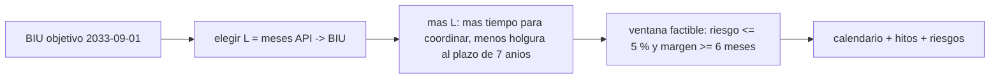

# B120-C06 — Caso de planificación regulatoria de un sistema satelital

<!-- nav:top -->
[🏠 Programa](../../../../README.md) · [📚 Bloque B120](../../../tronco-comun/B120-espectro-licencias-y-regulacion-satelital.md) · [← Anterior: B120-C05 — Riesgos de incumplimiento regulatorio](../B120-C05-riesgos-de-incumplimiento-regulatorio/CLASE.md) · [Siguiente: B121-C01 — Licencias y requisitos nacionales para el lanzamiento →](../../../tronco-comun/B121-regulacion-nacional-de-actividades-espaciales.md#b121-c01)
<!-- /nav -->

## 1. Ubicación, nivel y alcance

Clase 6 del bloque B120 y cierre del módulo. Nivel N4. Reúnes lo aprendido en un caso integrador: a partir de una fecha objetivo de puesta en servicio, construyes un plan regresivo que ordena la publicación anticipada, la coordinación, el expediente, la notificación y los hitos de despliegue, y lo evalúas con el riesgo de [B120-C05](../B120-C05-riesgos-de-incumplimiento-regulatorio/CLASE.md). Usas los plazos de [B120-C01](../B120-C01-licencias-satelitales-y-procedimiento-de-notificacion/CLASE.md), la coordinación de [B120-C02](../B120-C02-zonas-de-coordinacion-entre-servicios-radioelectricos/CLASE.md), los recursos de [B120-C03](../B120-C03-posiciones-orbitales-y-espectro-como-recursos-limitados/CLASE.md) y el expediente de [B120-C04](../B120-C04-documentacion-regulatoria-de-un-sistema-satelital/CLASE.md). **Esta clase es educativa: no es asesoría legal, regulatoria ni financiera y el plan no sirve para tramitar un sistema real.** El sistema «SINT-C» y todas sus fechas son sintéticos.

## 2. Por qué esta clase existe

Integrar licencias, frecuencias y plazos en un plan es el cierre del módulo y no existe un caso integrador regulatorio. La decisión central: **¿cuándo debe presentarse la publicación anticipada para que haya tiempo de coordinar y holgura frente al plazo, y qué riesgo restante queda?**

## 3. Lo que podrás hacer al terminar

1. Construir un calendario regulatorio hacia atrás desde una fecha de puesta en servicio.
2. Encontrar la ventana de anticipación que cumple a la vez un riesgo objetivo y un margen de coordinación.
3. Calcular las fechas de los hitos de despliegue a partir del plazo de siete años.
4. Verificar el plan con reglas y con una segunda aritmética de fechas.
5. Estimar el riesgo de plazo y de hitos con una fórmula y una simulación.
6. Rotular qué proviene de textos consultados, qué reglas son del curso y qué no se consultó, y declarar que no es asesoría.

La evidencia es el **plan regulatorio sintético con calendario, riesgos y límites** del ejercicio 12 (sección 20).

## 4. Con qué llegas y cómo comprobarlo

1. ¿Qué plazo máximo hay entre la publicación anticipada y la puesta en servicio, según el material consultado?
2. ¿Qué significa «a más tardar» incluyendo la fecha límite?
3. ¿Cómo se calcula `P(incumplir)` con retraso normal?
4. ¿Qué es un plan regresivo?
5. ¿Qué es un dato sintético?

<details>
<summary>Ver respuestas</summary>

1. Siete años. 2. Que la fecha límite misma cumple. 3. `1 − Φ((holgura − μ)/σ)`. 4. Un calendario que parte de la fecha final y retrocede. 5. Un dato inventado para el ejemplo, no real.
</details>

Con cuatro o cinco aciertos, sigue; si no, repasa los prerrequisitos.

## 5. Un caso de contexto y casos de referencia

Los documentos de la UIT consultados el 2026-11-11 —el marco regulatorio espacial (creado el 2018-01-10) y las diapositivas de 2022 sobre la Resolución 35— dan el esqueleto: publicación anticipada entre siete y dos años antes de la puesta en servicio, coordinación desde los seis meses, solicitud antes de los 24 meses, respuestas en cuatro meses, notificación no antes de tres años previos, puesta en servicio como máximo a siete años de la publicación e hitos del 10 %, 50 % y 100 % a dos, cinco y siete años de ese plazo (más 30 días). El **ejemplo conductor** es «SINT-C», un sistema sintético de 120 satélites (12 por lanzamiento, 2 lanzamientos por año) con puesta en servicio objetivo el 2033-09-01. Las reglas de negociación, examen y riesgo son del curso (**ilustrativas**).

## 6. Vocabulario

El **plan regresivo** parte de la fecha final. La **ventana de anticipación** `L` son los meses entre la publicación anticipada y la puesta en servicio. La **holgura** es `84 − L` meses. El **margen de coordinación** es el tiempo que sobra tras coordinar y examinar. Un **hito** es una fracción del sistema desplegada en una fecha. La **ruta crítica** es la cadena de pasos que fija la fecha más temprana posible.

## 7. Modelo mental: un calendario con dos fuerzas



*Descripción textual:* un `L` grande da más tiempo de coordinación pero deja menos holgura frente al plazo de siete años; la ventana factible concilia ambas fuerzas y de ella sale el calendario.

Analogía: una maleta que se prepara con tiempo pero que no puede salir demasiado pronto porque caduca. Límite: la ventana depende de supuestos propios del curso (14 meses de negociación, 5 % de riesgo).

## 8. La explicación, paso a paso

### 8.1 La tabla de anticipación

Con la BIU fija, el margen de coordinación es `L − (6 + 4 + 14 + 6) = L − 30` meses (espera de 6, respuesta de 4, negociación de 14 y examen de 6) y la holgura es `84 − L`. Con `D ~ N(8; 5)` meses, el riesgo de plazo pasa de 0,000 (L ≤ 48) a 0,036 (L = 67), 0,055 (L = 68) y 0,945 (L = 84).

### 8.2 La ventana factible

Pedir riesgo ≤ 5 % y margen ≥ 6 meses da `L` entre 36 y 67 meses. Se elige el punto medio, `L = 51` (convención del curso), y la publicación anticipada se recibe el 2029-06-01.

### 8.3 El calendario

Coordinación posible desde 2029-12-01; respuestas el 2030-04-01; coordinación concluida el 2031-06-01; notificación el 2031-07-01; información de diligencia el 2032-09-01; puesta en servicio el 2033-09-01 con informe de los 90 días el 2033-12-30; plazo de siete años el 2036-06-01; hitos M1, M2 y M3 el 2038-07-01, 2041-07-01 y 2043-07-01.

### 8.4 El riesgo restante

La holgura es de 33 meses y el riesgo de plazo es prácticamente nulo. Los hitos son el riesgo dominante: `P(fallar M1) = 0,018`, `P(fallar M2) = 0,029`, `P(fallar M3) = 0,109`. Tratados como independientes, la probabilidad de cumplir plazo e hitos es 0,849.

## 9. Magnitudes, símbolos y unidades

| Símbolo | Qué es | Unidad | Valor / nota |
|---|---|---|---|
| `L` | meses entre la API y la BIU | meses | 51 (elegido) |
| holgura | `84 − L` | meses | 33 |
| margen | `L − 30` | meses | 21 |
| `N` | satélites del sistema | — | 120 (sintético) |
| `m` | satélites por lanzamiento | — | 12 |
| `λ` | tasa de lanzamientos | 1/año | 2 |

## 10. Convenciones y referencias

Fechas AAAA-MM-DD; los meses se suman conservando el día. Las reglas de plazos y hitos provienen de los dos documentos fechados; no se consultó el Reglamento vigente ni la revisión de la Resolución 35 de la CMR-23, que modifica el cálculo de fechas. La regla de la diapositiva para la información inicial (M0) no se usa porque su enunciado no es claro. Hitos y plazo se tratan como independientes por simplicidad, aunque los hitos son acumulativos.

## 11. De dónde sale lo que afirmamos

| ID | Fuente | Localizador | Respalda | Estado |
|---|---|---|---|---|
| S1 | UIT, «ITU Radio Regulatory Framework for Space Services» (PDF; creación 2018-01-10; hasta la CMR-15) — https://www.itu.int/en/ITU-R/space/snl/Documents/ITU-Space_reg.pdf (consultada 2026-11-11) | secciones 4, 5 y 8 | plazos de API, coordinación, notificación, BIU y diligencia | Consultada (síntesis; no es el Reglamento) |
| S2 | UIT, 30.º Seminario Mundial de Radiocomunicaciones, «A milestone approach for NGSO systems, Resolution 35 (WRC-19)» (diapositivas, 24–28 de octubre de 2022) — https://www.itu.int/en/ITU-R/space/WRS22space/WRS22_RES35.pdf (consultada 2026-11-11) | diapositivas «Timeframe» y «Procedure» (caso 2) | fechas de los hitos | Consultada (material de seminario; no es la Resolución) |
| S3 | UIT, Oficina de Radiocomunicaciones, «Orbit-Spectrum International Regulatory Framework» (PDF; metadatos 2021-05-11) — https://www.itu.int/bestofwrs/wp-content/uploads/sites/15/2021/12/WRS-20-Orbit-Spectrum-Internatio_nal-Regulatory-Framework.pdf (consultada 2026-11-11) | diapositivas del marco legal | el registro en el MIFR da reconocimiento internacional; el Reglamento se revisa cada cuatro años | Consultada (presentación) |
| — | Reglamento vigente; Res. 35 (CMR-23); legislación nacional | — | texto exacto, prórrogas, licencia nacional | No consultado |
| — | Negociación, examen, riesgo objetivo, SINT-C | — | calendario y riesgos | Del curso / sintético |

Límites: el plan no incluye la licencia nacional ni la coordinación real; los parámetros son del curso; las fuentes son anteriores a la revisión de la CMR-23.

## 12. Cómo ver el plan

| Fecha | Paso |
|---|---|
| 2029-06-01 | API recibida |
| 2029-12-01 | Solicitud de coordinación |
| 2030-04-01 | Respuestas de las administraciones |
| 2031-06-01 | Coordinación concluida |
| 2031-07-01 | Notificación |
| 2032-09-01 | Información de diligencia |
| 2033-09-01 | BIU objetivo |
| 2036-06-01 | Límite de 7 años |
| 2038-07-01 / 2041-07-01 / 2043-07-01 | Hitos M1 / M2 / M3 |

Descripción larga: los pasos de trámite se concentran antes de la BIU; los hitos caen después del límite de siete años.

## 13. Ejemplo trabajado: la ventana

**Paso 1 · Fuerza 1.** Margen ≥ 6 → `L − 30 ≥ 6` → `L ≥ 36`.

**Paso 2 · Fuerza 2.** Riesgo ≤ 5 % → holgura ≥ `8 + 1,645 × 5 = 16,2` meses → `L ≤ 84 − 16,2 = 67,8` → `L ≤ 67`.

**Paso 3 · Ventana.** `36 ≤ L ≤ 67`; punto medio `(36 + 67)/2 = 51`.

**Paso 4 · Fecha.** `2033-09-01 − 51 meses = 2029-06-01`.

## 14. Distintas formas de describir el plan

**Por calendario:** la tabla de la sección 12. **Por ruta crítica:** espera, respuesta, negociación, examen. **Por riesgo:** plazo y hitos. **Por expediente:** lo que debe estar listo en cada fecha ([B120-C04](../B120-C04-documentacion-regulatoria-de-un-sistema-satelital/CLASE.md)). **Por recurso:** la posición o la banda de [B120-C03](../B120-C03-posiciones-orbitales-y-espectro-como-recursos-limitados/CLASE.md).

## 15. Práctica guiada

**Ejercicio 1 · con los pasos indicados.** Fecha de la API con `L = 40` para una BIU del 2033-09-01. *Pasos:* resta 40 meses.

<details><summary>Solución comentada</summary>

`2030-05-01`.
</details>

**Ejercicio 2 · con una pista.** Límite de siete años para esa API. *Pista:* suma 84 meses.

<details><summary>Solución comentada</summary>

`2037-05-01`.
</details>

**Ejercicio 3 · casi autónomo.** ¿Cuál es la holgura con `L = 40`?

<details><summary>Solución comentada</summary>

`84 − 40 = 44` meses.
</details>

## 16. Práctica autónoma, transferencia e integrador

**Ejercicio 4 · autónomo.** Margen de coordinación con `L = 40`.

<details><summary>Solución comentada</summary>

`40 − 30 = 10` meses.
</details>

**Ejercicio 5 · autónomo.** Fecha del hito M1 con límite de siete años el 2037-05-01.

<details><summary>Solución comentada</summary>

`2039-05-01 + 30 días = 2039-05-31`.
</details>

**Ejercicio 6 · autónomo.** Lanzamientos necesarios para el hito M2 con 120 satélites y 12 por lanzamiento.

<details><summary>Solución comentada</summary>

`0,5 × 120/12 = 5`.
</details>

**Ejercicio 7 · autónomo.** Ventana de `L` si se exige un margen de 12 meses.

<details><summary>Solución comentada</summary>

`L ≥ 42`; el límite superior sigue en 67: `42 ≤ L ≤ 67`.
</details>

**Ejercicio 8 · autónomo.** ¿Qué ocurre con la ventana si el retraso medio sube a 12 meses?

<details><summary>Solución comentada</summary>

La holgura necesaria es `12 + 1,645 × 5 = 20,2` meses, así que `L ≤ 63`; la ventana se acorta por arriba.
</details>

**Ejercicio 9 · transferencia.** **Transferencia.** ¿Por qué elegir el punto medio de la ventana es una convención y no una norma?

<details><summary>Solución comentada</summary>

Porque equilibra dos márgenes bajo supuestos del curso; el Reglamento no fija un `L` y otra organización pesaría distinto.
</details>

**Ejercicio 10 · transferencia.** **Transferencia.** El plan no incluye la licencia nacional. ¿Qué cambia en el calendario al añadirla?

<details><summary>Solución comentada</summary>

Aparecen plazos y requisitos de la administración (no consultados) que pueden adelantar la API o la notificación; habría que añadir esos pasos con su fuente.
</details>

**Ejercicio 11 · transferencia.** **Transferencia.** Los hitos son acumulativos, no independientes. ¿Hacia dónde se corrige la probabilidad de cumplir todo?

<details><summary>Solución comentada</summary>

Al haber dependencia positiva, la probabilidad conjunta de cumplir todos los hitos es mayor que el producto, así que 0,849 es una cota inferior aproximada bajo estos supuestos.
</details>

**Ejercicio 12 · integrador.** **Integrador.** Elabora tu *plan regulatorio sintético con calendario, riesgos y límites*: elige una BIU objetivo, calcula la ventana de `L`, el calendario completo con los hitos, el riesgo de plazo y de hitos, una sensibilidad y la lista de qué es consultado, del curso y no consultado, con el aviso de que no es asesoría legal, regulatoria ni financiera.

<details><summary>Solución comentada</summary>

Secciones 8, 12 y 13 y la salida del laboratorio.
</details>

## 17. Laboratorio: plan regresivo de «SINT-C»

El script [plan.py](plan.py) calcula la ventana de `L`, el calendario, las fechas de los hitos y los riesgos (**comprueba** las reglas del plan, la aritmética de fechas con una segunda vía en días y la simulación a 0,005).

**Datos:** plazos y hitos consultados (versiones fechadas); reglas de negociación, examen y riesgo **del curso**; sistema **sintético**. **Predice antes de ejecutar:** ¿qué hito concentra el mayor riesgo? (M3, el 100 %.) **Ejecución del 2026-11-11 (Python 3.12.9):**

```text
Python 3.12.9 (biblioteca estandar)
PLAN REGULATORIO SINTETICO «SINT-C»; plazos UIT 2018-01-10 y diapositivas Res. 35 (2022-10), consulta 2026-11-11; reglas del curso rotuladas. No es asesoria.
L [meses API->BIU]  holgura  P(incumplir BIU)  margen de coordinacion [meses]
                24       60           0.0000          -6
                30       54           0.0000           0
                36       48           0.0000           6
                48       36           0.0000          18
                60       24           0.0007          30
                67       17           0.0359          37
                68       16           0.0548          38
                72       12           0.2119          42
                84        0           0.9452          54
Ventana factible de L: 36..67 meses; se elige el punto medio L = 51 (convencion del curso)
Calendario del plan:
  2029-06-01  API recibida (t0)
  2029-12-01  Coordinacion posible desde (t0 + 6 m)
  2029-12-01  Solicitud de coordinacion (en cuanto es posible, t0 + 6 m)
  2030-04-01  Respuestas de las administraciones (+4 m)
  2031-06-01  Coordinacion concluida (+14 m de negociacion)
  2031-06-01  Informacion del lanzador (1 m antes de notificar)
  2031-07-01  Notificacion al registro
  2032-09-01  Informacion de diligencia (BIU - 12 m)
  2033-09-01  BIU objetivo
  2033-12-30  Informe de 90 dias continuos (BIU + 90 d + 30 d)
  2036-06-01  Limite de 7 anios desde la API
  2038-07-01  Hito M1 10 % ((limite + 2 anios) + 30 d)
  2041-07-01  Hito M2 50 % ((limite + 5 anios) + 30 d)
  2043-07-01  Hito M3 100 % ((limite + 7 anios) + 30 d)
Verificacion de reglas del plan: API dentro de [BIU-84m, BIU-24m]: True; BIU <= limite: True; notificacion >= BIU-36m: True; coordinacion concluida antes de notificar: True
Riesgo del plazo de BIU con holgura 33 meses: 0.0000
  simulacion = 0.0000 (diferencia 0.0000)
Riesgo de los hitos (120 satelites, 12 por lanzamiento, 2 lanzamientos/anio):
  M1 10 %: 1 lanzamientos en 2 anios (lambda T = 4) -> P(incumplir) = 0.0183
  M2 50 %: 5 lanzamientos en 5 anios (lambda T = 10) -> P(incumplir) = 0.0293
  M3 100 %: 10 lanzamientos en 7 anios (lambda T = 14) -> P(incumplir) = 0.1094
Probabilidad de cumplir el plazo y los tres hitos (independencia, hitos tratados por separado) = 0.8487
Pruebas superadas.
```

```bash
python programa/clases/B120/B120-C06-caso-de-planificacion-regulatoria-de-un-sistema-satelital/plan.py
```

**Límites:** sin licencia nacional; hitos independientes; parámetros no calibrados; fuentes anteriores a la revisión de la CMR-23.

## 18. Errores frecuentes y cómo corregirlos

**Presentar el plan como un trámite válido.** Se corrige con las secciones 1 y 21.

**Fijar `L` sin ver las dos fuerzas.** Se corrige con la tabla de 8.1.

**Mezclar reglas del texto con reglas del curso.** Se corrige con la sección 11.

**Olvidar la versión y fecha del texto.** Se corrige con la sección 10.

## 19. Cómo sabrás que vas bien

Tras la sección 8: ¿qué ventana de `L` esperabas y cuál obtuviste? Si dudas, repasa el ejemplo 13. Tras el laboratorio: ¿qué comprueba? (ver la sección 17).

## 20. Qué entregas y cómo se evalúa

El producto es tu **plan regulatorio sintético con calendario, riesgos y límites** (ejercicio 12).

| Criterio | Inicial | En desarrollo | Logrado | Destacado |
|---|---|---|---|---|
| Conceptos | Los confunde | Parciales | Integra plazos, coordinación, expediente y riesgo | Explica los límites del plan |
| Cálculo | Sin fechas | Con errores | Calendario y ventana correctos | Calcula casos nuevos |
| Numérico | Sin comprobar | Un caso | Dos aritméticas de fechas y simulación | Interpreta las diferencias |
| Fuentes | Sin fuente | Sin fecha | Fuentes con fecha, versión y estado | Declara lo no consultado |
| Límites | No los nombra | Uno | Tres | Discute qué falta del plan |

**Condiciones críticas (no se compensan con promedio):** rotular el sistema como sintético y las reglas propias como del curso; citar la versión y fecha del texto normativo; declarar que no es asesoría legal, regulatoria ni financiera.

## 21. Ética, seguridad y límites

Clase educativa: **no es asesoría legal, regulatoria ni financiera**; el sistema, las fechas y los riesgos son sintéticos y ningún resultado debe usarse para planificar o tramitar un sistema real. Los plazos citados provienen de documentos fechados de la UIT y pueden diferir del texto vigente del Reglamento de Radiocomunicaciones. Accesibilidad: tablas equivalentes a las gráficas, fórmulas en texto, ejercicios sin conexión.

## 22. Para cerrar y seguir

Para una puesta en servicio sintética del 2033-09-01, la ventana de anticipación es de 36 a 67 meses; con 51 meses la API se recibe el 2029-06-01, la holgura es de 33 meses y el riesgo dominante pasa a los hitos (0,109 para el 100 %). Con esto termina el bloque. Queda una pregunta: ¿qué agrega la regulación nacional a este plan internacional?

**Glosario español–inglés.** plan regresivo · *backward schedule*; ventana de anticipación · *lead-time window*; ruta crítica · *critical path*; hito · *milestone*; puesta en servicio · *bringing into use (BIU)*.

**Continuidad.** [B121](../../../tronco-comun/B121-regulacion-nacional-de-actividades-espaciales.md) estudia la regulación nacional de actividades espaciales.

**Referencias:** ver sección 11.

<!-- nav:bottom -->
---

[← Anterior: B120-C05 — Riesgos de incumplimiento regulatorio](../B120-C05-riesgos-de-incumplimiento-regulatorio/CLASE.md) · [📚 Bloque B120](../../../tronco-comun/B120-espectro-licencias-y-regulacion-satelital.md) · [Siguiente: B121-C01 — Licencias y requisitos nacionales para el lanzamiento →](../../../tronco-comun/B121-regulacion-nacional-de-actividades-espaciales.md#b121-c01)
<!-- /nav -->
