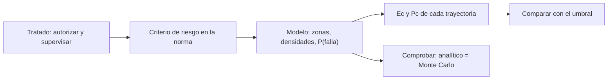

# B121-C01 — Licencias y requisitos nacionales para el lanzamiento

<!-- nav:top -->
[🏠 Programa](../../../../README.md) · [📚 Bloque B121](../../../tronco-comun/B121-regulacion-nacional-de-actividades-espaciales.md) · [← Anterior: B120-C06 — Caso de planificación regulatoria de un sistema satelital](../../../tronco-comun/B120-espectro-licencias-y-regulacion-satelital.md#b120-c06) · [Siguiente: B121-C02 — Licenciamiento de actividades de teledetección →](../B121-C02-licenciamiento-de-actividades-de-teledeteccion/CLASE.md)
<!-- /nav -->

## 1. Ubicación, nivel y alcance

Clase 1 del bloque B121. Nivel N4. Un Estado es responsable de lo que lanzan sus nacionales y, para cumplirlo, exige una licencia. Aquí ves la parte medible de esa licencia: el riesgo que un lanzamiento impone al público. Conecta con B119-C08, que trata la autorización en general. **Esta clase es educativa: no es asesoría legal, regulatoria ni financiera, no sustituye a un abogado ni a la autoridad competente y cita la versión y la fecha del texto normativo consultado.** Los datos son sintéticos o ilustrativos salvo los umbrales y textos que se rotulan como consultados.

## 2. Por qué esta clase existe

La autorización de un lanzamiento no es un trámite abstracto: incluye criterios numéricos de riesgo. La decisión central: **¿una trayectoria cumple el criterio de riesgo colectivo e individual que exige la licencia y con qué margen?**

## 3. Lo que podrás hacer al terminar

1. Explicar por qué el Tratado del Espacio obliga al Estado a autorizar y supervisar a sus operadores privados.
2. Calcular las bajas esperadas `Ec` de un lanzamiento con un modelo de zonas de impacto.
3. Calcular la probabilidad individual de baja `Pc` de la persona más expuesta.
4. Comparar `Ec` y `Pc` con los umbrales del texto consultado (14 CFR 450.101(a)).
5. Verificar el cálculo analítico con una simulación de Monte Carlo.
6. Rotular qué es texto normativo consultado y qué es dato sintético.

La evidencia es tu *ficha de riesgo de tres trayectorias sintéticas* del ejercicio 12 (sección 20).

## 4. Con qué llegas y cómo comprobarlo

1. ¿Qué es una probabilidad condicional?
2. ¿Qué es un valor esperado?
3. ¿Qué es un Estado de lanzamiento?
4. ¿Qué es una simulación de Monte Carlo?
5. ¿Qué distingue una recomendación de una obligación?

<details>
<summary>Ver respuestas</summary>

1. La probabilidad de un suceso sabiendo que otro ocurrió. 2. El promedio ponderado por probabilidad. 3. El que lanza, hace lanzar o aporta territorio o instalación para el lanzamiento (Art. VII, copia consultada). 4. Estimar una cantidad repitiendo un experimento aleatorio muchas veces. 5. La obligación es exigible por la norma; la recomendación orienta sin imponer.

</details>

Con cuatro o cinco aciertos, sigue; si no, repasa los prerrequisitos.

## 5. Un caso de contexto y casos de referencia

El Art. VI del Tratado del Espacio dice que los Estados responden internacionalmente por sus actividades nacionales, públicas o privadas, y que las privadas requieren autorización y supervisión continua del Estado pertinente; el Art. VII hace internacionalmente responsable al Estado que lanza, hace lanzar o aporta el territorio o la instalación (copia de la NASA, consultada). Una norma nacional que concreta esto es 14 CFR 450.101(a), que fija para el público un máximo de `1 × 10⁻⁴` bajas esperadas y de `1 × 10⁻⁶` de probabilidad de baja por lanzamiento (eCFR, consultado). El **ejemplo conductor** compara tres trayectorias **sintéticas**: A por mar abierto (`Ec = 1,8 × 10⁻⁵`, cumple), B costera (`4,2 × 10⁻⁴`, no cumple) y C sobre zona poblada (`9,7 × 10⁻⁴`, no cumple); las tres cumplen el criterio individual.

## 6. Vocabulario

La **licencia** es la autorización estatal previa. El **riesgo colectivo** `Ec` es el número esperado de bajas. El **riesgo individual** `Pc` es la probabilidad de baja de una persona. La **zona de impacto** es un área donde pueden caer fragmentos. El **área de baja** `A_cas` es el área en la que un fragmento causa una baja. La **falla de vuelo** es la pérdida del vehículo antes de completar la trayectoria. La **supervisión continua** es la vigilancia del Estado tras otorgar la licencia.

## 7. Modelo mental



*Descripción textual:* el tratado obliga a autorizar, la norma fija un criterio de riesgo, el modelo calcula `Ec` y `Pc` por trayectoria y se comparan con el umbral y con una simulación.

Analogía: un permiso de obras que exige que, si la grúa cae, el riesgo para los vecinos no supere un límite. Límite: el modelo de zonas ignora la dispersión real de fragmentos y la hora del día.

## 8. La explicación, paso a paso

### 8.1 Riesgo colectivo

Dado que hay una falla (probabilidad `P_f`), el fragmento cae en la zona `z` con probabilidad `f_z`. Las bajas esperadas son `Ec = P_f · Σ_z f_z · ρ_z · A_cas`, con `ρ_z` en personas/km² y `A_cas` en km².

### 8.2 Riesgo individual

Para una persona en la zona `z`, `Pc = P_f · f_z · A_cas / A_z`. Se toma el máximo entre zonas habitadas. Un riesgo individual bajo no garantiza un riesgo colectivo bajo: `Ec` suma sobre mucha gente.

### 8.3 Qué cambia la licencia

Con `P_f = 0,03` y `A_cas = 0,004 km²`, la trayectoria A da `Ec = 1,824 × 10⁻⁵`; B, `4,248 × 10⁻⁴`; C, `9,720 × 10⁻⁴`. Solo A cumple `Ec ≤ 10⁻⁴`; las tres cumplen `Pc ≤ 10⁻⁶`. Para que C cumpla habría que bajar `P_f` a `3,09 × 10⁻³` o desplazar la trayectoria.

### 8.4 Verificación

El Monte Carlo (400 000 muestras condicionales a la falla, semilla 121) reproduce `Ec` dentro del 10 % relativo (o `2 × 10⁻⁵` absoluto). Una sola vía no basta para dar el cálculo por bueno.

## 9. Magnitudes, símbolos y unidades

| Símbolo | Qué es | Unidad | Valor / nota |
|---|---|---|---|
| `P_f` | probabilidad de falla | — | 0,03 (sintético) |
| `f_z` | fracción de la falla en la zona | — | ver tabla |
| `ρ_z` | densidad | personas/km² | 0–4000 (sintético) |
| `A_cas` | área de baja | km² | 0,004 (sintético) |
| `A_z` | área de la zona | km² | 60–5×10⁵ (sintético) |
| `Ec`, `Pc` | riesgo colectivo e individual | — | umbrales 10⁻⁴ y 10⁻⁶ (consultados) |

## 10. Convenciones y referencias

Modelo de zonas discretas, sin geodesia: no hay sistema de referencia. Falla única, fragmentos independientes, densidad uniforme por zona. Tolerancia de la verificación: 10 % relativo o `2 × 10⁻⁵` absoluto. Los umbrales son los de 14 CFR 450.101(a) según el eCFR consultado el 2026-11-11 (la página no muestra fecha de vigencia). Todos los demás números son sintéticos.

## 11. De dónde sale lo que afirmamos

| ID | Fuente | Localizador | Respalda | Estado |
|---|---|---|---|---|
| S1 | Tratado del Espacio Ultraterrestre, copia de NASA History (SP-4225) — https://www.nasa.gov/history/SP-4225/documentation/cooperation/treaty.htm (consultada 2026-11-11) | arts. VI y VII | responsabilidad del Estado, autorización y supervisión continua de actividades privadas, Estado de lanzamiento | Consultada |
| S2 | 14 CFR § 450.101, eCFR — https://www.ecfr.gov/ (API versionador, 2026-11-01; consultada 2026-11-11) | (a) | umbrales `Ec ≤ 1×10⁻⁴` y `Pc ≤ 1×10⁻⁶` para el público; `2×10⁻⁴` y `1×10⁻⁵` para personal de operaciones vecinas | Consultada |
| S3 | 14 CFR § 450.3, eCFR (consultada 2026-11-11) | alcance | la licencia de operador cubre uno o varios lanzamientos o reentradas con el mismo vehículo o familia | Consultada |
| — | Zonas, poblaciones, `P_f`, `A_cas` | — | todos los números del laboratorio | Sintético |

Límites: no se leyó el resto de la Parte 450 ni la ley nacional de ningún otro país; no se consultó el texto de la Convención sobre Responsabilidad. Lo rotulado «No consultado» no se afirma. Esta clase no es asesoría legal: la versión y la fecha citadas caducan cuando el texto cambia.

## 12. Cómo ver el resultado

| Magnitud | Valor |
|---|---|
| `Ec` A / B / C | 1,824 × 10⁻⁵ / 4,248 × 10⁻⁴ / 9,720 × 10⁻⁴ |
| `Pc` A / B / C | 2,0 × 10⁻¹⁰ / 4,9 × 10⁻⁹ / 9,5 × 10⁻⁹ |
| Cumplen `Ec` | solo A |
| `P_f` máxima de C | 3,09 × 10⁻³ |

Descripción larga: la trayectoria sobre mar abierto cumple; las que pasan cerca de población multiplican `Ec` por 23 y 53 aunque `Pc` siga muy por debajo del umbral.

## 13. Ejemplo trabajado

**Paso 1 · Datos.** Trayectoria B: `f = (océano 0,9900; isla 0,0050; costa 0,0049; ciudad 0,0001)`, densidades `(0; 40; 600; 4000)`.

**Paso 2 · Suma.** `Σ f ρ = 0,0050·40 + 0,0049·600 + 0,0001·4000 = 0,2 + 2,94 + 0,4 = 3,54`.

**Paso 3 · `Ec`.** `0,03 · 3,54 · 0,004 = 4,248 × 10⁻⁴`, que supera `10⁻⁴` en un factor 4,2.

**Paso 4 · `Pc`.** En la costa: `0,03 · 0,0049 · 0,004 / 120 = 4,9 × 10⁻⁹`, muy bajo el umbral individual.

## 14. Distintas formas de describir el problema

**Por zona:** tabla `f`, `ρ`. **Por riesgo:** `Ec` y `Pc`. **Por margen:** razón umbral/valor. **Por decisión:** cumple o no. **Por sensibilidad:** `P_f` máxima admisible.

## 15. Práctica guiada

**Ejercicio 1 · con los pasos indicados.** Calcula `Ec` de la trayectoria A. *Pasos:* `Σ f ρ`, luego `P_f · Σ · A_cas`.

<details><summary>Solución comentada</summary>

`Σ = 0,0008·40 + 0,0002·600 = 0,152`; `Ec = 0,03 · 0,152 · 0,004 = 1,824 × 10⁻⁵`.
</details>

**Ejercicio 2 · con una pista.** ¿Qué `P_f` máxima admite B para `Ec ≤ 10⁻⁴`? *Pista:* `Ec/P_f` no depende de `P_f`.

<details><summary>Solución comentada</summary>

`Ec/P_f = 4,248×10⁻⁴/0,03 = 0,01416`; `P_f ≤ 10⁻⁴/0,01416 = 7,06 × 10⁻³`.
</details>

**Ejercicio 3 · casi autónomo.** ¿Cuántas veces mayor es `Ec` de C que el de A?

<details><summary>Solución comentada</summary>

`9,72×10⁻⁴ / 1,824×10⁻⁵ = 53,3`.
</details>

## 16. Práctica autónoma, transferencia e integrador

**Ejercicio 4 · autónomo.** ¿Cuánto hay que reducir `Ec` de C para cumplir?

<details><summary>Solución comentada</summary>

Un factor `9,72` (de `9,72×10⁻⁴` a `10⁻⁴`).
</details>

**Ejercicio 5 · autónomo.** ¿Cumple B el criterio individual y con qué margen?

<details><summary>Solución comentada</summary>

Sí: `4,9×10⁻⁹ ≤ 10⁻⁶`, margen `10⁻⁶/4,9×10⁻⁹ ≈ 204`.
</details>

**Ejercicio 6 · autónomo.** Si `A_cas` se duplica a `0,008 km²`, ¿qué pasa con A?

<details><summary>Solución comentada</summary>

`Ec` se duplica a `3,65 × 10⁻⁵`: aún cumple.
</details>

**Ejercicio 7 · autónomo.** Si `P_f = 0,003` en B, ¿cumple?

<details><summary>Solución comentada</summary>

`Ec = 4,248 × 10⁻⁵ ≤ 10⁻⁴`: cumple.
</details>

**Ejercicio 8 · autónomo.** Error relativo del Monte Carlo en A (`1,792×10⁻⁵` frente a `1,824×10⁻⁵`).

<details><summary>Solución comentada</summary>

`(1,792 − 1,824)/1,824 = −1,8 %`, dentro de la tolerancia del 10 %.
</details>

**Ejercicio 9 · transferencia.** **Transferencia.** ¿Por qué el Tratado exige que el Estado autorice las actividades de una empresa privada?

<details><summary>Solución comentada</summary>

Porque según el Art. VI (copia consultada) el Estado responde internacionalmente por ellas; sin autorización y supervisión no podría controlar esa responsabilidad.
</details>

**Ejercicio 10 · transferencia.** **Transferencia.** Una empresa de un país lanza desde el territorio de otro. ¿Cuántos Estados pueden ser «de lanzamiento» según el Art. VII?

<details><summary>Solución comentada</summary>

Más de uno: el que lanza o hace lanzar y el que aporta territorio o instalación; el reparto de cargas se acuerda entre ellos.
</details>

**Ejercicio 11 · transferencia.** **Transferencia.** Una jurisdicción exige `Ec ≤ 5×10⁻⁵`. ¿Qué trayectorias de la tabla cumplen?

<details><summary>Solución comentada</summary>

Solo A (`1,8×10⁻⁵`); B y C no.
</details>

**Ejercicio 12 · integrador.** **Integrador.** Elabora tu *ficha de riesgo de tres trayectorias sintéticas*: tabla `Ec`, `Pc`, margen, verificación Monte Carlo, `P_f` máxima admisible y una lista de qué es consultado y qué es sintético, con el aviso de que es educativa.

<details><summary>Solución comentada</summary>

Secciones 8.1–8.4 y la salida del laboratorio.
</details>

## 17. Laboratorio

El script [riesgo_lanzamiento.py](riesgo_lanzamiento.py) calcula `Ec` y `Pc` de tres trayectorias, las compara con los umbrales y contrasta `Ec` con un Monte Carlo (**comprueba** a 10 % relativo o `2×10⁻⁵`). Tarda unos segundos.

**Datos:** los umbrales de 14 CFR 450.101(a) son consultados; zonas, poblaciones y probabilidades son **sintéticos**. **Predice antes de ejecutar:** ¿Cumplirá B el criterio individual aunque falle el colectivo? (sí.) **Ejecución del 2026-11-11 (Python 3.12.9):**

```text
Python 3.12.9 (biblioteca estandar)
Zonas, poblaciones y probabilidades SINTETICAS; umbrales de 14 CFR 450.101(a) consultados 2026-11-11.
Umbrales: Ec <= 1e-04, Pc individual <= 1e-06; P_falla = 0.03, A_cas = 0.004 km2
opcion                           Ec      Ec MC    Pc ind.  Ec ok  Pc ok
A_mar_abierto             1.824e-05  1.792e-05  2.000e-10  True   True 
B_costera                 4.248e-04  4.346e-04  4.900e-09  False  True 
C_sobre_zona_poblada      9.720e-04  9.841e-04  9.500e-09  False  True 
Ec condicional a la falla (C) = 0.0324 bajas; P_falla maxima admisible = 3.09e-03
Pruebas superadas.
```

```bash
python programa/clases/B121/B121-C01-licencias-y-requisitos-nacionales-para-el-lanzamiento/riesgo_lanzamiento.py
```

**Límites:** zonas discretas, una sola falla, densidad uniforme; ignora el tiempo de exposición, los refugios y la dispersión real; no es un análisis de seguridad de vuelo.

## 18. Errores frecuentes y cómo corregirlos

**Creer que cumplir el riesgo individual implica cumplir el colectivo.** Se corrige con 8.2 y 8.3.

**Usar un umbral sin su versión y fecha.** Se corrige con la sección 10.

**Tomar el modelo de zonas como un análisis de seguridad de vuelo.** Se corrige con la sección 21.

**Dar por verificado un valor con una sola vía.** Se corrige con 8.4.

## 19. Cómo sabrás que vas bien

Tras la sección 8: ¿qué resultado esperabas y cuál obtuviste? Si dudas, repasa el ejemplo 13. Tras el laboratorio: ¿qué comprueba? (ver la sección 17).

## 20. Qué entregas y cómo se evalúa

El producto es tu *ficha de riesgo de tres trayectorias sintéticas* (ejercicio 12).

| Criterio | Inicial | En desarrollo | Logrado | Destacado |
|---|---|---|---|---|
| Conceptos | Los confunde | Parciales | Aplica el requisito al diseño | Explica los límites |
| Cálculo | Sin unidades | Con errores | Tablas completas con unidades | Calcula casos nuevos |
| Numérico | Sin comprobar | Un caso | Contraste con una segunda vía | Interpreta las diferencias |
| Fuentes | Sin fuente | Sin fecha | Fuentes con versión, fecha y estado | Declara lo sintético y lo no consultado |
| Límites | No los nombra | Uno | Tres | Discute qué falta del modelo |

**Condiciones críticas (no se compensan con promedio):** citar versión y fecha de cada texto normativo; rotular lo sintético e hipotético; no presentar el resultado como asesoría legal, regulatoria ni financiera.

## 21. Ética, seguridad y límites

Clase educativa: **no es asesoría legal, regulatoria ni financiera** y no sustituye a un abogado, a la autoridad competente ni a la revisión de un especialista; ningún resultado debe usarse para decidir si una misión real cumple una norma. Los textos normativos cambian: cada cita indica versión y fecha de consulta y caduca con ellas. Los modelos son simplificados y sus datos son sintéticos o ilustrativos. Accesibilidad: tablas equivalentes a las gráficas, fórmulas en texto, ejercicios sin conexión.

## 22. Para cerrar y seguir

Con `P_f = 0,03`, una trayectoria sobre mar abierto da `Ec = 1,8 × 10⁻⁵` y cumple, mientras que la costera (`4,2 × 10⁻⁴`) y la poblada (`9,7 × 10⁻⁴`) no, aunque las tres cumplan el criterio individual.

**Glosario español–inglés.** licencia · *license*; riesgo colectivo · *collective risk*; bajas esperadas · *expected casualties*; falla de vuelo · *flight failure*; Estado de lanzamiento · *launching State*.

**Continuidad.** [B121-C02](../B121-C02-licenciamiento-de-actividades-de-teledeteccion/CLASE.md) trata la regulación de la teledetección.

**Referencias:** ver sección 11.

<!-- nav:bottom -->
---

[← Anterior: B120-C06 — Caso de planificación regulatoria de un sistema satelital](../../../tronco-comun/B120-espectro-licencias-y-regulacion-satelital.md#b120-c06) · [📚 Bloque B121](../../../tronco-comun/B121-regulacion-nacional-de-actividades-espaciales.md) · [Siguiente: B121-C02 — Licenciamiento de actividades de teledetección →](../B121-C02-licenciamiento-de-actividades-de-teledeteccion/CLASE.md)
<!-- /nav -->
