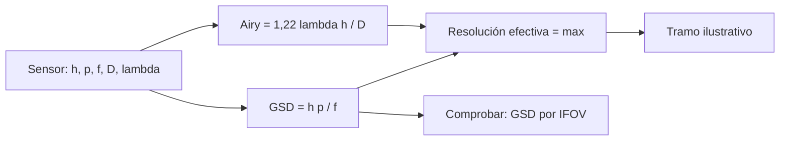

# B121-C02 — Licenciamiento de actividades de teledetección

<!-- nav:top -->
[🏠 Programa](../../../../README.md) · [📚 Bloque B121](../../../tronco-comun/B121-regulacion-nacional-de-actividades-espaciales.md) · [← Anterior: B121-C01 — Licencias y requisitos nacionales para el lanzamiento](../B121-C01-licencias-y-requisitos-nacionales-para-el-lanzamiento/CLASE.md) · [Siguiente: B121-C03 — Protección ambiental en la legislación espacial →](../B121-C03-proteccion-ambiental-en-la-legislacion-espacial/CLASE.md)
<!-- /nav -->

## 1. Ubicación, nivel y alcance

Clase 2 del bloque B121. Nivel N4. Las imágenes satelitales de alta resolución tienen un régimen propio porque cuanto más fino es el detalle, mayor es su sensibilidad. Aquí calculas la variable técnica sobre la que se apoya ese régimen: la resolución. Usas [C01](../B121-C01-licencias-y-requisitos-nacionales-para-el-lanzamiento/CLASE.md) solo como contexto de la autorización estatal. **Esta clase es educativa: no es asesoría legal, regulatoria ni financiera, no sustituye a un abogado ni a la autoridad competente y cita la versión y la fecha del texto normativo consultado.** Los datos son sintéticos o ilustrativos salvo los umbrales y textos que se rotulan como consultados.

## 2. Por qué esta clase existe

Ninguna clase anterior trata la regulación de la teledetección. La decisión central: **¿en qué tramo de resolución cae un sensor y qué licencia o condiciones podría implicar?** (los tramos del laboratorio son ilustrativos).

## 3. Lo que podrás hacer al terminar

1. Calcular el GSD de un sensor óptico con `GSD = h·p/f` y verificarlo con el IFOV.
2. Calcular el límite de difracción `1,22·λ·h/D` y la resolución efectiva.
3. Decidir si un sensor está limitado por geometría o por difracción.
4. Calcular la altitud máxima para un tramo de resolución dado.
5. Describir el marco de principios de la ONU de 1986 y el propósito del régimen de licencias estadounidense.
6. Separar lo consultado de los umbrales ilustrativos del laboratorio.

La evidencia es tu *tabla de resolución de cinco sensores sintéticos* del ejercicio 12 (sección 20).

## 4. Con qué llegas y cómo comprobarlo

1. ¿Qué es un píxel y su paso?
2. ¿Qué es la distancia focal?
3. ¿Qué es la difracción?
4. ¿Qué es un ángulo pequeño?
5. ¿Qué es una verificación por segunda vía?

<details>
<summary>Ver respuestas</summary>

1. La unidad de la imagen y la distancia entre centros en el detector. 2. La distancia entre el centro óptico y el plano del detector. 3. El ensanchamiento de la imagen de un punto por la apertura finita. 4. Uno donde `tan θ ≈ θ`. 5. Calcular lo mismo con otro método y comparar.

</details>

Con cuatro o cinco aciertos, sigue; si no, repasa los prerrequisitos.

## 5. Un caso de contexto y casos de referencia

La resolución 41/65 de la Asamblea General, adoptada el 1986-12-03 sin votación, enuncia los *Principios sobre la teleobservación de la Tierra desde el espacio* (metadatos consultados; el texto íntegro no se leyó). En la norma estadounidense, 15 CFR 960.1 declara que la Parte 960 aplica la facultad de licenciar sistemas privados de teledetección bajo la ley de 1992, con el propósito de promover la innovación privada y sopesando cargas de la licencia frente a beneficios para la seguridad nacional (eCFR, consultado). Ninguna de las dos fuentes consultadas fija un umbral numérico de resolución, así que el **ejemplo conductor** usa tramos de `0,25; 0,5; 1 y 5 m` **ilustrativos** y cinco sensores **sintéticos**: solo S3 alcanza `0,5 m`.

## 6. Vocabulario

El **GSD** (*ground sample distance*) es la distancia en el suelo entre píxeles. El **IFOV** es el ángulo que ve un píxel. El **disco de Airy** es la imagen de un punto limitada por difracción. La **resolución efectiva** es el mayor entre GSD y disco de Airy proyectado (regla simplificada). El **tramo** es un intervalo de resolución al que una norma podría asociar condiciones. Los **datos primarios** son los medidos por el sensor.

## 7. Modelo mental



*Descripción textual:* el sensor define GSD y difracción, el mayor de los dos es la resolución efectiva, que cae en un tramo; el GSD se comprueba por otra vía.

Analogía: leer un cartel desde lejos; ves menos letras por la distancia (GSD) y por lo borroso de tus ojos (difracción), y manda lo peor. Límite: el sistema real tiene además movimiento, atmósfera y procesamiento.

## 8. La explicación, paso a paso

### 8.1 GSD

En geometría nadir y ángulo pequeño, `GSD = h·p/f` con `h` en m, `p` en m y `f` en m. Para `h = 480 km`, `p = 10 µm`, `f = 9,6 m` resulta `0,500 m`.

### 8.2 Difracción

El radio de Airy proyectado es `1,22·λ·h/D`. Con `λ = 0,55 µm`, `D = 1,1 m`, `h = 480 km`: `0,293 m`. Es menor que el GSD, así que S3 está limitado por geometría.

### 8.3 Resolución efectiva y tramos

`res = max(GSD, Airy)`. S1 `3,25 m`, S2 `1,26 m` y S4 `5,25 m` quedan en tramos de `5 m` o sin tramo; S5 (`35,6 m`) queda sin tramo. S3 (`0,50 m`) alcanza el tramo de `0,5 m`.

### 8.4 Altitud máxima

Para que S3 se mantenga en `≤ 0,5 m` la altitud no puede superar `480,0 km` por GSD (la difracción permitiría `819,7 km`). A `600 km` el GSD sube a `0,625 m`: una decisión de órbita cambia el tramo regulatorio.

## 9. Magnitudes, símbolos y unidades

| Símbolo | Qué es | Unidad | Valor / nota |
|---|---|---|---|
| `h` | altitud | m | 4,8–8×10⁵ (sintético) |
| `p` | paso de píxel | µm | 6,5–20 |
| `f` | focal | m | 0,45–9,6 |
| `D` | apertura | m | 0,10–1,1 |
| `λ` | longitud de onda | µm | 0,55 |
| GSD, Airy | resoluciones | m | 0,29–35,6 |

## 10. Convenciones y referencias

Geometría nadir sobre una Tierra plana local; sin curvatura, rotación terrestre, ángulo fuera de nadir ni actividad atmosférica. Tolerancia: GSD por las dos vías con diferencia relativa `< 10⁻⁹`. Los sensores y los tramos son sintéticos/ilustrativos; ningún umbral numérico procede de una norma.

## 11. De dónde sale lo que afirmamos

| ID | Fuente | Localizador | Respalda | Estado |
|---|---|---|---|---|
| S1 | UN General Assembly, A/RES/41/65, *Principles Relating to Remote Sensing of the Earth from Outer Space*, 1986-12-03 — registro UN Digital Library 126423 (consultado 2026-11-11 por resultado de búsqueda; texto no leído) | metadatos | adopción el 1986-12-03 sin votación | Consultada (solo metadatos) |
| S2 | 15 CFR § 960.1, eCFR (consultada 2026-11-11) | Propósito | la Parte 960 licencia sistemas privados de teledetección bajo la Land Remote Sensing Policy Act de 1992 (51 U.S.C. 60101 y ss.) | Consultada |
| — | Fórmulas de GSD, IFOV y disco de Airy; tramos de resolución | — | el cálculo y los tramos | No consultadas en una fuente concreta / Ilustrativo |
| — | Sensores | — | todos los números | Sintético |

Límites: no se leyó el contenido de los principios de 1986 ni las demás secciones de la Parte 960; no se consultó ninguna ley de otro país. Lo rotulado «No consultado» no se afirma. Esta clase no es asesoría legal: la versión y la fecha citadas caducan cuando el texto cambia.

## 12. Cómo ver el resultado

| Magnitud | Valor |
|---|---|
| S1 / S2 / S3 | 3,25 / 1,26 / 0,50 m |
| S4 / S5 | 5,25 / 35,6 m |
| Altitud máxima S3 a ≤ 0,5 m | 480,0 km (GSD) |
| GSD de S3 a 600 km | 0,625 m |

Descripción larga: solo el sensor de mayor focal alcanza el tramo de 0,5 m; subir la órbita lo saca del tramo.

## 13. Ejemplo trabajado

**Paso 1 · Datos.** S2: `h = 550 km`, `p = 8 µm`, `f = 3,5 m`, `D = 0,5 m`, `λ = 0,55 µm`.

**Paso 2 · GSD.** `550×10³ · 8×10⁻⁶ / 3,5 = 1,257 m`.

**Paso 3 · Airy.** `1,22 · 0,55×10⁻⁶ · 550×10³ / 0,5 = 0,738 m`.

**Paso 4 · Resultado.** `res = 1,257 m`; está limitado por geometría, no por difracción.

## 14. Distintas formas de describir el problema

**Por geometría:** GSD. **Por óptica:** disco de Airy. **Por tramo:** umbral ilustrativo. **Por órbita:** altitud máxima. **Por norma:** propósito y principios.

## 15. Práctica guiada

**Ejercicio 1 · con los pasos indicados.** Calcula el GSD de S1. *Pasos:* `h·p/f` con unidades en m.

<details><summary>Solución comentada</summary>

`500×10³ · 6,5×10⁻⁶ / 1,00 = 3,25 m`.
</details>

**Ejercicio 2 · con una pista.** Calcula el disco de Airy de S5. *Pista:* `1,22·λ·h/D`.

<details><summary>Solución comentada</summary>

`1,22 · 0,55×10⁻⁶ · 800×10³ / 0,10 = 5,37 m`.
</details>

**Ejercicio 3 · casi autónomo.** ¿Está S5 limitado por GSD o por difracción?

<details><summary>Solución comentada</summary>

Por GSD (`35,6 m` frente a `5,37 m`).
</details>

## 16. Práctica autónoma, transferencia e integrador

**Ejercicio 4 · autónomo.** ¿Qué focal necesita S1 para `GSD = 1 m`?

<details><summary>Solución comentada</summary>

`f = h·p/GSD = 500×10³·6,5×10⁻⁶/1 = 3,25 m`.
</details>

**Ejercicio 5 · autónomo.** ¿Qué apertura mínima necesita S4 para un disco de Airy de `0,5 m`?

<details><summary>Solución comentada</summary>

`D = 1,22·0,55×10⁻⁶·700×10³/0,5 = 0,94 m`.
</details>

**Ejercicio 6 · autónomo.** ¿Qué focal necesita S2 para `GSD = 0,5 m`?

<details><summary>Solución comentada</summary>

`f = 550×10³·8×10⁻⁶/0,5 = 8,8 m`.
</details>

**Ejercicio 7 · autónomo.** GSD de S3 a `400 km`.

<details><summary>Solución comentada</summary>

`400×10³·10×10⁻⁶/9,6 = 0,417 m`.
</details>

**Ejercicio 8 · autónomo.** ¿Cuál es la altitud máxima de S3 por difracción para `0,5 m`?

<details><summary>Solución comentada</summary>

`0,5·1,1/(1,22·0,55×10⁻⁶) = 819,7 km`; manda el GSD (`480 km`).
</details>

**Ejercicio 9 · transferencia.** **Transferencia.** Un operador quiere elevar la órbita de S3 a `600 km`. ¿Qué implicación regulatoria podría tener?

<details><summary>Solución comentada</summary>

Su GSD pasa de `0,50` a `0,625 m`: podría cambiar de tramo y de condiciones, si la norma aplicable usa la resolución como criterio (hay que verificarlo en el texto vigente).
</details>

**Ejercicio 10 · transferencia.** **Transferencia.** ¿Por qué un régimen de licencias sopesa «cargas para el licenciatario» frente a «seguridad nacional»?

<details><summary>Solución comentada</summary>

Porque el propósito declarado de 15 CFR 960.1 incluye ambas: promover la innovación privada sin perder el control de riesgos.
</details>

**Ejercicio 11 · transferencia.** **Transferencia.** Un satélite mejora su resolución con procesamiento (superresolución). ¿Qué falla en la regla `max(GSD, Airy)`?

<details><summary>Solución comentada</summary>

Que la resolución efectiva ya no queda fijada solo por el hardware; una norma basada en el sensor debe decir si mide el producto o el instrumento.
</details>

**Ejercicio 12 · integrador.** **Integrador.** Elabora tu *tabla de resolución de cinco sensores sintéticos*: GSD, Airy, resolución efectiva, tramo ilustrativo, altitud máxima, verificación por IFOV y lista de qué es consultado e ilustrativo, con el aviso de que es educativa.

<details><summary>Solución comentada</summary>

Secciones 8.1–8.4 y la salida del laboratorio.
</details>

## 17. Laboratorio

El script [resolucion_sensor.py](resolucion_sensor.py) calcula GSD por dos vías (**comprueba** a `10⁻⁹` relativo), el disco de Airy, la resolución efectiva, el tramo ilustrativo y la altitud máxima de S3.

**Datos:** solo los propósitos de A/RES/41/65 y de 15 CFR 960.1 son consultados; sensores y tramos son **sintéticos**/**ilustrativos**. **Predice antes de ejecutar:** ¿Qué sensor está limitado por difracción en vez de por geometría? (ninguno.) **Ejecución del 2026-11-11 (Python 3.12.9):**

```text
Python 3.12.9 (biblioteca estandar)
Sensores SINTETICOS; umbrales [0.25, 0.5, 1.0, 5.0] m ILUSTRATIVOS (no consultados en una norma).
sensor           GSD[m]  Airy[m]  efec.[m]  tramo ilustrativo
S1_microsat       3.250    1.677     3.250  <= 5.00 m
S2_pequeno        1.257    0.738     1.257  <= 5.00 m
S3_alta_res       0.500    0.293     0.500  <= 0.50 m
S4_media_res      5.250    1.879     5.250  sin tramo (> 5 m)
S5_baja_res      35.556    5.368    35.556  sin tramo (> 5 m)
S3 a 400/500/600 km: GSD = 0.417, 0.521, 0.625 m
S3: altitud maxima para <= 0,5 m: por GSD 480.0 km, por difraccion 819.7 km -> 480.0 km
Pruebas superadas.
```

```bash
python programa/clases/B121/B121-C02-licenciamiento-de-actividades-de-teledeteccion/resolucion_sensor.py
```

**Límites:** geometría nadir y óptica ideal; sin MTF, atmósfera ni procesamiento; los tramos no provienen de ninguna norma.

## 18. Errores frecuentes y cómo corregirlos

**Tomar los tramos del laboratorio como umbrales legales.** Se corrige con la sección 10.

**Calcular el GSD sin unificar unidades.** Se corrige con la sección 9.

**Suponer que la difracción siempre manda.** Se corrige con 8.2 y 8.3.

**Usar un régimen ajeno sin verificar su texto vigente.** Se corrige con la sección 11.

## 19. Cómo sabrás que vas bien

Tras la sección 8: ¿qué resultado esperabas y cuál obtuviste? Si dudas, repasa el ejemplo 13. Tras el laboratorio: ¿qué comprueba? (ver la sección 17).

## 20. Qué entregas y cómo se evalúa

El producto es tu *tabla de resolución de cinco sensores sintéticos* (ejercicio 12).

| Criterio | Inicial | En desarrollo | Logrado | Destacado |
|---|---|---|---|---|
| Conceptos | Los confunde | Parciales | Aplica el requisito al diseño | Explica los límites |
| Cálculo | Sin unidades | Con errores | Tablas completas con unidades | Calcula casos nuevos |
| Numérico | Sin comprobar | Un caso | Contraste con una segunda vía | Interpreta las diferencias |
| Fuentes | Sin fuente | Sin fecha | Fuentes con versión, fecha y estado | Declara lo sintético y lo no consultado |
| Límites | No los nombra | Uno | Tres | Discute qué falta del modelo |

**Condiciones críticas (no se compensan con promedio):** citar versión y fecha de cada texto normativo; rotular lo sintético e hipotético; no presentar el resultado como asesoría legal, regulatoria ni financiera.

## 21. Ética, seguridad y límites

Clase educativa: **no es asesoría legal, regulatoria ni financiera** y no sustituye a un abogado, a la autoridad competente ni a la revisión de un especialista; ningún resultado debe usarse para decidir si una misión real cumple una norma. Los textos normativos cambian: cada cita indica versión y fecha de consulta y caduca con ellas. Los modelos son simplificados y sus datos son sintéticos o ilustrativos. Accesibilidad: tablas equivalentes a las gráficas, fórmulas en texto, ejercicios sin conexión.

## 22. Para cerrar y seguir

Un sensor se clasifica por su resolución efectiva, y esta depende de la altitud: S3 llega a `0,5 m` a `480 km` y a `0,625 m` a `600 km`, de modo que una decisión de órbita puede cambiar el régimen aplicable.

**Glosario español–inglés.** teledetección · *remote sensing*; resolución espacial · *spatial resolution*; disco de Airy · *Airy disk*; datos primarios · *primary data*; licencia · *license*.

**Continuidad.** [B121-C03](../B121-C03-proteccion-ambiental-en-la-legislacion-espacial/CLASE.md) trata los requisitos ambientales y de desorbitación.

**Referencias:** ver sección 11.

<!-- nav:bottom -->
---

[← Anterior: B121-C01 — Licencias y requisitos nacionales para el lanzamiento](../B121-C01-licencias-y-requisitos-nacionales-para-el-lanzamiento/CLASE.md) · [📚 Bloque B121](../../../tronco-comun/B121-regulacion-nacional-de-actividades-espaciales.md) · [Siguiente: B121-C03 — Protección ambiental en la legislación espacial →](../B121-C03-proteccion-ambiental-en-la-legislacion-espacial/CLASE.md)
<!-- /nav -->
