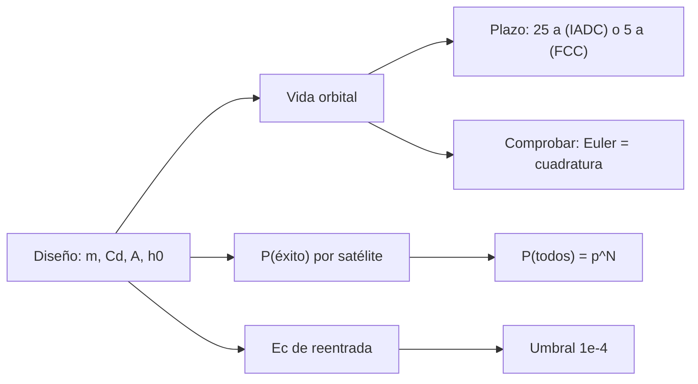

# B121-C03 — Protección ambiental en la legislación espacial

<!-- nav:top -->
[🏠 Programa](../../../../README.md) · [📚 Bloque B121](../../../tronco-comun/B121-regulacion-nacional-de-actividades-espaciales.md) · [← Anterior: B121-C02 — Licenciamiento de actividades de teledetección](../B121-C02-licenciamiento-de-actividades-de-teledeteccion/CLASE.md) · [Siguiente: B121-C04 — Marco legal espacial en Chile →](../B121-C04-marco-legal-espacial-en-chile/CLASE.md)
<!-- /nav -->

## 1. Ubicación, nivel y alcance

Clase 3 del bloque B121. Nivel N4. Las leyes nacionales incluyen requisitos ambientales y de mitigación de desechos: un plazo para retirar el satélite, una probabilidad mínima de lograrlo y un límite de riesgo en la reentrada. Esta clase los trata como tema regulatorio y los contrasta con un modelo de vida orbital. Se apoya en [C01](../B121-C01-licencias-y-requisitos-nacionales-para-el-lanzamiento/CLASE.md) para el criterio de riesgo. **Esta clase es educativa: no es asesoría legal, regulatoria ni financiera, no sustituye a un abogado ni a la autoridad competente y cita la versión y la fecha del texto normativo consultado.** Los datos son sintéticos o ilustrativos salvo los umbrales y textos que se rotulan como consultados.

## 2. Por qué esta clase existe

El catálogo no trata la mitigación de desechos como requisito normativo. La decisión central: **¿un diseño cumple el plazo de desorbitación, la probabilidad de éxito y el riesgo de reentrada que exige la norma?**

## 3. Lo que podrás hacer al terminar

1. Estimar la vida orbital de un satélite con un modelo de arrastre y comprobarla con una segunda vía.
2. Comparar la vida con los plazos de 25 y de 5 años.
3. Calcular la probabilidad de que todos los satélites de una constelación se desorbiten con éxito.
4. Calcular el riesgo de reentrada `Ec` y compararlo con `10⁻⁴`.
5. Distinguir una recomendación (IADC) de una obligación (47 CFR 25.114).
6. Citar versión y fecha de cada texto.

La evidencia es tu *ficha de desorbitación de un satélite sintético* del ejercicio 12 (sección 20).

## 4. Con qué llegas y cómo comprobarlo

1. ¿Qué es el arrastre atmosférico?
2. ¿Qué es el coeficiente balístico?
3. ¿Qué es una atmósfera exponencial?
4. ¿Qué es integrar numéricamente?
5. ¿Qué es una probabilidad de éxito compuesta?

<details>
<summary>Ver respuestas</summary>

1. La fuerza que frena un cuerpo por el aire residual. 2. La razón `m/(Cd·A)`: cuanto mayor, más lento decae. 3. Un modelo donde la densidad cae como `e^(−Δh/H)`. 4. Aproximar una evolución por pasos pequeños. 5. Para sucesos independientes, el producto de las probabilidades.

</details>

Con cuatro o cinco aciertos, sigue; si no, repasa los prerrequisitos.

## 5. Un caso de contexto y casos de referencia

Las directrices IADC, Rev. 4 (enero de 2025; reproducidas en A/AC.105/C.1/2025/CRP.9), recomiendan desorbitar los objetos que atraviesan la región LEO con una vida residual que no supere **25 años**, con una probabilidad de éxito de **al menos 90 %** (meta de 99 %) y `10⁻⁴` como límite recomendado de bajas esperadas por reentrada (consultadas). La norma de la FCC, 47 CFR 25.114(d)(14)(vii), exige en LEO por debajo de 2000 km reentrar **a los 5 años** tras la misión, `P(éxito) ≥ 0,9` (meta de 0,99 para sistemas grandes) y un riesgo de baja `< 10⁻⁴` para restos que sobreviven con energía cinética sobre 15 J (eCFR, consultado). El **ejemplo conductor** es un satélite **sintético** de 60 kg: desde `500 km` cumple 5 años (`3,45 a`); desde `550 km` solo cumple 25 años (`7,56 a`).

## 6. Vocabulario

La **vida orbital** es el tiempo hasta la reentrada. La **desorbitación** (*post-mission disposal*) es el retiro tras la misión. El **coeficiente balístico** `m/(Cd·A)` mide qué tan fácil lo frena el aire. La **altura de escala** `H` es la distancia en que la densidad cae por `e`. El **área de baja** `A_cas` es el área en que un fragmento causa una baja. Una **constelación grande** son muchos satélites con un mismo diseño.

## 7. Modelo mental



*Descripción textual:* el diseño fija la vida orbital, la probabilidad de éxito y el riesgo de reentrada; cada uno se compara con un umbral y la vida se comprueba con dos métodos.

Analogía: un local que debe retirar su mobiliario dentro de un plazo y con alta probabilidad, sin dañar a los vecinos. Límite: un satélite no se retira por voluntad sino por física y por la fiabilidad de su sistema de desorbitación.

## 8. La explicación, paso a paso

### 8.1 Vida orbital

Para una órbita circular, `da/dt = −ρ·v·a/(m/(Cd·A))`. Con una atmósfera exponencial **ilustrativa** (`ρ = 3×10⁻¹² kg/m³` a `400 km` y altura de escala creciente con la altitud) se integra hasta `150 km`.

### 8.2 Los plazos

Con `m/(Cd·A) = 54,5 kg/m²`: `450 km → 1,38 a`; `500 → 3,45`; `550 → 7,56`; `600 → 14,94`; `650 → 27,16`; `700 → 46,14`. La altitud máxima inicial es `522,7 km` para 5 años y `642,7 km` para 25 años (modelo ilustrativo).

### 8.3 Constelaciones

Si cada satélite tiene `p = 0,90`, la probabilidad de que los `N = 100` se desorbiten todos es `0,9¹⁰⁰ ≈ 2,7×10⁻⁵`; con `p = 0,99` es `0,366`. Se esperan 10 fallos frente a 1.

### 8.4 Riesgo de reentrada

`Ec = Σ A_cas · ρ_pob`. Con 25 personas/km² (sintético): el diseño A (`2,0 m²`) da `5,0×10⁻⁵` y cumple; el B (`9,2 m²`) da `2,3×10⁻⁴` y no cumple. Hay que contrastar siempre con una segunda vía: Euler adaptativo y cuadratura de Simpson coinciden dentro del 1 %.

## 9. Magnitudes, símbolos y unidades

| Símbolo | Qué es | Unidad | Valor / nota |
|---|---|---|---|
| `h₀` | altitud inicial | km | 450–700 |
| `m/(Cd·A)` | coeficiente balístico | kg/m² | 54,5 (sintético) |
| `ρ` | densidad atmosférica | kg/m³ | ilustrativa |
| `H` | altura de escala | km | 25–80 (ilustrativa) |
| `p` | P(éxito) por satélite | — | 0,90; 0,99 |
| `Ec` | bajas esperadas | — | umbral 10⁻⁴ (consultado) |

## 10. Convenciones y referencias

Órbita circular, sin J2, `μ = 398 600,4418 km³/s²`, `R⊕ = 6378,137 km`. Atmósfera **ilustrativa**: no es NRLMSISE-00 ni incluye actividad solar; los años de vida son ilustrativos, no predicciones. Tolerancia 1 % entre las dos integraciones. Umbrales de IADC Rev. 4 (enero de 2025) y de 47 CFR 25.114 consultados el 2026-11-11.

## 11. De dónde sale lo que afirmamos

| ID | Fuente | Localizador | Respalda | Estado |
|---|---|---|---|---|
| S1 | IADC Space Debris Mitigation Guidelines, Rev. 4 (enero de 2025), reproducidas en A/AC.105/C.1/2025/CRP.9 (2025-02-03) — https://www.unoosa.org/res/oosadoc/data/documents/2025/aac_105c_12025crp/aac_105c_12025crp_9_0_html/AC105_C1_2025_CRP09E.pdf (consultada 2026-11-11, PyMuPDF) | secciones de LEO y reentrada | 25 años; P(éxito) ≥ 90 % con meta de 99 %; `10⁻⁴` bajas por reentrada | Consultada |
| S2 | 47 CFR § 25.114(d)(14)(vii), eCFR (consultada 2026-11-11) | (D)(1) y (D)(2)(ii) | 5 años en LEO < 2000 km; P ≥ 0,9; riesgo `< 10⁻⁴` con energía sobre 15 J | Consultada |
| S3 | Tratado del Espacio, copia de NASA History — https://www.nasa.gov/history/SP-4225/documentation/cooperation/treaty.htm (2026-11-11) | art. IX | evitar la contaminación nociva del espacio y los cambios adversos del ambiente terrestre | Consultada |
| — | Atmósfera, satélites, densidades de población | — | todos los números del laboratorio | Sintético / Ilustrativo |

Límites: la FCC no es la autoridad de ningún otro país; no se consultó la ley francesa ni otra ley nacional que convierta las directrices en obligación; la fecha de entrada en vigor de la norma de 5 años no se confirmó en el texto. Lo rotulado «No consultado» no se afirma. Esta clase no es asesoría legal: la versión y la fecha citadas caducan cuando el texto cambia.

## 12. Cómo ver el resultado

| Magnitud | Valor |
|---|---|
| Vida a 550 km | 7,56 a (cumple 25 a, no 5 a) |
| Altitud máx. 5 a / 25 a | 522,7 km / 642,7 km |
| `P(todos)`, N=100 | p=0,90: 2,7×10⁻⁵; p=0,99: 0,366 |
| `Ec` A / B | 5,0×10⁻⁵ / 2,3×10⁻⁴ |

Descripción larga: pasar de 25 a 5 años baja la altitud permitida unos 120 km; una probabilidad de éxito de 0,9 es muy poco para una constelación.

## 13. Ejemplo trabajado

**Paso 1 · Datos.** Constelación de `N = 100` con `p = 0,99`.

**Paso 2 · Probabilidad conjunta.** `0,99¹⁰⁰ = 0,366`.

**Paso 3 · Fallos esperados.** `100 · (1 − 0,99) = 1`.

**Paso 4 · Lectura.** Aunque se cumpla `p ≥ 0,9`, la probabilidad de que fallen cero satélites es solo `36,6 %`; el riesgo agregado crece con `N`.

## 14. Distintas formas de describir el problema

**Por tiempo:** vida orbital. **Por plazo:** 25 o 5 años. **Por fiabilidad:** `p` y `p^N`. **Por riesgo:** `Ec`. **Por obligación:** recomendación frente a norma.

## 15. Práctica guiada

**Ejercicio 1 · con los pasos indicados.** ¿Cumple 5 años un satélite desde `500 km`? *Pasos:* mira la tabla 8.2.

<details><summary>Solución comentada</summary>

Sí: `3,45 a ≤ 5 a`.
</details>

**Ejercicio 2 · con una pista.** Calcula `0,9¹⁰`. *Pista:* `0,9² = 0,81`.

<details><summary>Solución comentada</summary>

`0,3487`.
</details>

**Ejercicio 3 · casi autónomo.** ¿Cuántos fallos se esperan en `N = 100` con `p = 0,99`?

<details><summary>Solución comentada</summary>

`1`.
</details>

## 16. Práctica autónoma, transferencia e integrador

**Ejercicio 4 · autónomo.** ¿Cuánto debe valer `A_cas` total como máximo para `Ec < 10⁻⁴` con 25 personas/km²?

<details><summary>Solución comentada</summary>

`10⁻⁴/(25×10⁻⁶) = 4,0 m²`.
</details>

**Ejercicio 5 · autónomo.** `Ec` del diseño B con 10 personas/km².

<details><summary>Solución comentada</summary>

`9,2 · 10×10⁻⁶ = 9,2×10⁻⁵`: cumple.
</details>

**Ejercicio 6 · autónomo.** ¿Cuánto excede 5 años el satélite de `550 km`?

<details><summary>Solución comentada</summary>

`7,56 − 5 = 2,56 a`.
</details>

**Ejercicio 7 · autónomo.** ¿Cuánto se reduce la vida al bajar de `650` a `600 km`?

<details><summary>Solución comentada</summary>

De `27,16` a `14,94 a`: un `45 %`.
</details>

**Ejercicio 8 · autónomo.** ¿Cuánto vale la diferencia entre el Euler y la cuadratura a `550 km`?

<details><summary>Solución comentada</summary>

Ninguna visible a 2 decimales (`7,56` y `7,56`); el criterio es `< 1 %`.
</details>

**Ejercicio 9 · transferencia.** **Transferencia.** IADC recomienda 25 años y la FCC exige 5. ¿Cuál obliga a un operador de otro país?

<details><summary>Solución comentada</summary>

Ninguna por sí misma: IADC es voluntaria y la FCC obliga a licenciatarios estadounidenses; para otro país hay que verificar su ley nacional.
</details>

**Ejercicio 10 · transferencia.** **Transferencia.** El satélite de `600 km` debe cumplir 5 años. ¿Qué opciones tiene el diseño?

<details><summary>Solución comentada</summary>

Bajar la altitud, aumentar `Cd·A` (por ejemplo con una vela) o añadir propulsión de desorbitación; cada una cambia masa, costo y `Ec`.
</details>

**Ejercicio 11 · transferencia.** **Transferencia.** ¿Por qué `p ≥ 0,9` no basta para una constelación grande?

<details><summary>Solución comentada</summary>

Porque `p^N` cae rápido con `N`; por eso las normas fijan metas más altas (0,99) para sistemas grandes.
</details>

**Ejercicio 12 · integrador.** **Integrador.** Elabora tu *ficha de desorbitación de un satélite sintético*: vida a cinco altitudes, altitud máxima para 5 y 25 años, `p^N`, `Ec` de dos diseños, verificación con dos métodos y qué es consultado e ilustrativo, con el aviso de que es educativa.

<details><summary>Solución comentada</summary>

Secciones 8.1–8.4 y la salida del laboratorio.
</details>

## 17. Laboratorio

El script [desorbita.py](desorbita.py) integra la vida orbital con Euler adaptativo y con cuadratura (**comprueba** 1 %), halla las altitudes máximas por bisección y calcula `p^N` y `Ec`.

**Datos:** los plazos y umbrales de IADC Rev. 4 y de 47 CFR 25.114 son consultados; atmósfera, satélites y poblaciones son **sintéticos**/**ilustrativos**. **Predice antes de ejecutar:** ¿Cumple 5 años un satélite de 60 kg desde `550 km`? (no.) **Ejecución del 2026-11-11 (Python 3.12.9):**

```text
Python 3.12.9 (biblioteca estandar)
Satelites y atmosfera SINTETICOS/ILUSTRATIVOS; plazos y umbrales consultados el 2026-11-11 (IADC Rev.4; 47 CFR 25.114).
Satelite de 60 kg, Cd 2,2, A 0,5 m2 -> m/(CdA) = 54.5 kg/m2
 h0[km]  vida Euler[a] vida cuad.[a]  <=5 a  <=25 a
    450           1.38          1.38  True   True 
    500           3.45          3.45  True   True 
    550           7.56          7.56  False  True 
    600          14.94         14.94  False  True 
    650          27.16         27.16  False  False
    700          46.14         46.14  False  False
Altitud maxima inicial con vida <= 5 a: 522.7 km (modelo ilustrativo)
Altitud maxima inicial con vida <= 25 a: 642.7 km (modelo ilustrativo)
Constelacion de N satelites con P(exito) individual p:
  p=0.9: N=10: P(todos)=0.3487, N=100: P(todos)=0.0000, N=1000: P(todos)=0.0000
  p=0.99: N=10: P(todos)=0.9044, N=100: P(todos)=0.3660, N=1000: P(todos)=0.0000
  fallos esperados con N=100: p=0,90 -> 10; p=0,99 -> 1
diseno A: A_cas total 2.0 m2 -> Ec = 5.00e-05 (< 1e-4 ok)
diseno B: A_cas total 9.2 m2 -> Ec = 2.30e-04 (>= 1e-4 no cumple)
Pruebas superadas.
```

```bash
python programa/clases/B121/B121-C03-proteccion-ambiental-en-la-legislacion-espacial/desorbita.py
```

**Límites:** atmósfera exponencial ilustrativa, sin actividad solar ni J2; los años no son predicciones; no es un análisis de reentrada certificable.

## 18. Errores frecuentes y cómo corregirlos

**Tomar la vida del modelo como predicción.** Se corrige con la sección 10.

**Confundir la recomendación IADC con una obligación.** Se corrige con la sección 5 y el ejercicio 9.

**Olvidar que `p^N` decrece con `N`.** Se corrige con 8.3.

**Usar un umbral sin versión ni fecha.** Se corrige con la sección 11.

## 19. Cómo sabrás que vas bien

Tras la sección 8: ¿qué resultado esperabas y cuál obtuviste? Si dudas, repasa el ejemplo 13. Tras el laboratorio: ¿qué comprueba? (ver la sección 17).

## 20. Qué entregas y cómo se evalúa

El producto es tu *ficha de desorbitación de un satélite sintético* (ejercicio 12).

| Criterio | Inicial | En desarrollo | Logrado | Destacado |
|---|---|---|---|---|
| Conceptos | Los confunde | Parciales | Aplica el requisito al diseño | Explica los límites |
| Cálculo | Sin unidades | Con errores | Tablas completas con unidades | Calcula casos nuevos |
| Numérico | Sin comprobar | Un caso | Contraste con una segunda vía | Interpreta las diferencias |
| Fuentes | Sin fuente | Sin fecha | Fuentes con versión, fecha y estado | Declara lo sintético y lo no consultado |
| Límites | No los nombra | Uno | Tres | Discute qué falta del modelo |

**Condiciones críticas (no se compensan con promedio):** citar versión y fecha de cada texto normativo; rotular lo sintético e hipotético; no presentar el resultado como asesoría legal, regulatoria ni financiera.

## 21. Ética, seguridad y límites

Clase educativa: **no es asesoría legal, regulatoria ni financiera** y no sustituye a un abogado, a la autoridad competente ni a la revisión de un especialista; ningún resultado debe usarse para decidir si una misión real cumple una norma. Los textos normativos cambian: cada cita indica versión y fecha de consulta y caduca con ellas. Los modelos son simplificados y sus datos son sintéticos o ilustrativos. Accesibilidad: tablas equivalentes a las gráficas, fórmulas en texto, ejercicios sin conexión.

## 22. Para cerrar y seguir

Un satélite sintético de 60 kg desde `550 km` cumple 25 años (`7,56 a`) pero no 5; y `0,99¹⁰⁰ = 0,366` muestra que una probabilidad de éxito alta por satélite no garantiza el éxito de toda una constelación.

**Glosario español–inglés.** desorbitación · *post-mission disposal*; vida orbital · *orbital lifetime*; coeficiente balístico · *ballistic coefficient*; reentrada · *reentry*; desechos espaciales · *space debris*.

**Continuidad.** [B121-C04](../B121-C04-marco-legal-espacial-en-chile/CLASE.md) mira el marco legal chileno.

**Referencias:** ver sección 11.

<!-- nav:bottom -->
---

[← Anterior: B121-C02 — Licenciamiento de actividades de teledetección](../B121-C02-licenciamiento-de-actividades-de-teledeteccion/CLASE.md) · [📚 Bloque B121](../../../tronco-comun/B121-regulacion-nacional-de-actividades-espaciales.md) · [Siguiente: B121-C04 — Marco legal espacial en Chile →](../B121-C04-marco-legal-espacial-en-chile/CLASE.md)
<!-- /nav -->
