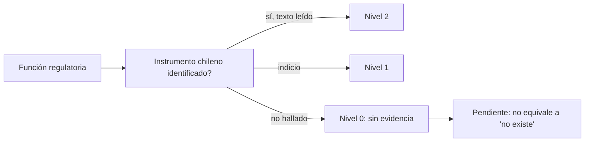

# B121-C04 — Marco legal espacial en Chile

<!-- nav:top -->
[🏠 Programa](../../../../README.md) · [📚 Bloque B121](../../../tronco-comun/B121-regulacion-nacional-de-actividades-espaciales.md) · [← Anterior: B121-C03 — Protección ambiental en la legislación espacial](../B121-C03-proteccion-ambiental-en-la-legislacion-espacial/CLASE.md) · [Siguiente: B121-C05 — Cumplimiento regulatorio en varias jurisdicciones →](../B121-C05-cumplimiento-regulatorio-en-varias-jurisdicciones/CLASE.md)
<!-- /nav -->

## 1. Ubicación, nivel y alcance

Clase 4 del bloque B121. Nivel N4. El programa se enseña en Chile y requiere reconocer el marco local. B119-C19 compara legislaciones sin centrarse en Chile. Aquí ordenas lo que se pudo consultar por **nivel de evidencia** y aprendes a decir «no se encontró» sin afirmar «no existe». Usas [C01](../B121-C01-licencias-y-requisitos-nacionales-para-el-lanzamiento/CLASE.md) a [C03](../B121-C03-proteccion-ambiental-en-la-legislacion-espacial/CLASE.md) para saber qué funciones regulatorias buscar. **Esta clase es educativa: no es asesoría legal, regulatoria ni financiera, no sustituye a un abogado ni a la autoridad competente y cita la versión y la fecha del texto normativo consultado.** Los datos son sintéticos o ilustrativos salvo los umbrales y textos que se rotulan como consultados.

## 2. Por qué esta clase existe

Un marco nacional se conoce por sus instrumentos, y cada instrumento debe leerse en su texto vigente. La decisión central: **¿qué funciones regulatorias tienen un instrumento chileno identificado y con qué nivel de evidencia?**

## 3. Lo que podrás hacer al terminar

1. Listar los tratados espaciales de la ONU de los que Chile es parte según la tabla consultada.
2. Describir el Decreto Supremo 338 de 2001 y su carácter asesor.
3. Distinguir un comité asesor de una autoridad de licenciamiento.
4. Clasificar cada función regulatoria por nivel de evidencia (2, 1, 0).
5. Calcular la cobertura por nivel y verificarla por otro recuento.
6. Explicar por qué «sin evidencia hallada» no prueba ausencia.

La evidencia es tu *matriz de cobertura con nivel de evidencia* del ejercicio 12 (sección 20).

## 4. Con qué llegas y cómo comprobarlo

1. ¿Qué es ratificar un tratado?
2. ¿Qué es un decreto supremo?
3. ¿Qué es un comité asesor?
4. ¿Qué es una fuente primaria?
5. ¿Qué es un nivel de evidencia?

<details>
<summary>Ver respuestas</summary>

1. Obligarse formalmente a cumplirlo tras la firma. 2. Una norma dictada por el Presidente de la República con rango reglamentario. 3. Un órgano que aconseja sin decidir ni licenciar. 4. El texto o registro oficial original. 5. Una escala que dice cuánto se leyó realmente.

</details>

Con cuatro o cinco aciertos, sigue; si no, repasa los prerrequisitos.

## 5. Un caso de contexto y casos de referencia

La tabla de la ONU sobre el estado de los acuerdos espaciales al 2020-01-01 (PDF leído) muestra a Chile con «R» (ratificación, aceptación, aprobación, adhesión o sucesión) en las cinco columnas de los tratados de la ONU: Tratado del Espacio, Acuerdo de Salvamento, Convenio de Responsabilidad, Convenio de Registro y Acuerdo de la Luna. El Decreto Supremo 338 (firmado el 2001-07-17 y publicado en el Diario Oficial el 2001-08-17) creó un Comité Asesor Presidencial denominado Agencia Espacial de Chile, que asesora, coordina, propone una política y debe redactar un proyecto de ley para un marco institucional permanente (traducción no oficial de UNOOSA, leída). El **ejemplo conductor** es una matriz de 10 funciones regulatorias: 4 con evidencia leída, 2 con indicios y 4 sin evidencia hallada.

## 6. Vocabulario

El **nivel de evidencia** va de 2 (texto o tabla leídos) a 0 (sin evidencia hallada). La **función regulatoria** es lo que una norma debe lograr (autorizar, supervisar, registrar). El **instrumento** es la norma o acto que la cumple. La **traducción no oficial** no tiene valor legal. La **concesión** es la habilitación estatal para operar un servicio. La **política nacional** orienta sin crear derechos y obligaciones por sí sola.

## 7. Modelo mental



*Descripción textual:* cada función se busca en un instrumento; según lo leído recibe nivel 2, 1 o 0, y el nivel 0 queda como tarea pendiente, no como afirmación de ausencia.

Analogía: un inventario de una bodega revisado con linterna: lo que viste está marcado, lo que no viste queda «por revisar», no «no hay». Límite: en derecho, además, un instrumento puede estar derogado o modificado.

## 8. La explicación, paso a paso

### 8.1 Los tratados

La tabla de 2020 indica «R» en los cinco tratados de la ONU para Chile. Es el estado a esa fecha: no se obtuvo una tabla más reciente (la CRP.9 de 2025 descargada no traía la tabla).

### 8.2 El Decreto 338

Es un decreto del Ministerio de Defensa Nacional (Subsecretaría de Aviación) que crea un comité **asesor**: propone política, coordina y debe elaborar un proyecto de ley. No licencia lanzamientos ni operadores; lo dice su propio texto resumido.

### 8.3 Otras piezas

La Ley 18.168 (General de Telecomunicaciones) exige concesión por decreto supremo para ciertos servicios; el contenido de sus artículos satelitales **no se leyó** (nivel 1). Una Política Nacional Espacial figura como aprobada en fuentes de prensa y de búsqueda; su decreto y fecha **no se verificaron** (nivel 1).

### 8.4 La matriz

De 10 funciones: nivel 2 = 40 %, nivel 1 = 20 %, nivel 0 = 40 %. Las funciones sin evidencia (autorización de operadores privados, licencia de lanzamiento, licencia de teledetección, mitigación de desechos) son tareas de búsqueda, no conclusiones.

## 9. Magnitudes, símbolos y unidades

| Símbolo | Qué es | Unidad | Valor / nota |
|---|---|---|---|
| Nivel | evidencia | 0, 1, 2 | escala de la clase |
| Funciones | filas de la matriz | — | 10 |
| Cobertura | fracción por nivel | — | 0,4; 0,2; 0,4 |
| DS 338 | publicación | fecha | 2001-08-17 |
| Tabla ONU | fecha de estado | fecha | 2020-01-01 |
| Antigüedad | días y años hasta 2026-11-11 | d, a | 9217 d, 25,2 a |

## 10. Convenciones y referencias

No es un análisis jurídico: es un ejercicio de ordenar la evidencia consultada. Fecha de consulta 2026-11-11. Los niveles son de esta clase y no de ninguna norma. Una ausencia de evidencia en búsquedas no prueba ausencia de norma. Los tratados se leen según la tabla de 2020; el estado vigente debe verificarse en la edición más reciente de UNOOSA.

## 11. De dónde sale lo que afirmamos

| ID | Fuente | Localizador | Respalda | Estado |
|---|---|---|---|---|
| S1 | UNOOSA, *Status of International Agreements relating to Activities in Outer Space as at 1 January 2020* — https://www.unoosa.org/documents/pdf/spacelaw/treatystatus/TreatiesStatus-2020E.pdf (consultada 2026-11-11, PyMuPDF) | tabla, fila de Chile | «R» en las 5 columnas de los tratados de la ONU | Consultada |
| S2 | UNOOSA, *Establishment of a Presidential Advisory Committee known as the Chilean Space Agency (Supreme Decree No. 338, unofficial translation)* — https://www.unoosa.org/oosa/en/ourwork/spacelaw/nationalspacelaw/chile/supreme_decree_338_2001E.html (consultada 2026-11-11) | arts. 1–10 | firmado 2001-07-17, publicado 2001-08-17; comité asesor presidencial | Consultada (traducción no oficial) |
| S3 | Resultados de búsqueda sobre Ley 18.168 (Subtel, ChileAtiende) (2026-11-11) | resumen | concesión por decreto supremo para ciertos servicios de telecomunicaciones | Indicio (texto no leído) |
| S4 | Resultados de búsqueda y nota de prensa sobre la Política Nacional Espacial (2026-11-11) | resumen | existencia reportada de una política; decreto y fecha no verificados | Indicio (no verificado) |
| — | Diario Oficial de Chile (PDF de 2025), edición vigente de la Ley 18.168, textos de la Cámara y del Senado | — | — | No consultado (acceso denegado o no intentado) |

Límites: no se leyó el texto de la Ley 18.168 ni el decreto de la política; la tabla de tratados es de 2020; la traducción del DS 338 no es oficial; no se consultaron proyectos de ley. Lo rotulado «No consultado» no se afirma. Esta clase no es asesoría legal: la versión y la fecha citadas caducan cuando el texto cambia.

## 12. Cómo ver el resultado

| Magnitud | Valor |
|---|---|
| Nivel 2 / 1 / 0 | 40 % / 20 % / 40 % |
| Tratados con R (2020) | 5 de 5 |
| DS 338 a la consulta | 25,2 años |
| Funciones sin evidencia | 4 de 10 |

Descripción larga: la mitad de la matriz queda con evidencia débil o nula; el trabajo siguiente es buscar y leer esos instrumentos.

## 13. Ejemplo trabajado

**Paso 1 · Datos.** Función: «Licencia de lanzamiento nacional». Búsqueda sin resultados relevantes.

**Paso 2 · Clasificación.** Nivel 0 y fuente `-`.

**Paso 3 · Redacción correcta.** «En las fuentes consultadas el 2026-11-11 no se encontró un instrumento que cumpla esta función.»

**Paso 4 · Redacción incorrecta.** «Chile no tiene licencia de lanzamiento.» No está respaldada por la consulta.

## 14. Distintas formas de describir el problema

**Por tratado:** ratificaciones. **Por instrumento:** decreto, ley, política. **Por función:** autorizar, supervisar, registrar. **Por evidencia:** niveles 2, 1, 0. **Por tiempo:** fecha de publicación y de consulta.

## 15. Práctica guiada

**Ejercicio 1 · con los pasos indicados.** ¿Cuántos tratados de la ONU ratificó Chile según la tabla de 2020? *Pasos:* cuenta las «R» de las cinco columnas.

<details><summary>Solución comentada</summary>

Cinco.
</details>

**Ejercicio 2 · con una pista.** ¿Qué función cumple el DS 338? *Pista:* mira el artículo 1.

<details><summary>Solución comentada</summary>

Crea un comité asesor presidencial que propone política y coordina; no licencia.
</details>

**Ejercicio 3 · casi autónomo.** ¿Qué nivel recibe una norma conocida solo por una nota de prensa?

<details><summary>Solución comentada</summary>

Nivel 1 (indicio), nunca 2.
</details>

## 16. Práctica autónoma, transferencia e integrador

**Ejercicio 4 · autónomo.** Calcula la cobertura de nivel 0 en la matriz.

<details><summary>Solución comentada</summary>

`4/10 = 40 %`.
</details>

**Ejercicio 5 · autónomo.** ¿Cuántos días hay entre el 2001-08-17 y el 2026-11-11?

<details><summary>Solución comentada</summary>

`9217 d` (25,2 años).
</details>

**Ejercicio 6 · autónomo.** Si se leyera el texto de la Ley 18.168, ¿cómo cambiaría la cobertura?

<details><summary>Solución comentada</summary>

El nivel 1 de esa fila pasaría a 2 si el texto confirma la función: nivel 2 `50 %`, nivel 1 `10 %`.
</details>

**Ejercicio 7 · autónomo.** ¿Por qué el laboratorio exige que «sin fuente» coincida con «nivel 0»?

<details><summary>Solución comentada</summary>

Para que ninguna fila afirme evidencia que no tiene fuente.
</details>

**Ejercicio 8 · autónomo.** Redacta una frase correcta sobre la mitigación de desechos en Chile.

<details><summary>Solución comentada</summary>

«En las fuentes consultadas el 2026-11-11 no se encontró un instrumento que fije requisitos de mitigación de desechos.»
</details>

**Ejercicio 9 · transferencia.** **Transferencia.** ¿Basta ser parte del Tratado para tener licenciamiento nacional?

<details><summary>Solución comentada</summary>

No: el Tratado obliga al Estado a autorizar y supervisar (Art. VI), pero el mecanismo se concreta en normas nacionales.
</details>

**Ejercicio 10 · transferencia.** **Transferencia.** Una traducción no oficial de un decreto, ¿sirve para cumplir la norma?

<details><summary>Solución comentada</summary>

Sirve para estudiar, no para cumplir: el texto oficial en español, en su versión vigente, es el que obliga.
</details>

**Ejercicio 11 · transferencia.** **Transferencia.** Un operador chileno de teledetección, ¿qué debería hacer antes de operar?

<details><summary>Solución comentada</summary>

Consultar a la autoridad competente y a un abogado; esta clase no identifica una licencia de teledetección en las fuentes consultadas.
</details>

**Ejercicio 12 · integrador.** **Integrador.** Elabora tu *matriz de cobertura con nivel de evidencia*: 10 funciones, instrumento, fuente, nivel, cobertura por nivel, verificación por recuento y lista de qué fue leído, qué fue indicio y qué no se consultó, con el aviso de que no es asesoría legal.

<details><summary>Solución comentada</summary>

Secciones 8.1–8.4 y la salida del laboratorio.
</details>

## 17. Laboratorio

El script [matriz_marco_chile.py](matriz_marco_chile.py) imprime la matriz, calcula la cobertura por nivel, la **comprueba** con un recuento independiente y exige que «sin fuente» equivalga a nivel 0.

**Datos:** la tabla de tratados y la traducción del DS 338 son consultadas; los niveles son de esta clase; ningún dato es observado. **Predice antes de ejecutar:** ¿Qué porcentaje de las funciones queda sin evidencia hallada? (40 %.) **Ejecución del 2026-11-11 (Python 3.12.9):**

```text
Python 3.12.9 (biblioteca estandar)
EJERCICIO EDUCATIVO, no asesoria legal. Evidencia: 2 = leido, 1 = indicio, 0 = sin evidencia hallada (NO es prueba de ausencia).
 # funcion                                                                    niv  fuente
 1 Ser parte del Tratado del Espacio (OST)                                      2  U1  ratificacion (R) en tabla ONU
 2 Ser parte del Convenio de Responsabilidad                                    2  U1  ratificacion (R) en tabla ONU
 3 Ser parte del Convenio de Registro                                           2  U1  ratificacion (R) en tabla ONU
 4 Asesoria y coordinacion de politica espacial                                 2  U2  DS 338/2001 (comite asesor)
 5 Concesion de servicios de telecomunicaciones                                 1  S1  Ley 18.168 (por decreto supremo)
 6 Politica nacional espacial                                                   1  P1  Politica Nacional Espacial (reportada)
 7 Autorizacion y supervision de operadores espaciales privados (OST art. VI    0  -   no se encontro un instrumento
 8 Licencia de lanzamiento nacional                                             0  -   no se encontro un instrumento
 9 Licencia de teledeteccion                                                    0  -   no se encontro un instrumento
10 Requisitos de mitigacion de desechos                                         0  -   no se encontro un instrumento
Cobertura: nivel 2 = 40%, nivel 1 = 20%, nivel 0 = 40% (de 10 funciones)
Dias desde la publicacion del DS 338/2001 (2001-08-17) hasta la consulta (2026-11-11): 9217 d = 25.2 anos
Tratados de la ONU con R para Chile al 2020-01-01: 5 de 5 (OST, ARRA, LIAB, REG, MOON)
Pruebas superadas.
```

```bash
python programa/clases/B121/B121-C04-marco-legal-espacial-en-chile/matriz_marco_chile.py
```

**Límites:** la lista de 10 funciones es una selección didáctica; el nivel 0 no prueba ausencia; no es un análisis jurídico.

## 18. Errores frecuentes y cómo corregirlos

**Afirmar que «Chile no tiene» una norma porque no se encontró.** Se corrige con 8.4 y el ejemplo 13.

**Usar la tabla de 2020 como estado actual.** Se corrige con 8.1.

**Citar una traducción no oficial como texto legal.** Se corrige con el ejercicio 10.

**Dar un indicio de prensa como evidencia leída.** Se corrige con la sección 11.

## 19. Cómo sabrás que vas bien

Tras la sección 8: ¿qué resultado esperabas y cuál obtuviste? Si dudas, repasa el ejemplo 13. Tras el laboratorio: ¿qué comprueba? (ver la sección 17).

## 20. Qué entregas y cómo se evalúa

El producto es tu *matriz de cobertura con nivel de evidencia* (ejercicio 12).

| Criterio | Inicial | En desarrollo | Logrado | Destacado |
|---|---|---|---|---|
| Conceptos | Los confunde | Parciales | Aplica el requisito al diseño | Explica los límites |
| Cálculo | Sin unidades | Con errores | Tablas completas con unidades | Calcula casos nuevos |
| Numérico | Sin comprobar | Un caso | Contraste con una segunda vía | Interpreta las diferencias |
| Fuentes | Sin fuente | Sin fecha | Fuentes con versión, fecha y estado | Declara lo sintético y lo no consultado |
| Límites | No los nombra | Uno | Tres | Discute qué falta del modelo |

**Condiciones críticas (no se compensan con promedio):** citar versión y fecha de cada texto normativo; rotular lo sintético e hipotético; no presentar el resultado como asesoría legal, regulatoria ni financiera.

## 21. Ética, seguridad y límites

Clase educativa: **no es asesoría legal, regulatoria ni financiera** y no sustituye a un abogado, a la autoridad competente ni a la revisión de un especialista; ningún resultado debe usarse para decidir si una misión real cumple una norma. Los textos normativos cambian: cada cita indica versión y fecha de consulta y caduca con ellas. Los modelos son simplificados y sus datos son sintéticos o ilustrativos. Accesibilidad: tablas equivalentes a las gráficas, fórmulas en texto, ejercicios sin conexión.

## 22. Para cerrar y seguir

De 10 funciones, 4 tienen evidencia leída (tres tratados y el DS 338), 2 tienen indicios (Ley 18.168 y la política) y 4 no tienen evidencia hallada; ese 40 % es la lista de lectura pendiente, no una conclusión sobre el derecho chileno.

**Glosario español–inglés.** decreto supremo · *supreme decree*; comité asesor · *advisory committee*; ratificación · *ratification*; concesión · *concession*; nivel de evidencia · *evidence level*.

**Continuidad.** [B121-C05](../B121-C05-cumplimiento-regulatorio-en-varias-jurisdicciones/CLASE.md) reúne varias jurisdicciones en una matriz de cumplimiento.

**Referencias:** ver sección 11.

<!-- nav:bottom -->
---

[← Anterior: B121-C03 — Protección ambiental en la legislación espacial](../B121-C03-proteccion-ambiental-en-la-legislacion-espacial/CLASE.md) · [📚 Bloque B121](../../../tronco-comun/B121-regulacion-nacional-de-actividades-espaciales.md) · [Siguiente: B121-C05 — Cumplimiento regulatorio en varias jurisdicciones →](../B121-C05-cumplimiento-regulatorio-en-varias-jurisdicciones/CLASE.md)
<!-- /nav -->
