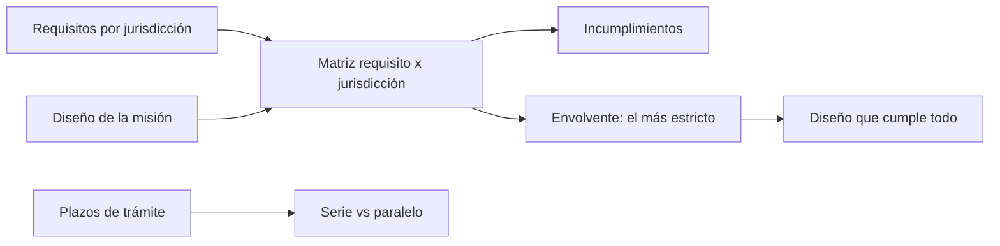

# B121-C05 — Cumplimiento regulatorio en varias jurisdicciones

<!-- nav:top -->
[🏠 Programa](../../../../README.md) · [📚 Bloque B121](../../../tronco-comun/B121-regulacion-nacional-de-actividades-espaciales.md) · [← Anterior: B121-C04 — Marco legal espacial en Chile](../B121-C04-marco-legal-espacial-en-chile/CLASE.md) · [Siguiente: B122-C01 — Dependencias de proveedores y cadena de suministro de infraestructura espacial →](../../../tronco-comun/B122-resiliencia-y-continuidad-de-infraestructura-espacial.md#b122-c01)
<!-- /nav -->

## 1. Ubicación, nivel y alcance

Clase 5 del bloque B121 y última. Nivel N4. Una misión con socios de varios países debe cumplir regímenes distintos. Aquí reúnes lo visto en [C01](../B121-C01-licencias-y-requisitos-nacionales-para-el-lanzamiento/CLASE.md), [C02](../B121-C02-licenciamiento-de-actividades-de-teledeteccion/CLASE.md), [C03](../B121-C03-proteccion-ambiental-en-la-legislacion-espacial/CLASE.md) y [C04](../B121-C04-marco-legal-espacial-en-chile/CLASE.md) en una **matriz de cumplimiento**. **Esta clase es educativa: no es asesoría legal, regulatoria ni financiera, no sustituye a un abogado ni a la autoridad competente y cita la versión y la fecha del texto normativo consultado.** Los datos son sintéticos o ilustrativos salvo los umbrales y textos que se rotulan como consultados.

## 2. Por qué esta clase existe

Ninguna clase trata el análisis de cumplimiento. La decisión central: **¿cuál es el requisito más estricto de cada tipo, qué incumple el diseño y cuánto tardan los trámites?**

## 3. Lo que podrás hacer al terminar

1. Armar una matriz requisito × jurisdicción con el sentido de cada desigualdad.
2. Calcular la envolvente del requisito más estricto.
3. Detectar qué requisitos incumple un diseño y en qué jurisdicción.
4. Calcular el camino crítico de trámites en serie y en paralelo.
5. Contar qué ajustes de diseño bastan para cumplir todo.
6. Rotular qué jurisdicciones son consultadas y cuáles son hipotéticas.

La evidencia es tu *matriz de cumplimiento de una misión sintética* del ejercicio 12 (sección 20).

## 4. Con qué llegas y cómo comprobarlo

1. ¿Qué es una desigualdad de cumplimiento?
2. ¿Qué es una envolvente?
3. ¿Qué es un camino crítico?
4. ¿Qué es una verificación por segunda vía?
5. ¿Qué es un requisito consultado?

<details>
<summary>Ver respuestas</summary>

1. Una condición `valor ≤ límite` o `valor ≥ límite`. 2. El valor más exigente que satisface a todos. 3. La secuencia que fija la duración mínima de un proyecto. 4. Calcular lo mismo con otro método. 5. Uno cuyo texto se leyó con versión y fecha.

</details>

Con cuatro o cinco aciertos, sigue; si no, repasa los prerrequisitos.

## 5. Un caso de contexto y casos de referencia

La matriz usa dos jurisdicciones con requisitos **consultados el 2026-11-11**: las directrices IADC Rev. 4 (25 años, `P ≥ 0,9`, `Ec ≤ 10⁻⁴` en reentrada; recomendaciones) y las normas estadounidenses 47 CFR 25.114 (5 años, `P ≥ 0,9`, `Ec < 10⁻⁴`) y 14 CFR 450.101 (`Ec ≤ 10⁻⁴` en el lanzamiento). Se añade una tercera jurisdicción **hipotética y sintética** (10 años, `P ≥ 0,95`, `Ec ≤ 5×10⁻⁵`). El **ejemplo conductor** es una misión **sintética** con vida `7,56 a` (la de C03 a 550 km), `P = 0,92`, `Ec` de reentrada `5×10⁻⁵` y `Ec` de lanzamiento `8×10⁻⁵`: incumple el plazo de la norma estadounidense y la probabilidad de la jurisdicción hipotética.

## 6. Vocabulario

La **matriz de cumplimiento** cruza requisitos y jurisdicciones. La **envolvente** es el requisito más estricto de cada fila (mínimo de los límites superiores, máximo de los inferiores). Una **jurisdicción** es un régimen aplicable. El **camino crítico** es la suma de las etapas que no se pueden solapar. La **recomendación** orienta; la **obligación** se exige. Un **trámite** tiene una etapa de preparación y otra de evaluación.

## 7. Modelo mental



*Descripción textual:* los requisitos y el diseño forman la matriz; de ella salen los incumplimientos y la envolvente, y los plazos de trámite dan el camino crítico.

Analogía: viajar con un equipaje que debe cumplir el peso límite de todas las aerolíneas del itinerario: manda la más estricta. Límite: algunos requisitos no son comparables numéricamente (formularios, idioma, competencia de la autoridad).

## 8. La explicación, paso a paso

### 8.1 La matriz

Cada fila es un requisito con un sentido (`máx` o `mín`). Para el plazo de desorbitación: IADC `25 a`, EE. UU. `5 a`, hipotética `10 a`. Para `P(éxito)`: `0,90`, `0,90`, `0,95`.

### 8.2 La envolvente

Para un límite superior es el mínimo de los límites; para uno inferior, el máximo. Plazo: `5 a`; `P`: `0,95`; `Ec` de reentrada: `5×10⁻⁵`; `Ec` de lanzamiento: `10⁻⁴`. Cumplir la envolvente equivale a cumplir todas las jurisdicciones (el laboratorio lo comprueba).

### 8.3 Qué incumple el diseño

Plazo frente a EE. UU. (`7,56 > 5`) y `P` frente a la hipotética (`0,92 < 0,95`). Con `Ec` de reentrada `5×10⁻⁵` el margen frente a la envolvente es `1,00×`: queda justo, sin holgura.

### 8.4 Trámites y ajustes

Con trámites sintéticos de `0`, `150` y `195` días, hacerlos en serie suma `345 d` y en paralelo `195 d`. De las 16 combinaciones de ajustar o no cada parámetro a la envolvente, solo `4` cumplen todo: las que ajustan plazo y `P`.

## 9. Magnitudes, símbolos y unidades

| Símbolo | Qué es | Unidad | Valor / nota |
|---|---|---|---|
| Plazo | años a la reentrada | a | 5; 10; 25 |
| `P` | P(éxito de desorbitación) | — | 0,90–0,95 |
| `Ec` | bajas esperadas | — | 5×10⁻⁵–10⁻⁴ |
| Trámite | preparar + evaluar | d | 0–195 (sintético) |
| Envolvente | requisito más estricto | según fila | ver 8.2 |
| Margen | envolvente/diseño | — | 1,00 (Ec reentrada) |

## 10. Convenciones y referencias

J1 (IADC Rev. 4, enero de 2025; recomendaciones) y J2 (47 CFR 25.114 y 14 CFR 450.101, eCFR sin fecha de vigencia visible) consultadas el 2026-11-11. **J3 es hipotética y sintética.** Los requisitos son dos desigualdades por fila; no se comparan requisitos cualitativos. Los plazos de trámite son sintéticos. Un cumplimiento numérico no implica una licencia otorgada.

## 11. De dónde sale lo que afirmamos

| ID | Fuente | Localizador | Respalda | Estado |
|---|---|---|---|---|
| S1 | IADC Space Debris Mitigation Guidelines, Rev. 4 (enero de 2025), en A/AC.105/C.1/2025/CRP.9 (consultada 2026-11-11, PyMuPDF) | LEO y reentrada | 25 años; P ≥ 90 %; `10⁻⁴` | Consultada |
| S2 | 47 CFR § 25.114(d)(14)(vii), eCFR (consultada 2026-11-11) | (D) | 5 años; P ≥ 0,9; riesgo `< 10⁻⁴` | Consultada |
| S3 | 14 CFR § 450.101(a), eCFR (consultada 2026-11-11) | (a) | `Ec ≤ 10⁻⁴` para el público en el lanzamiento | Consultada |
| — | Jurisdicción J3, diseño de la misión y plazos de trámite | — | todos los demás números | Sintético / hipotético |

Límites: J1 no es una jurisdicción sino un conjunto de recomendaciones; no se consultó la ley de ningún país distinto de EE. UU. ni ningún requisito de espectro, exportación o seguros. Lo rotulado «No consultado» no se afirma. Esta clase no es asesoría legal: la versión y la fecha citadas caducan cuando el texto cambia.

## 12. Cómo ver el resultado

| Magnitud | Valor |
|---|---|
| Incumplimientos | plazo (EE. UU.) y `P` (J3) |
| Envolvente | 5 a; 0,95; 5×10⁻⁵; 10⁻⁴ |
| Trámites | serie 345 d; paralelo 195 d |
| Ajustes que bastan | 4 de 16 combinaciones |

Descripción larga: el diseño falla en dos celdas y se resuelve ajustando dos parámetros; hacer los trámites en paralelo ahorra 150 días.

## 13. Ejemplo trabajado

**Paso 1 · Datos.** Fila `P(éxito)`: IADC `0,90`, EE. UU. `0,90`, J3 `0,95`; diseño `0,92`.

**Paso 2 · Envolvente.** `máx(0,90; 0,90; 0,95) = 0,95`.

**Paso 3 · Comprobación.** `0,92 ≥ 0,90` cumple J1 y J2; `0,92 < 0,95` incumple J3.

**Paso 4 · Decisión.** Hay que subir `P` a `≥ 0,95` (por ejemplo, redundancia en la desorbitación) o negociar el requisito.

## 14. Distintas formas de describir el problema

**Por jurisdicción:** columnas. **Por requisito:** filas. **Por envolvente:** el más estricto. **Por tiempo:** serie o paralelo. **Por decisión:** qué ajustar.

## 15. Práctica guiada

**Ejercicio 1 · con los pasos indicados.** Halla la envolvente del plazo de desorbitación. *Pasos:* es un máximo permitido: toma el mínimo.

<details><summary>Solución comentada</summary>

`mín(25; 5; 10) = 5 a`.
</details>

**Ejercicio 2 · con una pista.** ¿Cumple el diseño el plazo de J3? *Pista:* compara `7,56` con `10`.

<details><summary>Solución comentada</summary>

Sí: `7,56 ≤ 10`.
</details>

**Ejercicio 3 · casi autónomo.** ¿Cuántos días ahorra el paralelo frente a la serie?

<details><summary>Solución comentada</summary>

`345 − 195 = 150 d`.
</details>

## 16. Práctica autónoma, transferencia e integrador

**Ejercicio 4 · autónomo.** ¿Cuánto debe bajar el plazo del diseño para cumplir la envolvente?

<details><summary>Solución comentada</summary>

De `7,56` a `5 a`: `2,56 a`.
</details>

**Ejercicio 5 · autónomo.** ¿Cuánto debe subir `P`?

<details><summary>Solución comentada</summary>

De `0,92` a `0,95`: `+0,03`.
</details>

**Ejercicio 6 · autónomo.** ¿Cuántas combinaciones de 16 cumplen todo y por qué?

<details><summary>Solución comentada</summary>

Cuatro: se deben ajustar plazo y `P` y los otros dos parámetros ya cumplen, así que `2² = 4`.
</details>

**Ejercicio 7 · autónomo.** Si `Ec` de reentrada fuera `6×10⁻⁵`, ¿qué pasaría?

<details><summary>Solución comentada</summary>

Incumpliría la jurisdicción hipotética (`> 5×10⁻⁵`), que pasaría a ser la envolvente.
</details>

**Ejercicio 8 · autónomo.** ¿Por qué la fila de `Ec` de lanzamiento tiene dos jurisdicciones y no tres?

<details><summary>Solución comentada</summary>

Porque IADC no fija un criterio de lanzamiento en el texto consultado; la celda queda vacía.
</details>

**Ejercicio 9 · transferencia.** **Transferencia.** ¿Es lo mismo cumplir la envolvente que tener la licencia?

<details><summary>Solución comentada</summary>

No: la envolvente es una condición numérica; la licencia exige solicitud, evaluación y decisión de cada autoridad.
</details>

**Ejercicio 10 · transferencia.** **Transferencia.** Dos socios en países distintos, ¿qué régimen aplica a un satélite?

<details><summary>Solución comentada</summary>

Depende del Estado de lanzamiento, de la nacionalidad del operador y del territorio; hay que verificarlo con la autoridad y con un abogado.
</details>

**Ejercicio 11 · transferencia.** **Transferencia.** ¿Qué haces con un requisito que una jurisdicción solo recomienda?

<details><summary>Solución comentada</summary>

Lo marcas como recomendación en la matriz y decides si lo adoptas por prudencia; no es un incumplimiento legal.
</details>

**Ejercicio 12 · integrador.** **Integrador.** Elabora tu *matriz de cumplimiento de una misión sintética*: requisitos, diseño, incumplimientos, envolvente, trámites en serie y paralelo, ajustes mínimos y lista de qué es consultado e hipotético, con el aviso de que no es asesoría legal.

<details><summary>Solución comentada</summary>

Secciones 8.1–8.4 y la salida del laboratorio.
</details>

## 17. Laboratorio

El script [matriz_cumplimiento.py](matriz_cumplimiento.py) construye la matriz, halla la envolvente y la **comprueba** frente al cumplimiento celda a celda, calcula serie y paralelo y cuenta las combinaciones de ajuste.

**Datos:** los requisitos de IADC y de EE. UU. son consultados; la jurisdicción J3, el diseño y los trámites son **sintéticos**/**hipotéticos**. **Predice antes de ejecutar:** ¿Cuántas celdas incumple el diseño? (2.) **Ejecución del 2026-11-11 (Python 3.12.9):**

```text
Python 3.12.9 (biblioteca estandar)
J1 y J2: requisitos consultados 2026-11-11. J3: HIPOTETICA y SINTETICA. Diseno y tramites: SINTETICOS.
requisito                         diseno        J1_IADC        J2_EEUU  J3_hipotetica  envolvente
plazo de desorbita LEO [a]          7.56          25 OK           5 NO          10 OK           5
P(exito de desorbita)               0.92         0.9 OK         0.9 OK        0.95 NO        0.95
Ec reentrada                       5e-05      0.0001 OK      0.0001 OK       5e-05 OK       5e-05
Ec lanzamiento (publico)           8e-05              -      0.0001 OK      0.0001 OK      0.0001
Incumplimientos: [('plazo de desorbita LEO [a]', 'J2_EEUU'), ('P(exito de desorbita)', 'J3_hipotetica')]
Dias por jurisdiccion: {'J1_IADC': 0, 'J2_EEUU': 150, 'J3_hipotetica': 195} | en serie: 345 d | en paralelo: 195 d
Ec de reentrada: diseno 5.0e-05 frente a envolvente 5.0e-05 -> margen 1.00x
Combinaciones (de 16) de ajustar o no cada parametro a la envolvente que cumplen todo: 4
Pruebas superadas.
```

```bash
python programa/clases/B121/B121-C05-cumplimiento-regulatorio-en-varias-jurisdicciones/matriz_cumplimiento.py
```

**Límites:** solo requisitos numéricos y simples; no incluye espectro, exportación, seguros ni requisitos cualitativos; J1 son recomendaciones.

## 18. Errores frecuentes y cómo corregirlos

**Confundir una recomendación con una obligación.** Se corrige con el ejercicio 11.

**Tomar la jurisdicción hipotética como real.** Se corrige con la sección 10.

**Creer que cumplir la envolvente otorga la licencia.** Se corrige con el ejercicio 9.

**Dar por válida una norma sin su versión y fecha.** Se corrige con la sección 11.

## 19. Cómo sabrás que vas bien

Tras la sección 8: ¿qué resultado esperabas y cuál obtuviste? Si dudas, repasa el ejemplo 13. Tras el laboratorio: ¿qué comprueba? (ver la sección 17).

## 20. Qué entregas y cómo se evalúa

El producto es tu *matriz de cumplimiento de una misión sintética* (ejercicio 12).

| Criterio | Inicial | En desarrollo | Logrado | Destacado |
|---|---|---|---|---|
| Conceptos | Los confunde | Parciales | Aplica el requisito al diseño | Explica los límites |
| Cálculo | Sin unidades | Con errores | Tablas completas con unidades | Calcula casos nuevos |
| Numérico | Sin comprobar | Un caso | Contraste con una segunda vía | Interpreta las diferencias |
| Fuentes | Sin fuente | Sin fecha | Fuentes con versión, fecha y estado | Declara lo sintético y lo no consultado |
| Límites | No los nombra | Uno | Tres | Discute qué falta del modelo |

**Condiciones críticas (no se compensan con promedio):** citar versión y fecha de cada texto normativo; rotular lo sintético e hipotético; no presentar el resultado como asesoría legal, regulatoria ni financiera.

## 21. Ética, seguridad y límites

Clase educativa: **no es asesoría legal, regulatoria ni financiera** y no sustituye a un abogado, a la autoridad competente ni a la revisión de un especialista; ningún resultado debe usarse para decidir si una misión real cumple una norma. Los textos normativos cambian: cada cita indica versión y fecha de consulta y caduca con ellas. Los modelos son simplificados y sus datos son sintéticos o ilustrativos. Accesibilidad: tablas equivalentes a las gráficas, fórmulas en texto, ejercicios sin conexión.

## 22. Para cerrar y seguir

Con tres regímenes, la envolvente fija un plazo de `5 a` y una probabilidad de `0,95`; el diseño sintético falla en dos celdas y bastan dos ajustes; y hacer los trámites en paralelo ahorra `150 d`. Con esto termina el bloque B121.

**Glosario español–inglés.** cumplimiento · *compliance*; jurisdicción · *jurisdiction*; envolvente · *envelope*; camino crítico · *critical path*; trámite · *procedure*.

**Continuidad.** [B122](../../../tronco-comun/B122-resiliencia-y-continuidad-de-infraestructura-espacial.md) es el bloque siguiente del programa.

**Referencias:** ver sección 11.

<!-- nav:bottom -->
---

[← Anterior: B121-C04 — Marco legal espacial en Chile](../B121-C04-marco-legal-espacial-en-chile/CLASE.md) · [📚 Bloque B121](../../../tronco-comun/B121-regulacion-nacional-de-actividades-espaciales.md) · [Siguiente: B122-C01 — Dependencias de proveedores y cadena de suministro de infraestructura espacial →](../../../tronco-comun/B122-resiliencia-y-continuidad-de-infraestructura-espacial.md#b122-c01)
<!-- /nav -->
