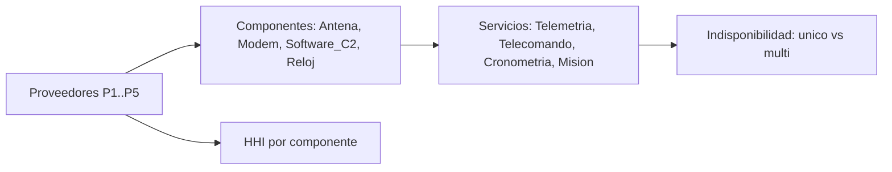

# B122-C01 — Dependencias de proveedores y cadena de suministro de infraestructura espacial

<!-- nav:top -->
[🏠 Programa](../../../../README.md) · [📚 Bloque B122](../../../tronco-comun/B122-resiliencia-y-continuidad-de-infraestructura-espacial.md) · [← Anterior: B121-C05 — Cumplimiento regulatorio en varias jurisdicciones](../../../tronco-comun/B121-regulacion-nacional-de-actividades-espaciales.md#b121-c05) · [Siguiente: B122-C02 — Continuidad de servicio: impacto y objetivos de recuperación →](../B122-C02-continuidad-de-servicio-impacto-y-objetivos-de-recuperacion/CLASE.md)
<!-- /nav -->

## 1. Ubicación, nivel y alcance

Clase 1 del bloque B122. Nivel N4. Una infraestructura espacial (estación terrestre, segmento de control, enlace) se construye con componentes que compran a pocos proveedores; si uno falla, cae más de un servicio. Aquí mides esa concentración con el índice de Herfindahl–Hirschman (HHI), recorres un mapa de dependencias y calculas la indisponibilidad de cada servicio con uno o con varios proveedores. Usas [B119](../../../tronco-comun/B119-derecho-seguridad-y-geopolitica-espacial.md) solo como contexto: allí la infraestructura crítica solo se introduce. **Esta clase es educativa y defensiva: no es asesoría legal, regulatoria, de seguridad ni financiera y no sustituye a un análisis con el operador, su asesor jurídico o su autoridad.** Los datos son sintéticos y los parámetros son ilustrativos.

## 2. Por qué esta clase existe

B119-C16 solo introduce la infraestructura crítica y no analiza de quién depende. La decisión central: **¿qué proveedor, si cae, daña más servicios, y cuánto baja el riesgo si hay una segunda fuente?**

## 3. Lo que podrás hacer al terminar

1. Calcular el HHI de las cuotas de compra de un componente.
2. Construir el mapa servicio → componente → proveedor.
3. Contar los servicios que pierden alguna función cuando cae un proveedor.
4. Calcular la indisponibilidad de un servicio por enumeración exacta de estados.
5. Comparar monoabastecimiento y multiproveedor y comprobar con Monte Carlo.
6. Separar lo consultado (marco de gestión de riesgos de la cadena de suministro) de lo sintético.

La evidencia es la **ficha de dependencias de una cadena sintética** del ejercicio 12 (sección 20).

## 4. Con qué llegas y cómo comprobarlo

1. ¿Qué es una probabilidad independiente?
2. ¿Qué es una suma de cuadrados?
3. ¿Qué es un Monte Carlo?
4. ¿Qué es un dato sintético?
5. ¿Qué es una segunda vía de verificación?

<details>
<summary>Ver respuestas</summary>

1. La que no cambia por lo que ocurra a otro evento. 2. Elevar cada término al cuadrado y sumar. 3. Repetir muchas veces un sorteo y promediar. 4. Uno inventado para el ejemplo, no medido. 5. Calcular lo mismo con otro método y comparar.
</details>

Con cuatro o cinco aciertos, sigue; si no, repasa los prerrequisitos.

## 5. Un caso de contexto y casos de referencia

NIST publicó en mayo de 2022 la SP 800-161 Rev. 1 sobre gestión de riesgos de la cadena de suministro de ciberseguridad (su ficha indica que fue retirada el 2024-11-01 y sustituida por una versión actualizada); su resumen señala que los riesgos nacen del poco conocimiento de cómo se construyen y despliegan los productos adquiridos. Esa es la única cifra y afirmación **consultada**. El **ejemplo conductor** es una cadena sintética: cuatro componentes (Antena, Modem, Software_C2, Reloj), cinco proveedores P1–P5 y cuatro servicios; cada proveedor falla con probabilidad 2 % (ilustrativa). Todo lo demás es **sintético**.

## 6. Vocabulario

La **concentración** es cuánto del suministro se reparte entre pocos proveedores. El **HHI** es la suma de los cuadrados de las cuotas en %, entre 0 y 10 000. El **monoabastecimiento** es depender de un solo proveedor por componente. Un **punto único de falla** es un elemento cuya caída detiene el servicio. La **cadena de suministro** es la red de proveedores y subproveedores. La **dependencia** es la relación «A necesita a B».

## 7. Modelo mental: un mapa de dependencias



*Descripción textual:* los proveedores abastecen componentes y estos sostienen servicios; del reparto sale el HHI y de la estructura la indisponibilidad con uno o varios proveedores.

Analogía: las ramas de un árbol de las que cuelgan frutos: cortar una rama gruesa tira muchos frutos. Límite: aquí los proveedores fallan de forma independiente, algo que en la realidad puede no cumplirse.

## 8. La explicación, paso a paso

### 8.1 Concentración (HHI)

`HHI = Σ sᵢ²` con `sᵢ` en %. Cuatro cuotas iguales dan `4 × 25² = 2500`; un proveedor único da `100² = 10 000`. En la cadena sintética: Antena `70²+20²+10² = 5400`, Modem `3400`, Software_C2 `8200`, Reloj `10 000`.

### 8.2 Alcance de la caída de un proveedor

En monoabastecimiento cada componente depende de su primer proveedor. Si cae P1 o P2, fallan 3 de 4 servicios; si cae P4, 2 (Telecomando y Mision_completa); si cae P5, 2 (Cronometria y Mision_completa); P3 no afecta a ninguno porque no es proveedor principal.

### 8.3 Indisponibilidad exacta

Con 5 proveedores hay `2⁵ = 32` estados; se suma la probabilidad de los estados en que el servicio no funciona. Para Telemetria con dos componentes de proveedores distintos: `1 − 0,98² = 0,0396`. Con varios proveedores por componente, Telemetria baja a `0,00002` y Telecomando a `0,00042`; Cronometria sigue en `0,02` porque Reloj sigue siendo de un solo proveedor.

### 8.4 Comprobación

Un Monte Carlo de 200 000 repeticiones (semilla 122) coincide con la enumeración con una diferencia máxima de `0,00013`.

## 9. Magnitudes, símbolos y unidades

| Símbolo | Qué es | Unidad | Valor / nota |
|---|---|---|---|
| `sᵢ` | cuota de compra | % | 70, 20, 10… |
| HHI | índice de concentración | — | 0 a 10 000 |
| `p` | probabilidad de caída de un proveedor | — | 0,02 (sintético) |
| `U` | indisponibilidad del servicio | — | ver sección 12 |
| `n` | estados | — | 32 |

## 10. Convenciones y referencias

Sin marco espacial ni temporal: las probabilidades son por periodo no especificado. Cuotas en %. Los proveedores P1–P5 y sus cuotas **no son reales**. La definición de HHI es la usada en este curso (suma de cuadrados de cuotas en %); no se consultó una fuente concreta de esa definición.

## 11. De dónde sale lo que afirmamos

| ID | Fuente | Localizador | Respalda | Estado |
|---|---|---|---|---|
| S1 | NIST, SP 800-161 Rev. 1, «Cybersecurity Supply Chain Risk Management Practices for Systems and Organizations», mayo de 2022 (la ficha indica retirada el 2024-11-01 y reemplazo por una versión actualizada) — https://csrc.nist.gov/pubs/sp/800/161/r1/final (consultada 2026-11-11) | ficha de la publicación leída mediante WebFetch (título, fecha, estado, resumen) | el marco general de gestión de riesgos de la cadena de suministro y su estado (retirada y sustituida) | Consultada (solo la ficha; no el cuerpo del documento) |
| — | ISO 22301, ISO/IEC 27001, ISO/IEC 27036, políticas espaciales nacionales y directrices de UNOOSA | — | marcos normativos y de buenas prácticas citados solo de forma general | No consultados |
| — | Datos y parámetros sintéticos de este curso | — | todo el modelo y los números del laboratorio | Sintético / ilustrativo |

Límites: solo se leyó la ficha de la publicación de NIST, no su cuerpo; la definición de HHI y las prácticas de diversificación no se consultaron; ninguna cuota ni proveedor es real. Lo simulado nunca se presenta como observado.

## 12. Cómo ver la indisponibilidad

| Servicio | Monoabastecimiento | Multiproveedor |
|---|---|---|
| Telemetria | 0,03960 | 0,00002 |
| Telecomando | 0,05881 | 0,00042 |
| Cronometria | 0,02000 | 0,02000 |
| Mision_completa | 0,07763 | 0,02002 |

Descripción larga: añadir segundas fuentes baja casi a cero la indisponibilidad de los servicios con componentes duplicables, pero un componente de un solo proveedor (Reloj) fija un suelo de `0,02`.

## 13. Ejemplo trabajado: el servicio Telemetria

**Paso 1 · Componentes.** Antena y Modem.

**Paso 2 · Proveedores principales.** P1 y P2 (monoabastecimiento).

**Paso 3 · Probabilidad de que ambos funcionen.** `0,98 × 0,98 = 0,9604`.

**Paso 4 · Indisponibilidad.** `1 − 0,9604 = 0,0396`.

## 14. Distintas formas de describir la dependencia

**Por cuotas:** HHI por componente. **Por alcance:** servicios afectados por proveedor. **Por probabilidad:** indisponibilidad por servicio. **Por estructura:** monoabastecimiento o multiproveedor. **Por criticidad:** el servicio que sostiene la misión.

## 15. Práctica guiada

**Ejercicio 1 · con los pasos indicados.** Calcula el HHI de dos proveedores con 50 % cada uno. *Pasos:* eleva al cuadrado cada cuota y suma.

<details><summary>Solución comentada</summary>

`50² + 50² = 5000`.
</details>

**Ejercicio 2 · con una pista.** Calcula el HHI de cuatro proveedores iguales. *Pista:* cada cuota es 25 %.

<details><summary>Solución comentada</summary>

`4 × 625 = 2500`.
</details>

**Ejercicio 3 · casi autónomo.** ¿Por qué el HHI de Antena es 5400 y no 100?

<details><summary>Solución comentada</summary>

Porque se suman los cuadrados: `4900 + 400 + 100 = 5400`; 100 sería la suma de las cuotas, no el índice.
</details>

## 16. Práctica autónoma, transferencia e integrador

**Ejercicio 4 · autónomo.** HHI de Software_C2 con cuotas 90 y 10.

<details><summary>Solución comentada</summary>

`8100 + 100 = 8200`.
</details>

**Ejercicio 5 · autónomo.** Indisponibilidad de Telemetria en monoabastecimiento con `p = 0,02`.

<details><summary>Solución comentada</summary>

`1 − 0,98² = 0,0396`.
</details>

**Ejercicio 6 · autónomo.** ¿Por qué Cronometria tiene `0,02` en ambos modos?

<details><summary>Solución comentada</summary>

Porque Reloj tiene un solo proveedor (P5); no hay segunda fuente que añadir.
</details>

**Ejercicio 7 · autónomo.** ¿Cuántos servicios pierden alguna función si cae P5?

<details><summary>Solución comentada</summary>

2: Cronometria y Mision_completa.
</details>

**Ejercicio 8 · autónomo.** ¿Cuántas veces menor es la indisponibilidad de Telemetria con multiproveedor?

<details><summary>Solución comentada</summary>

De `0,03960` a `0,00002`: unas 2000 veces (cifras redondeadas, el cociente es aproximado).
</details>

**Ejercicio 9 · transferencia.** **Transferencia.** Un HHI bajo, ¿garantiza resiliencia?

<details><summary>Solución comentada</summary>

No: el HHI mide el reparto entre proveedores directos, no los subproveedores comunes ni la existencia de repuestos o de alternativas aprobadas.
</details>

**Ejercicio 10 · transferencia.** **Transferencia.** El modelo supone fallos independientes con 2 %. ¿Qué pasa si P1 y P2 comparten un subproveedor?

<details><summary>Solución comentada</summary>

La caída conjunta es más probable que `0,02²`; la indisponibilidad real sería mayor que la calculada.
</details>

**Ejercicio 11 · transferencia.** **Transferencia.** ¿Qué información pedirías a un proveedor real para mapear sus propias dependencias?

<details><summary>Solución comentada</summary>

Lista de subproveedores y de componentes, ubicaciones, plazos de reposición, y si hay alternativas calificadas; todo con consentimiento y bajo contrato.
</details>

**Ejercicio 12 · integrador.** **Integrador.** Elabora tu *ficha de dependencias de una cadena sintética*: HHI por componente, alcance por proveedor, tabla de indisponibilidad en ambos modos, una propuesta de diversificación y lo que es consultado o sintético, con el aviso de que no es asesoría.

<details><summary>Solución comentada</summary>

Secciones 8.1–8.4 y la salida del laboratorio.
</details>

## 17. Laboratorio: concentración y alcance de proveedores

El script [dependencias.py](dependencias.py) calcula el HHI, el alcance de la caída de cada proveedor y la indisponibilidad de cada servicio por enumeración exacta de 32 estados y por Monte Carlo (**comprueba** la diferencia máxima < 0,003).

**Datos:** cuotas, proveedores y probabilidad de caída **sintéticos**. **Predice antes de ejecutar:** ¿qué proveedor no afecta a ningún servicio en monoabastecimiento? (el que no es principal de ningún componente.) **Ejecución del 2026-11-11 (Python 3.12.9):**

```text
Python 3.12.9 (biblioteca estandar)
DATOS SINTETICOS: cuotas, proveedores P1..P5 y probabilidad de caida del 2 % son inventados.
HHI por componente (cuotas %):
  Antena       cuotas=[70, 20, 10] HHI= 5400
  Modem        cuotas=[40, 30, 30] HHI= 3400
  Software_C2  cuotas=[90, 10] HHI= 8200
  Reloj        cuotas=[100] HHI=10000
Alcance de la caida de UN proveedor (servicios que pierden alguna funcion, modo monoabastecimiento):
  cae P1: 3 de 4 servicios -> ['Telemetria', 'Telecomando', 'Mision_completa']
  cae P2: 3 de 4 servicios -> ['Telemetria', 'Telecomando', 'Mision_completa']
  cae P3: 0 de 4 servicios -> []
  cae P4: 2 de 4 servicios -> ['Telecomando', 'Mision_completa']
  cae P5: 2 de 4 servicios -> ['Cronometria', 'Mision_completa']
Indisponibilidad por servicio: exacta (enumeracion de 32 estados) y Monte Carlo [monoabastecimiento | multiproveedor]
  Telemetria       exacta: 0.03960 | 0.00002   MC: 0.03966 | 0.00001
  Telecomando      exacta: 0.05881 | 0.00042   MC: 0.05871 | 0.00038
  Cronometria      exacta: 0.02000 | 0.02000   MC: 0.02014 | 0.02014
  Mision_completa  exacta: 0.07763 | 0.02002   MC: 0.07770 | 0.02014
Diferencia maxima MC - exacta = 0.00013
Pruebas superadas.
```

```bash
python programa/clases/B122/B122-C01-dependencias-de-proveedores-y-cadena-de-suministro-de-infraestructura-espacial/dependencias.py
```

**Límites:** independencia de fallos, probabilidad única de 2 % y estructura inventada; no es un análisis de ninguna cadena real.

## 18. Errores frecuentes y cómo corregirlos

**Confundir HHI con la suma de cuotas.** Se corrige con 8.1.

**Suponer que duplicar proveedores elimina el riesgo.** Se corrige con Reloj, sección 12.

**Tomar los proveedores P1–P5 como empresas reales.** Se corrige con la sección 10.

**Dar por válida la independencia.** Se corrige con el ejercicio 10.

## 19. Cómo sabrás que vas bien

Tras la sección 8: ¿cuál es el HHI de Antena y por qué? Si dudas, repasa el ejemplo 13. Tras el laboratorio: ¿qué comprueba? (ver la sección 17).

## 20. Qué entregas y cómo se evalúa

El producto es tu **ficha de dependencias de una cadena sintética** (ejercicio 12).

| Criterio | Inicial | En desarrollo | Logrado | Destacado |
|---|---|---|---|---|
| Conceptos | Los confunde | Parciales | Calcula HHI e indisponibilidad | Explica los límites de la independencia |
| Cálculo | Sin unidades | Con errores | Tablas completas | Calcula casos nuevos |
| Numérico | Sin comprobar | Un caso | Exacto y Monte Carlo contrastados | Interpreta las diferencias |
| Fuentes | Sin fuente | Sin fecha | Fuentes con versión, fecha y estado | Declara lo sintético y lo no consultado |
| Límites | No los nombra | Uno | Tres | Discute qué falta del modelo |

**Condiciones críticas (no se compensan con promedio):** rotular los datos como sintéticos; declarar que la clase no es asesoría legal, regulatoria ni de seguridad; citar solo lo consultado, con versión y fecha.

## 21. Ética, seguridad y límites

La clase trata la cadena de suministro **desde la defensa**: no identifica proveedores reales ni vulnerabilidades. Los números son ficticios. Clase educativa y **exclusivamente defensiva**: **no es asesoría legal, regulatoria, de seguridad ni financiera**; no describe cómo atacar sistemas ni sustituye al asesor jurídico, a la autoridad competente ni a un equipo de respuesta real. Los textos normativos se citan con su versión y fecha de consulta y pueden haber cambiado. Los modelos son simplificados y sus datos, sintéticos. Accesibilidad: tablas equivalentes a las gráficas, fórmulas en texto, ejercicios sin conexión.

## 22. Para cerrar y seguir

En la cadena sintética, el HHI va de 3400 a 10 000 y la caída de P1 o P2 afecta a 3 de 4 servicios; con varios proveedores la indisponibilidad de Telemetria baja de `0,0396` a `0,00002`. Queda una pregunta: ¿cuánto tiempo puede estar caído un servicio antes de que el daño sea inaceptable?

**Glosario español–inglés.** concentración · *concentration*; cadena de suministro · *supply chain*; punto único de falla · *single point of failure*; monoabastecimiento · *single sourcing*; proveedor · *supplier*.

**Continuidad.** [B122-C02](../B122-C02-continuidad-de-servicio-impacto-y-objetivos-de-recuperacion/CLASE.md) estudia los tiempos tolerables y de recuperación.

**Referencias:** ver sección 11.

<!-- nav:bottom -->
---

[← Anterior: B121-C05 — Cumplimiento regulatorio en varias jurisdicciones](../../../tronco-comun/B121-regulacion-nacional-de-actividades-espaciales.md#b121-c05) · [📚 Bloque B122](../../../tronco-comun/B122-resiliencia-y-continuidad-de-infraestructura-espacial.md) · [Siguiente: B122-C02 — Continuidad de servicio: impacto y objetivos de recuperación →](../B122-C02-continuidad-de-servicio-impacto-y-objetivos-de-recuperacion/CLASE.md)
<!-- /nav -->
