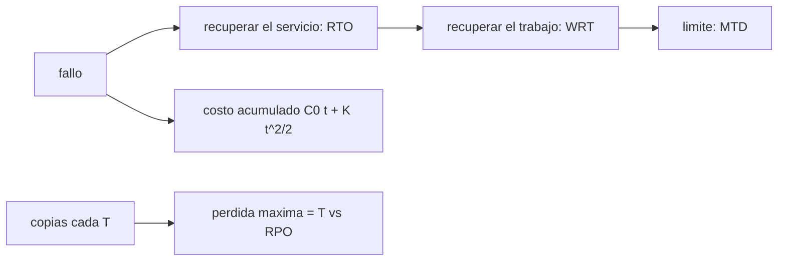

# B122-C02 — Continuidad de servicio: impacto y objetivos de recuperación

<!-- nav:top -->
[🏠 Programa](../../../../README.md) · [📚 Bloque B122](../../../tronco-comun/B122-resiliencia-y-continuidad-de-infraestructura-espacial.md) · [← Anterior: B122-C01 — Dependencias de proveedores y cadena de suministro de infraestructura espacial](../B122-C01-dependencias-de-proveedores-y-cadena-de-suministro-de-infraestructura-espacial/CLASE.md) · [Siguiente: B122-C03 — Modelo defensivo de riesgos de infraestructura espacial →](../B122-C03-modelo-defensivo-de-riesgos-de-infraestructura-espacial/CLASE.md)
<!-- /nav -->

## 1. Ubicación, nivel y alcance

Clase 2 del bloque B122. Nivel N4. Un servicio de telemetría que se cae cuesta más cuanto más dura la interrupción. Aquí haces un análisis de impacto en la continuidad (BIA): calculas la disponibilidad, comparas la duración de los cortes con el objetivo de tiempo de recuperación (RTO), con el tiempo máximo tolerable (MTD) y con el objetivo de punto de recuperación (RPO). Usas [B96](../../../tronco-comun/B96-control-y-operacion-de-misiones-espaciales.md) solo como contexto de procedimientos. **Esta clase es educativa y defensiva: no es asesoría legal, regulatoria, de seguridad ni financiera y no sustituye a un análisis con el operador, su asesor jurídico o su autoridad.** Los datos son sintéticos y los parámetros son ilustrativos.

## 2. Por qué esta clase existe

B96-C14 trata procedimientos y no enseña a fijar objetivos de recuperación a partir del impacto. La decisión central: **¿cuál debe ser el RTO para no superar el tiempo máximo tolerable y qué frecuencia de copias exige el RPO?**

## 3. Lo que podrás hacer al terminar

1. Calcular la disponibilidad `A = MTBF/(MTBF+MTTR)`.
2. Distinguir RTO, RPO, WRT y MTD.
3. Verificar la condición `RTO + WRT ≤ MTD`.
4. Integrar un costo de impacto creciente en el tiempo.
5. Estimar cuántas veces al año se supera el MTD.
6. Separar lo consultado (guía de planificación de contingencias) de lo sintético.

La evidencia es la **ficha de análisis de impacto de un servicio** del ejercicio 12 (sección 20).

## 4. Con qué llegas y cómo comprobarlo

1. ¿Qué es una distribución exponencial?
2. ¿Qué es una integral?
3. ¿Qué es una media?
4. ¿Qué es un dato sintético?
5. ¿Qué es un costo ficticio?

<details>
<summary>Ver respuestas</summary>

1. La del tiempo entre sucesos al azar con tasa constante. 2. La suma continua de una tasa a lo largo del tiempo. 3. La suma dividida por el número de datos. 4. Uno inventado, no medido. 5. Una cantidad sin valor real, solo para el ejemplo.
</details>

Con cuatro o cinco aciertos, sigue; si no, repasa los prerrequisitos.

## 5. Un caso de contexto y casos de referencia

La guía NIST SP 800-34 Rev. 1 (mayo de 2010, actualizada el 2010-11-11) trata la planificación de contingencias y su relación con la resiliencia organizacional; solo se leyó su ficha. El **ejemplo conductor** es un enlace de telemetría sintético con MTBF de 720 h y MTTR de 4 h, un RTO de 6 h, un WRT de 2 h, un MTD de 8 h y un RPO de 4 h. El costo de impacto es `1,5 + 0,25 t` kUSD ficticios por hora. Todo es **sintético**.

## 6. Vocabulario

La **disponibilidad** es la fracción del tiempo en que el servicio funciona. El **MTBF** es el tiempo medio entre fallas y el **MTTR** el tiempo medio de reparación. El **RTO** es el tiempo objetivo para restablecer el servicio; el **WRT** es el tiempo adicional para recuperar el trabajo; el **MTD** es el tiempo máximo tolerable de interrupción. El **RPO** es la pérdida máxima de datos aceptable, medida en tiempo.

## 7. Modelo mental: una cuenta que crece mientras dura el corte



*Descripción textual:* desde el fallo corren el RTO y el WRT, cuya suma no debe pasar del MTD, mientras el costo crece; el RPO limita el intervalo entre copias.

Analogía: un grifo roto que inunda más cada minuto: arreglarlo (RTO) y secar (WRT) debe caber antes del daño inaceptable (MTD). Límite: el costo real rara vez crece de forma tan regular.

## 8. La explicación, paso a paso

### 8.1 Disponibilidad

`A = 720/(720+4) = 0,99448`; la indisponibilidad anual es `8760 × (1 − A) = 48,40 h`. La simulación de 50 años da `0,99465` (diferencia `< 0,0005`).

### 8.2 RTO, WRT y MTD

`RTO + WRT = 6 + 2 = 8 h ≤ MTD = 8 h`: se cumple justo en el límite. Con cortes de duración exponencial de media 4 h, la fracción que supera el RTO es `e^(−6/4) = 0,223`; la simulación dio `0,196` con 601 cortes (variación de muestreo).

### 8.3 Impacto acumulado

`C(t) = 1,5 t + 0,25 t²/2`: 1,62 a 1 h, 8,00 a 4 h, 20,00 a 8 h y 36,00 a 12 h kUSD ficticios; la integral numérica coincide con la fórmula (< 0,5 %).

### 8.4 Cortes que superan el MTD y RPO

Se esperan `(8760/724) e^(−8/4) = 1,637` cortes por año que superen el MTD. Con RPO de 4 h, una copia cada 1 h cumple (pérdida máxima 1 h) y cada 6 h o 24 h no.

## 9. Magnitudes, símbolos y unidades

| Símbolo | Qué es | Unidad | Valor / nota |
|---|---|---|---|
| `A` | disponibilidad | — | 0,99448 |
| MTBF | tiempo medio entre fallas | h | 720 |
| MTTR | tiempo medio de reparación | h | 4 |
| RTO / WRT / MTD | objetivos de recuperación | h | 6 / 2 / 8 |
| RPO | pérdida máxima de datos | h | 4 |
| `C(t)` | impacto acumulado | kUSD ficticios | ver 8.3 |

## 10. Convenciones y referencias

Reloj desde el inicio de la interrupción, en horas; costos en kUSD **ficticios** sin valor real. Las definiciones de RTO, RPO, WRT y MTD siguen el uso general de la planificación de contingencias; no se leyó el cuerpo de la guía, por lo que los valores y la relación `RTO + WRT ≤ MTD` son de este curso.

## 11. De dónde sale lo que afirmamos

| ID | Fuente | Localizador | Respalda | Estado |
|---|---|---|---|---|
| S1 | NIST, SP 800-34 Rev. 1, «Contingency Planning Guide for Federal Information Systems», mayo de 2010 (actualizada 2010-11-11) — https://csrc.nist.gov/pubs/sp/800/34/r1/upd1/final (consultada 2026-11-11) | ficha de la publicación leída mediante WebFetch (título, fecha, resumen) | la existencia y el objetivo de la guía de planificación de contingencias | Consultada (solo la ficha; no el cuerpo del documento) |
| — | ISO 22301, ISO/IEC 27001, ISO/IEC 27036, políticas espaciales nacionales y directrices de UNOOSA | — | marcos normativos y de buenas prácticas citados solo de forma general | No consultados |
| — | Datos y parámetros sintéticos de este curso | — | todo el modelo y los números del laboratorio | Sintético / ilustrativo |

Límites: solo se leyó la ficha de la guía de NIST; el cuerpo, sus definiciones y plantillas no se consultaron; MTBF, MTTR y costos son inventados. Lo simulado nunca se presenta como observado.

## 12. Cómo ver el impacto

| t (h) | Impacto acumulado (kUSD ficticios) |
|---|---|
| 1 | 1,62 |
| 2 | 3,50 |
| 4 | 8,00 |
| 6 | 13,50 |
| 8 | 20,00 |
| 12 | 36,00 |

Descripción larga: el impacto crece cada vez más rápido (parábola); a 8 h es 2,5 veces el de 4 h.

## 13. Ejemplo trabajado: comprobar el objetivo

**Paso 1 · Suma.** `RTO + WRT = 8 h`.

**Paso 2 · Límite.** `MTD = 8 h`.

**Paso 3 · Margen.** `8 − 8 = 0 h`: sin holgura.

**Paso 4 · Cortes que lo superan.** `1,637` al año.

## 14. Distintas formas de describir la continuidad

**Por tiempo:** RTO, WRT y MTD. **Por datos:** RPO. **Por probabilidad:** disponibilidad. **Por costo:** impacto acumulado. **Por frecuencia:** cortes por año.

## 15. Práctica guiada

**Ejercicio 1 · con los pasos indicados.** Calcula `A`. *Pasos:* `720/724`.

<details><summary>Solución comentada</summary>

`0,99448`.
</details>

**Ejercicio 2 · con una pista.** Calcula el impacto de 4 h. *Pista:* `1,5×4 + 0,25×16/2`.

<details><summary>Solución comentada</summary>

`6 + 2 = 8,00` kUSD ficticios.
</details>

**Ejercicio 3 · casi autónomo.** ¿Se cumple `RTO + WRT ≤ MTD`?

<details><summary>Solución comentada</summary>

Sí, `8 ≤ 8`, sin holgura.
</details>

## 16. Práctica autónoma, transferencia e integrador

**Ejercicio 4 · autónomo.** Impacto de 8 h.

<details><summary>Solución comentada</summary>

`12 + 8 = 20,00`.
</details>

**Ejercicio 5 · autónomo.** Horas de indisponibilidad al año.

<details><summary>Solución comentada</summary>

`8760 × 4/724 = 48,40 h`.
</details>

**Ejercicio 6 · autónomo.** Fracción teórica de cortes mayores que el RTO.

<details><summary>Solución comentada</summary>

`e^(−1,5) = 0,223`.
</details>

**Ejercicio 7 · autónomo.** Cortes esperados por año que superan el MTD.

<details><summary>Solución comentada</summary>

`1,637`.
</details>

**Ejercicio 8 · autónomo.** ¿Qué intervalo de copias cumple un RPO de 4 h?

<details><summary>Solución comentada</summary>

Uno de 4 h o menos; en el laboratorio, la copia cada 1 h.
</details>

**Ejercicio 9 · transferencia.** **Transferencia.** El MTTR es 4 h y el RTO 6 h. ¿Entonces el RTO se cumple siempre?

<details><summary>Solución comentada</summary>

No: con cortes de media 4 h, el 22 % dura más de 6 h; el RTO no es una media.
</details>

**Ejercicio 10 · transferencia.** **Transferencia.** ¿Por qué el costo crece como parábola?

<details><summary>Solución comentada</summary>

Porque la tasa de pérdida crece con el tiempo (`1,5 + 0,25 t`) y se acumula.
</details>

**Ejercicio 11 · transferencia.** **Transferencia.** ¿Cómo calibrarías MTBF y MTTR con datos reales?

<details><summary>Solución comentada</summary>

Con el registro histórico de interrupciones del servicio (fechas y duraciones), con consentimiento y bajo las reglas de la organización.
</details>

**Ejercicio 12 · integrador.** **Integrador.** Elabora tu *ficha de análisis de impacto de un servicio*: disponibilidad, RTO/WRT/MTD/RPO, tabla de impacto, cortes que superan el MTD y lo consultado o sintético, con el aviso de que no es asesoría.

<details><summary>Solución comentada</summary>

Secciones 8.1–8.4 y la salida del laboratorio.
</details>

## 17. Laboratorio: disponibilidad, RTO, RPO e impacto

El script [continuidad.py](continuidad.py) calcula la disponibilidad analítica y simulada, la fracción de cortes que supera el RTO, el impacto acumulado (**comprueba** la disponibilidad a 0,0005 y la integral al 0,5 %) y el cumplimiento del RPO.

**Datos:** MTBF, MTTR, objetivos y costos **sintéticos**. **Predice antes de ejecutar:** ¿cuántos cortes al año superarán el MTD? (poco más de uno.) **Ejecución del 2026-11-11 (Python 3.12.9):**

```text
Python 3.12.9 (biblioteca estandar)
DATOS SINTETICOS: MTBF 720 h, MTTR 4 h, costos ficticios en kUSD sin valor real.
Disponibilidad analitica A = 0.99448 ; indisponibilidad anual = 48.40 h
Simulacion de 50 anos: A = 0.99465 ; cortes = 601 ; fraccion de cortes con duracion > RTO (6.0 h) = 0.196
Fraccion teorica de cortes > RTO (exponencial) = exp(-RTO/MTTR) = 0.223
MTD = 8.0 h ; RTO + WRT = 8.0 h ; condicion RTO + WRT <= MTD: True
Impacto acumulado de una interrupcion de t horas (cerrado | numerico), kUSD ficticios:
  t= 1 h :    1.62 |    1.63
  t= 2 h :    3.50 |    3.50
  t= 4 h :    8.00 |    8.00
  t= 6 h :   13.50 |   13.50
  t= 8 h :   20.00 |   20.00
  t=12 h :   36.00 |   36.00
Cuantas veces al ano se espera superar MTD: 1.637
RPO = 4.0 h (ilustrativo):
  copia cada 1 h: perdida maxima 1.0 h -> cumple
  copia cada 6 h: perdida maxima 6.0 h -> NO cumple
  copia cada 24 h: perdida maxima 24.0 h -> NO cumple
Pruebas superadas.
```

```bash
python programa/clases/B122/B122-C02-continuidad-de-servicio-impacto-y-objetivos-de-recuperacion/continuidad.py
```

**Límites:** cortes exponenciales independientes, costo lineal creciente inventado, sin estacionalidad; no sirve para fijar objetivos reales.

## 18. Errores frecuentes y cómo corregirlos

**Confundir RTO con MTTR.** Se corrige con el ejercicio 9.

**Olvidar el WRT.** Se corrige con 8.2.

**Tomar los kUSD como dinero real.** Se corrige con la sección 10.

**Confundir RPO con RTO.** El RPO es de datos y el RTO de servicio; ver sección 6.

## 19. Cómo sabrás que vas bien

Tras la sección 8: ¿cuál es el margen de `RTO + WRT` sobre el MTD? Si dudas, repasa el ejemplo 13. Tras el laboratorio: ¿qué comprueba? (ver la sección 17).

## 20. Qué entregas y cómo se evalúa

El producto es tu **ficha de análisis de impacto de un servicio** (ejercicio 12).

| Criterio | Inicial | En desarrollo | Logrado | Destacado |
|---|---|---|---|---|
| Conceptos | Los confunde | Parciales | Distingue RTO, RPO, WRT y MTD | Explica sus límites |
| Cálculo | Sin unidades | Con errores | Tablas completas | Calcula casos nuevos |
| Numérico | Sin comprobar | Un caso | Analítico y simulado contrastados | Interpreta las diferencias |
| Fuentes | Sin fuente | Sin fecha | Fuentes con versión, fecha y estado | Declara lo sintético y lo no consultado |
| Límites | No los nombra | Uno | Tres | Discute qué falta del modelo |

**Condiciones críticas (no se compensan con promedio):** rotular los datos como sintéticos; declarar que la clase no es asesoría legal, regulatoria ni de seguridad; citar solo lo consultado, con versión y fecha.

## 21. Ética, seguridad y límites

Los objetivos de recuperación reales dependen del operador, sus contratos y su regulación; esta clase no los fija. Los costos son ficticios. Clase educativa y **exclusivamente defensiva**: **no es asesoría legal, regulatoria, de seguridad ni financiera**; no describe cómo atacar sistemas ni sustituye al asesor jurídico, a la autoridad competente ni a un equipo de respuesta real. Los textos normativos se citan con su versión y fecha de consulta y pueden haber cambiado. Los modelos son simplificados y sus datos, sintéticos. Accesibilidad: tablas equivalentes a las gráficas, fórmulas en texto, ejercicios sin conexión.

## 22. Para cerrar y seguir

El enlace sintético tiene una disponibilidad de `0,99448`, un `RTO + WRT` de 8 h igual al MTD y se espera superar el MTD `1,637` veces al año. Queda una pregunta: ¿qué activos y amenazas hay que modelar para decidir dónde invertir?

**Glosario español–inglés.** disponibilidad · *availability*; objetivo de tiempo de recuperación · *recovery time objective (RTO)*; objetivo de punto de recuperación · *recovery point objective (RPO)*; tiempo máximo tolerable de interrupción · *maximum tolerable downtime (MTD)*; análisis de impacto · *business impact analysis (BIA)*.

**Continuidad.** [B122-C03](../B122-C03-modelo-defensivo-de-riesgos-de-infraestructura-espacial/CLASE.md) construye el modelo defensivo de riesgos.

**Referencias:** ver sección 11.

<!-- nav:bottom -->
---

[← Anterior: B122-C01 — Dependencias de proveedores y cadena de suministro de infraestructura espacial](../B122-C01-dependencias-de-proveedores-y-cadena-de-suministro-de-infraestructura-espacial/CLASE.md) · [📚 Bloque B122](../../../tronco-comun/B122-resiliencia-y-continuidad-de-infraestructura-espacial.md) · [Siguiente: B122-C03 — Modelo defensivo de riesgos de infraestructura espacial →](../B122-C03-modelo-defensivo-de-riesgos-de-infraestructura-espacial/CLASE.md)
<!-- /nav -->
