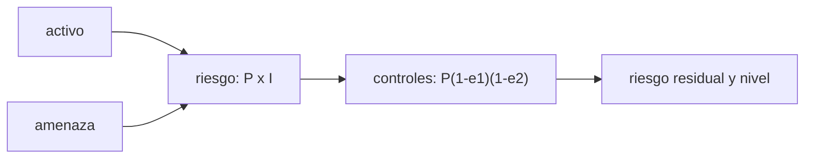

# B122-C03 — Modelo defensivo de riesgos de infraestructura espacial

<!-- nav:top -->
[🏠 Programa](../../../../README.md) · [📚 Bloque B122](../../../tronco-comun/B122-resiliencia-y-continuidad-de-infraestructura-espacial.md) · [← Anterior: B122-C02 — Continuidad de servicio: impacto y objetivos de recuperación](../B122-C02-continuidad-de-servicio-impacto-y-objetivos-de-recuperacion/CLASE.md) · [Siguiente: B122-C04 — Seguridad de estaciones terrestres y segmento de control →](../B122-C04-seguridad-de-estaciones-terrestres-y-segmento-de-control/CLASE.md)
<!-- /nav -->

## 1. Ubicación, nivel y alcance

Clase 3 del bloque B122. Nivel N4. Un modelo defensivo ordena los activos, las amenazas (descritas de forma abstracta) y los controles en un registro de riesgos: riesgo inherente = probabilidad × impacto, y riesgo residual tras aplicar controles. Usas [B83](../../../tronco-comun/B83-ingenieria-de-sistemas-y-diseno-de-misiones.md) y [B119](../../../tronco-comun/B119-derecho-seguridad-y-geopolitica-espacial.md) solo como contexto: allí los riesgos técnicos y las amenazas se tratan sin modelo. **Esta clase es educativa y defensiva: no es asesoría legal, regulatoria, de seguridad ni financiera y no sustituye a un análisis con el operador, su asesor jurídico o su autoridad.** Los datos son sintéticos y los parámetros son ilustrativos.

## 2. Por qué esta clase existe

B83-C16 trata riesgos técnicos y B119-C14 amenazas sin modelo. La decisión central: **¿qué riesgo residual domina y qué activo carece de controles?**

## 3. Lo que podrás hacer al terminar

1. Armar un registro con activo, amenaza, probabilidad, impacto y controles.
2. Calcular el riesgo inherente y el residual.
3. Aplicar la eficacia de controles en serie `P(1−e₁)(1−e₂)`.
4. Clasificar el riesgo en bajo, medio o alto.
5. Detectar activos sin controles.
6. Separar lo consultado (guías de evaluación de riesgos) de lo sintético.

La evidencia es la **registro de riesgos sintético** del ejercicio 12 (sección 20).

## 4. Con qué llegas y cómo comprobarlo

1. ¿Qué es una probabilidad?
2. ¿Qué es un producto?
3. ¿Qué es un control?
4. ¿Qué es una amenaza abstracta?
5. ¿Qué es un dato sintético?

<details>
<summary>Ver respuestas</summary>

1. Un número entre 0 y 1 que mide cuán posible es un suceso. 2. El resultado de multiplicar. 3. Una medida que reduce la probabilidad o el impacto. 4. Una descripción general del daño posible, sin detalles de cómo causarlo. 5. Uno inventado, no medido.
</details>

Con cuatro o cinco aciertos, sigue; si no, repasa los prerrequisitos.

## 5. Un caso de contexto y casos de referencia

NIST SP 800-30 Rev. 1 (septiembre de 2012) es una guía para realizar evaluaciones de riesgos y NIST IR 8401 (diciembre de 2022) aplica el Marco de Ciberseguridad al segmento terrestre de satélites; solo se leyeron sus fichas. El IR 8401 describe el ecosistema espacial como de alto riesgo, alto costo y difícil acceso. El **ejemplo conductor** es un registro sintético de seis riesgos con puntajes 1–5 y eficacias de control ilustrativas. Todo lo demás es **sintético**.

## 6. Vocabulario

Un **activo** es algo que vale la pena proteger. Una **amenaza** es una causa potencial de daño. Un **control** es una medida defensiva. El **riesgo inherente** es `P × I` sin controles; el **residual**, con controles. La **eficacia** `e` es la fracción en que un control reduce la probabilidad.

## 7. Modelo mental: un registro vivo



*Descripción textual:* activo y amenaza definen un riesgo inherente; los controles reducen la probabilidad y dejan el riesgo residual, que se clasifica.

Analogía: un balance de cuentas con deuda bruta y deuda tras pagos. Límite: los puntajes ordinales no son magnitudes físicas y su producto es solo una convención.

## 8. La explicación, paso a paso

### 8.1 Riesgo inherente

`P × I`: R3 (credencial comprometida, `P = 4`, `I = 5`) vale 20; R4, 15; R1, 12; R2, 10; R6, 8; R5, 6. Suma `71`.

### 8.2 Controles

La probabilidad residual es `P(1−e₁)(1−e₂)…`. R3 con `e = 0,5` y `0,4`: `4 × 0,5 × 0,6 = 1,2`; riesgo residual `1,2 × 5 = 6,00`.

### 8.3 Nivel

Residual `≥ 15` alto, `≥ 8` medio, resto bajo (umbrales ilustrativos). R4 (`9,00`) y R6 (`8,00`) quedan en medio; los demás, bajos. La suma residual es `33,00`, una reducción del `53,5 %`.

### 8.4 Hallazgos

R6 (proveedor único de software) no tiene ningún control: es el activo sin protección. El mayor riesgo residual es R4. Un Monte Carlo del impacto esperado coincide con la fórmula (`6,6000` frente a `6,6004`).

## 9. Magnitudes, símbolos y unidades

| Símbolo | Qué es | Unidad | Valor / nota |
|---|---|---|---|
| `P` | probabilidad (ordinal) | 1–5 | ver tabla |
| `I` | impacto (ordinal) | 1–5 | ver tabla |
| `e` | eficacia de un control | — | 0–1 (ilustrativa) |
| `R` | riesgo | puntos | `P × I` |

## 10. Convenciones y referencias

Escalas ordinales de 1 a 5; sin unidades físicas. Las amenazas se nombran de forma **abstracta** (sin técnicas). Las eficacias, umbrales y puntajes son **ilustrativos**; no provienen de NIST: de esas guías solo se leyó la ficha.

## 11. De dónde sale lo que afirmamos

| ID | Fuente | Localizador | Respalda | Estado |
|---|---|---|---|---|
| S1 | NIST, SP 800-30 Rev. 1, «Guide for Conducting Risk Assessments», septiembre de 2012 — https://csrc.nist.gov/pubs/sp/800/30/r1/final (consultada 2026-11-11) | ficha de la publicación leída mediante WebFetch (título, fecha, resumen) | la existencia y el objetivo de una guía de evaluación de riesgos | Consultada (solo la ficha; no el cuerpo del documento) |
| S2 | NIST, IR 8401, «Satellite Ground Segment: Applying the Cybersecurity Framework to Satellite Command and Control», diciembre de 2022 — https://csrc.nist.gov/pubs/ir/8401/final (consultada 2026-11-11) | ficha de la publicación leída mediante WebFetch (título, fecha, resumen) | la aplicación del marco de ciberseguridad al segmento terrestre y el carácter de alto riesgo del ecosistema espacial | Consultada (solo la ficha; no el cuerpo del documento) |
| — | ISO 22301, ISO/IEC 27001, ISO/IEC 27036, políticas espaciales nacionales y directrices de UNOOSA | — | marcos normativos y de buenas prácticas citados solo de forma general | No consultados |
| — | Datos y parámetros sintéticos de este curso | — | todo el modelo y los números del laboratorio | Sintético / ilustrativo |

Límites: solo se leyeron las fichas; las escalas, matrices y controles concretos de NIST no se consultaron; los puntajes son inventados. Lo simulado nunca se presenta como observado.

## 12. Cómo ver el registro

| ID | Inherente | Residual | Nivel |
|---|---|---|---|
| R1 | 12 | 4,20 | Bajo |
| R2 | 10 | 4,00 | Bajo |
| R3 | 20 | 6,00 | Bajo |
| R4 | 15 | 9,00 | Medio |
| R5 | 6 | 1,80 | Bajo |
| R6 | 8 | 8,00 | Medio |

Descripción larga: los controles reducen R3 de 20 a 6, pero R6 queda igual por no tener ninguno.

## 13. Ejemplo trabajado: el riesgo R4

**Paso 1 · Inherente.** `3 × 5 = 15`.

**Paso 2 · Controles.** Un control de `e = 0,4`: `3 × 0,6 = 1,8`.

**Paso 3 · Residual.** `1,8 × 5 = 9,00`.

**Paso 4 · Nivel.** `9 ≥ 8`: medio.

## 14. Distintas formas de describir el riesgo

**Por activo:** qué se protege. **Por amenaza:** qué podría dañarlo. **Por puntaje:** inherente y residual. **Por control:** qué lo reduce. **Por nivel:** bajo, medio o alto.

## 15. Práctica guiada

**Ejercicio 1 · con los pasos indicados.** Riesgo inherente de R1 (`P = 3`, `I = 4`). *Pasos:* multiplica.

<details><summary>Solución comentada</summary>

`12`.
</details>

**Ejercicio 2 · con una pista.** Riesgo residual de R2 (`P = 2`, `I = 5`, `e = 0,6`). *Pista:* `2 × 0,4`.

<details><summary>Solución comentada</summary>

`0,8 × 5 = 4,00`.
</details>

**Ejercicio 3 · casi autónomo.** ¿Por qué R6 conserva 8 de residual?

<details><summary>Solución comentada</summary>

Porque no tiene controles: `e` vacío no reduce la probabilidad.
</details>

## 16. Práctica autónoma, transferencia e integrador

**Ejercicio 4 · autónomo.** Residual de R5 (`P = 2`, `I = 3`, `e = 0,7`).

<details><summary>Solución comentada</summary>

`0,6 × 3 = 1,80`.
</details>

**Ejercicio 5 · autónomo.** Reducción porcentual total.

<details><summary>Solución comentada</summary>

`1 − 33/71 = 53,5 %`.
</details>

**Ejercicio 6 · autónomo.** Nivel de un riesgo residual de 15.

<details><summary>Solución comentada</summary>

Alto (`≥ 15`).
</details>

**Ejercicio 7 · autónomo.** Residual de R3 si se quita el control de `e = 0,4`.

<details><summary>Solución comentada</summary>

`4 × 0,5 × 5 = 10,0`.
</details>

**Ejercicio 8 · autónomo.** ¿Qué riesgo debe tratarse primero según el residual?

<details><summary>Solución comentada</summary>

R4 (9,00), el mayor; luego R6 (8,00).
</details>

**Ejercicio 9 · transferencia.** **Transferencia.** ¿Es legítimo multiplicar dos puntajes ordinales?

<details><summary>Solución comentada</summary>

Es una convención útil para ordenar, no una magnitud; por eso se declara ilustrativa.
</details>

**Ejercicio 10 · transferencia.** **Transferencia.** Un control reduce el impacto en lugar de la probabilidad. ¿Cómo cambiarías la fórmula?

<details><summary>Solución comentada</summary>

`R = P × I(1−e)`; el modelo del curso solo contempla controles sobre la probabilidad.
</details>

**Ejercicio 11 · transferencia.** **Transferencia.** ¿Qué evidencia pedirías para estimar la eficacia de un control real?

<details><summary>Solución comentada</summary>

Pruebas, auditorías o datos de incidentes propios, con la autoridad de la organización.
</details>

**Ejercicio 12 · integrador.** **Integrador.** Elabora tu *registro de riesgos sintético*: tabla con inherente, residual y nivel, hallazgos (riesgos sin control), el tratamiento propuesto y lo consultado o sintético, con el aviso de que no es asesoría.

<details><summary>Solución comentada</summary>

Secciones 8.1–8.4 y la salida del laboratorio.
</details>

## 17. Laboratorio: registro de riesgos y riesgo residual

El script [riesgos.py](riesgos.py) calcula riesgos inherentes y residuales, los clasifica, recalcula la suma por otra vía y contrasta con Monte Carlo (**comprueba** la suma exacta y el impacto esperado al 1 %).

**Datos:** activos, amenazas abstractas, puntajes y eficacias **sintéticos**. **Predice antes de ejecutar:** ¿cuál será el mayor riesgo residual? (R4.) **Ejecución del 2026-11-11 (Python 3.12.9):**

```text
Python 3.12.9 (biblioteca estandar)
DATOS SINTETICOS: activos, amenazas (abstractas), puntajes y eficacias son inventados.
 id  activo                        amenaza                        P  I  inherente  residual  nivel_res
 R1  Estacion terrena A            perdida de energia             3  4        12      4.20  BAJO
 R2  Estacion terrena A            acceso fisico no autorizado    2  5        10      4.00  BAJO
 R3  Segmento de control           credencial comprometida        4  5        20      6.00  BAJO
 R4  Enlace de comandos            interferencia deliberada       3  5        15      9.00  MEDIO
 R5  Archivo de telemetria         corrupcion de datos            2  3         6      1.80  BAJO
 R6  Proveedor unico de software   cese del proveedor             2  4         8      8.00  MEDIO
Suma inherente = 71.0 ; suma residual = 33.00 ; reduccion = 53.5 %
Impacto esperado por periodo (escala ilustrativa): analitico = 6.6000 ; Monte Carlo = 6.6004 ; dif = 0.01 %
Mayor riesgo residual: R4 (Enlace de comandos / interferencia deliberada)
Riesgos sin ningun control: ['R6']
Pruebas superadas.
```

```bash
python programa/clases/B122/B122-C03-modelo-defensivo-de-riesgos-de-infraestructura-espacial/riesgos.py
```

**Límites:** escala ordinal, controles independientes, sin dependencias entre riesgos; no representa ninguna infraestructura real.

## 18. Errores frecuentes y cómo corregirlos

**Tratar el puntaje como una medida física.** Se corrige con el ejercicio 9.

**Olvidar activos sin controles.** Se corrige con 8.4.

**Describir amenazas con detalle técnico ofensivo.** Esta clase las nombra de forma abstracta; ver sección 21.

**Creer que el residual cero existe.** Siempre queda algún residual.

## 19. Cómo sabrás que vas bien

Tras la sección 8: ¿qué riesgo domina el residual? Si dudas, repasa el ejemplo 13. Tras el laboratorio: ¿qué comprueba? (ver la sección 17).

## 20. Qué entregas y cómo se evalúa

El producto es tu **registro de riesgos sintético** (ejercicio 12).

| Criterio | Inicial | En desarrollo | Logrado | Destacado |
|---|---|---|---|---|
| Conceptos | Los confunde | Parciales | Distingue inherente y residual | Explica los límites del puntaje |
| Cálculo | Sin unidades | Con errores | Tabla completa | Calcula casos nuevos |
| Numérico | Sin comprobar | Un caso | Segunda vía y Monte Carlo contrastados | Interpreta las diferencias |
| Fuentes | Sin fuente | Sin fecha | Fuentes con versión, fecha y estado | Declara lo sintético y lo no consultado |
| Límites | No los nombra | Uno | Tres | Discute qué falta del modelo |

**Condiciones críticas (no se compensan con promedio):** rotular los datos como sintéticos; declarar que la clase no es asesoría legal, regulatoria ni de seguridad; citar solo lo consultado, con versión y fecha.

## 21. Ética, seguridad y límites

El registro no contiene detalles que faciliten un ataque: las amenazas son abstractas y los activos, ficticios. Clase educativa y **exclusivamente defensiva**: **no es asesoría legal, regulatoria, de seguridad ni financiera**; no describe cómo atacar sistemas ni sustituye al asesor jurídico, a la autoridad competente ni a un equipo de respuesta real. Los textos normativos se citan con su versión y fecha de consulta y pueden haber cambiado. Los modelos son simplificados y sus datos, sintéticos. Accesibilidad: tablas equivalentes a las gráficas, fórmulas en texto, ejercicios sin conexión.

## 22. Para cerrar y seguir

El registro sintético baja de `71` a `33` puntos (53,5 %), el mayor residual es R4 y R6 no tiene controles. Queda una pregunta: ¿cómo se protege físicamente y lógicamente una estación terrestre?

**Glosario español–inglés.** activo · *asset*; amenaza · *threat*; control · *control*; riesgo residual · *residual risk*; registro de riesgos · *risk register*.

**Continuidad.** [B122-C04](../B122-C04-seguridad-de-estaciones-terrestres-y-segmento-de-control/CLASE.md) estudia la seguridad de las estaciones terrestres.

**Referencias:** ver sección 11.

<!-- nav:bottom -->
---

[← Anterior: B122-C02 — Continuidad de servicio: impacto y objetivos de recuperación](../B122-C02-continuidad-de-servicio-impacto-y-objetivos-de-recuperacion/CLASE.md) · [📚 Bloque B122](../../../tronco-comun/B122-resiliencia-y-continuidad-de-infraestructura-espacial.md) · [Siguiente: B122-C04 — Seguridad de estaciones terrestres y segmento de control →](../B122-C04-seguridad-de-estaciones-terrestres-y-segmento-de-control/CLASE.md)
<!-- /nav -->
