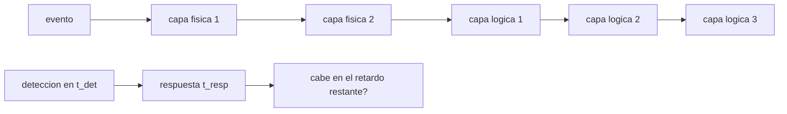

# B122-C04 — Seguridad de estaciones terrestres y segmento de control

<!-- nav:top -->
[🏠 Programa](../../../../README.md) · [📚 Bloque B122](../../../tronco-comun/B122-resiliencia-y-continuidad-de-infraestructura-espacial.md) · [← Anterior: B122-C03 — Modelo defensivo de riesgos de infraestructura espacial](../B122-C03-modelo-defensivo-de-riesgos-de-infraestructura-espacial/CLASE.md) · [Siguiente: B122-C05 — Control de accesos y gestión de identidades en operaciones →](../B122-C05-control-de-accesos-y-gestion-de-identidades-en-operaciones/CLASE.md)
<!-- /nav -->

## 1. Ubicación, nivel y alcance

Clase 4 del bloque B122. Nivel N4. Una estación terrestre se protege con capas físicas y lógicas; ninguna es perfecta, pero juntas reducen la probabilidad de que una acción indebida las cruce todas, y la detección debe llegar antes de que se agoten los retardos. Usas [B89](../../../tronco-comun/B89-comunicaciones-y-navegacion-satelital.md) solo como contexto de la estación como infraestructura de enlace. **Esta clase es educativa y defensiva: no es asesoría legal, regulatoria, de seguridad ni financiera y no sustituye a un análisis con el operador, su asesor jurídico o su autoridad.** Los datos son sintéticos y los parámetros son ilustrativos.

## 2. Por qué esta clase existe

B89-C14 trata las estaciones solo como infraestructura de enlace. La decisión central: **¿cuántas capas y qué detección bastan para que la respuesta llegue a tiempo?**

## 3. Lo que podrás hacer al terminar

1. Describir capas físicas y lógicas de una estación.
2. Calcular la probabilidad de cruzar todas las capas con `Π(1 − eᵢ)`.
3. Sumar los retardos y calcular el retardo restante tras una detección.
4. Aplicar la condición `t_resp ≤ retardo restante`.
5. Medir el efecto de quitar una capa.
6. Separar lo consultado (aplicación del marco de ciberseguridad al segmento terrestre) de lo sintético.

La evidencia es la **ficha de capas de una estación sintética** del ejercicio 12 (sección 20).

## 4. Con qué llegas y cómo comprobarlo

1. ¿Qué es un producto de probabilidades complementarias?
2. ¿Qué es un retardo?
3. ¿Qué es una alarma?
4. ¿Qué es la independencia?
5. ¿Qué es un dato sintético?

<details>
<summary>Ver respuestas</summary>

1. `Π(1−eᵢ)`: la probabilidad de que todas fallen en detener. 2. El tiempo que una capa hace perder. 3. Una señal que avisa de un evento. 4. Que un evento no cambia la probabilidad de otro. 5. Uno inventado, no medido.
</details>

Con cuatro o cinco aciertos, sigue; si no, repasa los prerrequisitos.

## 5. Un caso de contexto y casos de referencia

NIST IR 8401 (diciembre de 2022) aplica el Marco de Ciberseguridad al segmento terrestre dedicado al mando y control de satélites; solo se leyó su ficha. El **ejemplo conductor** es una estación sintética con cinco capas (dos físicas y tres lógicas), eficacias de 0,50 a 0,90, retardos de 2 a 6 min y un tiempo de respuesta de 5 min. No se describe ninguna estación real ni forma de vulnerarla. Todo es **sintético**.

## 6. Vocabulario

Una **capa** es una barrera independiente. La **eficacia** `e` es la probabilidad de que la capa detenga la acción. El **retardo** `d` es el tiempo que añade la capa. La **detección** es el aviso de que algo ocurre. El **segmento de control** es el conjunto de sistemas que comanda al satélite. La **defensa en profundidad** es apilar capas.

## 7. Modelo mental: una carrera entre la detección y el retardo



*Descripción textual:* el evento atraviesa las capas en orden; la detección en un instante dado deja un retardo restante donde debe caber la respuesta.

Analogía: una carrera de relevos donde el reloj corre mientras las puertas se cierran. Límite: las capas reales no son independientes ni sus eficacias constantes.

## 8. La explicación, paso a paso

### 8.1 Probabilidad de cruzar todas las capas

`P = (1−0,60)(1−0,50)(1−0,70)(1−0,80)(1−0,90) = 0,4×0,5×0,3×0,2×0,1 = 0,00120`. El Monte Carlo da `0,00118`.

### 8.2 Retardo total y restante

`3+2+4+5+6 = 20 min`. Si la alarma salta a los 3 min, el retardo restante es 17 min; a los 9 min, 11 min.

### 8.3 Condición de respuesta

La respuesta de 5 min cabe en ambos casos (`5 ≤ 17`, `5 ≤ 11`). Sin sensores no hay detección y no hay respuesta efectiva, por mucho retardo que se acumule.

### 8.4 Quitar una capa

Sin la autenticación fuerte (capa 4, `e = 0,80`) la probabilidad sube a `0,00600`: 5 veces mayor.

## 9. Magnitudes, símbolos y unidades

| Símbolo | Qué es | Unidad | Valor / nota |
|---|---|---|---|
| `eᵢ` | eficacia de la capa | — | 0,50–0,90 (sintético) |
| `dᵢ` | retardo de la capa | min | 2–6 |
| `t_det` | tiempo de detección | min | 3 o 9 |
| `t_resp` | tiempo de respuesta | min | 5 |
| `P` | prob. de cruzar todas | — | 0,00120 |

## 10. Convenciones y referencias

Tiempo en minutos desde el inicio del evento. Capas independientes (supuesto). Las eficacias y tiempos son **sintéticos**; la clase no describe estaciones reales ni formas de burlar controles.

## 11. De dónde sale lo que afirmamos

| ID | Fuente | Localizador | Respalda | Estado |
|---|---|---|---|---|
| S1 | NIST, IR 8401, «Satellite Ground Segment: Applying the Cybersecurity Framework to Satellite Command and Control», diciembre de 2022 — https://csrc.nist.gov/pubs/ir/8401/final (consultada 2026-11-11) | ficha de la publicación leída mediante WebFetch (título, fecha, resumen) | la existencia de una guía que aplica el marco de ciberseguridad al segmento terrestre de mando y control | Consultada (solo la ficha; no el cuerpo del documento) |
| — | ISO 22301, ISO/IEC 27001, ISO/IEC 27036, políticas espaciales nacionales y directrices de UNOOSA | — | marcos normativos y de buenas prácticas citados solo de forma general | No consultados |
| — | Datos y parámetros sintéticos de este curso | — | todo el modelo y los números del laboratorio | Sintético / ilustrativo |

Límites: solo se leyó la ficha del IR 8401; sus controles y perfiles no se consultaron; todas las eficacias son inventadas. Lo simulado nunca se presenta como observado.

## 12. Cómo ver las capas

| Capa | Tipo | e | Retardo (min) |
|---|---|---|---|
| Perímetro y acceso | Física | 0,60 | 3 |
| Sala de control | Física | 0,50 | 2 |
| Segmentación de red | Lógica | 0,70 | 4 |
| Autenticación fuerte | Lógica | 0,80 | 5 |
| Doble confirmación de telecomandos | Lógica | 0,90 | 6 |

Descripción larga: el retardo total es 20 min; la combinación de capas deja pasar solo un 0,12 % de las acciones.

## 13. Ejemplo trabajado: detección en la capa 2

**Paso 1 · Instante.** `t_det = 3 min`.

**Paso 2 · Retardo restante.** `20 − 3 = 17 min`.

**Paso 3 · Comparación.** `5 ≤ 17`.

**Paso 4 · Conclusión.** La respuesta efectiva es posible.

## 14. Distintas formas de describir la defensa

**Por capa:** eficacia y retardo. **Por tipo:** física y lógica. **Por probabilidad:** producto de complementos. **Por tiempo:** retardo restante. **Por escenario:** con y sin una capa.

## 15. Práctica guiada

**Ejercicio 1 · con los pasos indicados.** Calcula `P` con dos capas de `e = 0,5`. *Pasos:* `0,5 × 0,5`.

<details><summary>Solución comentada</summary>

`0,25`.
</details>

**Ejercicio 2 · con una pista.** Retardo restante si se detecta a los 9 min. *Pista:* `20 − 9`.

<details><summary>Solución comentada</summary>

`11 min`.
</details>

**Ejercicio 3 · casi autónomo.** ¿Por qué «sin sensores» no tiene respuesta efectiva?

<details><summary>Solución comentada</summary>

Porque sin detección no hay `t_det`; el retardo se agota sin que nadie actúe.
</details>

## 16. Práctica autónoma, transferencia e integrador

**Ejercicio 4 · autónomo.** Probabilidad de cruzar todas las capas.

<details><summary>Solución comentada</summary>

`0,00120`.
</details>

**Ejercicio 5 · autónomo.** Retardo total.

<details><summary>Solución comentada</summary>

`20 min`.
</details>

**Ejercicio 6 · autónomo.** ¿Cuántas veces sube `P` sin la capa 4?

<details><summary>Solución comentada</summary>

5 veces (`0,00600/0,00120`).
</details>

**Ejercicio 7 · autónomo.** ¿Cabe una respuesta de 12 min si se detecta a los 9 min?

<details><summary>Solución comentada</summary>

No: el retardo restante es 11 min y `12 > 11`.
</details>

**Ejercicio 8 · autónomo.** ¿Qué capa aporta más retardo?

<details><summary>Solución comentada</summary>

La doble confirmación de telecomandos (6 min).
</details>

**Ejercicio 9 · transferencia.** **Transferencia.** ¿Por qué asumir capas independientes puede ser optimista?

<details><summary>Solución comentada</summary>

Una causa común (un fallo de energía o una credencial compartida) puede vencer varias capas a la vez.
</details>

**Ejercicio 10 · transferencia.** **Transferencia.** ¿Basta una sola capa muy eficaz (`e = 0,99`) frente a cinco medianas?

<details><summary>Solución comentada</summary>

Una `e = 0,99` deja `0,01`, peor que `0,00120`; además un fallo único la anula.
</details>

**Ejercicio 11 · transferencia.** **Transferencia.** ¿Qué medirías para calibrar `t_det` en una estación real?

<details><summary>Solución comentada</summary>

Ejercicios de detección autorizados y registrados por la propia organización.
</details>

**Ejercicio 12 · integrador.** **Integrador.** Elabora tu *ficha de capas de una estación sintética*: tabla de capas, probabilidad de cruce, retardo restante según la detección, efecto de quitar una capa y lo consultado o sintético, con el aviso de que no es asesoría.

<details><summary>Solución comentada</summary>

Secciones 8.1–8.4 y la salida del laboratorio.
</details>

## 17. Laboratorio: capas y detección antes que retardo

El script [estacion.py](estacion.py) calcula la probabilidad de cruzar todas las capas, el retardo restante según el instante de detección y el efecto de quitar una capa (**comprueba** el producto frente a Monte Carlo a 0,002 y que el retardo total se recupera con `t_det = 0`).

**Datos:** capas, eficacias y tiempos **sintéticos**. **Predice antes de ejecutar:** ¿cuántas veces sube la probabilidad de cruce sin la capa 4? (5.) **Ejecución del 2026-11-11 (Python 3.12.9):**

```text
Python 3.12.9 (biblioteca estandar)
DATOS SINTETICOS: capas, eficacias y tiempos son inventados; no describen ninguna estacion real.
  capa fisica e=0.60 retardo=3.0 min : Perimetro y control de acceso
  capa fisica e=0.50 retardo=2.0 min : Sala de control con registro de entradas
  capa logica e=0.70 retardo=4.0 min : Segmentacion de red de operaciones
  capa logica e=0.80 retardo=5.0 min : Autenticacion fuerte en el segmento de control
  capa logica e=0.90 retardo=6.0 min : Autorizacion de telecomandos (doble confirmacion)
Prob. de cruzar todas las capas: producto = 0.00120 ; Monte Carlo = 0.00118 ; dif = 0.00002
Retardo total = 20.0 min ; tiempo de respuesta = 5.0 min
  sin sensores: no hay deteccion -> respuesta efectiva: False
  alarma en capa 2: t_det = 3.0 min ; retardo restante = 17.0 min ; respuesta efectiva (t_resp <= restante): True
  alarma en capa 4: t_det = 9.0 min ; retardo restante = 11.0 min ; respuesta efectiva (t_resp <= restante): True
Sin la autenticacion fuerte (capa 4): prob. de cruce = 0.00600 (5.0 veces mayor)
Pruebas superadas.
```

```bash
python programa/clases/B122/B122-C04-seguridad-de-estaciones-terrestres-y-segmento-de-control/estacion.py
```

**Límites:** capas independientes, eficacias constantes y retardos fijos; no evalúa ninguna estación real.

## 18. Errores frecuentes y cómo corregirlos

**Sumar eficacias en vez de multiplicar complementos.** Se corrige con 8.1.

**Ignorar la detección.** Se corrige con 8.3.

**Suponer independencia entre capas.** Se corrige con el ejercicio 9.

**Usar la clase como guía para vulnerar una estación.** No lo es; ver sección 21.

## 19. Cómo sabrás que vas bien

Tras la sección 8: ¿qué retardo queda si se detecta a los 9 min? Si dudas, repasa el ejemplo 13. Tras el laboratorio: ¿qué comprueba? (ver la sección 17).

## 20. Qué entregas y cómo se evalúa

El producto es tu **ficha de capas de una estación sintética** (ejercicio 12).

| Criterio | Inicial | En desarrollo | Logrado | Destacado |
|---|---|---|---|---|
| Conceptos | Los confunde | Parciales | Calcula cruce y retardo restante | Explica los límites de la independencia |
| Cálculo | Sin unidades | Con errores | Tablas completas | Calcula casos nuevos |
| Numérico | Sin comprobar | Un caso | Producto y Monte Carlo contrastados | Interpreta las diferencias |
| Fuentes | Sin fuente | Sin fecha | Fuentes con versión, fecha y estado | Declara lo sintético y lo no consultado |
| Límites | No los nombra | Uno | Tres | Discute qué falta del modelo |

**Condiciones críticas (no se compensan con promedio):** rotular los datos como sintéticos; declarar que la clase no es asesoría legal, regulatoria ni de seguridad; citar solo lo consultado, con versión y fecha.

## 21. Ética, seguridad y límites

Todo es defensivo y ficticio: no se describen técnicas de intrusión ni se evalúa ninguna estación real. Clase educativa y **exclusivamente defensiva**: **no es asesoría legal, regulatoria, de seguridad ni financiera**; no describe cómo atacar sistemas ni sustituye al asesor jurídico, a la autoridad competente ni a un equipo de respuesta real. Los textos normativos se citan con su versión y fecha de consulta y pueden haber cambiado. Los modelos son simplificados y sus datos, sintéticos. Accesibilidad: tablas equivalentes a las gráficas, fórmulas en texto, ejercicios sin conexión.

## 22. Para cerrar y seguir

Con cinco capas la probabilidad de cruce es `0,00120`, el retardo total 20 min y una respuesta de 5 min cabe si se detecta antes de los 15 min. Queda una pregunta: ¿quién debe tener cada permiso para que ninguna persona sola pueda hacer daño?

**Glosario español–inglés.** estación terrestre · *ground station*; segmento de control · *control segment*; defensa en profundidad · *defense in depth*; retardo · *delay*; detección · *detection*.

**Continuidad.** [B122-C05](../B122-C05-control-de-accesos-y-gestion-de-identidades-en-operaciones/CLASE.md) estudia el control de accesos y las identidades.

**Referencias:** ver sección 11.

<!-- nav:bottom -->
---

[← Anterior: B122-C03 — Modelo defensivo de riesgos de infraestructura espacial](../B122-C03-modelo-defensivo-de-riesgos-de-infraestructura-espacial/CLASE.md) · [📚 Bloque B122](../../../tronco-comun/B122-resiliencia-y-continuidad-de-infraestructura-espacial.md) · [Siguiente: B122-C05 — Control de accesos y gestión de identidades en operaciones →](../B122-C05-control-de-accesos-y-gestion-de-identidades-en-operaciones/CLASE.md)
<!-- /nav -->
