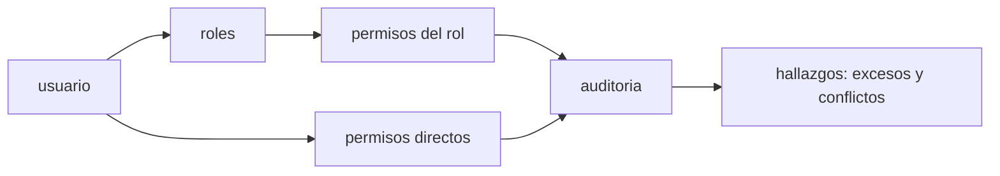

# B122-C05 — Control de accesos y gestión de identidades en operaciones

<!-- nav:top -->
[🏠 Programa](../../../../README.md) · [📚 Bloque B122](../../../tronco-comun/B122-resiliencia-y-continuidad-de-infraestructura-espacial.md) · [← Anterior: B122-C04 — Seguridad de estaciones terrestres y segmento de control](../B122-C04-seguridad-de-estaciones-terrestres-y-segmento-de-control/CLASE.md) · [Siguiente: B122-C06 — Respuesta a incidentes cibernéticos en operaciones de misión →](../B122-C06-respuesta-a-incidentes-ciberneticos-en-operaciones-de-mision/CLASE.md)
<!-- /nav -->

## 1. Ubicación, nivel y alcance

Clase 5 del bloque B122. Nivel N4. En una sala de control cada persona debe tener solo los permisos de su rol (privilegio mínimo), ninguna debe reunir permisos incompatibles (segregación de funciones) y las acciones críticas deben exigir a una segunda persona. Aquí auditas una matriz de roles sintética y cuentas hallazgos. Usas [B96](../../../tronco-comun/B96-control-y-operacion-de-misiones-espaciales.md) solo como contexto de la autorización de telecomandos. **Esta clase es educativa y defensiva: no es asesoría legal, regulatoria, de seguridad ni financiera y no sustituye a un análisis con el operador, su asesor jurídico o su autoridad.** Los datos son sintéticos y los parámetros son ilustrativos.

## 2. Por qué esta clase existe

B96-C07 trata solo la autorización de telecomandos. La decisión central: **¿qué permisos sobran, cuáles se contradicen y quién puede aprobar a quién?**

## 3. Lo que podrás hacer al terminar

1. Construir la matriz usuario → roles → permisos.
2. Detectar permisos directos fuera de rol.
3. Detectar conflictos de segregación de funciones.
4. Calcular los pares emisor-aprobador válidos para la regla de dos personas.
5. Medir la reducción de superficie al corregir.
6. Separar lo consultado (catálogo de controles de NIST) de lo sintético.

La evidencia es la **informe de auditoría de accesos sintético** del ejercicio 12 (sección 20).

## 4. Con qué llegas y cómo comprobarlo

1. ¿Qué es un conjunto?
2. ¿Qué es la unión de conjuntos?
3. ¿Qué es un rol?
4. ¿Qué es una auditoría?
5. ¿Qué es un dato sintético?

<details>
<summary>Ver respuestas</summary>

1. Una colección de elementos sin repetición. 2. El conjunto de elementos que están en alguno de ellos. 3. Un conjunto de permisos asociado a una función. 4. Una revisión contra una regla, con evidencia. 5. Uno inventado, no medido.
</details>

Con cuatro o cinco aciertos, sigue; si no, repasa los prerrequisitos.

## 5. Un caso de contexto y casos de referencia

NIST SP 800-53 Rev. 5 (septiembre de 2020; la página indica la versión menor 5.2.0 del 2025-08-27) es un catálogo de controles de seguridad y privacidad con una familia de control de acceso; la página consultada no detalla los controles concretos. Los principios de privilegio mínimo y segregación de funciones se usan aquí como conceptos generales del curso. El **ejemplo conductor** es una matriz sintética con cinco roles y seis usuarios (u1–u6). Todo es **sintético**.

## 6. Vocabulario

El **privilegio mínimo** es dar solo los permisos necesarios. La **segregación de funciones** impide que una persona reúna permisos incompatibles. La **regla de dos personas** exige que una acción crítica la aprueba otra persona distinta del emisor. Una **identidad** es la cuenta que representa a una persona. Un **permiso directo** es el concedido fuera de un rol. Una **auditoría de accesos** compara lo asignado con lo permitido.

## 7. Modelo mental: una matriz que se revisa



*Descripción textual:* cada usuario recibe permisos por sus roles y a veces directos; la auditoría compara ambos con las reglas y produce hallazgos.

Analogía: las llaves de un edificio: cada persona lleva solo las de su oficina y quien abre la caja fuerte no la audita. Límite: la matriz es estática; los accesos reales cambian y exigen revisión periódica.

## 8. La explicación, paso a paso

### 8.1 Permisos efectivos

El permiso de un usuario es la unión de los permisos de sus roles y los directos. u2 es operador y además tiene `aprobar_telecomando_critico` directamente.

### 8.2 Hallazgos

Permisos directos fuera de rol: u2 (aprobar), u3 (gestionar cuentas) y u4 (ver registros): `3`. Conflictos de segregación: u2 (enviar rutina y aprobar crítico), u4 y u6 (gestionar cuentas y ver registros): `3`. Hay hallazgos en `4` de los `6` usuarios (u2, u3, u4, u6).

### 8.3 Superficie

Los permisos medios por usuario bajan de `2,67` a `2,33` al retirar los directos (`12,5 %`).

### 8.4 Dos personas

Emisores: u1 y u2. Aprobadores: u2 y u5. Hay `3` pares emisor-aprobador distintos. Si se eligieran al azar, la probabilidad de que coincidan es `1/(2×2) = 0,25`; el Monte Carlo da `0,2487`. Retirar la aprobación a u2 elimina esa coincidencia.

## 9. Magnitudes, símbolos y unidades

| Símbolo | Qué es | Unidad | Valor / nota |
|---|---|---|---|
| `n_exc` | permisos directos fuera de rol | conteo | 3 |
| `n_conf` | conflictos de segregación | conteo | 3 |
| `P` | prob. de coincidencia emisor-aprobador | — | 0,25 |
| permisos medios | por usuario | conteo | 2,67 → 2,33 |

## 10. Convenciones y referencias

Sin marco espacial ni temporal. Usuarios, roles y permisos **no son reales**. Los pares incompatibles son una elección del curso, no una lista oficial. No se consultó el texto de los controles de acceso de NIST.

## 11. De dónde sale lo que afirmamos

| ID | Fuente | Localizador | Respalda | Estado |
|---|---|---|---|---|
| S1 | NIST, SP 800-53 Rev. 5, «Security and Privacy Controls for Information Systems and Organizations», septiembre de 2020 (la página indica la versión menor 5.2.0 del 2025-08-27) — https://csrc.nist.gov/pubs/sp/800/53/r5/upd1/final (consultada 2026-11-11) | página de la publicación leída mediante WebFetch; no detalla los controles AC-5 y AC-6 | la existencia de un catálogo de controles con una familia de control de acceso | Consultada (solo la ficha; no el cuerpo del documento) |
| — | ISO 22301, ISO/IEC 27001, ISO/IEC 27036, políticas espaciales nacionales y directrices de UNOOSA | — | marcos normativos y de buenas prácticas citados solo de forma general | No consultados |
| — | Datos y parámetros sintéticos de este curso | — | todo el modelo y los números del laboratorio | Sintético / ilustrativo |

Límites: la página de NIST SP 800-53 no detalla los controles de acceso consultados; las reglas de este laboratorio son del curso; ningún usuario es real. Lo simulado nunca se presenta como observado.

## 12. Cómo ver los hallazgos

| Usuario | Roles | Directos fuera de rol | Conflictos |
|---|---|---|---|
| u1 | operador | — | — |
| u2 | operador | aprobar crítico | enviar rutina + aprobar crítico |
| u3 | ingeniero | gestionar cuentas | — |
| u4 | admin TI | ver registros | gestionar cuentas + ver registros |
| u5 | aprobador, auditor | — | — |
| u6 | admin TI, auditor | — | gestionar cuentas + ver registros |

Descripción larga: cuatro de seis usuarios tienen algún hallazgo; u1 y u5 están limpios.

## 13. Ejemplo trabajado: el usuario u2

**Paso 1 · Rol.** Operador: ver telemetría y enviar telecomando de rutina.

**Paso 2 · Directo.** Aprobar telecomando crítico, fuera de rol.

**Paso 3 · Conflicto.** Enviar rutina y aprobar crítico son incompatibles.

**Paso 4 · Corrección.** Retirar el permiso directo.

## 14. Distintas formas de describir el control de accesos

**Por rol:** matriz. **Por excepción:** permisos directos. **Por regla:** conflictos. **Por número:** superficie media. **Por proceso:** pares de dos personas.

## 15. Práctica guiada

**Ejercicio 1 · con los pasos indicados.** ¿Qué permiso directo tiene u3? *Pasos:* mira su fila.

<details><summary>Solución comentada</summary>

`gestionar_cuentas`.
</details>

**Ejercicio 2 · con una pista.** ¿Qué conflicto tiene u6? *Pista:* admin TI y auditor.

<details><summary>Solución comentada</summary>

`gestionar_cuentas` con `ver_registros`.
</details>

**Ejercicio 3 · casi autónomo.** ¿Por qué u5 no tiene hallazgos si tiene dos roles?

<details><summary>Solución comentada</summary>

Sus permisos (`aprobar`, `ver_registros`, `ver_telemetria`) no incluyen ningún par incompatible.
</details>

## 16. Práctica autónoma, transferencia e integrador

**Ejercicio 4 · autónomo.** ¿Cuántos usuarios tienen algún hallazgo?

<details><summary>Solución comentada</summary>

4 de 6.
</details>

**Ejercicio 5 · autónomo.** Reducción porcentual de la superficie media al quitar permisos directos.

<details><summary>Solución comentada</summary>

`(2,67 − 2,33)/2,67 = 12,5 %`.
</details>

**Ejercicio 6 · autónomo.** Pares emisor-aprobador distintos.

<details><summary>Solución comentada</summary>

3: (u1,u2), (u1,u5), (u2,u5).
</details>

**Ejercicio 7 · autónomo.** Probabilidad de que emisor y aprobador coincidan al azar.

<details><summary>Solución comentada</summary>

`1/4 = 0,25`.
</details>

**Ejercicio 8 · autónomo.** Si se retira la aprobación a u2, ¿cuántos pares quedan?

<details><summary>Solución comentada</summary>

2: (u1,u5) y (u2,u5).
</details>

**Ejercicio 9 · transferencia.** **Transferencia.** En un equipo de dos personas es imposible segregar todas las funciones. ¿Qué harías?

<details><summary>Solución comentada</summary>

Compensar con registro y auditoría independientes, y revisión por un tercero fuera del equipo.
</details>

**Ejercicio 10 · transferencia.** **Transferencia.** ¿Por qué una cuenta compartida arruina la auditoría?

<details><summary>Solución comentada</summary>

Porque impide atribuir cada acción a una persona.
</details>

**Ejercicio 11 · transferencia.** **Transferencia.** ¿Qué evidencia mostrarías para demostrar que los accesos se revisaron?

<details><summary>Solución comentada</summary>

El listado de permisos con fecha de revisión, firmante y correcciones aplicadas.
</details>

**Ejercicio 12 · integrador.** **Integrador.** Elabora tu *informe de auditoría de accesos sintético*: matriz, hallazgos (excesos y conflictos), correcciones propuestas, efecto en la superficie y lo consultado o sintético, con el aviso de que no es asesoría.

<details><summary>Solución comentada</summary>

Secciones 8.1–8.4 y la salida del laboratorio.
</details>

## 17. Laboratorio: auditoría de una matriz de roles

El script [accesos.py](accesos.py) calcula permisos efectivos, hallazgos, superficie media y pares de dos personas (**comprueba** los conteos exactos y la probabilidad de coincidencia a 0,002).

**Datos:** usuarios, roles y permisos **sintéticos**. **Predice antes de ejecutar:** ¿cuántos usuarios tendrán algún hallazgo? (cuatro de seis.) **Ejecución del 2026-11-11 (Python 3.12.9):**

```text
Python 3.12.9 (biblioteca estandar)
DATOS SINTETICOS: usuarios, roles y permisos son inventados.
  u1: roles=['operador'] | permisos directos fuera de rol=[] | conflictos=[]
  u2: roles=['operador'] | permisos directos fuera de rol=['aprobar_telecomando_critico'] | conflictos=[('enviar_telecomando_rutina', 'aprobar_telecomando_critico')]
  u3: roles=['ingeniero_sistemas'] | permisos directos fuera de rol=['gestionar_cuentas'] | conflictos=[]
  u4: roles=['admin_ti'] | permisos directos fuera de rol=['ver_registros'] | conflictos=[('gestionar_cuentas', 'ver_registros')]
  u5: roles=['aprobador', 'auditor'] | permisos directos fuera de rol=[] | conflictos=[]
  u6: roles=['admin_ti', 'auditor'] | permisos directos fuera de rol=[] | conflictos=[('gestionar_cuentas', 'ver_registros')]
Total de permisos directos fuera de rol = 3 ; conflictos de segregacion = 3
Usuarios con algun hallazgo: ['u2', 'u3', 'u4', 'u6'] (4 de 6)
Permisos medios por usuario: actual = 2.67 ; sin permisos directos = 2.33
Emisores=['u1', 'u2'] aprobadores=['u2', 'u5'] ; pares emisor-aprobador distintos = 3
P(emisor = aprobador al azar): analitica = 0.2500 ; Monte Carlo = 0.2487
Pruebas superadas.
```

```bash
python programa/clases/B122/B122-C05-control-de-accesos-y-gestion-de-identidades-en-operaciones/accesos.py
```

**Límites:** matriz estática, reglas inventadas, sin aprobaciones en tiempo real; no audita ningún sistema real.

## 18. Errores frecuentes y cómo corregirlos

**Aceptar permisos directos como «excepciones» sin fecha.** Se corrige con 8.2 y el ejercicio 11.

**Medir solo roles y olvidar los directos.** Se corrige con 8.1.

**Compartir cuentas.** Se corrige con el ejercicio 10.

**Creer que la regla de dos personas se cumple sola.** Requiere pares válidos, ver 8.4.

## 19. Cómo sabrás que vas bien

Tras la sección 8: ¿qué hallazgos tiene u2? Si dudas, repasa el ejemplo 13. Tras el laboratorio: ¿qué comprueba? (ver la sección 17).

## 20. Qué entregas y cómo se evalúa

El producto es tu **informe de auditoría de accesos sintético** (ejercicio 12).

| Criterio | Inicial | En desarrollo | Logrado | Destacado |
|---|---|---|---|---|
| Conceptos | Los confunde | Parciales | Distingue exceso y conflicto | Explica sus límites |
| Cálculo | Sin unidades | Con errores | Cuenta hallazgos y pares | Calcula casos nuevos |
| Numérico | Sin comprobar | Un caso | Conteos y Monte Carlo contrastados | Interpreta las diferencias |
| Fuentes | Sin fuente | Sin fecha | Fuentes con versión, fecha y estado | Declara lo sintético y lo no consultado |
| Límites | No los nombra | Uno | Tres | Discute qué falta del modelo |

**Condiciones críticas (no se compensan con promedio):** rotular los datos como sintéticos; declarar que la clase no es asesoría legal, regulatoria ni de seguridad; citar solo lo consultado, con versión y fecha.

## 21. Ética, seguridad y límites

La auditoría usa identidades ficticias; en un caso real hay que respetar la privacidad y las normas de la organización. Clase educativa y **exclusivamente defensiva**: **no es asesoría legal, regulatoria, de seguridad ni financiera**; no describe cómo atacar sistemas ni sustituye al asesor jurídico, a la autoridad competente ni a un equipo de respuesta real. Los textos normativos se citan con su versión y fecha de consulta y pueden haber cambiado. Los modelos son simplificados y sus datos, sintéticos. Accesibilidad: tablas equivalentes a las gráficas, fórmulas en texto, ejercicios sin conexión.

## 22. Para cerrar y seguir

La matriz sintética tiene `3` permisos fuera de rol, `3` conflictos y hallazgos en 4 de 6 usuarios; retirar los directos baja la superficie un `12,5 %`. Queda una pregunta: ¿qué se hace cuando, pese a los controles, ocurre un incidente?

**Glosario español–inglés.** privilegio mínimo · *least privilege*; segregación de funciones · *separation of duties*; identidad · *identity*; auditoría · *audit*; regla de dos personas · *two-person rule*.

**Continuidad.** [B122-C06](../B122-C06-respuesta-a-incidentes-ciberneticos-en-operaciones-de-mision/CLASE.md) estudia la respuesta a incidentes cibernéticos.

**Referencias:** ver sección 11.

<!-- nav:bottom -->
---

[← Anterior: B122-C04 — Seguridad de estaciones terrestres y segmento de control](../B122-C04-seguridad-de-estaciones-terrestres-y-segmento-de-control/CLASE.md) · [📚 Bloque B122](../../../tronco-comun/B122-resiliencia-y-continuidad-de-infraestructura-espacial.md) · [Siguiente: B122-C06 — Respuesta a incidentes cibernéticos en operaciones de misión →](../B122-C06-respuesta-a-incidentes-ciberneticos-en-operaciones-de-mision/CLASE.md)
<!-- /nav -->
