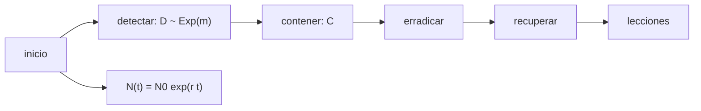

# B122-C06 — Respuesta a incidentes cibernéticos en operaciones de misión

<!-- nav:top -->
[🏠 Programa](../../../../README.md) · [📚 Bloque B122](../../../tronco-comun/B122-resiliencia-y-continuidad-de-infraestructura-espacial.md) · [← Anterior: B122-C05 — Control de accesos y gestión de identidades en operaciones](../B122-C05-control-de-accesos-y-gestion-de-identidades-en-operaciones/CLASE.md) · [Siguiente: B122-C07 — Clasificación de severidad e impacto de incidentes espaciales →](../B122-C07-clasificacion-de-severidad-e-impacto-de-incidentes-espaciales/CLASE.md)
<!-- /nav -->

## 1. Ubicación, nivel y alcance

Clase 6 del bloque B122. Nivel N4. Un incidente tiene un ciclo —detectar, contener, erradicar, recuperar y aprender— y cada hora de demora puede aumentar los sistemas afectados. Aquí modelas esa demora con un crecimiento exponencial y calculas cuánto ayudan detectar y contener antes. Usas [B96](../../../tronco-comun/B96-control-y-operacion-de-misiones-espaciales.md) solo como contexto de emergencias operativas. **Esta clase es educativa y defensiva: no es asesoría legal, regulatoria, de seguridad ni financiera y no sustituye a un análisis con el operador, su asesor jurídico o su autoridad.** Los datos son sintéticos y los parámetros son ilustrativos.

## 2. Por qué esta clase existe

B96-C15 trata emergencias operativas, no incidentes cibernéticos. La decisión central: **¿cuánto reduce el daño esperado acortar la detección o la contención?**

## 3. Lo que podrás hacer al terminar

1. Describir las fases del ciclo de respuesta.
2. Armar la cronología de un caso con horas por fase.
3. Modelar los sistemas afectados `N(t) = N₀ e^(rt)`.
4. Calcular el valor esperado con detección exponencial.
5. Comparar acortar la detección con acortar la contención.
6. Separar lo consultado (guía de respuesta a incidentes) de lo sintético.

La evidencia es la **línea de tiempo de un incidente simulado** del ejercicio 12 (sección 20).

## 4. Con qué llegas y cómo comprobarlo

1. ¿Qué es un crecimiento exponencial?
2. ¿Qué es un valor esperado?
3. ¿Qué es una distribución exponencial?
4. ¿Qué es una cronología?
5. ¿Qué es un dato sintético?

<details>
<summary>Ver respuestas</summary>

1. Uno cuya velocidad es proporcional al valor actual. 2. El promedio ponderado por probabilidad. 3. La del tiempo hasta un suceso al azar con tasa constante. 4. Una lista ordenada de hechos con su hora. 5. Uno inventado, no medido.
</details>

Con cuatro o cinco aciertos, sigue; si no, repasa los prerrequisitos.

## 5. Un caso de contexto y casos de referencia

NIST SP 800-61 Rev. 3 (abril de 2025) ofrece recomendaciones de respuesta a incidentes alineadas con el Marco de Ciberseguridad 2.0 y sustituye a la Rev. 2 de 2012; solo se leyó su ficha. El **ejemplo conductor** es un incidente simulado con propagación de `r = 0,05` por hora, detección de media `m = 6 h` y contención `C = 2 h` después. No describe ninguna técnica de intrusión. Todo es **sintético**.

## 6. Vocabulario

La **detección** es notar el incidente; la **contención** limita su alcance; la **erradicación** elimina la causa; la **recuperación** restablece el servicio; las **lecciones aprendidas** mejoran el plan. `N₀` son los sistemas iniciales y `r` la tasa de propagación por hora.

## 7. Modelo mental: una cuenta regresiva de propagación



*Descripción textual:* tras el inicio corre la detección y luego la contención, mientras el alcance crece; después vienen erradicar, recuperar y aprender.

Analogía: una mancha de aceite que se extiende mientras se busca el origen. Límite: el crecimiento real se satura y depende de la topología.

## 8. La explicación, paso a paso

### 8.1 Cronología del caso

Detectar y analizar 6 h; contener 2 h; erradicar 10 h; recuperar 14 h. Duración total `32 h`; la contención llega a las `8 h`.

### 8.2 Valor esperado

Con `D` exponencial de media `m` y `C` fijo, `E[N] = N₀ e^(rC)/(1 − rm)` si `rm < 1`. Con `m = 6 h`, `C = 2 h`: `1,1052/0,7 = 1,579`. El Monte Carlo (400 000 repeticiones) da `1,579`.

### 8.3 Detectar antes

`E[N]` vale `1,163` con `m = 1 h`, `1,300` con `3 h`, `1,579` con `6 h` y `1,842` con `8 h`. Pasar de 6 a 3 h reduce `E[N]` un `17,7 %`.

### 8.4 Contener antes y el umbral

Con `m = 6 h`, `E[N]` es `1,465` si `C = 0,5 h`, `1,579` si `2 h` y `1,928` si `6 h`. El modelo diverge cuando `m ≥ 1/r = 20 h`.

## 9. Magnitudes, símbolos y unidades

| Símbolo | Qué es | Unidad | Valor / nota |
|---|---|---|---|
| `N₀` | sistemas afectados al inicio | conteo | 1 |
| `r` | tasa de propagación | 1/h | 0,05 (sintético) |
| `m` | media de detección | h | 6 |
| `C` | tiempo de contención | h | 2 |
| `E[N]` | afectados esperados | conteo | 1,579 |

## 10. Convenciones y referencias

Tiempo en horas desde el inicio real del incidente (desconocido hasta detectarlo). Tasas y tiempos **sintéticos**. La fórmula `E[N]` es una derivación del curso (verificada por Monte Carlo); las fases son las del ciclo clásico, no una cita textual de NIST.

## 11. De dónde sale lo que afirmamos

| ID | Fuente | Localizador | Respalda | Estado |
|---|---|---|---|---|
| S1 | NIST, SP 800-61 Rev. 3, «Incident Response Recommendations and Considerations for Cybersecurity Risk Management: A CSF 2.0 Community Profile», abril de 2025 (sustituye a la Rev. 2, 2012) — https://csrc.nist.gov/pubs/sp/800/61/r3/final (consultada 2026-11-11) | ficha de la publicación leída mediante WebFetch (título, fecha, resumen) | la existencia y el alcance de la guía de respuesta a incidentes y su relación con el Marco de Ciberseguridad 2.0 | Consultada (solo la ficha; no el cuerpo del documento) |
| — | ISO 22301, ISO/IEC 27001, ISO/IEC 27036, políticas espaciales nacionales y directrices de UNOOSA | — | marcos normativos y de buenas prácticas citados solo de forma general | No consultados |
| — | Datos y parámetros sintéticos de este curso | — | todo el modelo y los números del laboratorio | Sintético / ilustrativo |

Límites: solo se leyó la ficha de NIST SP 800-61 Rev. 3; sus fases y recomendaciones no se consultaron en el cuerpo; todas las tasas son inventadas. Lo simulado nunca se presenta como observado.

## 12. Cómo ver la demora

| m (h) | E[N] con C = 2 h |
|---|---|
| 1 | 1,163 |
| 3 | 1,300 |
| 6 | 1,579 |
| 8 | 1,842 |

Descripción larga: el daño esperado crece cada vez más rápido con la demora de detección y diverge en 20 h.

## 13. Ejemplo trabajado: el valor esperado con m = 6 h

**Paso 1 · Contención.** `e^(0,05×2) = 1,1052`.

**Paso 2 · Denominador.** `1 − 0,05×6 = 0,7`.

**Paso 3 · Cociente.** `1,1052/0,7 = 1,579`.

**Paso 4 · Lectura.** En promedio, el incidente afecta 1,6 veces los sistemas iniciales.

## 14. Distintas formas de describir el incidente

**Por fase:** detectar, contener, erradicar, recuperar. **Por tiempo:** cronología. **Por alcance:** `N(t)`. **Por esperanza:** `E[N]`. **Por decisión:** invertir en detección o en contención.

## 15. Práctica guiada

**Ejercicio 1 · con los pasos indicados.** Calcula `E[N]` con `m = 6`, `C = 2`. *Pasos:* `e^0,1/(1−0,3)`.

<details><summary>Solución comentada</summary>

`1,579`.
</details>

**Ejercicio 2 · con una pista.** ¿Cuánto tarda el caso en llegar a la contención? *Pista:* suma las dos primeras fases.

<details><summary>Solución comentada</summary>

`6 + 2 = 8 h`.
</details>

**Ejercicio 3 · casi autónomo.** Duración total del caso sintético.

<details><summary>Solución comentada</summary>

`6+2+10+14 = 32 h`.
</details>

## 16. Práctica autónoma, transferencia e integrador

**Ejercicio 4 · autónomo.** `E[N]` con `m = 3 h`.

<details><summary>Solución comentada</summary>

`1,1052/0,85 = 1,300`.
</details>

**Ejercicio 5 · autónomo.** `E[N]` con `m = 1 h`.

<details><summary>Solución comentada</summary>

`1,1052/0,95 = 1,163`.
</details>

**Ejercicio 6 · autónomo.** Umbral de `m` donde el modelo diverge.

<details><summary>Solución comentada</summary>

`1/r = 20 h`.
</details>

**Ejercicio 7 · autónomo.** `E[N]` con `m = 6 h` y `C = 6 h`.

<details><summary>Solución comentada</summary>

`e^0,3/0,7 = 1,928`.
</details>

**Ejercicio 8 · autónomo.** Reducción de `E[N]` al pasar de `m = 6` a `m = 3`.

<details><summary>Solución comentada</summary>

`1 − 1,300/1,579 = 17,7 %`.
</details>

**Ejercicio 9 · transferencia.** **Transferencia.** El modelo diverge con `m ≥ 20 h`. ¿Qué pasa en la realidad?

<details><summary>Solución comentada</summary>

El crecimiento se satura (no hay infinitos sistemas), así que el modelo exponencial es solo una aproximación inicial.
</details>

**Ejercicio 10 · transferencia.** **Transferencia.** ¿Por qué la fase de lecciones aprendidas no aparece en la fórmula?

<details><summary>Solución comentada</summary>

Porque no reduce este incidente sino los futuros; mejora `m`, `C` y `r` más adelante.
</details>

**Ejercicio 11 · transferencia.** **Transferencia.** ¿Qué registrarías durante un incidente para reconstruir la cronología?

<details><summary>Solución comentada</summary>

Hora y autor de cada decisión y de cada cambio, en un registro único (ver B122-C09).
</details>

**Ejercicio 12 · integrador.** **Integrador.** Elabora tu *línea de tiempo de un incidente simulado*: fases con horas, `E[N]` según `m` y `C`, qué invertir primero y lo consultado o sintético, con el aviso de que no es asesoría.

<details><summary>Solución comentada</summary>

Secciones 8.1–8.4 y la salida del laboratorio.
</details>

## 17. Laboratorio: cronología y costo de la demora

El script [incidente.py](incidente.py) muestra la cronología, calcula `E[N]` por fórmula y por Monte Carlo para varias medias de detección y compara acortar la contención (**comprueba** la diferencia < 1 %; se limita a `m ≤ 8 h` para que la varianza sea finita).

**Datos:** tasas, tiempos y fases **sintéticos**. **Predice antes de ejecutar:** ¿qué pesa más: pasar `m` de 6 a 3 h o `C` de 2 a 0,5 h? (detección: 17,7 % frente a 7,2 %.) **Ejecución del 2026-11-11 (Python 3.12.9):**

```text
Python 3.12.9 (biblioteca estandar)
DATOS SINTETICOS: tasas, tiempos y fases son inventados; no hay ningun incidente real.
Cronologia de un caso sintetico (horas desde el inicio del incidente):
    0.0 h ->   6.0 h : Detectar y analizar
    6.0 h ->   8.0 h : Contener
    8.0 h ->  18.0 h : Erradicar
   18.0 h ->  32.0 h : Recuperar
Duracion total = 32.0 h ; tiempo hasta la contencion = 8.0 h
Sistemas afectados esperados al contener, segun la media de deteccion m:
  m =  1.0 h : analitico =  1.163 ; Monte Carlo =  1.163 ; dif = 0.00 %
  m =  3.0 h : analitico =  1.300 ; Monte Carlo =  1.300 ; dif = 0.01 %
  m =  6.0 h : analitico =  1.579 ; Monte Carlo =  1.579 ; dif = 0.04 %
  m =  8.0 h : analitico =  1.842 ; Monte Carlo =  1.844 ; dif = 0.12 %
Efecto de acortar la contencion C con m = 6 h:
  C = 0.5 h : E[N] = 1.465
  C = 2.0 h : E[N] = 1.579
  C = 6.0 h : E[N] = 1.928
Umbral de inestabilidad: m = 1/r = 20.0 h (con m >= 1/r el valor esperado diverge en el modelo)
Pruebas superadas.
```

```bash
python programa/clases/B122/B122-C06-respuesta-a-incidentes-ciberneticos-en-operaciones-de-mision/incidente.py
```

**Límites:** crecimiento exponencial sin saturación, detección exponencial, un solo parámetro de propagación; no simula ningún sistema real.

## 18. Errores frecuentes y cómo corregirlos

**Creer que contener antes es siempre lo mejor.** Compara con 8.3 y 8.4: depende de `m` y `C`.

**Aplicar la fórmula con `rm ≥ 1`.** Se corrige con 8.4.

**Confundir fases del ciclo.** Ver sección 6.

**Tomar la clase como guía técnica de intrusión o defensa real.** No lo es; ver sección 21.

## 19. Cómo sabrás que vas bien

Tras la sección 8: ¿qué `E[N]` esperabas y cuál obtuviste? Si dudas, repasa el ejemplo 13. Tras el laboratorio: ¿qué comprueba? (ver la sección 17).

## 20. Qué entregas y cómo se evalúa

El producto es tu **línea de tiempo de un incidente simulado** (ejercicio 12).

| Criterio | Inicial | En desarrollo | Logrado | Destacado |
|---|---|---|---|---|
| Conceptos | Los confunde | Parciales | Describe el ciclo y el modelo | Explica sus límites |
| Cálculo | Sin unidades | Con errores | Calcula `E[N]` | Calcula casos nuevos |
| Numérico | Sin comprobar | Un caso | Fórmula y Monte Carlo contrastados | Interpreta las diferencias |
| Fuentes | Sin fuente | Sin fecha | Fuentes con versión, fecha y estado | Declara lo sintético y lo no consultado |
| Límites | No los nombra | Uno | Tres | Discute qué falta del modelo |

**Condiciones críticas (no se compensan con promedio):** rotular los datos como sintéticos; declarar que la clase no es asesoría legal, regulatoria ni de seguridad; citar solo lo consultado, con versión y fecha.

## 21. Ética, seguridad y límites

La clase es solo defensiva y no explica cómo intrusar sistemas; ante un incidente real hay que seguir el plan de la organización y a su equipo de respuesta. Clase educativa y **exclusivamente defensiva**: **no es asesoría legal, regulatoria, de seguridad ni financiera**; no describe cómo atacar sistemas ni sustituye al asesor jurídico, a la autoridad competente ni a un equipo de respuesta real. Los textos normativos se citan con su versión y fecha de consulta y pueden haber cambiado. Los modelos son simplificados y sus datos, sintéticos. Accesibilidad: tablas equivalentes a las gráficas, fórmulas en texto, ejercicios sin conexión.

## 22. Para cerrar y seguir

Con detección de 6 h y contención de 2 h, el incidente afecta en promedio `1,579` veces los sistemas iniciales; detectar en 3 h baja ese valor a `1,300`. Queda una pregunta: ¿cómo se decide qué incidente atender primero?

**Glosario español–inglés.** respuesta a incidentes · *incident response*; contención · *containment*; erradicación · *eradication*; recuperación · *recovery*; lecciones aprendidas · *lessons learned*.

**Continuidad.** [B122-C07](../B122-C07-clasificacion-de-severidad-e-impacto-de-incidentes-espaciales/CLASE.md) estudia la clasificación de severidad.

**Referencias:** ver sección 11.

<!-- nav:bottom -->
---

[← Anterior: B122-C05 — Control de accesos y gestión de identidades en operaciones](../B122-C05-control-de-accesos-y-gestion-de-identidades-en-operaciones/CLASE.md) · [📚 Bloque B122](../../../tronco-comun/B122-resiliencia-y-continuidad-de-infraestructura-espacial.md) · [Siguiente: B122-C07 — Clasificación de severidad e impacto de incidentes espaciales →](../B122-C07-clasificacion-de-severidad-e-impacto-de-incidentes-espaciales/CLASE.md)
<!-- /nav -->
