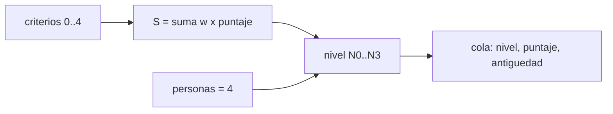

# B122-C07 — Clasificación de severidad e impacto de incidentes espaciales

<!-- nav:top -->
[🏠 Programa](../../../../README.md) · [📚 Bloque B122](../../../tronco-comun/B122-resiliencia-y-continuidad-de-infraestructura-espacial.md) · [← Anterior: B122-C06 — Respuesta a incidentes cibernéticos en operaciones de misión](../B122-C06-respuesta-a-incidentes-ciberneticos-en-operaciones-de-mision/CLASE.md) · [Siguiente: B122-C08 — Comunicación de crisis con operadores, autoridades y público →](../B122-C08-comunicacion-de-crisis-con-operadores-autoridades-y-publico/CLASE.md)
<!-- /nav -->

## 1. Ubicación, nivel y alcance

Clase 7 del bloque B122. Nivel N4. Con varios incidentes abiertos hay que decidir cuál atender primero. Aquí aplicas una escala de severidad ponderada (del curso, no oficial), una regla de escalada por seguridad de las personas y una cola de prioridad. Usas [B58](../../../tronco-comun/B58-asteroides-cometas-y-defensa-planetaria.md) solo como contraste: allí se clasifican impactos de asteroides. **Esta clase es educativa y defensiva: no es asesoría legal, regulatoria, de seguridad ni financiera y no sustituye a un análisis con el operador, su asesor jurídico o su autoridad.** Los datos son sintéticos y los parámetros son ilustrativos.

## 2. Por qué esta clase existe

B58-C10 clasifica solo impactos de asteroides. La decisión central: **¿en qué orden se atienden los incidentes y qué regla fuerza la escalada?**

## 3. Lo que podrás hacer al terminar

1. Definir criterios con puntaje de 0 a 4 y pesos que suman 1.
2. Calcular el puntaje ponderado `S`.
3. Asignar un nivel de N0 a N3 con umbrales.
4. Aplicar la regla de escalada por personas.
5. Ordenar una cola de atención.
6. Medir la estabilidad del nivel frente a cambios de pesos.

La evidencia es la **tabla de clasificación de incidentes sintéticos** del ejercicio 12 (sección 20).

## 4. Con qué llegas y cómo comprobarlo

1. ¿Qué es un promedio ponderado?
2. ¿Qué es un umbral?
3. ¿Qué es ordenar por varios criterios?
4. ¿Qué es una escala ordinal?
5. ¿Qué es un dato sintético?

<details>
<summary>Ver respuestas</summary>

1. Una suma de valores multiplicados por pesos que suman 1. 2. Un valor que separa categorías. 3. Ordenar por el primero y desempatar con los siguientes. 4. Una con orden pero sin distancias iguales. 5. Uno inventado, no medido.
</details>

Con cuatro o cinco aciertos, sigue; si no, repasa los prerrequisitos.

## 5. Un caso de contexto y casos de referencia

NIST SP 800-61 Rev. 3 (abril de 2025) trata la respuesta a incidentes en el contexto del Marco de Ciberseguridad 2.0; solo se leyó su ficha, y no se consultó ninguna escala oficial de severidad. La escala de esta clase es **del curso**: criterios servicio, alcance, datos, personas y reputación con pesos 0,35, 0,25, 0,15, 0,15 y 0,10. El **ejemplo conductor** son ocho incidentes sintéticos (I-01 a I-08). Todo es **sintético**.

## 6. Vocabulario

La **severidad** es la gravedad del incidente para priorizar. El **puntaje** `S` es la suma ponderada de los criterios. El **nivel** es la categoría que resulta de los umbrales. La **escalada** es subir el nivel por una regla. La **cola de atención** es el orden de respuesta. Un **peso** `w` es la importancia relativa de un criterio.

## 7. Modelo mental: un embudo de priorización



*Descripción textual:* los criterios se ponderan en un puntaje que da un nivel; una regla de personas puede forzar el nivel más alto; la cola ordena por nivel, puntaje y antigüedad.

Analogía: el triaje de un hospital, con un caso que pasa adelante aunque su puntaje sea moderado. Límite: la escala es ilustrativa y no sustituye a una oficial.

## 8. La explicación, paso a paso

### 8.1 Puntaje

`S = 0,35·servicio + 0,25·alcance + 0,15·datos + 0,15·personas + 0,10·reputación`. I-06 `(2,1,1,0,1)`: `0,70+0,25+0,15+0+0,10 = 1,20`. I-07 `(4,4,3,1,4)`: `3,40`.

### 8.2 Nivel

`S < 1` N0, `< 2` N1, `< 3` N2 y `≥ 3` N3. I-02 (0,60) y I-05 (0,40) son N0; I-06 (1,20), N1; I-01 (2,50), I-03 (2,10) e I-08 (2,30), N2; I-07 (3,40), N3.

### 8.3 Escalada

I-04 `(3,2,0,4,1)` tiene `S = 2,25` (N2 por puntaje) pero `personas = 4`: se escala a N3.

### 8.4 Cola y estabilidad

Orden por nivel, puntaje y antigüedad: I-07, I-04, I-01, I-08, I-03, I-06, I-02, I-05. Al perturbar los pesos ±20 %, solo I-03 cambia de nivel alguna vez (estabilidad `0,982`).

## 9. Magnitudes, símbolos y unidades

| Símbolo | Qué es | Unidad | Valor / nota |
|---|---|---|---|
| `w` | peso del criterio | — | 0,35; 0,25; 0,15; 0,15; 0,10 |
| `S` | puntaje | 0–4 | ver tabla |
| Nivel | N0–N3 | — | umbrales 1, 2, 3 |
| edad | tiempo abierto | h | 1–48 |

## 10. Convenciones y referencias

Sin marco espacial. Puntajes 0–4 ordinales. La escala, los pesos y los umbrales **son del curso**; no se consultó ninguna escala oficial de severidad de incidentes.

## 11. De dónde sale lo que afirmamos

| ID | Fuente | Localizador | Respalda | Estado |
|---|---|---|---|---|
| S1 | NIST, SP 800-61 Rev. 3, «Incident Response Recommendations and Considerations for Cybersecurity Risk Management: A CSF 2.0 Community Profile», abril de 2025 (sustituye a la Rev. 2, 2012) — https://csrc.nist.gov/pubs/sp/800/61/r3/final (consultada 2026-11-11) | ficha de la publicación leída mediante WebFetch (título, fecha, resumen) | el contexto de la respuesta a incidentes; no se consultó ninguna escala de severidad | Consultada (solo la ficha; no el cuerpo del documento) |
| — | ISO 22301, ISO/IEC 27001, ISO/IEC 27036, políticas espaciales nacionales y directrices de UNOOSA; escalas oficiales de severidad de incidentes | — | marcos normativos y de buenas prácticas citados solo de forma general | No consultados |
| — | Datos y parámetros sintéticos de este curso (escala de severidad propia) | — | todo el modelo y los números del laboratorio | Sintético / ilustrativo |

Límites: no se consultó ninguna escala oficial; los pesos y umbrales son inventados; los incidentes son ficticios. Lo simulado nunca se presenta como observado.

## 12. Cómo ver la clasificación

| ID | S | Nivel |
|---|---|---|
| I-01 | 2,50 | N2 |
| I-02 | 0,60 | N0 |
| I-03 | 2,10 | N2 |
| I-04 | 2,25 | N3 (escalada) |
| I-05 | 0,40 | N0 |
| I-06 | 1,20 | N1 |
| I-07 | 3,40 | N3 |
| I-08 | 2,30 | N2 |

Descripción larga: solo I-07 y I-04 llegan a N3; I-04 lo hace por la regla de personas.

## 13. Ejemplo trabajado: el incidente I-04

**Paso 1 · Puntaje.** `1,05 + 0,50 + 0 + 0,60 + 0,10 = 2,25`.

**Paso 2 · Nivel por puntaje.** `2 ≤ S < 3`: N2.

**Paso 3 · Regla.** `personas = 4`: N3.

**Paso 4 · Cola.** Segundo lugar, tras I-07.

## 14. Distintas formas de describir la severidad

**Por criterio:** servicio, alcance, datos, personas, reputación. **Por puntaje:** `S`. **Por nivel:** N0–N3. **Por regla:** escalada. **Por prioridad:** cola.

## 15. Práctica guiada

**Ejercicio 1 · con los pasos indicados.** Calcula `S` de I-06. *Pasos:* multiplica cada criterio por su peso y suma.

<details><summary>Solución comentada</summary>

`1,20`.
</details>

**Ejercicio 2 · con una pista.** Calcula `S` de I-02 `(1,1,0,0,0)`. *Pista:* solo dos términos.

<details><summary>Solución comentada</summary>

`0,35 + 0,25 = 0,60`.
</details>

**Ejercicio 3 · casi autónomo.** ¿Suman 1 los pesos?

<details><summary>Solución comentada</summary>

Sí: `0,35+0,25+0,15+0,15+0,10 = 1`.
</details>

## 16. Práctica autónoma, transferencia e integrador

**Ejercicio 4 · autónomo.** `S` de I-05 `(0,1,1,0,0)`.

<details><summary>Solución comentada</summary>

`0,25 + 0,15 = 0,40`.
</details>

**Ejercicio 5 · autónomo.** `S` de I-01 `(4,3,1,0,2)`.

<details><summary>Solución comentada</summary>

`1,40+0,75+0,15+0+0,20 = 2,50`.
</details>

**Ejercicio 6 · autónomo.** `S` de I-07 y nivel.

<details><summary>Solución comentada</summary>

`3,40`, N3.
</details>

**Ejercicio 7 · autónomo.** ¿Por qué I-04 es N3 con `S = 2,25`?

<details><summary>Solución comentada</summary>

Por la regla de escalada: `personas = 4`.
</details>

**Ejercicio 8 · autónomo.** ¿Qué dos incidentes encabezan la cola?

<details><summary>Solución comentada</summary>

I-07 e I-04.
</details>

**Ejercicio 9 · transferencia.** **Transferencia.** I-03 cambia de nivel en 1,8 % de las simulaciones de pesos. ¿Por qué?

<details><summary>Solución comentada</summary>

Su puntaje (2,10) está cerca del umbral de 2: un pequeño cambio de pesos lo cruza.
</details>

**Ejercicio 10 · transferencia.** **Transferencia.** ¿Por qué una regla de escalada y no solo un peso mayor para personas?

<details><summary>Solución comentada</summary>

Porque un promedio puede diluir un criterio grave; la regla impide que los demás lo compensen.
</details>

**Ejercicio 11 · transferencia.** **Transferencia.** ¿Qué datos reales necesitarías para calibrar pesos y umbrales?

<details><summary>Solución comentada</summary>

Incidentes pasados clasificados por expertos y su consecuencia, bajo las normas de la organización.
</details>

**Ejercicio 12 · integrador.** **Integrador.** Elabora tu *tabla de clasificación de incidentes sintéticos*: puntajes, niveles, regla de escalada, cola y estabilidad, y lo consultado o sintético, con el aviso de que la escala no es oficial ni asesoría.

<details><summary>Solución comentada</summary>

Secciones 8.1–8.4 y la salida del laboratorio.
</details>

## 17. Laboratorio: severidad, escalada y cola de atención

El script [severidad.py](severidad.py) calcula puntajes, niveles, la escalada y la cola, y mide la estabilidad con pesos perturbados ±20 % (**comprueba** que los pesos suman 1 y que el puntaje es monótono).

**Datos:** incidentes y escala **sintéticos**. **Predice antes de ejecutar:** ¿qué incidente tendrá el nivel más alto con un puntaje moderado? (I-04.) **Ejecución del 2026-11-11 (Python 3.12.9):**

```text
Python 3.12.9 (biblioteca estandar)
DATOS SINTETICOS: incidentes y puntajes inventados; la escala es ilustrativa, no oficial.
 id     S    nivel  edad[h]
 I-01   2.50  N2      2
 I-02   0.60  N0     30
 I-03   2.10  N2      5
 I-04   2.25  N3      1
 I-05   0.40  N0     48
 I-06   1.20  N1     10
 I-07   3.40  N3      3
 I-08   2.30  N2      8
Cola de atencion (nivel, puntaje, antiguedad): ['I-07', 'I-04', 'I-01', 'I-08', 'I-03', 'I-06', 'I-02', 'I-05']
I-04: puntaje 2.25 (N2 por puntaje) pero se escala a N3 por la regla de seguridad de las personas
Fraccion de simulaciones con el mismo nivel al perturbar los pesos +-20 %:
  I-01: 1.000
  I-02: 1.000
  I-03: 0.982
  I-04: 1.000
  I-05: 1.000
  I-06: 1.000
  I-07: 1.000
  I-08: 1.000
Pruebas superadas.
```

```bash
python programa/clases/B122/B122-C07-clasificacion-de-severidad-e-impacto-de-incidentes-espaciales/severidad.py
```

**Límites:** escala ordinal inventada, pesos sin calibrar, sin incertidumbre en los puntajes; no es una escala oficial.

## 18. Errores frecuentes y cómo corregirlos

**Presentar la escala como oficial.** Es del curso; ver sección 10.

**Dejar que el promedio diluya un criterio grave.** Se corrige con 8.3.

**Ignorar la antigüedad al desempatar.** Se corrige con 8.4.

**Fijar umbrales sin comprobar su estabilidad.** Se corrige con el ejercicio 9.

## 19. Cómo sabrás que vas bien

Tras la sección 8: ¿qué nivel tiene I-04 y por qué? Si dudas, repasa el ejemplo 13. Tras el laboratorio: ¿qué comprueba? (ver la sección 17).

## 20. Qué entregas y cómo se evalúa

El producto es tu **tabla de clasificación de incidentes sintéticos** (ejercicio 12).

| Criterio | Inicial | En desarrollo | Logrado | Destacado |
|---|---|---|---|---|
| Conceptos | Los confunde | Parciales | Explica puntaje, nivel y escalada | Explica sus límites |
| Cálculo | Sin unidades | Con errores | Calcula puntajes y cola | Calcula casos nuevos |
| Numérico | Sin comprobar | Un caso | Monotonía y estabilidad comprobadas | Interpreta las diferencias |
| Fuentes | Sin fuente | Sin fecha | Fuentes con versión, fecha y estado | Declara lo sintético y lo no consultado |
| Límites | No los nombra | Uno | Tres | Discute qué falta del modelo |

**Condiciones críticas (no se compensan con promedio):** rotular los datos como sintéticos; declarar que la clase no es asesoría legal, regulatoria ni de seguridad; citar solo lo consultado, con versión y fecha.

## 21. Ética, seguridad y límites

Una escala propia no sustituye a las obligaciones de clasificar o notificar que imponga una norma o una autoridad; consulta siempre al asesor jurídico y a la autoridad competente. Clase educativa y **exclusivamente defensiva**: **no es asesoría legal, regulatoria, de seguridad ni financiera**; no describe cómo atacar sistemas ni sustituye al asesor jurídico, a la autoridad competente ni a un equipo de respuesta real. Los textos normativos se citan con su versión y fecha de consulta y pueden haber cambiado. Los modelos son simplificados y sus datos, sintéticos. Accesibilidad: tablas equivalentes a las gráficas, fórmulas en texto, ejercicios sin conexión.

## 22. Para cerrar y seguir

Con la escala del curso, I-07 e I-04 son N3 y encabezan la cola; I-04 sube por tener `personas = 4` pese a `S = 2,25`. Queda una pregunta: ¿qué y cuándo hay que comunicar a quién?

**Glosario español–inglés.** severidad · *severity*; escalada · *escalation*; cola de prioridad · *priority queue*; criterio · *criterion*; peso · *weight*.

**Continuidad.** [B122-C08](../B122-C08-comunicacion-de-crisis-con-operadores-autoridades-y-publico/CLASE.md) estudia la comunicación de crisis.

**Referencias:** ver sección 11.

<!-- nav:bottom -->
---

[← Anterior: B122-C06 — Respuesta a incidentes cibernéticos en operaciones de misión](../B122-C06-respuesta-a-incidentes-ciberneticos-en-operaciones-de-mision/CLASE.md) · [📚 Bloque B122](../../../tronco-comun/B122-resiliencia-y-continuidad-de-infraestructura-espacial.md) · [Siguiente: B122-C08 — Comunicación de crisis con operadores, autoridades y público →](../B122-C08-comunicacion-de-crisis-con-operadores-autoridades-y-publico/CLASE.md)
<!-- /nav -->
