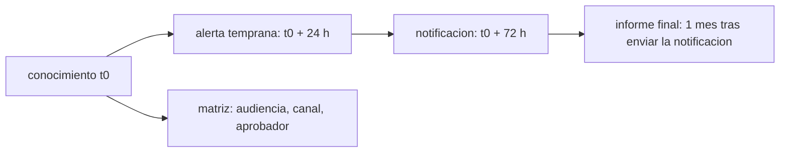

# B122-C08 — Comunicación de crisis con operadores, autoridades y público

<!-- nav:top -->
[🏠 Programa](../../../../README.md) · [📚 Bloque B122](../../../tronco-comun/B122-resiliencia-y-continuidad-de-infraestructura-espacial.md) · [← Anterior: B122-C07 — Clasificación de severidad e impacto de incidentes espaciales](../B122-C07-clasificacion-de-severidad-e-impacto-de-incidentes-espaciales/CLASE.md) · [Siguiente: B122-C09 — Preservación de evidencias y cadena de custodia de datos de incidentes →](../B122-C09-preservacion-de-evidencias-y-cadena-de-custodia-de-datos-de-incidentes/CLASE.md)
<!-- /nav -->

## 1. Ubicación, nivel y alcance

Clase 8 del bloque B122. Nivel N4. En una crisis hay que informar a la autoridad, a los operadores que dependen del servicio, al personal y al público, con mensajes oportunos y sin presentar lo no confirmado como hecho. Aquí calculas los plazos de una notificación según el texto de la Directiva (UE) 2022/2555 y planificas una matriz de audiencias. Usas [B124](../../../tronco-comun/B124-industria-economia-etica-y-proyectos-espaciales.md) solo como contexto: allí la divulgación no cubre la crisis. **Esta clase es educativa y defensiva: no es asesoría legal, regulatoria, de seguridad ni financiera y no sustituye a un análisis con el operador, su asesor jurídico o su autoridad.** Los datos son sintéticos y los parámetros son ilustrativos.

## 2. Por qué esta clase existe

B124-C18 trata divulgación; la comunicación de crisis con mensajes oportunos no está cubierta. La decisión central: **¿qué hay que comunicar, a quién y antes de qué plazo?**

## 3. Lo que podrás hacer al terminar

1. Calcular los plazos de alerta temprana (24 h), notificación (72 h) e informe final (un mes) a partir de un instante de conocimiento.
2. Comprobar si una notificación se envió a tiempo.
3. Construir una matriz de audiencias, canales y aprobadores.
4. Comparar la preparación de mensajes en secuencia y en paralelo.
5. Rotular los hechos confirmados y los no confirmados.
6. Separar lo consultado (texto de la directiva) de lo sintético.

La evidencia es la **plan de comunicación de crisis simulado** del ejercicio 12 (sección 20).

## 4. Con qué llegas y cómo comprobarlo

1. ¿Qué es UTC?
2. ¿Qué es un plazo?
3. ¿Qué es un canal de comunicación?
4. ¿Qué es un hecho confirmado?
5. ¿Qué es un dato sintético?

<details>
<summary>Ver respuestas</summary>

1. El tiempo universal coordinado, la referencia horaria común. 2. Un instante límite para hacer algo. 3. El medio por el que se envía un mensaje. 4. Uno verificado por más de una fuente o evidencia. 5. Uno inventado, no medido.
</details>

Con cuatro o cinco aciertos, sigue; si no, repasa los prerrequisitos.

## 5. Un caso de contexto y casos de referencia

La Directiva (UE) 2022/2555 (NIS 2), firmada en Estrasburgo el 2022-12-14, establece en su artículo 23(4) que, para un incidente significativo, se envía una alerta temprana en 24 horas desde que se tiene conocimiento del incidente, una notificación en 72 horas y un informe final a más tardar un mes después de presentar la notificación; su anexo I, sector 11, incluye a los operadores de infraestructura terrestre que apoya servicios espaciales. Esos son los textos **consultados** (EUR-Lex, 2026-11-11). **No** se consultó la fecha de publicación en el Diario Oficial, la transposición nacional ni qué es «incidente significativo». El **ejemplo conductor** es un incidente sintético con conocimiento el 2026-03-05 22:30 UTC. Todo lo demás es **sintético**.

## 6. Vocabulario

La **alerta temprana** es el primer aviso breve. La **notificación** amplía los hechos. El **informe final** cierra el caso. Una **audiencia** es el grupo al que se dirige un mensaje. Un **canal** es el medio. Un **aprobador** autoriza el mensaje. Un **hecho no confirmado** se rotula como tal.

## 7. Modelo mental: un reloj regulatorio y una matriz de mensajes



*Descripción textual:* desde el conocimiento corren los plazos de alerta, notificación e informe final, y en paralelo se preparan los mensajes por audiencia.

Analogía: una cuenta regresiva con paradas obligatorias. Límite: esta clase solo hace aritmética de fechas; si la norma aplica y cuándo empieza el plazo lo decide el asesor jurídico y la autoridad.

## 8. La explicación, paso a paso

### 8.1 Plazos

Conocimiento: `2026-03-05 22:30 UTC`. Alerta temprana: `+24 h = 2026-03-06 22:30`. Notificación: `+72 h = 2026-03-08 22:30`. Si la notificación se envió el `2026-03-08 20:00`, estuvo a tiempo con `2,5 h` de margen. Informe final: un mes tras el envío, `2026-04-08 20:00 UTC`.

### 8.2 Un mes

Se usa el mismo día del mes siguiente, recortado al último día si no existe: el 31 de enero más un mes da el 28 de febrero de 2026.

### 8.3 Matriz de audiencias

Autoridad competente (90 min, dirección y jurídico), operadores dependientes (45 min), personal interno (30 min) y público y medios (120 min). En secuencia: `285 min`; en paralelo: `120 min`. La alerta a la autoridad cabe en las 24 h en ambos casos.

### 8.4 Hechos confirmados

Un mensaje sintético con 5 hechos confirmados y 3 no confirmados tiene una fracción confirmada de `0,625`: los tres restantes se rotulan «no confirmado» con la hora de la próxima actualización.

## 9. Magnitudes, símbolos y unidades

| Símbolo | Qué es | Unidad | Valor / nota |
|---|---|---|---|
| `t₀` | instante de conocimiento | UTC | 2026-03-05 22:30 (sintético) |
| plazos | 24 h / 72 h / 1 mes | h, mes | art. 23(4), texto consultado |
| margen | plazo − envío | h | 2,5 |
| tiempo de mensajes | secuencia / paralelo | min | 285 / 120 |

## 10. Convenciones y referencias

Todas las horas en UTC. Los plazos son los del artículo 23(4) en el texto consultado; **pueden cambiar o tener matices** y no se determina si una entidad está obligada. Fechas y audiencias **sintéticas**.

## 11. De dónde sale lo que afirmamos

| ID | Fuente | Localizador | Respalda | Estado |
|---|---|---|---|---|
| S1 | Directiva (UE) 2022/2555 (NIS 2), firmada en Estrasburgo el 2022-12-14, texto en inglés en EUR-Lex — https://eur-lex.europa.eu/eli/dir/2022/2555/oj/eng (consultada 2026-11-11) | artículo 23(4) y anexo I, sector 11 «Space», leídos mediante WebFetch; no se obtuvo la fecha de publicación en el Diario Oficial | los plazos de 24 h, 72 h y un mes del artículo 23(4) y la mención del sector espacial en el anexo I, sector 11 | Consultada (texto oficial; no es asesoría legal) |
| — | ISO 22301, ISO/IEC 27001, ISO/IEC 27036, políticas espaciales nacionales y directrices de UNOOSA; la transposición nacional de la directiva y la definición de incidente significativo | — | marcos normativos y de buenas prácticas citados solo de forma general | No consultados |
| — | Datos y parámetros sintéticos de este curso | — | todo el modelo y los números del laboratorio | Sintético / ilustrativo |

Límites: no se consultó la fecha de publicación en el Diario Oficial ni la transposición nacional; el laboratorio solo hace aritmética de fechas y no decide si una norma aplica. Lo simulado nunca se presenta como observado.

## 12. Cómo ver el calendario

| Hito | Fecha y hora (UTC) |
|---|---|
| Conocimiento | 2026-03-05 22:30 |
| Alerta temprana (24 h) | 2026-03-06 22:30 |
| Notificación (72 h) | 2026-03-08 22:30 |
| Notificación enviada (sintética) | 2026-03-08 20:00 |
| Informe final (1 mes tras enviarla) | 2026-04-08 20:00 |

Descripción larga: los plazos se cuentan desde el conocimiento, salvo el informe final, que se cuenta desde el envío de la notificación.

## 13. Ejemplo trabajado: el margen de la notificación

**Paso 1 · Plazo.** `22:30 + 72 h = 2026-03-08 22:30`.

**Paso 2 · Envío.** `2026-03-08 20:00`.

**Paso 3 · Diferencia.** `22:30 − 20:00 = 2,5 h`.

**Paso 4 · Lectura.** A tiempo, con poco margen.

## 14. Distintas formas de describir la comunicación de crisis

**Por plazo:** alerta, notificación, informe final. **Por audiencia:** autoridad, operadores, personal, público. **Por canal:** formulario, canal operativo, intranet, comunicado. **Por estado del hecho:** confirmado o no. **Por tiempo de preparación:** secuencia o paralelo.

## 15. Práctica guiada

**Ejercicio 1 · con los pasos indicados.** ¿Cuándo vence la alerta temprana? *Pasos:* suma 24 h a `2026-03-05 22:30`.

<details><summary>Solución comentada</summary>

`2026-03-06 22:30 UTC`.
</details>

**Ejercicio 2 · con una pista.** ¿Cuándo vence la notificación? *Pista:* 72 h desde el conocimiento.

<details><summary>Solución comentada</summary>

`2026-03-08 22:30 UTC`.
</details>

**Ejercicio 3 · casi autónomo.** ¿Qué margen hubo con el envío a las 20:00?

<details><summary>Solución comentada</summary>

`2,5 h`.
</details>

## 16. Práctica autónoma, transferencia e integrador

**Ejercicio 4 · autónomo.** ¿Cuándo vence el informe final?

<details><summary>Solución comentada</summary>

Un mes tras el envío: `2026-04-08 20:00 UTC`.
</details>

**Ejercicio 5 · autónomo.** Tiempo de preparar los cuatro mensajes en secuencia.

<details><summary>Solución comentada</summary>

`90+45+30+120 = 285 min`.
</details>

**Ejercicio 6 · autónomo.** Tiempo en paralelo.

<details><summary>Solución comentada</summary>

`120 min`, el del mensaje más largo.
</details>

**Ejercicio 7 · autónomo.** Fracción de hechos confirmados con 5 y 3.

<details><summary>Solución comentada</summary>

`5/8 = 0,625`.
</details>

**Ejercicio 8 · autónomo.** ¿Qué día vence un mes después del 31 de enero de 2026?

<details><summary>Solución comentada</summary>

El 28 de febrero de 2026.
</details>

**Ejercicio 9 · transferencia.** **Transferencia.** ¿Basta este laboratorio para saber si mi entidad debe notificar?

<details><summary>Solución comentada</summary>

No: depende de la norma aplicable, su transposición, la definición de «significativo» y el asesor jurídico.
</details>

**Ejercicio 10 · transferencia.** **Transferencia.** ¿Por qué rotular los hechos no confirmados?

<details><summary>Solución comentada</summary>

Para no presentar hipótesis como hechos y poder rectificar sin perder credibilidad.
</details>

**Ejercicio 11 · transferencia.** **Transferencia.** ¿Quién debería aprobar un comunicado al público en un caso real?

<details><summary>Solución comentada</summary>

La persona o el comité definidos en el plan de la organización, con apoyo jurídico y de comunicaciones.
</details>

**Ejercicio 12 · integrador.** **Integrador.** Elabora tu *plan de comunicación de crisis simulado*: calendario de plazos, matriz de audiencias, tiempos de preparación, rotulado de hechos y lo consultado o sintético, con el aviso de que no es asesoría legal ni regulatoria.

<details><summary>Solución comentada</summary>

Secciones 8.1–8.4 y la salida del laboratorio.
</details>

## 17. Laboratorio: plazos de notificación y matriz de audiencias

El script [crisis.py](crisis.py) calcula los plazos del artículo 23(4) desde un instante sintético, comprueba el margen, suma los tiempos de mensajes en secuencia y en paralelo (**comprueba** la aritmética de horas y el recorte de fin de mes).

**Datos:** el texto del artículo consultado el 2026-11-11; fechas, audiencias y tiempos **sintéticos**. **Predice antes de ejecutar:** ¿cuál es el informe final si la notificación se envió el 8 de marzo a las 20:00? (8 de abril a las 20:00.) **Ejecución del 2026-11-11 (Python 3.12.9):**

```text
Python 3.12.9 (biblioteca estandar)
DATOS SINTETICOS: fechas y audiencias inventadas. Plazos: art. 23(4) de la Directiva (UE) 2022/2555 (texto consultado 2026-11-11).
Conocimiento del incidente : 2026-03-05 22:30 UTC
Alerta temprana (24 h)     : 2026-03-06 22:30 UTC
Notificacion (72 h)        : 2026-03-08 22:30 UTC ; enviada 2026-03-08 20:00 UTC -> a tiempo: True
Informe final (1 mes tras la notificacion): 2026-04-08 20:00 UTC
Margen de la notificacion = 2.5 h
Matriz de audiencias y tiempo de mensajes en secuencia (un solo equipo) o en paralelo:
  Autoridad competente                 | formulario oficial | direccion + juridico         |  90 min | acumulado secuencial  90 min
  Operadores de servicios dependientes | canal operativo    | direccion de operaciones     |  45 min | acumulado secuencial 135 min
  Personal interno                     | intranet/aviso     | direccion de operaciones     |  30 min | acumulado secuencial 165 min
  Publico y medios                     | comunicado         | direccion + comunicaciones   | 120 min | acumulado secuencial 285 min
Tiempo total en secuencia = 285 min ; en paralelo = 120 min ; la alerta temprana a la autoridad cabe en 1440 min: True
Fraccion de hechos confirmados en el mensaje sintetico = 0.625; regla del curso: rotular los no confirmados como tales
Pruebas superadas.
```

```bash
python programa/clases/B122/B122-C08-comunicacion-de-crisis-con-operadores-autoridades-y-publico/crisis.py
```

**Límites:** aritmética de fechas únicamente; no decide aplicabilidad ni contenido de ninguna notificación; no es asesoría legal ni regulatoria.

## 18. Errores frecuentes y cómo corregirlos

**Creer que los plazos valen para cualquier entidad.** Ver sección 21 y el ejercicio 9.

**Contar el informe final desde el conocimiento.** Se cuenta desde el envío de la notificación; ver 8.1.

**Mezclar horas locales con UTC.** Se corrige con la sección 10.

**Presentar hipótesis como hechos.** Se corrige con 8.4.

## 19. Cómo sabrás que vas bien

Tras la sección 8: ¿cuál es el margen de la notificación? Si dudas, repasa el ejemplo 13. Tras el laboratorio: ¿qué comprueba? (ver la sección 17).

## 20. Qué entregas y cómo se evalúa

El producto es tu **plan de comunicación de crisis simulado** (ejercicio 12).

| Criterio | Inicial | En desarrollo | Logrado | Destacado |
|---|---|---|---|---|
| Conceptos | Los confunde | Parciales | Distingue los tres plazos | Explica sus límites |
| Cálculo | Sin unidades | Con errores | Calcula fechas y márgenes | Calcula casos nuevos |
| Numérico | Sin comprobar | Un caso | Aritmética y casos límite verificados | Interpreta las diferencias |
| Fuentes | Sin fuente | Sin fecha | Fuentes con versión, fecha y estado | Declara lo sintético y lo no consultado |
| Límites | No los nombra | Uno | Tres | Discute qué falta del modelo |

**Condiciones críticas (no se compensan con promedio):** rotular los datos como sintéticos; declarar que la clase no es asesoría legal, regulatoria ni de seguridad; citar solo lo consultado, con versión y fecha.

## 21. Ética, seguridad y límites

**Esta clase no es asesoría legal ni regulatoria.** El texto de la directiva consultado puede haber sido modificado o transpuesto de otro modo en cada país; la obligación de notificar depende de la clasificación de la entidad y del incidente. Clase educativa y **exclusivamente defensiva**: **no es asesoría legal, regulatoria, de seguridad ni financiera**; no describe cómo atacar sistemas ni sustituye al asesor jurídico, a la autoridad competente ni a un equipo de respuesta real. Los textos normativos se citan con su versión y fecha de consulta y pueden haber cambiado. Los modelos son simplificados y sus datos, sintéticos. Accesibilidad: tablas equivalentes a las gráficas, fórmulas en texto, ejercicios sin conexión.

## 22. Para cerrar y seguir

Con conocimiento el 5 de marzo a las 22:30 UTC, la alerta vence 24 h después, la notificación a las 72 h y el informe final un mes tras el envío; preparar los cuatro mensajes lleva 285 min en secuencia o 120 en paralelo. Queda una pregunta: ¿cómo se conservan las pruebas del incidente?

**Glosario español–inglés.** alerta temprana · *early warning*; notificación de incidente · *incident notification*; informe final · *final report*; audiencia · *audience*; comunicación de crisis · *crisis communication*.

**Continuidad.** [B122-C09](../B122-C09-preservacion-de-evidencias-y-cadena-de-custodia-de-datos-de-incidentes/CLASE.md) estudia la preservación de evidencias.

**Referencias:** ver sección 11.

<!-- nav:bottom -->
---

[← Anterior: B122-C07 — Clasificación de severidad e impacto de incidentes espaciales](../B122-C07-clasificacion-de-severidad-e-impacto-de-incidentes-espaciales/CLASE.md) · [📚 Bloque B122](../../../tronco-comun/B122-resiliencia-y-continuidad-de-infraestructura-espacial.md) · [Siguiente: B122-C09 — Preservación de evidencias y cadena de custodia de datos de incidentes →](../B122-C09-preservacion-de-evidencias-y-cadena-de-custodia-de-datos-de-incidentes/CLASE.md)
<!-- /nav -->
