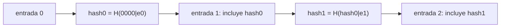

# B122-C09 — Preservación de evidencias y cadena de custodia de datos de incidentes

<!-- nav:top -->
[🏠 Programa](../../../../README.md) · [📚 Bloque B122](../../../tronco-comun/B122-resiliencia-y-continuidad-de-infraestructura-espacial.md) · [← Anterior: B122-C08 — Comunicación de crisis con operadores, autoridades y público](../B122-C08-comunicacion-de-crisis-con-operadores-autoridades-y-publico/CLASE.md) · [Siguiente: B122-C10 — Planes de continuidad institucional y de operaciones →](../B122-C10-planes-de-continuidad-institucional-y-de-operaciones/CLASE.md)
<!-- /nav -->

## 1. Ubicación, nivel y alcance

Clase 9 del bloque B122. Nivel N4. Para que los datos de un incidente sirvan después hay que poder demostrar que no cambiaron: se calcula un hash SHA-256 de cada archivo y se encadenan los registros de custodia, de modo que alterar uno rompe la cadena. Usas [B90](../../../tronco-comun/B90-integracion-ensayos-y-calificacion-espacial.md) solo como contexto: allí se trata la trazabilidad de ensayos. **Esta clase es educativa y defensiva: no es asesoría legal, regulatoria, de seguridad ni financiera y no sustituye a un análisis con el operador, su asesor jurídico o su autoridad.** Los datos son sintéticos y los parámetros son ilustrativos.

## 2. Por qué esta clase existe

B90-C18 trata trazabilidad de ensayos; la custodia de evidencia de incidentes no está cubierta. La decisión central: **¿cómo detecto que un registro de custodia fue alterado y qué no puede probar un hash?**

## 3. Lo que podrás hacer al terminar

1. Calcular un hash SHA-256 y verificar un vector de prueba conocido.
2. Construir una cadena de custodia con el hash del registro anterior.
3. Verificar la integridad y localizar la primera entrada rota.
4. Explicar por qué recalcular un hash intermedio también se detecta.
5. Medir el efecto avalancha.
6. Separar lo consultado (guía de técnicas forenses) de lo sintético.

La evidencia es la **registro de custodia sintético verificado** del ejercicio 12 (sección 20).

## 4. Con qué llegas y cómo comprobarlo

1. ¿Qué es una función hash?
2. ¿Qué es un hexadecimal?
3. ¿Qué es una cadena de bloques simple?
4. ¿Qué es la integridad?
5. ¿Qué es un dato sintético?

<details>
<summary>Ver respuestas</summary>

1. Una función que convierte datos en una huella de tamaño fijo. 2. Un número escrito en base 16. 3. Una lista donde cada elemento incluye la huella del anterior. 4. Que los datos no cambiaron. 5. Uno inventado, no medido.
</details>

Con cuatro o cinco aciertos, sigue; si no, repasa los prerrequisitos.

## 5. Un caso de contexto y casos de referencia

NIST SP 800-86 (agosto de 2006) guía la integración de técnicas forenses en la respuesta a incidentes; su ficha advierte que no es una guía completa ni asesoría legal y que conviene consultar a la dirección y al asesor jurídico; solo se leyó la ficha. El vector de prueba `SHA-256("abc") = ba7816bf…15ad` es el publicado en el estándar FIPS 180-4, que **no** se consultó: se comprueba con la biblioteca `hashlib`. El **ejemplo conductor** es una cadena de cinco entradas de custodia sintéticas. Todo lo demás es **sintético**.

## 6. Vocabulario

Un **hash** es una huella de datos. La **integridad** es que no hayan cambiado. La **cadena de custodia** es el registro de quién tuvo la evidencia y cuándo. Una **entrada** es un registro de la cadena. El **efecto avalancha** es que cambiar un bit cambia la mitad de los bits del hash. Un **sello de tiempo** prueba cuándo existía un dato.

## 7. Modelo mental: una cadena de candados



*Descripción textual:* cada entrada incluye el hash de la anterior; si una cambia, su hash y los de las siguientes dejan de coincidir.

Analogía: páginas numeradas y selladas, donde cada una cita el sello de la anterior. Límite: quien recalcula toda la cadena desde el inicio no se detecta si la última huella no está anclada en otro sitio.

## 8. La explicación, paso a paso

### 8.1 Hash

SHA-256 produce 256 bits (64 caracteres hexadecimales). El laboratorio comprueba `SHA-256("abc") = ba7816bf…15ad`.

### 8.2 Cadena

`hashᵢ = SHA-256(hashᵢ₋₁ | entradaᵢ)` con `hash₋₁ = 000…0`. Las cinco entradas sintéticas (captura, hash, transferencia, almacenamiento y acceso) producen la cadena `8e42833a…`, `234f3adb…`, `c7d710c0…`, `574db855…`, `0d549fdf…`.

### 8.3 Detección

Cambiar el texto de la entrada #2 rompe la #2. Cambiar la #1 y recalcular solo su hash rompe la #2, porque ya no cita ese hash.

### 8.4 Avalancha

Cambiar un bit de 64 bytes cambia en promedio `0,4999` de los 256 bits (esperado `0,5`) en 1000 pares.

## 9. Magnitudes, símbolos y unidades

| Símbolo | Qué es | Unidad | Valor / nota |
|---|---|---|---|
| hash | huella SHA-256 | bits | 256 |
| avalancha | fracción de bits distintos | — | 0,4999 (esperado 0,5) |
| entradas | registros de la cadena | conteo | 5 |
| tiempo | reloj de los registros | UTC | sintético |

## 10. Convenciones y referencias

Reloj UTC sintético. Los registros **no son una cadena de custodia real ni válida legalmente**. La admisibilidad de una prueba depende de la jurisdicción y de un perito. El vector de prueba de SHA-256 se verifica localmente, no contra el estándar FIPS 180-4.

## 11. De dónde sale lo que afirmamos

| ID | Fuente | Localizador | Respalda | Estado |
|---|---|---|---|---|
| S1 | NIST, SP 800-86, «Guide to Integrating Forensic Techniques into Incident Response», agosto de 2006 — https://csrc.nist.gov/pubs/sp/800/86/final (consultada 2026-11-11) | ficha de la publicación leída mediante WebFetch (título, fecha, resumen y aviso de que no es asesoría legal) | la existencia de una guía forense para la respuesta a incidentes y el aviso de que no es asesoría legal | Consultada (solo la ficha; no el cuerpo del documento) |
| — | ISO 22301, ISO/IEC 27001, ISO/IEC 27036, políticas espaciales nacionales y directrices de UNOOSA; FIPS 180-4 | — | marcos normativos y de buenas prácticas citados solo de forma general | No consultados |
| — | Datos y parámetros sintéticos de este curso | — | todo el modelo y los números del laboratorio | Sintético / ilustrativo |

Límites: solo se leyó la ficha de NIST SP 800-86; el estándar FIPS 180-4 no se consultó; los registros son inventados y no tienen validez legal. Lo simulado nunca se presenta como observado.

## 12. Cómo ver la cadena

| # | Entrada | Hash (16 primeros) | Hash previo (8 primeros) |
|---|---|---|---|
| 0 | captura | 8e42833a94018643 | 00000000 |
| 1 | hash | 234f3adb1e21d02e | 8e42833a |
| 2 | transferencia | c7d710c0fc17f305 | 234f3adb |
| 3 | almacenamiento | 574db855d1b55167 | c7d710c0 |
| 4 | acceso | 0d549fdf799da224 | 574db855 |

Descripción larga: cada fila cita en «hash previo» el hash de la anterior, lo que encadena los registros.

## 13. Ejemplo trabajado: alterar la entrada #2

**Paso 1 · Cambio.** Se reemplaza «custodio B» por «custodio X» en #2.

**Paso 2 · Recalcular.** `SHA-256(hash₁ | entrada₂ alterada)` no coincide con el hash guardado.

**Paso 3 · Resultado.** La verificación señala la entrada `#2`.

## 14. Distintas formas de describir la integridad

**Por huella:** SHA-256. **Por encadenamiento:** hash previo. **Por detección:** primera entrada rota. **Por estadística:** avalancha. **Por anclaje:** sello externo del último hash.

## 15. Práctica guiada

**Ejercicio 1 · con los pasos indicados.** ¿Cuántos caracteres hexadecimales tiene un SHA-256? *Pasos:* 256 bits / 4 bits por carácter.

<details><summary>Solución comentada</summary>

`64`.
</details>

**Ejercicio 2 · con una pista.** ¿Qué entrada se rompe al alterar el texto de #2? *Pista:* se recalcula su hash.

<details><summary>Solución comentada</summary>

La `#2`.
</details>

**Ejercicio 3 · casi autónomo.** Si alteras #1 y recalculas su hash, ¿dónde se rompe la cadena?

<details><summary>Solución comentada</summary>

En `#2`, que cita el hash anterior.
</details>

## 16. Práctica autónoma, transferencia e integrador

**Ejercicio 4 · autónomo.** Fracción de bits distintos esperada al cambiar un bit de la entrada.

<details><summary>Solución comentada</summary>

`0,5`; el laboratorio da `0,4999`.
</details>

**Ejercicio 5 · autónomo.** ¿Cuántos bits distintos son en promedio?

<details><summary>Solución comentada</summary>

`≈128` de 256.
</details>

**Ejercicio 6 · autónomo.** Cuántas entradas tiene la cadena de ejemplo.

<details><summary>Solución comentada</summary>

5.
</details>

**Ejercicio 7 · autónomo.** ¿Qué comprueba el vector de prueba de `abc`?

<details><summary>Solución comentada</summary>

Que la implementación local de SHA-256 es correcta.
</details>

**Ejercicio 8 · autónomo.** ¿Qué pasa si se recalcula toda la cadena tras alterar #0?

<details><summary>Solución comentada</summary>

Todas las entradas serían coherentes entre sí y no se detectaría, salvo que el último hash estuviera anclado fuera.
</details>

**Ejercicio 9 · transferencia.** **Transferencia.** ¿Qué no prueba un hash sobre quién hizo qué ni cuándo?

<details><summary>Solución comentada</summary>

Nada de eso: solo que los datos no cambiaron; para autoría y hora hacen falta firmas y sellos de tiempo.
</details>

**Ejercicio 10 · transferencia.** **Transferencia.** ¿Por qué trabajar sobre una copia y no sobre el original?

<details><summary>Solución comentada</summary>

Para no alterar la evidencia original; el hash de la copia debe coincidir con el del original.
</details>

**Ejercicio 11 · transferencia.** **Transferencia.** ¿Qué consultarías antes de aplicar esto a un caso real?

<details><summary>Solución comentada</summary>

Al asesor jurídico, a un perito forense y al plan de la organización, porque la validez legal depende de la jurisdicción.
</details>

**Ejercicio 12 · integrador.** **Integrador.** Elabora tu *registro de custodia sintético verificado*: tabla de entradas con sus hashes, resultado de la verificación y de dos manipulaciones, la limitación del anclaje y lo consultado o sintético, con el aviso de que no es asesoría legal ni forense.

<details><summary>Solución comentada</summary>

Secciones 8.1–8.4 y la salida del laboratorio.
</details>

## 17. Laboratorio: hashes encadenados y detección de alteración

El script [custodia.py](custodia.py) verifica un vector de prueba, construye una cadena de cinco entradas, detecta dos manipulaciones y mide el efecto avalancha (**comprueba** el vector, la localización de la entrada rota y la avalancha a 0,5 ± 0,02).

**Datos:** entradas **sintéticas**; solo el vector de `abc` es un dato conocido de un estándar no consultado. **Predice antes de ejecutar:** ¿qué entrada se rompe si se altera #1 y se recalcula solo su hash? (la #2.) **Ejecución del 2026-11-11 (Python 3.12.9):**

```text
Python 3.12.9 (biblioteca estandar)
DATOS SINTETICOS: entradas de custodia inventadas; no es una cadena de custodia real ni valida legalmente.
Vector de prueba SHA-256('abc') verificado.
  #0 hash=8e42833a94018643... prev=00000000... 2026-03-05T22:31Z|captura|registro_telemetria.bi
  #1 hash=234f3adb1e21d02e... prev=8e42833a... 2026-03-05T23:05Z|hash|registro_telemetria.bin|a
  #2 hash=c7d710c0fc17f305... prev=234f3adb... 2026-03-06T08:10Z|transferencia|de analista A a 
  #3 hash=574db855d1b55167... prev=c7d710c0... 2026-03-06T08:40Z|almacenamiento|volumen WORM si
  #4 hash=0d549fdf799da224... prev=574db855... 2026-03-07T10:00Z|acceso|lectura para analisis|a
Verificacion de la cadena original: integra
Se altera el texto de la entrada #2 -> primera entrada rota: #2
Se altera #1 y se recalcula su hash -> primera entrada rota: #2 (la siguiente no encadena)
Efecto avalancha: fraccion media de bits distintos al cambiar 1 bit = 0.4999 (esperado 0.5)
Pruebas superadas.
```

```bash
python programa/clases/B122/B122-C09-preservacion-de-evidencias-y-cadena-de-custodia-de-datos-de-incidentes/custodia.py
```

**Límites:** cadena local sin firma ni sello de tiempo; no tiene validez legal ni sustituye una herramienta forense.

## 18. Errores frecuentes y cómo corregirlos

**Creer que el hash prueba autoría.** Se corrige con el ejercicio 9.

**Trabajar sobre el original.** Se corrige con el ejercicio 10.

**Olvidar anclar el último hash.** Se corrige con el ejercicio 8.

**Tomar el registro como prueba legal.** No lo es; ver sección 21.

## 19. Cómo sabrás que vas bien

Tras la sección 8: ¿qué entrada se rompe al alterar #2? Si dudas, repasa el ejemplo 13. Tras el laboratorio: ¿qué comprueba? (ver la sección 17).

## 20. Qué entregas y cómo se evalúa

El producto es tu **registro de custodia sintético verificado** (ejercicio 12).

| Criterio | Inicial | En desarrollo | Logrado | Destacado |
|---|---|---|---|---|
| Conceptos | Los confunde | Parciales | Explica hash y encadenamiento | Explica sus límites |
| Cálculo | Sin unidades | Con errores | Verifica la cadena | Calcula casos nuevos |
| Numérico | Sin comprobar | Un caso | Manipulaciones y avalancha contrastadas | Interpreta las diferencias |
| Fuentes | Sin fuente | Sin fecha | Fuentes con versión, fecha y estado | Declara lo sintético y lo no consultado |
| Límites | No los nombra | Uno | Tres | Discute qué falta del modelo |

**Condiciones críticas (no se compensan con promedio):** rotular los datos como sintéticos; declarar que la clase no es asesoría legal, regulatoria ni de seguridad; citar solo lo consultado, con versión y fecha.

## 21. Ética, seguridad y límites

**No es asesoría legal ni forense.** En un incidente real se debe seguir el plan de la organización, no alterar los originales y consultar al asesor jurídico y a un perito antes de manipular evidencias. Clase educativa y **exclusivamente defensiva**: **no es asesoría legal, regulatoria, de seguridad ni financiera**; no describe cómo atacar sistemas ni sustituye al asesor jurídico, a la autoridad competente ni a un equipo de respuesta real. Los textos normativos se citan con su versión y fecha de consulta y pueden haber cambiado. Los modelos son simplificados y sus datos, sintéticos. Accesibilidad: tablas equivalentes a las gráficas, fórmulas en texto, ejercicios sin conexión.

## 22. Para cerrar y seguir

Una cadena de cinco hashes detecta cualquier alteración de una entrada y localiza la primera rota; el efecto avalancha es de `0,4999`. Queda una pregunta: ¿cómo sigue funcionando la institución mientras tanto?

**Glosario español–inglés.** evidencia · *evidence*; cadena de custodia · *chain of custody*; hash · *hash*; integridad · *integrity*; sello de tiempo · *timestamp*.

**Continuidad.** [B122-C10](../B122-C10-planes-de-continuidad-institucional-y-de-operaciones/CLASE.md) estudia la continuidad institucional.

**Referencias:** ver sección 11.

<!-- nav:bottom -->
---

[← Anterior: B122-C08 — Comunicación de crisis con operadores, autoridades y público](../B122-C08-comunicacion-de-crisis-con-operadores-autoridades-y-publico/CLASE.md) · [📚 Bloque B122](../../../tronco-comun/B122-resiliencia-y-continuidad-de-infraestructura-espacial.md) · [Siguiente: B122-C10 — Planes de continuidad institucional y de operaciones →](../B122-C10-planes-de-continuidad-institucional-y-de-operaciones/CLASE.md)
<!-- /nav -->
