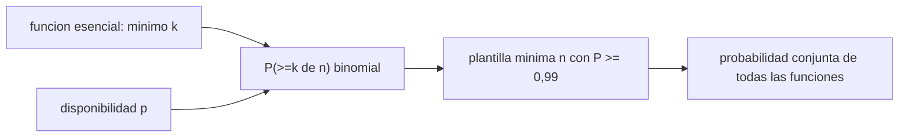

# B122-C10 — Planes de continuidad institucional y de operaciones

<!-- nav:top -->
[🏠 Programa](../../../../README.md) · [📚 Bloque B122](../../../tronco-comun/B122-resiliencia-y-continuidad-de-infraestructura-espacial.md) · [← Anterior: B122-C09 — Preservación de evidencias y cadena de custodia de datos de incidentes](../B122-C09-preservacion-de-evidencias-y-cadena-de-custodia-de-datos-de-incidentes/CLASE.md) · [Siguiente: B123-C01 — Prueba del daño y cuantificación de la reparación →](../../../tronco-comun/B123-responsabilidad-danos-y-controversias-espaciales.md#b123-c01)
<!-- /nav -->

## 1. Ubicación, nivel y alcance

Clase 10 del bloque B122. Nivel N4. Una institución que opera infraestructura espacial debe seguir cumpliendo sus funciones esenciales aunque parte de su personal no esté disponible. Aquí calculas, con la distribución binomial, cuántas personas hacen falta por función para cubrir un mínimo con una probabilidad objetivo. Cierra el bloque. **Esta clase es educativa y defensiva: no es asesoría legal, regulatoria, de seguridad ni financiera y no sustituye a un análisis con el operador, su asesor jurídico o su autoridad.** Los datos son sintéticos y los parámetros son ilustrativos.

## 2. Por qué esta clase existe

No hay clase equivalente sobre continuidad de funciones institucionales. La decisión central: **¿qué dotación mínima asegura que cada función esencial se cubra con al menos el 99 %?**

## 3. Lo que podrás hacer al terminar

1. Identificar funciones esenciales y su dotación mínima `k`.
2. Calcular `P(≥k de n)` con la distribución binomial.
3. Hallar la plantilla mínima `n` para una probabilidad objetivo.
4. Ver el efecto de la disponibilidad individual `p`.
5. Calcular la probabilidad conjunta de cubrir todas las funciones.
6. Separar lo consultado (guía de contingencias) de lo sintético.

La evidencia es la **plan de continuidad de operaciones sintético** del ejercicio 12 (sección 20).

## 4. Con qué llegas y cómo comprobarlo

1. ¿Qué es una combinación `C(n,j)`?
2. ¿Qué es una distribución binomial?
3. ¿Qué es una probabilidad conjunta?
4. ¿Qué es una función esencial?
5. ¿Qué es un dato sintético?

<details>
<summary>Ver respuestas</summary>

1. El número de formas de elegir `j` de `n` elementos. 2. La del número de éxitos en `n` intentos independientes. 3. La de que ocurran varios sucesos a la vez. 4. Una que debe mantenerse en una emergencia. 5. Uno inventado, no medido.
</details>

Con cuatro o cinco aciertos, sigue; si no, repasa los prerrequisitos.

## 5. Un caso de contexto y casos de referencia

NIST SP 800-34 Rev. 1 (mayo de 2010) trata la planificación de contingencias y su relación con la resiliencia organizacional; solo se leyó su ficha, y la norma ISO 22301 no se consultó. El **ejemplo conductor** es una institución sintética con cuatro funciones esenciales (Control de la misión `k = 3`, Seguridad de las comunicaciones `k = 2`, Comunicación de crisis `k = 1`, Soporte de TI `k = 2`), disponibilidad individual `p = 0,85` y objetivo `0,99`. Todo es **sintético**.

## 6. Vocabulario

Una **función esencial** es la que no puede interrumpirse. La **dotación mínima** `k` es el número de personas que necesita. La **plantilla** `n` es el equipo total. La **disponibilidad individual** `p` es la probabilidad de que una persona pueda actuar. El **plan de continuidad de operaciones** define cómo seguir funcionando. El **sitio alterno** es un lugar de trabajo de reserva.

## 7. Modelo mental: un colchón de personas



*Descripción textual:* para cada función, el mínimo `k` y la disponibilidad `p` dan la probabilidad de cubrirla; se busca la plantilla mínima y se combinan las funciones.

Analogía: llevar ruedas de repuesto: más repuestos aumentan la probabilidad de poder seguir, con rendimientos decrecientes. Límite: las ausencias reales se correlacionan (una misma causa afecta a varios).

## 8. La explicación, paso a paso

### 8.1 Binomial

`P(≥k de n) = Σ_{j≥k} C(n,j) pʲ (1−p)ⁿ⁻ʲ`. Con `k = n`, es `pⁿ`: para Seguridad de las comunicaciones con `n = k = 2`, `0,85² = 0,7225`.

### 8.2 Plantilla mínima

Con `p = 0,85` y objetivo `0,99`: Control de la misión `n = 6` (`0,99411`), Seguridad de las comunicaciones `n = 5` (`0,99777`), Comunicación de crisis `n = 3` (`0,9966`) y Soporte de TI `n = 5` (`0,99777`). Total `19` personas para `8` puestos mínimos. El Monte Carlo coincide a menos de `0,003`.

### 8.3 Efecto de `p`

Para Control de la misión (`k = 3`): `n = 5` con `p = 0,95`, `n = 6` con `0,85` y `n = 9` con `0,70`.

### 8.4 Conjunto

Con equipos disjuntos e independientes, la probabilidad de cubrir todas las funciones a la vez es `0,98635`, inferior al objetivo individual de `0,99`.

## 9. Magnitudes, símbolos y unidades

| Símbolo | Qué es | Unidad | Valor / nota |
|---|---|---|---|
| `k` | dotación mínima de una función | personas | 3, 2, 1, 2 |
| `n` | plantilla | personas | 6, 5, 3, 5 |
| `p` | disponibilidad individual | — | 0,85 (sintético) |
| `P` | probabilidad de cubrir | — | ≥ 0,99 |

## 10. Convenciones y referencias

Un turno como periodo de referencia. Independencia entre personas (supuesto). `p`, `k` y el objetivo son **sintéticos**; los equipos de las funciones son disjuntos. No se consultó ISO 22301.

## 11. De dónde sale lo que afirmamos

| ID | Fuente | Localizador | Respalda | Estado |
|---|---|---|---|---|
| S1 | NIST, SP 800-34 Rev. 1, «Contingency Planning Guide for Federal Information Systems», mayo de 2010 (actualizada 2010-11-11) — https://csrc.nist.gov/pubs/sp/800/34/r1/upd1/final (consultada 2026-11-11) | ficha de la publicación leída mediante WebFetch (título, fecha, resumen) | la existencia de una guía de planificación de contingencias y su vínculo con la resiliencia organizacional | Consultada (solo la ficha; no el cuerpo del documento) |
| — | ISO 22301, ISO/IEC 27001, ISO/IEC 27036, políticas espaciales nacionales y directrices de UNOOSA | — | marcos normativos y de buenas prácticas citados solo de forma general | No consultados |
| — | Datos y parámetros sintéticos de este curso | — | todo el modelo y los números del laboratorio | Sintético / ilustrativo |

Límites: solo se leyó la ficha de NIST SP 800-34; el cuerpo y ISO 22301 no se consultaron; `p`, `k` y objetivos son inventados. Lo simulado nunca se presenta como observado.

## 12. Cómo ver la plantilla

| Función | k | n mínimo | P(cubrir) |
|---|---|---|---|
| Control de la misión | 3 | 6 | 0,99411 |
| Seguridad de las comunicaciones | 2 | 5 | 0,99777 |
| Comunicación de crisis | 1 | 3 | 0,99662 |
| Soporte de TI | 2 | 5 | 0,99777 |

Descripción larga: para pasar del 85 % al 99 % hay que casi duplicar la plantilla mínima de cada función.

## 13. Ejemplo trabajado: la función Comunicación de crisis

**Paso 1 · Mínimo.** `k = 1`.

**Paso 2 · Probabilidad de que nadie esté.** `(1 − 0,85)ⁿ = 0,15³ = 0,003375` con `n = 3`.

**Paso 3 · Cobertura.** `1 − 0,003375 = 0,9966`.

**Paso 4 · Lectura.** Con 2 personas sería `1 − 0,0225 = 0,9775 < 0,99`, por eso `n = 3`.

## 14. Distintas formas de describir la continuidad

**Por función:** mínimo `k`. **Por probabilidad:** binomial. **Por plantilla:** `n`. **Por escenario:** valor de `p`. **Por conjunto:** producto entre funciones.

## 15. Práctica guiada

**Ejercicio 1 · con los pasos indicados.** `P` para `k = 2`, `n = 2`, `p = 0,85`. *Pasos:* `0,85²`.

<details><summary>Solución comentada</summary>

`0,7225`.
</details>

**Ejercicio 2 · con una pista.** `P` de cubrir `k = 1` con `n = 3`. *Pista:* `1 − 0,15³`.

<details><summary>Solución comentada</summary>

`0,9966`.
</details>

**Ejercicio 3 · casi autónomo.** ¿Por qué `n` mínimo es mayor que `k`?

<details><summary>Solución comentada</summary>

Porque con `n = k` basta una ausencia para fallar; hay que tener reserva.
</details>

## 16. Práctica autónoma, transferencia e integrador

**Ejercicio 4 · autónomo.** Plantilla mínima de Control de la misión.

<details><summary>Solución comentada</summary>

`6`.
</details>

**Ejercicio 5 · autónomo.** Plantilla con `p = 0,70` para Control de la misión.

<details><summary>Solución comentada</summary>

`9`.
</details>

**Ejercicio 6 · autónomo.** Plantilla con `p = 0,95`.

<details><summary>Solución comentada</summary>

`5`.
</details>

**Ejercicio 7 · autónomo.** Plantilla total del ejemplo.

<details><summary>Solución comentada</summary>

`6+5+3+5 = 19`.
</details>

**Ejercicio 8 · autónomo.** Probabilidad de cubrir todas las funciones a la vez.

<details><summary>Solución comentada</summary>

`0,98635`.
</details>

**Ejercicio 9 · transferencia.** **Transferencia.** Una epidemia afecta a todo el personal a la vez. ¿Qué supuesto rompe?

<details><summary>Solución comentada</summary>

La independencia: las ausencias correlacionadas hacen que la probabilidad real sea menor.
</details>

**Ejercicio 10 · transferencia.** **Transferencia.** ¿Qué más que personas necesita un plan de continuidad?

<details><summary>Solución comentada</summary>

Sitio alterno, sistemas, datos, proveedores, comunicaciones y reglas de activación, ensayados.
</details>

**Ejercicio 11 · transferencia.** **Transferencia.** ¿Cómo comprobarías el plan en la práctica?

<details><summary>Solución comentada</summary>

Con ejercicios de simulación periódicos y registro de las brechas encontradas.
</details>

**Ejercicio 12 · integrador.** **Integrador.** Elabora tu *plan de continuidad de operaciones sintético*: funciones, plantillas, efecto de `p`, probabilidad conjunta, supuestos y lo consultado o sintético, con el aviso de que no es asesoría.

<details><summary>Solución comentada</summary>

Secciones 8.1–8.4 y la salida del laboratorio.
</details>

## 17. Laboratorio: dotación mínima de funciones esenciales

El script [coop.py](coop.py) calcula `P(≥k de n)`, la plantilla mínima por función, el efecto de `p` y la probabilidad conjunta (**comprueba** la identidad de la binomial y el Monte Carlo a 0,003).

**Datos:** `p`, `k` y objetivo **sintéticos**. **Predice antes de ejecutar:** ¿cuántas personas hacen falta para 3 puestos con `p = 0,85` y 99 %? (6.) **Ejecución del 2026-11-11 (Python 3.12.9):**

```text
Python 3.12.9 (biblioteca estandar)
DATOS SINTETICOS: p de disponibilidad = 0.85 (ilustrativa); objetivo = 0.99.
 funcion                          k  n_min  P(n_min)  P(k personas exactas)  MC(n_min)
 Control de la mision             3     6   0.99411   0.61412              0.99406
 Seguridad de las comunicaciones  2     5   0.99777   0.72250              0.99782
 Comunicacion de crisis           1     3   0.99662   0.85000              0.99675
 Soporte de TI                    2     5   0.99777   0.72250              0.99782
Plantilla total (equipos disjuntos) = 19 personas para 8 puestos minimos
Efecto de la disponibilidad p en la plantilla de 'Control de la mision' (k=3):
  p = 0.95 : n_min = 5
  p = 0.85 : n_min = 6
  p = 0.70 : n_min = 9
Probabilidad de cubrir TODAS las funciones a la vez = 0.98635
Pruebas superadas.
```

```bash
python programa/clases/B122/B122-C10-planes-de-continuidad-institucional-y-de-operaciones/coop.py
```

**Límites:** independencia entre personas, equipos disjuntos, una sola amenaza (ausencia); no es un plan real.

## 18. Errores frecuentes y cómo corregirlos

**Dotar con `n = k`.** Se corrige con 8.2.

**Suponer independencia en una crisis común.** Se corrige con el ejercicio 9.

**Creer que el plan es solo personal.** Se corrige con el ejercicio 10.

**Tomar el 99 % como el de toda la institución.** Se corrige con 8.4.

## 19. Cómo sabrás que vas bien

Tras la sección 8: ¿cuántas personas necesita Control de la misión? Si dudas, repasa el ejemplo 13. Tras el laboratorio: ¿qué comprueba? (ver la sección 17).

## 20. Qué entregas y cómo se evalúa

El producto es tu **plan de continuidad de operaciones sintético** (ejercicio 12).

| Criterio | Inicial | En desarrollo | Logrado | Destacado |
|---|---|---|---|---|
| Conceptos | Los confunde | Parciales | Explica función esencial y binomial | Explica sus límites |
| Cálculo | Sin unidades | Con errores | Calcula plantillas | Calcula casos nuevos |
| Numérico | Sin comprobar | Un caso | Exacto y Monte Carlo contrastados | Interpreta las diferencias |
| Fuentes | Sin fuente | Sin fecha | Fuentes con versión, fecha y estado | Declara lo sintético y lo no consultado |
| Límites | No los nombra | Uno | Tres | Discute qué falta del modelo |

**Condiciones críticas (no se compensan con promedio):** rotular los datos como sintéticos; declarar que la clase no es asesoría legal, regulatoria ni de seguridad; citar solo lo consultado, con versión y fecha.

## 21. Ética, seguridad y límites

Un plan real requiere el acuerdo de la dirección, el asesor jurídico y la autoridad competente; esta clase no sustituye a ninguno. Clase educativa y **exclusivamente defensiva**: **no es asesoría legal, regulatoria, de seguridad ni financiera**; no describe cómo atacar sistemas ni sustituye al asesor jurídico, a la autoridad competente ni a un equipo de respuesta real. Los textos normativos se citan con su versión y fecha de consulta y pueden haber cambiado. Los modelos son simplificados y sus datos, sintéticos. Accesibilidad: tablas equivalentes a las gráficas, fórmulas en texto, ejercicios sin conexión.

## 22. Para cerrar y seguir

Con `p = 0,85` y objetivo 99 %, el plan sintético necesita 19 personas para 8 puestos mínimos y cubre todas las funciones a la vez con `0,98635`. El bloque B122 cierra la secuencia: dependencias, impacto, riesgos, protección, accesos, respuesta, severidad, comunicación, evidencia y continuidad. Queda una pregunta para el siguiente bloque del programa: ¿cómo se integra todo esto con la gobernanza de la actividad espacial?

**Glosario español–inglés.** función esencial · *essential function*; plan de continuidad · *continuity plan*; plantilla · *staffing*; sitio alterno · *alternate site*; disponibilidad · *availability*.

**Continuidad.** Con esta clase se completa el bloque B122; ver la [guía del bloque](../../../tronco-comun/B122-resiliencia-y-continuidad-de-infraestructura-espacial.md).

**Referencias:** ver sección 11.

<!-- nav:bottom -->
---

[← Anterior: B122-C09 — Preservación de evidencias y cadena de custodia de datos de incidentes](../B122-C09-preservacion-de-evidencias-y-cadena-de-custodia-de-datos-de-incidentes/CLASE.md) · [📚 Bloque B122](../../../tronco-comun/B122-resiliencia-y-continuidad-de-infraestructura-espacial.md) · [Siguiente: B123-C01 — Prueba del daño y cuantificación de la reparación →](../../../tronco-comun/B123-responsabilidad-danos-y-controversias-espaciales.md#b123-c01)
<!-- /nav -->
