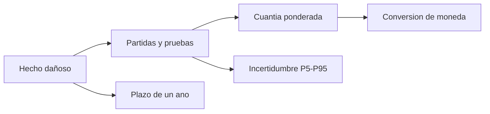

# B123-C01 — Prueba del daño y cuantificación de la reparación

<!-- nav:top -->
[🏠 Programa](../../../../README.md) · [📚 Bloque B123](../../../tronco-comun/B123-responsabilidad-danos-y-controversias-espaciales.md) · [← Anterior: B122-C10 — Planes de continuidad institucional y de operaciones](../../../tronco-comun/B122-resiliencia-y-continuidad-de-infraestructura-espacial.md#b122-c10) · [Siguiente: B123-C02 — Causalidad y atribución jurídica del daño →](../B123-C02-causalidad-y-atribucion-juridica-del-dano/CLASE.md)
<!-- /nav -->

## 1. Ubicación, nivel y alcance

Clase 1 del bloque B123. Nivel N3. Reclamar por un daño exige dos cosas distintas: **probarlo** y **ponerle cifra**. Aquí armas un expediente sintético con partidas de distinto respaldo, calculas una cuantía ponderada, la conviertes a la moneda del reclamante, expresas su incertidumbre con un rango y compruebas el plazo de un año. Retomas el régimen de responsabilidad de B119-C10 (qué se debe) para ver aquí cómo se demuestra y se valora (cuánto). El expediente es sintético y no corresponde a ningún caso real.

## 2. Por qué esta clase existe

Un Estado puede tener derecho a reclamar y aun así perder o cobrar poco si no demuestra el daño o no lo cuantifica de forma defendible. La decisión central: **¿qué partidas puedo sostener con pruebas, por cuánto, en qué moneda y con qué margen de error?**

## 3. Lo que podrás hacer al terminar

1. Identificar qué tipos de daño nombra el Convenio de 1972 en su artículo I(a).
2. Ordenar las partidas de un reclamo según el respaldo probatorio que tienen.
3. Calcular una cuantía ponderada y convertirla a la moneda del reclamante.
4. Expresar la incertidumbre de una partida con un intervalo P5–P95.
5. Comprobar el plazo de un año del artículo X con fechas explícitas.
6. Separar lo que dice el texto consultado de lo que es convención didáctica o dato sintético.

La evidencia es el **expediente de daño sintético con cuantía y rango** del ejercicio 12 (sección 20).

## 4. Con qué llegas y cómo comprobarlo

1. ¿Qué es un Estado de lanzamiento?
2. ¿Qué es un dato sintético?
3. ¿Qué es una mediana y un percentil?
4. ¿Qué es una tasa de cambio?
5. ¿Qué es una verificación independiente?

<details>
<summary>Ver respuestas</summary>

1. Un Estado que lanza o hace lanzar un objeto espacial, o desde cuyo territorio o instalación se lanza. 2. Un dato generado para el ejemplo, no medido ni extraído de un caso real. 3. La mediana deja la mitad de los valores a cada lado; P5 y P95 dejan el 5 % por debajo y por encima. 4. El número de unidades de una moneda que equivalen a una de otra. 5. Calcular lo mismo por otra vía y comparar.
</details>

Con cuatro o cinco aciertos, sigue; si no, repasa los prerrequisitos.

## 5. Un caso de contexto y casos de referencia

Un Estado sintético reclama por daños en una nave industrial: cubierta (`180 000` UMF), maquinaria (`420 000`), descontaminación (`300 000`) y lucro cesante de tres meses (`250 000`). Suma `1 150 000` UMF brutos; ponderados por un grado de prueba didáctico quedan en `808 000` UMF, o `646 400` UMF-A en la moneda del reclamante. Es el **ejemplo conductor**; todo es **sintético**, rotulado y sin relación con un caso real. UMF significa «unidad monetaria ficticia».

## 6. Vocabulario

El **daño**, en el artículo I(a) del Convenio leído, es «loss of life, personal injury or other impairment of health» o «loss of or damage to property of States or of persons, natural or juridical». La **cuantía** es la cifra reclamada. El **grado de prueba** es aquí una convención didáctica entre 0 y 1, **no** una regla jurídica. La **reparación** busca, según el artículo XII leído, compensar «in accordance with international law and the principles of justice and equity». La **moneda del reclamante** es la de pago por defecto según el artículo XIII, según el resumen consultado.

## 7. Modelo mental: un expediente como una cadena de eslabones



*Descripción textual:* del hecho dañoso salen las partidas con sus pruebas y el plazo de un año; las partidas dan la cuantía ponderada y su incertidumbre; la cuantía se convierte a la moneda del reclamante.

Analogía: es un puente de piedras; una partida sin prueba es una piedra suelta que no sostiene peso. Límite: en un procedimiento real no se pondera con coeficientes; el tribunal o las partes valoran la prueba caso a caso.

## 8. La explicación, paso a paso

### 8.1 Qué es daño en el texto leído

El artículo I(a) cubre la pérdida de vida, las lesiones o el deterioro de la salud y la pérdida o el daño de bienes de Estados o personas. En el ejemplo, cubierta, maquinaria y descontaminación son daño a bienes. El **lucro cesante** no aparece nombrado en las citas leídas; si se admite o no es una cuestión de interpretación que esta clase no resuelve y que figura como partida de bajo respaldo.

### 8.2 Cuantía ponderada

Con los grados `0,95; 0,85; 0,60; 0,40`, la cuantía ponderada es `171 000 + 357 000 + 180 000 + 100 000 = 808 000` UMF. La ponderación es un recurso didáctico para visualizar el riesgo probatorio.

### 8.3 Moneda y tasa

Con la tasa sintética `0,80`, `808 000 × 0,80 = 646 400` UMF-A. Según el resumen leído del artículo XIII, el pago se hace en la moneda del reclamante salvo acuerdo distinto o petición de la moneda del Estado de lanzamiento.

### 8.4 Incertidumbre

Si el costo de descontaminación varía de forma lognormal con sigma `0,25`, la cuantía ponderada tiene mediana `807 690` UMF y un intervalo P5–P95 de `747 588` a `900 205` UMF (20 000 sorteos, semilla 123). El rango es el mensaje: una cifra única oculta lo que no se sabe.

### 8.5 Plazo

El artículo X, según el resumen leído, fija un año desde la fecha del daño o desde la identificación del Estado de lanzamiento responsable. Con daño el `2026-03-01`, presentar el `2027-01-15` son `320` días (dentro); presentar el `2027-04-01` son `396` (fuera, salvo que la identificación se produjera más tarde).

## 9. Magnitudes, símbolos y unidades

| Símbolo o término | Qué es | Unidad | Valor / nota |
|---|---|---|---|
| UMF | unidad monetaria ficticia | — | sintética |
| UMF-A | UMF en la moneda del reclamante | — | tasa 0,80 sintética |
| grado de prueba | respaldo de una partida | 0–1 | convención didáctica |
| cuantía ponderada | suma de monto × grado | UMF | 808 000 |
| P5, P95 | percentiles del Monte Carlo | UMF | 747 588; 900 205 |
| plazo | días entre daño y reclamación | días | 320; 396 |

## 10. Convenciones y referencias

Daño y reparación según el Convenio de 1972 en la reproducción de McGill, leída en resumen con citas breves el 2026-11-11; el texto oficial completo no se pudo leer. Fechas calendario ISO 8601. Moneda ficticia. Plazo aproximado en 365 días corridos. Marco de referencia: no aplica sistema astronómico.

## 11. De dónde sale lo que afirmamos

| ID | Fuente | Localizador | Respalda | Estado |
|---|---|---|---|---|
| S1 | McGill, Institute of Air and Space Law, «Convention on the International Liability for Damage Caused by Space Object» (abierto a la firma el 29 de marzo de 1972) — https://www.mcgill.ca/iasl/research/space-law/liability-convention (consultada 2026-11-11) | resumen artículo por artículo con citas breves | arts. I, II, III, IV, VI–XII, XIV–XX | Consultada (lectura parcial) |
| S2 | UNOOSA, página introductoria del Convenio sobre responsabilidad — https://www.unoosa.org/oosa/en/ourwork/spacelaw/treaties/introliability-convention.html (consultada 2026-11-11) | página completa | resolución 2777 (XXVI); entrada en vigor en septiembre de 1972 | Consultada (lectura parcial) |
| — | Texto completo del Convenio en UNOOSA y en la UN Treaty Series, vol. 961, I-13810 | — | no se pudo leer: la página dio error 404 y el PDF es un escaneo sin texto | No consultada |
| — | Artículos de la CDI sobre responsabilidad del Estado (2001) | — | el PDF no fue legible para la herramienta | No consultada |
| — | Lo simulado en el laboratorio (cuantías, fechas, probabilidades, duraciones) | — | solo ilustra el razonamiento | Sintético, no observado |

Límites: las reproducciones y resúmenes leídos no sustituyen la edición oficial vigente; en un caso real hay que cotejar versión y fecha del texto. El grado de prueba, la tasa y la distribución del costo son inventados; no se cita ninguna cuantía real.

## 12. Cómo ver el expediente

| Magnitud | Valor |
|---|---|
| Total bruto | 1 150 000 UMF |
| Cuantía ponderada | 808 000 UMF |
| En moneda del reclamante | 646 400 UMF-A |
| P5–P95 | 747 588–900 205 UMF |
| Plazo (caso 1) | 320 días |

Descripción larga: la cuantía ponderada es el 70,3 % del bruto; el rango P5–P95 mide unos 152 600 UMF de amplitud y el primer caso cumple el año.

## 13. Ejemplo trabajado: la cuantía en la moneda del reclamante

**Paso 1 · Pondera.** `180 000×0,95 + 420 000×0,85 + 300 000×0,60 + 250 000×0,40 = 808 000`.

**Paso 2 · Convierte.** `808 000 × 0,80 = 646 400` UMF-A.

**Paso 3 · Comprueba el plazo.** `2026-03-01` a `2027-01-15` = `320` días ≤ 365.

**Paso 4 · Rotula.** Todo es sintético; el grado de prueba no es una regla jurídica.

## 14. Distintas formas de describir el problema

**Por partida:** monto y prueba. **Por total:** bruto frente a ponderado. **Por moneda:** UMF o UMF-A. **Por incertidumbre:** mediana y P5–P95. **Por tiempo:** días desde el daño.

## 15. Práctica guiada

**Ejercicio 1 · con los pasos indicados.** Suma el monto bruto de las cuatro partidas. *Pasos:* suma `180 000 + 420 000 + 300 000 + 250 000`.

<details><summary>Solución comentada</summary>

`1 150 000` UMF.
</details>

**Ejercicio 2 · con una pista.** Calcula la cuantía ponderada de la cubierta. *Pista:* monto × grado.

<details><summary>Solución comentada</summary>

`180 000 × 0,95 = 171 000` UMF.
</details>

**Ejercicio 3 · casi autónomo.** Convierte `808 000` UMF a UMF-A con la tasa `0,80`.

<details><summary>Solución comentada</summary>

`646 400` UMF-A.
</details>

## 16. Práctica autónoma, transferencia e integrador

**Ejercicio 4 · autónomo.** Cuenta los días entre `2026-03-01` y `2027-01-15`. ¿Cumple el año?

<details><summary>Solución comentada</summary>

`320` días; sí cumple (aproximación de 365 días).
</details>

**Ejercicio 5 · autónomo.** Calcula la cuantía ponderada sin el lucro cesante.

<details><summary>Solución comentada</summary>

`808 000 − 100 000 = 708 000` UMF.
</details>

**Ejercicio 6 · autónomo.** Si el grado de la descontaminación sube a `0,90`, ¿cuál es el total ponderado?

<details><summary>Solución comentada</summary>

`180 000×0,90 = 270 000`; el total pasa de `808 000` a `898 000` UMF.
</details>

**Ejercicio 7 · autónomo.** Con tasa `0,75`, ¿cuánto son `808 000` UMF?

<details><summary>Solución comentada</summary>

`606 000` UMF-A.
</details>

**Ejercicio 8 · autónomo.** ¿Qué amplitud tiene el intervalo P5–P95 y qué significa?

<details><summary>Solución comentada</summary>

`900 205 − 747 588 = 152 617` UMF: con las hipótesis sintéticas, el 90 % de los sorteos cae en ese rango.
</details>

**Ejercicio 9 · transferencia.** **Transferencia.** Falta la factura de la maquinaria. Propón qué pruebas alternativas reunirías y qué pasaría con su grado.

<details><summary>Solución comentada</summary>

Peritajes, registros contables, fotografías fechadas, informes técnicos; el grado de respaldo bajaría si solo hay declaraciones. Es un razonamiento didáctico, no un consejo para un caso real.
</details>

**Ejercicio 10 · transferencia.** **Transferencia.** El lucro cesante no figura en las citas leídas del artículo I(a). ¿Qué haces con esa partida?

<details><summary>Solución comentada</summary>

La separas, la rotulas como dudosa y verificas el texto oficial y la práctica con un profesional; no la das por admitida.
</details>

**Ejercicio 11 · transferencia.** **Transferencia.** Un reclamo llega a los `396` días. ¿Qué debes averiguar antes de descartarlo?

<details><summary>Solución comentada</summary>

Cuándo se identificó al Estado de lanzamiento responsable, porque el plazo leído corre desde el daño o desde esa identificación.
</details>

**Ejercicio 12 · integrador.** **Integrador.** Elabora tu *expediente de daño sintético con cuantía y rango*: tabla de partidas con prueba, cuantía ponderada, conversión de moneda, P5–P95, plazo y lista de lo consultado, lo sintético y lo no consultado.

<details><summary>Solución comentada</summary>

Secciones 8.1–8.5 y la salida del laboratorio.
</details>

## 17. Laboratorio: expediente, cuantía y rango

El script [expediente.py](expediente.py) pondera las partidas, convierte la moneda, simula la incertidumbre de la descontaminación (**comprueba** que el bruto es 1 150 000, que lo ponderado no supera al bruto, que P5 < mediana < P95 y que la conversión es invertible) y verifica el plazo.

**Datos:** todos **sintéticos**; lo normativo es solo la regla leída (ver sección 11). **Predice antes de ejecutar:** ¿qué cuantía ponderada esperas? (808 000 UMF.) **Ejecución del 2026-11-11 (Python 3.12.9):**

```text
Python 3.12.9 (biblioteca estandar)
Datos SINTETICOS; UMF = unidad monetaria ficticia; semilla 123
Total reclamado (bruto) = 1,150,000 UMF
  reparacion de cubierta de una nave industrial       180,000  prueba=0.95  ponderado=   171,000
  sustitucion de maquinaria dañada                    420,000  prueba=0.85  ponderado=   357,000
  limpieza y descontaminacion del terreno             300,000  prueba=0.60  ponderado=   180,000
  lucro cesante de tres meses                         250,000  prueba=0.40  ponderado=   100,000
Cuantia ponderada por prueba = 808,000 UMF
Convertida a la moneda del reclamante (tasa sintetica 0.8) = 646,400 UMF-A
Monte Carlo (20000 sorteos): mediana = 807,690; P5 = 747,588; P95 = 900,205 UMF
Dano 2026-03-01 -> reclamacion 2027-01-15: 320 dias; dentro del plazo de un ano: True
Dano 2026-03-01 -> reclamacion 2027-04-01: 396 dias; dentro del plazo de un ano: False
Pruebas superadas.
```

```bash
python programa/clases/B123/B123-C01-prueba-del-dano-y-cuantificacion-de-la-reparacion/expediente.py
```

**Límites:** el grado de prueba, la tasa y la distribución son inventados; la ponderación no existe en la práctica jurídica; el plazo se aproxima con 365 días.

## 18. Errores frecuentes y cómo corregirlos

**Dar el grado de prueba como regla jurídica.** Se corrige con 8.2.

**Dar una cifra única sin rango.** Se corrige con 8.4.

**Contar el plazo solo desde el daño.** Se corrige con 8.5.

**Presentar el expediente sintético como un caso real.** Se corrige con la sección 10.

## 19. Cómo sabrás que vas bien

Tras 8.2: ¿qué cuantía esperabas y cuál obtuviste? Si dudas, repasa el ejemplo 13. Tras el laboratorio: ¿qué comprueba? (ver la sección 17).

## 20. Qué entregas y cómo se evalúa

El producto es tu **expediente de daño sintético con cuantía y rango** (ejercicio 12).

| Criterio | Inicial | En desarrollo | Logrado | Destacado |
|---|---|---|---|---|
| Conceptos | Los confunde | Parciales | Explica las reglas con su texto | Explica sus límites |
| Cálculo | Sin unidades | Con errores | Resultados con unidades y fechas | Prueba casos nuevos |
| Numérico | Sin comprobar | Un caso | Contrasta con una comprobación | Interpreta la incertidumbre |
| Fuentes | Sin fuente | Sin fecha | Fuentes con versión, fecha y estado | Declara lo no consultado |
| Límites | No los nombra | Uno | Tres | Discute qué falta del modelo |

**Condiciones críticas (no se compensan con promedio):** rotular lo sintético como sintético; no presentar el ejemplo como un caso real ni imputar responsabilidad a nadie; citar versión y fecha del texto consultado; no dar asesoría legal.

## 21. Ética, seguridad y límites

Clase educativa: **no es asesoría legal, regulatoria ni financiera**. Los textos se leyeron en reproducciones y resúmenes; para un caso real debes recurrir a un profesional y al texto oficial vigente, y citar su versión y fecha. Los datos son sintéticos y no se imputa responsabilidad a ninguna persona u organización. La cuantía y su rango son ilustraciones; un reclamo real exige peritaje y texto oficial. Accesibilidad: tablas equivalentes a los diagramas, fórmulas en texto, ejercicios sin conexión.

## 22. Para cerrar y seguir

Un expediente sintético de `1 150 000` UMF brutos queda en `808 000` ponderados, `646 400` UMF-A y un rango P5–P95 de `747 588` a `900 205`. Queda una pregunta: ¿cómo se atribuye ese daño a un actor?

**Glosario español–inglés.** daño · *damage*; reparación · *reparation, compensation*; cuantía · *amount of the claim*; Estado de lanzamiento · *launching State*; moneda del reclamante · *claimant's currency*.

**Continuidad.** [B123-C02](../B123-C02-causalidad-y-atribucion-juridica-del-dano/CLASE.md) trata la causalidad y la atribución.

**Referencias:** ver sección 11.

<!-- nav:bottom -->
---

[← Anterior: B122-C10 — Planes de continuidad institucional y de operaciones](../../../tronco-comun/B122-resiliencia-y-continuidad-de-infraestructura-espacial.md#b122-c10) · [📚 Bloque B123](../../../tronco-comun/B123-responsabilidad-danos-y-controversias-espaciales.md) · [Siguiente: B123-C02 — Causalidad y atribución jurídica del daño →](../B123-C02-causalidad-y-atribucion-juridica-del-dano/CLASE.md)
<!-- /nav -->
