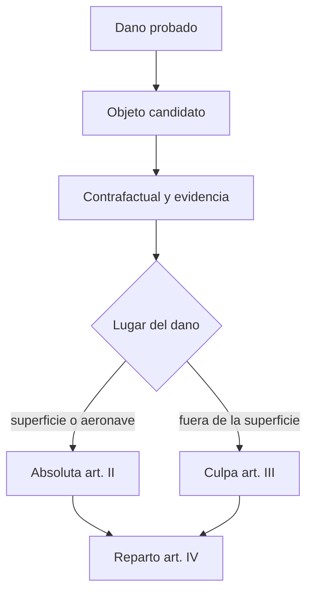

# B123-C02 — Causalidad y atribución jurídica del daño

<!-- nav:top -->
[🏠 Programa](../../../../README.md) · [📚 Bloque B123](../../../tronco-comun/B123-responsabilidad-danos-y-controversias-espaciales.md) · [← Anterior: B123-C01 — Prueba del daño y cuantificación de la reparación](../B123-C01-prueba-del-dano-y-cuantificacion-de-la-reparacion/CLASE.md) · [Siguiente: B123-C03 — Mecanismos de reclamación entre Estados →](../B123-C03-mecanismos-de-reclamacion-entre-estados/CLASE.md)
<!-- /nav -->

## 1. Ubicación, nivel y alcance

Clase 2 del bloque B123. Nivel N3. Para atribuir un daño a un Estado de lanzamiento no basta que exista el daño: hay que enlazarlo con un objeto y con un régimen de responsabilidad. Aquí calculas la probabilidad de que cada objeto candidato sea el causante, eliges el régimen según el lugar del daño y repartes la carga entre Estados. Se apoya en [B123-C01](../B123-C01-prueba-del-dano-y-cuantificacion-de-la-reparacion/CLASE.md) para la cuantía. El caso es sintético y no corresponde a ninguna colisión real.

## 2. Por qué esta clase existe

Un daño probado no tiene responsable hasta que se establece qué objeto lo causó y bajo qué régimen. La decisión central: **¿qué objeto, de qué Estado, con qué régimen y con qué reparto?**

## 3. Lo que podrás hacer al terminar

1. Aplicar la prueba contrafactual «sin el objeto, ¿habría daño?».
2. Calcular un posterior bayesiano didáctico sobre objetos candidatos.
3. Elegir entre responsabilidad absoluta (art. II) y por culpa (art. III) según el lugar del daño.
4. Repartir una cuantía entre dos Estados de lanzamiento según el artículo IV.
5. Nombrar las exoneraciones y exclusiones del texto leído (arts. VI y VII).
6. Distinguir probabilidad didáctica de prueba jurídica.

La evidencia es el **memorando de atribución sobre un caso sintético** del ejercicio 12 (sección 20).

## 4. Con qué llegas y cómo comprobarlo

1. ¿Qué es la causalidad?
2. ¿Qué es una probabilidad condicional?
3. ¿Qué es la responsabilidad absoluta?
4. ¿Qué es la responsabilidad solidaria?
5. ¿Qué es un dato sintético?

<details>
<summary>Ver respuestas</summary>

1. La relación por la que un hecho produce un resultado. 2. La probabilidad de un suceso sabiendo que ocurrió otro. 3. Deber de reparar sin necesidad de probar culpa. 4. Cada responsable puede ser requerido por el total. 5. Un dato inventado para el ejemplo.
</details>

Con cuatro o cinco aciertos, sigue; si no, repasa los prerrequisitos.

## 5. Un caso de contexto y casos de referencia

Un fragmento dañó una instalación y tres objetos de tres Estados de lanzamiento sintéticos (X, Y, Z) son candidatos. Con priors `0,30; 0,50; 0,20` y coincidencias de material y masa, el posterior didáctico es `0,6372; 0,2212; 0,1416`. Si el daño fue en la superficie, el régimen es absoluto; si fue en órbita, por culpa. Es el **ejemplo conductor**; todo es **sintético**.

## 6. Vocabulario

La **causalidad** es el nexo entre un objeto y el daño. La **prueba contrafactual** pregunta si, sin el hecho, el daño habría ocurrido. La **responsabilidad absoluta** (art. II) se aplica al daño en la superficie o a una aeronave en vuelo; la **responsabilidad por culpa** (art. III) se aplica al daño fuera de la superficie entre objetos de distintos Estados, según los textos leídos. La **solidaridad** (art. IV) permite reclamar a cualquiera de los Estados implicados frente a un tercer Estado.

## 7. Modelo mental: un árbol de decisión de la atribución



*Descripción textual:* del daño probado se pasa al objeto candidato, se somete a la prueba contrafactual y a la evidencia, y según el lugar se aplica el régimen absoluto o por culpa; con varios Estados implicados se reparte según el artículo IV.

Analogía: es un detective que primero reúne sospechosos y luego decide qué ley aplica según dónde ocurrió el hecho. Límite: un posterior bayesiano no equivale a la prueba que exige un tribunal.

## 8. La explicación, paso a paso

### 8.1 Contrafactual

Si con el objeto la probabilidad de daño es `0,95` y sin él `0,05`, la diferencia es `0,90`: el objeto es un factor determinante en el modelo didáctico.

### 8.2 Posterior por candidato

Los pesos son `prior × material × masa`: A `0,216`, B `0,075`, C `0,048`; suman `0,339`. El posterior es `0,6372; 0,2212; 0,1416` y suma `1`. Los factores de coincidencia son convención didáctica.

### 8.3 Régimen

Según los artículos II y III leídos: daño en la superficie o a una aeronave en vuelo, responsabilidad absoluta; daño fuera de la superficie entre objetos de distintos Estados, por culpa.

### 8.4 Reparto

Con culpas `70/30`, un millón de UMF se reparte `700 000` y `300 000`. Sin culpa probada, según el resumen leído del artículo IV, la carga se reparte por partes iguales: `500 000` y `500 000`.

### 8.5 Exoneración y exclusiones

El artículo VI leído permite reducir la responsabilidad absoluta por negligencia grave o acto intencional del reclamante y no ampara actividades contrarias al derecho internacional. El artículo VII excluye, entre otros, el daño a nacionales del Estado de lanzamiento.

## 9. Magnitudes, símbolos y unidades

| Símbolo o término | Qué es | Unidad | Valor / nota |
|---|---|---|---|
| prior | probabilidad previa del candidato | — | 0,30; 0,50; 0,20 (sintética) |
| posterior | probabilidad tras la evidencia | — | 0,6372; 0,2212; 0,1416 |
| contrafactual | P(daño con objeto) − P(daño sin objeto) | — | 0,90 (sintético) |
| reparto | parte de la cuantía por Estado | UMF | 700 000 / 300 000 |
| régimen | absoluta o por culpa | — | arts. II y III |

## 10. Convenciones y referencias

Textos de los artículos I a VII del Convenio de 1972 leídos en resumen con citas breves (McGill, 2026-11-11). Cuantías en UMF ficticias. No aplica sistema astronómico.

## 11. De dónde sale lo que afirmamos

| ID | Fuente | Localizador | Respalda | Estado |
|---|---|---|---|---|
| S1 | McGill, Institute of Air and Space Law, «Convention on the International Liability for Damage Caused by Space Object» (abierto a la firma el 29 de marzo de 1972) — https://www.mcgill.ca/iasl/research/space-law/liability-convention (consultada 2026-11-11) | resumen artículo por artículo con citas breves | arts. I, II, III, IV, VI–XII, XIV–XX | Consultada (lectura parcial) |
| — | Texto completo del Convenio en UNOOSA y en la UN Treaty Series, vol. 961, I-13810 | — | no se pudo leer: la página dio error 404 y el PDF es un escaneo sin texto | No consultada |
| — | Artículos de la CDI sobre responsabilidad del Estado (2001) | — | el PDF no fue legible para la herramienta | No consultada |
| — | Lo simulado en el laboratorio (cuantías, fechas, probabilidades, duraciones) | — | solo ilustra el razonamiento | Sintético, no observado |

Límites: las reproducciones y resúmenes leídos no sustituyen la edición oficial vigente; en un caso real hay que cotejar versión y fecha del texto. Los factores de coincidencia, los priors y las culpas son inventados; no se analiza ninguna colisión real.

## 12. Cómo ver la atribución

| Magnitud | Valor |
|---|---|
| Posterior del objeto A | 0,6372 |
| Suma de posteriores | 1,000000 |
| Régimen en órbita | por culpa (art. III) |
| Reparto 70/30 | 700 000 / 300 000 UMF |
| Reparto sin culpa probada | 500 000 / 500 000 UMF |

Descripción larga: el candidato con más material y masa compatibles domina el posterior; el régimen depende del lugar; el reparto sin culpa probada es por partes iguales.

## 13. Ejemplo trabajado: el posterior del objeto A

**Paso 1 · Pesos.** `0,30×0,90×0,80 = 0,216`; `0,50×0,30×0,50 = 0,075`; `0,20×0,60×0,40 = 0,048`.

**Paso 2 · Suma.** `0,339`.

**Paso 3 · Posterior de A.** `0,216/0,339 = 0,6372`.

**Paso 4 · Rotula.** Es una probabilidad didáctica sintética, no una prueba.

## 14. Distintas formas de describir el problema

**Por contrafactual:** con y sin el objeto. **Por probabilidad:** prior y posterior. **Por régimen:** artículo II o III. **Por reparto:** culpa o partes iguales.

## 15. Práctica guiada

**Ejercicio 1 · con los pasos indicados.** Calcula el peso del objeto B. *Pasos:* prior × material × masa.

<details><summary>Solución comentada</summary>

`0,50×0,30×0,50 = 0,075`.
</details>

**Ejercicio 2 · con una pista.** Calcula el posterior de B. *Pista:* peso de B dividido por `0,339`.

<details><summary>Solución comentada</summary>

`0,075/0,339 = 0,2212`.
</details>

**Ejercicio 3 · casi autónomo.** ¿Qué régimen aplica un daño a una aeronave en vuelo?

<details><summary>Solución comentada</summary>

Absoluta (art. II, según el texto leído).
</details>

## 16. Práctica autónoma, transferencia e integrador

**Ejercicio 4 · autónomo.** Reparte `1 000 000` UMF con culpas `60/40`.

<details><summary>Solución comentada</summary>

`600 000` y `400 000`.
</details>

**Ejercicio 5 · autónomo.** Reparte `1 000 000` UMF sin culpa probada entre dos Estados.

<details><summary>Solución comentada</summary>

`500 000` cada uno (partes iguales según el resumen del art. IV).
</details>

**Ejercicio 6 · autónomo.** Calcula el posterior de C.

<details><summary>Solución comentada</summary>

`0,048/0,339 = 0,1416`.
</details>

**Ejercicio 7 · autónomo.** Si la masa de A coincidiera `0,40` en vez de `0,80`, ¿cuál sería su peso y quién domina?

<details><summary>Solución comentada</summary>

Peso `0,30×0,90×0,40 = 0,108`; B pesa `0,075`, A sigue dominando pero con menos margen (`0,108/0,231 = 0,4675`).
</details>

**Ejercicio 8 · autónomo.** ¿Qué diferencia hay entre un contrafactual de `0,90` y uno de `0,10`?

<details><summary>Solución comentada</summary>

Con `0,90` el objeto es factor determinante; con `0,10` el daño habría ocurrido casi igual sin él.
</details>

**Ejercicio 9 · transferencia.** **Transferencia.** Dos objetos de dos Estados chocan en órbita y no hay daño en la superficie. ¿Qué régimen leído aplica y qué debe probarse?

<details><summary>Solución comentada</summary>

El del artículo III, por culpa: hay que probar que el daño se debe a la culpa del Estado de lanzamiento o de las personas de las que responde.
</details>

**Ejercicio 10 · transferencia.** **Transferencia.** Un reclamante actuó con negligencia grave. ¿Qué dice el artículo VI leído?

<details><summary>Solución comentada</summary>

Que la responsabilidad absoluta puede reducirse, o eximirse según el grado, por negligencia grave o acto intencional del reclamante.
</details>

**Ejercicio 11 · transferencia.** **Transferencia.** ¿Por qué un posterior de `0,64` no basta para asignar responsabilidad?

<details><summary>Solución comentada</summary>

Es una probabilidad didáctica con priors y coincidencias convencionales; un tribunal exige prueba y reglas de valoración propias.
</details>

**Ejercicio 12 · integrador.** **Integrador.** Elabora tu *memorando de atribución sobre un caso sintético*: candidatos, posterior, contrafactual, régimen, reparto y lista de lo consultado, lo sintético y lo no consultado.

<details><summary>Solución comentada</summary>

Secciones 8.1–8.5 y la salida del laboratorio.
</details>

## 17. Laboratorio: posterior, régimen y reparto

El script [atribucion.py](atribucion.py) calcula el posterior de tres candidatos, elige el régimen según el lugar, reparte una cuantía por culpa o por partes iguales y evalúa un contrafactual (**comprueba** que los posteriores suman 1 y que los repartos suman la cuantía).

**Datos:** todos **sintéticos**; lo normativo es solo la regla leída (ver sección 11). **Predice antes de ejecutar:** ¿qué candidato dominará? (el objeto A.) **Ejecución del 2026-11-11 (Python 3.12.9):**

```text
Python 3.12.9 (biblioteca estandar)
Datos SINTETICOS; UMF = unidad monetaria ficticia
  objeto A (Estado de lanzamiento X)     prior=0.30 material=0.90 masa=0.80 -> posterior=0.6372
  objeto B (Estado de lanzamiento Y)     prior=0.50 material=0.30 masa=0.50 -> posterior=0.2212
  objeto C (Estado de lanzamiento Z)     prior=0.20 material=0.60 masa=0.40 -> posterior=0.1416
Suma de posteriores = 1.000000
Dano en superficie: regimen absoluta (art. II)
Dano en aeronave  : regimen absoluta (art. II)
Dano en orbita    : regimen por culpa (art. III)
Reparto de 1 000 000 UMF entre X e Y (art. IV):
  culpa 70/30        X = 700,000 ; Y = 300,000
  sin culpa probada  X = 500,000 ; Y = 500,000
Contrafactual (SINTETICO): P(dano | con objeto) - P(dano | sin objeto) = 0.90
Pruebas superadas.
```

```bash
python programa/clases/B123/B123-C02-causalidad-y-atribucion-juridica-del-dano/atribucion.py
```

**Límites:** priors, coincidencias y culpas son inventados; el posterior no es prueba jurídica; no se modela la causalidad física de una colisión.

## 18. Errores frecuentes y cómo corregirlos

**Confundir probabilidad con prueba.** Se corrige con 8.2.

**Aplicar siempre responsabilidad por culpa.** Se corrige con 8.3.

**Olvidar las exoneraciones.** Se corrige con 8.5.

**Presentar el caso sintético como real.** Se corrige con la sección 10.

## 19. Cómo sabrás que vas bien

Tras 8.2: ¿qué posterior esperabas para A y cuál obtuviste? Si dudas, repasa el ejemplo 13. Tras el laboratorio: ¿qué comprueba? (ver la sección 17).

## 20. Qué entregas y cómo se evalúa

El producto es tu **memorando de atribución sobre un caso sintético** (ejercicio 12).

| Criterio | Inicial | En desarrollo | Logrado | Destacado |
|---|---|---|---|---|
| Conceptos | Los confunde | Parciales | Explica las reglas con su texto | Explica sus límites |
| Cálculo | Sin unidades | Con errores | Resultados con unidades y fechas | Prueba casos nuevos |
| Numérico | Sin comprobar | Un caso | Contrasta con una comprobación | Interpreta la incertidumbre |
| Fuentes | Sin fuente | Sin fecha | Fuentes con versión, fecha y estado | Declara lo no consultado |
| Límites | No los nombra | Uno | Tres | Discute qué falta del modelo |

**Condiciones críticas (no se compensan con promedio):** rotular lo sintético como sintético; no presentar el ejemplo como un caso real ni imputar responsabilidad a nadie; citar versión y fecha del texto consultado; no dar asesoría legal.

## 21. Ética, seguridad y límites

Clase educativa: **no es asesoría legal, regulatoria ni financiera**. Los textos se leyeron en reproducciones y resúmenes; para un caso real debes recurrir a un profesional y al texto oficial vigente, y citar su versión y fecha. Los datos son sintéticos y no se imputa responsabilidad a ninguna persona u organización. No se señala a ningún operador real como causante de nada. Accesibilidad: tablas equivalentes a los diagramas, fórmulas en texto, ejercicios sin conexión.

## 22. Para cerrar y seguir

Con evidencia sintética, el objeto A recibe un posterior de `0,6372`; en órbita se exige culpa y con culpas `70/30` un millón de UMF se reparte `700 000/300 000`. Queda una pregunta: ¿por qué vías reclama un Estado a otro?

**Glosario español–inglés.** causalidad · *causation*; responsabilidad absoluta · *absolute liability*; responsabilidad por culpa · *fault-based liability*; solidaridad · *joint and several liability*; contrafactual · *counterfactual*.

**Continuidad.** [B123-C03](../B123-C03-mecanismos-de-reclamacion-entre-estados/CLASE.md) estudia los mecanismos de reclamación entre Estados.

**Referencias:** ver sección 11.

<!-- nav:bottom -->
---

[← Anterior: B123-C01 — Prueba del daño y cuantificación de la reparación](../B123-C01-prueba-del-dano-y-cuantificacion-de-la-reparacion/CLASE.md) · [📚 Bloque B123](../../../tronco-comun/B123-responsabilidad-danos-y-controversias-espaciales.md) · [Siguiente: B123-C03 — Mecanismos de reclamación entre Estados →](../B123-C03-mecanismos-de-reclamacion-entre-estados/CLASE.md)
<!-- /nav -->
