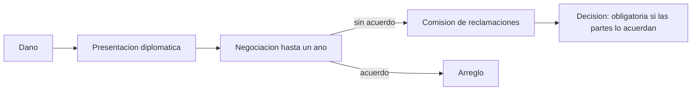

# B123-C03 — Mecanismos de reclamación entre Estados

<!-- nav:top -->
[🏠 Programa](../../../../README.md) · [📚 Bloque B123](../../../tronco-comun/B123-responsabilidad-danos-y-controversias-espaciales.md) · [← Anterior: B123-C02 — Causalidad y atribución jurídica del daño](../B123-C02-causalidad-y-atribucion-juridica-del-dano/CLASE.md) · [Siguiente: B123-C04 — Arbitraje y resolución de controversias espaciales →](../B123-C04-arbitraje-y-resolucion-de-controversias-espaciales/CLASE.md)
<!-- /nav -->

## 1. Ubicación, nivel y alcance

Clase 3 del bloque B123. Nivel N3. Con el daño probado y atribuido, hay que reclamar por la vía y en los plazos que prevé el Convenio. Aquí recorres las etapas (presentación por vía diplomática, negociación, comisión de reclamaciones) con un cronograma de fechas sintéticas, y lees el arreglo de un caso real solo en lo que su texto dice. Se apoya en [B123-C02](../B123-C02-causalidad-y-atribucion-juridica-del-dano/CLASE.md). Las fechas del cronograma son sintéticas.

## 2. Por qué esta clase existe

Un derecho a reclamar se pierde o se debilita si no se ejerce por la vía y en el plazo previstos. La decisión central: **¿cuándo y cómo se presenta la reclamación, cuándo se puede pedir una comisión y qué valor tiene su decisión?**

## 3. Lo que podrás hacer al terminar

1. Describir las etapas de una reclamación según el Convenio de 1972.
2. Calcular el límite de presentación (un año) y el fin del año de negociación.
3. Verificar si una solicitud de comisión es anticipada.
4. Describir la composición de la comisión y quién puede nombrar a su presidente.
5. Explicar el valor obligatorio o recomendatorio de su decisión.
6. Leer un arreglo real sin deducir de él conclusiones de responsabilidad.

La evidencia es el **cronograma de una reclamación sintética** del ejercicio 12 (sección 20).

## 4. Con qué llegas y cómo comprobarlo

1. ¿Qué es la vía diplomática?
2. ¿Qué significa «recomendatorio»?
3. ¿Qué es una comisión de reclamaciones?
4. ¿Qué es un plazo calendario?
5. ¿Qué es un dato sintético?

<details>
<summary>Ver respuestas</summary>

1. El canal de comunicación formal entre Estados. 2. Que orienta pero no obliga por sí mismo. 3. Un órgano ad hoc que examina un reclamo y decide su fundamento y cuantía. 4. Un periodo contado en días o años corridos. 5. Un dato inventado para el ejemplo.
</details>

Con cuatro o cinco aciertos, sigue; si no, repasa los prerrequisitos.

## 5. Un caso de contexto y casos de referencia

Con daño el `2026-03-01`, un Estado sintético presenta su reclamación el `2026-11-20` (dentro del año); la negociación dura hasta el `2027-11-20` y solo entonces puede pedir la comisión. Un segundo caso presenta el `2027-04-02` (fuera) y pide la comisión antes de agotar la negociación. En el caso real de 1981 leído, un protocolo bilateral fijó un pago de `3 000 000` CAD como arreglo «full and final». Es el **ejemplo conductor**; las fechas son **sintéticas**.

## 6. Vocabulario

La **presentación** de la reclamación se hace por vía diplomática (art. IX, según el resumen leído), con alternativas como un tercer Estado o el Secretario General de la ONU si ambos son miembros. El **plazo** es de un año desde el daño o desde la identificación del Estado de lanzamiento responsable (art. X). La **comisión de reclamaciones** se puede pedir si la negociación diplomática no resuelve en un año (art. XIV) y se compone de tres miembros (art. XV); su decisión es obligatoria solo si las partes lo acuerdan y en otro caso es recomendatoria (art. XIX). Los **costos** se reparten por igual salvo decisión distinta (art. XX). No se exige agotar los recursos internos (art. XI).

## 7. Modelo mental: una línea de tiempo con puertas



*Descripción textual:* tras el daño se presenta la reclamación; si en un año no hay acuerdo, se puede pedir la comisión, cuya decisión obliga solo si las partes lo acordaron.

Analogía: es una carrera de postas con tiempo de relevo; si se cambia de tramo antes de hora, el relevo no vale. Límite: los plazos reales dependen del texto oficial y de la fecha de identificación del responsable.

## 8. La explicación, paso a paso

### 8.1 Presentar a tiempo

Con daño el `2026-03-01`, el límite del artículo X es el `2027-03-01`. Presentar el `2026-11-20` cumple; presentar el `2027-04-02` queda fuera, salvo que la identificación del Estado responsable fuera posterior.

### 8.2 Negociar

El año de negociación se cuenta desde la presentación: hasta el `2027-11-20` en el primer caso. Pedir la comisión el `2027-06-01` en el segundo caso es anticipado, según el artículo XIV leído.

### 8.3 La comisión

Son tres miembros: uno por cada parte y un presidente elegido de común acuerdo; si no hay acuerdo, el Secretario General de la ONU puede nombrarlo (art. XV, según el resumen). Decide la procedencia y la cuantía aplicando el artículo XII; su decisión es obligatoria solo si las partes lo acuerdan y debe hacerse pública (art. XIX). Con comisión constituida el `2028-01-10`, un año después es el `2029-01-10`.

### 8.4 Un caso real, solo lo que dice el texto

El Protocolo Canadá–URSS, firmado en Moscú el `2 de abril de 1981` (Tratado E103429, consultado), dispone un pago de `3 000 000` CAD como arreglo «full and final» de los asuntos conectados con la desintegración del satélite «Cosmos-954» de enero de 1978, entra en vigor al firmarse y **no contiene un reconocimiento expreso de responsabilidad**. La cifra reclamada, las fechas de la nota diplomática y los argumentos jurídicos **no se consultaron en una fuente primaria**: de un arreglo no se deduce quién tenía razón.

## 9. Magnitudes, símbolos y unidades

| Símbolo o término | Qué es | Unidad | Valor / nota |
|---|---|---|---|
| fecha del daño | inicio del plazo | fecha ISO | 2026-03-01 (sintética) |
| límite de presentación | daño + 1 año | fecha ISO | 2027-03-01 |
| fin de negociación | presentación + 1 año | fecha ISO | 2027-11-20 (caso 1) |
| miembros de la comisión | partes + presidente | — | 3 |
| pago del protocolo de 1981 | arreglo bilateral | CAD | 3 000 000 (consultado) |

## 10. Convenciones y referencias

Etapas según el Convenio de 1972 (McGill, resumen con citas breves, 2026-11-11) y el Protocolo Canadá–URSS (texto del Tratado E103429, 2026-11-11). Fechas ISO 8601; plazos de años calendario. No aplica sistema astronómico.

## 11. De dónde sale lo que afirmamos

| ID | Fuente | Localizador | Respalda | Estado |
|---|---|---|---|---|
| S1 | McGill, Institute of Air and Space Law, «Convention on the International Liability for Damage Caused by Space Object» (abierto a la firma el 29 de marzo de 1972) — https://www.mcgill.ca/iasl/research/space-law/liability-convention (consultada 2026-11-11) | resumen artículo por artículo con citas breves | arts. I, II, III, IV, VI–XII, XIV–XX | Consultada (lectura parcial) |
| S2 | UNOOSA, página introductoria del Convenio sobre responsabilidad — https://www.unoosa.org/oosa/en/ourwork/spacelaw/treaties/introliability-convention.html (consultada 2026-11-11) | página completa | resolución 2777 (XXVI); entrada en vigor en septiembre de 1972 | Consultada (lectura parcial) |
| S3 | Gobierno de Canadá, Tratado E103429 (CTS 1981 n.º 8), Protocolo Canadá–URSS, firmado en Moscú el 2 de abril de 1981 — https://www.treaty-accord.gc.ca/text-texte.aspx?id=103429 (consultada 2026-11-11) | texto del protocolo (tres artículos) | pago de 3 000 000 CAD como arreglo «full and final»; vigor en la firma; sin reconocimiento expreso de responsabilidad | Consultada (lectura parcial) |
| — | Texto completo del Convenio en UNOOSA y en la UN Treaty Series, vol. 961, I-13810 | — | no se pudo leer: la página dio error 404 y el PDF es un escaneo sin texto | No consultada |
| — | Artículos de la CDI sobre responsabilidad del Estado (2001) | — | el PDF no fue legible para la herramienta | No consultada |
| — | Lo simulado en el laboratorio (cuantías, fechas, probabilidades, duraciones) | — | solo ilustra el razonamiento | Sintético, no observado |

Límites: las reproducciones y resúmenes leídos no sustituyen la edición oficial vigente; en un caso real hay que cotejar versión y fecha del texto. Las fechas del cronograma son sintéticas; el texto completo del Convenio y la documentación del caso de 1981 (nota diplomática y monto reclamado) no se consultaron.

## 12. Cómo ver el cronograma

| Magnitud | Valor |
|---|---|
| Límite de presentación | 2027-03-01 |
| Caso 2: presentación | 2027-04-02, fuera de plazo |
| Fin de la negociación (caso 1) | 2027-11-20 |
| Caso 2: comisión pedida | 2027-06-01, anticipada |
| Decisión de la comisión (constituida 2028-01-10) | 2029-01-10 |

Descripción larga: el primer caso cumple todas las puertas; el segundo falla el plazo de presentación y la espera de negociación.

## 13. Ejemplo trabajado: las puertas del caso 1

**Paso 1 · Límite.** `2026-03-01` + 1 año = `2027-03-01`.

**Paso 2 · Presentación.** `2026-11-20` ≤ límite: cumple.

**Paso 3 · Negociación.** `2026-11-20` + 1 año = `2027-11-20`.

**Paso 4 · Comisión.** Pedida el `2027-11-20`: no es anticipada.

## 14. Distintas formas de describir el problema

**Por fechas:** límite, presentación, fin de negociación. **Por órgano:** diplomacia, comisión. **Por valor:** obligatoria o recomendatoria. **Por costo:** partes iguales.

## 15. Práctica guiada

**Ejercicio 1 · con los pasos indicados.** Calcula el límite de presentación para un daño del `2026-05-10`. *Pasos:* suma un año.

<details><summary>Solución comentada</summary>

`2027-05-10`.
</details>

**Ejercicio 2 · con una pista.** ¿Cuándo termina el año de negociación si se presentó el `2026-12-01`? *Pista:* suma un año.

<details><summary>Solución comentada</summary>

`2027-12-01`.
</details>

**Ejercicio 3 · casi autónomo.** ¿Cuántos miembros tiene la comisión y cómo se elige su presidente?

<details><summary>Solución comentada</summary>

Tres; el presidente se elige de común acuerdo y, si no, puede nombrarlo el Secretario General de la ONU.
</details>

## 16. Práctica autónoma, transferencia e integrador

**Ejercicio 4 · autónomo.** ¿Es obligatoria la decisión de la comisión?

<details><summary>Solución comentada</summary>

Solo si las partes lo acordaron; si no, es recomendatoria (art. XIX leído).
</details>

**Ejercicio 5 · autónomo.** ¿Quién paga los costos de la comisión?

<details><summary>Solución comentada</summary>

Las partes, por igual, salvo decisión distinta de la comisión (art. XX leído).
</details>

**Ejercicio 6 · autónomo.** Una comisión se constituye el `2027-09-30`. ¿Cuándo vence el año para decidir?

<details><summary>Solución comentada</summary>

`2028-09-30` (art. XIX leído: un año, salvo prórroga).
</details>

**Ejercicio 7 · autónomo.** ¿Hace falta agotar los recursos internos antes de reclamar?

<details><summary>Solución comentada</summary>

No (art. XI leído).
</details>

**Ejercicio 8 · autónomo.** Un caso presenta el `2027-02-28` con daño el `2026-03-01`. ¿Cumple?

<details><summary>Solución comentada</summary>

Sí: el límite es `2027-03-01`.
</details>

**Ejercicio 9 · transferencia.** **Transferencia.** El Estado responsable fue identificado nueve meses después del daño. ¿Cómo cambia el cómputo?

<details><summary>Solución comentada</summary>

El plazo leído corre desde el daño o desde la identificación, así que el límite puede ser posterior; hay que verificar el texto oficial.
</details>

**Ejercicio 10 · transferencia.** **Transferencia.** El protocolo de 1981 pagó `3 000 000` CAD. ¿Puedes concluir quién tenía razón?

<details><summary>Solución comentada</summary>

No: el texto leído es un arreglo «full and final» sin reconocimiento expreso de responsabilidad; no permite inferir fundamento ni cuantía del reclamo.
</details>

**Ejercicio 11 · transferencia.** **Transferencia.** ¿Qué ventaja y qué desventaja tiene pedir la comisión si la decisión puede ser solo recomendatoria?

<details><summary>Solución comentada</summary>

Ventaja: un órgano ad hoc con tres miembros y plazo; desventaja: sin acuerdo previo no obliga por sí misma.
</details>

**Ejercicio 12 · integrador.** **Integrador.** Elabora tu *cronograma de una reclamación sintética*: fechas de daño, presentación, límites, solicitud de comisión, composición y lista de lo consultado, lo sintético y lo no consultado.

<details><summary>Solución comentada</summary>

Secciones 8.1–8.4 y la salida del laboratorio.
</details>

## 17. Laboratorio: cronograma y composición de la comisión

El script [cronograma.py](cronograma.py) calcula los límites de presentación y negociación para dos casos sintéticos, detecta una presentación fuera de plazo y una solicitud anticipada, fija el plazo de decisión y cuenta los miembros de la comisión (**comprueba** el manejo del 29 de febrero y que el segundo caso queda fuera de plazo).

**Datos:** todos **sintéticos**; lo normativo es solo la regla leída (ver sección 11). **Predice antes de ejecutar:** ¿qué casos cumplen todas las puertas? (solo el primero.) **Ejecución del 2026-11-11 (Python 3.12.9):**

```text
Python 3.12.9 (biblioteca estandar)
Fechas SINTETICAS
Caso dano 2026-03-01, presentacion 2026-11-20, comision 2027-11-20:
  2026-03-01  Dano 
  2027-03-01  Limite para presentar (art. X) OK
  2026-11-20  Presentacion por via diplomatica (art. IX) 
  2027-11-20  Fin del ano de negociacion (art. XIV) 
  2027-11-20  Solicitud de comision OK
Caso dano 2026-03-01, presentacion 2027-04-02, comision 2027-06-01:
  2026-03-01  Dano 
  2027-03-01  Limite para presentar (art. X) FUERA DE PLAZO
  2027-04-02  Presentacion por via diplomatica (art. IX) 
  2028-04-02  Fin del ano de negociacion (art. XIV) 
  2027-06-01  Solicitud de comision ANTICIPADA (sin agotar la negociacion)
Comision constituida 2028-01-10: decision en un ano -> 2029-01-10
Composicion: miembros nombrados = 3; presidente por acuerdo
Composicion: miembros nombrados = 2; presidente por el Secretario General (a solicitud, tras el plazo)
Pruebas superadas.
```

```bash
python programa/clases/B123/B123-C03-mecanismos-de-reclamacion-entre-estados/cronograma.py
```

**Límites:** los plazos se aproximan por años calendario; no se considera la fecha de identificación ni las prórrogas; las fechas son sintéticas.

## 18. Errores frecuentes y cómo corregirlos

**Pedir la comisión antes de agotar la negociación.** Se corrige con 8.2.

**Creer que la decisión siempre obliga.** Se corrige con 8.3.

**Deducir responsabilidad de un arreglo.** Se corrige con 8.4.

**Presentar el cronograma sintético como un caso real.** Se corrige con la sección 10.

## 19. Cómo sabrás que vas bien

Tras 8.1: ¿qué límite esperabas y cuál obtuviste? Si dudas, repasa el ejemplo 13. Tras el laboratorio: ¿qué comprueba? (ver la sección 17).

## 20. Qué entregas y cómo se evalúa

El producto es tu **cronograma de una reclamación sintética** (ejercicio 12).

| Criterio | Inicial | En desarrollo | Logrado | Destacado |
|---|---|---|---|---|
| Conceptos | Los confunde | Parciales | Explica las reglas con su texto | Explica sus límites |
| Cálculo | Sin unidades | Con errores | Resultados con unidades y fechas | Prueba casos nuevos |
| Numérico | Sin comprobar | Un caso | Contrasta con una comprobación | Interpreta la incertidumbre |
| Fuentes | Sin fuente | Sin fecha | Fuentes con versión, fecha y estado | Declara lo no consultado |
| Límites | No los nombra | Uno | Tres | Discute qué falta del modelo |

**Condiciones críticas (no se compensan con promedio):** rotular lo sintético como sintético; no presentar el ejemplo como un caso real ni imputar responsabilidad a nadie; citar versión y fecha del texto consultado; no dar asesoría legal.

## 21. Ética, seguridad y límites

Clase educativa: **no es asesoría legal, regulatoria ni financiera**. Los textos se leyeron en reproducciones y resúmenes; para un caso real debes recurrir a un profesional y al texto oficial vigente, y citar su versión y fecha. Los datos son sintéticos y no se imputa responsabilidad a ninguna persona u organización. El caso de 1981 se describe solo con el texto del protocolo; no se atribuye responsabilidad a ningún Estado. Accesibilidad: tablas equivalentes a los diagramas, fórmulas en texto, ejercicios sin conexión.

## 22. Para cerrar y seguir

Un cronograma sintético fija el límite del `2027-03-01` y el fin de negociación del `2027-11-20`; la comisión decide en un año y su decisión obliga solo si las partes lo acuerdan. Queda una pregunta: ¿qué otras vías, como el arbitraje, existen para las controversias?

**Glosario español–inglés.** vía diplomática · *diplomatic channels*; comisión de reclamaciones · *Claims Commission*; arreglo · *settlement*; plazo · *time limit*; decisión recomendatoria · *recommendatory award*.

**Continuidad.** [B123-C04](../B123-C04-arbitraje-y-resolucion-de-controversias-espaciales/CLASE.md) estudia el arbitraje y otras vías de resolución.

**Referencias:** ver sección 11.

<!-- nav:bottom -->
---

[← Anterior: B123-C02 — Causalidad y atribución jurídica del daño](../B123-C02-causalidad-y-atribucion-juridica-del-dano/CLASE.md) · [📚 Bloque B123](../../../tronco-comun/B123-responsabilidad-danos-y-controversias-espaciales.md) · [Siguiente: B123-C04 — Arbitraje y resolución de controversias espaciales →](../B123-C04-arbitraje-y-resolucion-de-controversias-espaciales/CLASE.md)
<!-- /nav -->
