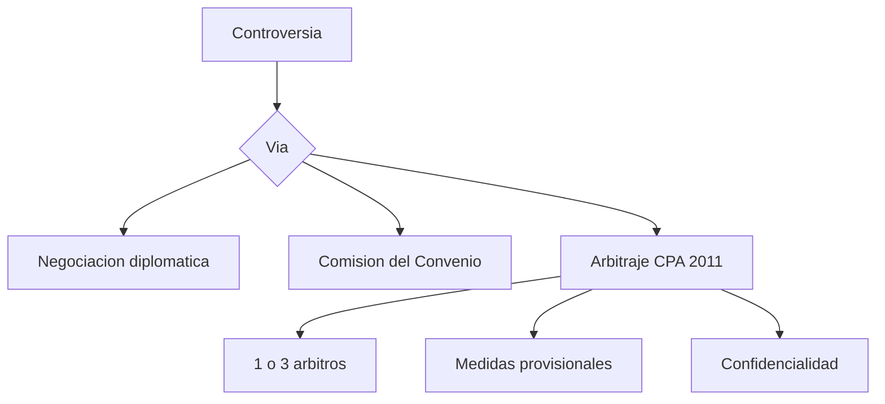

# B123-C04 — Arbitraje y resolución de controversias espaciales

<!-- nav:top -->
[🏠 Programa](../../../../README.md) · [📚 Bloque B123](../../../tronco-comun/B123-responsabilidad-danos-y-controversias-espaciales.md) · [← Anterior: B123-C03 — Mecanismos de reclamación entre Estados](../B123-C03-mecanismos-de-reclamacion-entre-estados/CLASE.md) · [Siguiente: B124-C01 — Cadena de valor de industria espacial →](../../../tronco-comun/B124-industria-economia-etica-y-proyectos-espaciales.md#b124-c01)
<!-- /nav -->

## 1. Ubicación, nivel y alcance

Clase 4 del bloque B123 y última del área A10. Nivel N3. Las controversias espaciales, entre Estados, empresas o ambos, pueden resolverse por la comisión del Convenio o por arbitraje. Aquí lees las reglas opcionales de la Corte Permanente de Arbitraje de 2011 (tribunal, medidas provisionales, confidencialidad, expertos) y comparas vías con duraciones y costos **sintéticos**. Se apoya en [B123-C03](../B123-C03-mecanismos-de-reclamacion-entre-estados/CLASE.md).

## 2. Por qué esta clase existe

Elegir la vía condiciona plazo, costo, confidencialidad y fuerza obligatoria de la decisión. La decisión central: **¿qué vía y qué reglas conviene pactar, y con qué compromisos?**

## 3. Lo que podrás hacer al terminar

1. Explicar el alcance y el consentimiento del arbitraje bajo las reglas de 2011.
2. Determinar el número de árbitros y el plazo para pactar uno solo (art. 7(1)).
3. Describir la autoridad nominadora, la renuncia a la inmunidad y la confidencialidad.
4. Distinguir las condiciones de una medida provisional (art. 26(3)).
5. Comparar duración, costo y obligatoriedad de tres vías con datos sintéticos.
6. Rotular lo consultado, lo sintético y lo no consultado.

La evidencia es el **cuadro comparativo de vías de resolución** del ejercicio 12 (sección 20).

## 4. Con qué llegas y cómo comprobarlo

1. ¿Qué es un arbitraje?
2. ¿Qué es una medida provisional?
3. ¿Qué es la inmunidad de jurisdicción?
4. ¿Qué es la mediana y el percentil 90?
5. ¿Qué es un dato sintético?

<details>
<summary>Ver respuestas</summary>

1. Un procedimiento en que un tribunal elegido por las partes decide la controversia. 2. Una orden urgente para preservar derechos mientras se resuelve el fondo. 3. La protección de un Estado frente a procesos ante tribunales ajenos. 4. El valor central y el valor bajo el cual queda el 90 % de los casos. 5. Un dato inventado para el ejemplo.
</details>

Con cuatro o cinco aciertos, sigue; si no, repasa los prerrequisitos.

## 5. Un caso de contexto y casos de referencia

Dos partes sintéticas pactan arbitraje bajo las reglas de 2011: si no acuerdan un solo árbitro en 30 días desde la notificación (`2027-02-01` → `2027-03-03`), son tres. Con duraciones sintéticas, la comisión del Convenio tiene mediana `18,0` meses, el arbitraje de tres árbitros `23,9` y el de un árbitro `14,0`. Es el **ejemplo conductor**; los números son **sintéticos** y no describen casos reales.

## 6. Vocabulario

Las **Reglas Opcionales** de la CPA (2011) se aplican cuando las partes acuerdan someter a ellas una controversia sobre una relación jurídica definida; no exige que la controversia sea «espacial» para tener competencia (art. 1). El **Secretario General de la CPA** actúa como autoridad nominadora (arts. 6 y 10(3)). Acordar el arbitraje implica renunciar a la inmunidad de jurisdicción, pero la renuncia a la inmunidad de ejecución debe expresarse explícitamente (art. 1(2)). Una **medida provisional** (art. 26) puede exigir daño irreparable probable y posibilidad razonable de éxito (art. 26(3)). La **confidencialidad** se tramita con petición razonada (art. 17) y las audiencias son a puerta cerrada salvo acuerdo (art. 28(3)). Hay **peritos** de parte y del tribunal (arts. 27 y 29).

## 7. Modelo mental: un menú de vías con distintas perillas



*Descripción textual:* una controversia puede seguir la negociación, la comisión del Convenio o el arbitraje; en el arbitraje se pactan el tribunal, las medidas provisionales y la confidencialidad.

Analogía: es un menú donde cada plato cambia precio, tiempo y reservas. Límite: las duraciones y costos son sintéticos y las reglas leídas están en un resumen.

## 8. La explicación, paso a paso

### 8.1 Alcance y consentimiento

Según el artículo 1 leído, las reglas aplican cuando las partes acuerdan someter una controversia a ellas, con las modificaciones que pacten. Sin esa cláusula o compromiso, no hay competencia.

### 8.2 Tribunal

Sin acuerdo sobre un solo árbitro en 30 días desde la notificación, son tres (art. 7(1)). Con tres, cada parte nombra uno y los dos eligen al presidente (art. 9). El Secretario General de la CPA es autoridad nominadora (arts. 6 y 10(3)). La notificación del `2027-02-01` da fin de plazo el `2027-03-03`.

### 8.3 Inmunidad, medidas y confidencialidad

La renuncia a la inmunidad de jurisdicción está implícita en el acuerdo; la de ejecución, no (art. 1(2)). Para ciertas medidas provisionales se exige daño irreparable probable y posibilidad razonable de éxito (art. 26(3)); en el laboratorio se usan umbrales `0,5` y `0,3`, que son **convención didáctica**, no del texto. La confidencialidad se solicita con razones y puede haber un asesor de confidencialidad (art. 17).

### 8.4 Comparar vías

Con 10 000 sorteos lognormales sintéticos: comisión mediana `18,0` meses y P90 `26,7`; arbitraje de tres árbitros `23,9` y `37,4`; arbitraje de un árbitro `14,0` y `22,0`. Los costos relativos sintéticos son `1,0; 2,4; 1,3`. Estas cifras ilustran un método de comparación y no una estadística real.

### 8.5 Fuerza obligatoria

La decisión de la comisión es obligatoria solo si las partes lo acuerdan (art. XIX del Convenio leído); en el arbitraje la fuerza obligatoria proviene del acuerdo de arbitraje, y la ejecución exige renuncia explícita a la inmunidad en el caso de Estados, según lo leído.

## 9. Magnitudes, símbolos y unidades

| Símbolo o término | Qué es | Unidad | Valor / nota |
|---|---|---|---|
| plazo de acuerdo | días para pactar un solo árbitro | días | 30 |
| árbitros | número del tribunal | — | 1 o 3 |
| duración | tiempo hasta la decisión | meses | medianas 18,0; 23,9; 14,0 (sintéticas) |
| costo relativo | cociente respecto a la comisión | — | 1,0; 2,4; 1,3 (sintético) |
| umbrales didácticos | P(irreparable) > 0,5 y P(éxito) > 0,3 | — | convención |

## 10. Convenciones y referencias

Reglas Opcionales de la CPA para controversias relacionadas con actividades espaciales (2011) leídas en la reproducción de italaw (2026-11-11) y artículos XIV–XX del Convenio de 1972 en resumen (McGill, 2026-11-11). Duraciones en meses; fechas ISO 8601. No aplica sistema astronómico.

## 11. De dónde sale lo que afirmamos

| ID | Fuente | Localizador | Respalda | Estado |
|---|---|---|---|---|
| S1 | McGill, Institute of Air and Space Law, «Convention on the International Liability for Damage Caused by Space Object» (abierto a la firma el 29 de marzo de 1972) — https://www.mcgill.ca/iasl/research/space-law/liability-convention (consultada 2026-11-11) | resumen artículo por artículo con citas breves | arts. I, II, III, IV, VI–XII, XIV–XX | Consultada (lectura parcial) |
| S4 | Corte Permanente de Arbitraje, Reglas Opcionales para el Arbitraje de Controversias Relacionadas con Actividades Espaciales (2011), reproducción de italaw — https://www.italaw.com/treaty-texts/read/pca-optional-rules-for-arbitration-of-disputes-relating-to-outer-space-activities-2011_en.html (consultada 2026-11-11) | resumen con números de artículo | arts. 1, 6–10, 17, 26, 27, 28, 29, 35 | Consultada (lectura parcial) |
| — | Texto completo del Convenio en UNOOSA y en la UN Treaty Series, vol. 961, I-13810 | — | no se pudo leer: la página dio error 404 y el PDF es un escaneo sin texto | No consultada |
| — | Artículos de la CDI sobre responsabilidad del Estado (2001) | — | el PDF no fue legible para la herramienta | No consultada |
| — | Lo simulado en el laboratorio (cuantías, fechas, probabilidades, duraciones) | — | solo ilustra el razonamiento | Sintético, no observado |

Límites: las reproducciones y resúmenes leídos no sustituyen la edición oficial vigente; en un caso real hay que cotejar versión y fecha del texto. Los umbrales de medidas provisionales, duraciones y costos son inventados; no se consultó ninguna sentencia o laudo ni la existencia de casos bajo estas reglas.

## 12. Cómo ver la comparación de vías

| Magnitud | Valor |
|---|---|
| Árbitros sin acuerdo | 3 |
| Fin del plazo de 30 días | 2027-03-03 |
| Comisión: mediana / P90 | 18,0 / 26,7 meses |
| Arbitraje 3: mediana / P90 | 23,9 / 37,4 meses |
| Arbitraje 1: mediana / P90 | 14,0 / 22,0 meses |

Descripción larga: con datos sintéticos, un solo árbitro es más rápido y barato que tres, y la comisión queda en el medio en duración y más barata en costo relativo.

## 13. Ejemplo trabajado: el plazo para pactar un árbitro

**Paso 1 · Notificación.** `2027-02-01`.

**Paso 2 · Plazo.** `+30` días = `2027-03-03`.

**Paso 3 · Regla.** Sin acuerdo, tres árbitros (art. 7(1)).

**Paso 4 · Rotula.** Fechas sintéticas; la regla es la leída.

## 14. Distintas formas de describir el problema

**Por vía:** negociación, comisión, arbitraje. **Por tribunal:** uno o tres. **Por tiempo:** mediana y P90. **Por costo:** relativo. **Por reserva:** confidencialidad.

## 15. Práctica guiada

**Ejercicio 1 · con los pasos indicados.** Calcula el fin del plazo de 30 días para una notificación el `2027-05-15`. *Pasos:* suma 30 días.

<details><summary>Solución comentada</summary>

`2027-06-14`.
</details>

**Ejercicio 2 · con una pista.** ¿Cuántos árbitros hay si no se acuerda uno solo en el plazo? *Pista:* art. 7(1).

<details><summary>Solución comentada</summary>

Tres.
</details>

**Ejercicio 3 · casi autónomo.** ¿Quién actúa como autoridad nominadora?

<details><summary>Solución comentada</summary>

El Secretario General de la CPA (arts. 6 y 10(3) leídos).
</details>

## 16. Práctica autónoma, transferencia e integrador

**Ejercicio 4 · autónomo.** ¿Basta aceptar el arbitraje para que se pueda ejecutar el laudo contra un Estado?

<details><summary>Solución comentada</summary>

No: la renuncia a la inmunidad de ejecución debe expresarse explícitamente (art. 1(2) leído).
</details>

**Ejercicio 5 · autónomo.** Con `P(irreparable)=0,6` y `P(éxito)=0,4`, ¿procede la medida con los umbrales didácticos?

<details><summary>Solución comentada</summary>

Sí (`0,6 > 0,5` y `0,4 > 0,3`), pero es convención didáctica, no el texto.
</details>

**Ejercicio 6 · autónomo.** Con `P(irreparable)=0,7` y `P(éxito)=0,2`, ¿procede?

<details><summary>Solución comentada</summary>

No: el éxito `0,2` no supera `0,3`.
</details>

**Ejercicio 7 · autónomo.** ¿Cuántos meses más tarda la mediana del arbitraje de tres respecto a la comisión?

<details><summary>Solución comentada</summary>

`23,9 − 18,0 = 5,9` meses (datos sintéticos).
</details>

**Ejercicio 8 · autónomo.** Si el costo del arbitraje de tres es `2,4` y el de uno `1,3`, ¿cuál es el cociente?

<details><summary>Solución comentada</summary>

`2,4/1,3 = 1,85`.
</details>

**Ejercicio 9 · transferencia.** **Transferencia.** Dos empresas pactan las reglas de 2011 en un contrato. ¿Hace falta que la disputa sea «espacial» para que apliquen?

<details><summary>Solución comentada</summary>

No: el artículo 1 leído no lo exige; basta el acuerdo sobre una relación jurídica definida.
</details>

**Ejercicio 10 · transferencia.** **Transferencia.** Una parte quiere reservar información técnica. ¿Qué instrumentos leídos hay?

<details><summary>Solución comentada</summary>

Petición razonada de confidencialidad, condiciones de acceso, compromisos firmados, asesor de confidencialidad y audiencias a puerta cerrada (arts. 17 y 28(3)).
</details>

**Ejercicio 11 · transferencia.** **Transferencia.** ¿Por qué no debes concluir que el arbitraje es mejor porque el de un árbitro salió más rápido en el laboratorio?

<details><summary>Solución comentada</summary>

Porque las duraciones son sintéticas y la elección depende de la complejidad, la confidencialidad, la ejecución y la voluntad de las partes.
</details>

**Ejercicio 12 · integrador.** **Integrador.** Elabora tu *cuadro comparativo de vías de resolución*: negociación, comisión y arbitraje con plazos, tribunal, fuerza obligatoria, reservas y lista de lo consultado, lo sintético y lo no consultado.

<details><summary>Solución comentada</summary>

Secciones 8.1–8.5 y la salida del laboratorio.
</details>

## 17. Laboratorio: árbitros, medidas y comparación de vías

El script [vias.py](vias.py) determina el número de árbitros y el fin del plazo, aplica umbrales didácticos a medidas provisionales y simula duraciones de tres vías (**comprueba** que un árbitro es más rápido que tres y que sin acuerdo son tres).

**Datos:** todos **sintéticos**; lo normativo es solo la regla leída (ver sección 11). **Predice antes de ejecutar:** ¿qué vía tendrá la menor mediana de duración? (el arbitraje de un árbitro.) **Ejecución del 2026-11-11 (Python 3.12.9):**

```text
Python 3.12.9 (biblioteca estandar)
Datos SINTETICOS; duraciones en meses; semilla 123
Arbitros (art. 7(1)): sin acuerdo -> 3 ; con acuerdo en 30 dias -> 1
Notificacion 2027-02-01 -> fin del plazo de 30 dias: 2027-03-03
Medida provisional con P(irreparable)=0.7, P(exito)=0.5: procede (convencion)
Medida provisional con P(irreparable)=0.7, P(exito)=0.2: no procede (convencion)
Medida provisional con P(irreparable)=0.3, P(exito)=0.9: no procede (convencion)
  Comision de reclamaciones    mediana= 18.0 P90= 26.7 meses  costo relativo=1.0
  Arbitraje CPA (3 arbitros)   mediana= 23.9 P90= 37.4 meses  costo relativo=2.4
  Arbitraje CPA (1 arbitro)    mediana= 14.0 P90= 22.0 meses  costo relativo=1.3
Pruebas superadas.
```

```bash
python programa/clases/B123/B123-C04-arbitraje-y-resolucion-de-controversias-espaciales/vias.py
```

**Límites:** duraciones, costos y umbrales son inventados; no hay datos de casos reales; las reglas se leyeron en una reproducción.

## 18. Errores frecuentes y cómo corregirlos

**Creer que el arbitraje requiere que la disputa sea espacial.** Se corrige con 8.1.

**Confundir renuncia a la jurisdicción con renuncia a la ejecución.** Se corrige con 8.3.

**Tomar los umbrales didácticos como texto.** Se corrige con 8.3.

**Tomar las duraciones sintéticas como estadística.** Se corrige con 8.4.

## 19. Cómo sabrás que vas bien

Tras 8.2: ¿cuántos árbitros esperabas y cuántos obtuviste? Si dudas, repasa el ejemplo 13. Tras el laboratorio: ¿qué comprueba? (ver la sección 17).

## 20. Qué entregas y cómo se evalúa

El producto es tu **cuadro comparativo de vías de resolución** (ejercicio 12).

| Criterio | Inicial | En desarrollo | Logrado | Destacado |
|---|---|---|---|---|
| Conceptos | Los confunde | Parciales | Explica las reglas con su texto | Explica sus límites |
| Cálculo | Sin unidades | Con errores | Resultados con unidades y fechas | Prueba casos nuevos |
| Numérico | Sin comprobar | Un caso | Contrasta con una comprobación | Interpreta la incertidumbre |
| Fuentes | Sin fuente | Sin fecha | Fuentes con versión, fecha y estado | Declara lo no consultado |
| Límites | No los nombra | Uno | Tres | Discute qué falta del modelo |

**Condiciones críticas (no se compensan con promedio):** rotular lo sintético como sintético; no presentar el ejemplo como un caso real ni imputar responsabilidad a nadie; citar versión y fecha del texto consultado; no dar asesoría legal.

## 21. Ética, seguridad y límites

Clase educativa: **no es asesoría legal, regulatoria ni financiera**. Los textos se leyeron en reproducciones y resúmenes; para un caso real debes recurrir a un profesional y al texto oficial vigente, y citar su versión y fecha. Los datos son sintéticos y no se imputa responsabilidad a ninguna persona u organización. No se afirma que exista ningún caso bajo estas reglas ni se evalúa a ninguna institución. Accesibilidad: tablas equivalentes a los diagramas, fórmulas en texto, ejercicios sin conexión.

## 22. Para cerrar y seguir

Sin acuerdo, un arbitraje bajo las reglas de 2011 tiene tres árbitros; con duraciones sintéticas, la vía de un árbitro es la más rápida. Con esto cierras el bloque B123: probar el daño, atribuirlo, reclamar y resolver la controversia.

**Glosario español–inglés.** arbitraje · *arbitration*; autoridad nominadora · *appointing authority*; medida provisional · *interim measure*; inmunidad · *immunity*; laudo · *award*.

**Continuidad.** Este es el último bloque del área A10; el siguiente bloque del programa es [B124](../../../tronco-comun/B124-industria-economia-etica-y-proyectos-espaciales.md).

**Referencias:** ver sección 11.

<!-- nav:bottom -->
---

[← Anterior: B123-C03 — Mecanismos de reclamación entre Estados](../B123-C03-mecanismos-de-reclamacion-entre-estados/CLASE.md) · [📚 Bloque B123](../../../tronco-comun/B123-responsabilidad-danos-y-controversias-espaciales.md) · [Siguiente: B124-C01 — Cadena de valor de industria espacial →](../../../tronco-comun/B124-industria-economia-etica-y-proyectos-espaciales.md#b124-c01)
<!-- /nav -->
